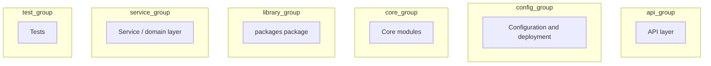

# Architecture report: lingui/js-lingui

> Automated static analysis. **Observed** = directly seen in files/imports/AST; **Inferred** = interpretation from that evidence. Repository code was not executed.

## 1. Repository at a glance

| Item | Value |
| --- | --- |
| Repository | lingui/js-lingui |
| Description | 🌍 📖 A readable, automated, and optimized (2 kb) internationalization for JavaScript |
| Language | TypeScript |
| Stars | 5937 |
| Licence | MIT |
| Analysed commit / branch | bbaae0e8d3ea427f52970ab7d3891aecdac6aaad / main |
| Framework(s) | Next.js, React, Vue |
| Files analysed | 791 |
| Components | 6 |

## 2. Architecture in one minute

lingui/js-lingui - 🌍 📖 A readable, automated, and optimized (2 kb) internationalization for JavaScript. This repository was analysed statically from 791 file(s) (0 Python). Detected technologies (observed from imports/manifests): GitHub Actions, Next.js, React, Vue, Tailwind CSS, TypeScript. Files are grouped into 6 component(s): API layer, Configuration and deployment, Core modules, packages package, Service / domain layer, Tests. Findings below distinguish observed facts from inferred interpretation.

## 3. High-level block diagram

## 4. Main components

### API layer (`api_layer`)

- **Kind:** api
- **Status:** Observed
- **Confidence:** 0.85
- **Responsibility:** Groups 75 file(s) under api layer (observed from repository paths and static analysis).
- **Paths:** `packages/cli/src/api/ProgramExit.ts`, `packages/cli/src/api/catalog.test.ts`, `packages/cli/src/api/catalog.ts`, `packages/cli/src/api/catalog/extractFromFiles.test.ts`, `packages/cli/src/api/catalog/extractFromFiles.ts`, `packages/cli/src/api/catalog/getCatalogDependentFiles.test.ts`, `packages/cli/src/api/catalog/getCatalogDependentFiles.ts`, `packages/cli/src/api/catalog/getCatalogs.test.ts`, `packages/cli/src/api/catalog/getCatalogs.ts`, `packages/cli/src/api/catalog/getFallbackListForLocale.test.ts`, `packages/cli/src/api/catalog/getFallbackListForLocale.ts`, `packages/cli/src/api/catalog/getTranslationsForCatalog.test.ts`, `packages/cli/src/api/catalog/getTranslationsForCatalog.ts`, `packages/cli/src/api/catalog/mergeCatalog.test.ts`, `packages/cli/src/api/catalog/mergeCatalog.ts`, `packages/cli/src/api/catalog/translations.ts`, `packages/cli/src/api/check/index.ts`, `packages/cli/src/api/check/missing.ts`, `packages/cli/src/api/check/sync.ts`, `packages/cli/src/api/check/types.ts`, `packages/cli/src/api/compile.test.ts`, `packages/cli/src/api/compile.ts`, `packages/cli/src/api/compile/compileLocale.ts`, `packages/cli/src/api/createWatchDispatcher.test.ts`, `packages/cli/src/api/createWatchDispatcher.ts`, `packages/cli/src/api/extractors/babel.ts`, `packages/cli/src/api/extractors/index.ts`, `packages/cli/src/api/fixtures/collect-inline-sourcemaps-charset/componentB.jsx`, `packages/cli/src/api/fixtures/collect-inline-sourcemaps-multiple/componentB.jsx`, `packages/cli/src/api/fixtures/collect-inline-sourcemaps/componentB.jsx`, `packages/cli/src/api/fixtures/collect-invalid/invalid.js`, `packages/cli/src/api/fixtures/collect-invalid/valid.js`, `packages/cli/src/api/fixtures/collect-placeholders-sorting/a.ts`, `packages/cli/src/api/fixtures/collect-placeholders-sorting/b.ts`, `packages/cli/src/api/fixtures/collect-syntax-flow/flow-syntax.js`, `packages/cli/src/api/fixtures/collect-syntax-flow/ts-syntax.ts`, `packages/cli/src/api/fixtures/collect-typescript-jsx/jsx-in-js.js`, `packages/cli/src/api/fixtures/collect-typescript-jsx/jsx-syntax.jsx`, `packages/cli/src/api/fixtures/collect-typescript-jsx/macro.tsx`, `packages/cli/src/api/fixtures/collect-typescript-jsx/tsx-experimental-decorators.tsx`, `packages/cli/src/api/fixtures/collect-typescript-jsx/tsx-syntax.tsx`, `packages/cli/src/api/fixtures/collect/$componentE/index.js`, `packages/cli/src/api/fixtures/collect/(componentC)/index.js`, `packages/cli/src/api/fixtures/collect/[componentD]/index.js`, `packages/cli/src/api/fixtures/collect/componentA/componentA.js`, `packages/cli/src/api/fixtures/collect/componentA/index.js`, `packages/cli/src/api/fixtures/collect/componentB.js`, `packages/cli/src/api/fixtures/duplicate-id.js`, `packages/cli/src/api/formats/formatterWrapper.test.ts`, `packages/cli/src/api/formats/formatterWrapper.ts`, `packages/cli/src/api/formats/index.ts`, `packages/cli/src/api/getPathsForCompileWatcher.test.ts`, `packages/cli/src/api/getPathsForCompileWatcher.ts`, `packages/cli/src/api/getPathsForExtractWatcher.test.ts`, `packages/cli/src/api/getPathsForExtractWatcher.ts`, `packages/cli/src/api/help.ts`, `packages/cli/src/api/index.ts`, `packages/cli/src/api/logger.ts`, `packages/cli/src/api/messages.test.ts`, `packages/cli/src/api/messages.ts`, `packages/cli/src/api/pseudoLocalize.test.ts`, `packages/cli/src/api/pseudoLocalize.ts`, `packages/cli/src/api/resolveWorkersOptions.test.ts`, `packages/cli/src/api/resolveWorkersOptions.ts`, `packages/cli/src/api/rethrownError.ts`, `packages/cli/src/api/runBounded.ts`, `packages/cli/src/api/stats.test.ts`, `packages/cli/src/api/stats.ts`, `packages/cli/src/api/typedPool.test.ts`, `packages/cli/src/api/typedPool.ts`, `packages/cli/src/api/types.ts`, `packages/cli/src/api/utils.test.ts`, `packages/cli/src/api/utils.ts`, `packages/cli/src/api/workerLogger.ts`, `packages/cli/src/api/workerPools.ts`
- **Evidence:** [packages/cli/src/api/ProgramExit.ts](https://github.com/lingui/js-lingui/blob/bbaae0e8d3ea427f52970ab7d3891aecdac6aaad/packages/cli/src/api/ProgramExit.ts); [packages/cli/src/api/catalog.test.ts](https://github.com/lingui/js-lingui/blob/bbaae0e8d3ea427f52970ab7d3891aecdac6aaad/packages/cli/src/api/catalog.test.ts); [packages/cli/src/api/catalog.ts](https://github.com/lingui/js-lingui/blob/bbaae0e8d3ea427f52970ab7d3891aecdac6aaad/packages/cli/src/api/catalog.ts); [packages/cli/src/api/catalog/extractFromFiles.test.ts](https://github.com/lingui/js-lingui/blob/bbaae0e8d3ea427f52970ab7d3891aecdac6aaad/packages/cli/src/api/catalog/extractFromFiles.test.ts); [packages/cli/src/api/catalog/extractFromFiles.ts](https://github.com/lingui/js-lingui/blob/bbaae0e8d3ea427f52970ab7d3891aecdac6aaad/packages/cli/src/api/catalog/extractFromFiles.ts); [packages/cli/src/api/catalog/getCatalogDependentFiles.test.ts](https://github.com/lingui/js-lingui/blob/bbaae0e8d3ea427f52970ab7d3891aecdac6aaad/packages/cli/src/api/catalog/getCatalogDependentFiles.test.ts); [packages/cli/src/api/catalog/getCatalogDependentFiles.ts](https://github.com/lingui/js-lingui/blob/bbaae0e8d3ea427f52970ab7d3891aecdac6aaad/packages/cli/src/api/catalog/getCatalogDependentFiles.ts); [packages/cli/src/api/catalog/getCatalogs.test.ts](https://github.com/lingui/js-lingui/blob/bbaae0e8d3ea427f52970ab7d3891aecdac6aaad/packages/cli/src/api/catalog/getCatalogs.test.ts)

### Configuration and deployment (`config`)

- **Kind:** config
- **Status:** Observed
- **Confidence:** 0.85
- **Responsibility:** Groups 59 file(s) under configuration and deployment (observed from repository paths and static analysis).
- **Paths:** `context7.json`, `lerna.json`, `package.json`, `packages/babel-plugin-extract-messages/package.json`, `packages/babel-plugin-extract-messages/tsconfig.json`, `packages/babel-plugin-lingui-macro/package.json`, `packages/babel-plugin-lingui-macro/tsconfig.json`, `packages/cli/package.json`, `packages/cli/tsconfig.build.json`, `packages/cli/tsconfig.json`, `packages/conf/__typetests__/index.tst.ts`, `packages/conf/__typetests__/tsconfig.json`, `packages/conf/package.json`, `packages/conf/src/defineConfig.ts`, `packages/conf/src/fixtures/valid/custom.config.js`, `packages/conf/src/fixtures/valid/custom.config.ts`, `packages/conf/src/fixtures/valid/lingui.config.cjs`, `packages/conf/src/fixtures/valid/lingui.config.js`, `packages/conf/src/fixtures/valid/lingui.config.mjs`, `packages/conf/src/fixtures/valid/lingui.config.ts`, `packages/conf/src/fixtures/valid/package.json`, `packages/conf/src/getConfig.test.ts`, `packages/conf/src/getConfig.ts`, `packages/conf/src/index.test.ts`, `packages/conf/src/index.ts`, `packages/conf/src/makeConfig.ts`, `packages/conf/src/migrations/normalizeRuntimeConfigModule.test.ts`, `packages/conf/src/migrations/normalizeRuntimeConfigModule.ts`, `packages/conf/src/migrations/setCldrParentLocales.ts`, `packages/conf/src/types.ts`, `packages/conf/src/utils/pathJoinPosix.ts`, `packages/conf/src/utils/replaceRootDir.test.ts`, `packages/conf/src/utils/replaceRootDir.ts`, `packages/conf/tsconfig.json`, `packages/conf/vitest.config.ts`, `packages/core/__typetests__/tsconfig.json`, `packages/core/__typetests__/typed-ids/tsconfig.json`, `packages/core/macro/__typetests__/tsconfig.json`, `packages/core/package.json`, `packages/core/tsconfig.json`, `packages/detect-locale/package.json`, `packages/detect-locale/tsconfig.json`, `packages/extractor-vue/package.json`, `packages/extractor-vue/tsconfig.json`, `packages/format-csv/__typetests__/tsconfig.json`, `packages/format-csv/package.json`, `packages/format-csv/tsconfig.json`, `packages/format-json/__typetests__/tsconfig.json`, `packages/format-json/package.json`, `packages/format-json/src/fixtures/messages.json`, `packages/format-json/tsconfig.json`, `packages/format-po-gettext/__typetests__/tsconfig.json`, `packages/format-po-gettext/gettext-plurals.json`, `packages/format-po-gettext/package.json`, `packages/format-po-gettext/tsconfig.json`, `packages/format-po/__typetests__/tsconfig.json`, `packages/format-po/package.json`, `packages/format-po/tsconfig.json`, `packages/loader/package.json`
- **Evidence:** [context7.json](https://github.com/lingui/js-lingui/blob/bbaae0e8d3ea427f52970ab7d3891aecdac6aaad/context7.json); [lerna.json](https://github.com/lingui/js-lingui/blob/bbaae0e8d3ea427f52970ab7d3891aecdac6aaad/lerna.json); [package.json](https://github.com/lingui/js-lingui/blob/bbaae0e8d3ea427f52970ab7d3891aecdac6aaad/package.json); [packages/babel-plugin-extract-messages/package.json](https://github.com/lingui/js-lingui/blob/bbaae0e8d3ea427f52970ab7d3891aecdac6aaad/packages/babel-plugin-extract-messages/package.json); [packages/babel-plugin-extract-messages/tsconfig.json](https://github.com/lingui/js-lingui/blob/bbaae0e8d3ea427f52970ab7d3891aecdac6aaad/packages/babel-plugin-extract-messages/tsconfig.json); [packages/babel-plugin-lingui-macro/package.json](https://github.com/lingui/js-lingui/blob/bbaae0e8d3ea427f52970ab7d3891aecdac6aaad/packages/babel-plugin-lingui-macro/package.json); [packages/babel-plugin-lingui-macro/tsconfig.json](https://github.com/lingui/js-lingui/blob/bbaae0e8d3ea427f52970ab7d3891aecdac6aaad/packages/babel-plugin-lingui-macro/tsconfig.json); [packages/cli/package.json](https://github.com/lingui/js-lingui/blob/bbaae0e8d3ea427f52970ab7d3891aecdac6aaad/packages/cli/package.json)

### Core modules (`core`)

- **Kind:** core
- **Status:** Observed
- **Confidence:** 0.85
- **Responsibility:** Groups 1 file(s) under core modules (observed from repository paths and static analysis).
- **Paths:** `eslint.config.js`
- **Evidence:** [eslint.config.js](https://github.com/lingui/js-lingui/blob/bbaae0e8d3ea427f52970ab7d3891aecdac6aaad/eslint.config.js)

### packages package (`packages`)

- **Kind:** library
- **Status:** Observed
- **Confidence:** 0.85
- **Responsibility:** Groups 122 file(s) under packages package (observed from repository paths and static analysis).
- **Paths:** `packages/babel-plugin-extract-messages/build.config.ts`, `packages/babel-plugin-extract-messages/src/index.ts`, `packages/babel-plugin-extract-messages/vitest.config.ts`, `packages/babel-plugin-lingui-macro/.vitest/serializer.ts`, `packages/babel-plugin-lingui-macro/src/ast.ts`, `packages/babel-plugin-lingui-macro/src/constants.ts`, `packages/babel-plugin-lingui-macro/src/icu.test.ts`, `packages/babel-plugin-lingui-macro/src/icu.ts`, `packages/babel-plugin-lingui-macro/src/index.ts`, `packages/babel-plugin-lingui-macro/src/linguiDirective.ts`, `packages/babel-plugin-lingui-macro/src/macro.ts`, `packages/babel-plugin-lingui-macro/src/macroJs.ts`, `packages/babel-plugin-lingui-macro/src/macroJsAst.test.ts`, `packages/babel-plugin-lingui-macro/src/macroJsAst.ts`, `packages/babel-plugin-lingui-macro/src/macroJsx.test.ts`, `packages/babel-plugin-lingui-macro/src/macroJsx.ts`, `packages/babel-plugin-lingui-macro/src/messageDescriptorUtils.test.ts`, `packages/babel-plugin-lingui-macro/src/messageDescriptorUtils.ts`, `packages/babel-plugin-lingui-macro/src/types.ts`, `packages/babel-plugin-lingui-macro/src/utils.ts`, `packages/babel-plugin-lingui-macro/src/utils/cleanJSXElementLiteralChild.ts`, `packages/babel-plugin-lingui-macro/vitest.config.ts`, `packages/cli/.vitest/serializer.ts`, `packages/cli/.vitest/setup.ts`, `packages/cli/api.ts`, `packages/cli/src/extract-experimental/buildChunkGraph.test.ts`, `packages/cli/src/extract-experimental/buildChunkGraph.ts`, `packages/cli/src/extract-experimental/buildContentFilter.ts`, `packages/cli/src/extract-experimental/buildIncludeDepsFilter.test.ts`, `packages/cli/src/extract-experimental/buildIncludeDepsFilter.ts`, `packages/cli/src/extract-experimental/bundlers/esbuild.ts`, `packages/cli/src/extract-experimental/bundlers/macroTransformOptions.ts`, `packages/cli/src/extract-experimental/bundlers/rolldown.ts`, `packages/cli/src/extract-experimental/constants.ts`, `packages/cli/src/extract-experimental/extractFromChunk.ts`, `packages/cli/src/extract-experimental/getExperimentalCatalogs.ts`, `packages/cli/src/extract-experimental/resolveCatalogPath.ts`, `packages/cli/src/extract-experimental/resolveTemplatePath.test.ts`, `packages/cli/src/extract-experimental/resolveTemplatePath.ts`, `packages/cli/src/extract-experimental/workers/extractWorker.ts`, `packages/cli/src/extract-experimental/workers/extractWorkerWrapper.jiti.js`, `packages/cli/src/extract-experimental/workers/extractWorkerWrapper.prod.ts`, `packages/cli/src/extract-experimental/writeCatalogs.ts`, `packages/cli/src/index.ts`, `packages/cli/src/lingui-check.ts`, `packages/cli/src/lingui-compile.ts`, `packages/cli/src/lingui-extract-experimental.ts`, `packages/cli/src/lingui-extract-template.ts`, `packages/cli/src/lingui-extract.ts`, `packages/cli/src/lingui.ts`, `packages/cli/src/tests.ts`, `packages/cli/src/workers/compileWorker.ts`, `packages/cli/src/workers/compileWorkerWrapper.jiti.js`, `packages/cli/src/workers/compileWorkerWrapper.prod.ts`, `packages/cli/src/workers/extractWorker.ts`, `packages/cli/src/workers/extractWorkerWrapper.jiti.js`, `packages/cli/src/workers/extractWorkerWrapper.prod.ts`, `packages/cli/src/workers/missingWorker.ts`, `packages/cli/src/workers/missingWorkerWrapper.jiti.js`, `packages/cli/src/workers/missingWorkerWrapper.prod.ts`, `packages/cli/vitest.config.ts`, `packages/detect-locale/src/detectors/fromCookie.test.ts`, `packages/detect-locale/src/detectors/fromCookie.ts`, `packages/detect-locale/src/detectors/fromHtmlTag.test.ts`, `packages/detect-locale/src/detectors/fromHtmlTag.ts`, `packages/detect-locale/src/detectors/fromNavigator.test.ts`, `packages/detect-locale/src/detectors/fromNavigator.ts`, `packages/detect-locale/src/detectors/fromPath.test.ts`, `packages/detect-locale/src/detectors/fromPath.ts`, `packages/detect-locale/src/detectors/fromStorage.test.ts`, `packages/detect-locale/src/detectors/fromStorage.ts`, `packages/detect-locale/src/detectors/fromSubdomain.test.ts`, `packages/detect-locale/src/detectors/fromSubdomain.ts`, `packages/detect-locale/src/detectors/fromUrl.test.ts`, `packages/detect-locale/src/detectors/fromUrl.ts`, `packages/detect-locale/src/index.test.ts`, `packages/detect-locale/src/index.ts`, `packages/detect-locale/src/utils/cookie-getter.test.ts`, `packages/detect-locale/src/utils/cookie-getter.ts`, `packages/detect-locale/src/utils/query-string.test.ts`, `packages/detect-locale/src/utils/query-string.ts`, `packages/detect-locale/vitest.config.ts`, `packages/extractor-vue/src/compile-script-setup.ts`, `packages/extractor-vue/src/extractor.test.ts`, `packages/extractor-vue/src/fixtures/functional.vue`, `packages/extractor-vue/src/fixtures/js-script-setup.vue`, `packages/extractor-vue/src/fixtures/props-destructuring-vue-runtime.vue`, `packages/extractor-vue/src/fixtures/props-destructuring.vue`, `packages/extractor-vue/src/fixtures/script-setup-after-template.vue`, `packages/extractor-vue/src/fixtures/test.vue`, `packages/extractor-vue/src/fixtures/trans.vue`, `packages/extractor-vue/src/index.ts`, `packages/extractor-vue/src/optional-lingui-vue.test.ts`, `packages/extractor-vue/src/vue-extractor.ts`, `packages/extractor-vue/vitest.config.ts`, `packages/format-csv/__typetests__/index.tst.ts`, `packages/format-csv/src/csv.test.ts`, `packages/format-csv/src/csv.ts`, `packages/format-csv/vitest.config.ts`, `packages/format-json/__typetests__/index.tst.ts`, `packages/format-json/src/json.test.ts`, `packages/format-json/src/json.ts`, `packages/format-json/vitest.config.ts`, `packages/format-po-gettext/__typetests__/index.tst.ts`, `packages/format-po-gettext/src/po-gettext.test.ts`, `packages/format-po-gettext/src/po-gettext.ts`, `packages/format-po-gettext/src/utils/checkCldr.test.ts`, `packages/format-po-gettext/src/utils/mapGettextPlurals2Icu.test.ts`, `packages/format-po-gettext/src/utils/mapGettextPlurals2Icu.ts`, `packages/format-po-gettext/src/utils/parseExamples.test.ts`, `packages/format-po-gettext/src/utils/parseExamples.ts`, `packages/format-po-gettext/src/utils/parsePluralFormsHeader.test.ts`, `packages/format-po-gettext/src/utils/parsePluralFormsHeader.ts`, `packages/format-po-gettext/vitest.config.ts`, `packages/format-po/__typetests__/index.tst.ts`, `packages/format-po/src/po.test.ts`, `packages/format-po/src/po.ts`, `packages/format-po/src/utils.test.ts`, `packages/format-po/src/utils.ts`, `packages/format-po/vitest.config.ts`, `packages/loader/src/index.ts`, `packages/loader/src/webpackLoader.ts`
- **Evidence:** [packages/babel-plugin-extract-messages/build.config.ts](https://github.com/lingui/js-lingui/blob/bbaae0e8d3ea427f52970ab7d3891aecdac6aaad/packages/babel-plugin-extract-messages/build.config.ts); [packages/babel-plugin-extract-messages/src/index.ts](https://github.com/lingui/js-lingui/blob/bbaae0e8d3ea427f52970ab7d3891aecdac6aaad/packages/babel-plugin-extract-messages/src/index.ts); [packages/babel-plugin-extract-messages/vitest.config.ts](https://github.com/lingui/js-lingui/blob/bbaae0e8d3ea427f52970ab7d3891aecdac6aaad/packages/babel-plugin-extract-messages/vitest.config.ts); [packages/babel-plugin-lingui-macro/.vitest/serializer.ts](https://github.com/lingui/js-lingui/blob/bbaae0e8d3ea427f52970ab7d3891aecdac6aaad/packages/babel-plugin-lingui-macro/.vitest/serializer.ts); [packages/babel-plugin-lingui-macro/src/ast.ts](https://github.com/lingui/js-lingui/blob/bbaae0e8d3ea427f52970ab7d3891aecdac6aaad/packages/babel-plugin-lingui-macro/src/ast.ts); [packages/babel-plugin-lingui-macro/src/constants.ts](https://github.com/lingui/js-lingui/blob/bbaae0e8d3ea427f52970ab7d3891aecdac6aaad/packages/babel-plugin-lingui-macro/src/constants.ts); [packages/babel-plugin-lingui-macro/src/icu.test.ts](https://github.com/lingui/js-lingui/blob/bbaae0e8d3ea427f52970ab7d3891aecdac6aaad/packages/babel-plugin-lingui-macro/src/icu.test.ts); [packages/babel-plugin-lingui-macro/src/icu.ts](https://github.com/lingui/js-lingui/blob/bbaae0e8d3ea427f52970ab7d3891aecdac6aaad/packages/babel-plugin-lingui-macro/src/icu.ts)

### Service / domain layer (`service_layer`)

- **Kind:** service
- **Status:** Observed
- **Confidence:** 0.85
- **Responsibility:** Groups 29 file(s) under service / domain layer (observed from repository paths and static analysis).
- **Paths:** `packages/cli/src/services/translationIO.test.ts`, `packages/cli/src/services/translationIO.ts`, `packages/cli/src/services/translationIO/segment-converters.test.ts`, `packages/cli/src/services/translationIO/segment-converters.ts`, `packages/cli/src/services/translationIO/translationio-api.ts`, `packages/core/__typetests__/eventEmitter.tst.ts`, `packages/core/__typetests__/index.tst.ts`, `packages/core/__typetests__/typed-ids/index.tst.ts`, `packages/core/__typetests__/typed-ids/lingui.d.ts`, `packages/core/macro/__typetests__/index.tst.ts`, `packages/core/macro/browser.mjs`, `packages/core/macro/index.mjs`, `packages/core/macro/index.test.ts`, `packages/core/src/escapeSequences.test.ts`, `packages/core/src/escapeSequences.ts`, `packages/core/src/essentials.test.ts`, `packages/core/src/essentials.ts`, `packages/core/src/eventEmitter.test.ts`, `packages/core/src/eventEmitter.ts`, `packages/core/src/formats.test.ts`, `packages/core/src/formats.ts`, `packages/core/src/i18n.test.ts`, `packages/core/src/i18n.ts`, `packages/core/src/index.ts`, `packages/core/src/interpolate.test.ts`, `packages/core/src/interpolate.ts`, `packages/core/src/runtime-macro.test.ts`, `packages/core/src/runtime-macro.ts`, `packages/core/vitest.config.ts`
- **Evidence:** [packages/cli/src/services/translationIO.test.ts](https://github.com/lingui/js-lingui/blob/bbaae0e8d3ea427f52970ab7d3891aecdac6aaad/packages/cli/src/services/translationIO.test.ts); [packages/cli/src/services/translationIO.ts](https://github.com/lingui/js-lingui/blob/bbaae0e8d3ea427f52970ab7d3891aecdac6aaad/packages/cli/src/services/translationIO.ts); [packages/cli/src/services/translationIO/segment-converters.test.ts](https://github.com/lingui/js-lingui/blob/bbaae0e8d3ea427f52970ab7d3891aecdac6aaad/packages/cli/src/services/translationIO/segment-converters.test.ts); [packages/cli/src/services/translationIO/segment-converters.ts](https://github.com/lingui/js-lingui/blob/bbaae0e8d3ea427f52970ab7d3891aecdac6aaad/packages/cli/src/services/translationIO/segment-converters.ts); [packages/cli/src/services/translationIO/translationio-api.ts](https://github.com/lingui/js-lingui/blob/bbaae0e8d3ea427f52970ab7d3891aecdac6aaad/packages/cli/src/services/translationIO/translationio-api.ts); [packages/core/__typetests__/eventEmitter.tst.ts](https://github.com/lingui/js-lingui/blob/bbaae0e8d3ea427f52970ab7d3891aecdac6aaad/packages/core/__typetests__/eventEmitter.tst.ts); [packages/core/__typetests__/index.tst.ts](https://github.com/lingui/js-lingui/blob/bbaae0e8d3ea427f52970ab7d3891aecdac6aaad/packages/core/__typetests__/index.tst.ts); [packages/core/__typetests__/typed-ids/index.tst.ts](https://github.com/lingui/js-lingui/blob/bbaae0e8d3ea427f52970ab7d3891aecdac6aaad/packages/core/__typetests__/typed-ids/index.tst.ts)

### Tests (`tests`)

- **Kind:** test
- **Status:** Observed
- **Confidence:** 0.85
- **Responsibility:** Groups 158 file(s) under tests (observed from repository paths and static analysis).
- **Paths:** `packages/babel-plugin-extract-messages/test/__snapshots__/extract-messages.test.ts.snap`, `packages/babel-plugin-extract-messages/test/extract-messages.test.ts`, `packages/babel-plugin-extract-messages/test/fixtures/custom-runtime/jsx-with-macros.js`, `packages/babel-plugin-extract-messages/test/fixtures/custom-runtime/lingui.config.js`, `packages/babel-plugin-extract-messages/test/fixtures/js-call-expression.js`, `packages/babel-plugin-extract-messages/test/fixtures/js-message-descriptor.js`, `packages/babel-plugin-extract-messages/test/fixtures/js-with-macros.js`, `packages/babel-plugin-extract-messages/test/fixtures/jsx-with-macros.js`, `packages/babel-plugin-extract-messages/test/fixtures/jsx-without-macros.js`, `packages/babel-plugin-extract-messages/test/fixtures/jsx-without-trans.js`, `packages/babel-plugin-extract-messages/test/fixtures/lingui.config.js`, `packages/babel-plugin-extract-messages/test/fixtures/without-lingui.js`, `packages/babel-plugin-lingui-macro/test/__snapshots__/js-defineMessage.test.ts.snap`, `packages/babel-plugin-lingui-macro/test/__snapshots__/js-plural.test.ts.snap`, `packages/babel-plugin-lingui-macro/test/__snapshots__/js-select.test.ts.snap`, `packages/babel-plugin-lingui-macro/test/__snapshots__/js-selectOrdinal.test.ts.snap`, `packages/babel-plugin-lingui-macro/test/__snapshots__/js-t.test.ts.snap`, `packages/babel-plugin-lingui-macro/test/__snapshots__/js-useLingui.test.ts.snap`, `packages/babel-plugin-lingui-macro/test/__snapshots__/jsx-placeholder.test.ts.snap`, `packages/babel-plugin-lingui-macro/test/__snapshots__/jsx-plural.test.ts.snap`, `packages/babel-plugin-lingui-macro/test/__snapshots__/jsx-select.test.ts.snap`, `packages/babel-plugin-lingui-macro/test/__snapshots__/jsx-selectOrdinal.test.ts.snap`, `packages/babel-plugin-lingui-macro/test/__snapshots__/jsx-trans.test.ts.snap`, `packages/babel-plugin-lingui-macro/test/__snapshots__/lingui-directive.test.ts.snap`, `packages/babel-plugin-lingui-macro/test/descriptor-fields-validation.test.ts`, `packages/babel-plugin-lingui-macro/test/fixtures/js-t-continuation-character.expected.js`, `packages/babel-plugin-lingui-macro/test/fixtures/js-t-continuation-character.js`, `packages/babel-plugin-lingui-macro/test/fixtures/js-t-var/js-t-var.expected.js`, `packages/babel-plugin-lingui-macro/test/fixtures/js-t-var/js-t-var.js`, `packages/babel-plugin-lingui-macro/test/fixtures/jsx-keep-forced-newlines.expected.js`, `packages/babel-plugin-lingui-macro/test/fixtures/jsx-keep-forced-newlines.js`, `packages/babel-plugin-lingui-macro/test/fixtures/jsx-plural-select-nested.expected.js`, `packages/babel-plugin-lingui-macro/test/fixtures/jsx-plural-select-nested.js`, `packages/babel-plugin-lingui-macro/test/index.ts`, `packages/babel-plugin-lingui-macro/test/js-defineMessage.test.ts`, `packages/babel-plugin-lingui-macro/test/js-plural.test.ts`, `packages/babel-plugin-lingui-macro/test/js-select.test.ts`, `packages/babel-plugin-lingui-macro/test/js-selectOrdinal.test.ts`, `packages/babel-plugin-lingui-macro/test/js-t.test.ts`, `packages/babel-plugin-lingui-macro/test/js-useLingui.test.ts`, `packages/babel-plugin-lingui-macro/test/jsx-placeholder.test.ts`, `packages/babel-plugin-lingui-macro/test/jsx-plural.test.ts`, `packages/babel-plugin-lingui-macro/test/jsx-select.test.ts`, `packages/babel-plugin-lingui-macro/test/jsx-selectOrdinal.test.ts`, `packages/babel-plugin-lingui-macro/test/jsx-trans.test.ts`, `packages/babel-plugin-lingui-macro/test/lingui-directive.test.ts`, `packages/babel-plugin-lingui-macro/test/lingui.config.js`, `packages/babel-plugin-lingui-macro/test/macroTester.ts`, `packages/cli/src/test/__snapshots__/compile.test.ts.snap`, `packages/cli/src/test/check-cli.test.ts`, `packages/cli/src/test/check-missing.test.ts`, `packages/cli/src/test/check-registry.test.ts`, `packages/cli/src/test/check-sync.test.ts`, `packages/cli/src/test/checkTestUtils.ts`, `packages/cli/src/test/compile.test.ts`, `packages/cli/test/.gitignore`, `packages/cli/test/extract-partial-consistency/existing/en.po`, `packages/cli/test/extract-partial-consistency/expected/en.po`, `packages/cli/test/extract-partial-consistency/fixtures/file-a.ts`, `packages/cli/test/extract-partial-consistency/fixtures/file-b.tsx`, `packages/cli/test/extract-po-format/expected/en.po`, `packages/cli/test/extract-po-format/expected/pl.po`, `packages/cli/test/extract-po-format/fixtures/file-a.ts`, `packages/cli/test/extract-po-format/fixtures/file-b.tsx`, `packages/cli/test/extract-po-format/fixtures/placeholders.ts`, `packages/cli/test/extract-po-format/lingui.config.ts`, `packages/cli/test/extract-template-po-format/expected/messages.pot`, `packages/cli/test/extract-template-po-format/fixtures/file-a.ts`, `packages/cli/test/extract-template-po-format/fixtures/file-b.tsx`, `packages/cli/test/extract-template-po-format/lingui.config.ts`, `packages/cli/test/extractor-experimental-clean/existing/about.page.en.po`, `packages/cli/test/extractor-experimental-clean/existing/about.page.pl.po`, `packages/cli/test/extractor-experimental-clean/existing/index.page.en.po`, `packages/cli/test/extractor-experimental-clean/existing/index.page.pl.po`, `packages/cli/test/extractor-experimental-clean/expected/about.page.en.po`, `packages/cli/test/extractor-experimental-clean/expected/about.page.pl.po`, `packages/cli/test/extractor-experimental-clean/expected/index.page.en.po`, `packages/cli/test/extractor-experimental-clean/expected/index.page.pl.po`, `packages/cli/test/extractor-experimental-clean/fixtures/components/header.ts`, `packages/cli/test/extractor-experimental-clean/fixtures/pages/about.page.ts`, `packages/cli/test/extractor-experimental-clean/fixtures/pages/index.page.ts`, `packages/cli/test/extractor-experimental-clean/lingui.config.ts`, `packages/cli/test/extractor-experimental-clean/package.json`, `packages/cli/test/extractor-experimental-no-entries/existing/.gitkeep`, `packages/cli/test/extractor-experimental-no-entries/expected/.gitkeep`, `packages/cli/test/extractor-experimental-no-entries/lingui.config.ts`, `packages/cli/test/extractor-experimental-no-entries/package.json`, `packages/cli/test/extractor-experimental-template/expected/about.page.en.js`, `packages/cli/test/extractor-experimental-template/expected/about.page.messages.pot`, `packages/cli/test/extractor-experimental-template/expected/about.page.pl.js`, `packages/cli/test/extractor-experimental-template/expected/index.page.en.js`, `packages/cli/test/extractor-experimental-template/expected/index.page.messages.pot`, `packages/cli/test/extractor-experimental-template/expected/index.page.pl.js`, `packages/cli/test/extractor-experimental-template/fixtures/components/aliased-module.ts`, `packages/cli/test/extractor-experimental-template/fixtures/components/header.ts`, `packages/cli/test/extractor-experimental-template/fixtures/components/subpath-import.ts`, `packages/cli/test/extractor-experimental-template/fixtures/pages/about.page.tsx`, `packages/cli/test/extractor-experimental-template/fixtures/pages/index.page.ts`, `packages/cli/test/extractor-experimental-template/lingui.config.ts`, `packages/cli/test/extractor-experimental-template/package.json`, `packages/cli/test/extractor-experimental-template/tsconfig.json`, `packages/cli/test/extractor-experimental/existing/about.page.en.po`, `packages/cli/test/extractor-experimental/existing/about.page.pl.po`, `packages/cli/test/extractor-experimental/existing/index.page.en.po`, `packages/cli/test/extractor-experimental/existing/index.page.pl.po`, `packages/cli/test/extractor-experimental/expected-rolldown/about.page.en.js`, `packages/cli/test/extractor-experimental/expected-rolldown/about.page.en.po`, `packages/cli/test/extractor-experimental/expected-rolldown/about.page.pl.js`, `packages/cli/test/extractor-experimental/expected-rolldown/about.page.pl.po`, `packages/cli/test/extractor-experimental/expected-rolldown/index.page.en.js`, `packages/cli/test/extractor-experimental/expected-rolldown/index.page.en.po`, `packages/cli/test/extractor-experimental/expected-rolldown/index.page.pl.js`, `packages/cli/test/extractor-experimental/expected-rolldown/index.page.pl.po`, `packages/cli/test/extractor-experimental/expected/about.page.en.js`, `packages/cli/test/extractor-experimental/expected/about.page.en.po`, `packages/cli/test/extractor-experimental/expected/about.page.pl.js`, `packages/cli/test/extractor-experimental/expected/about.page.pl.po`, `packages/cli/test/extractor-experimental/expected/index.page.en.js`, `packages/cli/test/extractor-experimental/expected/index.page.en.po`, `packages/cli/test/extractor-experimental/expected/index.page.pl.js`, `packages/cli/test/extractor-experimental/expected/index.page.pl.po`, `packages/cli/test/extractor-experimental/fixtures/components/dynamic.ts`, `packages/cli/test/extractor-experimental/fixtures/components/header.ts`, `packages/cli/test/extractor-experimental/fixtures/components/shared.ts`, `packages/cli/test/extractor-experimental/fixtures/constants/green.ts`, `packages/cli/test/extractor-experimental/fixtures/constants/index.ts`, `packages/cli/test/extractor-experimental/fixtures/constants/red.ts`, `packages/cli/test/extractor-experimental/fixtures/pages/about.page.ts`, `packages/cli/test/extractor-experimental/fixtures/pages/index.page.ts`, `packages/cli/test/extractor-experimental/lingui.config.rolldown.ts`, `packages/cli/test/extractor-experimental/lingui.config.ts`, `packages/cli/test/extractor-experimental/package.json`, `packages/cli/test/index.test.ts`, `packages/loader/test/__snapshots__/loader.test.ts.snap`, `packages/loader/test/compiler.ts`, `packages/loader/test/entrypoint.js`, `packages/loader/test/fail-on-compile-errors/entrypoint.js`, `packages/loader/test/fail-on-compile-errors/lingui.config.js`, `packages/loader/test/fail-on-compile-errors/locale/en.po`, `packages/loader/test/fail-on-missing-fallback/entrypoint.js`, `packages/loader/test/fail-on-missing-fallback/lingui.config.js`, `packages/loader/test/fail-on-missing-fallback/locale/en-GB.po`, `packages/loader/test/fail-on-missing-fallback/locale/en-US.po`, `packages/loader/test/fail-on-missing-pseudo/entrypoint.js`, `packages/loader/test/fail-on-missing-pseudo/lingui.config.js`, `packages/loader/test/fail-on-missing-pseudo/locale/en.po`, `packages/loader/test/fail-on-missing-pseudo/locale/pseudo.po`, `packages/loader/test/fail-on-missing/entrypoint.js`, `packages/loader/test/fail-on-missing/lingui.config.js`, `packages/loader/test/fail-on-missing/locale/en.po`, `packages/loader/test/json-format/entrypoint.js`, `packages/loader/test/json-format/lingui.config.ts`, `packages/loader/test/json-format/locale/en.json`, `packages/loader/test/loader.cjs`, `packages/loader/test/loader.test.ts`, `packages/loader/test/not-known-catalog/.linguirc`, `packages/loader/test/not-known-catalog/entrypoint.js`, `packages/loader/test/not-known-catalog/locale/en.po`
- **Evidence:** [packages/babel-plugin-extract-messages/test/__snapshots__/extract-messages.test.ts.snap](https://github.com/lingui/js-lingui/blob/bbaae0e8d3ea427f52970ab7d3891aecdac6aaad/packages/babel-plugin-extract-messages/test/__snapshots__/extract-messages.test.ts.snap); [packages/babel-plugin-extract-messages/test/extract-messages.test.ts](https://github.com/lingui/js-lingui/blob/bbaae0e8d3ea427f52970ab7d3891aecdac6aaad/packages/babel-plugin-extract-messages/test/extract-messages.test.ts); [packages/babel-plugin-extract-messages/test/fixtures/custom-runtime/jsx-with-macros.js](https://github.com/lingui/js-lingui/blob/bbaae0e8d3ea427f52970ab7d3891aecdac6aaad/packages/babel-plugin-extract-messages/test/fixtures/custom-runtime/jsx-with-macros.js); [packages/babel-plugin-extract-messages/test/fixtures/custom-runtime/lingui.config.js](https://github.com/lingui/js-lingui/blob/bbaae0e8d3ea427f52970ab7d3891aecdac6aaad/packages/babel-plugin-extract-messages/test/fixtures/custom-runtime/lingui.config.js); [packages/babel-plugin-extract-messages/test/fixtures/js-call-expression.js](https://github.com/lingui/js-lingui/blob/bbaae0e8d3ea427f52970ab7d3891aecdac6aaad/packages/babel-plugin-extract-messages/test/fixtures/js-call-expression.js); [packages/babel-plugin-extract-messages/test/fixtures/js-message-descriptor.js](https://github.com/lingui/js-lingui/blob/bbaae0e8d3ea427f52970ab7d3891aecdac6aaad/packages/babel-plugin-extract-messages/test/fixtures/js-message-descriptor.js); [packages/babel-plugin-extract-messages/test/fixtures/js-with-macros.js](https://github.com/lingui/js-lingui/blob/bbaae0e8d3ea427f52970ab7d3891aecdac6aaad/packages/babel-plugin-extract-messages/test/fixtures/js-with-macros.js); [packages/babel-plugin-extract-messages/test/fixtures/jsx-with-macros.js](https://github.com/lingui/js-lingui/blob/bbaae0e8d3ea427f52970ab7d3891aecdac6aaad/packages/babel-plugin-extract-messages/test/fixtures/jsx-with-macros.js)

## 5. Execution flow

**Observed** entry point(s):

- [examples/react-webpack-gettext/src/index.tsx](https://github.com/lingui/js-lingui/blob/bbaae0e8d3ea427f52970ab7d3891aecdac6aaad/examples/react-webpack-gettext/src/index.tsx)
- [packages/babel-plugin-extract-messages/src/index.ts](https://github.com/lingui/js-lingui/blob/bbaae0e8d3ea427f52970ab7d3891aecdac6aaad/packages/babel-plugin-extract-messages/src/index.ts)
- [packages/babel-plugin-lingui-macro/src/index.ts](https://github.com/lingui/js-lingui/blob/bbaae0e8d3ea427f52970ab7d3891aecdac6aaad/packages/babel-plugin-lingui-macro/src/index.ts)
- [packages/cli/src/index.ts](https://github.com/lingui/js-lingui/blob/bbaae0e8d3ea427f52970ab7d3891aecdac6aaad/packages/cli/src/index.ts)
- [packages/conf/src/index.ts](https://github.com/lingui/js-lingui/blob/bbaae0e8d3ea427f52970ab7d3891aecdac6aaad/packages/conf/src/index.ts)
- [packages/core/src/index.ts](https://github.com/lingui/js-lingui/blob/bbaae0e8d3ea427f52970ab7d3891aecdac6aaad/packages/core/src/index.ts)
- [packages/detect-locale/src/index.ts](https://github.com/lingui/js-lingui/blob/bbaae0e8d3ea427f52970ab7d3891aecdac6aaad/packages/detect-locale/src/index.ts)
- [packages/extractor-vue/src/index.ts](https://github.com/lingui/js-lingui/blob/bbaae0e8d3ea427f52970ab7d3891aecdac6aaad/packages/extractor-vue/src/index.ts)
- [packages/loader/src/index.ts](https://github.com/lingui/js-lingui/blob/bbaae0e8d3ea427f52970ab7d3891aecdac6aaad/packages/loader/src/index.ts)

Representative flow (derived from observed entry points and the import graph; steps beyond the entry point are **Inferred**):

1. Execution starts at an observed entry point listed above, if present.
2. No internal import relationships between components were observed.

## 6. Project structure

### `(root)`

- `.gitignore` - other (231 bytes)
- `.nvmrc` - other (2 bytes)
- `.prettierignore` - other (218 bytes)
- `.prettierrc.json` - config (20 bytes)
- `.yarnrc.yml` - config (246 bytes)
- `CHANGELOG.md` - docs (103010 bytes)
- `CODE_OF_CONDUCT.md` - docs (5248 bytes)
- `CONTRIBUTING.md` - docs (5497 bytes)
- `LICENSE` - docs (1111 bytes)
- `README.md` - docs (9510 bytes)
- `context7.json` - config (2245 bytes)
- `eslint.config.js` - source, JavaScript (1930 bytes)
- `lerna.json` - config (713 bytes)
- `package.json` - manifest (3321 bytes)

### `.github`

- `.github/ISSUE_TEMPLATE/01_bug_report.yml` - config (3125 bytes)
- `.github/ISSUE_TEMPLATE/02_feature_request.yml` - config (1028 bytes)
- `.github/ISSUE_TEMPLATE/03_documentation.yml` - config (1737 bytes)
- `.github/ISSUE_TEMPLATE/config.yml` - config (394 bytes)
- `.github/PULL_REQUEST_TEMPLATE.md` - docs (1270 bytes)
- `.github/codecov.yml` - config (289 bytes)
- `.github/dependabot.yml` - config (1265 bytes)
- `.github/verdaccio/.yarnrc.yml` - config (144 bytes)
- `.github/verdaccio/config.yaml` - config (357 bytes)
- `.github/workflows/docs-suite.yml` - ci, YAML (771 bytes)
- `.github/workflows/lint-pr-title.yml` - ci, YAML (345 bytes)
- `.github/workflows/main-suite.yml` - ci, YAML (3251 bytes)
- `.github/workflows/next-sync.yml` - ci, YAML (719 bytes)
- `.github/workflows/reindex-docs.yml` - ci, YAML (562 bytes)
- `.github/workflows/release-test.yml` - ci, YAML (1293 bytes)
- `.github/workflows/release.yml` - ci, YAML (1297 bytes)
- `.github/workflows/size-limit.yml` - ci, YAML (466 bytes)
- `.github/workflows/update-cldr-data.yml` - ci, YAML (2012 bytes)
- `.github/workflows/version-bump.yml` - ci, YAML (2347 bytes)

### `.husky`

- `.husky/pre-commit` - other (69 bytes)

### `examples`

- `examples/js/.gitignore` - other (128 bytes)
- `examples/js/README.md` - docs (449 bytes)
- `examples/js/lingui.config.js` - source, JavaScript (254 bytes)
- `examples/js/package.json` - manifest (537 bytes)
- `examples/js/src/example.test.js` - source, JavaScript (1519 bytes)
- `examples/js/src/ids.js` - source, JavaScript (1275 bytes)
- `examples/js/src/locale/cs/messages.po` - other (1558 bytes)
- `examples/js/src/locale/en/messages.po` - other (1414 bytes)
- `examples/js/src/messages.js` - source, JavaScript (1437 bytes)
- `examples/js/vite.config.js` - source, JavaScript (162 bytes)
- `examples/nextjs-babel/.babelrc` - other (92 bytes)
- `examples/nextjs-babel/.gitignore` - other (563 bytes)
- `examples/nextjs-babel/.yarnrc.yml` - config (21 bytes)
- `examples/nextjs-babel/README.md` - docs (1689 bytes)
- `examples/nextjs-babel/lingui.config.ts` - source, TypeScript (458 bytes)
- `examples/nextjs-babel/next.config.ts` - source, TypeScript (402 bytes)
- `examples/nextjs-babel/package.json` - manifest (724 bytes)
- `examples/nextjs-babel/public/vercel.svg` - other (1101 bytes)
- `examples/nextjs-babel/src/components/Layout.module.css` - other (533 bytes)
- `examples/nextjs-babel/src/components/Layout.tsx` - source, TypeScript (1445 bytes)
- `examples/nextjs-babel/src/components/LocaleSwitcher.tsx` - source, TypeScript (1148 bytes)
- `examples/nextjs-babel/src/components/PluralExample.tsx` - source, TypeScript (519 bytes)
- `examples/nextjs-babel/src/i18n.ts` - source, TypeScript (937 bytes)
- `examples/nextjs-babel/src/locales/cs.po` - other (2136 bytes)
- `examples/nextjs-babel/src/locales/en.po` - other (2118 bytes)
- `examples/nextjs-babel/src/locales/pseudo.po` - other (1713 bytes)
- `examples/nextjs-babel/src/pages/_app.tsx` - source, TypeScript (375 bytes)
- `examples/nextjs-babel/src/pages/examples.tsx` - source, TypeScript (1377 bytes)
- `examples/nextjs-babel/src/pages/index.module.css` - other (1342 bytes)
- `examples/nextjs-babel/src/pages/index.tsx` - source, TypeScript (1513 bytes)
- `examples/nextjs-babel/src/styles.css` - other (275 bytes)
- `examples/nextjs-babel/tsconfig.json` - config (653 bytes)
- `examples/nextjs-swc/.gitignore` - other (563 bytes)
- `examples/nextjs-swc/.prettierrc.js` - source, JavaScript (102 bytes)
- `examples/nextjs-swc/.yarnrc.yml` - config (21 bytes)
- `examples/nextjs-swc/README.md` - docs (2179 bytes)
- `examples/nextjs-swc/lingui.config.ts` - source, TypeScript (298 bytes)
- `examples/nextjs-swc/next.config.ts` - source, TypeScript (518 bytes)
- `examples/nextjs-swc/package.json` - manifest (769 bytes)
- `examples/nextjs-swc/public/vercel.svg` - other (1101 bytes)
- `examples/nextjs-swc/src/app/[lang]/about/page.tsx` - source, TypeScript (1011 bytes)
- `examples/nextjs-swc/src/app/[lang]/layout.tsx` - source, TypeScript (1272 bytes)
- `examples/nextjs-swc/src/app/[lang]/page.tsx` - source, TypeScript (975 bytes)
- `examples/nextjs-swc/src/appRouterI18n.ts` - source, TypeScript (1086 bytes)
- `examples/nextjs-swc/src/components/Developers.tsx` - source, TypeScript (712 bytes)
- `examples/nextjs-swc/src/components/LinguiClientProvider.tsx` - source, TypeScript (559 bytes)
- `examples/nextjs-swc/src/components/Switcher.tsx` - source, TypeScript (1057 bytes)
- `examples/nextjs-swc/src/initLingui.tsx` - source, TypeScript (486 bytes)
- `examples/nextjs-swc/src/locales/en.po` - other (2376 bytes)
- `examples/nextjs-swc/src/locales/es.po` - other (2496 bytes)
- `examples/nextjs-swc/src/locales/pseudo.po` - other (1715 bytes)
- `examples/nextjs-swc/src/locales/sr.po` - other (2642 bytes)
- `examples/nextjs-swc/src/proxy.ts` - source, TypeScript (1538 bytes)
- `examples/nextjs-swc/src/styles/Page.module.css` - other (387 bytes)
- `examples/nextjs-swc/src/styles/globals.css` - other (350 bytes)
- `examples/nextjs-swc/tsconfig.json` - config (812 bytes)
- `examples/react-native/.eslintrc.js` - source, JavaScript (76 bytes)
- `examples/react-native/.gitignore` - other (389 bytes)
- `examples/react-native/.prettierrc` - other (116 bytes)
- `examples/react-native/.yarnrc.yml` - config (25 bytes)
- `examples/react-native/App.tsx` - source, TypeScript (819 bytes)
- `examples/react-native/README.md` - docs (2085 bytes)
- `examples/react-native/app.json` - config (750 bytes)
- `examples/react-native/babel.config.js` - source, JavaScript (161 bytes)
- `examples/react-native/lingui.config.js` - source, JavaScript (224 bytes)
- `examples/react-native/metro.config.js` - source, JavaScript (443 bytes)
- `examples/react-native/package.json` - manifest (1452 bytes)
- `examples/react-native/src/Components.tsx` - source, TypeScript (238 bytes)
- `examples/react-native/src/MainScreen.tsx` - source, TypeScript (3410 bytes)
- `examples/react-native/src/PaddedButton.tsx` - source, TypeScript (387 bytes)
- `examples/react-native/src/locales/cs/messages.po` - other (1976 bytes)
- `examples/react-native/src/locales/en/messages.po` - other (1703 bytes)
- `examples/react-native/src/po-types.d.ts` - source, TypeScript (109 bytes)
- `examples/react-native/tsconfig.json` - config (85 bytes)
- `examples/react-webpack-gettext/.babelrc` - other (158 bytes)
- `examples/react-webpack-gettext/.gitignore` - other (400 bytes)
- `examples/react-webpack-gettext/README.md` - docs (953 bytes)
- `examples/react-webpack-gettext/lingui.config.js` - source, JavaScript (467 bytes)
- `examples/react-webpack-gettext/package.json` - manifest (1192 bytes)
- `examples/react-webpack-gettext/public/index.html` - other (332 bytes)
- `examples/react-webpack-gettext/src/App.css` - other (691 bytes)
- `examples/react-webpack-gettext/src/App.tsx` - source, TypeScript (2503 bytes)
- `examples/react-webpack-gettext/src/i18n.ts` - source, TypeScript (415 bytes)
- `examples/react-webpack-gettext/src/index.tsx` - source, TypeScript (639 bytes)
- `examples/react-webpack-gettext/src/locales/cs.json` - config (573 bytes)
- `examples/react-webpack-gettext/src/locales/cs.po` - other (1594 bytes)
- `examples/react-webpack-gettext/src/locales/en.json` - config (490 bytes)
- `examples/react-webpack-gettext/src/locales/en.po` - other (1507 bytes)
- `examples/react-webpack-gettext/tsconfig.json` - config (535 bytes)
- `examples/react-webpack-gettext/webpack.config.js` - source, JavaScript (935 bytes)
- `examples/remix-vite-babel/.eslintrc.cjs` - source, JavaScript (1887 bytes)
- `examples/remix-vite-babel/.gitignore` - other (40 bytes)
- `examples/remix-vite-babel/README.md` - docs (963 bytes)
- `examples/remix-vite-babel/app/entry.client.tsx` - source, TypeScript (956 bytes)
- `examples/remix-vite-babel/app/entry.server.tsx` - source, TypeScript (4487 bytes)
- `examples/remix-vite-babel/app/locales/en.po` - other (948 bytes)
- `examples/remix-vite-babel/app/locales/fr.po` - other (1177 bytes)
- `examples/remix-vite-babel/app/modules/lingui/config.ts` - source, TypeScript (281 bytes)
- `examples/remix-vite-babel/app/modules/lingui/lingui.server.ts` - source, TypeScript (586 bytes)
- `examples/remix-vite-babel/app/modules/lingui/lingui.tsx` - source, TypeScript (2773 bytes)
- `examples/remix-vite-babel/app/modules/lingui/remix.server.ts` - source, TypeScript (5696 bytes)
- `examples/remix-vite-babel/app/modules/lingui/utils.ts` - source, TypeScript (1715 bytes)
- `examples/remix-vite-babel/app/root.tsx` - source, TypeScript (1557 bytes)
- `examples/remix-vite-babel/app/routes/_index.tsx` - source, TypeScript (1669 bytes)
- `examples/remix-vite-babel/lingui.config.ts` - source, TypeScript (55 bytes)
- `examples/remix-vite-babel/package.json` - manifest (1735 bytes)
- `examples/remix-vite-babel/tsconfig.json` - config (791 bytes)
- `examples/remix-vite-babel/vite.config.ts` - source, TypeScript (607 bytes)
- `examples/rspack/.gitignore` - other (2301 bytes)
- `examples/rspack/LICENSE` - docs (1069 bytes)
- `examples/rspack/README.md` - docs (2129 bytes)
- `examples/rspack/index.html` - other (239 bytes)
- `examples/rspack/lingui.config.ts` - source, TypeScript (225 bytes)
- `examples/rspack/package.json` - manifest (606 bytes)
- `examples/rspack/rspack.config.js` - source, JavaScript (1290 bytes)
- `examples/rspack/src/Inbox.tsx` - source, TypeScript (952 bytes)
- `examples/rspack/src/LocaleSwitcher.tsx` - source, TypeScript (967 bytes)
- `examples/rspack/src/assets/react.svg` - other (4126 bytes)
- `examples/rspack/src/i18n.ts` - source, TypeScript (614 bytes)
- `examples/rspack/src/index.css` - other (1204 bytes)
- `examples/rspack/src/locales.ts` - source, TypeScript (79 bytes)
- `examples/rspack/src/locales/en/messages.po` - other (1015 bytes)
- `examples/rspack/src/locales/fr/messages.po` - other (1076 bytes)
- `examples/rspack/src/main.tsx` - source, TypeScript (661 bytes)
- `examples/rspack/src/react-env.d.ts` - source, TypeScript (4506 bytes)
- `examples/rspack/tsconfig.json` - config (524 bytes)
- `examples/tanstack-start/.gitignore` - other (233 bytes)
- `examples/tanstack-start/.prettierignore` - other (50 bytes)
- `examples/tanstack-start/README.md` - docs (372 bytes)
- `examples/tanstack-start/lingui.config.ts` - source, TypeScript (235 bytes)
- `examples/tanstack-start/package.json` - manifest (1120 bytes)
- `examples/tanstack-start/public/site.webmanifest` - other (360 bytes)
- `examples/tanstack-start/src/components/DefaultCatchBoundary.tsx` - source, TypeScript (1534 bytes)
- `examples/tanstack-start/src/components/NotFound.tsx` - source, TypeScript (893 bytes)
- `examples/tanstack-start/src/components/PostError.tsx` - source, TypeScript (191 bytes)
- `examples/tanstack-start/src/components/UserError.tsx` - source, TypeScript (191 bytes)
- `examples/tanstack-start/src/functions/deferred.ts` - source, TypeScript (521 bytes)
- `examples/tanstack-start/src/functions/headers.ts` - source, TypeScript (279 bytes)
- `examples/tanstack-start/src/functions/locale.ts` - source, TypeScript (452 bytes)
- `examples/tanstack-start/src/functions/origin.ts` - source, TypeScript (300 bytes)
- `examples/tanstack-start/src/locales/en/messages.po` - other (3954 bytes)
- `examples/tanstack-start/src/locales/fr/messages.po` - other (4137 bytes)
- `examples/tanstack-start/src/modules/lingui/i18n.server.ts` - source, TypeScript (1178 bytes)
- `examples/tanstack-start/src/modules/lingui/i18n.ts` - source, TypeScript (520 bytes)
- `examples/tanstack-start/src/modules/lingui/lingui-middleware.ts` - source, TypeScript (717 bytes)
- `examples/tanstack-start/src/modules/lingui/router-plugin.tsx` - source, TypeScript (1854 bytes)
- `examples/tanstack-start/src/routeTree.gen.ts` - source, TypeScript (16255 bytes)
- `examples/tanstack-start/src/router.tsx` - source, TypeScript (1022 bytes)
- `examples/tanstack-start/src/routes/$lang/content-bis.tsx` - source, TypeScript (962 bytes)
- `examples/tanstack-start/src/routes/$lang/content.tsx` - source, TypeScript (950 bytes)
- `examples/tanstack-start/src/routes/$lang/route.tsx` - source, TypeScript (1153 bytes)
- `examples/tanstack-start/src/routes/__root.tsx` - source, TypeScript (4818 bytes)
- `examples/tanstack-start/src/routes/_pathlessLayout.tsx` - source, TypeScript (412 bytes)
- `examples/tanstack-start/src/routes/_pathlessLayout/_nested-layout.tsx` - source, TypeScript (814 bytes)
- `examples/tanstack-start/src/routes/_pathlessLayout/_nested-layout/route-a.tsx` - source, TypeScript (323 bytes)
- `examples/tanstack-start/src/routes/_pathlessLayout/_nested-layout/route-b.tsx` - source, TypeScript (323 bytes)
- `examples/tanstack-start/src/routes/api/users.$id.ts` - source, TypeScript (990 bytes)
- `examples/tanstack-start/src/routes/api/users.ts` - source, TypeScript (600 bytes)
- `examples/tanstack-start/src/routes/deferred.tsx` - source, TypeScript (1789 bytes)
- `examples/tanstack-start/src/routes/index.tsx` - source, TypeScript (303 bytes)
- `examples/tanstack-start/src/routes/posts.$postId.tsx` - source, TypeScript (1102 bytes)
- `examples/tanstack-start/src/routes/posts.index.tsx` - source, TypeScript (297 bytes)
- `examples/tanstack-start/src/routes/posts.route.tsx` - source, TypeScript (1168 bytes)
- `examples/tanstack-start/src/routes/posts_.$postId.deep.tsx` - source, TypeScript (841 bytes)
- `examples/tanstack-start/src/routes/redirect.tsx` - source, TypeScript (204 bytes)
- `examples/tanstack-start/src/routes/users.$userId.tsx` - source, TypeScript (1213 bytes)
- `examples/tanstack-start/src/routes/users.index.tsx` - source, TypeScript (850 bytes)
- `examples/tanstack-start/src/routes/users.route.tsx` - source, TypeScript (1612 bytes)
- `examples/tanstack-start/src/start.ts` - source, TypeScript (233 bytes)
- `examples/tanstack-start/src/styles/app.css` - other (254 bytes)
- `examples/tanstack-start/src/utils/loggingMiddleware.tsx` - source, TypeScript (1005 bytes)
- `examples/tanstack-start/src/utils/posts.tsx` - source, TypeScript (951 bytes)
- `examples/tanstack-start/src/utils/seo.ts` - source, TypeScript (885 bytes)
- `examples/tanstack-start/src/utils/users.tsx` - source, TypeScript (118 bytes)
- `examples/tanstack-start/tsconfig.json` - config (510 bytes)
- `examples/tanstack-start/vite.config.ts` - source, TypeScript (685 bytes)
- `examples/vite-project-react-babel/.gitignore` - other (344 bytes)
- `examples/vite-project-react-babel/.prettierrc.json` - config (20 bytes)
- `examples/vite-project-react-babel/index.html` - other (366 bytes)
- `examples/vite-project-react-babel/lingui.config.ts` - source, TypeScript (216 bytes)
- `examples/vite-project-react-babel/package.json` - manifest (1003 bytes)
- `examples/vite-project-react-babel/public/vite.svg` - other (1498 bytes)
- `examples/vite-project-react-babel/src/App.css` - other (606 bytes)
- `examples/vite-project-react-babel/src/App.test.tsx` - source, TypeScript (3385 bytes)
- `examples/vite-project-react-babel/src/App.tsx` - source, TypeScript (1541 bytes)
- `examples/vite-project-react-babel/src/MsgExample.tsx` - source, TypeScript (1085 bytes)
- `examples/vite-project-react-babel/src/PluralExample.tsx` - source, TypeScript (446 bytes)
- `examples/vite-project-react-babel/src/assets/lingui-logo.svg` - other (5209 bytes)
- `examples/vite-project-react-babel/src/assets/react.svg` - other (4127 bytes)
- `examples/vite-project-react-babel/src/i18n.ts` - source, TypeScript (437 bytes)
- `examples/vite-project-react-babel/src/index.css` - other (1195 bytes)
- `examples/vite-project-react-babel/src/locales/en.po` - other (1064 bytes)
- `examples/vite-project-react-babel/src/locales/pl.po` - other (1136 bytes)
- `examples/vite-project-react-babel/src/main.tsx` - source, TypeScript (482 bytes)
- `examples/vite-project-react-babel/src/vite-env.d.ts` - source, TypeScript (38 bytes)
- `examples/vite-project-react-babel/tsconfig.json` - config (562 bytes)
- `examples/vite-project-react-babel/tsconfig.node.json` - config (208 bytes)
- `examples/vite-project-react-babel/vite.config.ts` - source, TypeScript (404 bytes)
- `examples/vite-project-react-swc/.gitignore` - other (344 bytes)
- `examples/vite-project-react-swc/README.md` - docs (1170 bytes)
- `examples/vite-project-react-swc/index.html` - other (366 bytes)
- `examples/vite-project-react-swc/lingui.config.ts` - source, TypeScript (223 bytes)
- `examples/vite-project-react-swc/package.json` - manifest (665 bytes)
- `examples/vite-project-react-swc/public/vite.svg` - other (1498 bytes)
- `examples/vite-project-react-swc/src/App.css` - other (606 bytes)
- `examples/vite-project-react-swc/src/App.tsx` - source, TypeScript (1808 bytes)
- `examples/vite-project-react-swc/src/assets/lingui-logo.svg` - other (5209 bytes)
- `examples/vite-project-react-swc/src/assets/react.svg` - other (4127 bytes)
- `examples/vite-project-react-swc/src/i18n.ts` - source, TypeScript (412 bytes)
- `examples/vite-project-react-swc/src/index.css` - other (1195 bytes)
- `examples/vite-project-react-swc/src/locales/en.po` - other (774 bytes)
- `examples/vite-project-react-swc/src/locales/pl.po` - other (805 bytes)
- `examples/vite-project-react-swc/src/main.tsx` - source, TypeScript (396 bytes)
- `examples/vite-project-react-swc/src/vite-env.d.ts` - source, TypeScript (38 bytes)
- `examples/vite-project-react-swc/tsconfig.json` - config (562 bytes)
- `examples/vite-project-react-swc/tsconfig.node.json` - config (187 bytes)
- `examples/vite-project-react-swc/vite.config.ts` - source, TypeScript (349 bytes)
- `examples/vite-project-solid/.gitignore` - other (344 bytes)
- `examples/vite-project-solid/.prettierrc.json` - config (20 bytes)
- `examples/vite-project-solid/index.html` - other (366 bytes)
- `examples/vite-project-solid/lingui.config.ts` - source, TypeScript (225 bytes)
- `examples/vite-project-solid/package.json` - manifest (1252 bytes)
- `examples/vite-project-solid/public/vite.svg` - other (1498 bytes)
- `examples/vite-project-solid/src/App.css` - other (606 bytes)
- `examples/vite-project-solid/src/App.test.tsx` - source, TypeScript (3356 bytes)
- `examples/vite-project-solid/src/App.tsx` - source, TypeScript (1492 bytes)
- `examples/vite-project-solid/src/MsgExample.tsx` - source, TypeScript (1092 bytes)
- `examples/vite-project-solid/src/PluralExample.tsx` - source, TypeScript (469 bytes)
- `examples/vite-project-solid/src/assets/lingui-logo.svg` - other (5209 bytes)
- `examples/vite-project-solid/src/assets/solid.svg` - other (1612 bytes)
- `examples/vite-project-solid/src/i18n.ts` - source, TypeScript (442 bytes)
- `examples/vite-project-solid/src/index.css` - other (1195 bytes)
- `examples/vite-project-solid/src/locales/en.po` - other (890 bytes)
- `examples/vite-project-solid/src/locales/pl.po` - other (1136 bytes)
- `examples/vite-project-solid/src/main.tsx` - source, TypeScript (407 bytes)
- `examples/vite-project-solid/src/vite-env.d.ts` - source, TypeScript (90 bytes)
- `examples/vite-project-solid/tsconfig.json` - config (567 bytes)
- `examples/vite-project-solid/tsconfig.node.json` - config (208 bytes)
- `examples/vite-project-solid/vite.config.ts` - source, TypeScript (370 bytes)
- `examples/vite-project-vue/.gitignore` - other (344 bytes)
- `examples/vite-project-vue/.prettierrc.json` - config (20 bytes)
- `examples/vite-project-vue/index.html` - other (366 bytes)
- `examples/vite-project-vue/lingui.config.ts` - source, TypeScript (380 bytes)
- `examples/vite-project-vue/package.json` - manifest (1206 bytes)
- `examples/vite-project-vue/public/vite.svg` - other (1498 bytes)
- `examples/vite-project-vue/src/App.css` - other (604 bytes)
- `examples/vite-project-vue/src/App.test.ts` - source, TypeScript (3824 bytes)
- `examples/vite-project-vue/src/App.vue` - source, Vue (1416 bytes)
- `examples/vite-project-vue/src/MsgExample.tsx` - source, TypeScript (1316 bytes)
- `examples/vite-project-vue/src/PluralExample.vue` - source, Vue (380 bytes)
- `examples/vite-project-vue/src/SelectExample.vue` - source, Vue (709 bytes)
- `examples/vite-project-vue/src/assets/lingui-logo.svg` - other (5209 bytes)
- `examples/vite-project-vue/src/assets/vue.svg` - other (276 bytes)
- `examples/vite-project-vue/src/env.d.ts` - source, TypeScript (306 bytes)
- `examples/vite-project-vue/src/i18n.ts` - source, TypeScript (442 bytes)
- `examples/vite-project-vue/src/index.css` - other (1195 bytes)
- `examples/vite-project-vue/src/locales/en.po` - other (1154 bytes)
- `examples/vite-project-vue/src/locales/pl.po` - other (1409 bytes)
- `examples/vite-project-vue/src/main.ts` - source, TypeScript (361 bytes)
- `examples/vite-project-vue/tsconfig.json` - config (561 bytes)
- `examples/vite-project-vue/tsconfig.node.json` - config (208 bytes)
- `examples/vite-project-vue/vite.config.ts` - source, TypeScript (559 bytes)

### `packages`

- `packages/babel-plugin-extract-messages/CHANGELOG.md` - docs (21090 bytes)
- `packages/babel-plugin-extract-messages/README.md` - docs (1405 bytes)
- `packages/babel-plugin-extract-messages/build.config.ts` - source, TypeScript (148 bytes)
- `packages/babel-plugin-extract-messages/package.json` - manifest (1380 bytes)
- `packages/babel-plugin-extract-messages/src/index.ts` - source, TypeScript (10874 bytes)
- `packages/babel-plugin-extract-messages/test/__snapshots__/extract-messages.test.ts.snap` - test (9970 bytes)
- `packages/babel-plugin-extract-messages/test/extract-messages.test.ts` - test, TypeScript (14095 bytes)
- `packages/babel-plugin-extract-messages/test/fixtures/custom-runtime/jsx-with-macros.js` - test, JavaScript (96 bytes)
- `packages/babel-plugin-extract-messages/test/fixtures/custom-runtime/lingui.config.js` - test, JavaScript (106 bytes)
- `packages/babel-plugin-extract-messages/test/fixtures/js-call-expression.js` - test, JavaScript (565 bytes)
- `packages/babel-plugin-extract-messages/test/fixtures/js-message-descriptor.js` - test, JavaScript (612 bytes)
- `packages/babel-plugin-extract-messages/test/fixtures/js-with-macros.js` - test, JavaScript (1094 bytes)
- `packages/babel-plugin-extract-messages/test/fixtures/jsx-with-macros.js` - test, JavaScript (388 bytes)
- `packages/babel-plugin-extract-messages/test/fixtures/jsx-without-macros.js` - test, JavaScript (421 bytes)
- `packages/babel-plugin-extract-messages/test/fixtures/jsx-without-trans.js` - test, JavaScript (178 bytes)
- `packages/babel-plugin-extract-messages/test/fixtures/lingui.config.js` - test, JavaScript (45 bytes)
- `packages/babel-plugin-extract-messages/test/fixtures/without-lingui.js` - test, JavaScript (185 bytes)
- `packages/babel-plugin-extract-messages/tsconfig.json` - config (241 bytes)
- `packages/babel-plugin-extract-messages/vitest.config.ts` - source, TypeScript (189 bytes)
- `packages/babel-plugin-lingui-macro/.vitest/serializer.ts` - source, TypeScript (155 bytes)
- `packages/babel-plugin-lingui-macro/CHANGELOG.md` - docs (9529 bytes)
- `packages/babel-plugin-lingui-macro/README.md` - docs (1577 bytes)
- `packages/babel-plugin-lingui-macro/package.json` - manifest (1897 bytes)
- `packages/babel-plugin-lingui-macro/src/ast.ts` - source, TypeScript (405 bytes)
- `packages/babel-plugin-lingui-macro/src/constants.ts` - source, TypeScript (556 bytes)
- `packages/babel-plugin-lingui-macro/src/icu.test.ts` - source, TypeScript (1128 bytes)
- `packages/babel-plugin-lingui-macro/src/icu.ts` - source, TypeScript (4082 bytes)
- `packages/babel-plugin-lingui-macro/src/index.ts` - source, TypeScript (14147 bytes)
- `packages/babel-plugin-lingui-macro/src/linguiDirective.ts` - source, TypeScript (4061 bytes)
- `packages/babel-plugin-lingui-macro/src/macro.ts` - source, TypeScript (1491 bytes)
- `packages/babel-plugin-lingui-macro/src/macroJs.ts` - source, TypeScript (9507 bytes)
- `packages/babel-plugin-lingui-macro/src/macroJsAst.test.ts` - source, TypeScript (9729 bytes)
- `packages/babel-plugin-lingui-macro/src/macroJsAst.ts` - source, TypeScript (10827 bytes)
- `packages/babel-plugin-lingui-macro/src/macroJsx.test.ts` - source, TypeScript (8902 bytes)
- `packages/babel-plugin-lingui-macro/src/macroJsx.ts` - source, TypeScript (15713 bytes)
- `packages/babel-plugin-lingui-macro/src/messageDescriptorUtils.test.ts` - source, TypeScript (2433 bytes)
- `packages/babel-plugin-lingui-macro/src/messageDescriptorUtils.ts` - source, TypeScript (6864 bytes)
- `packages/babel-plugin-lingui-macro/src/types.ts` - source, TypeScript (1130 bytes)
- `packages/babel-plugin-lingui-macro/src/utils.ts` - source, TypeScript (64 bytes)
- `packages/babel-plugin-lingui-macro/src/utils/cleanJSXElementLiteralChild.ts` - source, TypeScript (1067 bytes)
- `packages/babel-plugin-lingui-macro/test/__snapshots__/js-defineMessage.test.ts.snap` - test (3614 bytes)
- `packages/babel-plugin-lingui-macro/test/__snapshots__/js-plural.test.ts.snap` - test (4025 bytes)
- `packages/babel-plugin-lingui-macro/test/__snapshots__/js-select.test.ts.snap` - test (2520 bytes)
- `packages/babel-plugin-lingui-macro/test/__snapshots__/js-selectOrdinal.test.ts.snap` - test (498 bytes)
- `packages/babel-plugin-lingui-macro/test/__snapshots__/js-t.test.ts.snap` - test (15192 bytes)
- `packages/babel-plugin-lingui-macro/test/__snapshots__/js-useLingui.test.ts.snap` - test (10289 bytes)
- `packages/babel-plugin-lingui-macro/test/__snapshots__/jsx-placeholder.test.ts.snap` - test (13907 bytes)
- `packages/babel-plugin-lingui-macro/test/__snapshots__/jsx-plural.test.ts.snap` - test (6908 bytes)
- `packages/babel-plugin-lingui-macro/test/__snapshots__/jsx-select.test.ts.snap` - test (2257 bytes)
- `packages/babel-plugin-lingui-macro/test/__snapshots__/jsx-selectOrdinal.test.ts.snap` - test (1826 bytes)
- `packages/babel-plugin-lingui-macro/test/__snapshots__/jsx-trans.test.ts.snap` - test (20875 bytes)
- `packages/babel-plugin-lingui-macro/test/__snapshots__/lingui-directive.test.ts.snap` - test (18531 bytes)
- `packages/babel-plugin-lingui-macro/test/descriptor-fields-validation.test.ts` - test, TypeScript (1335 bytes)
- `packages/babel-plugin-lingui-macro/test/fixtures/js-t-continuation-character.expected.js` - test, JavaScript (140 bytes)
- `packages/babel-plugin-lingui-macro/test/fixtures/js-t-continuation-character.js` - test, JavaScript (73 bytes)
- `packages/babel-plugin-lingui-macro/test/fixtures/js-t-var/js-t-var.expected.js` - test, JavaScript (472 bytes)
- `packages/babel-plugin-lingui-macro/test/fixtures/js-t-var/js-t-var.js` - test, JavaScript (195 bytes)
- `packages/babel-plugin-lingui-macro/test/fixtures/jsx-keep-forced-newlines.expected.js` - test, JavaScript (170 bytes)
- `packages/babel-plugin-lingui-macro/test/fixtures/jsx-keep-forced-newlines.js` - test, JavaScript (111 bytes)
- `packages/babel-plugin-lingui-macro/test/fixtures/jsx-plural-select-nested.expected.js` - test, JavaScript (1034 bytes)
- `packages/babel-plugin-lingui-macro/test/fixtures/jsx-plural-select-nested.js` - test, JavaScript (1047 bytes)
- `packages/babel-plugin-lingui-macro/test/index.ts` - test, TypeScript (6757 bytes)
- `packages/babel-plugin-lingui-macro/test/js-defineMessage.test.ts` - test, TypeScript (2854 bytes)
- `packages/babel-plugin-lingui-macro/test/js-plural.test.ts` - test, TypeScript (2508 bytes)
- `packages/babel-plugin-lingui-macro/test/js-select.test.ts` - test, TypeScript (1566 bytes)
- `packages/babel-plugin-lingui-macro/test/js-selectOrdinal.test.ts` - test, TypeScript (343 bytes)
- `packages/babel-plugin-lingui-macro/test/js-t.test.ts` - test, TypeScript (10474 bytes)
- `packages/babel-plugin-lingui-macro/test/js-useLingui.test.ts` - test, TypeScript (5435 bytes)
- `packages/babel-plugin-lingui-macro/test/jsx-placeholder.test.ts` - test, TypeScript (9328 bytes)
- `packages/babel-plugin-lingui-macro/test/jsx-plural.test.ts` - test, TypeScript (4148 bytes)
- `packages/babel-plugin-lingui-macro/test/jsx-select.test.ts` - test, TypeScript (1283 bytes)
- `packages/babel-plugin-lingui-macro/test/jsx-selectOrdinal.test.ts` - test, TypeScript (1125 bytes)
- `packages/babel-plugin-lingui-macro/test/jsx-trans.test.ts` - test, TypeScript (12825 bytes)
- `packages/babel-plugin-lingui-macro/test/lingui-directive.test.ts` - test, TypeScript (18176 bytes)
- `packages/babel-plugin-lingui-macro/test/lingui.config.js` - test, JavaScript (40 bytes)
- `packages/babel-plugin-lingui-macro/test/macroTester.ts` - test, TypeScript (6998 bytes)
- `packages/babel-plugin-lingui-macro/tsconfig.json` - config (243 bytes)
- `packages/babel-plugin-lingui-macro/vitest.config.ts` - source, TypeScript (169 bytes)
- `packages/cli/.gitignore` - other (8 bytes)
- `packages/cli/.vitest/serializer.ts` - source, TypeScript (164 bytes)
- `packages/cli/.vitest/setup.ts` - source, TypeScript (151 bytes)
- `packages/cli/CHANGELOG.md` - docs (43761 bytes)
- `packages/cli/README.md` - docs (2777 bytes)
- `packages/cli/api.ts` - source, TypeScript (35 bytes)
- `packages/cli/package.json` - manifest (2601 bytes)
- `packages/cli/src/api/ProgramExit.ts` - source, TypeScript (108 bytes)
- `packages/cli/src/api/__snapshots__/catalog.test.ts.snap` - other (20862 bytes)
- `packages/cli/src/api/__snapshots__/compile.test.ts.snap` - other (2880 bytes)
- `packages/cli/src/api/catalog.test.ts` - source, TypeScript (22693 bytes)
- `packages/cli/src/api/catalog.ts` - source, TypeScript (12163 bytes)
- `packages/cli/src/api/catalog/__snapshots__/getCatalogs.test.ts.snap` - other (978 bytes)
- `packages/cli/src/api/catalog/extractFromFiles.test.ts` - source, TypeScript (2297 bytes)
- `packages/cli/src/api/catalog/extractFromFiles.ts` - source, TypeScript (3860 bytes)
- `packages/cli/src/api/catalog/getCatalogDependentFiles.test.ts` - source, TypeScript (4728 bytes)
- `packages/cli/src/api/catalog/getCatalogDependentFiles.ts` - source, TypeScript (1028 bytes)
- `packages/cli/src/api/catalog/getCatalogs.test.ts` - source, TypeScript (13850 bytes)
- `packages/cli/src/api/catalog/getCatalogs.ts` - source, TypeScript (5630 bytes)
- `packages/cli/src/api/catalog/getFallbackListForLocale.test.ts` - source, TypeScript (1170 bytes)
- `packages/cli/src/api/catalog/getFallbackListForLocale.ts` - source, TypeScript (500 bytes)
- `packages/cli/src/api/catalog/getTranslationsForCatalog.test.ts` - source, TypeScript (12344 bytes)
- `packages/cli/src/api/catalog/getTranslationsForCatalog.ts` - source, TypeScript (5181 bytes)
- `packages/cli/src/api/catalog/mergeCatalog.test.ts` - source, TypeScript (6655 bytes)
- `packages/cli/src/api/catalog/mergeCatalog.ts` - source, TypeScript (2366 bytes)
- `packages/cli/src/api/catalog/translations.ts` - source, TypeScript (1968 bytes)
- `packages/cli/src/api/check/index.ts` - source, TypeScript (1968 bytes)
- `packages/cli/src/api/check/missing.ts` - source, TypeScript (2730 bytes)
- `packages/cli/src/api/check/sync.ts` - source, TypeScript (4334 bytes)
- `packages/cli/src/api/check/types.ts` - source, TypeScript (2203 bytes)
- `packages/cli/src/api/compile.test.ts` - source, TypeScript (10398 bytes)
- `packages/cli/src/api/compile.ts` - source, TypeScript (4986 bytes)
- `packages/cli/src/api/compile/compileLocale.ts` - source, TypeScript (4415 bytes)
- `packages/cli/src/api/createWatchDispatcher.test.ts` - source, TypeScript (961 bytes)
- `packages/cli/src/api/createWatchDispatcher.ts` - source, TypeScript (613 bytes)
- `packages/cli/src/api/extractors/babel.ts` - source, TypeScript (6304 bytes)
- `packages/cli/src/api/extractors/index.ts` - source, TypeScript (1180 bytes)
- `packages/cli/src/api/fixtures/.linguirc` - other (30 bytes)
- `packages/cli/src/api/fixtures/collect-inline-sourcemaps-charset/componentB.jsx` - source, JavaScript (429 bytes)
- `packages/cli/src/api/fixtures/collect-inline-sourcemaps-multiple/componentB.jsx` - source, JavaScript (734 bytes)
- `packages/cli/src/api/fixtures/collect-inline-sourcemaps/componentB.jsx` - source, JavaScript (415 bytes)
- `packages/cli/src/api/fixtures/collect-invalid/invalid.js` - source, JavaScript (40 bytes)
- `packages/cli/src/api/fixtures/collect-invalid/valid.js` - source, JavaScript (32 bytes)
- `packages/cli/src/api/fixtures/collect-placeholders-sorting/a.ts` - source, TypeScript (102 bytes)
- `packages/cli/src/api/fixtures/collect-placeholders-sorting/b.ts` - source, TypeScript (103 bytes)
- `packages/cli/src/api/fixtures/collect-syntax-flow/flow-syntax.js` - source, JavaScript (104 bytes)
- `packages/cli/src/api/fixtures/collect-syntax-flow/ts-syntax.ts` - source, TypeScript (53 bytes)
- `packages/cli/src/api/fixtures/collect-typescript-jsx/jsx-in-js.js` - source, JavaScript (84 bytes)
- `packages/cli/src/api/fixtures/collect-typescript-jsx/jsx-syntax.jsx` - source, JavaScript (557 bytes)
- `packages/cli/src/api/fixtures/collect-typescript-jsx/macro.tsx` - source, TypeScript (537 bytes)
- `packages/cli/src/api/fixtures/collect-typescript-jsx/tsx-experimental-decorators.tsx` - source, TypeScript (242 bytes)
- `packages/cli/src/api/fixtures/collect-typescript-jsx/tsx-syntax.tsx` - source, TypeScript (649 bytes)
- `packages/cli/src/api/fixtures/collect/$componentE/index.js` - source, JavaScript (33 bytes)
- `packages/cli/src/api/fixtures/collect/(componentC)/index.js` - source, JavaScript (33 bytes)
- `packages/cli/src/api/fixtures/collect/[componentD]/index.js` - source, JavaScript (33 bytes)
- `packages/cli/src/api/fixtures/collect/componentA/componentA.js` - source, JavaScript (228 bytes)
- `packages/cli/src/api/fixtures/collect/componentA/index.js` - source, JavaScript (64 bytes)
- `packages/cli/src/api/fixtures/collect/componentB.js` - source, JavaScript (32 bytes)
- `packages/cli/src/api/fixtures/duplicate-id.js` - source, JavaScript (135 bytes)
- `packages/cli/src/api/fixtures/locales/existing/cs.po` - other (64 bytes)
- `packages/cli/src/api/fixtures/locales/existing/en.po` - other (64 bytes)
- `packages/cli/src/api/fixtures/messages.po` - other (1933 bytes)
- `packages/cli/src/api/fixtures/pot-template/messages.pot` - other (61 bytes)
- `packages/cli/src/api/fixtures/pot-template/pl.po` - other (44 bytes)
- `packages/cli/src/api/fixtures/readAll/cs/messages.po` - other (39 bytes)
- `packages/cli/src/api/fixtures/readAll/en/messages.po` - other (41 bytes)
- `packages/cli/src/api/formats/formatterWrapper.test.ts` - source, TypeScript (7462 bytes)
- `packages/cli/src/api/formats/formatterWrapper.ts` - source, TypeScript (1585 bytes)
- `packages/cli/src/api/formats/index.ts` - source, TypeScript (404 bytes)
- `packages/cli/src/api/getPathsForCompileWatcher.test.ts` - source, TypeScript (2125 bytes)
- `packages/cli/src/api/getPathsForCompileWatcher.ts` - source, TypeScript (521 bytes)
- `packages/cli/src/api/getPathsForExtractWatcher.test.ts` - source, TypeScript (2303 bytes)
- `packages/cli/src/api/getPathsForExtractWatcher.ts` - source, TypeScript (551 bytes)
- `packages/cli/src/api/help.ts` - source, TypeScript (1532 bytes)
- `packages/cli/src/api/index.ts` - source, TypeScript (688 bytes)
- `packages/cli/src/api/logger.ts` - source, TypeScript (56 bytes)
- `packages/cli/src/api/messages.test.ts` - source, TypeScript (1876 bytes)
- `packages/cli/src/api/messages.ts` - source, TypeScript (2698 bytes)
- `packages/cli/src/api/pseudoLocalize.test.ts` - source, TypeScript (4894 bytes)
- `packages/cli/src/api/pseudoLocalize.ts` - source, TypeScript (1839 bytes)
- `packages/cli/src/api/resolveWorkersOptions.test.ts` - source, TypeScript (2071 bytes)
- `packages/cli/src/api/resolveWorkersOptions.ts` - source, TypeScript (1014 bytes)
- `packages/cli/src/api/rethrownError.ts` - source, TypeScript (272 bytes)
- `packages/cli/src/api/runBounded.ts` - source, TypeScript (571 bytes)
- `packages/cli/src/api/stats.test.ts` - source, TypeScript (2963 bytes)
- `packages/cli/src/api/stats.ts` - source, TypeScript (2070 bytes)
- `packages/cli/src/api/typedPool.test.ts` - source, TypeScript (1722 bytes)
- `packages/cli/src/api/typedPool.ts` - source, TypeScript (1993 bytes)
- `packages/cli/src/api/types.ts` - source, TypeScript (246 bytes)
- `packages/cli/src/api/utils.test.ts` - source, TypeScript (4101 bytes)
- `packages/cli/src/api/utils.ts` - source, TypeScript (3109 bytes)
- `packages/cli/src/api/workerLogger.ts` - source, TypeScript (359 bytes)
- `packages/cli/src/api/workerPools.ts` - source, TypeScript (1779 bytes)
- `packages/cli/src/extract-experimental/buildChunkGraph.test.ts` - source, TypeScript (3893 bytes)
- `packages/cli/src/extract-experimental/buildChunkGraph.ts` - source, TypeScript (1321 bytes)
- `packages/cli/src/extract-experimental/buildContentFilter.ts` - source, TypeScript (522 bytes)
- `packages/cli/src/extract-experimental/buildIncludeDepsFilter.test.ts` - source, TypeScript (538 bytes)
- `packages/cli/src/extract-experimental/buildIncludeDepsFilter.ts` - source, TypeScript (298 bytes)
- `packages/cli/src/extract-experimental/bundlers/esbuild.ts` - source, TypeScript (6823 bytes)
- `packages/cli/src/extract-experimental/bundlers/macroTransformOptions.ts` - source, TypeScript (684 bytes)
- `packages/cli/src/extract-experimental/bundlers/rolldown.ts` - source, TypeScript (5241 bytes)
- `packages/cli/src/extract-experimental/constants.ts` - source, TypeScript (317 bytes)
- `packages/cli/src/extract-experimental/extractFromChunk.ts` - source, TypeScript (437 bytes)
- `packages/cli/src/extract-experimental/getExperimentalCatalogs.ts` - source, TypeScript (1152 bytes)
- `packages/cli/src/extract-experimental/resolveCatalogPath.ts` - source, TypeScript (653 bytes)
- `packages/cli/src/extract-experimental/resolveTemplatePath.test.ts` - source, TypeScript (1421 bytes)
- `packages/cli/src/extract-experimental/resolveTemplatePath.ts` - source, TypeScript (559 bytes)
- `packages/cli/src/extract-experimental/workers/extractWorker.ts` - source, TypeScript (1413 bytes)
- `packages/cli/src/extract-experimental/workers/extractWorkerWrapper.jiti.js` - source, JavaScript (433 bytes)
- `packages/cli/src/extract-experimental/workers/extractWorkerWrapper.prod.ts` - source, TypeScript (276 bytes)
- `packages/cli/src/extract-experimental/writeCatalogs.ts` - source, TypeScript (3538 bytes)
- `packages/cli/src/index.ts` - source, TypeScript (137 bytes)
- `packages/cli/src/lingui-check.ts` - source, TypeScript (5707 bytes)
- `packages/cli/src/lingui-compile.ts` - source, TypeScript (6240 bytes)
- `packages/cli/src/lingui-extract-experimental.ts` - source, TypeScript (9874 bytes)
- `packages/cli/src/lingui-extract-template.ts` - source, TypeScript (2720 bytes)
- `packages/cli/src/lingui-extract.ts` - source, TypeScript (8351 bytes)
- `packages/cli/src/lingui.ts` - source, TypeScript (687 bytes)
- `packages/cli/src/services/fixtures/existing/es.po` - other (495 bytes)
- `packages/cli/src/services/fixtures/existing/fr.po` - other (557 bytes)
- `packages/cli/src/services/fixtures/source/en.po` - other (521 bytes)
- `packages/cli/src/services/translationIO.test.ts` - source, TypeScript (53040 bytes)
- `packages/cli/src/services/translationIO.ts` - source, TypeScript (7451 bytes)
- `packages/cli/src/services/translationIO/segment-converters.test.ts` - source, TypeScript (7181 bytes)
- `packages/cli/src/services/translationIO/segment-converters.ts` - source, TypeScript (3211 bytes)
- `packages/cli/src/services/translationIO/translationio-api.ts` - source, TypeScript (2150 bytes)
- `packages/cli/src/test/__snapshots__/compile.test.ts.snap` - test (2921 bytes)
- `packages/cli/src/test/check-cli.test.ts` - test, TypeScript (2252 bytes)
- `packages/cli/src/test/check-missing.test.ts` - test, TypeScript (8086 bytes)
- `packages/cli/src/test/check-registry.test.ts` - test, TypeScript (2077 bytes)
- `packages/cli/src/test/check-sync.test.ts` - test, TypeScript (11741 bytes)
- `packages/cli/src/test/checkTestUtils.ts` - test, TypeScript (1332 bytes)
- `packages/cli/src/test/compile.test.ts` - test, TypeScript (16335 bytes)
- `packages/cli/src/tests.ts` - source, TypeScript (3886 bytes)
- `packages/cli/src/workers/compileWorker.ts` - source, TypeScript (1583 bytes)
- `packages/cli/src/workers/compileWorkerWrapper.jiti.js` - source, JavaScript (288 bytes)
- `packages/cli/src/workers/compileWorkerWrapper.prod.ts` - source, TypeScript (136 bytes)
- `packages/cli/src/workers/extractWorker.ts` - source, TypeScript (822 bytes)
- `packages/cli/src/workers/extractWorkerWrapper.jiti.js` - source, JavaScript (288 bytes)
- `packages/cli/src/workers/extractWorkerWrapper.prod.ts` - source, TypeScript (136 bytes)
- `packages/cli/src/workers/missingWorker.ts` - source, TypeScript (1283 bytes)
- `packages/cli/src/workers/missingWorkerWrapper.jiti.js` - source, JavaScript (288 bytes)
- `packages/cli/src/workers/missingWorkerWrapper.prod.ts` - source, TypeScript (136 bytes)
- `packages/cli/test/.gitignore` - test (8 bytes)
- `packages/cli/test/extract-partial-consistency/existing/en.po` - test (1353 bytes)
- `packages/cli/test/extract-partial-consistency/expected/en.po` - test (1353 bytes)
- `packages/cli/test/extract-partial-consistency/fixtures/file-a.ts` - test, TypeScript (589 bytes)
- `packages/cli/test/extract-partial-consistency/fixtures/file-b.tsx` - test, TypeScript (422 bytes)
- `packages/cli/test/extract-po-format/expected/en.po` - test (1436 bytes)
- `packages/cli/test/extract-po-format/expected/pl.po` - test (1235 bytes)
- `packages/cli/test/extract-po-format/fixtures/file-a.ts` - test, TypeScript (447 bytes)
- `packages/cli/test/extract-po-format/fixtures/file-b.tsx` - test, TypeScript (422 bytes)
- `packages/cli/test/extract-po-format/fixtures/placeholders.ts` - test, TypeScript (208 bytes)
- `packages/cli/test/extract-po-format/lingui.config.ts` - test, TypeScript (238 bytes)
- `packages/cli/test/extract-template-po-format/expected/messages.pot` - test (806 bytes)
- `packages/cli/test/extract-template-po-format/fixtures/file-a.ts` - test, TypeScript (376 bytes)
- `packages/cli/test/extract-template-po-format/fixtures/file-b.tsx` - test, TypeScript (422 bytes)
- `packages/cli/test/extract-template-po-format/lingui.config.ts` - test, TypeScript (179 bytes)
- `packages/cli/test/extractor-experimental-clean/existing/about.page.en.po` - test (433 bytes)
- `packages/cli/test/extractor-experimental-clean/existing/about.page.pl.po` - test (385 bytes)
- `packages/cli/test/extractor-experimental-clean/existing/index.page.en.po` - test (326 bytes)
- `packages/cli/test/extractor-experimental-clean/existing/index.page.pl.po` - test (308 bytes)
- `packages/cli/test/extractor-experimental-clean/expected/about.page.en.po` - test (385 bytes)
- `packages/cli/test/extractor-experimental-clean/expected/about.page.pl.po` - test (380 bytes)
- `packages/cli/test/extractor-experimental-clean/expected/index.page.en.po` - test (302 bytes)
- `packages/cli/test/extractor-experimental-clean/expected/index.page.pl.po` - test (284 bytes)
- `packages/cli/test/extractor-experimental-clean/fixtures/components/header.ts` - test, TypeScript (77 bytes)
- `packages/cli/test/extractor-experimental-clean/fixtures/pages/about.page.ts` - test, TypeScript (159 bytes)
- `packages/cli/test/extractor-experimental-clean/fixtures/pages/index.page.ts` - test, TypeScript (91 bytes)
- `packages/cli/test/extractor-experimental-clean/lingui.config.ts` - test, TypeScript (308 bytes)
- `packages/cli/test/extractor-experimental-clean/package.json` - test (180 bytes)
- `packages/cli/test/extractor-experimental-no-entries/existing/.gitkeep` - test (0 bytes)
- `packages/cli/test/extractor-experimental-no-entries/expected/.gitkeep` - test (0 bytes)
- `packages/cli/test/extractor-experimental-no-entries/lingui.config.ts` - test, TypeScript (316 bytes)
- `packages/cli/test/extractor-experimental-no-entries/package.json` - test (185 bytes)
- `packages/cli/test/extractor-experimental-template/expected/about.page.en.js` - test, JavaScript (256 bytes)
- `packages/cli/test/extractor-experimental-template/expected/about.page.messages.pot` - test (594 bytes)
- `packages/cli/test/extractor-experimental-template/expected/about.page.pl.js` - test, JavaScript (256 bytes)
- `packages/cli/test/extractor-experimental-template/expected/index.page.en.js` - test, JavaScript (96 bytes)
- `packages/cli/test/extractor-experimental-template/expected/index.page.messages.pot` - test (267 bytes)
- `packages/cli/test/extractor-experimental-template/expected/index.page.pl.js` - test, JavaScript (96 bytes)
- `packages/cli/test/extractor-experimental-template/fixtures/components/aliased-module.ts` - test, TypeScript (85 bytes)
- `packages/cli/test/extractor-experimental-template/fixtures/components/header.ts` - test, TypeScript (77 bytes)
- `packages/cli/test/extractor-experimental-template/fixtures/components/subpath-import.ts` - test, TypeScript (92 bytes)
- `packages/cli/test/extractor-experimental-template/fixtures/pages/about.page.tsx` - test, TypeScript (792 bytes)
- `packages/cli/test/extractor-experimental-template/fixtures/pages/index.page.ts` - test, TypeScript (91 bytes)
- `packages/cli/test/extractor-experimental-template/lingui.config.ts` - test, TypeScript (339 bytes)
- `packages/cli/test/extractor-experimental-template/package.json` - test (316 bytes)
- `packages/cli/test/extractor-experimental-template/tsconfig.json` - test (237 bytes)
- `packages/cli/test/extractor-experimental/existing/about.page.en.po` - test (433 bytes)
- `packages/cli/test/extractor-experimental/existing/about.page.pl.po` - test (385 bytes)
- `packages/cli/test/extractor-experimental/existing/index.page.en.po` - test (326 bytes)
- `packages/cli/test/extractor-experimental/existing/index.page.pl.po` - test (308 bytes)
- `packages/cli/test/extractor-experimental/expected-rolldown/about.page.en.js` - test, JavaScript (183 bytes)
- `packages/cli/test/extractor-experimental/expected-rolldown/about.page.en.po` - test (531 bytes)
- `packages/cli/test/extractor-experimental/expected-rolldown/about.page.pl.js` - test, JavaScript (247 bytes)
- `packages/cli/test/extractor-experimental/expected-rolldown/about.page.pl.po` - test (566 bytes)
- `packages/cli/test/extractor-experimental/expected-rolldown/index.page.en.js` - test, JavaScript (205 bytes)
- `packages/cli/test/extractor-experimental/expected-rolldown/index.page.en.po` - test (574 bytes)
- `packages/cli/test/extractor-experimental/expected-rolldown/index.page.pl.js` - test, JavaScript (205 bytes)
- `packages/cli/test/extractor-experimental/expected-rolldown/index.page.pl.po` - test (501 bytes)
- `packages/cli/test/extractor-experimental/expected/about.page.en.js` - test, JavaScript (204 bytes)
- `packages/cli/test/extractor-experimental/expected/about.page.en.po` - test (588 bytes)
- `packages/cli/test/extractor-experimental/expected/about.page.pl.js` - test, JavaScript (268 bytes)
- `packages/cli/test/extractor-experimental/expected/about.page.pl.po` - test (620 bytes)
- `packages/cli/test/extractor-experimental/expected/index.page.en.js` - test, JavaScript (228 bytes)
- `packages/cli/test/extractor-experimental/expected/index.page.en.po` - test (637 bytes)
- `packages/cli/test/extractor-experimental/expected/index.page.pl.js` - test, JavaScript (228 bytes)
- `packages/cli/test/extractor-experimental/expected/index.page.pl.po` - test (559 bytes)
- `packages/cli/test/extractor-experimental/fixtures/components/dynamic.ts` - test, TypeScript (155 bytes)
- `packages/cli/test/extractor-experimental/fixtures/components/header.ts` - test, TypeScript (77 bytes)
- `packages/cli/test/extractor-experimental/fixtures/components/shared.ts` - test, TypeScript (83 bytes)
- `packages/cli/test/extractor-experimental/fixtures/constants/green.ts` - test, TypeScript (74 bytes)
- `packages/cli/test/extractor-experimental/fixtures/constants/index.ts` - test, TypeScript (85 bytes)
- `packages/cli/test/extractor-experimental/fixtures/constants/red.ts` - test, TypeScript (70 bytes)
- `packages/cli/test/extractor-experimental/fixtures/pages/about.page.ts` - test, TypeScript (275 bytes)
- `packages/cli/test/extractor-experimental/fixtures/pages/index.page.ts` - test, TypeScript (410 bytes)
- `packages/cli/test/extractor-experimental/lingui.config.rolldown.ts` - test, TypeScript (440 bytes)
- `packages/cli/test/extractor-experimental/lingui.config.ts` - test, TypeScript (308 bytes)
- `packages/cli/test/extractor-experimental/package.json` - test (174 bytes)
- `packages/cli/test/index.test.ts` - test, TypeScript (24656 bytes)
- `packages/cli/tsconfig.build.json` - config (385 bytes)
- `packages/cli/tsconfig.json` - config (219 bytes)
- `packages/cli/vitest.config.ts` - source, TypeScript (205 bytes)
- `packages/conf/CHANGELOG.md` - docs (23668 bytes)
- `packages/conf/README.md` - docs (1225 bytes)
- `packages/conf/__typetests__/index.tst.ts` - source, TypeScript (2860 bytes)
- `packages/conf/__typetests__/tsconfig.json` - config (74 bytes)
- `packages/conf/package.json` - manifest (1219 bytes)
- `packages/conf/src/__snapshots__/getConfig.test.ts.snap` - other (1068 bytes)
- `packages/conf/src/__snapshots__/index.test.ts.snap` - other (1346 bytes)
- `packages/conf/src/defineConfig.ts` - source, TypeScript (206 bytes)
- `packages/conf/src/fixtures/default/.linguirc` - other (118 bytes)
- `packages/conf/src/fixtures/valid/.linguirc` - other (72 bytes)
- `packages/conf/src/fixtures/valid/custom.config.js` - source, JavaScript (68 bytes)
- `packages/conf/src/fixtures/valid/custom.config.ts` - source, TypeScript (60 bytes)
- `packages/conf/src/fixtures/valid/lingui.config.cjs` - source, JavaScript (235 bytes)
- `packages/conf/src/fixtures/valid/lingui.config.js` - source, JavaScript (235 bytes)
- `packages/conf/src/fixtures/valid/lingui.config.mjs` - source, JavaScript (241 bytes)
- `packages/conf/src/fixtures/valid/lingui.config.ts` - source, TypeScript (241 bytes)
- `packages/conf/src/fixtures/valid/package.json` - manifest (256 bytes)
- `packages/conf/src/getConfig.test.ts` - source, TypeScript (6000 bytes)
- `packages/conf/src/getConfig.ts` - source, TypeScript (2272 bytes)
- `packages/conf/src/index.test.ts` - source, TypeScript (8694 bytes)
- `packages/conf/src/index.ts` - source, TypeScript (152 bytes)
- `packages/conf/src/makeConfig.ts` - source, TypeScript (6532 bytes)
- `packages/conf/src/migrations/normalizeRuntimeConfigModule.test.ts` - source, TypeScript (2258 bytes)
- `packages/conf/src/migrations/normalizeRuntimeConfigModule.ts` - source, TypeScript (1092 bytes)
- `packages/conf/src/migrations/setCldrParentLocales.ts` - source, TypeScript (4272 bytes)
- `packages/conf/src/types.ts` - source, TypeScript (17876 bytes)
- `packages/conf/src/utils/pathJoinPosix.ts` - source, TypeScript (270 bytes)
- `packages/conf/src/utils/replaceRootDir.test.ts` - source, TypeScript (924 bytes)
- `packages/conf/src/utils/replaceRootDir.ts` - source, TypeScript (1203 bytes)
- `packages/conf/tsconfig.json` - config (264 bytes)
- `packages/conf/vitest.config.ts` - source, TypeScript (201 bytes)
- `packages/core/CHANGELOG.md` - docs (25001 bytes)
- `packages/core/README.md` - docs (2417 bytes)
- `packages/core/__typetests__/eventEmitter.tst.ts` - source, TypeScript (705 bytes)
- `packages/core/__typetests__/index.tst.ts` - source, TypeScript (3049 bytes)
- `packages/core/__typetests__/tsconfig.json` - config (107 bytes)
- `packages/core/__typetests__/typed-ids/index.tst.ts` - source, TypeScript (1093 bytes)
- `packages/core/__typetests__/typed-ids/lingui.d.ts` - source, TypeScript (146 bytes)
- `packages/core/__typetests__/typed-ids/tsconfig.json` - config (77 bytes)
- `packages/core/macro/__typetests__/index.tst.ts` - source, TypeScript (5944 bytes)
- `packages/core/macro/__typetests__/tsconfig.json` - config (77 bytes)
- `packages/core/macro/browser.mjs` - source, JavaScript (648 bytes)
- `packages/core/macro/index.d.mts` - other (5217 bytes)
- `packages/core/macro/index.mjs` - source, JavaScript (975 bytes)
- `packages/core/macro/index.test.ts` - source, TypeScript (196 bytes)
- `packages/core/package.json` - manifest (1787 bytes)
- `packages/core/src/escapeSequences.test.ts` - source, TypeScript (3673 bytes)
- `packages/core/src/escapeSequences.ts` - source, TypeScript (755 bytes)
- `packages/core/src/essentials.test.ts` - source, TypeScript (488 bytes)
- `packages/core/src/essentials.ts` - source, TypeScript (227 bytes)
- `packages/core/src/eventEmitter.test.ts` - source, TypeScript (2326 bytes)
- `packages/core/src/eventEmitter.ts` - source, TypeScript (864 bytes)
- `packages/core/src/formats.test.ts` - source, TypeScript (793 bytes)
- `packages/core/src/formats.ts` - source, TypeScript (4184 bytes)
- `packages/core/src/i18n.test.ts` - source, TypeScript (31313 bytes)
- `packages/core/src/i18n.ts` - source, TypeScript (11485 bytes)
- `packages/core/src/index.ts` - source, TypeScript (432 bytes)
- `packages/core/src/interpolate.test.ts` - source, TypeScript (12525 bytes)
- `packages/core/src/interpolate.ts` - source, TypeScript (6721 bytes)
- `packages/core/src/runtime-macro.test.ts` - source, TypeScript (22965 bytes)
- `packages/core/src/runtime-macro.ts` - source, TypeScript (9700 bytes)
- `packages/core/tsconfig.json` - config (401 bytes)
- `packages/core/vitest.config.ts` - source, TypeScript (150 bytes)
- `packages/detect-locale/CHANGELOG.md` - docs (18519 bytes)
- `packages/detect-locale/README.md` - docs (1198 bytes)
- `packages/detect-locale/package.json` - manifest (1220 bytes)
- `packages/detect-locale/src/detectors/__snapshots__/fromUrl.test.ts.snap` - other (173 bytes)
- `packages/detect-locale/src/detectors/fromCookie.test.ts` - source, TypeScript (663 bytes)
- `packages/detect-locale/src/detectors/fromCookie.ts` - source, TypeScript (189 bytes)
- `packages/detect-locale/src/detectors/fromHtmlTag.test.ts` - source, TypeScript (744 bytes)
- `packages/detect-locale/src/detectors/fromHtmlTag.ts` - source, TypeScript (290 bytes)
- `packages/detect-locale/src/detectors/fromNavigator.test.ts` - source, TypeScript (537 bytes)
- `packages/detect-locale/src/detectors/fromNavigator.ts` - source, TypeScript (330 bytes)
- `packages/detect-locale/src/detectors/fromPath.test.ts` - source, TypeScript (1171 bytes)
- `packages/detect-locale/src/detectors/fromPath.ts` - source, TypeScript (380 bytes)
- `packages/detect-locale/src/detectors/fromStorage.test.ts` - source, TypeScript (669 bytes)
- `packages/detect-locale/src/detectors/fromStorage.ts` - source, TypeScript (323 bytes)
- `packages/detect-locale/src/detectors/fromSubdomain.test.ts` - source, TypeScript (1099 bytes)
- `packages/detect-locale/src/detectors/fromSubdomain.ts` - source, TypeScript (701 bytes)
- `packages/detect-locale/src/detectors/fromUrl.test.ts` - source, TypeScript (1060 bytes)
- `packages/detect-locale/src/detectors/fromUrl.ts` - source, TypeScript (371 bytes)
- `packages/detect-locale/src/index.test.ts` - source, TypeScript (1494 bytes)
- `packages/detect-locale/src/index.ts` - source, TypeScript (1043 bytes)
- `packages/detect-locale/src/utils/cookie-getter.test.ts` - source, TypeScript (662 bytes)
- `packages/detect-locale/src/utils/cookie-getter.ts` - source, TypeScript (831 bytes)
- `packages/detect-locale/src/utils/query-string.test.ts` - source, TypeScript (2425 bytes)
- `packages/detect-locale/src/utils/query-string.ts` - source, TypeScript (875 bytes)
- `packages/detect-locale/tsconfig.json` - config (158 bytes)
- `packages/detect-locale/vitest.config.ts` - source, TypeScript (145 bytes)
- `packages/extractor-vue/CHANGELOG.md` - docs (11710 bytes)
- `packages/extractor-vue/README.md` - docs (1232 bytes)
- `packages/extractor-vue/package.json` - manifest (1511 bytes)
- `packages/extractor-vue/src/__snapshots__/extractor.test.ts.snap` - other (5767 bytes)
- `packages/extractor-vue/src/compile-script-setup.ts` - source, TypeScript (2004 bytes)
- `packages/extractor-vue/src/extractor.test.ts` - source, TypeScript (12275 bytes)
- `packages/extractor-vue/src/fixtures/functional.vue` - source, Vue (337 bytes)
- `packages/extractor-vue/src/fixtures/js-script-setup.vue` - source, Vue (152 bytes)
- `packages/extractor-vue/src/fixtures/props-destructuring-vue-runtime.vue` - source, Vue (193 bytes)
- `packages/extractor-vue/src/fixtures/props-destructuring.vue` - source, Vue (521 bytes)
- `packages/extractor-vue/src/fixtures/script-setup-after-template.vue` - source, Vue (186 bytes)
- `packages/extractor-vue/src/fixtures/test.vue` - source, Vue (805 bytes)
- `packages/extractor-vue/src/fixtures/trans.vue` - source, Vue (1604 bytes)
- `packages/extractor-vue/src/index.ts` - source, TypeScript (99 bytes)
- `packages/extractor-vue/src/optional-lingui-vue.test.ts` - source, TypeScript (3740 bytes)
- `packages/extractor-vue/src/vue-extractor.ts` - source, TypeScript (9876 bytes)
- `packages/extractor-vue/tsconfig.json` - config (216 bytes)
- `packages/extractor-vue/vitest.config.ts` - source, TypeScript (115 bytes)
- `packages/format-csv/CHANGELOG.md` - docs (10333 bytes)
- `packages/format-csv/README.md` - docs (1187 bytes)
- `packages/format-csv/__typetests__/index.tst.ts` - source, TypeScript (191 bytes)
- `packages/format-csv/__typetests__/tsconfig.json` - config (74 bytes)
- `packages/format-csv/package.json` - manifest (1124 bytes)
- `packages/format-csv/src/__snapshots__/csv.test.ts.snap` - other (1912 bytes)
- `packages/format-csv/src/csv.test.ts` - source, TypeScript (3160 bytes)
- `packages/format-csv/src/csv.ts` - source, TypeScript (1115 bytes)
- `packages/format-csv/src/fixtures/messages.csv` - data (710 bytes)
- `packages/format-csv/tsconfig.json` - config (158 bytes)
- `packages/format-csv/vitest.config.ts` - source, TypeScript (115 bytes)
- `packages/format-json/CHANGELOG.md` - docs (10560 bytes)
- `packages/format-json/README.md` - docs (1279 bytes)
- `packages/format-json/__typetests__/index.tst.ts` - source, TypeScript (295 bytes)
- `packages/format-json/__typetests__/tsconfig.json` - config (74 bytes)
- `packages/format-json/package.json` - manifest (1120 bytes)
- `packages/format-json/src/__snapshots__/json.test.ts.snap` - other (3645 bytes)
- `packages/format-json/src/fixtures/messages.json` - config (608 bytes)
- `packages/format-json/src/json.test.ts` - source, TypeScript (8138 bytes)
- `packages/format-json/src/json.ts` - source, TypeScript (2836 bytes)
- `packages/format-json/tsconfig.json` - config (158 bytes)
- `packages/format-json/vitest.config.ts` - source, TypeScript (115 bytes)
- `packages/format-po-gettext/CHANGELOG.md` - docs (12487 bytes)
- `packages/format-po-gettext/README.md` - docs (1523 bytes)
- `packages/format-po-gettext/__typetests__/index.tst.ts` - source, TypeScript (369 bytes)
- `packages/format-po-gettext/__typetests__/tsconfig.json` - config (74 bytes)
- `packages/format-po-gettext/gettext-plurals.json` - config (55214 bytes)
- `packages/format-po-gettext/package.json` - manifest (1325 bytes)
- `packages/format-po-gettext/src/__snapshots__/po-gettext.test.ts.snap` - other (26181 bytes)
- `packages/format-po-gettext/src/fixtures/messages_plural-4-letter.po` - other (1067 bytes)
- `packages/format-po-gettext/src/fixtures/messages_plural.po` - other (1129 bytes)
- `packages/format-po-gettext/src/po-gettext.test.ts` - source, TypeScript (32674 bytes)
- `packages/format-po-gettext/src/po-gettext.ts` - source, TypeScript (17813 bytes)
- `packages/format-po-gettext/src/utils/checkCldr.test.ts` - source, TypeScript (764 bytes)
- `packages/format-po-gettext/src/utils/mapGettextPlurals2Icu.test.ts` - source, TypeScript (4836 bytes)
- `packages/format-po-gettext/src/utils/mapGettextPlurals2Icu.ts` - source, TypeScript (2410 bytes)
- `packages/format-po-gettext/src/utils/parseExamples.test.ts` - source, TypeScript (2660 bytes)
- `packages/format-po-gettext/src/utils/parseExamples.ts` - source, TypeScript (2369 bytes)
- `packages/format-po-gettext/src/utils/parsePluralFormsHeader.test.ts` - source, TypeScript (3482 bytes)
- `packages/format-po-gettext/src/utils/parsePluralFormsHeader.ts` - source, TypeScript (889 bytes)
- `packages/format-po-gettext/tsconfig.json` - config (178 bytes)
- `packages/format-po-gettext/vitest.config.ts` - source, TypeScript (150 bytes)
- `packages/format-po/CHANGELOG.md` - docs (11335 bytes)
- `packages/format-po/README.md` - docs (1356 bytes)
- `packages/format-po/__typetests__/index.tst.ts` - source, TypeScript (329 bytes)
- `packages/format-po/__typetests__/tsconfig.json` - config (74 bytes)
- `packages/format-po/package.json` - manifest (1201 bytes)
- `packages/format-po/src/__snapshots__/po.test.ts.snap` - other (12040 bytes)
- `packages/format-po/src/__snapshots__/utils.test.ts.snap` - other (251 bytes)
- `packages/format-po/src/fixtures/messages.po` - other (1933 bytes)
- `packages/format-po/src/po.test.ts` - source, TypeScript (32598 bytes)
- `packages/format-po/src/po.ts` - source, TypeScript (14013 bytes)
- `packages/format-po/src/utils.test.ts` - source, TypeScript (576 bytes)
- `packages/format-po/src/utils.ts` - source, TypeScript (759 bytes)
- `packages/format-po/tsconfig.json` - config (178 bytes)
- `packages/format-po/vitest.config.ts` - source, TypeScript (150 bytes)
- `packages/loader/CHANGELOG.md` - docs (19159 bytes)
- `packages/loader/README.md` - docs (1149 bytes)
- `packages/loader/package.json` - manifest (1501 bytes)
- `packages/loader/src/index.ts` - source, TypeScript (42 bytes)
- `packages/loader/src/webpackLoader.ts` - source, TypeScript (3686 bytes)
- `packages/loader/test/__snapshots__/loader.test.ts.snap` - test (707 bytes)
- `packages/loader/test/compiler.ts` - test, TypeScript (2919 bytes)
- `packages/loader/test/entrypoint.js` - test, JavaScript (76 bytes)
- `packages/loader/test/fail-on-compile-errors/entrypoint.js` - test, JavaScript (73 bytes)
- `packages/loader/test/fail-on-compile-errors/lingui.config.js` - test, JavaScript (169 bytes)
- `packages/loader/test/fail-on-compile-errors/locale/en.po` - test (99 bytes)
- `packages/loader/test/fail-on-missing-fallback/entrypoint.js` - test, JavaScript (76 bytes)
- `packages/loader/test/fail-on-missing-fallback/lingui.config.js` - test, JavaScript (254 bytes)
- `packages/loader/test/fail-on-missing-fallback/locale/en-GB.po` - test (78 bytes)
- `packages/loader/test/fail-on-missing-fallback/locale/en-US.po` - test (95 bytes)
- `packages/loader/test/fail-on-missing-pseudo/entrypoint.js` - test, JavaScript (77 bytes)
- `packages/loader/test/fail-on-missing-pseudo/lingui.config.js` - test, JavaScript (199 bytes)
- `packages/loader/test/fail-on-missing-pseudo/locale/en.po` - test (78 bytes)
- `packages/loader/test/fail-on-missing-pseudo/locale/pseudo.po` - test (0 bytes)
- `packages/loader/test/fail-on-missing/entrypoint.js` - test, JavaScript (73 bytes)
- `packages/loader/test/fail-on-missing/lingui.config.js` - test, JavaScript (169 bytes)
- `packages/loader/test/fail-on-missing/locale/en.po` - test (78 bytes)
- `packages/loader/test/json-format/entrypoint.js` - test, JavaScript (100 bytes)
- `packages/loader/test/json-format/lingui.config.ts` - test, TypeScript (248 bytes)
- `packages/loader/test/json-format/locale/en.json` - test (49 bytes)
- `packages/loader/test/loader.cjs` - test, JavaScript (125 bytes)
- `packages/loader/test/loader.test.ts` - test, TypeScript (6399 bytes)
- `packages/loader/test/not-known-catalog/.linguirc` - test (131 bytes)
- `packages/loader/test/not-known-catalog/entrypoint.js` - test, JavaScript (82 bytes)
- `packages/loader/test/not-known-catalog/locale/en.po` - test (95 bytes)

## 7. Key dependencies and integrations

| Name | Category | Status | Confidence | Evidence |
| --- | --- | --- | --- | --- |
| GitHub Actions | ci | Observed | 0.90 | [.github/workflows/docs-suite.yml](https://github.com/lingui/js-lingui/blob/bbaae0e8d3ea427f52970ab7d3891aecdac6aaad/.github/workflows/docs-suite.yml); [.github/workflows/lint-pr-title.yml](https://github.com/lingui/js-lingui/blob/bbaae0e8d3ea427f52970ab7d3891aecdac6aaad/.github/workflows/lint-pr-title.yml); [.github/workflows/main-suite.yml](https://github.com/lingui/js-lingui/blob/bbaae0e8d3ea427f52970ab7d3891aecdac6aaad/.github/workflows/main-suite.yml); [.github/workflows/next-sync.yml](https://github.com/lingui/js-lingui/blob/bbaae0e8d3ea427f52970ab7d3891aecdac6aaad/.github/workflows/next-sync.yml) |
| Next.js | framework | Observed | 0.90 | [examples/nextjs-babel/package.json:2](https://github.com/lingui/js-lingui/blob/bbaae0e8d3ea427f52970ab7d3891aecdac6aaad/examples/nextjs-babel/package.json#L2); [examples/nextjs-swc/package.json:2](https://github.com/lingui/js-lingui/blob/bbaae0e8d3ea427f52970ab7d3891aecdac6aaad/examples/nextjs-swc/package.json#L2) |
| React | framework | Observed | 0.90 | [examples/nextjs-babel/package.json:15](https://github.com/lingui/js-lingui/blob/bbaae0e8d3ea427f52970ab7d3891aecdac6aaad/examples/nextjs-babel/package.json#L15); [examples/nextjs-babel/package.json:19](https://github.com/lingui/js-lingui/blob/bbaae0e8d3ea427f52970ab7d3891aecdac6aaad/examples/nextjs-babel/package.json#L19); [examples/nextjs-swc/package.json:15](https://github.com/lingui/js-lingui/blob/bbaae0e8d3ea427f52970ab7d3891aecdac6aaad/examples/nextjs-swc/package.json#L15); [examples/nextjs-swc/package.json:19](https://github.com/lingui/js-lingui/blob/bbaae0e8d3ea427f52970ab7d3891aecdac6aaad/examples/nextjs-swc/package.json#L19) |
| Vue | framework | Observed | 0.85 | [examples/vite-project-vue/package.json:2](https://github.com/lingui/js-lingui/blob/bbaae0e8d3ea427f52970ab7d3891aecdac6aaad/examples/vite-project-vue/package.json#L2) |
| Tailwind CSS | library | Observed | 0.85 | [examples/tanstack-start/package.json:30](https://github.com/lingui/js-lingui/blob/bbaae0e8d3ea427f52970ab7d3891aecdac6aaad/examples/tanstack-start/package.json#L30) |
| TypeScript | tooling | Observed | 0.90 | [examples/nextjs-babel/package.json:27](https://github.com/lingui/js-lingui/blob/bbaae0e8d3ea427f52970ab7d3891aecdac6aaad/examples/nextjs-babel/package.json#L27); [examples/nextjs-swc/package.json:29](https://github.com/lingui/js-lingui/blob/bbaae0e8d3ea427f52970ab7d3891aecdac6aaad/examples/nextjs-swc/package.json#L29); [examples/react-native/package.json:36](https://github.com/lingui/js-lingui/blob/bbaae0e8d3ea427f52970ab7d3891aecdac6aaad/examples/react-native/package.json#L36); [examples/react-webpack-gettext/package.json:23](https://github.com/lingui/js-lingui/blob/bbaae0e8d3ea427f52970ab7d3891aecdac6aaad/examples/react-webpack-gettext/package.json#L23) |
| Vite | tooling | Observed | 0.90 | [examples/js/package.json:12](https://github.com/lingui/js-lingui/blob/bbaae0e8d3ea427f52970ab7d3891aecdac6aaad/examples/js/package.json#L12); [examples/remix-vite-babel/package.json:2](https://github.com/lingui/js-lingui/blob/bbaae0e8d3ea427f52970ab7d3891aecdac6aaad/examples/remix-vite-babel/package.json#L2); [examples/tanstack-start/package.json:7](https://github.com/lingui/js-lingui/blob/bbaae0e8d3ea427f52970ab7d3891aecdac6aaad/examples/tanstack-start/package.json#L7); [examples/vite-project-react-babel/package.json:2](https://github.com/lingui/js-lingui/blob/bbaae0e8d3ea427f52970ab7d3891aecdac6aaad/examples/vite-project-react-babel/package.json#L2) |
| Vitest | tooling | Observed | 0.90 | [examples/js/package.json:12](https://github.com/lingui/js-lingui/blob/bbaae0e8d3ea427f52970ab7d3891aecdac6aaad/examples/js/package.json#L12); [examples/vite-project-react-babel/package.json:11](https://github.com/lingui/js-lingui/blob/bbaae0e8d3ea427f52970ab7d3891aecdac6aaad/examples/vite-project-react-babel/package.json#L11); [examples/vite-project-solid/package.json:11](https://github.com/lingui/js-lingui/blob/bbaae0e8d3ea427f52970ab7d3891aecdac6aaad/examples/vite-project-solid/package.json#L11); [examples/vite-project-vue/package.json:11](https://github.com/lingui/js-lingui/blob/bbaae0e8d3ea427f52970ab7d3891aecdac6aaad/examples/vite-project-vue/package.json#L11) |
| webpack | tooling | Observed | 0.90 | [examples/react-webpack-gettext/package.json:2](https://github.com/lingui/js-lingui/blob/bbaae0e8d3ea427f52970ab7d3891aecdac6aaad/examples/react-webpack-gettext/package.json#L2); [packages/loader/package.json:5](https://github.com/lingui/js-lingui/blob/bbaae0e8d3ea427f52970ab7d3891aecdac6aaad/packages/loader/package.json#L5) |

## 8. Data and state

No database, cache, queue, or persistent-state usage was observed in the analysed files. State handling, if any, may be in-memory or in files that were not analysed.

## 9. Configuration and deployment clues

- `.github/ISSUE_TEMPLATE/01_bug_report.yml` (config)
- `.github/ISSUE_TEMPLATE/02_feature_request.yml` (config)
- `.github/ISSUE_TEMPLATE/03_documentation.yml` (config)
- `.github/ISSUE_TEMPLATE/config.yml` (config)
- `.github/codecov.yml` (config)
- `.github/dependabot.yml` (config)
- `.github/verdaccio/.yarnrc.yml` (config)
- `.github/verdaccio/config.yaml` (config)
- `.github/workflows/docs-suite.yml` (ci)
- `.github/workflows/lint-pr-title.yml` (ci)
- `.github/workflows/main-suite.yml` (ci)
- `.github/workflows/next-sync.yml` (ci)
- `.github/workflows/reindex-docs.yml` (ci)
- `.github/workflows/release-test.yml` (ci)
- `.github/workflows/release.yml` (ci)
- `.github/workflows/size-limit.yml` (ci)
- `.github/workflows/update-cldr-data.yml` (ci)
- `.github/workflows/version-bump.yml` (ci)
- `.prettierrc.json` (config)
- `.yarnrc.yml` (config)
- `context7.json` (config)
- `examples/js/package.json` (manifest)
- `examples/nextjs-babel/.yarnrc.yml` (config)
- `examples/nextjs-babel/package.json` (manifest)
- `examples/nextjs-babel/tsconfig.json` (config)
- `examples/nextjs-swc/.yarnrc.yml` (config)
- `examples/nextjs-swc/package.json` (manifest)
- `examples/nextjs-swc/tsconfig.json` (config)
- `examples/react-native/.yarnrc.yml` (config)
- `examples/react-native/app.json` (config)
- `examples/react-native/package.json` (manifest)
- `examples/react-native/tsconfig.json` (config)
- `examples/react-webpack-gettext/package.json` (manifest)
- `examples/react-webpack-gettext/src/locales/cs.json` (config)
- `examples/react-webpack-gettext/src/locales/en.json` (config)
- `examples/react-webpack-gettext/tsconfig.json` (config)
- `examples/remix-vite-babel/package.json` (manifest)
- `examples/remix-vite-babel/tsconfig.json` (config)
- `examples/rspack/package.json` (manifest)
- `examples/rspack/tsconfig.json` (config)
- `examples/tanstack-start/package.json` (manifest)
- `examples/tanstack-start/tsconfig.json` (config)
- `examples/vite-project-react-babel/.prettierrc.json` (config)
- `examples/vite-project-react-babel/package.json` (manifest)
- `examples/vite-project-react-babel/tsconfig.json` (config)
- `examples/vite-project-react-babel/tsconfig.node.json` (config)
- `examples/vite-project-react-swc/package.json` (manifest)
- `examples/vite-project-react-swc/tsconfig.json` (config)
- `examples/vite-project-react-swc/tsconfig.node.json` (config)
- `examples/vite-project-solid/.prettierrc.json` (config)
- `examples/vite-project-solid/package.json` (manifest)
- `examples/vite-project-solid/tsconfig.json` (config)
- `examples/vite-project-solid/tsconfig.node.json` (config)
- `examples/vite-project-vue/.prettierrc.json` (config)
- `examples/vite-project-vue/package.json` (manifest)
- `examples/vite-project-vue/tsconfig.json` (config)
- `examples/vite-project-vue/tsconfig.node.json` (config)
- `lerna.json` (config)
- `package.json` (manifest)
- `packages/babel-plugin-extract-messages/package.json` (manifest)
- `packages/babel-plugin-extract-messages/tsconfig.json` (config)
- `packages/babel-plugin-lingui-macro/package.json` (manifest)
- `packages/babel-plugin-lingui-macro/tsconfig.json` (config)
- `packages/cli/package.json` (manifest)
- `packages/cli/tsconfig.build.json` (config)
- `packages/cli/tsconfig.json` (config)
- `packages/conf/__typetests__/tsconfig.json` (config)
- `packages/conf/package.json` (manifest)
- `packages/conf/src/fixtures/valid/package.json` (manifest)
- `packages/conf/tsconfig.json` (config)
- `packages/core/__typetests__/tsconfig.json` (config)
- `packages/core/__typetests__/typed-ids/tsconfig.json` (config)
- `packages/core/macro/__typetests__/tsconfig.json` (config)
- `packages/core/package.json` (manifest)
- `packages/core/tsconfig.json` (config)
- `packages/detect-locale/package.json` (manifest)
- `packages/detect-locale/tsconfig.json` (config)
- `packages/extractor-vue/package.json` (manifest)
- `packages/extractor-vue/tsconfig.json` (config)
- `packages/format-csv/__typetests__/tsconfig.json` (config)
- `packages/format-csv/package.json` (manifest)
- `packages/format-csv/tsconfig.json` (config)
- `packages/format-json/__typetests__/tsconfig.json` (config)
- `packages/format-json/package.json` (manifest)
- `packages/format-json/src/fixtures/messages.json` (config)
- `packages/format-json/tsconfig.json` (config)
- `packages/format-po-gettext/__typetests__/tsconfig.json` (config)
- `packages/format-po-gettext/gettext-plurals.json` (config)
- `packages/format-po-gettext/package.json` (manifest)
- `packages/format-po-gettext/tsconfig.json` (config)
- `packages/format-po/__typetests__/tsconfig.json` (config)
- `packages/format-po/package.json` (manifest)
- `packages/format-po/tsconfig.json` (config)
- `packages/loader/package.json` (manifest)

## 10. Design observations

- An entry/API layer is separated from other code (Inferred from paths and decorators).
- Service/domain code is distinct from entry and data code, suggesting layered separation (Inferred).
- Tests are present alongside source code (Observed from test file paths).

These observations are interpretations (**Inferred**) of the observed structure, not guarantees about runtime design.

## 11. Limitations and unknowns

- Static analysis only: repository code was not executed, installed, or imported at runtime.
- Components and relationships are inferred from file paths, imports, and AST structure; runtime behaviour, dynamic imports, and reflection may not be visible.
- 9 file(s) were skipped during inventory (9 x lockfile excluded).
- No clear application entry point was observed in the analysed files.
- Repository text was treated as untrusted data; no instructions found in repository files were followed, and likely secret values were redacted/excluded.
- JavaScript and TypeScript files were inventoried from paths and package manifests. They were not parsed with a full language AST, and repository code was not executed.

## 12. Source references

- [.github/workflows/docs-suite.yml](https://github.com/lingui/js-lingui/blob/bbaae0e8d3ea427f52970ab7d3891aecdac6aaad/.github/workflows/docs-suite.yml)
- [.github/workflows/lint-pr-title.yml](https://github.com/lingui/js-lingui/blob/bbaae0e8d3ea427f52970ab7d3891aecdac6aaad/.github/workflows/lint-pr-title.yml)
- [.github/workflows/main-suite.yml](https://github.com/lingui/js-lingui/blob/bbaae0e8d3ea427f52970ab7d3891aecdac6aaad/.github/workflows/main-suite.yml)
- [.github/workflows/next-sync.yml](https://github.com/lingui/js-lingui/blob/bbaae0e8d3ea427f52970ab7d3891aecdac6aaad/.github/workflows/next-sync.yml)
- [.github/workflows/reindex-docs.yml](https://github.com/lingui/js-lingui/blob/bbaae0e8d3ea427f52970ab7d3891aecdac6aaad/.github/workflows/reindex-docs.yml)
- [.github/workflows/release-test.yml](https://github.com/lingui/js-lingui/blob/bbaae0e8d3ea427f52970ab7d3891aecdac6aaad/.github/workflows/release-test.yml)
- [.github/workflows/release.yml](https://github.com/lingui/js-lingui/blob/bbaae0e8d3ea427f52970ab7d3891aecdac6aaad/.github/workflows/release.yml)
- [.github/workflows/size-limit.yml](https://github.com/lingui/js-lingui/blob/bbaae0e8d3ea427f52970ab7d3891aecdac6aaad/.github/workflows/size-limit.yml)
- [context7.json](https://github.com/lingui/js-lingui/blob/bbaae0e8d3ea427f52970ab7d3891aecdac6aaad/context7.json)
- [eslint.config.js](https://github.com/lingui/js-lingui/blob/bbaae0e8d3ea427f52970ab7d3891aecdac6aaad/eslint.config.js)
- [examples/js/package.json:12](https://github.com/lingui/js-lingui/blob/bbaae0e8d3ea427f52970ab7d3891aecdac6aaad/examples/js/package.json#L12)
- [examples/nextjs-babel/package.json:2](https://github.com/lingui/js-lingui/blob/bbaae0e8d3ea427f52970ab7d3891aecdac6aaad/examples/nextjs-babel/package.json#L2)
- [examples/nextjs-babel/package.json:15](https://github.com/lingui/js-lingui/blob/bbaae0e8d3ea427f52970ab7d3891aecdac6aaad/examples/nextjs-babel/package.json#L15)
- [examples/nextjs-babel/package.json:19](https://github.com/lingui/js-lingui/blob/bbaae0e8d3ea427f52970ab7d3891aecdac6aaad/examples/nextjs-babel/package.json#L19)
- [examples/nextjs-babel/package.json:27](https://github.com/lingui/js-lingui/blob/bbaae0e8d3ea427f52970ab7d3891aecdac6aaad/examples/nextjs-babel/package.json#L27)
- [examples/nextjs-swc/package.json:2](https://github.com/lingui/js-lingui/blob/bbaae0e8d3ea427f52970ab7d3891aecdac6aaad/examples/nextjs-swc/package.json#L2)
- [examples/nextjs-swc/package.json:15](https://github.com/lingui/js-lingui/blob/bbaae0e8d3ea427f52970ab7d3891aecdac6aaad/examples/nextjs-swc/package.json#L15)
- [examples/nextjs-swc/package.json:19](https://github.com/lingui/js-lingui/blob/bbaae0e8d3ea427f52970ab7d3891aecdac6aaad/examples/nextjs-swc/package.json#L19)
- [examples/nextjs-swc/package.json:29](https://github.com/lingui/js-lingui/blob/bbaae0e8d3ea427f52970ab7d3891aecdac6aaad/examples/nextjs-swc/package.json#L29)
- [examples/react-native/package.json:21](https://github.com/lingui/js-lingui/blob/bbaae0e8d3ea427f52970ab7d3891aecdac6aaad/examples/react-native/package.json#L21)
- [examples/react-native/package.json:36](https://github.com/lingui/js-lingui/blob/bbaae0e8d3ea427f52970ab7d3891aecdac6aaad/examples/react-native/package.json#L36)
- [examples/react-webpack-gettext/package.json:2](https://github.com/lingui/js-lingui/blob/bbaae0e8d3ea427f52970ab7d3891aecdac6aaad/examples/react-webpack-gettext/package.json#L2)
- [examples/react-webpack-gettext/package.json:17](https://github.com/lingui/js-lingui/blob/bbaae0e8d3ea427f52970ab7d3891aecdac6aaad/examples/react-webpack-gettext/package.json#L17)
- [examples/react-webpack-gettext/package.json:23](https://github.com/lingui/js-lingui/blob/bbaae0e8d3ea427f52970ab7d3891aecdac6aaad/examples/react-webpack-gettext/package.json#L23)
- [examples/react-webpack-gettext/src/index.tsx](https://github.com/lingui/js-lingui/blob/bbaae0e8d3ea427f52970ab7d3891aecdac6aaad/examples/react-webpack-gettext/src/index.tsx)
- [examples/remix-vite-babel/package.json:2](https://github.com/lingui/js-lingui/blob/bbaae0e8d3ea427f52970ab7d3891aecdac6aaad/examples/remix-vite-babel/package.json#L2)
- [examples/remix-vite-babel/package.json:18](https://github.com/lingui/js-lingui/blob/bbaae0e8d3ea427f52970ab7d3891aecdac6aaad/examples/remix-vite-babel/package.json#L18)
- [examples/remix-vite-babel/package.json:30](https://github.com/lingui/js-lingui/blob/bbaae0e8d3ea427f52970ab7d3891aecdac6aaad/examples/remix-vite-babel/package.json#L30)
- [examples/rspack/package.json:24](https://github.com/lingui/js-lingui/blob/bbaae0e8d3ea427f52970ab7d3891aecdac6aaad/examples/rspack/package.json#L24)
- [examples/tanstack-start/package.json:7](https://github.com/lingui/js-lingui/blob/bbaae0e8d3ea427f52970ab7d3891aecdac6aaad/examples/tanstack-start/package.json#L7)
- [examples/tanstack-start/package.json:30](https://github.com/lingui/js-lingui/blob/bbaae0e8d3ea427f52970ab7d3891aecdac6aaad/examples/tanstack-start/package.json#L30)
- [examples/tanstack-start/package.json:36](https://github.com/lingui/js-lingui/blob/bbaae0e8d3ea427f52970ab7d3891aecdac6aaad/examples/tanstack-start/package.json#L36)
- [examples/vite-project-react-babel/package.json:2](https://github.com/lingui/js-lingui/blob/bbaae0e8d3ea427f52970ab7d3891aecdac6aaad/examples/vite-project-react-babel/package.json#L2)
- [examples/vite-project-react-babel/package.json:11](https://github.com/lingui/js-lingui/blob/bbaae0e8d3ea427f52970ab7d3891aecdac6aaad/examples/vite-project-react-babel/package.json#L11)
- [examples/vite-project-react-babel/package.json:33](https://github.com/lingui/js-lingui/blob/bbaae0e8d3ea427f52970ab7d3891aecdac6aaad/examples/vite-project-react-babel/package.json#L33)
- [examples/vite-project-react-swc/package.json:2](https://github.com/lingui/js-lingui/blob/bbaae0e8d3ea427f52970ab7d3891aecdac6aaad/examples/vite-project-react-swc/package.json#L2)
- [examples/vite-project-solid/package.json:2](https://github.com/lingui/js-lingui/blob/bbaae0e8d3ea427f52970ab7d3891aecdac6aaad/examples/vite-project-solid/package.json#L2)
- [examples/vite-project-solid/package.json:11](https://github.com/lingui/js-lingui/blob/bbaae0e8d3ea427f52970ab7d3891aecdac6aaad/examples/vite-project-solid/package.json#L11)
- [examples/vite-project-vue/package.json:2](https://github.com/lingui/js-lingui/blob/bbaae0e8d3ea427f52970ab7d3891aecdac6aaad/examples/vite-project-vue/package.json#L2)
- [examples/vite-project-vue/package.json:11](https://github.com/lingui/js-lingui/blob/bbaae0e8d3ea427f52970ab7d3891aecdac6aaad/examples/vite-project-vue/package.json#L11)
- [lerna.json](https://github.com/lingui/js-lingui/blob/bbaae0e8d3ea427f52970ab7d3891aecdac6aaad/lerna.json)
- [package.json](https://github.com/lingui/js-lingui/blob/bbaae0e8d3ea427f52970ab7d3891aecdac6aaad/package.json)
- [package.json:12](https://github.com/lingui/js-lingui/blob/bbaae0e8d3ea427f52970ab7d3891aecdac6aaad/package.json#L12)
- [packages/babel-plugin-extract-messages/build.config.ts](https://github.com/lingui/js-lingui/blob/bbaae0e8d3ea427f52970ab7d3891aecdac6aaad/packages/babel-plugin-extract-messages/build.config.ts)
- [packages/babel-plugin-extract-messages/package.json](https://github.com/lingui/js-lingui/blob/bbaae0e8d3ea427f52970ab7d3891aecdac6aaad/packages/babel-plugin-extract-messages/package.json)
- [packages/babel-plugin-extract-messages/package.json:56](https://github.com/lingui/js-lingui/blob/bbaae0e8d3ea427f52970ab7d3891aecdac6aaad/packages/babel-plugin-extract-messages/package.json#L56)
- [packages/babel-plugin-extract-messages/src/index.ts](https://github.com/lingui/js-lingui/blob/bbaae0e8d3ea427f52970ab7d3891aecdac6aaad/packages/babel-plugin-extract-messages/src/index.ts)
- [packages/babel-plugin-extract-messages/test/__snapshots__/extract-messages.test.ts.snap](https://github.com/lingui/js-lingui/blob/bbaae0e8d3ea427f52970ab7d3891aecdac6aaad/packages/babel-plugin-extract-messages/test/__snapshots__/extract-messages.test.ts.snap)
- [packages/babel-plugin-extract-messages/test/extract-messages.test.ts](https://github.com/lingui/js-lingui/blob/bbaae0e8d3ea427f52970ab7d3891aecdac6aaad/packages/babel-plugin-extract-messages/test/extract-messages.test.ts)
- [packages/babel-plugin-extract-messages/test/fixtures/custom-runtime/jsx-with-macros.js](https://github.com/lingui/js-lingui/blob/bbaae0e8d3ea427f52970ab7d3891aecdac6aaad/packages/babel-plugin-extract-messages/test/fixtures/custom-runtime/jsx-with-macros.js)
- [packages/babel-plugin-extract-messages/test/fixtures/custom-runtime/lingui.config.js](https://github.com/lingui/js-lingui/blob/bbaae0e8d3ea427f52970ab7d3891aecdac6aaad/packages/babel-plugin-extract-messages/test/fixtures/custom-runtime/lingui.config.js)
- [packages/babel-plugin-extract-messages/test/fixtures/js-call-expression.js](https://github.com/lingui/js-lingui/blob/bbaae0e8d3ea427f52970ab7d3891aecdac6aaad/packages/babel-plugin-extract-messages/test/fixtures/js-call-expression.js)
- [packages/babel-plugin-extract-messages/test/fixtures/js-message-descriptor.js](https://github.com/lingui/js-lingui/blob/bbaae0e8d3ea427f52970ab7d3891aecdac6aaad/packages/babel-plugin-extract-messages/test/fixtures/js-message-descriptor.js)
- [packages/babel-plugin-extract-messages/test/fixtures/js-with-macros.js](https://github.com/lingui/js-lingui/blob/bbaae0e8d3ea427f52970ab7d3891aecdac6aaad/packages/babel-plugin-extract-messages/test/fixtures/js-with-macros.js)
- [packages/babel-plugin-extract-messages/test/fixtures/jsx-with-macros.js](https://github.com/lingui/js-lingui/blob/bbaae0e8d3ea427f52970ab7d3891aecdac6aaad/packages/babel-plugin-extract-messages/test/fixtures/jsx-with-macros.js)
- [packages/babel-plugin-extract-messages/tsconfig.json](https://github.com/lingui/js-lingui/blob/bbaae0e8d3ea427f52970ab7d3891aecdac6aaad/packages/babel-plugin-extract-messages/tsconfig.json)
- [packages/babel-plugin-extract-messages/vitest.config.ts](https://github.com/lingui/js-lingui/blob/bbaae0e8d3ea427f52970ab7d3891aecdac6aaad/packages/babel-plugin-extract-messages/vitest.config.ts)
- [packages/babel-plugin-lingui-macro/.vitest/serializer.ts](https://github.com/lingui/js-lingui/blob/bbaae0e8d3ea427f52970ab7d3891aecdac6aaad/packages/babel-plugin-lingui-macro/.vitest/serializer.ts)
- [packages/babel-plugin-lingui-macro/package.json](https://github.com/lingui/js-lingui/blob/bbaae0e8d3ea427f52970ab7d3891aecdac6aaad/packages/babel-plugin-lingui-macro/package.json)
- [packages/babel-plugin-lingui-macro/package.json:80](https://github.com/lingui/js-lingui/blob/bbaae0e8d3ea427f52970ab7d3891aecdac6aaad/packages/babel-plugin-lingui-macro/package.json#L80)
- [packages/babel-plugin-lingui-macro/src/ast.ts](https://github.com/lingui/js-lingui/blob/bbaae0e8d3ea427f52970ab7d3891aecdac6aaad/packages/babel-plugin-lingui-macro/src/ast.ts)
- [packages/babel-plugin-lingui-macro/src/constants.ts](https://github.com/lingui/js-lingui/blob/bbaae0e8d3ea427f52970ab7d3891aecdac6aaad/packages/babel-plugin-lingui-macro/src/constants.ts)
- [packages/babel-plugin-lingui-macro/src/icu.test.ts](https://github.com/lingui/js-lingui/blob/bbaae0e8d3ea427f52970ab7d3891aecdac6aaad/packages/babel-plugin-lingui-macro/src/icu.test.ts)
- [packages/babel-plugin-lingui-macro/src/icu.ts](https://github.com/lingui/js-lingui/blob/bbaae0e8d3ea427f52970ab7d3891aecdac6aaad/packages/babel-plugin-lingui-macro/src/icu.ts)
- [packages/babel-plugin-lingui-macro/src/index.ts](https://github.com/lingui/js-lingui/blob/bbaae0e8d3ea427f52970ab7d3891aecdac6aaad/packages/babel-plugin-lingui-macro/src/index.ts)
- [packages/babel-plugin-lingui-macro/tsconfig.json](https://github.com/lingui/js-lingui/blob/bbaae0e8d3ea427f52970ab7d3891aecdac6aaad/packages/babel-plugin-lingui-macro/tsconfig.json)
- [packages/cli/package.json](https://github.com/lingui/js-lingui/blob/bbaae0e8d3ea427f52970ab7d3891aecdac6aaad/packages/cli/package.json)
- [packages/cli/package.json:99](https://github.com/lingui/js-lingui/blob/bbaae0e8d3ea427f52970ab7d3891aecdac6aaad/packages/cli/package.json#L99)
- [packages/cli/src/api/ProgramExit.ts](https://github.com/lingui/js-lingui/blob/bbaae0e8d3ea427f52970ab7d3891aecdac6aaad/packages/cli/src/api/ProgramExit.ts)
- [packages/cli/src/api/catalog.test.ts](https://github.com/lingui/js-lingui/blob/bbaae0e8d3ea427f52970ab7d3891aecdac6aaad/packages/cli/src/api/catalog.test.ts)
- [packages/cli/src/api/catalog.ts](https://github.com/lingui/js-lingui/blob/bbaae0e8d3ea427f52970ab7d3891aecdac6aaad/packages/cli/src/api/catalog.ts)
- [packages/cli/src/api/catalog/extractFromFiles.test.ts](https://github.com/lingui/js-lingui/blob/bbaae0e8d3ea427f52970ab7d3891aecdac6aaad/packages/cli/src/api/catalog/extractFromFiles.test.ts)
- [packages/cli/src/api/catalog/extractFromFiles.ts](https://github.com/lingui/js-lingui/blob/bbaae0e8d3ea427f52970ab7d3891aecdac6aaad/packages/cli/src/api/catalog/extractFromFiles.ts)
- [packages/cli/src/api/catalog/getCatalogDependentFiles.test.ts](https://github.com/lingui/js-lingui/blob/bbaae0e8d3ea427f52970ab7d3891aecdac6aaad/packages/cli/src/api/catalog/getCatalogDependentFiles.test.ts)
- [packages/cli/src/api/catalog/getCatalogDependentFiles.ts](https://github.com/lingui/js-lingui/blob/bbaae0e8d3ea427f52970ab7d3891aecdac6aaad/packages/cli/src/api/catalog/getCatalogDependentFiles.ts)
- [packages/cli/src/api/catalog/getCatalogs.test.ts](https://github.com/lingui/js-lingui/blob/bbaae0e8d3ea427f52970ab7d3891aecdac6aaad/packages/cli/src/api/catalog/getCatalogs.test.ts)
- [packages/cli/src/index.ts](https://github.com/lingui/js-lingui/blob/bbaae0e8d3ea427f52970ab7d3891aecdac6aaad/packages/cli/src/index.ts)
- [packages/cli/src/services/translationIO.test.ts](https://github.com/lingui/js-lingui/blob/bbaae0e8d3ea427f52970ab7d3891aecdac6aaad/packages/cli/src/services/translationIO.test.ts)
- [packages/cli/src/services/translationIO.ts](https://github.com/lingui/js-lingui/blob/bbaae0e8d3ea427f52970ab7d3891aecdac6aaad/packages/cli/src/services/translationIO.ts)
- [packages/cli/src/services/translationIO/segment-converters.test.ts](https://github.com/lingui/js-lingui/blob/bbaae0e8d3ea427f52970ab7d3891aecdac6aaad/packages/cli/src/services/translationIO/segment-converters.test.ts)
- [packages/cli/src/services/translationIO/segment-converters.ts](https://github.com/lingui/js-lingui/blob/bbaae0e8d3ea427f52970ab7d3891aecdac6aaad/packages/cli/src/services/translationIO/segment-converters.ts)
- [packages/cli/src/services/translationIO/translationio-api.ts](https://github.com/lingui/js-lingui/blob/bbaae0e8d3ea427f52970ab7d3891aecdac6aaad/packages/cli/src/services/translationIO/translationio-api.ts)
- [packages/conf/src/index.ts](https://github.com/lingui/js-lingui/blob/bbaae0e8d3ea427f52970ab7d3891aecdac6aaad/packages/conf/src/index.ts)
- [packages/core/__typetests__/eventEmitter.tst.ts](https://github.com/lingui/js-lingui/blob/bbaae0e8d3ea427f52970ab7d3891aecdac6aaad/packages/core/__typetests__/eventEmitter.tst.ts)
- [packages/core/__typetests__/index.tst.ts](https://github.com/lingui/js-lingui/blob/bbaae0e8d3ea427f52970ab7d3891aecdac6aaad/packages/core/__typetests__/index.tst.ts)
- [packages/core/__typetests__/typed-ids/index.tst.ts](https://github.com/lingui/js-lingui/blob/bbaae0e8d3ea427f52970ab7d3891aecdac6aaad/packages/core/__typetests__/typed-ids/index.tst.ts)
- [packages/core/src/index.ts](https://github.com/lingui/js-lingui/blob/bbaae0e8d3ea427f52970ab7d3891aecdac6aaad/packages/core/src/index.ts)
- [packages/detect-locale/src/index.ts](https://github.com/lingui/js-lingui/blob/bbaae0e8d3ea427f52970ab7d3891aecdac6aaad/packages/detect-locale/src/index.ts)
- [packages/extractor-vue/src/index.ts](https://github.com/lingui/js-lingui/blob/bbaae0e8d3ea427f52970ab7d3891aecdac6aaad/packages/extractor-vue/src/index.ts)
- [packages/loader/package.json:5](https://github.com/lingui/js-lingui/blob/bbaae0e8d3ea427f52970ab7d3891aecdac6aaad/packages/loader/package.json#L5)
- [packages/loader/src/index.ts](https://github.com/lingui/js-lingui/blob/bbaae0e8d3ea427f52970ab7d3891aecdac6aaad/packages/loader/src/index.ts)
