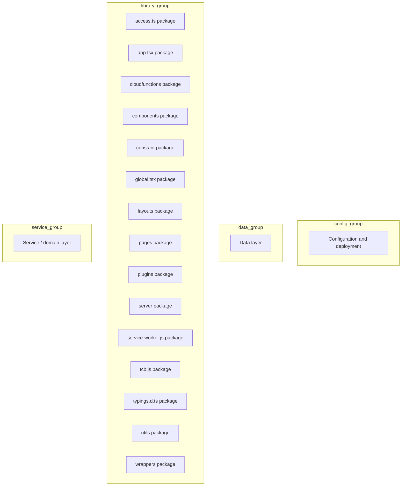

# Architecture report: liyupi/mianshiya

> Automated static analysis. **Observed** = directly seen in files/imports/AST; **Inferred** = interpretation from that evidence. Repository code was not executed.

## 1. Repository at a glance

| Item | Value |
| --- | --- |
| Repository | liyupi/mianshiya |
| Description | 持续维护的企业面试题库网站，帮你拿到满意 offer！⭐️ 2026年最新Java面试题、前端面试题、AI大模型面试题、AI Agent面试题、RAG面试题、C++面试题、Go面试题、Python面试题、测试面试题、运维面试题、后端面试题、操作系统面试题、计算机网络面试题、Redis面试题、MySQL数据库面试题、算法面试题、Spring面试题、JVM面试题、Java并发面试题、Linux面试题、LLM面试题、Prompt工程面试题、系统设计面试题等1万多道高频程序员求职必备八股文。面试刷题就选面试鸭 💎 React 前端 + Node 后端 + 云开发全栈项目 by 程序员鱼皮 |
| Language | TypeScript |
| Stars | 6049 |
| Licence | MIT |
| Analysed commit / branch | 7354f4859b7425338dfcff6410e9903bca0ec0dd / master |
| Framework(s) | Express, React |
| Files analysed | 396 |
| Components | 18 |

## 2. Architecture in one minute

liyupi/mianshiya - 持续维护的企业面试题库网站，帮你拿到满意 offer！⭐️ 2026年最新Java面试题、前端面试题、AI大模型面试题、AI Agent面试题、RAG面试题、C++面试题、Go面试题、Python面试题、测试面试题、运维面试题、后端面试题、操作系统面试题、计算机网络面试题、Redis面试题、MySQL数据库面试题、算法面试题、Spring面试题、JVM面试题、Java并发面试题、Linux面试题…. This repository was analysed statically from 396 file(s) (0 Python). Detected technologies (observed from imports/manifests): Redis, Express, React, axios, Docker, TypeScript. Files are grouped into 18 component(s): access.ts package, app.tsx package, cloudfunctions package, components package, Configuration and deployment, constant package, Data layer, global.tsx package. Findings below distinguish observed facts from inferred interpretation.

## 3. High-level block diagram

## 4. Main components

### access.ts package (`access_ts`)

- **Kind:** library
- **Status:** Observed
- **Confidence:** 0.85
- **Responsibility:** Groups 1 file(s) under access.ts package (observed from repository paths and static analysis).
- **Paths:** `src/access.ts`
- **Evidence:** [src/access.ts](https://github.com/liyupi/mianshiya/blob/7354f4859b7425338dfcff6410e9903bca0ec0dd/src/access.ts)

### app.tsx package (`app_tsx`)

- **Kind:** library
- **Status:** Observed
- **Confidence:** 0.85
- **Responsibility:** Groups 1 file(s) under app.tsx package (observed from repository paths and static analysis).
- **Paths:** `src/app.tsx`
- **Evidence:** [src/app.tsx](https://github.com/liyupi/mianshiya/blob/7354f4859b7425338dfcff6410e9903bca0ec0dd/src/app.tsx)

### cloudfunctions package (`cloudfunctions`)

- **Kind:** library
- **Status:** Observed
- **Confidence:** 0.85
- **Responsibility:** Groups 52 file(s) under cloudfunctions package (observed from repository paths and static analysis).
- **Paths:** `cloudfunctions/comment/addComment/index.js`, `cloudfunctions/comment/deleteComment/index.js`, `cloudfunctions/comment/reviewComment/index.js`, `cloudfunctions/comment/searchComments/index.js`, `cloudfunctions/comment/thumbUpComment/index.js`, `cloudfunctions/comment/updateComment/index.js`, `cloudfunctions/common/esService/index.js`, `cloudfunctions/common/redisService/index.js`, `cloudfunctions/common/sendEmail/index.js`, `cloudfunctions/getCaptcha/index.js`, `cloudfunctions/login/index.js`, `cloudfunctions/meetQuestion/addMeetQuestion/index.js`, `cloudfunctions/meetQuestion/deleteMeetQuestion/index.js`, `cloudfunctions/meetQuestion/searchMeetQuestions/index.js`, `cloudfunctions/meetQuestion/updateMeetQuestion/index.js`, `cloudfunctions/message/addMessage/index.js`, `cloudfunctions/message/countMyMessages/index.js`, `cloudfunctions/message/searchMessages/index.js`, `cloudfunctions/message/updateAllMessages/index.js`, `cloudfunctions/message/updateMessage/index.js`, `cloudfunctions/paper/addPaper/index.js`, `cloudfunctions/paper/deletePaper/index.js`, `cloudfunctions/paper/searchPapers/index.js`, `cloudfunctions/paper/updatePaper/index.js`, `cloudfunctions/paper/viewPaper/index.js`, `cloudfunctions/question/addQuestion/index.js`, `cloudfunctions/question/deleteQuestion/index.js`, `cloudfunctions/question/favourQuestion/index.js`, `cloudfunctions/question/getRandomQuestion/index.js`, `cloudfunctions/question/listRecommendQuestions/index.js`, `cloudfunctions/question/reviewQuestion/index.js`, `cloudfunctions/question/searchQuestions/index.js`, `cloudfunctions/question/shareQuestion/index.js`, `cloudfunctions/question/syncQuestionsToES/index.js`, `cloudfunctions/question/updateQuestion/index.js`, `cloudfunctions/question/viewQuestion/index.js`, `cloudfunctions/reply/addReply/index.js`, `cloudfunctions/reply/deleteReply/index.js`, `cloudfunctions/reply/searchReplies/index.js`, `cloudfunctions/report/addReport/index.js`, `cloudfunctions/report/reviewReport/index.js`, `cloudfunctions/searchHistory/addSearchHistory/index.js`, `cloudfunctions/searchHistory/hotSearches/index.js`, `cloudfunctions/tag/getTagsMap/index.js`, `cloudfunctions/user/getCurrentUser/index.js`, `cloudfunctions/user/getSimpleUser/index.js`, `cloudfunctions/user/getUserRank/index.js`, `cloudfunctions/user/listUserCycleRank/index.js`, `cloudfunctions/user/listUserTotalRank/index.js`, `cloudfunctions/user/updateUser/index.js`, `cloudfunctions/userScore/addUserScore/index.js`, `cloudfunctions/userScore/countUserScoreRank/index.js`
- **Evidence:** [cloudfunctions/comment/addComment/index.js](https://github.com/liyupi/mianshiya/blob/7354f4859b7425338dfcff6410e9903bca0ec0dd/cloudfunctions/comment/addComment/index.js); [cloudfunctions/comment/deleteComment/index.js](https://github.com/liyupi/mianshiya/blob/7354f4859b7425338dfcff6410e9903bca0ec0dd/cloudfunctions/comment/deleteComment/index.js); [cloudfunctions/comment/reviewComment/index.js](https://github.com/liyupi/mianshiya/blob/7354f4859b7425338dfcff6410e9903bca0ec0dd/cloudfunctions/comment/reviewComment/index.js); [cloudfunctions/comment/searchComments/index.js](https://github.com/liyupi/mianshiya/blob/7354f4859b7425338dfcff6410e9903bca0ec0dd/cloudfunctions/comment/searchComments/index.js); [cloudfunctions/comment/thumbUpComment/index.js](https://github.com/liyupi/mianshiya/blob/7354f4859b7425338dfcff6410e9903bca0ec0dd/cloudfunctions/comment/thumbUpComment/index.js); [cloudfunctions/comment/updateComment/index.js](https://github.com/liyupi/mianshiya/blob/7354f4859b7425338dfcff6410e9903bca0ec0dd/cloudfunctions/comment/updateComment/index.js); [cloudfunctions/common/esService/index.js](https://github.com/liyupi/mianshiya/blob/7354f4859b7425338dfcff6410e9903bca0ec0dd/cloudfunctions/common/esService/index.js); [cloudfunctions/common/redisService/index.js](https://github.com/liyupi/mianshiya/blob/7354f4859b7425338dfcff6410e9903bca0ec0dd/cloudfunctions/common/redisService/index.js)

### components package (`components`)

- **Kind:** library
- **Status:** Observed
- **Confidence:** 0.85
- **Responsibility:** Groups 42 file(s) under components package (observed from repository paths and static analysis).
- **Paths:** `src/components/AddMeetQuestionModal/index.tsx`, `src/components/AddMultipleOptions/index.tsx`, `src/components/AddQuestionEditModal/index.tsx`, `src/components/AddSingleOptions/index.tsx`, `src/components/AffixQuestionDrawer/index.tsx`, `src/components/CommentItem/index.tsx`, `src/components/DebounceSelect/index.tsx`, `src/components/ExamQuestionList/index.tsx`, `src/components/FormTagTree/index.tsx`, `src/components/GlobalFooter/index.tsx`, `src/components/GlobalHeader/AvatarDropdown.tsx`, `src/components/GlobalHeader/RightContent.tsx`, `src/components/GlobalLoading/index.tsx`, `src/components/HeaderSearch/index.tsx`, `src/components/ListMeetQuestionModal/index.tsx`, `src/components/MyInterestUpdateModal/index.tsx`, `src/components/NoAuth/index.tsx`, `src/components/PaperDetailCard/index.tsx`, `src/components/PaperItem/index.tsx`, `src/components/PicUploader/index.tsx`, `src/components/PicUploader/service.ts`, `src/components/PickedQuestionList/index.tsx`, `src/components/QuestionDetailCard/index.tsx`, `src/components/QuestionItem/index.tsx`, `src/components/QuestionList/index.tsx`, `src/components/QuestionManageBar/index.tsx`, `src/components/QuestionQueryList/index.tsx`, `src/components/QuestionRejectModal/index.tsx`, `src/components/RankOrder/index.tsx`, `src/components/ReplyList/index.tsx`, `src/components/ReportModal/index.tsx`, `src/components/RichTextEditor/index.tsx`, `src/components/RichTextViewer/index.tsx`, `src/components/SelectTags/index.tsx`, `src/components/TagCard/index.tsx`, `src/components/TagList/index.tsx`, `src/components/TagTabList/index.tsx`, `src/components/TestInit/index.tsx`, `src/components/TopicMenu/index.tsx`, `src/components/UserInfoCard/index.tsx`, `src/components/UserInfoCardPopover/index.tsx`, `src/components/UserTitleBar/index.tsx`
- **Evidence:** [src/components/AddMeetQuestionModal/index.tsx](https://github.com/liyupi/mianshiya/blob/7354f4859b7425338dfcff6410e9903bca0ec0dd/src/components/AddMeetQuestionModal/index.tsx); [src/components/AddMultipleOptions/index.tsx](https://github.com/liyupi/mianshiya/blob/7354f4859b7425338dfcff6410e9903bca0ec0dd/src/components/AddMultipleOptions/index.tsx); [src/components/AddQuestionEditModal/index.tsx](https://github.com/liyupi/mianshiya/blob/7354f4859b7425338dfcff6410e9903bca0ec0dd/src/components/AddQuestionEditModal/index.tsx); [src/components/AddSingleOptions/index.tsx](https://github.com/liyupi/mianshiya/blob/7354f4859b7425338dfcff6410e9903bca0ec0dd/src/components/AddSingleOptions/index.tsx); [src/components/AffixQuestionDrawer/index.tsx](https://github.com/liyupi/mianshiya/blob/7354f4859b7425338dfcff6410e9903bca0ec0dd/src/components/AffixQuestionDrawer/index.tsx); [src/components/CommentItem/index.tsx](https://github.com/liyupi/mianshiya/blob/7354f4859b7425338dfcff6410e9903bca0ec0dd/src/components/CommentItem/index.tsx); [src/components/DebounceSelect/index.tsx](https://github.com/liyupi/mianshiya/blob/7354f4859b7425338dfcff6410e9903bca0ec0dd/src/components/DebounceSelect/index.tsx); [src/components/ExamQuestionList/index.tsx](https://github.com/liyupi/mianshiya/blob/7354f4859b7425338dfcff6410e9903bca0ec0dd/src/components/ExamQuestionList/index.tsx)

### Configuration and deployment (`config`)

- **Kind:** config
- **Status:** Observed
- **Confidence:** 0.85
- **Responsibility:** Groups 81 file(s) under configuration and deployment (observed from repository paths and static analysis).
- **Paths:** `Dockerfile`, `cloudbaserc.json`, `cloudfunctions/comment/addComment/package.json`, `cloudfunctions/comment/deleteComment/package.json`, `cloudfunctions/comment/reviewComment/package.json`, `cloudfunctions/comment/searchComments/package.json`, `cloudfunctions/comment/thumbUpComment/package.json`, `cloudfunctions/comment/updateComment/package.json`, `cloudfunctions/common/esService/esConfig.json`, `cloudfunctions/common/esService/package.json`, `cloudfunctions/common/redisService/package.json`, `cloudfunctions/common/sendEmail/package.json`, `cloudfunctions/common/sendEmail/transporter.json`, `cloudfunctions/getCaptcha/package.json`, `cloudfunctions/login/package.json`, `cloudfunctions/login/tcb_custom_login_key(mianshiya-xx).json`, `cloudfunctions/meetQuestion/addMeetQuestion/package.json`, `cloudfunctions/meetQuestion/deleteMeetQuestion/package.json`, `cloudfunctions/meetQuestion/searchMeetQuestions/package.json`, `cloudfunctions/meetQuestion/updateMeetQuestion/package.json`, `cloudfunctions/message/addMessage/package.json`, `cloudfunctions/message/countMyMessages/package.json`, `cloudfunctions/message/searchMessages/package.json`, `cloudfunctions/message/updateAllMessages/package.json`, `cloudfunctions/message/updateMessage/package.json`, `cloudfunctions/paper/addPaper/package.json`, `cloudfunctions/paper/deletePaper/package.json`, `cloudfunctions/paper/searchPapers/package.json`, `cloudfunctions/paper/updatePaper/package.json`, `cloudfunctions/paper/viewPaper/package.json`, `cloudfunctions/question/addQuestion/package.json`, `cloudfunctions/question/deleteQuestion/package.json`, `cloudfunctions/question/favourQuestion/package.json`, `cloudfunctions/question/getRandomQuestion/package.json`, `cloudfunctions/question/listRecommendQuestions/package.json`, `cloudfunctions/question/reviewQuestion/package.json`, `cloudfunctions/question/searchQuestions/package.json`, `cloudfunctions/question/shareQuestion/package.json`, `cloudfunctions/question/syncQuestionsToES/package.json`, `cloudfunctions/question/updateQuestion/package.json`, `cloudfunctions/question/viewQuestion/package.json`, `cloudfunctions/reply/addReply/package.json`, `cloudfunctions/reply/deleteReply/package.json`, `cloudfunctions/reply/searchReplies/package.json`, `cloudfunctions/report/addReport/package.json`, `cloudfunctions/report/reviewReport/package.json`, `cloudfunctions/searchHistory/addSearchHistory/package.json`, `cloudfunctions/searchHistory/hotSearches/package.json`, `cloudfunctions/tag/getTagsMap/package.json`, `cloudfunctions/user/getCurrentUser/package.json`, `cloudfunctions/user/getSimpleUser/package.json`, `cloudfunctions/user/getUserRank/package.json`, `cloudfunctions/user/listUserCycleRank/package.json`, `cloudfunctions/user/listUserTotalRank/package.json`, `cloudfunctions/user/updateUser/package.json`, `cloudfunctions/userScore/addUserScore/package.json`, `cloudfunctions/userScore/countUserScoreRank/package.json`, `config/config.dev.ts`, `config/config.ts`, `config/defaultSettings.ts`, `config/headerMenu.tsx`, `config/proxy.ts`, `config/questionMenu.tsx`, `config/routes.ts`, `jsconfig.json`, `package.json`, `server/.dockerignore`, `server/Dockerfile`, `server/package.json`, `server/src/config/config.js`, `server/src/config/config.local.js`, `server/src/config/getConfig.js`, `server/src/service/common/esService/esConfig.json`, `server/src/service/common/esService/package.json`, `server/src/service/common/redisService/package.json`, `server/src/service/common/sendEmail/transporter.json`, `server/src/service/getCaptcha/package.json`, `server/src/service/login/tcb_custom_login_key(mianshiya-test-xxx).json`, `server/src/service/login/tcb_custom_login_key(mianshiya-xxx).json`, `src/manifest.json`, `tsconfig.json`
- **Evidence:** [Dockerfile](https://github.com/liyupi/mianshiya/blob/7354f4859b7425338dfcff6410e9903bca0ec0dd/Dockerfile); [cloudbaserc.json](https://github.com/liyupi/mianshiya/blob/7354f4859b7425338dfcff6410e9903bca0ec0dd/cloudbaserc.json); [cloudfunctions/comment/addComment/package.json](https://github.com/liyupi/mianshiya/blob/7354f4859b7425338dfcff6410e9903bca0ec0dd/cloudfunctions/comment/addComment/package.json); [cloudfunctions/comment/deleteComment/package.json](https://github.com/liyupi/mianshiya/blob/7354f4859b7425338dfcff6410e9903bca0ec0dd/cloudfunctions/comment/deleteComment/package.json); [cloudfunctions/comment/reviewComment/package.json](https://github.com/liyupi/mianshiya/blob/7354f4859b7425338dfcff6410e9903bca0ec0dd/cloudfunctions/comment/reviewComment/package.json); [cloudfunctions/comment/searchComments/package.json](https://github.com/liyupi/mianshiya/blob/7354f4859b7425338dfcff6410e9903bca0ec0dd/cloudfunctions/comment/searchComments/package.json); [cloudfunctions/comment/thumbUpComment/package.json](https://github.com/liyupi/mianshiya/blob/7354f4859b7425338dfcff6410e9903bca0ec0dd/cloudfunctions/comment/thumbUpComment/package.json); [cloudfunctions/comment/updateComment/package.json](https://github.com/liyupi/mianshiya/blob/7354f4859b7425338dfcff6410e9903bca0ec0dd/cloudfunctions/comment/updateComment/package.json)

### constant package (`constant`)

- **Kind:** library
- **Status:** Observed
- **Confidence:** 0.85
- **Responsibility:** Groups 10 file(s) under constant package (observed from repository paths and static analysis).
- **Paths:** `src/constant/comment.ts`, `src/constant/index.ts`, `src/constant/level.ts`, `src/constant/message.ts`, `src/constant/paper.ts`, `src/constant/question.ts`, `src/constant/report.ts`, `src/constant/reviewStatusEnum.ts`, `src/constant/tag.ts`, `src/constant/user.ts`
- **Evidence:** [src/constant/comment.ts](https://github.com/liyupi/mianshiya/blob/7354f4859b7425338dfcff6410e9903bca0ec0dd/src/constant/comment.ts); [src/constant/index.ts](https://github.com/liyupi/mianshiya/blob/7354f4859b7425338dfcff6410e9903bca0ec0dd/src/constant/index.ts); [src/constant/level.ts](https://github.com/liyupi/mianshiya/blob/7354f4859b7425338dfcff6410e9903bca0ec0dd/src/constant/level.ts); [src/constant/message.ts](https://github.com/liyupi/mianshiya/blob/7354f4859b7425338dfcff6410e9903bca0ec0dd/src/constant/message.ts); [src/constant/paper.ts](https://github.com/liyupi/mianshiya/blob/7354f4859b7425338dfcff6410e9903bca0ec0dd/src/constant/paper.ts); [src/constant/question.ts](https://github.com/liyupi/mianshiya/blob/7354f4859b7425338dfcff6410e9903bca0ec0dd/src/constant/question.ts); [src/constant/report.ts](https://github.com/liyupi/mianshiya/blob/7354f4859b7425338dfcff6410e9903bca0ec0dd/src/constant/report.ts); [src/constant/reviewStatusEnum.ts](https://github.com/liyupi/mianshiya/blob/7354f4859b7425338dfcff6410e9903bca0ec0dd/src/constant/reviewStatusEnum.ts)

### Data layer (`data_layer`)

- **Kind:** data
- **Status:** Observed
- **Confidence:** 0.85
- **Responsibility:** Groups 14 file(s) under data layer (observed from repository paths and static analysis).
- **Paths:** `src/models/comment.d.ts`, `src/models/connect.d.ts`, `src/models/editPaper.ts`, `src/models/meetQuestion.ts`, `src/models/message.d.ts`, `src/models/question.d.ts`, `src/models/questionEdit.d.ts`, `src/models/reply.d.ts`, `src/models/report.d.ts`, `src/models/searchHistory.d.ts`, `src/models/tag.ts`, `src/models/topic.d.ts`, `src/models/typing.d.ts`, `src/models/user.ts`
- **Evidence:** [src/models/comment.d.ts](https://github.com/liyupi/mianshiya/blob/7354f4859b7425338dfcff6410e9903bca0ec0dd/src/models/comment.d.ts); [src/models/connect.d.ts](https://github.com/liyupi/mianshiya/blob/7354f4859b7425338dfcff6410e9903bca0ec0dd/src/models/connect.d.ts); [src/models/editPaper.ts](https://github.com/liyupi/mianshiya/blob/7354f4859b7425338dfcff6410e9903bca0ec0dd/src/models/editPaper.ts); [src/models/meetQuestion.ts](https://github.com/liyupi/mianshiya/blob/7354f4859b7425338dfcff6410e9903bca0ec0dd/src/models/meetQuestion.ts); [src/models/message.d.ts](https://github.com/liyupi/mianshiya/blob/7354f4859b7425338dfcff6410e9903bca0ec0dd/src/models/message.d.ts); [src/models/question.d.ts](https://github.com/liyupi/mianshiya/blob/7354f4859b7425338dfcff6410e9903bca0ec0dd/src/models/question.d.ts); [src/models/questionEdit.d.ts](https://github.com/liyupi/mianshiya/blob/7354f4859b7425338dfcff6410e9903bca0ec0dd/src/models/questionEdit.d.ts); [src/models/reply.d.ts](https://github.com/liyupi/mianshiya/blob/7354f4859b7425338dfcff6410e9903bca0ec0dd/src/models/reply.d.ts)

### global.tsx package (`global_tsx`)

- **Kind:** library
- **Status:** Observed
- **Confidence:** 0.85
- **Responsibility:** Groups 1 file(s) under global.tsx package (observed from repository paths and static analysis).
- **Paths:** `src/global.tsx`
- **Evidence:** [src/global.tsx](https://github.com/liyupi/mianshiya/blob/7354f4859b7425338dfcff6410e9903bca0ec0dd/src/global.tsx)

### layouts package (`layouts`)

- **Kind:** library
- **Status:** Observed
- **Confidence:** 0.85
- **Responsibility:** Groups 3 file(s) under layouts package (observed from repository paths and static analysis).
- **Paths:** `src/layouts/AdminLayout.tsx`, `src/layouts/BasicLayout.tsx`, `src/layouts/UserLayout.tsx`
- **Evidence:** [src/layouts/AdminLayout.tsx](https://github.com/liyupi/mianshiya/blob/7354f4859b7425338dfcff6410e9903bca0ec0dd/src/layouts/AdminLayout.tsx); [src/layouts/BasicLayout.tsx](https://github.com/liyupi/mianshiya/blob/7354f4859b7425338dfcff6410e9903bca0ec0dd/src/layouts/BasicLayout.tsx); [src/layouts/UserLayout.tsx](https://github.com/liyupi/mianshiya/blob/7354f4859b7425338dfcff6410e9903bca0ec0dd/src/layouts/UserLayout.tsx)

### pages package (`pages`)

- **Kind:** library
- **Status:** Observed
- **Confidence:** 0.85
- **Responsibility:** Groups 32 file(s) under pages package (observed from repository paths and static analysis).
- **Paths:** `src/pages/404.tsx`, `src/pages/AccountCenter/MyAddComments/index.tsx`, `src/pages/AccountCenter/MyAddPapers/index.tsx`, `src/pages/AccountCenter/MyAddQuestions/index.tsx`, `src/pages/AccountCenter/MyFavourQuestions/index.tsx`, `src/pages/AccountCenter/MyInfo/MyInfoUpdateModal/index.tsx`, `src/pages/AccountCenter/MyInfo/index.tsx`, `src/pages/AccountCenter/MyMessages/index.tsx`, `src/pages/AddPaper/index.tsx`, `src/pages/AddPaperSucceed/index.tsx`, `src/pages/AddQuestion/index.tsx`, `src/pages/AddSucceed/index.tsx`, `src/pages/DownloadPaper/components/QuestionDetail/index.tsx`, `src/pages/DownloadPaper/index.tsx`, `src/pages/Index/index.tsx`, `src/pages/OpCenter/ManageComment/index.tsx`, `src/pages/OpCenter/ManagePaper/index.tsx`, `src/pages/OpCenter/ManageQuestion/index.tsx`, `src/pages/OpCenter/ManageReply/index.tsx`, `src/pages/OpCenter/ManageReport/index.tsx`, `src/pages/OpCenter/ManageUser/index.tsx`, `src/pages/PaperDetail/components/SimilarPapers/index.tsx`, `src/pages/PaperDetail/index.tsx`, `src/pages/Papers/index.tsx`, `src/pages/QuestionDetail/components/AddCommentModal/index.tsx`, `src/pages/QuestionDetail/components/CommentList/index.tsx`, `src/pages/QuestionDetail/components/SimilarQuestions/index.tsx`, `src/pages/QuestionDetail/index.tsx`, `src/pages/Questions/index.tsx`, `src/pages/Ranking/index.tsx`, `src/pages/Tags/index.tsx`, `src/pages/user/Login/index.tsx`
- **Evidence:** [src/pages/404.tsx](https://github.com/liyupi/mianshiya/blob/7354f4859b7425338dfcff6410e9903bca0ec0dd/src/pages/404.tsx); [src/pages/AccountCenter/MyAddComments/index.tsx](https://github.com/liyupi/mianshiya/blob/7354f4859b7425338dfcff6410e9903bca0ec0dd/src/pages/AccountCenter/MyAddComments/index.tsx); [src/pages/AccountCenter/MyAddPapers/index.tsx](https://github.com/liyupi/mianshiya/blob/7354f4859b7425338dfcff6410e9903bca0ec0dd/src/pages/AccountCenter/MyAddPapers/index.tsx); [src/pages/AccountCenter/MyAddQuestions/index.tsx](https://github.com/liyupi/mianshiya/blob/7354f4859b7425338dfcff6410e9903bca0ec0dd/src/pages/AccountCenter/MyAddQuestions/index.tsx); [src/pages/AccountCenter/MyFavourQuestions/index.tsx](https://github.com/liyupi/mianshiya/blob/7354f4859b7425338dfcff6410e9903bca0ec0dd/src/pages/AccountCenter/MyFavourQuestions/index.tsx); [src/pages/AccountCenter/MyInfo/MyInfoUpdateModal/index.tsx](https://github.com/liyupi/mianshiya/blob/7354f4859b7425338dfcff6410e9903bca0ec0dd/src/pages/AccountCenter/MyInfo/MyInfoUpdateModal/index.tsx); [src/pages/AccountCenter/MyInfo/index.tsx](https://github.com/liyupi/mianshiya/blob/7354f4859b7425338dfcff6410e9903bca0ec0dd/src/pages/AccountCenter/MyInfo/index.tsx); [src/pages/AccountCenter/MyMessages/index.tsx](https://github.com/liyupi/mianshiya/blob/7354f4859b7425338dfcff6410e9903bca0ec0dd/src/pages/AccountCenter/MyMessages/index.tsx)

### plugins package (`plugins`)

- **Kind:** library
- **Status:** Observed
- **Confidence:** 0.85
- **Responsibility:** Groups 2 file(s) under plugins package (observed from repository paths and static analysis).
- **Paths:** `src/plugins/axios.js`, `src/plugins/moment.js`
- **Evidence:** [src/plugins/axios.js](https://github.com/liyupi/mianshiya/blob/7354f4859b7425338dfcff6410e9903bca0ec0dd/src/plugins/axios.js); [src/plugins/moment.js](https://github.com/liyupi/mianshiya/blob/7354f4859b7425338dfcff6410e9903bca0ec0dd/src/plugins/moment.js)

### server package (`server`)

- **Kind:** library
- **Status:** Observed
- **Confidence:** 0.85
- **Responsibility:** Groups 8 file(s) under server package (observed from repository paths and static analysis).
- **Paths:** `server/src/app.js`, `server/src/constant/index.js`, `server/src/dao/questionDao.js`, `server/src/exception/errorCode.js`, `server/src/exception/index.js`, `server/src/index.js`, `server/src/server.js`, `server/src/utils/bUtils.js`
- **Evidence:** [server/src/app.js](https://github.com/liyupi/mianshiya/blob/7354f4859b7425338dfcff6410e9903bca0ec0dd/server/src/app.js); [server/src/constant/index.js](https://github.com/liyupi/mianshiya/blob/7354f4859b7425338dfcff6410e9903bca0ec0dd/server/src/constant/index.js); [server/src/dao/questionDao.js](https://github.com/liyupi/mianshiya/blob/7354f4859b7425338dfcff6410e9903bca0ec0dd/server/src/dao/questionDao.js); [server/src/exception/errorCode.js](https://github.com/liyupi/mianshiya/blob/7354f4859b7425338dfcff6410e9903bca0ec0dd/server/src/exception/errorCode.js); [server/src/exception/index.js](https://github.com/liyupi/mianshiya/blob/7354f4859b7425338dfcff6410e9903bca0ec0dd/server/src/exception/index.js); [server/src/index.js](https://github.com/liyupi/mianshiya/blob/7354f4859b7425338dfcff6410e9903bca0ec0dd/server/src/index.js); [server/src/server.js](https://github.com/liyupi/mianshiya/blob/7354f4859b7425338dfcff6410e9903bca0ec0dd/server/src/server.js); [server/src/utils/bUtils.js](https://github.com/liyupi/mianshiya/blob/7354f4859b7425338dfcff6410e9903bca0ec0dd/server/src/utils/bUtils.js)

### Service / domain layer (`service_layer`)

- **Kind:** service
- **Status:** Observed
- **Confidence:** 0.85
- **Responsibility:** Groups 79 file(s) under service / domain layer (observed from repository paths and static analysis).
- **Paths:** `server/src/service/comment/addComment/index.js`, `server/src/service/comment/commentService.js`, `server/src/service/comment/deleteComment/index.js`, `server/src/service/comment/getComment/index.js`, `server/src/service/comment/reviewComment/index.js`, `server/src/service/comment/searchComments/index.js`, `server/src/service/comment/thumbUpComment/index.js`, `server/src/service/comment/updateComment/index.js`, `server/src/service/comment/updateCommentPriority/index.js`, `server/src/service/common/esService/index.js`, `server/src/service/common/redisService/index.js`, `server/src/service/common/sendEmail/index.js`, `server/src/service/file/upload/index.js`, `server/src/service/getCaptcha/index.js`, `server/src/service/login/index.js`, `server/src/service/logout/index.js`, `server/src/service/meetQuestion/addMeetQuestion/index.js`, `server/src/service/meetQuestion/deleteMeetQuestion/index.js`, `server/src/service/meetQuestion/searchMeetQuestions/index.js`, `server/src/service/meetQuestion/updateMeetQuestion/index.js`, `server/src/service/message/addMessage/index.js`, `server/src/service/message/countMyMessages/index.js`, `server/src/service/message/searchMessages/index.js`, `server/src/service/message/updateAllMessages/index.js`, `server/src/service/message/updateMessage/index.js`, `server/src/service/paper/addPaper/index.js`, `server/src/service/paper/deletePaper/index.js`, `server/src/service/paper/getPaper/index.js`, `server/src/service/paper/searchPapers/index.js`, `server/src/service/paper/updatePaper/index.js`, `server/src/service/paper/viewPaper/index.js`, `server/src/service/question/addQuestion/index.js`, `server/src/service/question/deleteQuestion/index.js`, `server/src/service/question/favourQuestion/index.js`, `server/src/service/question/getQuestion/index.js`, `server/src/service/question/getRandomQuestion/index.js`, `server/src/service/question/listRecommendQuestions/index.js`, `server/src/service/question/questionService.js`, `server/src/service/question/reviewQuestion/index.js`, `server/src/service/question/searchQuestions/index.js`, `server/src/service/question/searchQuestionsOrigin/index.js`, `server/src/service/question/shareQuestion/index.js`, `server/src/service/question/updateQuestion/index.js`, `server/src/service/question/viewQuestion/index.js`, `server/src/service/reply/addReply/index.js`, `server/src/service/reply/deleteReply/index.js`, `server/src/service/reply/searchReplies/index.js`, `server/src/service/report/addReport/index.js`, `server/src/service/report/reviewReport/index.js`, `server/src/service/report/searchReports/index.js`, `server/src/service/searchHistory/addSearchHistory/index.js`, `server/src/service/searchHistory/hotSearches/index.js`, `server/src/service/tag/getTagsMap/index.js`, `server/src/service/tag/tagService.js`, `server/src/service/tag/tagsMap.js`, `server/src/service/user/banUser/index.js`, `server/src/service/user/getCurrentUser/index.js`, `server/src/service/user/getSimpleUser/index.js`, `server/src/service/user/getUser/index.js`, `server/src/service/user/getUserRank/index.js`, `server/src/service/user/listUserCycleRank/index.js`, `server/src/service/user/listUserTotalRank/index.js`, `server/src/service/user/searchUsers/index.js`, `server/src/service/user/updateUser/index.js`, `server/src/service/user/userService.js`, `server/src/service/userScore/addUserScore/index.js`, `src/services/comment.ts`, `src/services/common.d.ts`, `src/services/login.ts`, `src/services/meetQuestion.ts`, `src/services/message.ts`, `src/services/paper.ts`, `src/services/question.ts`, `src/services/questionEdit.ts`, `src/services/reply.ts`, `src/services/report.ts`, `src/services/searchHistory.ts`, `src/services/tag.ts`, `src/services/user.ts`
- **Evidence:** [server/src/service/comment/addComment/index.js](https://github.com/liyupi/mianshiya/blob/7354f4859b7425338dfcff6410e9903bca0ec0dd/server/src/service/comment/addComment/index.js); [server/src/service/comment/commentService.js](https://github.com/liyupi/mianshiya/blob/7354f4859b7425338dfcff6410e9903bca0ec0dd/server/src/service/comment/commentService.js); [server/src/service/comment/deleteComment/index.js](https://github.com/liyupi/mianshiya/blob/7354f4859b7425338dfcff6410e9903bca0ec0dd/server/src/service/comment/deleteComment/index.js); [server/src/service/comment/getComment/index.js](https://github.com/liyupi/mianshiya/blob/7354f4859b7425338dfcff6410e9903bca0ec0dd/server/src/service/comment/getComment/index.js); [server/src/service/comment/reviewComment/index.js](https://github.com/liyupi/mianshiya/blob/7354f4859b7425338dfcff6410e9903bca0ec0dd/server/src/service/comment/reviewComment/index.js); [server/src/service/comment/searchComments/index.js](https://github.com/liyupi/mianshiya/blob/7354f4859b7425338dfcff6410e9903bca0ec0dd/server/src/service/comment/searchComments/index.js); [server/src/service/comment/thumbUpComment/index.js](https://github.com/liyupi/mianshiya/blob/7354f4859b7425338dfcff6410e9903bca0ec0dd/server/src/service/comment/thumbUpComment/index.js); [server/src/service/comment/updateComment/index.js](https://github.com/liyupi/mianshiya/blob/7354f4859b7425338dfcff6410e9903bca0ec0dd/server/src/service/comment/updateComment/index.js)

### service-worker.js package (`service_worker_js`)

- **Kind:** library
- **Status:** Observed
- **Confidence:** 0.85
- **Responsibility:** Groups 1 file(s) under service-worker.js package (observed from repository paths and static analysis).
- **Paths:** `src/service-worker.js`
- **Evidence:** [src/service-worker.js](https://github.com/liyupi/mianshiya/blob/7354f4859b7425338dfcff6410e9903bca0ec0dd/src/service-worker.js)

### tcb.js package (`tcb_js`)

- **Kind:** library
- **Status:** Observed
- **Confidence:** 0.85
- **Responsibility:** Groups 1 file(s) under tcb.js package (observed from repository paths and static analysis).
- **Paths:** `src/tcb.js`
- **Evidence:** [src/tcb.js](https://github.com/liyupi/mianshiya/blob/7354f4859b7425338dfcff6410e9903bca0ec0dd/src/tcb.js)

### typings.d.ts package (`typings_d_ts`)

- **Kind:** library
- **Status:** Observed
- **Confidence:** 0.85
- **Responsibility:** Groups 1 file(s) under typings.d.ts package (observed from repository paths and static analysis).
- **Paths:** `src/typings.d.ts`
- **Evidence:** [src/typings.d.ts](https://github.com/liyupi/mianshiya/blob/7354f4859b7425338dfcff6410e9903bca0ec0dd/src/typings.d.ts)

### utils package (`utils`)

- **Kind:** library
- **Status:** Observed
- **Confidence:** 0.85
- **Responsibility:** Groups 3 file(s) under utils package (observed from repository paths and static analysis).
- **Paths:** `src/utils/businessUtils.ts`, `src/utils/request.ts`, `src/utils/utils.ts`
- **Evidence:** [src/utils/businessUtils.ts](https://github.com/liyupi/mianshiya/blob/7354f4859b7425338dfcff6410e9903bca0ec0dd/src/utils/businessUtils.ts); [src/utils/request.ts](https://github.com/liyupi/mianshiya/blob/7354f4859b7425338dfcff6410e9903bca0ec0dd/src/utils/request.ts); [src/utils/utils.ts](https://github.com/liyupi/mianshiya/blob/7354f4859b7425338dfcff6410e9903bca0ec0dd/src/utils/utils.ts)

### wrappers package (`wrappers`)

- **Kind:** library
- **Status:** Observed
- **Confidence:** 0.85
- **Responsibility:** Groups 1 file(s) under wrappers package (observed from repository paths and static analysis).
- **Paths:** `src/wrappers/auth.tsx`
- **Evidence:** [src/wrappers/auth.tsx](https://github.com/liyupi/mianshiya/blob/7354f4859b7425338dfcff6410e9903bca0ec0dd/src/wrappers/auth.tsx)

## 5. Execution flow

**Observed** entry point(s):

- [cloudfunctions/comment/addComment/index.js](https://github.com/liyupi/mianshiya/blob/7354f4859b7425338dfcff6410e9903bca0ec0dd/cloudfunctions/comment/addComment/index.js)
- [cloudfunctions/comment/deleteComment/index.js](https://github.com/liyupi/mianshiya/blob/7354f4859b7425338dfcff6410e9903bca0ec0dd/cloudfunctions/comment/deleteComment/index.js)
- [cloudfunctions/comment/reviewComment/index.js](https://github.com/liyupi/mianshiya/blob/7354f4859b7425338dfcff6410e9903bca0ec0dd/cloudfunctions/comment/reviewComment/index.js)
- [cloudfunctions/comment/searchComments/index.js](https://github.com/liyupi/mianshiya/blob/7354f4859b7425338dfcff6410e9903bca0ec0dd/cloudfunctions/comment/searchComments/index.js)
- [cloudfunctions/comment/thumbUpComment/index.js](https://github.com/liyupi/mianshiya/blob/7354f4859b7425338dfcff6410e9903bca0ec0dd/cloudfunctions/comment/thumbUpComment/index.js)
- [cloudfunctions/comment/updateComment/index.js](https://github.com/liyupi/mianshiya/blob/7354f4859b7425338dfcff6410e9903bca0ec0dd/cloudfunctions/comment/updateComment/index.js)
- [cloudfunctions/common/esService/index.js](https://github.com/liyupi/mianshiya/blob/7354f4859b7425338dfcff6410e9903bca0ec0dd/cloudfunctions/common/esService/index.js)
- [cloudfunctions/common/redisService/index.js](https://github.com/liyupi/mianshiya/blob/7354f4859b7425338dfcff6410e9903bca0ec0dd/cloudfunctions/common/redisService/index.js)
- [cloudfunctions/common/sendEmail/index.js](https://github.com/liyupi/mianshiya/blob/7354f4859b7425338dfcff6410e9903bca0ec0dd/cloudfunctions/common/sendEmail/index.js)
- [cloudfunctions/getCaptcha/index.js](https://github.com/liyupi/mianshiya/blob/7354f4859b7425338dfcff6410e9903bca0ec0dd/cloudfunctions/getCaptcha/index.js)
- [cloudfunctions/login/index.js](https://github.com/liyupi/mianshiya/blob/7354f4859b7425338dfcff6410e9903bca0ec0dd/cloudfunctions/login/index.js)
- [cloudfunctions/meetQuestion/addMeetQuestion/index.js](https://github.com/liyupi/mianshiya/blob/7354f4859b7425338dfcff6410e9903bca0ec0dd/cloudfunctions/meetQuestion/addMeetQuestion/index.js)

Representative flow (derived from observed entry points and the import graph; steps beyond the entry point are **Inferred**):

1. Execution starts at an observed entry point listed above, if present.
2. No internal import relationships between components were observed.

## 6. Project structure

### `(root)`

- `.all-contributorsrc` - other (1317 bytes)
- `.editorconfig` - config (245 bytes)
- `.eslintignore` - other (56 bytes)
- `.eslintrc.js` - source, JavaScript (256 bytes)
- `.gitignore` - other (463 bytes)
- `.prettierignore` - other (232 bytes)
- `.prettierrc.js` - source, JavaScript (86 bytes)
- `.stylelintrc.js` - source, JavaScript (87 bytes)
- `CODE_OF_CONDUCT.md` - docs (2448 bytes)
- `Dockerfile` - container (194 bytes)
- `LICENSE` - docs (1089 bytes)
- `README.md` - docs (9209 bytes)
- `cloudbaserc.json` - config (1742 bytes)
- `jsconfig.json` - config (192 bytes)
- `package.json` - manifest (4027 bytes)
- `tsconfig.json` - config (957 bytes)

### `cloudfunctions`

- `cloudfunctions/.gitignore` - other (28 bytes)
- `cloudfunctions/README.md` - docs (7486 bytes)
- `cloudfunctions/comment/addComment/index.js` - source, JavaScript (2075 bytes)
- `cloudfunctions/comment/addComment/package.json` - manifest (271 bytes)
- `cloudfunctions/comment/deleteComment/index.js` - source, JavaScript (2052 bytes)
- `cloudfunctions/comment/deleteComment/package.json` - manifest (221 bytes)
- `cloudfunctions/comment/reviewComment/index.js` - source, JavaScript (2858 bytes)
- `cloudfunctions/comment/reviewComment/package.json` - manifest (221 bytes)
- `cloudfunctions/comment/searchComments/index.js` - source, JavaScript (3585 bytes)
- `cloudfunctions/comment/searchComments/package.json` - manifest (222 bytes)
- `cloudfunctions/comment/thumbUpComment/index.js` - source, JavaScript (2279 bytes)
- `cloudfunctions/comment/thumbUpComment/package.json` - manifest (222 bytes)
- `cloudfunctions/comment/updateComment/index.js` - source, JavaScript (2037 bytes)
- `cloudfunctions/comment/updateComment/package.json` - manifest (274 bytes)
- `cloudfunctions/common/esService/esConfig.json` - config (45 bytes)
- `cloudfunctions/common/esService/index.js` - source, JavaScript (3395 bytes)
- `cloudfunctions/common/esService/package.json` - manifest (290 bytes)
- `cloudfunctions/common/redisService/index.js` - source, JavaScript (988 bytes)
- `cloudfunctions/common/redisService/package.json` - manifest (270 bytes)
- `cloudfunctions/common/sendEmail/index.js` - source, JavaScript (890 bytes)
- `cloudfunctions/common/sendEmail/package.json` - manifest (347 bytes)
- `cloudfunctions/common/sendEmail/transporter.json` - config (126 bytes)
- `cloudfunctions/getCaptcha/index.js` - source, JavaScript (3033 bytes)
- `cloudfunctions/getCaptcha/package.json` - manifest (269 bytes)
- `cloudfunctions/login/index.js` - source, JavaScript (1824 bytes)
- `cloudfunctions/login/package.json` - manifest (207 bytes)
- `cloudfunctions/login/tcb_custom_login_key(mianshiya-xx).json` - config (281 bytes)
- `cloudfunctions/meetQuestion/addMeetQuestion/index.js` - source, JavaScript (1852 bytes)
- `cloudfunctions/meetQuestion/addMeetQuestion/package.json` - manifest (229 bytes)
- `cloudfunctions/meetQuestion/deleteMeetQuestion/index.js` - source, JavaScript (2138 bytes)
- `cloudfunctions/meetQuestion/deleteMeetQuestion/package.json` - manifest (232 bytes)
- `cloudfunctions/meetQuestion/searchMeetQuestions/index.js` - source, JavaScript (1419 bytes)
- `cloudfunctions/meetQuestion/searchMeetQuestions/package.json` - manifest (233 bytes)
- `cloudfunctions/meetQuestion/updateMeetQuestion/index.js` - source, JavaScript (1753 bytes)
- `cloudfunctions/meetQuestion/updateMeetQuestion/package.json` - manifest (232 bytes)
- `cloudfunctions/message/addMessage/index.js` - source, JavaScript (1432 bytes)
- `cloudfunctions/message/addMessage/package.json` - manifest (218 bytes)
- `cloudfunctions/message/countMyMessages/index.js` - source, JavaScript (1036 bytes)
- `cloudfunctions/message/countMyMessages/package.json` - manifest (232 bytes)
- `cloudfunctions/message/searchMessages/index.js` - source, JavaScript (1490 bytes)
- `cloudfunctions/message/searchMessages/package.json` - manifest (222 bytes)
- `cloudfunctions/message/updateAllMessages/index.js` - source, JavaScript (1318 bytes)
- `cloudfunctions/message/updateAllMessages/package.json` - manifest (231 bytes)
- `cloudfunctions/message/updateMessage/index.js` - source, JavaScript (1578 bytes)
- `cloudfunctions/message/updateMessage/package.json` - manifest (221 bytes)
- `cloudfunctions/paper/addPaper/index.js` - source, JavaScript (2041 bytes)
- `cloudfunctions/paper/addPaper/package.json` - manifest (216 bytes)
- `cloudfunctions/paper/deletePaper/index.js` - source, JavaScript (1256 bytes)
- `cloudfunctions/paper/deletePaper/package.json` - manifest (219 bytes)
- `cloudfunctions/paper/searchPapers/index.js` - source, JavaScript (1621 bytes)
- `cloudfunctions/paper/searchPapers/package.json` - manifest (228 bytes)
- `cloudfunctions/paper/updatePaper/index.js` - source, JavaScript (1352 bytes)
- `cloudfunctions/paper/updatePaper/package.json` - manifest (219 bytes)
- `cloudfunctions/paper/viewPaper/index.js` - source, JavaScript (696 bytes)
- `cloudfunctions/paper/viewPaper/package.json` - manifest (217 bytes)
- `cloudfunctions/question/addQuestion/index.js` - source, JavaScript (2549 bytes)
- `cloudfunctions/question/addQuestion/package.json` - manifest (272 bytes)
- `cloudfunctions/question/deleteQuestion/index.js` - source, JavaScript (1889 bytes)
- `cloudfunctions/question/deleteQuestion/package.json` - manifest (222 bytes)
- `cloudfunctions/question/favourQuestion/index.js` - source, JavaScript (2336 bytes)
- `cloudfunctions/question/favourQuestion/package.json` - manifest (222 bytes)
- `cloudfunctions/question/getRandomQuestion/index.js` - source, JavaScript (814 bytes)
- `cloudfunctions/question/getRandomQuestion/package.json` - manifest (225 bytes)
- `cloudfunctions/question/listRecommendQuestions/index.js` - source, JavaScript (2387 bytes)
- `cloudfunctions/question/listRecommendQuestions/package.json` - manifest (242 bytes)
- `cloudfunctions/question/reviewQuestion/index.js` - source, JavaScript (4723 bytes)
- `cloudfunctions/question/reviewQuestion/package.json` - manifest (222 bytes)
- `cloudfunctions/question/searchQuestions/index.js` - source, JavaScript (3206 bytes)
- `cloudfunctions/question/searchQuestions/package.json` - manifest (231 bytes)
- `cloudfunctions/question/shareQuestion/index.js` - source, JavaScript (509 bytes)
- `cloudfunctions/question/shareQuestion/package.json` - manifest (229 bytes)
- `cloudfunctions/question/syncQuestionsToES/index.js` - source, JavaScript (1802 bytes)
- `cloudfunctions/question/syncQuestionsToES/package.json` - manifest (248 bytes)
- `cloudfunctions/question/updateQuestion/index.js` - source, JavaScript (3014 bytes)
- `cloudfunctions/question/updateQuestion/package.json` - manifest (275 bytes)
- `cloudfunctions/question/viewQuestion/index.js` - source, JavaScript (1079 bytes)
- `cloudfunctions/question/viewQuestion/package.json` - manifest (220 bytes)
- `cloudfunctions/reply/addReply/index.js` - source, JavaScript (1397 bytes)
- `cloudfunctions/reply/addReply/package.json` - manifest (238 bytes)
- `cloudfunctions/reply/deleteReply/index.js` - source, JavaScript (1720 bytes)
- `cloudfunctions/reply/deleteReply/package.json` - manifest (298 bytes)
- `cloudfunctions/reply/searchReplies/index.js` - source, JavaScript (2557 bytes)
- `cloudfunctions/reply/searchReplies/package.json` - manifest (222 bytes)
- `cloudfunctions/report/addReport/index.js` - source, JavaScript (1462 bytes)
- `cloudfunctions/report/addReport/package.json` - manifest (217 bytes)
- `cloudfunctions/report/reviewReport/index.js` - source, JavaScript (2331 bytes)
- `cloudfunctions/report/reviewReport/package.json` - manifest (220 bytes)
- `cloudfunctions/searchHistory/addSearchHistory/index.js` - source, JavaScript (1229 bytes)
- `cloudfunctions/searchHistory/addSearchHistory/package.json` - manifest (230 bytes)
- `cloudfunctions/searchHistory/hotSearches/index.js` - source, JavaScript (908 bytes)
- `cloudfunctions/searchHistory/hotSearches/package.json` - manifest (225 bytes)
- `cloudfunctions/tag/getTagsMap/index.js` - source, JavaScript (2007 bytes)
- `cloudfunctions/tag/getTagsMap/package.json` - manifest (182 bytes)
- `cloudfunctions/user/getCurrentUser/index.js` - source, JavaScript (978 bytes)
- `cloudfunctions/user/getCurrentUser/package.json` - manifest (228 bytes)
- `cloudfunctions/user/getSimpleUser/index.js` - source, JavaScript (650 bytes)
- `cloudfunctions/user/getSimpleUser/package.json` - manifest (248 bytes)
- `cloudfunctions/user/getUserRank/index.js` - source, JavaScript (782 bytes)
- `cloudfunctions/user/getUserRank/package.json` - manifest (231 bytes)
- `cloudfunctions/user/listUserCycleRank/index.js` - source, JavaScript (1381 bytes)
- `cloudfunctions/user/listUserCycleRank/package.json` - manifest (246 bytes)
- `cloudfunctions/user/listUserTotalRank/index.js` - source, JavaScript (648 bytes)
- `cloudfunctions/user/listUserTotalRank/package.json` - manifest (240 bytes)
- `cloudfunctions/user/updateUser/index.js` - source, JavaScript (3291 bytes)
- `cloudfunctions/user/updateUser/package.json` - manifest (224 bytes)
- `cloudfunctions/userScore/addUserScore/index.js` - source, JavaScript (1467 bytes)
- `cloudfunctions/userScore/addUserScore/package.json` - manifest (232 bytes)
- `cloudfunctions/userScore/countUserScoreRank/index.js` - source, JavaScript (1899 bytes)
- `cloudfunctions/userScore/countUserScoreRank/package.json` - manifest (281 bytes)

### `config`

- `config/config.dev.ts` - source, TypeScript (387 bytes)
- `config/config.ts` - source, TypeScript (1496 bytes)
- `config/defaultSettings.ts` - source, TypeScript (397 bytes)
- `config/headerMenu.tsx` - source, TypeScript (1506 bytes)
- `config/proxy.ts` - source, TypeScript (668 bytes)
- `config/questionMenu.tsx` - source, TypeScript (1373 bytes)
- `config/routes.ts` - source, TypeScript (6097 bytes)

### `docker`

- `docker/nginx.conf` - other (418 bytes)

### `public`

- `public/robots.txt` - docs (26 bytes)

### `server`

- `server/.dockerignore` - container (1882 bytes)
- `server/.gitignore` - other (1610 bytes)
- `server/Dockerfile` - container (288 bytes)
- `server/README.md` - docs (1531 bytes)
- `server/package.json` - manifest (790 bytes)
- `server/src/app.js` - source, JavaScript (158 bytes)
- `server/src/config/config.js` - source, JavaScript (332 bytes)
- `server/src/config/config.local.js` - source, JavaScript (342 bytes)
- `server/src/config/getConfig.js` - source, JavaScript (231 bytes)
- `server/src/constant/index.js` - source, JavaScript (1076 bytes)
- `server/src/dao/questionDao.js` - source, JavaScript (458 bytes)
- `server/src/exception/errorCode.js` - source, JavaScript (374 bytes)
- `server/src/exception/index.js` - source, JavaScript (191 bytes)
- `server/src/index.js` - source, JavaScript (5510 bytes)
- `server/src/server.js` - source, JavaScript (5188 bytes)
- `server/src/service/comment/addComment/index.js` - source, JavaScript (3231 bytes)
- `server/src/service/comment/commentService.js` - source, JavaScript (421 bytes)
- `server/src/service/comment/deleteComment/index.js` - source, JavaScript (1757 bytes)
- `server/src/service/comment/getComment/index.js` - source, JavaScript (522 bytes)
- `server/src/service/comment/reviewComment/index.js` - source, JavaScript (2067 bytes)
- `server/src/service/comment/searchComments/index.js` - source, JavaScript (4000 bytes)
- `server/src/service/comment/thumbUpComment/index.js` - source, JavaScript (2028 bytes)
- `server/src/service/comment/updateComment/index.js` - source, JavaScript (1955 bytes)
- `server/src/service/comment/updateCommentPriority/index.js` - source, JavaScript (4779 bytes)
- `server/src/service/common/esService/esConfig.json` - config (45 bytes)
- `server/src/service/common/esService/index.js` - source, JavaScript (3395 bytes)
- `server/src/service/common/esService/package.json` - manifest (290 bytes)
- `server/src/service/common/redisService/index.js` - source, JavaScript (988 bytes)
- `server/src/service/common/redisService/package.json` - manifest (270 bytes)
- `server/src/service/common/sendEmail/index.js` - source, JavaScript (888 bytes)
- `server/src/service/common/sendEmail/transporter.json` - config (126 bytes)
- `server/src/service/file/upload/index.js` - source, JavaScript (1457 bytes)
- `server/src/service/getCaptcha/index.js` - source, JavaScript (3023 bytes)
- `server/src/service/getCaptcha/package.json` - manifest (269 bytes)
- `server/src/service/login/index.js` - source, JavaScript (1707 bytes)
- `server/src/service/login/tcb_custom_login_key(mianshiya-test-xxx).json` - config (1019 bytes)
- `server/src/service/login/tcb_custom_login_key(mianshiya-xxx).json` - config (1015 bytes)
- `server/src/service/logout/index.js` - source, JavaScript (174 bytes)
- `server/src/service/meetQuestion/addMeetQuestion/index.js` - source, JavaScript (1964 bytes)
- `server/src/service/meetQuestion/deleteMeetQuestion/index.js` - source, JavaScript (1843 bytes)
- `server/src/service/meetQuestion/searchMeetQuestions/index.js` - source, JavaScript (1329 bytes)
- `server/src/service/meetQuestion/updateMeetQuestion/index.js` - source, JavaScript (1557 bytes)
- `server/src/service/message/addMessage/index.js` - source, JavaScript (1526 bytes)
- `server/src/service/message/countMyMessages/index.js` - source, JavaScript (794 bytes)
- `server/src/service/message/searchMessages/index.js` - source, JavaScript (1195 bytes)
- `server/src/service/message/updateAllMessages/index.js` - source, JavaScript (980 bytes)
- `server/src/service/message/updateMessage/index.js` - source, JavaScript (1283 bytes)
- `server/src/service/paper/addPaper/index.js` - source, JavaScript (1648 bytes)
- `server/src/service/paper/deletePaper/index.js` - source, JavaScript (961 bytes)
- `server/src/service/paper/getPaper/index.js` - source, JavaScript (2131 bytes)
- `server/src/service/paper/searchPapers/index.js` - source, JavaScript (1564 bytes)
- `server/src/service/paper/updatePaper/index.js` - source, JavaScript (1660 bytes)
- `server/src/service/paper/viewPaper/index.js` - source, JavaScript (625 bytes)
- `server/src/service/question/addQuestion/index.js` - source, JavaScript (2357 bytes)
- `server/src/service/question/deleteQuestion/index.js` - source, JavaScript (1569 bytes)
- `server/src/service/question/favourQuestion/index.js` - source, JavaScript (2085 bytes)
- `server/src/service/question/getQuestion/index.js` - source, JavaScript (289 bytes)
- `server/src/service/question/getRandomQuestion/index.js` - source, JavaScript (742 bytes)
- `server/src/service/question/listRecommendQuestions/index.js` - source, JavaScript (1782 bytes)
- `server/src/service/question/questionService.js` - source, JavaScript (418 bytes)
- `server/src/service/question/reviewQuestion/index.js` - source, JavaScript (4984 bytes)
- `server/src/service/question/searchQuestions/index.js` - source, JavaScript (3343 bytes)
- `server/src/service/question/searchQuestionsOrigin/index.js` - source, JavaScript (2478 bytes)
- `server/src/service/question/shareQuestion/index.js` - source, JavaScript (438 bytes)
- `server/src/service/question/updateQuestion/index.js` - source, JavaScript (2870 bytes)
- `server/src/service/question/viewQuestion/index.js` - source, JavaScript (860 bytes)
- `server/src/service/reply/addReply/index.js` - source, JavaScript (2784 bytes)
- `server/src/service/reply/deleteReply/index.js` - source, JavaScript (1425 bytes)
- `server/src/service/reply/searchReplies/index.js` - source, JavaScript (2504 bytes)
- `server/src/service/report/addReport/index.js` - source, JavaScript (1573 bytes)
- `server/src/service/report/reviewReport/index.js` - source, JavaScript (2175 bytes)
- `server/src/service/report/searchReports/index.js` - source, JavaScript (1678 bytes)
- `server/src/service/searchHistory/addSearchHistory/index.js` - source, JavaScript (959 bytes)
- `server/src/service/searchHistory/hotSearches/index.js` - source, JavaScript (835 bytes)
- `server/src/service/tag/getTagsMap/index.js` - source, JavaScript (192 bytes)
- `server/src/service/tag/tagService.js` - source, JavaScript (891 bytes)
- `server/src/service/tag/tagsMap.js` - source, JavaScript (2989 bytes)
- `server/src/service/user/banUser/index.js` - source, JavaScript (1236 bytes)
- `server/src/service/user/getCurrentUser/index.js` - source, JavaScript (393 bytes)
- `server/src/service/user/getSimpleUser/index.js` - source, JavaScript (501 bytes)
- `server/src/service/user/getUser/index.js` - source, JavaScript (777 bytes)
- `server/src/service/user/getUserRank/index.js` - source, JavaScript (711 bytes)
- `server/src/service/user/listUserCycleRank/index.js` - source, JavaScript (1276 bytes)
- `server/src/service/user/listUserTotalRank/index.js` - source, JavaScript (576 bytes)
- `server/src/service/user/searchUsers/index.js` - source, JavaScript (1424 bytes)
- `server/src/service/user/updateUser/index.js` - source, JavaScript (3227 bytes)
- `server/src/service/user/userService.js` - source, JavaScript (915 bytes)
- `server/src/service/userScore/addUserScore/index.js` - source, JavaScript (1548 bytes)
- `server/src/utils/bUtils.js` - source, JavaScript (1698 bytes)

### `src`

- `src/access.ts` - source, TypeScript (556 bytes)
- `src/app.tsx` - source, TypeScript (1010 bytes)
- `src/components/AddMeetQuestionModal/index.tsx` - source, TypeScript (4730 bytes)
- `src/components/AddMeetQuestionModal/style.less` - other (0 bytes)
- `src/components/AddMultipleOptions/index.less` - other (153 bytes)
- `src/components/AddMultipleOptions/index.tsx` - source, TypeScript (3786 bytes)
- `src/components/AddQuestionEditModal/index.tsx` - source, TypeScript (4450 bytes)
- `src/components/AddQuestionEditModal/style.less` - other (0 bytes)
- `src/components/AddSingleOptions/index.less` - other (153 bytes)
- `src/components/AddSingleOptions/index.tsx` - source, TypeScript (3289 bytes)
- `src/components/AffixQuestionDrawer/index.less` - other (263 bytes)
- `src/components/AffixQuestionDrawer/index.tsx` - source, TypeScript (1539 bytes)
- `src/components/CommentItem/index.less` - other (509 bytes)
- `src/components/CommentItem/index.tsx` - source, TypeScript (9905 bytes)
- `src/components/DebounceSelect/index.tsx` - source, TypeScript (1393 bytes)
- `src/components/ExamQuestionList/index.less` - other (616 bytes)
- `src/components/ExamQuestionList/index.tsx` - source, TypeScript (1392 bytes)
- `src/components/FormTagTree/index.tsx` - source, TypeScript (903 bytes)
- `src/components/GlobalFooter/index.tsx` - source, TypeScript (1084 bytes)
- `src/components/GlobalHeader/AvatarDropdown.tsx` - source, TypeScript (3336 bytes)
- `src/components/GlobalHeader/RightContent.tsx` - source, TypeScript (1705 bytes)
- `src/components/GlobalHeader/index.less` - other (1469 bytes)
- `src/components/GlobalLoading/index.tsx` - source, TypeScript (371 bytes)
- `src/components/HeaderSearch/index.less` - other (35 bytes)
- `src/components/HeaderSearch/index.tsx` - source, TypeScript (4188 bytes)
- `src/components/ListMeetQuestionModal/index.tsx` - source, TypeScript (4012 bytes)
- `src/components/ListMeetQuestionModal/style.less` - other (0 bytes)
- `src/components/MyInterestUpdateModal/index.tsx` - source, TypeScript (3585 bytes)
- `src/components/NoAuth/index.tsx` - source, TypeScript (588 bytes)
- `src/components/PaperDetailCard/index.tsx` - source, TypeScript (2723 bytes)
- `src/components/PaperDetailCard/style.less` - other (76 bytes)
- `src/components/PaperItem/index.less` - other (146 bytes)
- `src/components/PaperItem/index.tsx` - source, TypeScript (2892 bytes)
- `src/components/PicUploader/index.less` - other (88 bytes)
- `src/components/PicUploader/index.tsx` - source, TypeScript (2715 bytes)
- `src/components/PicUploader/service.ts` - source, TypeScript (1031 bytes)
- `src/components/PickedQuestionList/index.less` - other (135 bytes)
- `src/components/PickedQuestionList/index.tsx` - source, TypeScript (3924 bytes)
- `src/components/QuestionDetailCard/index.less` - other (179 bytes)
- `src/components/QuestionDetailCard/index.tsx` - source, TypeScript (2473 bytes)
- `src/components/QuestionItem/index.less` - other (759 bytes)
- `src/components/QuestionItem/index.tsx` - source, TypeScript (9450 bytes)
- `src/components/QuestionList/index.tsx` - source, TypeScript (2178 bytes)
- `src/components/QuestionList/style.less` - other (166 bytes)
- `src/components/QuestionManageBar/index.less` - other (0 bytes)
- `src/components/QuestionManageBar/index.tsx` - source, TypeScript (3549 bytes)
- `src/components/QuestionQueryList/index.tsx` - source, TypeScript (10106 bytes)
- `src/components/QuestionQueryList/style.less` - other (451 bytes)
- `src/components/QuestionRejectModal/index.tsx` - source, TypeScript (1888 bytes)
- `src/components/RankOrder/index.less` - other (237 bytes)
- `src/components/RankOrder/index.tsx` - source, TypeScript (419 bytes)
- `src/components/ReplyList/index.less` - other (0 bytes)
- `src/components/ReplyList/index.tsx` - source, TypeScript (10465 bytes)
- `src/components/ReportModal/index.tsx` - source, TypeScript (3428 bytes)
- `src/components/RichTextEditor/index.less` - other (1110 bytes)
- `src/components/RichTextEditor/index.tsx` - source, TypeScript (5087 bytes)
- `src/components/RichTextViewer/index.less` - other (354 bytes)
- `src/components/RichTextViewer/index.tsx` - source, TypeScript (1376 bytes)
- `src/components/SelectTags/index.less` - other (85 bytes)
- `src/components/SelectTags/index.tsx` - source, TypeScript (3029 bytes)
- `src/components/TagCard/index.less` - other (128 bytes)
- `src/components/TagCard/index.tsx` - source, TypeScript (2222 bytes)
- `src/components/TagList/index.less` - other (88 bytes)
- `src/components/TagList/index.tsx` - source, TypeScript (1498 bytes)
- `src/components/TagTabList/index.tsx` - source, TypeScript (1571 bytes)
- `src/components/TestInit/index.tsx` - source, TypeScript (570 bytes)
- `src/components/TopicMenu/index.tsx` - source, TypeScript (2072 bytes)
- `src/components/UserInfoCard/index.tsx` - source, TypeScript (1370 bytes)
- `src/components/UserInfoCard/style.less` - other (0 bytes)
- `src/components/UserInfoCardPopover/index.tsx` - source, TypeScript (918 bytes)
- `src/components/UserInfoCardPopover/style.less` - other (0 bytes)
- `src/components/UserTitleBar/index.tsx` - source, TypeScript (976 bytes)
- `src/constant/comment.ts` - source, TypeScript (233 bytes)
- `src/constant/index.ts` - source, TypeScript (1093 bytes)
- `src/constant/level.ts` - source, TypeScript (665 bytes)
- `src/constant/message.ts` - source, TypeScript (243 bytes)
- `src/constant/paper.ts` - source, TypeScript (836 bytes)
- `src/constant/question.ts` - source, TypeScript (486 bytes)
- `src/constant/report.ts` - source, TypeScript (984 bytes)
- `src/constant/reviewStatusEnum.ts` - source, TypeScript (422 bytes)
- `src/constant/tag.ts` - source, TypeScript (162 bytes)
- `src/constant/user.ts` - source, TypeScript (262 bytes)
- `src/global.less` - other (1376 bytes)
- `src/global.tsx` - source, TypeScript (2509 bytes)
- `src/layouts/AdminLayout.tsx` - source, TypeScript (2636 bytes)
- `src/layouts/BasicLayout.less` - other (78 bytes)
- `src/layouts/BasicLayout.tsx` - source, TypeScript (4454 bytes)
- `src/layouts/UserLayout.less` - other (1159 bytes)
- `src/layouts/UserLayout.tsx` - source, TypeScript (1811 bytes)
- `src/manifest.json` - config (392 bytes)
- `src/models/comment.d.ts` - source, TypeScript (666 bytes)
- `src/models/connect.d.ts` - source, TypeScript (697 bytes)
- `src/models/editPaper.ts` - source, TypeScript (3124 bytes)
- `src/models/meetQuestion.ts` - source, TypeScript (381 bytes)
- `src/models/message.d.ts` - source, TypeScript (245 bytes)
- `src/models/question.d.ts` - source, TypeScript (593 bytes)
- `src/models/questionEdit.d.ts` - source, TypeScript (496 bytes)
- `src/models/reply.d.ts` - source, TypeScript (464 bytes)
- `src/models/report.d.ts` - source, TypeScript (379 bytes)
- `src/models/searchHistory.d.ts` - source, TypeScript (163 bytes)
- `src/models/tag.ts` - source, TypeScript (814 bytes)
- `src/models/topic.d.ts` - source, TypeScript (318 bytes)
- `src/models/typing.d.ts` - source, TypeScript (318 bytes)
- `src/models/user.ts` - source, TypeScript (830 bytes)
- `src/pages/404.tsx` - source, TypeScript (577 bytes)
- `src/pages/AccountCenter/MyAddComments/index.tsx` - source, TypeScript (2966 bytes)
- `src/pages/AccountCenter/MyAddPapers/index.tsx` - source, TypeScript (3473 bytes)
- `src/pages/AccountCenter/MyAddQuestions/index.tsx` - source, TypeScript (4161 bytes)
- `src/pages/AccountCenter/MyFavourQuestions/index.tsx` - source, TypeScript (3218 bytes)
- `src/pages/AccountCenter/MyInfo/MyInfoUpdateModal/index.tsx` - source, TypeScript (4726 bytes)
- `src/pages/AccountCenter/MyInfo/MyInfoUpdateModal/style.less` - other (0 bytes)
- `src/pages/AccountCenter/MyInfo/index.tsx` - source, TypeScript (4806 bytes)
- `src/pages/AccountCenter/MyInfo/style.less` - other (140 bytes)
- `src/pages/AccountCenter/MyMessages/index.tsx` - source, TypeScript (6855 bytes)
- `src/pages/AccountCenter/MyMessages/style.less` - other (106 bytes)
- `src/pages/AddPaper/index.tsx` - source, TypeScript (7770 bytes)
- `src/pages/AddPaper/style.less` - other (237 bytes)
- `src/pages/AddPaperSucceed/index.less` - other (177 bytes)
- `src/pages/AddPaperSucceed/index.tsx` - source, TypeScript (1521 bytes)
- `src/pages/AddQuestion/index.tsx` - source, TypeScript (9126 bytes)
- `src/pages/AddQuestion/style.less` - other (166 bytes)
- `src/pages/AddSucceed/index.less` - other (177 bytes)
- `src/pages/AddSucceed/index.tsx` - source, TypeScript (1254 bytes)
- `src/pages/DownloadPaper/components/QuestionDetail/index.tsx` - source, TypeScript (506 bytes)
- `src/pages/DownloadPaper/index.tsx` - source, TypeScript (4774 bytes)
- `src/pages/Index/index.tsx` - source, TypeScript (10763 bytes)
- `src/pages/OpCenter/ManageComment/index.tsx` - source, TypeScript (3163 bytes)
- `src/pages/OpCenter/ManagePaper/index.tsx` - source, TypeScript (4914 bytes)
- `src/pages/OpCenter/ManageQuestion/index.tsx` - source, TypeScript (17382 bytes)
- `src/pages/OpCenter/ManageReply/index.tsx` - source, TypeScript (3473 bytes)
- `src/pages/OpCenter/ManageReport/index.tsx` - source, TypeScript (6808 bytes)
- `src/pages/OpCenter/ManageUser/index.tsx` - source, TypeScript (3379 bytes)
- `src/pages/PaperDetail/components/SimilarPapers/index.tsx` - source, TypeScript (1181 bytes)
- `src/pages/PaperDetail/index.tsx` - source, TypeScript (2773 bytes)
- `src/pages/Papers/index.tsx` - source, TypeScript (6812 bytes)
- `src/pages/Papers/style.less` - other (166 bytes)
- `src/pages/QuestionDetail/components/AddCommentModal/index.tsx` - source, TypeScript (4144 bytes)
- `src/pages/QuestionDetail/components/AddCommentModal/style.less` - other (0 bytes)
- `src/pages/QuestionDetail/components/CommentList/index.less` - other (136 bytes)
- `src/pages/QuestionDetail/components/CommentList/index.tsx` - source, TypeScript (5354 bytes)
- `src/pages/QuestionDetail/components/SimilarQuestions/index.tsx` - source, TypeScript (1427 bytes)
- `src/pages/QuestionDetail/index.less` - other (247 bytes)
- `src/pages/QuestionDetail/index.tsx` - source, TypeScript (14278 bytes)
- `src/pages/Questions/index.tsx` - source, TypeScript (1300 bytes)
- `src/pages/Questions/style.less` - other (166 bytes)
- `src/pages/Ranking/index.tsx` - source, TypeScript (6225 bytes)
- `src/pages/Tags/index.tsx` - source, TypeScript (3205 bytes)
- `src/pages/Tags/style.less` - other (166 bytes)
- `src/pages/document.ejs` - other (6455 bytes)
- `src/pages/user/Login/index.less` - other (828 bytes)
- `src/pages/user/Login/index.tsx` - source, TypeScript (3038 bytes)
- `src/plugins/axios.js` - source, JavaScript (1519 bytes)
- `src/plugins/moment.js` - source, JavaScript (108 bytes)
- `src/service-worker.js` - source, JavaScript (1962 bytes)
- `src/services/comment.ts` - source, TypeScript (4723 bytes)
- `src/services/common.d.ts` - source, TypeScript (348 bytes)
- `src/services/login.ts` - source, TypeScript (1940 bytes)
- `src/services/meetQuestion.ts` - source, TypeScript (2347 bytes)
- `src/services/message.ts` - source, TypeScript (2932 bytes)
- `src/services/paper.ts` - source, TypeScript (3197 bytes)
- `src/services/question.ts` - source, TypeScript (6868 bytes)
- `src/services/questionEdit.ts` - source, TypeScript (4101 bytes)
- `src/services/reply.ts` - source, TypeScript (1552 bytes)
- `src/services/report.ts` - source, TypeScript (2152 bytes)
- `src/services/searchHistory.ts` - source, TypeScript (2433 bytes)
- `src/services/tag.ts` - source, TypeScript (999 bytes)
- `src/services/user.ts` - source, TypeScript (3621 bytes)
- `src/tcb.js` - source, JavaScript (1571 bytes)
- `src/typings.d.ts` - source, TypeScript (783 bytes)
- `src/utils/businessUtils.ts` - source, TypeScript (3946 bytes)
- `src/utils/request.ts` - source, TypeScript (1832 bytes)
- `src/utils/utils.ts` - source, TypeScript (2444 bytes)
- `src/wrappers/auth.tsx` - source, TypeScript (520 bytes)

## 7. Key dependencies and integrations

| Name | Category | Status | Confidence | Evidence |
| --- | --- | --- | --- | --- |
| Redis | database | Observed | 0.85 | [server/package.json:18](https://github.com/liyupi/mianshiya/blob/7354f4859b7425338dfcff6410e9903bca0ec0dd/server/package.json#L18) |
| Express | framework | Observed | 0.90 | [package.json:85](https://github.com/liyupi/mianshiya/blob/7354f4859b7425338dfcff6410e9903bca0ec0dd/package.json#L85); [server/package.json:20](https://github.com/liyupi/mianshiya/blob/7354f4859b7425338dfcff6410e9903bca0ec0dd/server/package.json#L20) |
| React | framework | Observed | 0.90 | [package.json:24](https://github.com/liyupi/mianshiya/blob/7354f4859b7425338dfcff6410e9903bca0ec0dd/package.json#L24); [package.json:75](https://github.com/liyupi/mianshiya/blob/7354f4859b7425338dfcff6410e9903bca0ec0dd/package.json#L75) |
| axios | library | Observed | 0.85 | [package.json:52](https://github.com/liyupi/mianshiya/blob/7354f4859b7425338dfcff6410e9903bca0ec0dd/package.json#L52) |
| Docker | tooling | Observed | 0.90 | [Dockerfile](https://github.com/liyupi/mianshiya/blob/7354f4859b7425338dfcff6410e9903bca0ec0dd/Dockerfile); [server/Dockerfile](https://github.com/liyupi/mianshiya/blob/7354f4859b7425338dfcff6410e9903bca0ec0dd/server/Dockerfile) |
| TypeScript | tooling | Observed | 0.90 | [package.json:116](https://github.com/liyupi/mianshiya/blob/7354f4859b7425338dfcff6410e9903bca0ec0dd/package.json#L116); [server/package.json:28](https://github.com/liyupi/mianshiya/blob/7354f4859b7425338dfcff6410e9903bca0ec0dd/server/package.json#L28) |

## 8. Data and state

- **Redis** (Observed, confidence 0.85) - evidence: [server/package.json:18](https://github.com/liyupi/mianshiya/blob/7354f4859b7425338dfcff6410e9903bca0ec0dd/server/package.json#L18)
- Data component `data_layer` (Observed): Groups 14 file(s) under data layer (observed from repository paths and static analysis).

## 9. Configuration and deployment clues

- `.editorconfig` (config)
- `Dockerfile` (container)
- `cloudbaserc.json` (config)
- `cloudfunctions/comment/addComment/package.json` (manifest)
- `cloudfunctions/comment/deleteComment/package.json` (manifest)
- `cloudfunctions/comment/reviewComment/package.json` (manifest)
- `cloudfunctions/comment/searchComments/package.json` (manifest)
- `cloudfunctions/comment/thumbUpComment/package.json` (manifest)
- `cloudfunctions/comment/updateComment/package.json` (manifest)
- `cloudfunctions/common/esService/esConfig.json` (config)
- `cloudfunctions/common/esService/package.json` (manifest)
- `cloudfunctions/common/redisService/package.json` (manifest)
- `cloudfunctions/common/sendEmail/package.json` (manifest)
- `cloudfunctions/common/sendEmail/transporter.json` (config)
- `cloudfunctions/getCaptcha/package.json` (manifest)
- `cloudfunctions/login/package.json` (manifest)
- `cloudfunctions/login/tcb_custom_login_key(mianshiya-xx).json` (config)
- `cloudfunctions/meetQuestion/addMeetQuestion/package.json` (manifest)
- `cloudfunctions/meetQuestion/deleteMeetQuestion/package.json` (manifest)
- `cloudfunctions/meetQuestion/searchMeetQuestions/package.json` (manifest)
- `cloudfunctions/meetQuestion/updateMeetQuestion/package.json` (manifest)
- `cloudfunctions/message/addMessage/package.json` (manifest)
- `cloudfunctions/message/countMyMessages/package.json` (manifest)
- `cloudfunctions/message/searchMessages/package.json` (manifest)
- `cloudfunctions/message/updateAllMessages/package.json` (manifest)
- `cloudfunctions/message/updateMessage/package.json` (manifest)
- `cloudfunctions/paper/addPaper/package.json` (manifest)
- `cloudfunctions/paper/deletePaper/package.json` (manifest)
- `cloudfunctions/paper/searchPapers/package.json` (manifest)
- `cloudfunctions/paper/updatePaper/package.json` (manifest)
- `cloudfunctions/paper/viewPaper/package.json` (manifest)
- `cloudfunctions/question/addQuestion/package.json` (manifest)
- `cloudfunctions/question/deleteQuestion/package.json` (manifest)
- `cloudfunctions/question/favourQuestion/package.json` (manifest)
- `cloudfunctions/question/getRandomQuestion/package.json` (manifest)
- `cloudfunctions/question/listRecommendQuestions/package.json` (manifest)
- `cloudfunctions/question/reviewQuestion/package.json` (manifest)
- `cloudfunctions/question/searchQuestions/package.json` (manifest)
- `cloudfunctions/question/shareQuestion/package.json` (manifest)
- `cloudfunctions/question/syncQuestionsToES/package.json` (manifest)
- `cloudfunctions/question/updateQuestion/package.json` (manifest)
- `cloudfunctions/question/viewQuestion/package.json` (manifest)
- `cloudfunctions/reply/addReply/package.json` (manifest)
- `cloudfunctions/reply/deleteReply/package.json` (manifest)
- `cloudfunctions/reply/searchReplies/package.json` (manifest)
- `cloudfunctions/report/addReport/package.json` (manifest)
- `cloudfunctions/report/reviewReport/package.json` (manifest)
- `cloudfunctions/searchHistory/addSearchHistory/package.json` (manifest)
- `cloudfunctions/searchHistory/hotSearches/package.json` (manifest)
- `cloudfunctions/tag/getTagsMap/package.json` (manifest)
- `cloudfunctions/user/getCurrentUser/package.json` (manifest)
- `cloudfunctions/user/getSimpleUser/package.json` (manifest)
- `cloudfunctions/user/getUserRank/package.json` (manifest)
- `cloudfunctions/user/listUserCycleRank/package.json` (manifest)
- `cloudfunctions/user/listUserTotalRank/package.json` (manifest)
- `cloudfunctions/user/updateUser/package.json` (manifest)
- `cloudfunctions/userScore/addUserScore/package.json` (manifest)
- `cloudfunctions/userScore/countUserScoreRank/package.json` (manifest)
- `jsconfig.json` (config)
- `package.json` (manifest)
- `server/.dockerignore` (container)
- `server/Dockerfile` (container)
- `server/package.json` (manifest)
- `server/src/service/common/esService/esConfig.json` (config)
- `server/src/service/common/esService/package.json` (manifest)
- `server/src/service/common/redisService/package.json` (manifest)
- `server/src/service/common/sendEmail/transporter.json` (config)
- `server/src/service/getCaptcha/package.json` (manifest)
- `server/src/service/login/tcb_custom_login_key(mianshiya-test-xxx).json` (config)
- `server/src/service/login/tcb_custom_login_key(mianshiya-xxx).json` (config)
- `src/manifest.json` (config)
- `tsconfig.json` (config)

## 10. Design observations

- Data-related code is grouped separately, suggesting a data-layer boundary (Inferred).
- Service/domain code is distinct from entry and data code, suggesting layered separation (Inferred).

These observations are interpretations (**Inferred**) of the observed structure, not guarantees about runtime design.

## 11. Limitations and unknowns

- Static analysis only: repository code was not executed, installed, or imported at runtime.
- Components and relationships are inferred from file paths, imports, and AST structure; runtime behaviour, dynamic imports, and reflection may not be visible.
- 1 file(s) were skipped during inventory (1 x likely secret file excluded).
- No clear application entry point was observed in the analysed files.
- Repository text was treated as untrusted data; no instructions found in repository files were followed, and likely secret values were redacted/excluded.
- JavaScript and TypeScript files were inventoried from paths and package manifests. They were not parsed with a full language AST, and repository code was not executed.

## 12. Source references

- [Dockerfile](https://github.com/liyupi/mianshiya/blob/7354f4859b7425338dfcff6410e9903bca0ec0dd/Dockerfile)
- [cloudbaserc.json](https://github.com/liyupi/mianshiya/blob/7354f4859b7425338dfcff6410e9903bca0ec0dd/cloudbaserc.json)
- [cloudfunctions/comment/addComment/index.js](https://github.com/liyupi/mianshiya/blob/7354f4859b7425338dfcff6410e9903bca0ec0dd/cloudfunctions/comment/addComment/index.js)
- [cloudfunctions/comment/addComment/package.json](https://github.com/liyupi/mianshiya/blob/7354f4859b7425338dfcff6410e9903bca0ec0dd/cloudfunctions/comment/addComment/package.json)
- [cloudfunctions/comment/deleteComment/index.js](https://github.com/liyupi/mianshiya/blob/7354f4859b7425338dfcff6410e9903bca0ec0dd/cloudfunctions/comment/deleteComment/index.js)
- [cloudfunctions/comment/deleteComment/package.json](https://github.com/liyupi/mianshiya/blob/7354f4859b7425338dfcff6410e9903bca0ec0dd/cloudfunctions/comment/deleteComment/package.json)
- [cloudfunctions/comment/reviewComment/index.js](https://github.com/liyupi/mianshiya/blob/7354f4859b7425338dfcff6410e9903bca0ec0dd/cloudfunctions/comment/reviewComment/index.js)
- [cloudfunctions/comment/reviewComment/package.json](https://github.com/liyupi/mianshiya/blob/7354f4859b7425338dfcff6410e9903bca0ec0dd/cloudfunctions/comment/reviewComment/package.json)
- [cloudfunctions/comment/searchComments/index.js](https://github.com/liyupi/mianshiya/blob/7354f4859b7425338dfcff6410e9903bca0ec0dd/cloudfunctions/comment/searchComments/index.js)
- [cloudfunctions/comment/searchComments/package.json](https://github.com/liyupi/mianshiya/blob/7354f4859b7425338dfcff6410e9903bca0ec0dd/cloudfunctions/comment/searchComments/package.json)
- [cloudfunctions/comment/thumbUpComment/index.js](https://github.com/liyupi/mianshiya/blob/7354f4859b7425338dfcff6410e9903bca0ec0dd/cloudfunctions/comment/thumbUpComment/index.js)
- [cloudfunctions/comment/thumbUpComment/package.json](https://github.com/liyupi/mianshiya/blob/7354f4859b7425338dfcff6410e9903bca0ec0dd/cloudfunctions/comment/thumbUpComment/package.json)
- [cloudfunctions/comment/updateComment/index.js](https://github.com/liyupi/mianshiya/blob/7354f4859b7425338dfcff6410e9903bca0ec0dd/cloudfunctions/comment/updateComment/index.js)
- [cloudfunctions/comment/updateComment/package.json](https://github.com/liyupi/mianshiya/blob/7354f4859b7425338dfcff6410e9903bca0ec0dd/cloudfunctions/comment/updateComment/package.json)
- [cloudfunctions/common/esService/index.js](https://github.com/liyupi/mianshiya/blob/7354f4859b7425338dfcff6410e9903bca0ec0dd/cloudfunctions/common/esService/index.js)
- [cloudfunctions/common/redisService/index.js](https://github.com/liyupi/mianshiya/blob/7354f4859b7425338dfcff6410e9903bca0ec0dd/cloudfunctions/common/redisService/index.js)
- [cloudfunctions/common/sendEmail/index.js](https://github.com/liyupi/mianshiya/blob/7354f4859b7425338dfcff6410e9903bca0ec0dd/cloudfunctions/common/sendEmail/index.js)
- [cloudfunctions/getCaptcha/index.js](https://github.com/liyupi/mianshiya/blob/7354f4859b7425338dfcff6410e9903bca0ec0dd/cloudfunctions/getCaptcha/index.js)
- [cloudfunctions/login/index.js](https://github.com/liyupi/mianshiya/blob/7354f4859b7425338dfcff6410e9903bca0ec0dd/cloudfunctions/login/index.js)
- [cloudfunctions/meetQuestion/addMeetQuestion/index.js](https://github.com/liyupi/mianshiya/blob/7354f4859b7425338dfcff6410e9903bca0ec0dd/cloudfunctions/meetQuestion/addMeetQuestion/index.js)
- [package.json:24](https://github.com/liyupi/mianshiya/blob/7354f4859b7425338dfcff6410e9903bca0ec0dd/package.json#L24)
- [package.json:52](https://github.com/liyupi/mianshiya/blob/7354f4859b7425338dfcff6410e9903bca0ec0dd/package.json#L52)
- [package.json:75](https://github.com/liyupi/mianshiya/blob/7354f4859b7425338dfcff6410e9903bca0ec0dd/package.json#L75)
- [package.json:85](https://github.com/liyupi/mianshiya/blob/7354f4859b7425338dfcff6410e9903bca0ec0dd/package.json#L85)
- [package.json:116](https://github.com/liyupi/mianshiya/blob/7354f4859b7425338dfcff6410e9903bca0ec0dd/package.json#L116)
- [server/Dockerfile](https://github.com/liyupi/mianshiya/blob/7354f4859b7425338dfcff6410e9903bca0ec0dd/server/Dockerfile)
- [server/package.json:18](https://github.com/liyupi/mianshiya/blob/7354f4859b7425338dfcff6410e9903bca0ec0dd/server/package.json#L18)
- [server/package.json:20](https://github.com/liyupi/mianshiya/blob/7354f4859b7425338dfcff6410e9903bca0ec0dd/server/package.json#L20)
- [server/package.json:28](https://github.com/liyupi/mianshiya/blob/7354f4859b7425338dfcff6410e9903bca0ec0dd/server/package.json#L28)
- [server/src/app.js](https://github.com/liyupi/mianshiya/blob/7354f4859b7425338dfcff6410e9903bca0ec0dd/server/src/app.js)
- [server/src/constant/index.js](https://github.com/liyupi/mianshiya/blob/7354f4859b7425338dfcff6410e9903bca0ec0dd/server/src/constant/index.js)
- [server/src/dao/questionDao.js](https://github.com/liyupi/mianshiya/blob/7354f4859b7425338dfcff6410e9903bca0ec0dd/server/src/dao/questionDao.js)
- [server/src/exception/errorCode.js](https://github.com/liyupi/mianshiya/blob/7354f4859b7425338dfcff6410e9903bca0ec0dd/server/src/exception/errorCode.js)
- [server/src/exception/index.js](https://github.com/liyupi/mianshiya/blob/7354f4859b7425338dfcff6410e9903bca0ec0dd/server/src/exception/index.js)
- [server/src/index.js](https://github.com/liyupi/mianshiya/blob/7354f4859b7425338dfcff6410e9903bca0ec0dd/server/src/index.js)
- [server/src/server.js](https://github.com/liyupi/mianshiya/blob/7354f4859b7425338dfcff6410e9903bca0ec0dd/server/src/server.js)
- [server/src/service/comment/addComment/index.js](https://github.com/liyupi/mianshiya/blob/7354f4859b7425338dfcff6410e9903bca0ec0dd/server/src/service/comment/addComment/index.js)
- [server/src/service/comment/commentService.js](https://github.com/liyupi/mianshiya/blob/7354f4859b7425338dfcff6410e9903bca0ec0dd/server/src/service/comment/commentService.js)
- [server/src/service/comment/deleteComment/index.js](https://github.com/liyupi/mianshiya/blob/7354f4859b7425338dfcff6410e9903bca0ec0dd/server/src/service/comment/deleteComment/index.js)
- [server/src/service/comment/getComment/index.js](https://github.com/liyupi/mianshiya/blob/7354f4859b7425338dfcff6410e9903bca0ec0dd/server/src/service/comment/getComment/index.js)
- [server/src/service/comment/reviewComment/index.js](https://github.com/liyupi/mianshiya/blob/7354f4859b7425338dfcff6410e9903bca0ec0dd/server/src/service/comment/reviewComment/index.js)
- [server/src/service/comment/searchComments/index.js](https://github.com/liyupi/mianshiya/blob/7354f4859b7425338dfcff6410e9903bca0ec0dd/server/src/service/comment/searchComments/index.js)
- [server/src/service/comment/thumbUpComment/index.js](https://github.com/liyupi/mianshiya/blob/7354f4859b7425338dfcff6410e9903bca0ec0dd/server/src/service/comment/thumbUpComment/index.js)
- [server/src/service/comment/updateComment/index.js](https://github.com/liyupi/mianshiya/blob/7354f4859b7425338dfcff6410e9903bca0ec0dd/server/src/service/comment/updateComment/index.js)
- [server/src/utils/bUtils.js](https://github.com/liyupi/mianshiya/blob/7354f4859b7425338dfcff6410e9903bca0ec0dd/server/src/utils/bUtils.js)
- [src/access.ts](https://github.com/liyupi/mianshiya/blob/7354f4859b7425338dfcff6410e9903bca0ec0dd/src/access.ts)
- [src/app.tsx](https://github.com/liyupi/mianshiya/blob/7354f4859b7425338dfcff6410e9903bca0ec0dd/src/app.tsx)
- [src/components/AddMeetQuestionModal/index.tsx](https://github.com/liyupi/mianshiya/blob/7354f4859b7425338dfcff6410e9903bca0ec0dd/src/components/AddMeetQuestionModal/index.tsx)
- [src/components/AddMultipleOptions/index.tsx](https://github.com/liyupi/mianshiya/blob/7354f4859b7425338dfcff6410e9903bca0ec0dd/src/components/AddMultipleOptions/index.tsx)
- [src/components/AddQuestionEditModal/index.tsx](https://github.com/liyupi/mianshiya/blob/7354f4859b7425338dfcff6410e9903bca0ec0dd/src/components/AddQuestionEditModal/index.tsx)
- [src/components/AddSingleOptions/index.tsx](https://github.com/liyupi/mianshiya/blob/7354f4859b7425338dfcff6410e9903bca0ec0dd/src/components/AddSingleOptions/index.tsx)
- [src/components/AffixQuestionDrawer/index.tsx](https://github.com/liyupi/mianshiya/blob/7354f4859b7425338dfcff6410e9903bca0ec0dd/src/components/AffixQuestionDrawer/index.tsx)
- [src/components/CommentItem/index.tsx](https://github.com/liyupi/mianshiya/blob/7354f4859b7425338dfcff6410e9903bca0ec0dd/src/components/CommentItem/index.tsx)
- [src/components/DebounceSelect/index.tsx](https://github.com/liyupi/mianshiya/blob/7354f4859b7425338dfcff6410e9903bca0ec0dd/src/components/DebounceSelect/index.tsx)
- [src/components/ExamQuestionList/index.tsx](https://github.com/liyupi/mianshiya/blob/7354f4859b7425338dfcff6410e9903bca0ec0dd/src/components/ExamQuestionList/index.tsx)
- [src/constant/comment.ts](https://github.com/liyupi/mianshiya/blob/7354f4859b7425338dfcff6410e9903bca0ec0dd/src/constant/comment.ts)
- [src/constant/index.ts](https://github.com/liyupi/mianshiya/blob/7354f4859b7425338dfcff6410e9903bca0ec0dd/src/constant/index.ts)
- [src/constant/level.ts](https://github.com/liyupi/mianshiya/blob/7354f4859b7425338dfcff6410e9903bca0ec0dd/src/constant/level.ts)
- [src/constant/message.ts](https://github.com/liyupi/mianshiya/blob/7354f4859b7425338dfcff6410e9903bca0ec0dd/src/constant/message.ts)
- [src/constant/paper.ts](https://github.com/liyupi/mianshiya/blob/7354f4859b7425338dfcff6410e9903bca0ec0dd/src/constant/paper.ts)
- [src/constant/question.ts](https://github.com/liyupi/mianshiya/blob/7354f4859b7425338dfcff6410e9903bca0ec0dd/src/constant/question.ts)
- [src/constant/report.ts](https://github.com/liyupi/mianshiya/blob/7354f4859b7425338dfcff6410e9903bca0ec0dd/src/constant/report.ts)
- [src/constant/reviewStatusEnum.ts](https://github.com/liyupi/mianshiya/blob/7354f4859b7425338dfcff6410e9903bca0ec0dd/src/constant/reviewStatusEnum.ts)
- [src/global.tsx](https://github.com/liyupi/mianshiya/blob/7354f4859b7425338dfcff6410e9903bca0ec0dd/src/global.tsx)
- [src/layouts/AdminLayout.tsx](https://github.com/liyupi/mianshiya/blob/7354f4859b7425338dfcff6410e9903bca0ec0dd/src/layouts/AdminLayout.tsx)
- [src/layouts/BasicLayout.tsx](https://github.com/liyupi/mianshiya/blob/7354f4859b7425338dfcff6410e9903bca0ec0dd/src/layouts/BasicLayout.tsx)
- [src/layouts/UserLayout.tsx](https://github.com/liyupi/mianshiya/blob/7354f4859b7425338dfcff6410e9903bca0ec0dd/src/layouts/UserLayout.tsx)
- [src/models/comment.d.ts](https://github.com/liyupi/mianshiya/blob/7354f4859b7425338dfcff6410e9903bca0ec0dd/src/models/comment.d.ts)
- [src/models/connect.d.ts](https://github.com/liyupi/mianshiya/blob/7354f4859b7425338dfcff6410e9903bca0ec0dd/src/models/connect.d.ts)
- [src/models/editPaper.ts](https://github.com/liyupi/mianshiya/blob/7354f4859b7425338dfcff6410e9903bca0ec0dd/src/models/editPaper.ts)
- [src/models/meetQuestion.ts](https://github.com/liyupi/mianshiya/blob/7354f4859b7425338dfcff6410e9903bca0ec0dd/src/models/meetQuestion.ts)
- [src/models/message.d.ts](https://github.com/liyupi/mianshiya/blob/7354f4859b7425338dfcff6410e9903bca0ec0dd/src/models/message.d.ts)
- [src/models/question.d.ts](https://github.com/liyupi/mianshiya/blob/7354f4859b7425338dfcff6410e9903bca0ec0dd/src/models/question.d.ts)
- [src/models/questionEdit.d.ts](https://github.com/liyupi/mianshiya/blob/7354f4859b7425338dfcff6410e9903bca0ec0dd/src/models/questionEdit.d.ts)
- [src/models/reply.d.ts](https://github.com/liyupi/mianshiya/blob/7354f4859b7425338dfcff6410e9903bca0ec0dd/src/models/reply.d.ts)
- [src/pages/404.tsx](https://github.com/liyupi/mianshiya/blob/7354f4859b7425338dfcff6410e9903bca0ec0dd/src/pages/404.tsx)
- [src/pages/AccountCenter/MyAddComments/index.tsx](https://github.com/liyupi/mianshiya/blob/7354f4859b7425338dfcff6410e9903bca0ec0dd/src/pages/AccountCenter/MyAddComments/index.tsx)
- [src/pages/AccountCenter/MyAddPapers/index.tsx](https://github.com/liyupi/mianshiya/blob/7354f4859b7425338dfcff6410e9903bca0ec0dd/src/pages/AccountCenter/MyAddPapers/index.tsx)
- [src/pages/AccountCenter/MyAddQuestions/index.tsx](https://github.com/liyupi/mianshiya/blob/7354f4859b7425338dfcff6410e9903bca0ec0dd/src/pages/AccountCenter/MyAddQuestions/index.tsx)
- [src/pages/AccountCenter/MyFavourQuestions/index.tsx](https://github.com/liyupi/mianshiya/blob/7354f4859b7425338dfcff6410e9903bca0ec0dd/src/pages/AccountCenter/MyFavourQuestions/index.tsx)
- [src/pages/AccountCenter/MyInfo/MyInfoUpdateModal/index.tsx](https://github.com/liyupi/mianshiya/blob/7354f4859b7425338dfcff6410e9903bca0ec0dd/src/pages/AccountCenter/MyInfo/MyInfoUpdateModal/index.tsx)
- [src/pages/AccountCenter/MyInfo/index.tsx](https://github.com/liyupi/mianshiya/blob/7354f4859b7425338dfcff6410e9903bca0ec0dd/src/pages/AccountCenter/MyInfo/index.tsx)
- [src/pages/AccountCenter/MyMessages/index.tsx](https://github.com/liyupi/mianshiya/blob/7354f4859b7425338dfcff6410e9903bca0ec0dd/src/pages/AccountCenter/MyMessages/index.tsx)
- [src/plugins/axios.js](https://github.com/liyupi/mianshiya/blob/7354f4859b7425338dfcff6410e9903bca0ec0dd/src/plugins/axios.js)
- [src/plugins/moment.js](https://github.com/liyupi/mianshiya/blob/7354f4859b7425338dfcff6410e9903bca0ec0dd/src/plugins/moment.js)
- [src/service-worker.js](https://github.com/liyupi/mianshiya/blob/7354f4859b7425338dfcff6410e9903bca0ec0dd/src/service-worker.js)
- [src/tcb.js](https://github.com/liyupi/mianshiya/blob/7354f4859b7425338dfcff6410e9903bca0ec0dd/src/tcb.js)
- [src/typings.d.ts](https://github.com/liyupi/mianshiya/blob/7354f4859b7425338dfcff6410e9903bca0ec0dd/src/typings.d.ts)
- [src/utils/businessUtils.ts](https://github.com/liyupi/mianshiya/blob/7354f4859b7425338dfcff6410e9903bca0ec0dd/src/utils/businessUtils.ts)
- [src/utils/request.ts](https://github.com/liyupi/mianshiya/blob/7354f4859b7425338dfcff6410e9903bca0ec0dd/src/utils/request.ts)
- [src/utils/utils.ts](https://github.com/liyupi/mianshiya/blob/7354f4859b7425338dfcff6410e9903bca0ec0dd/src/utils/utils.ts)
- [src/wrappers/auth.tsx](https://github.com/liyupi/mianshiya/blob/7354f4859b7425338dfcff6410e9903bca0ec0dd/src/wrappers/auth.tsx)
