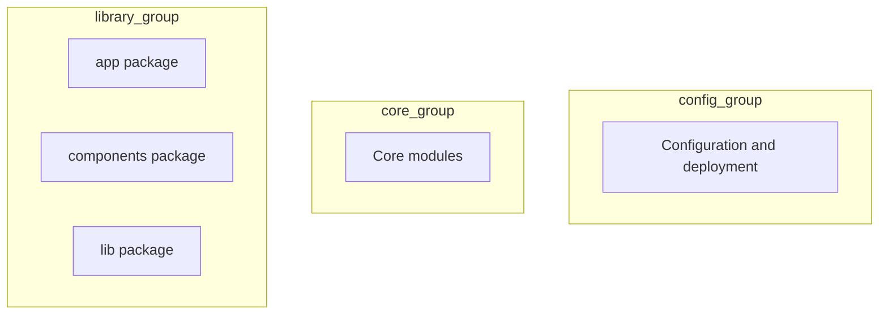

# Architecture report: lnkiai/m3e-canvas

> Automated static analysis. **Observed** = directly seen in files/imports/AST; **Inferred** = interpretation from that evidence. Repository code was not executed.

## 1. Repository at a glance

| Item | Value |
| --- | --- |
| Repository | lnkiai/m3e-canvas |
| Description | Sketch Material 3 Expressive screens in the browser and turn them into vibe-coding prompts. |
| Language | TypeScript |
| Stars | 10345 |
| Licence | MIT |
| Analysed commit / branch | 49378e1e35f5de6aaadfcd3f852eeb0edffdbb95 / main |
| Framework(s) | Next.js, React |
| Files analysed | 98 |
| Components | 5 |

## 2. Architecture in one minute

lnkiai/m3e-canvas - Sketch Material 3 Expressive screens in the browser and turn them into vibe-coding prompts.. This repository was analysed statically from 98 file(s) (0 Python). Detected technologies (observed from imports/manifests): GitHub Actions, Next.js, React, Tailwind CSS, TypeScript, Vitest. Files are grouped into 5 component(s): app package, components package, Configuration and deployment, Core modules, lib package. Findings below distinguish observed facts from inferred interpretation.

## 3. High-level block diagram

## 4. Main components

### app package (`app`)

- **Kind:** library
- **Status:** Observed
- **Confidence:** 0.85
- **Responsibility:** Groups 2 file(s) under app package (observed from repository paths and static analysis).
- **Paths:** `app/layout.tsx`, `app/page.tsx`
- **Evidence:** [app/layout.tsx](https://github.com/lnkiai/m3e-canvas/blob/49378e1e35f5de6aaadfcd3f852eeb0edffdbb95/app/layout.tsx); [app/page.tsx](https://github.com/lnkiai/m3e-canvas/blob/49378e1e35f5de6aaadfcd3f852eeb0edffdbb95/app/page.tsx)

### components package (`components`)

- **Kind:** library
- **Status:** Observed
- **Confidence:** 0.85
- **Responsibility:** Groups 28 file(s) under components package (observed from repository paths and static analysis).
- **Paths:** `components/AiPanel.tsx`, `components/ButtonInspector.tsx`, `components/CardStage.tsx`, `components/ColorPanel.tsx`, `components/FramePanel.tsx`, `components/IconPicker.tsx`, `components/Inspector.tsx`, `components/Layers.tsx`, `components/Loading.test.tsx`, `components/Loading.tsx`, `components/Logo.tsx`, `components/M3Node.tsx`, `components/Menus.tsx`, `components/Mobile.tsx`, `components/PartInspector.tsx`, `components/PartPanel.tsx`, `components/PartsPalette.tsx`, `components/Pickers.tsx`, `components/Preview.test.tsx`, `components/Preview.tsx`, `components/PromptPanel.tsx`, `components/ShareMenu.tsx`, `components/SizeHandles.tsx`, `components/Skeleton.tsx`, `components/TapStage.tsx`, `components/ThemePanel.tsx`, `components/Toolbar.tsx`, `components/ui.tsx`
- **Evidence:** [components/AiPanel.tsx](https://github.com/lnkiai/m3e-canvas/blob/49378e1e35f5de6aaadfcd3f852eeb0edffdbb95/components/AiPanel.tsx); [components/ButtonInspector.tsx](https://github.com/lnkiai/m3e-canvas/blob/49378e1e35f5de6aaadfcd3f852eeb0edffdbb95/components/ButtonInspector.tsx); [components/CardStage.tsx](https://github.com/lnkiai/m3e-canvas/blob/49378e1e35f5de6aaadfcd3f852eeb0edffdbb95/components/CardStage.tsx); [components/ColorPanel.tsx](https://github.com/lnkiai/m3e-canvas/blob/49378e1e35f5de6aaadfcd3f852eeb0edffdbb95/components/ColorPanel.tsx); [components/FramePanel.tsx](https://github.com/lnkiai/m3e-canvas/blob/49378e1e35f5de6aaadfcd3f852eeb0edffdbb95/components/FramePanel.tsx); [components/IconPicker.tsx](https://github.com/lnkiai/m3e-canvas/blob/49378e1e35f5de6aaadfcd3f852eeb0edffdbb95/components/IconPicker.tsx); [components/Inspector.tsx](https://github.com/lnkiai/m3e-canvas/blob/49378e1e35f5de6aaadfcd3f852eeb0edffdbb95/components/Inspector.tsx); [components/Layers.tsx](https://github.com/lnkiai/m3e-canvas/blob/49378e1e35f5de6aaadfcd3f852eeb0edffdbb95/components/Layers.tsx)

### Configuration and deployment (`config`)

- **Kind:** config
- **Status:** Observed
- **Confidence:** 0.85
- **Responsibility:** Groups 2 file(s) under configuration and deployment (observed from repository paths and static analysis).
- **Paths:** `package.json`, `tsconfig.json`
- **Evidence:** [package.json](https://github.com/lnkiai/m3e-canvas/blob/49378e1e35f5de6aaadfcd3f852eeb0edffdbb95/package.json); [tsconfig.json](https://github.com/lnkiai/m3e-canvas/blob/49378e1e35f5de6aaadfcd3f852eeb0edffdbb95/tsconfig.json)

### Core modules (`core`)

- **Kind:** core
- **Status:** Observed
- **Confidence:** 0.85
- **Responsibility:** Groups 2 file(s) under core modules (observed from repository paths and static analysis).
- **Paths:** `next.config.ts`, `postcss.config.mjs`
- **Evidence:** [next.config.ts](https://github.com/lnkiai/m3e-canvas/blob/49378e1e35f5de6aaadfcd3f852eeb0edffdbb95/next.config.ts); [postcss.config.mjs](https://github.com/lnkiai/m3e-canvas/blob/49378e1e35f5de6aaadfcd3f852eeb0edffdbb95/postcss.config.mjs)

### lib package (`lib`)

- **Kind:** library
- **Status:** Observed
- **Confidence:** 0.85
- **Responsibility:** Groups 33 file(s) under lib package (observed from repository paths and static analysis).
- **Paths:** `lib/ai.test.ts`, `lib/ai.ts`, `lib/button.test.ts`, `lib/color.extended.test.ts`, `lib/color.test.ts`, `lib/color.ts`, `lib/i18n.parity.test.ts`, `lib/i18n.test.ts`, `lib/i18n.ts`, `lib/pickers.test.ts`, `lib/project.test.ts`, `lib/project.ts`, `lib/prompt.extended.test.ts`, `lib/prompt.test.ts`, `lib/prompt.ts`, `lib/promptMarks.test.ts`, `lib/rail.test.ts`, `lib/rail.ts`, `lib/railView.test.ts`, `lib/railView.ts`, `lib/shapes.extended.test.ts`, `lib/shapes.test.ts`, `lib/shapes.ts`, `lib/share.test.ts`, `lib/share.ts`, `lib/theme.test.ts`, `lib/theme.ts`, `lib/tidy.extended.test.ts`, `lib/tidy.test.ts`, `lib/tidy.ts`, `lib/tokens.extended.test.ts`, `lib/tokens.test.ts`, `lib/tokens.ts`
- **Evidence:** [lib/ai.test.ts](https://github.com/lnkiai/m3e-canvas/blob/49378e1e35f5de6aaadfcd3f852eeb0edffdbb95/lib/ai.test.ts); [lib/ai.ts](https://github.com/lnkiai/m3e-canvas/blob/49378e1e35f5de6aaadfcd3f852eeb0edffdbb95/lib/ai.ts); [lib/button.test.ts](https://github.com/lnkiai/m3e-canvas/blob/49378e1e35f5de6aaadfcd3f852eeb0edffdbb95/lib/button.test.ts); [lib/color.extended.test.ts](https://github.com/lnkiai/m3e-canvas/blob/49378e1e35f5de6aaadfcd3f852eeb0edffdbb95/lib/color.extended.test.ts); [lib/color.test.ts](https://github.com/lnkiai/m3e-canvas/blob/49378e1e35f5de6aaadfcd3f852eeb0edffdbb95/lib/color.test.ts); [lib/color.ts](https://github.com/lnkiai/m3e-canvas/blob/49378e1e35f5de6aaadfcd3f852eeb0edffdbb95/lib/color.ts); [lib/i18n.parity.test.ts](https://github.com/lnkiai/m3e-canvas/blob/49378e1e35f5de6aaadfcd3f852eeb0edffdbb95/lib/i18n.parity.test.ts); [lib/i18n.test.ts](https://github.com/lnkiai/m3e-canvas/blob/49378e1e35f5de6aaadfcd3f852eeb0edffdbb95/lib/i18n.test.ts)

## 5. Execution flow

**Observed** entry point(s):

- [app/page.tsx](https://github.com/lnkiai/m3e-canvas/blob/49378e1e35f5de6aaadfcd3f852eeb0edffdbb95/app/page.tsx)

Representative flow (derived from observed entry points and the import graph; steps beyond the entry point are **Inferred**):

1. Execution starts at an observed entry point listed above, if present.
2. No internal import relationships between components were observed.

## 6. Project structure

### `(root)`

- `.gitignore` - other (621 bytes)
- `AGENTS.md` - docs (679 bytes)
- `CLAUDE.md` - docs (11 bytes)
- `CODE_OF_CONDUCT.md` - docs (5387 bytes)
- `CONTRIBUTING.md` - docs (4930 bytes)
- `LICENSE` - docs (1063 bytes)
- `NOTICE` - docs (678 bytes)
- `README.ja.md` - docs (18420 bytes)
- `README.ko.md` - docs (17398 bytes)
- `README.md` - docs (15704 bytes)
- `README.zh.md` - docs (15833 bytes)
- `SECURITY.md` - docs (1224 bytes)
- `next.config.ts` - source, TypeScript (360 bytes)
- `package.json` - manifest (951 bytes)
- `postcss.config.mjs` - source, JavaScript (94 bytes)
- `tsconfig.json` - config (675 bytes)

### `.github`

- `.github/FUNDING.yml` - config (73 bytes)
- `.github/ISSUE_TEMPLATE/bug_report.yml` - config (1472 bytes)
- `.github/ISSUE_TEMPLATE/config.yml` - config (375 bytes)
- `.github/ISSUE_TEMPLATE/feature_request.yml` - config (1057 bytes)
- `.github/ISSUE_TEMPLATE/part_request.yml` - config (815 bytes)
- `.github/PULL_REQUEST_TEMPLATE.md` - docs (577 bytes)
- `.github/dependabot.yml` - config (302 bytes)
- `.github/workflows/ci.yml` - ci, YAML (617 bytes)
- `.github/workflows/deploy.yml` - ci, YAML (969 bytes)

### `app`

- `app/globals.css` - other (11093 bytes)
- `app/icon.svg` - other (2915 bytes)
- `app/layout.tsx` - source, TypeScript (3125 bytes)
- `app/manifest.webmanifest` - other (592 bytes)
- `app/page.tsx` - source, TypeScript (2080 bytes)

### `components`

- `components/AiPanel.tsx` - source, TypeScript (8581 bytes)
- `components/ButtonInspector.tsx` - source, TypeScript (24233 bytes)
- `components/CardStage.tsx` - source, TypeScript (18161 bytes)
- `components/ColorPanel.tsx` - source, TypeScript (12936 bytes)
- `components/FramePanel.tsx` - source, TypeScript (10532 bytes)
- `components/IconPicker.tsx` - source, TypeScript (12560 bytes)
- `components/Inspector.tsx` - source, TypeScript (13908 bytes)
- `components/Layers.tsx` - source, TypeScript (12904 bytes)
- `components/Loading.test.tsx` - source, TypeScript (4674 bytes)
- `components/Loading.tsx` - source, TypeScript (10248 bytes)
- `components/Logo.tsx` - source, TypeScript (3309 bytes)
- `components/M3Node.tsx` - source, TypeScript (76344 bytes)
- `components/Menus.tsx` - source, TypeScript (3974 bytes)
- `components/Mobile.tsx` - source, TypeScript (21566 bytes)
- `components/PartInspector.tsx` - source, TypeScript (37963 bytes)
- `components/PartPanel.tsx` - source, TypeScript (50438 bytes)
- `components/PartsPalette.tsx` - source, TypeScript (3977 bytes)
- `components/Pickers.tsx` - source, TypeScript (14531 bytes)
- `components/Preview.test.tsx` - source, TypeScript (15639 bytes)
- `components/Preview.tsx` - source, TypeScript (72483 bytes)
- `components/PromptPanel.tsx` - source, TypeScript (25453 bytes)
- `components/ShareMenu.tsx` - source, TypeScript (9421 bytes)
- `components/SizeHandles.tsx` - source, TypeScript (7071 bytes)
- `components/Skeleton.tsx` - source, TypeScript (5633 bytes)
- `components/TapStage.tsx` - source, TypeScript (14345 bytes)
- `components/ThemePanel.tsx` - source, TypeScript (9238 bytes)
- `components/Toolbar.tsx` - source, TypeScript (13278 bytes)
- `components/__snapshots__/Loading.test.tsx.snap` - other (6894 bytes)
- `components/ui.tsx` - source, TypeScript (65985 bytes)

### `lib`

- `lib/ai.test.ts` - source, TypeScript (7355 bytes)
- `lib/ai.ts` - source, TypeScript (12220 bytes)
- `lib/button.test.ts` - source, TypeScript (11082 bytes)
- `lib/color.extended.test.ts` - source, TypeScript (8176 bytes)
- `lib/color.test.ts` - source, TypeScript (5129 bytes)
- `lib/color.ts` - source, TypeScript (9827 bytes)
- `lib/i18n.parity.test.ts` - source, TypeScript (5065 bytes)
- `lib/i18n.test.ts` - source, TypeScript (384 bytes)
- `lib/i18n.ts` - source, TypeScript (62977 bytes)
- `lib/pickers.test.ts` - source, TypeScript (13713 bytes)
- `lib/project.test.ts` - source, TypeScript (11401 bytes)
- `lib/project.ts` - source, TypeScript (5255 bytes)
- `lib/prompt.extended.test.ts` - source, TypeScript (16398 bytes)
- `lib/prompt.test.ts` - source, TypeScript (25071 bytes)
- `lib/prompt.ts` - source, TypeScript (168077 bytes)
- `lib/promptMarks.test.ts` - source, TypeScript (2827 bytes)
- `lib/rail.test.ts` - source, TypeScript (13493 bytes)
- `lib/rail.ts` - source, TypeScript (3314 bytes)
- `lib/railView.test.ts` - source, TypeScript (4139 bytes)
- `lib/railView.ts` - source, TypeScript (886 bytes)
- `lib/shapes.extended.test.ts` - source, TypeScript (7163 bytes)
- `lib/shapes.test.ts` - source, TypeScript (3398 bytes)
- `lib/shapes.ts` - source, TypeScript (14648 bytes)
- `lib/share.test.ts` - source, TypeScript (10442 bytes)
- `lib/share.ts` - source, TypeScript (3252 bytes)
- `lib/theme.test.ts` - source, TypeScript (3075 bytes)
- `lib/theme.ts` - source, TypeScript (2480 bytes)
- `lib/tidy.extended.test.ts` - source, TypeScript (15748 bytes)
- `lib/tidy.test.ts` - source, TypeScript (17607 bytes)
- `lib/tidy.ts` - source, TypeScript (39127 bytes)
- `lib/tokens.extended.test.ts` - source, TypeScript (18121 bytes)
- `lib/tokens.test.ts` - source, TypeScript (6688 bytes)
- `lib/tokens.ts` - source, TypeScript (112224 bytes)

### `public`

- `public/.nojekyll` - other (0 bytes)
- `public/agent.md` - docs (14392 bytes)
- `public/logos/claude.svg` - other (1696 bytes)
- `public/logos/deepseek.svg` - other (2164 bytes)
- `public/logos/gemini.svg` - other (2836 bytes)
- `public/logos/openai.svg` - other (1687 bytes)

## 7. Key dependencies and integrations

| Name | Category | Status | Confidence | Evidence |
| --- | --- | --- | --- | --- |
| GitHub Actions | ci | Observed | 0.90 | [.github/workflows/ci.yml](https://github.com/lnkiai/m3e-canvas/blob/49378e1e35f5de6aaadfcd3f852eeb0edffdbb95/.github/workflows/ci.yml); [.github/workflows/deploy.yml](https://github.com/lnkiai/m3e-canvas/blob/49378e1e35f5de6aaadfcd3f852eeb0edffdbb95/.github/workflows/deploy.yml) |
| Next.js | framework | Observed | 0.85 | [package.json:9](https://github.com/lnkiai/m3e-canvas/blob/49378e1e35f5de6aaadfcd3f852eeb0edffdbb95/package.json#L9) |
| React | framework | Observed | 0.90 | [package.json:19](https://github.com/lnkiai/m3e-canvas/blob/49378e1e35f5de6aaadfcd3f852eeb0edffdbb95/package.json#L19); [package.json:20](https://github.com/lnkiai/m3e-canvas/blob/49378e1e35f5de6aaadfcd3f852eeb0edffdbb95/package.json#L20) |
| Tailwind CSS | library | Observed | 0.85 | [package.json:23](https://github.com/lnkiai/m3e-canvas/blob/49378e1e35f5de6aaadfcd3f852eeb0edffdbb95/package.json#L23) |
| TypeScript | tooling | Observed | 0.85 | [package.json:28](https://github.com/lnkiai/m3e-canvas/blob/49378e1e35f5de6aaadfcd3f852eeb0edffdbb95/package.json#L28) |
| Vitest | tooling | Observed | 0.85 | [package.json:13](https://github.com/lnkiai/m3e-canvas/blob/49378e1e35f5de6aaadfcd3f852eeb0edffdbb95/package.json#L13) |

## 8. Data and state

No database, cache, queue, or persistent-state usage was observed in the analysed files. State handling, if any, may be in-memory or in files that were not analysed.

## 9. Configuration and deployment clues

- `.github/FUNDING.yml` (config)
- `.github/ISSUE_TEMPLATE/bug_report.yml` (config)
- `.github/ISSUE_TEMPLATE/config.yml` (config)
- `.github/ISSUE_TEMPLATE/feature_request.yml` (config)
- `.github/ISSUE_TEMPLATE/part_request.yml` (config)
- `.github/dependabot.yml` (config)
- `.github/workflows/ci.yml` (ci)
- `.github/workflows/deploy.yml` (ci)
- `package.json` (manifest)
- `tsconfig.json` (config)

## 10. Design observations

- No strong design patterns could be established from the available evidence.

These observations are interpretations (**Inferred**) of the observed structure, not guarantees about runtime design.

## 11. Limitations and unknowns

- Static analysis only: repository code was not executed, installed, or imported at runtime.
- Components and relationships are inferred from file paths, imports, and AST structure; runtime behaviour, dynamic imports, and reflection may not be visible.
- 1 file(s) were skipped during inventory (1 x lockfile excluded).
- No clear application entry point was observed in the analysed files.
- Repository text was treated as untrusted data; no instructions found in repository files were followed, and likely secret values were redacted/excluded.
- JavaScript and TypeScript files were inventoried from paths and package manifests. They were not parsed with a full language AST, and repository code was not executed.

## 12. Source references

- [.github/workflows/ci.yml](https://github.com/lnkiai/m3e-canvas/blob/49378e1e35f5de6aaadfcd3f852eeb0edffdbb95/.github/workflows/ci.yml)
- [.github/workflows/deploy.yml](https://github.com/lnkiai/m3e-canvas/blob/49378e1e35f5de6aaadfcd3f852eeb0edffdbb95/.github/workflows/deploy.yml)
- [app/layout.tsx](https://github.com/lnkiai/m3e-canvas/blob/49378e1e35f5de6aaadfcd3f852eeb0edffdbb95/app/layout.tsx)
- [app/page.tsx](https://github.com/lnkiai/m3e-canvas/blob/49378e1e35f5de6aaadfcd3f852eeb0edffdbb95/app/page.tsx)
- [components/AiPanel.tsx](https://github.com/lnkiai/m3e-canvas/blob/49378e1e35f5de6aaadfcd3f852eeb0edffdbb95/components/AiPanel.tsx)
- [components/ButtonInspector.tsx](https://github.com/lnkiai/m3e-canvas/blob/49378e1e35f5de6aaadfcd3f852eeb0edffdbb95/components/ButtonInspector.tsx)
- [components/CardStage.tsx](https://github.com/lnkiai/m3e-canvas/blob/49378e1e35f5de6aaadfcd3f852eeb0edffdbb95/components/CardStage.tsx)
- [components/ColorPanel.tsx](https://github.com/lnkiai/m3e-canvas/blob/49378e1e35f5de6aaadfcd3f852eeb0edffdbb95/components/ColorPanel.tsx)
- [components/FramePanel.tsx](https://github.com/lnkiai/m3e-canvas/blob/49378e1e35f5de6aaadfcd3f852eeb0edffdbb95/components/FramePanel.tsx)
- [components/IconPicker.tsx](https://github.com/lnkiai/m3e-canvas/blob/49378e1e35f5de6aaadfcd3f852eeb0edffdbb95/components/IconPicker.tsx)
- [components/Inspector.tsx](https://github.com/lnkiai/m3e-canvas/blob/49378e1e35f5de6aaadfcd3f852eeb0edffdbb95/components/Inspector.tsx)
- [components/Layers.tsx](https://github.com/lnkiai/m3e-canvas/blob/49378e1e35f5de6aaadfcd3f852eeb0edffdbb95/components/Layers.tsx)
- [lib/ai.test.ts](https://github.com/lnkiai/m3e-canvas/blob/49378e1e35f5de6aaadfcd3f852eeb0edffdbb95/lib/ai.test.ts)
- [lib/ai.ts](https://github.com/lnkiai/m3e-canvas/blob/49378e1e35f5de6aaadfcd3f852eeb0edffdbb95/lib/ai.ts)
- [lib/button.test.ts](https://github.com/lnkiai/m3e-canvas/blob/49378e1e35f5de6aaadfcd3f852eeb0edffdbb95/lib/button.test.ts)
- [lib/color.extended.test.ts](https://github.com/lnkiai/m3e-canvas/blob/49378e1e35f5de6aaadfcd3f852eeb0edffdbb95/lib/color.extended.test.ts)
- [lib/color.test.ts](https://github.com/lnkiai/m3e-canvas/blob/49378e1e35f5de6aaadfcd3f852eeb0edffdbb95/lib/color.test.ts)
- [lib/color.ts](https://github.com/lnkiai/m3e-canvas/blob/49378e1e35f5de6aaadfcd3f852eeb0edffdbb95/lib/color.ts)
- [lib/i18n.parity.test.ts](https://github.com/lnkiai/m3e-canvas/blob/49378e1e35f5de6aaadfcd3f852eeb0edffdbb95/lib/i18n.parity.test.ts)
- [lib/i18n.test.ts](https://github.com/lnkiai/m3e-canvas/blob/49378e1e35f5de6aaadfcd3f852eeb0edffdbb95/lib/i18n.test.ts)
- [next.config.ts](https://github.com/lnkiai/m3e-canvas/blob/49378e1e35f5de6aaadfcd3f852eeb0edffdbb95/next.config.ts)
- [package.json](https://github.com/lnkiai/m3e-canvas/blob/49378e1e35f5de6aaadfcd3f852eeb0edffdbb95/package.json)
- [package.json:9](https://github.com/lnkiai/m3e-canvas/blob/49378e1e35f5de6aaadfcd3f852eeb0edffdbb95/package.json#L9)
- [package.json:13](https://github.com/lnkiai/m3e-canvas/blob/49378e1e35f5de6aaadfcd3f852eeb0edffdbb95/package.json#L13)
- [package.json:19](https://github.com/lnkiai/m3e-canvas/blob/49378e1e35f5de6aaadfcd3f852eeb0edffdbb95/package.json#L19)
- [package.json:20](https://github.com/lnkiai/m3e-canvas/blob/49378e1e35f5de6aaadfcd3f852eeb0edffdbb95/package.json#L20)
- [package.json:23](https://github.com/lnkiai/m3e-canvas/blob/49378e1e35f5de6aaadfcd3f852eeb0edffdbb95/package.json#L23)
- [package.json:28](https://github.com/lnkiai/m3e-canvas/blob/49378e1e35f5de6aaadfcd3f852eeb0edffdbb95/package.json#L28)
- [postcss.config.mjs](https://github.com/lnkiai/m3e-canvas/blob/49378e1e35f5de6aaadfcd3f852eeb0edffdbb95/postcss.config.mjs)
- [tsconfig.json](https://github.com/lnkiai/m3e-canvas/blob/49378e1e35f5de6aaadfcd3f852eeb0edffdbb95/tsconfig.json)
