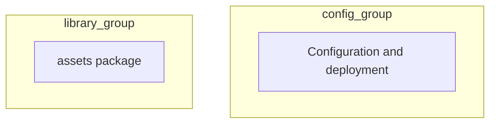

# Architecture report: lokalise/i18n-ally

> Automated static analysis. **Observed** = directly seen in files/imports/AST; **Inferred** = interpretation from that evidence. Repository code was not executed.

## 1. Repository at a glance

| Item | Value |
| --- | --- |
| Repository | lokalise/i18n-ally |
| Description | 🌍 All in one i18n extension for VS Code |
| Language | TypeScript |
| Stars | 4901 |
| Licence | MIT |
| Analysed commit / branch | 4c504c93cec6c4697134eca379f1476d0eb1c9f6 / main |
| Framework(s) | Next.js, React, Svelte, Vue |
| Files analysed | 799 |
| Components | 2 |

## 2. Architecture in one minute

lokalise/i18n-ally - 🌍 All in one i18n extension for VS Code. This repository was analysed statically from 799 file(s) (0 Python). Detected technologies (observed from imports/manifests): GitHub Actions, Next.js, React, Svelte, Vue, axios. Files are grouped into 2 component(s): assets package, Configuration and deployment. Findings below distinguish observed facts from inferred interpretation.

## 3. High-level block diagram

## 4. Main components

### assets package (`assets`)

- **Kind:** library
- **Status:** Observed
- **Confidence:** 0.85
- **Responsibility:** Groups 1 file(s) under assets package (observed from repository paths and static analysis).
- **Paths:** `assets/loader.js`
- **Evidence:** [assets/loader.js](https://github.com/lokalise/i18n-ally/blob/4c504c93cec6c4697134eca379f1476d0eb1c9f6/assets/loader.js)

### Configuration and deployment (`config`)

- **Kind:** config
- **Status:** Observed
- **Confidence:** 0.85
- **Responsibility:** Groups 18 file(s) under configuration and deployment (observed from repository paths and static analysis).
- **Paths:** `locales/de.json`, `locales/en.json`, `locales/es.json`, `locales/fr.json`, `locales/hu.json`, `locales/ja.json`, `locales/ko.json`, `locales/nb-NO.json`, `locales/nl-NL.json`, `locales/pt-BR.json`, `locales/ru.json`, `locales/sv-SE.json`, `locales/th.json`, `locales/tr.json`, `locales/uk-UA.json`, `locales/zh-CN.json`, `locales/zh-TW.json`, `package.json`
- **Evidence:** [locales/de.json](https://github.com/lokalise/i18n-ally/blob/4c504c93cec6c4697134eca379f1476d0eb1c9f6/locales/de.json); [locales/en.json](https://github.com/lokalise/i18n-ally/blob/4c504c93cec6c4697134eca379f1476d0eb1c9f6/locales/en.json); [locales/es.json](https://github.com/lokalise/i18n-ally/blob/4c504c93cec6c4697134eca379f1476d0eb1c9f6/locales/es.json); [locales/fr.json](https://github.com/lokalise/i18n-ally/blob/4c504c93cec6c4697134eca379f1476d0eb1c9f6/locales/fr.json); [locales/hu.json](https://github.com/lokalise/i18n-ally/blob/4c504c93cec6c4697134eca379f1476d0eb1c9f6/locales/hu.json); [locales/ja.json](https://github.com/lokalise/i18n-ally/blob/4c504c93cec6c4697134eca379f1476d0eb1c9f6/locales/ja.json); [locales/ko.json](https://github.com/lokalise/i18n-ally/blob/4c504c93cec6c4697134eca379f1476d0eb1c9f6/locales/ko.json); [locales/nb-NO.json](https://github.com/lokalise/i18n-ally/blob/4c504c93cec6c4697134eca379f1476d0eb1c9f6/locales/nb-NO.json)

## 5. Execution flow

No entry point was observed; the startup flow below is therefore limited.

Representative flow (derived from observed entry points and the import graph; steps beyond the entry point are **Inferred**):

1. Execution starts at an observed entry point listed above, if present.
2. No internal import relationships between components were observed.

## 6. Project structure

### `(root)`

- `.editorconfig` - config (332 bytes)
- `.eslintignore` - other (149 bytes)
- `.eslintrc.js` - source, JavaScript (123 bytes)
- `.gitattributes` - other (19 bytes)
- `.gitignore` - other (290 bytes)
- `.mocharc.yml` - config (15 bytes)
- `.tazerc.json` - config (183 bytes)
- `.vscodeignore` - other (1712 bytes)
- `.yarnrc` - other (20 bytes)
- `CHANGELOG.md` - docs (147073 bytes)
- `CODEOWNERS` - other (205 bytes)
- `CODE_OF_CONDUCT.md` - docs (6424 bytes)
- `CONTRIBUTING.md` - docs (1630 bytes)
- `LICENSE` - docs (1235 bytes)
- `README.md` - docs (8588 bytes)
- `README.zh-CN.md` - docs (5627 bytes)
- `package.json` - manifest (41659 bytes)

### `.github`

- `.github/ISSUE_TEMPLATE/bug-report.md` - docs (740 bytes)
- `.github/ISSUE_TEMPLATE/feature-request.md` - docs (639 bytes)
- `.github/ISSUE_TEMPLATE/framework-support-request.md` - docs (556 bytes)
- `.github/renovate.json5` - other (331 bytes)
- `.github/stale.yml` - config (695 bytes)
- `.github/workflows/release.yml` - ci, YAML (682 bytes)
- `.github/workflows/test.yml` - ci, YAML (2533 bytes)

### `.vscode`

- `.vscode/extensions.json` - config (236 bytes)
- `.vscode/i18n-ally-reviews.yml` - config (71 bytes)
- `.vscode/launch.json` - config (1053 bytes)
- `.vscode/settings.json` - config (1663 bytes)
- `.vscode/tasks.json` - config (736 bytes)

### `assets`

- `assets/editor/index.html` - other (412 bytes)
- `assets/loader.js` - source, JavaScript (360 bytes)

### `examples`

- `examples/README.md` - docs (417 bytes)
- `examples/by-features/100-locales/.vscode/settings.json` - config (473 bytes)
- `examples/by-features/100-locales/README.md` - docs (211 bytes)
- `examples/by-features/100-locales/app.js` - source, JavaScript (125 bytes)
- `examples/by-features/100-locales/locales/af.yml` - config (44 bytes)
- `examples/by-features/100-locales/locales/am.yml` - config (73 bytes)
- `examples/by-features/100-locales/locales/aq.yml` - config (46 bytes)
- `examples/by-features/100-locales/locales/be.yml` - config (66 bytes)
- `examples/by-features/100-locales/locales/ca.yml` - config (40 bytes)
- `examples/by-features/100-locales/locales/cy.yml` - config (43 bytes)
- `examples/by-features/100-locales/locales/de.yml` - config (51 bytes)
- `examples/by-features/100-locales/locales/en-ca.yml` - config (46 bytes)
- `examples/by-features/100-locales/locales/en-uk.yml` - config (46 bytes)
- `examples/by-features/100-locales/locales/en-us.yml` - config (210 bytes)
- `examples/by-features/100-locales/locales/es-ar.yml` - config (41 bytes)
- `examples/by-features/100-locales/locales/es.yml` - config (1 bytes)
- `examples/by-features/100-locales/locales/et.yml` - config (44 bytes)
- `examples/by-features/100-locales/locales/fr-fr.yml` - config (49 bytes)
- `examples/by-features/100-locales/locales/gd.yml` - config (47 bytes)
- `examples/by-features/100-locales/locales/he.yml` - config (0 bytes)
- `examples/by-features/100-locales/locales/hr.yml` - config (43 bytes)
- `examples/by-features/100-locales/locales/ja.yml` - config (59 bytes)
- `examples/by-features/100-locales/locales/ko.yml` - config (53 bytes)
- `examples/by-features/100-locales/locales/mk.yml` - config (58 bytes)
- `examples/by-features/100-locales/locales/mn.yml` - config (80 bytes)
- `examples/by-features/100-locales/locales/mt.yml` - config (43 bytes)
- `examples/by-features/100-locales/locales/ne.yml` - config (74 bytes)
- `examples/by-features/100-locales/locales/no-no.yml` - config (42 bytes)
- `examples/by-features/100-locales/locales/pt-br.yml` - config (38 bytes)
- `examples/by-features/100-locales/locales/ru.yml` - config (58 bytes)
- `examples/by-features/100-locales/locales/th.yml` - config (68 bytes)
- `examples/by-features/100-locales/locales/vi.yml` - config (57 bytes)
- `examples/by-features/100-locales/locales/zh-cn.yml` - config (44 bytes)
- `examples/by-features/100-locales/locales/zh-hk.yml` - config (44 bytes)
- `examples/by-features/100-locales/locales/zh-sg.yml` - config (44 bytes)
- `examples/by-features/100-locales/locales/zh-tw.yml` - config (44 bytes)
- `examples/by-features/100-locales/package.json` - manifest (47 bytes)
- `examples/by-features/collections/.vscode/settings.json` - config (51 bytes)
- `examples/by-features/collections/App.vue` - source, Vue (587 bytes)
- `examples/by-features/collections/locales/en.json` - config (265 bytes)
- `examples/by-features/collections/locales/ja.json` - config (4 bytes)
- `examples/by-features/collections/package.json` - manifest (142 bytes)
- `examples/by-features/custom-locales-path/App.vue` - source, Vue (1164 bytes)
- `examples/by-features/custom-locales-path/lang/en.json` - config (646 bytes)
- `examples/by-features/custom-locales-path/lang/ja.json` - config (281 bytes)
- `examples/by-features/custom-locales-path/lang/zh-cn.json` - config (152 bytes)
- `examples/by-features/custom-locales-path/package.json` - manifest (150 bytes)
- `examples/by-features/custom-scope-range/.vscode/i18n-ally-custom-framework.yml` - config (169 bytes)
- `examples/by-features/custom-scope-range/.vscode/settings.json` - config (236 bytes)
- `examples/by-features/custom-scope-range/package.json` - manifest (242 bytes)
- `examples/by-features/custom-scope-range/public/index.html` - other (384 bytes)
- `examples/by-features/custom-scope-range/public/locales/en/pages/home.json` - config (22 bytes)
- `examples/by-features/custom-scope-range/public/locales/en/translation.json` - config (254 bytes)
- `examples/by-features/custom-scope-range/src/App.css` - other (124 bytes)
- `examples/by-features/custom-scope-range/src/App.jsx` - source, JavaScript (1763 bytes)
- `examples/by-features/custom-scope-range/src/customScopeRange.js` - source, JavaScript (69 bytes)
- `examples/by-features/custom-scope-range/src/i18n.js` - source, JavaScript (391 bytes)
- `examples/by-features/custom-scope-range/src/index.js` - source, JavaScript (243 bytes)
- `examples/by-features/demo/.vscode/settings.json` - config (161 bytes)
- `examples/by-features/demo/Demo.vue` - source, Vue (372 bytes)
- `examples/by-features/demo/locales/en.json` - config (304 bytes)
- `examples/by-features/demo/locales/fr.json` - config (246 bytes)
- `examples/by-features/demo/locales/ja.json` - config (159 bytes)
- `examples/by-features/demo/locales/ko.yml` - config (148 bytes)
- `examples/by-features/demo/locales/zh-cn.yml` - config (134 bytes)
- `examples/by-features/demo/package.json` - manifest (135 bytes)
- `examples/by-features/dir-locales/.vscode/settings.json` - config (112 bytes)
- `examples/by-features/dir-locales/App.vue` - source, Vue (107 bytes)
- `examples/by-features/dir-locales/locales/en/a.json` - config (33 bytes)
- `examples/by-features/dir-locales/locales/en/b.json` - config (35 bytes)
- `examples/by-features/dir-locales/locales/en/index.js` - source, JavaScript (71 bytes)
- `examples/by-features/dir-locales/locales/ja/a.json` - config (33 bytes)
- `examples/by-features/dir-locales/locales/ja/b.json` - config (35 bytes)
- `examples/by-features/dir-locales/locales/ja/index.js` - source, JavaScript (71 bytes)
- `examples/by-features/dir-locales/locales/zh-cn/a.json` - config (33 bytes)
- `examples/by-features/dir-locales/locales/zh-cn/b.json` - config (35 bytes)
- `examples/by-features/dir-locales/locales/zh-cn/index.js` - source, JavaScript (71 bytes)
- `examples/by-features/dir-locales/package.json` - manifest (136 bytes)
- `examples/by-features/encoding/Demo.vue` - source, Vue (300 bytes)
- `examples/by-features/encoding/locales/en-us.json` - config (122 bytes)
- `examples/by-features/encoding/locales/en.json` - config (224 bytes)
- `examples/by-features/encoding/locales/ja.json` - config (168 bytes)
- `examples/by-features/encoding/locales/ko.yml` - config (190 bytes)
- `examples/by-features/encoding/locales/zh-cn.json` - config (185 bytes)
- `examples/by-features/encoding/locales/zh-tw.json` - config (194 bytes)
- `examples/by-features/encoding/package.json` - manifest (135 bytes)
- `examples/by-features/extractions/.eslintignore` - other (2 bytes)
- `examples/by-features/extractions/.vscode/settings.json` - config (633 bytes)
- `examples/by-features/extractions/Demo.vue` - source, Vue (271 bytes)
- `examples/by-features/extractions/Demo2.vue` - source, Vue (407 bytes)
- `examples/by-features/extractions/SavedBoards.vue` - source, Vue (3495 bytes)
- `examples/by-features/extractions/a.tsx` - source, TypeScript (89 bytes)
- `examples/by-features/extractions/index.html` - other (1553 bytes)
- `examples/by-features/extractions/locales/en.json` - config (338 bytes)
- `examples/by-features/extractions/package.json` - manifest (142 bytes)
- `examples/by-features/flatten-mode/App.vue` - source, Vue (755 bytes)
- `examples/by-features/flatten-mode/lang/en.json` - config (255 bytes)
- `examples/by-features/flatten-mode/lang/ja.yml` - config (151 bytes)
- `examples/by-features/flatten-mode/lang/zh-cn.json` - config (145 bytes)
- `examples/by-features/flatten-mode/package.json` - manifest (150 bytes)
- `examples/by-features/flatten-scope-conflict/index.js` - source, JavaScript (57 bytes)
- `examples/by-features/flatten-scope-conflict/lang/en.json` - config (66 bytes)
- `examples/by-features/flatten-scope-conflict/lang/ja.yml` - config (44 bytes)
- `examples/by-features/flatten-scope-conflict/package.json` - manifest (48 bytes)
- `examples/by-features/js-parser-dir/.vscode/settings.json` - config (130 bytes)
- `examples/by-features/js-parser-dir/App.vue` - source, Vue (304 bytes)
- `examples/by-features/js-parser-dir/locales/en/a.ts` - source, TypeScript (29 bytes)
- `examples/by-features/js-parser-dir/locales/en/b.ts` - source, TypeScript (29 bytes)
- `examples/by-features/js-parser-dir/locales/en/index.ts` - source, TypeScript (76 bytes)
- `examples/by-features/js-parser-dir/locales/zh-cn/a.ts` - source, TypeScript (31 bytes)
- `examples/by-features/js-parser-dir/locales/zh-cn/b.ts` - source, TypeScript (31 bytes)
- `examples/by-features/js-parser-dir/locales/zh-cn/index.ts` - source, TypeScript (76 bytes)
- `examples/by-features/js-parser-dir/package.json` - manifest (136 bytes)
- `examples/by-features/js-parser-dir/tsconfig.json` - config (101 bytes)
- `examples/by-features/js-parser/.vscode/settings.json` - config (240 bytes)
- `examples/by-features/js-parser/App.vue` - source, Vue (304 bytes)
- `examples/by-features/js-parser/locales/en.ts` - source, TypeScript (145 bytes)
- `examples/by-features/js-parser/locales/fr.ts` - source, TypeScript (92 bytes)
- `examples/by-features/js-parser/locales/ja.js` - source, JavaScript (68 bytes)
- `examples/by-features/js-parser/locales/zh_cn.js` - source, JavaScript (80 bytes)
- `examples/by-features/js-parser/package.json` - manifest (136 bytes)
- `examples/by-features/js-parser/tsconfig.json` - config (101 bytes)
- `examples/by-features/json5/.vscode/settings.json` - config (132 bytes)
- `examples/by-features/json5/App.vue` - source, Vue (1164 bytes)
- `examples/by-features/json5/locales/en.json5` - other (616 bytes)
- `examples/by-features/json5/locales/ja.my-custom-ext` - other (283 bytes)
- `examples/by-features/json5/locales/zh-cn.json5` - other (161 bytes)
- `examples/by-features/json5/package.json` - manifest (136 bytes)
- `examples/by-features/linked/Demo.vue` - source, Vue (296 bytes)
- `examples/by-features/linked/locales/en.json` - config (343 bytes)
- `examples/by-features/linked/locales/fr.json` - config (194 bytes)
- `examples/by-features/linked/locales/ja.json` - config (135 bytes)
- `examples/by-features/linked/locales/ko.yml` - config (158 bytes)
- `examples/by-features/linked/locales/nl-nl.ini` - config (107 bytes)
- `examples/by-features/linked/locales/zh-cn.yml` - config (128 bytes)
- `examples/by-features/linked/package.json` - manifest (135 bytes)
- `examples/by-features/module-style/App.vue` - source, Vue (186 bytes)
- `examples/by-features/module-style/modules/moduleA/locales/en.json` - config (19 bytes)
- `examples/by-features/module-style/modules/moduleA/locales/fr.json` - config (17 bytes)
- `examples/by-features/module-style/modules/moduleA/locales/zh-cn.json` - config (18 bytes)
- `examples/by-features/module-style/modules/moduleB/locales/en.json` - config (19 bytes)
- `examples/by-features/module-style/modules/moduleB/locales/fr.json` - config (19 bytes)
- `examples/by-features/module-style/modules/moduleB/locales/zh-cn.json` - config (18 bytes)
- `examples/by-features/module-style/modules/moduleC/nested/locales/en.json` - config (23 bytes)
- `examples/by-features/module-style/modules/moduleC/nested/locales/fr.json` - config (22 bytes)
- `examples/by-features/module-style/modules/moduleC/nested/locales/zh-cn.json` - config (20 bytes)
- `examples/by-features/module-style/package.json` - manifest (143 bytes)
- `examples/by-features/path-matcher/locale-namespaces/.vscode/settings.json` - config (168 bytes)
- `examples/by-features/path-matcher/locale-namespaces/App.vue` - source, Vue (132 bytes)
- `examples/by-features/path-matcher/locale-namespaces/i18n/en/foo.yml` - config (31 bytes)
- `examples/by-features/path-matcher/locale-namespaces/i18n/en/foo/bar.yml` - config (28 bytes)
- `examples/by-features/path-matcher/locale-namespaces/i18n/en/general.yml` - config (13 bytes)
- `examples/by-features/path-matcher/locale-namespaces/i18n/fr/foo.yml` - config (34 bytes)
- `examples/by-features/path-matcher/locale-namespaces/i18n/fr/foo/bar.yml` - config (28 bytes)
- `examples/by-features/path-matcher/locale-namespaces/i18n/fr/general.yml` - config (15 bytes)
- `examples/by-features/path-matcher/locale-namespaces/package.json` - manifest (48 bytes)
- `examples/by-features/path-matcher/namespaces-locale/.vscode/settings.json` - config (170 bytes)
- `examples/by-features/path-matcher/namespaces-locale/App.vue` - source, Vue (152 bytes)
- `examples/by-features/path-matcher/namespaces-locale/i18n/en.yml` - config (9 bytes)
- `examples/by-features/path-matcher/namespaces-locale/i18n/foo/bar/en.yml` - config (28 bytes)
- `examples/by-features/path-matcher/namespaces-locale/i18n/foo/bar/fr.yml` - config (28 bytes)
- `examples/by-features/path-matcher/namespaces-locale/i18n/foo/en.yml` - config (31 bytes)
- `examples/by-features/path-matcher/namespaces-locale/i18n/foo/fr.yml` - config (34 bytes)
- `examples/by-features/path-matcher/namespaces-locale/i18n/general/en.yml` - config (13 bytes)
- `examples/by-features/path-matcher/namespaces-locale/i18n/general/fr.yml` - config (16 bytes)
- `examples/by-features/path-matcher/namespaces-locale/package.json` - manifest (48 bytes)
- `examples/by-features/tag-system-bcp47/.vscode/settings.json` - config (253 bytes)
- `examples/by-features/tag-system-bcp47/README.md` - docs (211 bytes)
- `examples/by-features/tag-system-bcp47/app.js` - source, JavaScript (16 bytes)
- `examples/by-features/tag-system-bcp47/locales/de-DE-bavarian.yml` - config (0 bytes)
- `examples/by-features/tag-system-bcp47/locales/de-de.yml` - config (0 bytes)
- `examples/by-features/tag-system-bcp47/locales/de.yml` - config (0 bytes)
- `examples/by-features/tag-system-bcp47/locales/en.yml` - config (13 bytes)
- `examples/by-features/tag-system-bcp47/locales/zh-cn.yml` - config (0 bytes)
- `examples/by-features/tag-system-bcp47/locales/zh-hk.yml` - config (0 bytes)
- `examples/by-features/tag-system-bcp47/locales/zh-sg.yml` - config (0 bytes)
- `examples/by-features/tag-system-bcp47/locales/zh-tw.yml` - config (0 bytes)
- `examples/by-features/tag-system-bcp47/package.json` - manifest (47 bytes)
- `examples/by-features/yaml/App.vue` - source, Vue (250 bytes)
- `examples/by-features/yaml/locales/en.yml` - config (79 bytes)
- `examples/by-features/yaml/locales/ja.yaml` - config (76 bytes)
- `examples/by-features/yaml/locales/zh-cn.yml` - config (14 bytes)
- `examples/by-features/yaml/package.json` - manifest (135 bytes)
- `examples/by-frameworks/angular/angular.json` - config (4033 bytes)
- `examples/by-frameworks/angular/package.json` - manifest (1893 bytes)
- `examples/by-frameworks/angular/src/app/app.component.css` - other (174 bytes)
- `examples/by-frameworks/angular/src/app/app.component.html` - other (327 bytes)
- `examples/by-frameworks/angular/src/app/app.component.spec.ts` - source, TypeScript (984 bytes)
- `examples/by-frameworks/angular/src/app/app.component.ts` - source, TypeScript (444 bytes)
- `examples/by-frameworks/angular/src/app/app.module.ts` - source, TypeScript (314 bytes)
- `examples/by-frameworks/angular/src/environments/environment.prod.ts` - source, TypeScript (51 bytes)
- `examples/by-frameworks/angular/src/environments/environment.ts` - source, TypeScript (662 bytes)
- `examples/by-frameworks/angular/src/index.html` - other (295 bytes)
- `examples/by-frameworks/angular/src/karma.conf.js` - source, JavaScript (964 bytes)
- `examples/by-frameworks/angular/src/main.ts` - source, TypeScript (372 bytes)
- `examples/by-frameworks/angular/src/polyfills.ts` - source, TypeScript (2838 bytes)
- `examples/by-frameworks/angular/src/styles.css` - other (80 bytes)
- `examples/by-frameworks/angular/src/test.ts` - source, TypeScript (642 bytes)
- `examples/by-frameworks/angular/src/translate/messages.en.xlf` - other (1027 bytes)
- `examples/by-frameworks/angular/src/translate/messages.es.xlf` - other (1042 bytes)
- `examples/by-frameworks/angular/src/translate/messages.hi.xlf` - other (1128 bytes)
- `examples/by-frameworks/angular/src/translate/messages.xlf` - other (913 bytes)
- `examples/by-frameworks/angular/src/tsconfig.app.json` - config (166 bytes)
- `examples/by-frameworks/angular/src/tsconfig.spec.json` - config (256 bytes)
- `examples/by-frameworks/angular/src/tslint.json` - config (314 bytes)
- `examples/by-frameworks/angular/tsconfig.json` - config (438 bytes)
- `examples/by-frameworks/angular/tslint.json` - config (2837 bytes)
- `examples/by-frameworks/chrome-extension/_locales/en/messages.json` - config (193 bytes)
- `examples/by-frameworks/chrome-extension/_locales/ja/messages.json` - config (133 bytes)
- `examples/by-frameworks/chrome-extension/manifest.json` - config (591 bytes)
- `examples/by-frameworks/chrome-extension/popup.js` - source, JavaScript (114 bytes)
- `examples/by-frameworks/custom/.vscode/i18n-ally-custom-framework.yml` - config (210 bytes)
- `examples/by-frameworks/custom/.vscode/settings.json` - config (78 bytes)
- `examples/by-frameworks/custom/App.vue` - source, Vue (176 bytes)
- `examples/by-frameworks/custom/index.ts` - source, TypeScript (36 bytes)
- `examples/by-frameworks/custom/locales/en.json` - config (361 bytes)
- `examples/by-frameworks/custom/package.json` - manifest (64 bytes)
- `examples/by-frameworks/ember/.vscode/settings.json` - config (162 bytes)
- `examples/by-frameworks/ember/locales/en.json` - config (71 bytes)
- `examples/by-frameworks/ember/locales/zh-cn.json` - config (24 bytes)
- `examples/by-frameworks/ember/package.json` - manifest (50 bytes)
- `examples/by-frameworks/ember/template.hbs` - other (81 bytes)
- `examples/by-frameworks/fluent-vue-sfc/.vscode/settings.json` - config (73 bytes)
- `examples/by-frameworks/fluent-vue-sfc/i18n/en.ftl` - other (26 bytes)
- `examples/by-frameworks/fluent-vue-sfc/package.json` - manifest (248 bytes)
- `examples/by-frameworks/fluent-vue-sfc/src/App.vue` - source, Vue (1183 bytes)
- `examples/by-frameworks/fluent-vue-sfc/src/fluent.js` - source, JavaScript (211 bytes)
- `examples/by-frameworks/fluent-vue-sfc/src/index.js` - source, JavaScript (156 bytes)
- `examples/by-frameworks/fluent-vue/.vscode/settings.json` - config (73 bytes)
- `examples/by-frameworks/fluent-vue/i18n/en.ftl` - other (266 bytes)
- `examples/by-frameworks/fluent-vue/package.json` - manifest (178 bytes)
- `examples/by-frameworks/fluent-vue/src/App.vue` - source, Vue (872 bytes)
- `examples/by-frameworks/fluent-vue/src/fluent.js` - source, JavaScript (211 bytes)
- `examples/by-frameworks/fluent-vue/src/index.js` - source, JavaScript (156 bytes)
- `examples/by-frameworks/flutter/.gitignore` - other (65 bytes)
- `examples/by-frameworks/flutter/.vscode/settings.json` - config (45 bytes)
- `examples/by-frameworks/flutter/assets/i18n/en.yaml` - config (381 bytes)
- `examples/by-frameworks/flutter/assets/i18n/es.json` - config (385 bytes)
- `examples/by-frameworks/flutter/assets/i18n/it.json` - config (377 bytes)
- `examples/by-frameworks/flutter/lib/main.dart` - other (3140 bytes)
- `examples/by-frameworks/flutter/pubspec.yaml` - config (271 bytes)
- `examples/by-frameworks/i18n-js/.gitignore` - other (310 bytes)
- `examples/by-frameworks/i18n-js/.vscode/i18n-ally-custom-framework.yml` - config (1172 bytes)
- `examples/by-frameworks/i18n-js/.vscode/settings.json` - config (63 bytes)
- `examples/by-frameworks/i18n-js/README.md` - docs (3362 bytes)
- `examples/by-frameworks/i18n-js/package.json` - manifest (835 bytes)
- `examples/by-frameworks/i18n-js/public/index.html` - other (1721 bytes)
- `examples/by-frameworks/i18n-js/public/manifest.json` - config (492 bytes)
- `examples/by-frameworks/i18n-js/public/robots.txt` - docs (67 bytes)
- `examples/by-frameworks/i18n-js/src/App.css` - other (564 bytes)
- `examples/by-frameworks/i18n-js/src/App.js` - source, JavaScript (358 bytes)
- `examples/by-frameworks/i18n-js/src/App.test.js` - source, JavaScript (246 bytes)
- `examples/by-frameworks/i18n-js/src/index.css` - other (366 bytes)
- `examples/by-frameworks/i18n-js/src/index.js` - source, JavaScript (500 bytes)
- `examples/by-frameworks/i18n-js/src/locales/en.json` - config (46 bytes)
- `examples/by-frameworks/i18n-js/src/locales/index.js` - source, JavaScript (165 bytes)
- `examples/by-frameworks/i18n-js/src/locales/sk.json` - config (46 bytes)
- `examples/by-frameworks/i18n-js/src/logo.svg` - other (2632 bytes)
- `examples/by-frameworks/i18n-js/src/reportWebVitals.js` - source, JavaScript (362 bytes)
- `examples/by-frameworks/i18n-js/src/setupTests.js` - source, JavaScript (241 bytes)
- `examples/by-frameworks/i18next-shopify/.vscode/settings.json` - config (282 bytes)
- `examples/by-frameworks/i18next-shopify/package.json` - manifest (533 bytes)
- `examples/by-frameworks/i18next-shopify/public/index.html` - other (384 bytes)
- `examples/by-frameworks/i18next-shopify/public/locales/de/pages/home.json` - config (25 bytes)
- `examples/by-frameworks/i18next-shopify/public/locales/de/translation.json` - config (365 bytes)
- `examples/by-frameworks/i18next-shopify/public/locales/en/pages/home.json` - config (22 bytes)
- `examples/by-frameworks/i18next-shopify/public/locales/en/translation.json` - config (361 bytes)
- `examples/by-frameworks/i18next-shopify/src/App.css` - other (124 bytes)
- `examples/by-frameworks/i18next-shopify/src/App.jsx` - source, JavaScript (2383 bytes)
- `examples/by-frameworks/i18next-shopify/src/i18n.js` - source, JavaScript (1016 bytes)
- `examples/by-frameworks/i18next-shopify/src/index.css` - other (63 bytes)
- `examples/by-frameworks/i18next-shopify/src/index.js` - source, JavaScript (282 bytes)
- `examples/by-frameworks/jekyll/.vscode/settings.json` - config (42 bytes)
- `examples/by-frameworks/jekyll/Gemfile` - other (108 bytes)
- `examples/by-frameworks/jekyll/LICENSE` - docs (1070 bytes)
- `examples/by-frameworks/jekyll/_i18n/en.yml` - config (86 bytes)
- `examples/by-frameworks/jekyll/_i18n/fr.yml` - config (99 bytes)
- `examples/by-frameworks/jekyll/_pages/404.html` - other (348 bytes)
- `examples/by-frameworks/laravel/.vscode/settings.json` - config (50 bytes)
- `examples/by-frameworks/laravel/app/User.php` - source, PHP (98 bytes)
- `examples/by-frameworks/laravel/composer.json` - config (1503 bytes)
- `examples/by-frameworks/laravel/resources/lang/en/messages.php` - source, PHP (112 bytes)
- `examples/by-frameworks/laravel/resources/lang/en/validation.php` - source, PHP (337 bytes)
- `examples/by-frameworks/laravel/resources/lang/es-es/messages.php` - source, PHP (69 bytes)
- `examples/by-frameworks/lingui-nextjs/.babelrc` - other (65 bytes)
- `examples/by-frameworks/lingui-nextjs/.vscode/settings.json` - config (50 bytes)
- `examples/by-frameworks/lingui-nextjs/README.md` - docs (75 bytes)
- `examples/by-frameworks/lingui-nextjs/lingui-example/components/Layout.module.css` - other (588 bytes)
- `examples/by-frameworks/lingui-nextjs/lingui-example/components/Layout.tsx` - source, TypeScript (1426 bytes)
- `examples/by-frameworks/lingui-nextjs/lingui-example/components/PluralExample.tsx` - source, TypeScript (357 bytes)
- `examples/by-frameworks/lingui-nextjs/lingui-example/i18n.ts` - source, TypeScript (559 bytes)
- `examples/by-frameworks/lingui-nextjs/lingui-example/styles.css` - other (275 bytes)
- `examples/by-frameworks/lingui-nextjs/lingui.config.js` - source, JavaScript (220 bytes)
- `examples/by-frameworks/lingui-nextjs/locale/cs/messages.js` - source, JavaScript (872 bytes)
- `examples/by-frameworks/lingui-nextjs/locale/cs/messages.po` - other (1557 bytes)
- `examples/by-frameworks/lingui-nextjs/locale/en/messages.js` - source, JavaScript (794 bytes)
- `examples/by-frameworks/lingui-nextjs/locale/en/messages.po` - other (1544 bytes)
- `examples/by-frameworks/lingui-nextjs/next.config.js` - source, JavaScript (315 bytes)
- `examples/by-frameworks/lingui-nextjs/package.json` - manifest (655 bytes)
- `examples/by-frameworks/lingui-nextjs/pages/_app.tsx` - source, TypeScript (457 bytes)
- `examples/by-frameworks/lingui-nextjs/pages/api/hello.ts` - source, TypeScript (168 bytes)
- `examples/by-frameworks/lingui-nextjs/pages/examples.tsx` - source, TypeScript (847 bytes)
- `examples/by-frameworks/lingui-nextjs/pages/index.module.css` - other (1342 bytes)
- `examples/by-frameworks/lingui-nextjs/pages/index.tsx` - source, TypeScript (1237 bytes)
- `examples/by-frameworks/lingui-nextjs/public/vercel.svg` - other (1101 bytes)
- `examples/by-frameworks/lingui-nextjs/tsconfig.json` - config (624 bytes)
- `examples/by-frameworks/next-international/.gitignore` - other (53 bytes)
- `examples/by-frameworks/next-international/.vscode/settings.json` - config (199 bytes)
- `examples/by-frameworks/next-international/next-env.d.ts` - source, TypeScript (201 bytes)
- `examples/by-frameworks/next-international/next.config.js` - source, JavaScript (87 bytes)
- `examples/by-frameworks/next-international/package.json` - manifest (443 bytes)
- `examples/by-frameworks/next-international/src/locales/en.ts` - source, TypeScript (140 bytes)
- `examples/by-frameworks/next-international/src/locales/fr.ts` - source, TypeScript (149 bytes)
- `examples/by-frameworks/next-international/src/locales/index.ts` - source, TypeScript (192 bytes)
- `examples/by-frameworks/next-international/src/pages/_app.tsx` - source, TypeScript (262 bytes)
- `examples/by-frameworks/next-international/src/pages/index.tsx` - source, TypeScript (547 bytes)
- `examples/by-frameworks/next-international/tsconfig.json` - config (442 bytes)
- `examples/by-frameworks/next-intl/.eslintrc` - other (85 bytes)
- `examples/by-frameworks/next-intl/.gitignore` - other (53 bytes)
- `examples/by-frameworks/next-intl/.vscode/settings.json` - config (91 bytes)
- `examples/by-frameworks/next-intl/global.d.ts` - source, TypeScript (150 bytes)
- `examples/by-frameworks/next-intl/messages/de.json` - config (184 bytes)
- `examples/by-frameworks/next-intl/messages/en.json` - config (181 bytes)
- `examples/by-frameworks/next-intl/next-env.d.ts` - source, TypeScript (201 bytes)
- `examples/by-frameworks/next-intl/next.config.js` - source, JavaScript (84 bytes)
- `examples/by-frameworks/next-intl/package.json` - manifest (424 bytes)
- `examples/by-frameworks/next-intl/src/app/[locale]/GetTranslationsTest1.tsx` - source, TypeScript (184 bytes)
- `examples/by-frameworks/next-intl/src/app/[locale]/GetTranslationsTest2.tsx` - source, TypeScript (185 bytes)
- `examples/by-frameworks/next-intl/src/app/[locale]/GetTranslationsTest3.tsx` - source, TypeScript (225 bytes)
- `examples/by-frameworks/next-intl/src/app/[locale]/UseTranslationsTest1.tsx` - source, TypeScript (161 bytes)
- `examples/by-frameworks/next-intl/src/app/[locale]/UseTranslationsTest2.tsx` - source, TypeScript (160 bytes)
- `examples/by-frameworks/next-intl/src/app/[locale]/layout.tsx` - source, TypeScript (631 bytes)
- `examples/by-frameworks/next-intl/src/app/[locale]/page.tsx` - source, TypeScript (1327 bytes)
- `examples/by-frameworks/next-intl/src/i18n.ts` - source, TypeScript (179 bytes)
- `examples/by-frameworks/next-intl/src/middleware.tsx` - source, TypeScript (265 bytes)
- `examples/by-frameworks/next-intl/tsconfig.json` - config (670 bytes)
- `examples/by-frameworks/next-translate/.vscode/settings.json` - config (41 bytes)
- `examples/by-frameworks/next-translate/components/header.js` - source, JavaScript (1167 bytes)
- `examples/by-frameworks/next-translate/components/no-functional-component.js` - source, JavaScript (351 bytes)
- `examples/by-frameworks/next-translate/components/plural-example.js` - source, JavaScript (461 bytes)
- `examples/by-frameworks/next-translate/i18n.json` - config (166 bytes)
- `examples/by-frameworks/next-translate/locales/ca/common.json` - config (42 bytes)
- `examples/by-frameworks/next-translate/locales/ca/dynamic.json` - config (85 bytes)
- `examples/by-frameworks/next-translate/locales/ca/home.json` - config (136 bytes)
- `examples/by-frameworks/next-translate/locales/ca/more-examples.json` - config (691 bytes)
- `examples/by-frameworks/next-translate/locales/en/common.json` - config (40 bytes)
- `examples/by-frameworks/next-translate/locales/en/dynamic.json` - config (71 bytes)
- `examples/by-frameworks/next-translate/locales/en/home.json` - config (117 bytes)
- `examples/by-frameworks/next-translate/locales/en/more-examples.json` - config (675 bytes)
- `examples/by-frameworks/next-translate/locales/es/common.json` - config (42 bytes)
- `examples/by-frameworks/next-translate/locales/es/dynamic.json` - config (83 bytes)
- `examples/by-frameworks/next-translate/locales/es/home.json` - config (140 bytes)
- `examples/by-frameworks/next-translate/locales/es/more-examples.json` - config (671 bytes)
- `examples/by-frameworks/next-translate/package.json` - manifest (471 bytes)
- `examples/by-frameworks/next-translate/pages_/_app.js` - source, JavaScript (149 bytes)
- `examples/by-frameworks/next-translate/pages_/_document.js` - source, JavaScript (582 bytes)
- `examples/by-frameworks/next-translate/pages_/index.tsx` - source, TypeScript (679 bytes)
- `examples/by-frameworks/next-translate/pages_/more-examples/dynamic-namespace.js` - source, JavaScript (659 bytes)
- `examples/by-frameworks/next-translate/pages_/more-examples/index.js` - source, JavaScript (1031 bytes)
- `examples/by-frameworks/ngneat-transloco/.vscode/settings.json` - config (39 bytes)
- `examples/by-frameworks/ngneat-transloco/app/home.component.html` - other (396 bytes)
- `examples/by-frameworks/ngneat-transloco/app/home.component.ts` - source, TypeScript (600 bytes)
- `examples/by-frameworks/ngneat-transloco/i18n/en.json` - config (134 bytes)
- `examples/by-frameworks/ngneat-transloco/i18n/es.json` - config (134 bytes)
- `examples/by-frameworks/ngneat-transloco/package.json` - manifest (1292 bytes)
- `examples/by-frameworks/ngx-translate/.vscode/settings.json` - config (113 bytes)
- `examples/by-frameworks/ngx-translate/package.json` - manifest (1322 bytes)
- `examples/by-frameworks/ngx-translate/src/app.component.ts` - source, TypeScript (976 bytes)
- `examples/by-frameworks/ngx-translate/src/app.module.ts` - source, TypeScript (863 bytes)
- `examples/by-frameworks/ngx-translate/src/i18n/en.json` - config (102 bytes)
- `examples/by-frameworks/ngx-translate/src/i18n/fr.json` - config (107 bytes)
- `examples/by-frameworks/ngx-translate/src/should_ignore.jsx` - source, JavaScript (120 bytes)
- `examples/by-frameworks/ngx-translate/src/should_ignore.vue` - source, Vue (370 bytes)
- `examples/by-frameworks/ngx-translate/tsconfig.json` - config (384 bytes)
- `examples/by-frameworks/non-i18n-project/App.vue` - source, Vue (250 bytes)
- `examples/by-frameworks/non-i18n-project/locales/en.json` - config (22 bytes)
- `examples/by-frameworks/non-i18n-project/locales/ja.json` - config (3 bytes)
- `examples/by-frameworks/non-i18n-project/locales/zh-cn.json` - config (2 bytes)
- `examples/by-frameworks/non-i18n-project/package.json` - manifest (139 bytes)
- `examples/by-frameworks/php-po/.vscode/settings.json` - config (99 bytes)
- `examples/by-frameworks/php-po/index.php` - source, PHP (389 bytes)
- `examples/by-frameworks/php-po/locale/en_US/messages.po` - other (86 bytes)
- `examples/by-frameworks/php-po/locale/zh-CN/messages.po` - other (83 bytes)
- `examples/by-frameworks/react-i18next/.vscode/settings.json` - config (346 bytes)
- `examples/by-frameworks/react-i18next/package.json` - manifest (492 bytes)
- `examples/by-frameworks/react-i18next/public/index.html` - other (384 bytes)
- `examples/by-frameworks/react-i18next/public/locales/de/pages/home.json` - config (25 bytes)
- `examples/by-frameworks/react-i18next/public/locales/de/translation.json` - config (262 bytes)
- `examples/by-frameworks/react-i18next/public/locales/en/pages/home.json` - config (22 bytes)
- `examples/by-frameworks/react-i18next/public/locales/en/translation.json` - config (254 bytes)
- `examples/by-frameworks/react-i18next/src/App.css` - other (124 bytes)
- `examples/by-frameworks/react-i18next/src/App.jsx` - source, JavaScript (2313 bytes)
- `examples/by-frameworks/react-i18next/src/i18n.js` - source, JavaScript (890 bytes)
- `examples/by-frameworks/react-i18next/src/index.css` - other (63 bytes)
- `examples/by-frameworks/react-i18next/src/index.js` - source, JavaScript (282 bytes)
- `examples/by-frameworks/ruby-on-rails/.vscode/settings.json` - config (48 bytes)
- `examples/by-frameworks/ruby-on-rails/Gemfile` - other (629 bytes)
- `examples/by-frameworks/ruby-on-rails/app/views/pages/index.html.erb` - other (385 bytes)
- `examples/by-frameworks/ruby-on-rails/config/locales/en.yml` - config (550 bytes)
- `examples/by-frameworks/ruby-on-rails/config/locales/ru.yml` - config (743 bytes)
- `examples/by-frameworks/svelte/.vscode/settings.json` - config (87 bytes)
- `examples/by-frameworks/svelte/messages/ar.json` - config (523 bytes)
- `examples/by-frameworks/svelte/messages/en.json` - config (452 bytes)
- `examples/by-frameworks/svelte/messages/es-ES.json` - config (476 bytes)
- `examples/by-frameworks/svelte/messages/pt-BR.json` - config (471 bytes)
- `examples/by-frameworks/svelte/package.json` - manifest (948 bytes)
- `examples/by-frameworks/svelte/src/components/Nav.svelte` - source, Svelte (1755 bytes)
- `examples/by-frameworks/svelte/src/components/Raw.svelte` - source, Svelte (619 bytes)
- `examples/by-frameworks/svelte/src/i18n.js` - source, JavaScript (368 bytes)
- `examples/by-frameworks/svelte/src/routes/about/_locales/ar.json` - config (183 bytes)
- `examples/by-frameworks/svelte/src/routes/about/_locales/default.json` - config (155 bytes)
- `examples/by-frameworks/svelte/src/routes/about/_locales/en.json` - config (155 bytes)
- `examples/by-frameworks/svelte/src/routes/about/_locales/es-ES.json` - config (168 bytes)
- `examples/by-frameworks/svelte/src/routes/about/_locales/pt-BR.json` - config (154 bytes)
- `examples/by-frameworks/svelte/src/routes/about/index.svelte` - source, Svelte (670 bytes)
- `examples/by-frameworks/svelte/src/routes/index.svelte` - source, Svelte (965 bytes)
- `examples/by-frameworks/ui5/.vscode/settings.json` - config (119 bytes)
- `examples/by-frameworks/ui5/package.json` - manifest (104 bytes)
- `examples/by-frameworks/ui5/webapp/App.controller.js` - source, JavaScript (377 bytes)
- `examples/by-frameworks/ui5/webapp/App.view.xml` - other (285 bytes)
- `examples/by-frameworks/ui5/webapp/i18n/i18n_ar.properties` - other (91 bytes)
- `examples/by-frameworks/ui5/webapp/i18n/i18n_en.properties` - other (81 bytes)
- `examples/by-frameworks/ui5/webapp/index.html` - other (480 bytes)
- `examples/by-frameworks/ui5/webapp/index.js` - source, JavaScript (362 bytes)
- `examples/by-frameworks/ui5/webapp/manifest.json` - config (30 bytes)
- `examples/by-frameworks/vue-i18n-sfc/.vscode/settings.json` - config (113 bytes)
- `examples/by-frameworks/vue-i18n-sfc/README.md` - docs (146 bytes)
- `examples/by-frameworks/vue-i18n-sfc/babel.config.js` - source, JavaScript (55 bytes)
- `examples/by-frameworks/vue-i18n-sfc/locales/en.json` - config (43 bytes)
- `examples/by-frameworks/vue-i18n-sfc/locales/ja.json` - config (60 bytes)
- `examples/by-frameworks/vue-i18n-sfc/package.json` - manifest (413 bytes)
- `examples/by-frameworks/vue-i18n-sfc/public/index.html` - other (543 bytes)
- `examples/by-frameworks/vue-i18n-sfc/src/App.vue` - source, Vue (692 bytes)
- `examples/by-frameworks/vue-i18n-sfc/src/CompA.vue` - source, Vue (544 bytes)
- `examples/by-frameworks/vue-i18n-sfc/src/CompB.vue` - source, Vue (442 bytes)
- `examples/by-frameworks/vue-i18n-sfc/src/main.js` - source, JavaScript (346 bytes)
- `examples/by-frameworks/vue-i18n-sfc/vue.config.js` - source, JavaScript (286 bytes)
- `examples/by-frameworks/vue-i18n/.vscode/settings.json` - config (172 bytes)
- `examples/by-frameworks/vue-i18n/App.vue` - source, Vue (1139 bytes)
- `examples/by-frameworks/vue-i18n/locales/en.json` - config (664 bytes)
- `examples/by-frameworks/vue-i18n/locales/ja.json` - config (301 bytes)
- `examples/by-frameworks/vue-i18n/locales/zh-cn.json` - config (173 bytes)
- `examples/by-frameworks/vue-i18n/package.json` - manifest (136 bytes)
- `examples/by-frameworks/vuex-i18n/todo-demo/app/app.vue` - source, Vue (238 bytes)
- `examples/by-frameworks/vuex-i18n/todo-demo/app/components/about.vue` - source, Vue (488 bytes)
- `examples/by-frameworks/vuex-i18n/todo-demo/app/components/actions.vue` - source, Vue (1814 bytes)
- `examples/by-frameworks/vuex-i18n/todo-demo/app/components/intro.vue` - source, Vue (406 bytes)
- `examples/by-frameworks/vuex-i18n/todo-demo/app/components/localizer.vue` - source, Vue (435 bytes)
- `examples/by-frameworks/vuex-i18n/todo-demo/app/components/todo-icon.vue` - source, Vue (739 bytes)
- `examples/by-frameworks/vuex-i18n/todo-demo/app/components/todos.styl` - other (1172 bytes)
- `examples/by-frameworks/vuex-i18n/todo-demo/app/components/todos.vue` - source, Vue (1387 bytes)
- `examples/by-frameworks/vuex-i18n/todo-demo/app/i18n/de.json` - config (502 bytes)
- `examples/by-frameworks/vuex-i18n/todo-demo/app/i18n/en.json` - config (469 bytes)
- `examples/by-frameworks/vuex-i18n/todo-demo/app/main.js` - source, JavaScript (1004 bytes)
- `examples/by-frameworks/vuex-i18n/todo-demo/app/routes.js` - source, JavaScript (306 bytes)
- `examples/by-frameworks/vuex-i18n/todo-demo/app/store/actions.js` - source, JavaScript (323 bytes)
- `examples/by-frameworks/vuex-i18n/todo-demo/app/store/index.js` - source, JavaScript (1137 bytes)
- `examples/by-frameworks/vuex-i18n/todo-demo/app/store/mutations.js` - source, JavaScript (892 bytes)
- `examples/by-frameworks/vuex-i18n/todo-demo/app/store/state.js` - source, JavaScript (32 bytes)
- `examples/by-frameworks/vuex-i18n/todo-demo/package.json` - manifest (435 bytes)

### `locales`

- `locales/de.json` - config (17354 bytes)
- `locales/en.json` - config (16155 bytes)
- `locales/es.json` - config (17062 bytes)
- `locales/fr.json` - config (18065 bytes)
- `locales/hu.json` - config (17776 bytes)
- `locales/ja.json` - config (11961 bytes)
- `locales/ko.json` - config (17210 bytes)
- `locales/nb-NO.json` - config (10113 bytes)
- `locales/nl-NL.json` - config (12399 bytes)
- `locales/pt-BR.json` - config (12367 bytes)
- `locales/ru.json` - config (24226 bytes)
- `locales/sv-SE.json` - config (16204 bytes)
- `locales/th.json` - config (27056 bytes)
- `locales/tr.json` - config (17858 bytes)
- `locales/uk-UA.json` - config (22542 bytes)
- `locales/zh-CN.json` - config (14200 bytes)
- `locales/zh-TW.json` - config (14231 bytes)

### `res`

- `res/dark/checkmark.svg` - other (298 bytes)
- `res/dark/collection.svg` - other (271 bytes)
- `res/dark/empty.svg` - other (436 bytes)
- `res/dark/help-documentation.svg` - other (766 bytes)
- `res/dark/help-heart.svg` - other (346 bytes)
- `res/dark/help-report-issue.svg` - other (460 bytes)
- `res/dark/help-review-issues.svg` - other (574 bytes)
- `res/dark/help-star.svg` - other (308 bytes)
- `res/dark/help-tweet.svg` - other (2517 bytes)
- `res/dark/hidden.svg` - other (666 bytes)
- `res/dark/icon-unknown.svg` - other (835 bytes)
- `res/dark/loading.svg` - other (1163 bytes)
- `res/dark/namespace.svg` - other (4336 bytes)
- `res/dark/plus.svg` - other (163 bytes)
- `res/dark/review-comment.svg` - other (414 bytes)
- `res/dark/review-conflict.svg` - other (349 bytes)
- `res/dark/review-request-change.svg` - other (376 bytes)
- `res/dark/review-suggestions.svg` - other (417 bytes)
- `res/dark/string-missing.svg` - other (3521 bytes)
- `res/dark/string.svg` - other (3521 bytes)
- `res/dark/symbol-string-gray.svg` - other (1500 bytes)
- `res/dark/symbol-string.svg` - other (1498 bytes)
- `res/dark/translate-colored.svg` - other (2409 bytes)
- `res/dark/translate.svg` - other (2411 bytes)
- `res/dark/warning.svg` - other (367 bytes)
- `res/flags/ad.svg` - other (48080 bytes)
- `res/flags/ae.svg` - other (257 bytes)
- `res/flags/af.svg` - other (46495 bytes)
- `res/flags/ag.svg` - other (643 bytes)
- `res/flags/ai.svg` - other (4047 bytes)
- `res/flags/al.svg` - other (6393 bytes)
- `res/flags/am.svg` - other (218 bytes)
- `res/flags/an.svg` - other (2280 bytes)
- `res/flags/ao.svg` - other (1944 bytes)
- `res/flags/aq.svg` - other (7405 bytes)
- `res/flags/ar.svg` - other (4883 bytes)
- `res/flags/as.svg` - other (13214 bytes)
- `res/flags/at.svg` - other (171 bytes)
- `res/flags/au.svg` - other (1556 bytes)
- `res/flags/aw.svg` - other (347 bytes)
- `res/flags/ax.svg` - other (322 bytes)
- `res/flags/az.svg` - other (573 bytes)
- `res/flags/ba.svg` - other (459 bytes)
- `res/flags/bb.svg` - other (804 bytes)
- `res/flags/bd.svg` - other (159 bytes)
- `res/flags/be.svg` - other (199 bytes)
- `res/flags/bf.svg` - other (581 bytes)
- `res/flags/bg.svg` - other (207 bytes)
- `res/flags/bh.svg` - other (205 bytes)
- `res/flags/bi.svg` - other (918 bytes)
- `res/flags/bj.svg` - other (204 bytes)
- `res/flags/bl.svg` - other (42820 bytes)
- `res/flags/bm.svg` - other (43304 bytes)
- `res/flags/bn.svg` - other (24205 bytes)
- `res/flags/bo.svg` - other (177323 bytes)
- `res/flags/bq.svg` - other (195 bytes)
- `res/flags/br.svg` - other (4923 bytes)
- `res/flags/bs.svg` - other (221 bytes)
- `res/flags/bt.svg` - other (48226 bytes)
- `res/flags/bv.svg` - other (340 bytes)
- `res/flags/bw.svg` - other (199 bytes)
- `res/flags/by.svg` - other (1232 bytes)
- `res/flags/bz.svg` - other (60093 bytes)
- `res/flags/ca.svg` - other (1387 bytes)
- `res/flags/cc.svg` - other (4996 bytes)
- `res/flags/cd.svg` - other (378 bytes)
- `res/flags/cf.svg` - other (418 bytes)
- `res/flags/cg.svg` - other (250 bytes)
- `res/flags/ch.svg` - other (236 bytes)
- `res/flags/ci.svg` - other (211 bytes)
- `res/flags/ck.svg` - other (1400 bytes)
- `res/flags/cl.svg` - other (526 bytes)
- `res/flags/cm.svg` - other (630 bytes)
- `res/flags/cn.svg` - other (614 bytes)
- `res/flags/co.svg` - other (198 bytes)
- `res/flags/cr.svg` - other (184 bytes)
- `res/flags/cu.svg` - other (324 bytes)
- `res/flags/cv.svg` - other (923 bytes)
- `res/flags/cw.svg` - other (593 bytes)
- `res/flags/cx.svg` - other (3966 bytes)
- `res/flags/cy.svg` - other (11778 bytes)
- `res/flags/cz.svg` - other (212 bytes)
- `res/flags/de.svg` - other (308 bytes)
- `res/flags/dj.svg` - other (525 bytes)
- `res/flags/dk.svg` - other (222 bytes)
- `res/flags/dm.svg` - other (13997 bytes)
- `res/flags/do.svg` - other (109071 bytes)
- `res/flags/dz.svg` - other (272 bytes)
- `res/flags/ec.svg` - other (176992 bytes)
- `res/flags/ee.svg` - other (187 bytes)
- `res/flags/eg.svg` - other (23406 bytes)
- `res/flags/eh.svg` - other (605 bytes)
- `res/flags/eo.svg` - other (229 bytes)
- `res/flags/er.svg` - other (6690 bytes)
- `res/flags/es-ca.svg` - other (242 bytes)
- `res/flags/es-eu.svg` - other (316 bytes)
- `res/flags/es-gl.svg` - other (1689 bytes)
- `res/flags/es.svg` - other (122176 bytes)
- `res/flags/et.svg` - other (762 bytes)
- `res/flags/eu.svg` - other (998 bytes)
- `res/flags/fi.svg` - other (233 bytes)
- `res/flags/fj.svg` - other (42228 bytes)
- `res/flags/fk.svg` - other (44499 bytes)
- `res/flags/fm.svg` - other (697 bytes)
- `res/flags/fo.svg` - other (303 bytes)
- `res/flags/fr.svg` - other (195 bytes)
- `res/flags/ga.svg` - other (214 bytes)
- `res/flags/gb-eng.svg` - other (208 bytes)
- `res/flags/gb-nir.svg` - other (495 bytes)
- `res/flags/gb-sct.svg` - other (297 bytes)
- `res/flags/gb-wls.svg` - other (16797 bytes)
- `res/flags/gb.svg` - other (495 bytes)
- `res/flags/gd.svg` - other (1356 bytes)
- `res/flags/ge.svg` - other (899 bytes)
- `res/flags/gf.svg` - other (677 bytes)
- `res/flags/gg.svg` - other (479 bytes)
- `res/flags/gh.svg` - other (296 bytes)
- `res/flags/gi.svg` - other (5866 bytes)
- `res/flags/gl.svg` - other (183 bytes)
- `res/flags/gm.svg` - other (263 bytes)
- `res/flags/gn.svg` - other (210 bytes)
- `res/flags/gp.svg` - other (211 bytes)
- `res/flags/gq.svg` - other (8135 bytes)
- `res/flags/gr.svg` - other (221 bytes)
- `res/flags/gs.svg` - other (46471 bytes)
- `res/flags/gt.svg` - other (47783 bytes)
- `res/flags/gu.svg` - other (10829 bytes)
- `res/flags/gw.svg` - other (602 bytes)
- `res/flags/gy.svg` - other (339 bytes)
- `res/flags/he.svg` - other (659 bytes)
- `res/flags/hi.svg` - other (780 bytes)
- `res/flags/hk.svg` - other (1199 bytes)
- `res/flags/hm.svg` - other (1556 bytes)
- `res/flags/hn.svg` - other (933 bytes)
- `res/flags/hr.svg` - other (68266 bytes)
- `res/flags/ht.svg` - other (32100 bytes)
- `res/flags/hu.svg` - other (195 bytes)
- `res/flags/id.svg` - other (151 bytes)
- `res/flags/ie.svg` - other (1370 bytes)
- `res/flags/il.svg` - other (636 bytes)
- `res/flags/im.svg` - other (29349 bytes)
- `res/flags/in.svg` - other (848 bytes)
- `res/flags/io.svg` - other (22465 bytes)
- `res/flags/iq.svg` - other (4875 bytes)
- `res/flags/ir.svg` - other (1367 bytes)
- `res/flags/is.svg` - other (243 bytes)
- `res/flags/it.svg` - other (207 bytes)
- `res/flags/ja.svg` - other (166 bytes)
- `res/flags/je.svg` - other (11375 bytes)
- `res/flags/jm.svg` - other (155 bytes)
- `res/flags/jo.svg` - other (584 bytes)
- `res/flags/jp.svg` - other (166 bytes)
- `res/flags/ke.svg` - other (1284 bytes)
- `res/flags/kg.svg` - other (1316 bytes)
- `res/flags/kh.svg` - other (13139 bytes)
- `res/flags/ki.svg` - other (3177 bytes)
- `res/flags/km.svg` - other (690 bytes)
- `res/flags/kn.svg` - other (774 bytes)
- `res/flags/ko.svg` - other (673 bytes)
- `res/flags/kp.svg` - other (791 bytes)
- `res/flags/kw.svg` - other (247 bytes)
- `res/flags/ky.svg` - other (49647 bytes)
- `res/flags/kz.svg` - other (10959 bytes)
- `res/flags/la.svg` - other (221 bytes)
- `res/flags/lb.svg` - other (10382 bytes)
- `res/flags/lc.svg` - other (292 bytes)
- `res/flags/li.svg` - other (23487 bytes)
- `res/flags/lk.svg` - other (22552 bytes)
- `res/flags/lr.svg` - other (691 bytes)
- `res/flags/ls.svg` - other (2008 bytes)
- `res/flags/lt.svg` - other (198 bytes)
- `res/flags/lu.svg` - other (232 bytes)
- `res/flags/lv.svg` - other (156 bytes)
- `res/flags/ly.svg` - other (430 bytes)
- `res/flags/ma.svg` - other (1327 bytes)
- `res/flags/mc.svg` - other (163 bytes)
- `res/flags/md.svg` - other (29353 bytes)
- `res/flags/me.svg` - other (59599 bytes)
- `res/flags/mf.svg` - other (211 bytes)
- `res/flags/mg.svg` - other (211 bytes)
- `res/flags/mh.svg` - other (823 bytes)
- `res/flags/mk.svg` - other (360 bytes)
- `res/flags/ml.svg` - other (214 bytes)
- `res/flags/mm.svg` - other (590 bytes)
- `res/flags/mn.svg` - other (992 bytes)
- `res/flags/mo.svg` - other (2286 bytes)
- `res/flags/mp.svg` - other (37718 bytes)
- `res/flags/mq.svg` - other (1709 bytes)
- `res/flags/mr.svg` - other (881 bytes)
- `res/flags/ms.svg` - other (12662 bytes)
- `res/flags/mt.svg` - other (22865 bytes)
- `res/flags/mu.svg` - other (242 bytes)
- `res/flags/mv.svg` - other (273 bytes)
- `res/flags/mw.svg` - other (816 bytes)
- `res/flags/mx.svg` - other (131849 bytes)
- `res/flags/my.svg` - other (1941 bytes)
- `res/flags/mz.svg` - other (4759 bytes)
- `res/flags/na.svg` - other (701 bytes)
- `res/flags/nc.svg` - other (1633 bytes)
- `res/flags/ne.svg` - other (261 bytes)
- `res/flags/nf.svg` - other (23584 bytes)
- `res/flags/ng.svg` - other (157 bytes)
- `res/flags/ni.svg` - other (40301 bytes)
- `res/flags/nl.svg` - other (195 bytes)
- `res/flags/no.svg` - other (340 bytes)
- `res/flags/np.svg` - other (1545 bytes)
- `res/flags/nr.svg` - other (672 bytes)
- `res/flags/nu.svg` - other (1057 bytes)
- `res/flags/nz.svg` - other (2312 bytes)
- `res/flags/om.svg` - other (22504 bytes)
- `res/flags/pa.svg` - other (680 bytes)
- `res/flags/pe.svg` - other (116827 bytes)
- `res/flags/pf.svg` - other (7542 bytes)
- `res/flags/pg.svg` - other (4605 bytes)
- `res/flags/ph.svg` - other (1287 bytes)
- `res/flags/pk.svg` - other (522 bytes)
- `res/flags/pl.svg` - other (182 bytes)
- `res/flags/pm.svg` - other (211 bytes)
- `res/flags/pn.svg` - other (20058 bytes)
- `res/flags/pr.svg` - other (842 bytes)
- `res/flags/ps.svg` - other (223 bytes)
- `res/flags/pt.svg` - other (12996 bytes)
- `res/flags/pw.svg` - other (169 bytes)
- `res/flags/py.svg` - other (34994 bytes)
- `res/flags/qa.svg` - other (256 bytes)
- `res/flags/re.svg` - other (211 bytes)
- `res/flags/ro.svg` - other (234 bytes)
- `res/flags/rs.svg` - other (141174 bytes)
- `res/flags/ru.svg` - other (207 bytes)
- `res/flags/rw.svg` - other (767 bytes)
- `res/flags/sa.svg` - other (26080 bytes)
- `res/flags/sb.svg` - other (798 bytes)
- `res/flags/sc.svg` - other (278 bytes)
- `res/flags/sd.svg` - other (231 bytes)
- `res/flags/se.svg` - other (216 bytes)
- `res/flags/sg.svg` - other (997 bytes)
- `res/flags/sh.svg` - other (495 bytes)
- `res/flags/si.svg` - other (1697 bytes)
- `res/flags/sj.svg` - other (340 bytes)
- `res/flags/sk.svg` - other (2078 bytes)
- `res/flags/sl.svg` - other (211 bytes)
- `res/flags/sm.svg` - other (79309 bytes)
- `res/flags/sn.svg` - other (649 bytes)
- `res/flags/so.svg` - other (549 bytes)
- `res/flags/sr.svg` - other (334 bytes)
- `res/flags/ss.svg` - other (454 bytes)
- `res/flags/st.svg` - other (689 bytes)
- `res/flags/sv.svg` - other (110206 bytes)
- `res/flags/sx.svg` - other (43727 bytes)
- `res/flags/sy.svg` - other (616 bytes)
- `res/flags/sz.svg` - other (6773 bytes)
- `res/flags/tc.svg` - other (20559 bytes)
- `res/flags/td.svg` - other (214 bytes)
- `res/flags/tf.svg` - other (895 bytes)
- `res/flags/tg.svg` - other (688 bytes)
- `res/flags/th.svg` - other (230 bytes)
- `res/flags/tj.svg` - other (1728 bytes)
- `res/flags/tk.svg` - other (1393 bytes)
- `res/flags/tl.svg` - other (555 bytes)
- `res/flags/tm.svg` - other (39993 bytes)
- `res/flags/tn.svg` - other (362 bytes)
- `res/flags/to.svg` - other (252 bytes)
- `res/flags/tr.svg` - other (351 bytes)
- `res/flags/tt.svg` - other (247 bytes)
- `res/flags/tv.svg` - other (1243 bytes)
- `res/flags/tw.svg` - other (511 bytes)
- `res/flags/tz.svg` - other (259 bytes)
- `res/flags/ua.svg` - other (177 bytes)
- `res/flags/ug.svg` - other (6577 bytes)
- `res/flags/uk.svg` - other (177 bytes)
- `res/flags/um.svg` - other (810 bytes)
- `res/flags/unknown.svg` - other (995 bytes)
- `res/flags/us.svg` - other (810 bytes)
- `res/flags/uy.svg` - other (1733 bytes)
- `res/flags/uz.svg` - other (992 bytes)
- `res/flags/va.svg` - other (47335 bytes)
- `res/flags/vc.svg` - other (335 bytes)
- `res/flags/ve.svg` - other (848 bytes)
- `res/flags/vg.svg` - other (21399 bytes)
- `res/flags/vi.svg` - other (27719 bytes)
- `res/flags/vn.svg` - other (502 bytes)
- `res/flags/vu.svg` - other (3900 bytes)
- `res/flags/wf.svg` - other (337 bytes)
- `res/flags/ws.svg` - other (668 bytes)
- `res/flags/xk.svg` - other (14904 bytes)
- `res/flags/ye.svg` - other (196 bytes)
- `res/flags/yt.svg` - other (211 bytes)
- `res/flags/za.svg` - other (547 bytes)
- `res/flags/zm.svg` - other (12947 bytes)
- `res/flags/zw.svg` - other (2733 bytes)
- `res/light/checkmark.svg` - other (298 bytes)

## 7. Key dependencies and integrations

| Name | Category | Status | Confidence | Evidence |
| --- | --- | --- | --- | --- |
| GitHub Actions | ci | Observed | 0.90 | [.github/workflows/release.yml](https://github.com/lokalise/i18n-ally/blob/4c504c93cec6c4697134eca379f1476d0eb1c9f6/.github/workflows/release.yml); [.github/workflows/test.yml](https://github.com/lokalise/i18n-ally/blob/4c504c93cec6c4697134eca379f1476d0eb1c9f6/.github/workflows/test.yml) |
| Next.js | framework | Observed | 0.90 | [examples/by-frameworks/lingui-nextjs/package.json:2](https://github.com/lokalise/i18n-ally/blob/4c504c93cec6c4697134eca379f1476d0eb1c9f6/examples/by-frameworks/lingui-nextjs/package.json#L2); [examples/by-frameworks/next-international/package.json:2](https://github.com/lokalise/i18n-ally/blob/4c504c93cec6c4697134eca379f1476d0eb1c9f6/examples/by-frameworks/next-international/package.json#L2); [examples/by-frameworks/next-intl/package.json:2](https://github.com/lokalise/i18n-ally/blob/4c504c93cec6c4697134eca379f1476d0eb1c9f6/examples/by-frameworks/next-intl/package.json#L2); [examples/by-frameworks/next-translate/package.json:7](https://github.com/lokalise/i18n-ally/blob/4c504c93cec6c4697134eca379f1476d0eb1c9f6/examples/by-frameworks/next-translate/package.json#L7) |
| React | framework | Observed | 0.90 | [examples/by-features/custom-scope-range/package.json:8](https://github.com/lokalise/i18n-ally/blob/4c504c93cec6c4697134eca379f1476d0eb1c9f6/examples/by-features/custom-scope-range/package.json#L8); [examples/by-features/custom-scope-range/package.json:9](https://github.com/lokalise/i18n-ally/blob/4c504c93cec6c4697134eca379f1476d0eb1c9f6/examples/by-features/custom-scope-range/package.json#L9); [examples/by-frameworks/i18n-js/package.json:7](https://github.com/lokalise/i18n-ally/blob/4c504c93cec6c4697134eca379f1476d0eb1c9f6/examples/by-frameworks/i18n-js/package.json#L7); [examples/by-frameworks/i18n-js/package.json:11](https://github.com/lokalise/i18n-ally/blob/4c504c93cec6c4697134eca379f1476d0eb1c9f6/examples/by-frameworks/i18n-js/package.json#L11) |
| Svelte | framework | Observed | 0.85 | [examples/by-frameworks/svelte/package.json:13](https://github.com/lokalise/i18n-ally/blob/4c504c93cec6c4697134eca379f1476d0eb1c9f6/examples/by-frameworks/svelte/package.json#L13) |
| Vue | framework | Observed | 0.90 | [examples/by-features/collections/package.json:6](https://github.com/lokalise/i18n-ally/blob/4c504c93cec6c4697134eca379f1476d0eb1c9f6/examples/by-features/collections/package.json#L6); [examples/by-features/custom-locales-path/package.json:6](https://github.com/lokalise/i18n-ally/blob/4c504c93cec6c4697134eca379f1476d0eb1c9f6/examples/by-features/custom-locales-path/package.json#L6); [examples/by-features/demo/package.json:6](https://github.com/lokalise/i18n-ally/blob/4c504c93cec6c4697134eca379f1476d0eb1c9f6/examples/by-features/demo/package.json#L6); [examples/by-features/dir-locales/package.json:6](https://github.com/lokalise/i18n-ally/blob/4c504c93cec6c4697134eca379f1476d0eb1c9f6/examples/by-features/dir-locales/package.json#L6) |
| axios | library | Observed | 0.85 | [package.json:103](https://github.com/lokalise/i18n-ally/blob/4c504c93cec6c4697134eca379f1476d0eb1c9f6/package.json#L103) |
| TypeScript | tooling | Observed | 0.90 | [examples/by-frameworks/angular/package.json:50](https://github.com/lokalise/i18n-ally/blob/4c504c93cec6c4697134eca379f1476d0eb1c9f6/examples/by-frameworks/angular/package.json#L50); [examples/by-frameworks/lingui-nextjs/package.json:26](https://github.com/lokalise/i18n-ally/blob/4c504c93cec6c4697134eca379f1476d0eb1c9f6/examples/by-frameworks/lingui-nextjs/package.json#L26); [examples/by-frameworks/next-international/package.json:20](https://github.com/lokalise/i18n-ally/blob/4c504c93cec6c4697134eca379f1476d0eb1c9f6/examples/by-frameworks/next-international/package.json#L20); [examples/by-frameworks/next-intl/package.json:20](https://github.com/lokalise/i18n-ally/blob/4c504c93cec6c4697134eca379f1476d0eb1c9f6/examples/by-frameworks/next-intl/package.json#L20) |
| webpack | tooling | Observed | 0.90 | [examples/by-frameworks/lingui-nextjs/package.json:27](https://github.com/lokalise/i18n-ally/blob/4c504c93cec6c4697134eca379f1476d0eb1c9f6/examples/by-frameworks/lingui-nextjs/package.json#L27); [package.json:26](https://github.com/lokalise/i18n-ally/blob/4c504c93cec6c4697134eca379f1476d0eb1c9f6/package.json#L26) |

## 8. Data and state

No database, cache, queue, or persistent-state usage was observed in the analysed files. State handling, if any, may be in-memory or in files that were not analysed.

## 9. Configuration and deployment clues

- `.editorconfig` (config)
- `.github/stale.yml` (config)
- `.github/workflows/release.yml` (ci)
- `.github/workflows/test.yml` (ci)
- `.mocharc.yml` (config)
- `.tazerc.json` (config)
- `.vscode/extensions.json` (config)
- `.vscode/i18n-ally-reviews.yml` (config)
- `.vscode/launch.json` (config)
- `.vscode/settings.json` (config)
- `.vscode/tasks.json` (config)
- `examples/by-features/100-locales/.vscode/settings.json` (config)
- `examples/by-features/100-locales/locales/af.yml` (config)
- `examples/by-features/100-locales/locales/am.yml` (config)
- `examples/by-features/100-locales/locales/aq.yml` (config)
- `examples/by-features/100-locales/locales/be.yml` (config)
- `examples/by-features/100-locales/locales/ca.yml` (config)
- `examples/by-features/100-locales/locales/cy.yml` (config)
- `examples/by-features/100-locales/locales/de.yml` (config)
- `examples/by-features/100-locales/locales/en-ca.yml` (config)
- `examples/by-features/100-locales/locales/en-uk.yml` (config)
- `examples/by-features/100-locales/locales/en-us.yml` (config)
- `examples/by-features/100-locales/locales/es-ar.yml` (config)
- `examples/by-features/100-locales/locales/es.yml` (config)
- `examples/by-features/100-locales/locales/et.yml` (config)
- `examples/by-features/100-locales/locales/fr-fr.yml` (config)
- `examples/by-features/100-locales/locales/gd.yml` (config)
- `examples/by-features/100-locales/locales/he.yml` (config)
- `examples/by-features/100-locales/locales/hr.yml` (config)
- `examples/by-features/100-locales/locales/ja.yml` (config)
- `examples/by-features/100-locales/locales/ko.yml` (config)
- `examples/by-features/100-locales/locales/mk.yml` (config)
- `examples/by-features/100-locales/locales/mn.yml` (config)
- `examples/by-features/100-locales/locales/mt.yml` (config)
- `examples/by-features/100-locales/locales/ne.yml` (config)
- `examples/by-features/100-locales/locales/no-no.yml` (config)
- `examples/by-features/100-locales/locales/pt-br.yml` (config)
- `examples/by-features/100-locales/locales/ru.yml` (config)
- `examples/by-features/100-locales/locales/th.yml` (config)
- `examples/by-features/100-locales/locales/vi.yml` (config)
- `examples/by-features/100-locales/locales/zh-cn.yml` (config)
- `examples/by-features/100-locales/locales/zh-hk.yml` (config)
- `examples/by-features/100-locales/locales/zh-sg.yml` (config)
- `examples/by-features/100-locales/locales/zh-tw.yml` (config)
- `examples/by-features/100-locales/package.json` (manifest)
- `examples/by-features/collections/.vscode/settings.json` (config)
- `examples/by-features/collections/locales/en.json` (config)
- `examples/by-features/collections/locales/ja.json` (config)
- `examples/by-features/collections/package.json` (manifest)
- `examples/by-features/custom-locales-path/lang/en.json` (config)
- `examples/by-features/custom-locales-path/lang/ja.json` (config)
- `examples/by-features/custom-locales-path/lang/zh-cn.json` (config)
- `examples/by-features/custom-locales-path/package.json` (manifest)
- `examples/by-features/custom-scope-range/.vscode/i18n-ally-custom-framework.yml` (config)
- `examples/by-features/custom-scope-range/.vscode/settings.json` (config)
- `examples/by-features/custom-scope-range/package.json` (manifest)
- `examples/by-features/custom-scope-range/public/locales/en/pages/home.json` (config)
- `examples/by-features/custom-scope-range/public/locales/en/translation.json` (config)
- `examples/by-features/demo/.vscode/settings.json` (config)
- `examples/by-features/demo/locales/en.json` (config)
- `examples/by-features/demo/locales/fr.json` (config)
- `examples/by-features/demo/locales/ja.json` (config)
- `examples/by-features/demo/locales/ko.yml` (config)
- `examples/by-features/demo/locales/zh-cn.yml` (config)
- `examples/by-features/demo/package.json` (manifest)
- `examples/by-features/dir-locales/.vscode/settings.json` (config)
- `examples/by-features/dir-locales/locales/en/a.json` (config)
- `examples/by-features/dir-locales/locales/en/b.json` (config)
- `examples/by-features/dir-locales/locales/ja/a.json` (config)
- `examples/by-features/dir-locales/locales/ja/b.json` (config)
- `examples/by-features/dir-locales/locales/zh-cn/a.json` (config)
- `examples/by-features/dir-locales/locales/zh-cn/b.json` (config)
- `examples/by-features/dir-locales/package.json` (manifest)
- `examples/by-features/encoding/locales/en-us.json` (config)
- `examples/by-features/encoding/locales/en.json` (config)
- `examples/by-features/encoding/locales/ja.json` (config)
- `examples/by-features/encoding/locales/ko.yml` (config)
- `examples/by-features/encoding/locales/zh-cn.json` (config)
- `examples/by-features/encoding/locales/zh-tw.json` (config)
- `examples/by-features/encoding/package.json` (manifest)
- `examples/by-features/extractions/.vscode/settings.json` (config)
- `examples/by-features/extractions/locales/en.json` (config)
- `examples/by-features/extractions/package.json` (manifest)
- `examples/by-features/flatten-mode/lang/en.json` (config)
- `examples/by-features/flatten-mode/lang/ja.yml` (config)
- `examples/by-features/flatten-mode/lang/zh-cn.json` (config)
- `examples/by-features/flatten-mode/package.json` (manifest)
- `examples/by-features/flatten-scope-conflict/lang/en.json` (config)
- `examples/by-features/flatten-scope-conflict/lang/ja.yml` (config)
- `examples/by-features/flatten-scope-conflict/package.json` (manifest)
- `examples/by-features/js-parser-dir/.vscode/settings.json` (config)
- `examples/by-features/js-parser-dir/package.json` (manifest)
- `examples/by-features/js-parser-dir/tsconfig.json` (config)
- `examples/by-features/js-parser/.vscode/settings.json` (config)
- `examples/by-features/js-parser/package.json` (manifest)
- `examples/by-features/js-parser/tsconfig.json` (config)
- `examples/by-features/json5/.vscode/settings.json` (config)
- `examples/by-features/json5/package.json` (manifest)
- `examples/by-features/linked/locales/en.json` (config)
- `examples/by-features/linked/locales/fr.json` (config)
- `examples/by-features/linked/locales/ja.json` (config)
- `examples/by-features/linked/locales/ko.yml` (config)
- `examples/by-features/linked/locales/nl-nl.ini` (config)
- `examples/by-features/linked/locales/zh-cn.yml` (config)
- `examples/by-features/linked/package.json` (manifest)
- `examples/by-features/module-style/modules/moduleA/locales/en.json` (config)
- `examples/by-features/module-style/modules/moduleA/locales/fr.json` (config)
- `examples/by-features/module-style/modules/moduleA/locales/zh-cn.json` (config)
- `examples/by-features/module-style/modules/moduleB/locales/en.json` (config)
- `examples/by-features/module-style/modules/moduleB/locales/fr.json` (config)
- `examples/by-features/module-style/modules/moduleB/locales/zh-cn.json` (config)
- `examples/by-features/module-style/modules/moduleC/nested/locales/en.json` (config)
- `examples/by-features/module-style/modules/moduleC/nested/locales/fr.json` (config)
- `examples/by-features/module-style/modules/moduleC/nested/locales/zh-cn.json` (config)
- `examples/by-features/module-style/package.json` (manifest)
- `examples/by-features/path-matcher/locale-namespaces/.vscode/settings.json` (config)
- `examples/by-features/path-matcher/locale-namespaces/i18n/en/foo.yml` (config)
- `examples/by-features/path-matcher/locale-namespaces/i18n/en/foo/bar.yml` (config)
- `examples/by-features/path-matcher/locale-namespaces/i18n/en/general.yml` (config)
- `examples/by-features/path-matcher/locale-namespaces/i18n/fr/foo.yml` (config)
- `examples/by-features/path-matcher/locale-namespaces/i18n/fr/foo/bar.yml` (config)
- `examples/by-features/path-matcher/locale-namespaces/i18n/fr/general.yml` (config)
- `examples/by-features/path-matcher/locale-namespaces/package.json` (manifest)
- `examples/by-features/path-matcher/namespaces-locale/.vscode/settings.json` (config)
- `examples/by-features/path-matcher/namespaces-locale/i18n/en.yml` (config)
- `examples/by-features/path-matcher/namespaces-locale/i18n/foo/bar/en.yml` (config)
- `examples/by-features/path-matcher/namespaces-locale/i18n/foo/bar/fr.yml` (config)
- `examples/by-features/path-matcher/namespaces-locale/i18n/foo/en.yml` (config)
- `examples/by-features/path-matcher/namespaces-locale/i18n/foo/fr.yml` (config)
- `examples/by-features/path-matcher/namespaces-locale/i18n/general/en.yml` (config)
- `examples/by-features/path-matcher/namespaces-locale/i18n/general/fr.yml` (config)
- `examples/by-features/path-matcher/namespaces-locale/package.json` (manifest)
- `examples/by-features/tag-system-bcp47/.vscode/settings.json` (config)
- `examples/by-features/tag-system-bcp47/locales/de-DE-bavarian.yml` (config)
- `examples/by-features/tag-system-bcp47/locales/de-de.yml` (config)
- `examples/by-features/tag-system-bcp47/locales/de.yml` (config)
- `examples/by-features/tag-system-bcp47/locales/en.yml` (config)
- `examples/by-features/tag-system-bcp47/locales/zh-cn.yml` (config)
- `examples/by-features/tag-system-bcp47/locales/zh-hk.yml` (config)
- `examples/by-features/tag-system-bcp47/locales/zh-sg.yml` (config)
- `examples/by-features/tag-system-bcp47/locales/zh-tw.yml` (config)
- `examples/by-features/tag-system-bcp47/package.json` (manifest)
- `examples/by-features/yaml/locales/en.yml` (config)
- `examples/by-features/yaml/locales/ja.yaml` (config)
- `examples/by-features/yaml/locales/zh-cn.yml` (config)
- `examples/by-features/yaml/package.json` (manifest)
- `examples/by-frameworks/angular/angular.json` (config)
- `examples/by-frameworks/angular/package.json` (manifest)
- `examples/by-frameworks/angular/src/tsconfig.app.json` (config)
- `examples/by-frameworks/angular/src/tsconfig.spec.json` (config)
- `examples/by-frameworks/angular/src/tslint.json` (config)
- `examples/by-frameworks/angular/tsconfig.json` (config)
- `examples/by-frameworks/angular/tslint.json` (config)
- `examples/by-frameworks/chrome-extension/_locales/en/messages.json` (config)
- `examples/by-frameworks/chrome-extension/_locales/ja/messages.json` (config)
- `examples/by-frameworks/chrome-extension/manifest.json` (config)
- `examples/by-frameworks/custom/.vscode/i18n-ally-custom-framework.yml` (config)
- `examples/by-frameworks/custom/.vscode/settings.json` (config)
- `examples/by-frameworks/custom/locales/en.json` (config)
- `examples/by-frameworks/custom/package.json` (manifest)
- `examples/by-frameworks/ember/.vscode/settings.json` (config)
- `examples/by-frameworks/ember/locales/en.json` (config)
- `examples/by-frameworks/ember/locales/zh-cn.json` (config)
- `examples/by-frameworks/ember/package.json` (manifest)
- `examples/by-frameworks/fluent-vue-sfc/.vscode/settings.json` (config)
- `examples/by-frameworks/fluent-vue-sfc/package.json` (manifest)
- `examples/by-frameworks/fluent-vue/.vscode/settings.json` (config)
- `examples/by-frameworks/fluent-vue/package.json` (manifest)
- `examples/by-frameworks/flutter/.vscode/settings.json` (config)
- `examples/by-frameworks/flutter/assets/i18n/en.yaml` (config)
- `examples/by-frameworks/flutter/assets/i18n/es.json` (config)
- `examples/by-frameworks/flutter/assets/i18n/it.json` (config)
- `examples/by-frameworks/flutter/pubspec.yaml` (config)
- `examples/by-frameworks/i18n-js/.vscode/i18n-ally-custom-framework.yml` (config)
- `examples/by-frameworks/i18n-js/.vscode/settings.json` (config)
- `examples/by-frameworks/i18n-js/package.json` (manifest)
- `examples/by-frameworks/i18n-js/public/manifest.json` (config)
- `examples/by-frameworks/i18n-js/src/locales/en.json` (config)
- `examples/by-frameworks/i18n-js/src/locales/sk.json` (config)
- `examples/by-frameworks/i18next-shopify/.vscode/settings.json` (config)
- `examples/by-frameworks/i18next-shopify/package.json` (manifest)
- `examples/by-frameworks/i18next-shopify/public/locales/de/pages/home.json` (config)
- `examples/by-frameworks/i18next-shopify/public/locales/de/translation.json` (config)
- `examples/by-frameworks/i18next-shopify/public/locales/en/pages/home.json` (config)
- `examples/by-frameworks/i18next-shopify/public/locales/en/translation.json` (config)
- `examples/by-frameworks/jekyll/.vscode/settings.json` (config)
- `examples/by-frameworks/jekyll/_i18n/en.yml` (config)
- `examples/by-frameworks/jekyll/_i18n/fr.yml` (config)
- `examples/by-frameworks/laravel/.vscode/settings.json` (config)
- `examples/by-frameworks/laravel/composer.json` (config)
- `examples/by-frameworks/lingui-nextjs/.vscode/settings.json` (config)
- `examples/by-frameworks/lingui-nextjs/package.json` (manifest)
- `examples/by-frameworks/lingui-nextjs/tsconfig.json` (config)
- `examples/by-frameworks/next-international/.vscode/settings.json` (config)
- `examples/by-frameworks/next-international/package.json` (manifest)
- `examples/by-frameworks/next-international/tsconfig.json` (config)
- `examples/by-frameworks/next-intl/.vscode/settings.json` (config)
- `examples/by-frameworks/next-intl/messages/de.json` (config)
- `examples/by-frameworks/next-intl/messages/en.json` (config)
- `examples/by-frameworks/next-intl/package.json` (manifest)
- `examples/by-frameworks/next-intl/tsconfig.json` (config)
- `examples/by-frameworks/next-translate/.vscode/settings.json` (config)
- `examples/by-frameworks/next-translate/i18n.json` (config)
- `examples/by-frameworks/next-translate/locales/ca/common.json` (config)
- `examples/by-frameworks/next-translate/locales/ca/dynamic.json` (config)
- `examples/by-frameworks/next-translate/locales/ca/home.json` (config)
- `examples/by-frameworks/next-translate/locales/ca/more-examples.json` (config)
- `examples/by-frameworks/next-translate/locales/en/common.json` (config)
- `examples/by-frameworks/next-translate/locales/en/dynamic.json` (config)
- `examples/by-frameworks/next-translate/locales/en/home.json` (config)
- `examples/by-frameworks/next-translate/locales/en/more-examples.json` (config)
- `examples/by-frameworks/next-translate/locales/es/common.json` (config)
- `examples/by-frameworks/next-translate/locales/es/dynamic.json` (config)
- `examples/by-frameworks/next-translate/locales/es/home.json` (config)
- `examples/by-frameworks/next-translate/locales/es/more-examples.json` (config)
- `examples/by-frameworks/next-translate/package.json` (manifest)
- `examples/by-frameworks/ngneat-transloco/.vscode/settings.json` (config)
- `examples/by-frameworks/ngneat-transloco/i18n/en.json` (config)
- `examples/by-frameworks/ngneat-transloco/i18n/es.json` (config)
- `examples/by-frameworks/ngneat-transloco/package.json` (manifest)
- `examples/by-frameworks/ngx-translate/.vscode/settings.json` (config)
- `examples/by-frameworks/ngx-translate/package.json` (manifest)
- `examples/by-frameworks/ngx-translate/src/i18n/en.json` (config)
- `examples/by-frameworks/ngx-translate/src/i18n/fr.json` (config)
- `examples/by-frameworks/ngx-translate/tsconfig.json` (config)
- `examples/by-frameworks/non-i18n-project/locales/en.json` (config)
- `examples/by-frameworks/non-i18n-project/locales/ja.json` (config)
- `examples/by-frameworks/non-i18n-project/locales/zh-cn.json` (config)
- `examples/by-frameworks/non-i18n-project/package.json` (manifest)
- `examples/by-frameworks/php-po/.vscode/settings.json` (config)
- `examples/by-frameworks/react-i18next/.vscode/settings.json` (config)
- `examples/by-frameworks/react-i18next/package.json` (manifest)
- `examples/by-frameworks/react-i18next/public/locales/de/pages/home.json` (config)
- `examples/by-frameworks/react-i18next/public/locales/de/translation.json` (config)
- `examples/by-frameworks/react-i18next/public/locales/en/pages/home.json` (config)
- `examples/by-frameworks/react-i18next/public/locales/en/translation.json` (config)
- `examples/by-frameworks/ruby-on-rails/.vscode/settings.json` (config)
- `examples/by-frameworks/ruby-on-rails/config/locales/en.yml` (config)
- `examples/by-frameworks/ruby-on-rails/config/locales/ru.yml` (config)
- `examples/by-frameworks/svelte/.vscode/settings.json` (config)
- `examples/by-frameworks/svelte/messages/ar.json` (config)
- `examples/by-frameworks/svelte/messages/en.json` (config)
- `examples/by-frameworks/svelte/messages/es-ES.json` (config)
- `examples/by-frameworks/svelte/messages/pt-BR.json` (config)
- `examples/by-frameworks/svelte/package.json` (manifest)
- `examples/by-frameworks/svelte/src/routes/about/_locales/ar.json` (config)
- `examples/by-frameworks/svelte/src/routes/about/_locales/default.json` (config)
- `examples/by-frameworks/svelte/src/routes/about/_locales/en.json` (config)
- `examples/by-frameworks/svelte/src/routes/about/_locales/es-ES.json` (config)
- `examples/by-frameworks/svelte/src/routes/about/_locales/pt-BR.json` (config)
- `examples/by-frameworks/ui5/.vscode/settings.json` (config)
- `examples/by-frameworks/ui5/package.json` (manifest)
- `examples/by-frameworks/ui5/webapp/manifest.json` (config)
- `examples/by-frameworks/vue-i18n-sfc/.vscode/settings.json` (config)
- `examples/by-frameworks/vue-i18n-sfc/locales/en.json` (config)
- `examples/by-frameworks/vue-i18n-sfc/locales/ja.json` (config)
- `examples/by-frameworks/vue-i18n-sfc/package.json` (manifest)
- `examples/by-frameworks/vue-i18n/.vscode/settings.json` (config)
- `examples/by-frameworks/vue-i18n/locales/en.json` (config)
- `examples/by-frameworks/vue-i18n/locales/ja.json` (config)
- `examples/by-frameworks/vue-i18n/locales/zh-cn.json` (config)
- `examples/by-frameworks/vue-i18n/package.json` (manifest)
- `examples/by-frameworks/vuex-i18n/todo-demo/app/i18n/de.json` (config)
- `examples/by-frameworks/vuex-i18n/todo-demo/app/i18n/en.json` (config)
- `examples/by-frameworks/vuex-i18n/todo-demo/package.json` (manifest)
- `locales/de.json` (config)
- `locales/en.json` (config)
- `locales/es.json` (config)
- `locales/fr.json` (config)
- `locales/hu.json` (config)
- `locales/ja.json` (config)
- `locales/ko.json` (config)
- `locales/nb-NO.json` (config)
- `locales/nl-NL.json` (config)
- `locales/pt-BR.json` (config)
- `locales/ru.json` (config)
- `locales/sv-SE.json` (config)
- `locales/th.json` (config)
- `locales/tr.json` (config)
- `locales/uk-UA.json` (config)
- `locales/zh-CN.json` (config)
- `locales/zh-TW.json` (config)
- `package.json` (manifest)

## 10. Design observations

- No strong design patterns could be established from the available evidence.

These observations are interpretations (**Inferred**) of the observed structure, not guarantees about runtime design.

## 11. Limitations and unknowns

- Static analysis only: repository code was not executed, installed, or imported at runtime.
- Components and relationships are inferred from file paths, imports, and AST structure; runtime behaviour, dynamic imports, and reflection may not be visible.
- 1 file(s) were skipped during inventory (1 x lockfile excluded).
- No clear application entry point was observed in the analysed files.
- Repository text was treated as untrusted data; no instructions found in repository files were followed, and likely secret values were redacted/excluded.
- JavaScript and TypeScript files were inventoried from paths and package manifests. They were not parsed with a full language AST, and repository code was not executed.

## 12. Source references

- [.github/workflows/release.yml](https://github.com/lokalise/i18n-ally/blob/4c504c93cec6c4697134eca379f1476d0eb1c9f6/.github/workflows/release.yml)
- [.github/workflows/test.yml](https://github.com/lokalise/i18n-ally/blob/4c504c93cec6c4697134eca379f1476d0eb1c9f6/.github/workflows/test.yml)
- [assets/loader.js](https://github.com/lokalise/i18n-ally/blob/4c504c93cec6c4697134eca379f1476d0eb1c9f6/assets/loader.js)
- [examples/by-features/collections/package.json:6](https://github.com/lokalise/i18n-ally/blob/4c504c93cec6c4697134eca379f1476d0eb1c9f6/examples/by-features/collections/package.json#L6)
- [examples/by-features/custom-locales-path/package.json:6](https://github.com/lokalise/i18n-ally/blob/4c504c93cec6c4697134eca379f1476d0eb1c9f6/examples/by-features/custom-locales-path/package.json#L6)
- [examples/by-features/custom-scope-range/package.json:8](https://github.com/lokalise/i18n-ally/blob/4c504c93cec6c4697134eca379f1476d0eb1c9f6/examples/by-features/custom-scope-range/package.json#L8)
- [examples/by-features/custom-scope-range/package.json:9](https://github.com/lokalise/i18n-ally/blob/4c504c93cec6c4697134eca379f1476d0eb1c9f6/examples/by-features/custom-scope-range/package.json#L9)
- [examples/by-features/demo/package.json:6](https://github.com/lokalise/i18n-ally/blob/4c504c93cec6c4697134eca379f1476d0eb1c9f6/examples/by-features/demo/package.json#L6)
- [examples/by-features/dir-locales/package.json:6](https://github.com/lokalise/i18n-ally/blob/4c504c93cec6c4697134eca379f1476d0eb1c9f6/examples/by-features/dir-locales/package.json#L6)
- [examples/by-features/encoding/package.json:6](https://github.com/lokalise/i18n-ally/blob/4c504c93cec6c4697134eca379f1476d0eb1c9f6/examples/by-features/encoding/package.json#L6)
- [examples/by-features/extractions/package.json:6](https://github.com/lokalise/i18n-ally/blob/4c504c93cec6c4697134eca379f1476d0eb1c9f6/examples/by-features/extractions/package.json#L6)
- [examples/by-features/flatten-mode/package.json:6](https://github.com/lokalise/i18n-ally/blob/4c504c93cec6c4697134eca379f1476d0eb1c9f6/examples/by-features/flatten-mode/package.json#L6)
- [examples/by-features/js-parser-dir/package.json:6](https://github.com/lokalise/i18n-ally/blob/4c504c93cec6c4697134eca379f1476d0eb1c9f6/examples/by-features/js-parser-dir/package.json#L6)
- [examples/by-frameworks/angular/package.json:50](https://github.com/lokalise/i18n-ally/blob/4c504c93cec6c4697134eca379f1476d0eb1c9f6/examples/by-frameworks/angular/package.json#L50)
- [examples/by-frameworks/i18n-js/package.json:7](https://github.com/lokalise/i18n-ally/blob/4c504c93cec6c4697134eca379f1476d0eb1c9f6/examples/by-frameworks/i18n-js/package.json#L7)
- [examples/by-frameworks/i18n-js/package.json:11](https://github.com/lokalise/i18n-ally/blob/4c504c93cec6c4697134eca379f1476d0eb1c9f6/examples/by-frameworks/i18n-js/package.json#L11)
- [examples/by-frameworks/i18next-shopify/package.json:2](https://github.com/lokalise/i18n-ally/blob/4c504c93cec6c4697134eca379f1476d0eb1c9f6/examples/by-frameworks/i18next-shopify/package.json#L2)
- [examples/by-frameworks/i18next-shopify/package.json:10](https://github.com/lokalise/i18n-ally/blob/4c504c93cec6c4697134eca379f1476d0eb1c9f6/examples/by-frameworks/i18next-shopify/package.json#L10)
- [examples/by-frameworks/lingui-nextjs/package.json:2](https://github.com/lokalise/i18n-ally/blob/4c504c93cec6c4697134eca379f1476d0eb1c9f6/examples/by-frameworks/lingui-nextjs/package.json#L2)
- [examples/by-frameworks/lingui-nextjs/package.json:14](https://github.com/lokalise/i18n-ally/blob/4c504c93cec6c4697134eca379f1476d0eb1c9f6/examples/by-frameworks/lingui-nextjs/package.json#L14)
- [examples/by-frameworks/lingui-nextjs/package.json:18](https://github.com/lokalise/i18n-ally/blob/4c504c93cec6c4697134eca379f1476d0eb1c9f6/examples/by-frameworks/lingui-nextjs/package.json#L18)
- [examples/by-frameworks/lingui-nextjs/package.json:26](https://github.com/lokalise/i18n-ally/blob/4c504c93cec6c4697134eca379f1476d0eb1c9f6/examples/by-frameworks/lingui-nextjs/package.json#L26)
- [examples/by-frameworks/lingui-nextjs/package.json:27](https://github.com/lokalise/i18n-ally/blob/4c504c93cec6c4697134eca379f1476d0eb1c9f6/examples/by-frameworks/lingui-nextjs/package.json#L27)
- [examples/by-frameworks/next-international/package.json:2](https://github.com/lokalise/i18n-ally/blob/4c504c93cec6c4697134eca379f1476d0eb1c9f6/examples/by-frameworks/next-international/package.json#L2)
- [examples/by-frameworks/next-international/package.json:20](https://github.com/lokalise/i18n-ally/blob/4c504c93cec6c4697134eca379f1476d0eb1c9f6/examples/by-frameworks/next-international/package.json#L20)
- [examples/by-frameworks/next-intl/package.json:2](https://github.com/lokalise/i18n-ally/blob/4c504c93cec6c4697134eca379f1476d0eb1c9f6/examples/by-frameworks/next-intl/package.json#L2)
- [examples/by-frameworks/next-intl/package.json:20](https://github.com/lokalise/i18n-ally/blob/4c504c93cec6c4697134eca379f1476d0eb1c9f6/examples/by-frameworks/next-intl/package.json#L20)
- [examples/by-frameworks/next-translate/package.json:7](https://github.com/lokalise/i18n-ally/blob/4c504c93cec6c4697134eca379f1476d0eb1c9f6/examples/by-frameworks/next-translate/package.json#L7)
- [examples/by-frameworks/next-translate/package.json:19](https://github.com/lokalise/i18n-ally/blob/4c504c93cec6c4697134eca379f1476d0eb1c9f6/examples/by-frameworks/next-translate/package.json#L19)
- [examples/by-frameworks/ngneat-transloco/package.json:45](https://github.com/lokalise/i18n-ally/blob/4c504c93cec6c4697134eca379f1476d0eb1c9f6/examples/by-frameworks/ngneat-transloco/package.json#L45)
- [examples/by-frameworks/ngx-translate/package.json:43](https://github.com/lokalise/i18n-ally/blob/4c504c93cec6c4697134eca379f1476d0eb1c9f6/examples/by-frameworks/ngx-translate/package.json#L43)
- [examples/by-frameworks/svelte/package.json:13](https://github.com/lokalise/i18n-ally/blob/4c504c93cec6c4697134eca379f1476d0eb1c9f6/examples/by-frameworks/svelte/package.json#L13)
- [locales/de.json](https://github.com/lokalise/i18n-ally/blob/4c504c93cec6c4697134eca379f1476d0eb1c9f6/locales/de.json)
- [locales/en.json](https://github.com/lokalise/i18n-ally/blob/4c504c93cec6c4697134eca379f1476d0eb1c9f6/locales/en.json)
- [locales/es.json](https://github.com/lokalise/i18n-ally/blob/4c504c93cec6c4697134eca379f1476d0eb1c9f6/locales/es.json)
- [locales/fr.json](https://github.com/lokalise/i18n-ally/blob/4c504c93cec6c4697134eca379f1476d0eb1c9f6/locales/fr.json)
- [locales/hu.json](https://github.com/lokalise/i18n-ally/blob/4c504c93cec6c4697134eca379f1476d0eb1c9f6/locales/hu.json)
- [locales/ja.json](https://github.com/lokalise/i18n-ally/blob/4c504c93cec6c4697134eca379f1476d0eb1c9f6/locales/ja.json)
- [locales/ko.json](https://github.com/lokalise/i18n-ally/blob/4c504c93cec6c4697134eca379f1476d0eb1c9f6/locales/ko.json)
- [locales/nb-NO.json](https://github.com/lokalise/i18n-ally/blob/4c504c93cec6c4697134eca379f1476d0eb1c9f6/locales/nb-NO.json)
- [package.json:26](https://github.com/lokalise/i18n-ally/blob/4c504c93cec6c4697134eca379f1476d0eb1c9f6/package.json#L26)
- [package.json:72](https://github.com/lokalise/i18n-ally/blob/4c504c93cec6c4697134eca379f1476d0eb1c9f6/package.json#L72)
- [package.json:103](https://github.com/lokalise/i18n-ally/blob/4c504c93cec6c4697134eca379f1476d0eb1c9f6/package.json#L103)
