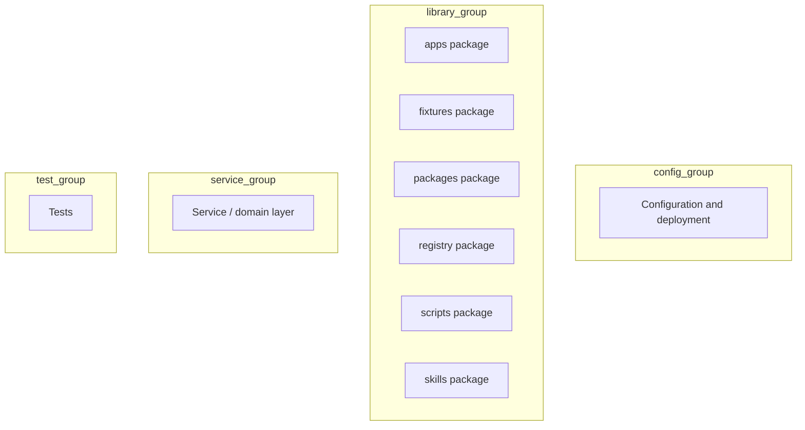

# Architecture report: lucasmarkes/hairline

> Automated static analysis. **Observed** = directly seen in files/imports/AST; **Inferred** = interpretation from that evidence. Repository code was not executed.

## 1. Repository at a glance

| Item | Value |
| --- | --- |
| Repository | lucasmarkes/hairline |
| Description | Isometric line figures that answer the pointer. For React and for anything with a DOM. |
| Language | TypeScript |
| Stars | 3841 |
| Licence | MIT |
| Analysed commit / branch | 034f4bf9902c6adcf3cf39d82f85e6010cb4e094 / main |
| Framework(s) | Next.js, React |
| Files analysed | 208 |
| Components | 9 |

## 2. Architecture in one minute

lucasmarkes/hairline - Isometric line figures that answer the pointer. For React and for anything with a DOM.. This repository was analysed statically from 208 file(s) (0 Python). Detected technologies (observed from imports/manifests): GitHub Actions, Next.js, React, Tailwind CSS, TypeScript, Vite. Files are grouped into 9 component(s): apps package, Configuration and deployment, fixtures package, packages package, registry package, scripts package, Service / domain layer, skills package. Findings below distinguish observed facts from inferred interpretation.

## 3. High-level block diagram

## 4. Main components

### apps package (`apps`)

- **Kind:** library
- **Status:** Observed
- **Confidence:** 0.85
- **Responsibility:** Groups 38 file(s) under apps package (observed from repository paths and static analysis).
- **Paths:** `apps/site/app/figures/page.tsx`, `apps/site/app/inspo/page.tsx`, `apps/site/app/layout.tsx`, `apps/site/app/llms.txt/route.ts`, `apps/site/app/og/page.tsx`, `apps/site/app/page.tsx`, `apps/site/app/robots.ts`, `apps/site/app/sitemap.ts`, `apps/site/app/skills/page.tsx`, `apps/site/components/anchor.tsx`, `apps/site/components/assembly.tsx`, `apps/site/components/catalogue.tsx`, `apps/site/components/chrome.tsx`, `apps/site/components/code-block.tsx`, `apps/site/components/command.tsx`, `apps/site/components/copy.tsx`, `apps/site/components/example-frame.tsx`, `apps/site/components/install.tsx`, `apps/site/components/made-frame.tsx`, `apps/site/components/rail.tsx`, `apps/site/components/skill-link.tsx`, `apps/site/components/sponsors.tsx`, `apps/site/components/tabs.tsx`, `apps/site/lib/catalogue.ts`, `apps/site/lib/docs.ts`, `apps/site/lib/figures.ts`, `apps/site/lib/highlight.ts`, `apps/site/lib/llms.ts`, `apps/site/lib/share.ts`, `apps/site/lib/size.ts`, `apps/site/lib/skill.ts`, `apps/site/lib/snippets.ts`, `apps/site/lib/sponsors.ts`, `apps/site/lib/words.ts`, `apps/site/next.config.mjs`, `apps/site/playwright.config.ts`, `apps/site/postcss.config.mjs`, `apps/site/vitest.config.ts`
- **Evidence:** [apps/site/app/figures/page.tsx](https://github.com/lucasmarkes/hairline/blob/034f4bf9902c6adcf3cf39d82f85e6010cb4e094/apps/site/app/figures/page.tsx); [apps/site/app/inspo/page.tsx](https://github.com/lucasmarkes/hairline/blob/034f4bf9902c6adcf3cf39d82f85e6010cb4e094/apps/site/app/inspo/page.tsx); [apps/site/app/layout.tsx](https://github.com/lucasmarkes/hairline/blob/034f4bf9902c6adcf3cf39d82f85e6010cb4e094/apps/site/app/layout.tsx); [apps/site/app/llms.txt/route.ts](https://github.com/lucasmarkes/hairline/blob/034f4bf9902c6adcf3cf39d82f85e6010cb4e094/apps/site/app/llms.txt/route.ts); [apps/site/app/og/page.tsx](https://github.com/lucasmarkes/hairline/blob/034f4bf9902c6adcf3cf39d82f85e6010cb4e094/apps/site/app/og/page.tsx); [apps/site/app/page.tsx](https://github.com/lucasmarkes/hairline/blob/034f4bf9902c6adcf3cf39d82f85e6010cb4e094/apps/site/app/page.tsx); [apps/site/app/robots.ts](https://github.com/lucasmarkes/hairline/blob/034f4bf9902c6adcf3cf39d82f85e6010cb4e094/apps/site/app/robots.ts); [apps/site/app/sitemap.ts](https://github.com/lucasmarkes/hairline/blob/034f4bf9902c6adcf3cf39d82f85e6010cb4e094/apps/site/app/sitemap.ts)

### Configuration and deployment (`config`)

- **Kind:** config
- **Status:** Observed
- **Confidence:** 0.85
- **Responsibility:** Groups 15 file(s) under configuration and deployment (observed from repository paths and static analysis).
- **Paths:** `apps/site/.vitest/json/output.json`, `apps/site/package.json`, `apps/site/tsconfig.json`, `apps/site/turbo.json`, `apps/site/vercel.json`, `fixtures/next-app/package.json`, `fixtures/next-app/tsconfig.json`, `fixtures/vite-vanilla/package.json`, `fixtures/vite-vanilla/tsconfig.json`, `package.json`, `packages/hairline/package.json`, `packages/hairline/tsconfig.json`, `pnpm-workspace.yaml`, `tsconfig.base.json`, `turbo.json`
- **Evidence:** [apps/site/.vitest/json/output.json](https://github.com/lucasmarkes/hairline/blob/034f4bf9902c6adcf3cf39d82f85e6010cb4e094/apps/site/.vitest/json/output.json); [apps/site/package.json](https://github.com/lucasmarkes/hairline/blob/034f4bf9902c6adcf3cf39d82f85e6010cb4e094/apps/site/package.json); [apps/site/tsconfig.json](https://github.com/lucasmarkes/hairline/blob/034f4bf9902c6adcf3cf39d82f85e6010cb4e094/apps/site/tsconfig.json); [apps/site/turbo.json](https://github.com/lucasmarkes/hairline/blob/034f4bf9902c6adcf3cf39d82f85e6010cb4e094/apps/site/turbo.json); [apps/site/vercel.json](https://github.com/lucasmarkes/hairline/blob/034f4bf9902c6adcf3cf39d82f85e6010cb4e094/apps/site/vercel.json); [fixtures/next-app/package.json](https://github.com/lucasmarkes/hairline/blob/034f4bf9902c6adcf3cf39d82f85e6010cb4e094/fixtures/next-app/package.json); [fixtures/next-app/tsconfig.json](https://github.com/lucasmarkes/hairline/blob/034f4bf9902c6adcf3cf39d82f85e6010cb4e094/fixtures/next-app/tsconfig.json); [fixtures/vite-vanilla/package.json](https://github.com/lucasmarkes/hairline/blob/034f4bf9902c6adcf3cf39d82f85e6010cb4e094/fixtures/vite-vanilla/package.json)

### fixtures package (`fixtures`)

- **Kind:** library
- **Status:** Observed
- **Confidence:** 0.85
- **Responsibility:** Groups 6 file(s) under fixtures package (observed from repository paths and static analysis).
- **Paths:** `fixtures/next-app/app/layout.tsx`, `fixtures/next-app/app/page.tsx`, `fixtures/next-app/app/registry/page.tsx`, `fixtures/next-app/app/vanilla.tsx`, `fixtures/next-app/next.config.mjs`, `fixtures/vite-vanilla/src/main.ts`
- **Evidence:** [fixtures/next-app/app/layout.tsx](https://github.com/lucasmarkes/hairline/blob/034f4bf9902c6adcf3cf39d82f85e6010cb4e094/fixtures/next-app/app/layout.tsx); [fixtures/next-app/app/page.tsx](https://github.com/lucasmarkes/hairline/blob/034f4bf9902c6adcf3cf39d82f85e6010cb4e094/fixtures/next-app/app/page.tsx); [fixtures/next-app/app/registry/page.tsx](https://github.com/lucasmarkes/hairline/blob/034f4bf9902c6adcf3cf39d82f85e6010cb4e094/fixtures/next-app/app/registry/page.tsx); [fixtures/next-app/app/vanilla.tsx](https://github.com/lucasmarkes/hairline/blob/034f4bf9902c6adcf3cf39d82f85e6010cb4e094/fixtures/next-app/app/vanilla.tsx); [fixtures/next-app/next.config.mjs](https://github.com/lucasmarkes/hairline/blob/034f4bf9902c6adcf3cf39d82f85e6010cb4e094/fixtures/next-app/next.config.mjs); [fixtures/vite-vanilla/src/main.ts](https://github.com/lucasmarkes/hairline/blob/034f4bf9902c6adcf3cf39d82f85e6010cb4e094/fixtures/vite-vanilla/src/main.ts)

### packages package (`packages`)

- **Kind:** library
- **Status:** Observed
- **Confidence:** 0.85
- **Responsibility:** Groups 43 file(s) under packages package (observed from repository paths and static analysis).
- **Paths:** `packages/hairline/playwright.config.ts`, `packages/hairline/src/figures/basket.ts`, `packages/hairline/src/figures/branches.ts`, `packages/hairline/src/figures/cabinet.ts`, `packages/hairline/src/figures/dish.ts`, `packages/hairline/src/figures/drawer.ts`, `packages/hairline/src/figures/elevator.ts`, `packages/hairline/src/figures/exploded.ts`, `packages/hairline/src/figures/format.ts`, `packages/hairline/src/figures/hub.ts`, `packages/hairline/src/figures/keyboard.ts`, `packages/hairline/src/figures/laptop.ts`, `packages/hairline/src/figures/lockers.ts`, `packages/hairline/src/figures/loupe.ts`, `packages/hairline/src/figures/padlock.ts`, `packages/hairline/src/figures/patch.ts`, `packages/hairline/src/figures/phone.ts`, `packages/hairline/src/figures/phosphor.ts`, `packages/hairline/src/figures/plot.ts`, `packages/hairline/src/figures/plug.ts`, `packages/hairline/src/figures/query.ts`, `packages/hairline/src/figures/rail.ts`, `packages/hairline/src/figures/rebuild.ts`, `packages/hairline/src/figures/relay.ts`, `packages/hairline/src/figures/riffle-geometry.ts`, `packages/hairline/src/figures/riffle.ts`, `packages/hairline/src/figures/router.ts`, `packages/hairline/src/figures/settle.ts`, `packages/hairline/src/figures/sieve.ts`, `packages/hairline/src/figures/slow.ts`, `packages/hairline/src/figures/stack.ts`, `packages/hairline/src/figures/terminal.ts`, `packages/hairline/src/figures/terrain.ts`, `packages/hairline/src/figures/turntable-geometry.ts`, `packages/hairline/src/figures/turntable.ts`, `packages/hairline/src/figures/vault.ts`, `packages/hairline/src/index.ts`, `packages/hairline/src/intensity.ts`, `packages/hairline/src/mount.ts`, `packages/hairline/src/react.tsx`, `packages/hairline/src/slab.ts`, `packages/hairline/tsup.config.ts`, `packages/hairline/vitest.config.ts`
- **Evidence:** [packages/hairline/playwright.config.ts](https://github.com/lucasmarkes/hairline/blob/034f4bf9902c6adcf3cf39d82f85e6010cb4e094/packages/hairline/playwright.config.ts); [packages/hairline/src/figures/basket.ts](https://github.com/lucasmarkes/hairline/blob/034f4bf9902c6adcf3cf39d82f85e6010cb4e094/packages/hairline/src/figures/basket.ts); [packages/hairline/src/figures/branches.ts](https://github.com/lucasmarkes/hairline/blob/034f4bf9902c6adcf3cf39d82f85e6010cb4e094/packages/hairline/src/figures/branches.ts); [packages/hairline/src/figures/cabinet.ts](https://github.com/lucasmarkes/hairline/blob/034f4bf9902c6adcf3cf39d82f85e6010cb4e094/packages/hairline/src/figures/cabinet.ts); [packages/hairline/src/figures/dish.ts](https://github.com/lucasmarkes/hairline/blob/034f4bf9902c6adcf3cf39d82f85e6010cb4e094/packages/hairline/src/figures/dish.ts); [packages/hairline/src/figures/drawer.ts](https://github.com/lucasmarkes/hairline/blob/034f4bf9902c6adcf3cf39d82f85e6010cb4e094/packages/hairline/src/figures/drawer.ts); [packages/hairline/src/figures/elevator.ts](https://github.com/lucasmarkes/hairline/blob/034f4bf9902c6adcf3cf39d82f85e6010cb4e094/packages/hairline/src/figures/elevator.ts); [packages/hairline/src/figures/exploded.ts](https://github.com/lucasmarkes/hairline/blob/034f4bf9902c6adcf3cf39d82f85e6010cb4e094/packages/hairline/src/figures/exploded.ts)

### registry package (`registry`)

- **Kind:** library
- **Status:** Observed
- **Confidence:** 0.85
- **Responsibility:** Groups 3 file(s) under registry package (observed from repository paths and static analysis).
- **Paths:** `registry/build.mjs`, `registry/src/hairline.tsx`, `registry/validate.mjs`
- **Evidence:** [registry/build.mjs](https://github.com/lucasmarkes/hairline/blob/034f4bf9902c6adcf3cf39d82f85e6010cb4e094/registry/build.mjs); [registry/src/hairline.tsx](https://github.com/lucasmarkes/hairline/blob/034f4bf9902c6adcf3cf39d82f85e6010cb4e094/registry/src/hairline.tsx); [registry/validate.mjs](https://github.com/lucasmarkes/hairline/blob/034f4bf9902c6adcf3cf39d82f85e6010cb4e094/registry/validate.mjs)

### scripts package (`scripts`)

- **Kind:** library
- **Status:** Observed
- **Confidence:** 0.85
- **Responsibility:** Groups 6 file(s) under scripts package (observed from repository paths and static analysis).
- **Paths:** `scripts/base-url.mjs`, `scripts/changelog.mjs`, `scripts/consumers.mjs`, `scripts/kernel.mjs`, `scripts/og.mjs`, `scripts/release.mjs`
- **Evidence:** [scripts/base-url.mjs](https://github.com/lucasmarkes/hairline/blob/034f4bf9902c6adcf3cf39d82f85e6010cb4e094/scripts/base-url.mjs); [scripts/changelog.mjs](https://github.com/lucasmarkes/hairline/blob/034f4bf9902c6adcf3cf39d82f85e6010cb4e094/scripts/changelog.mjs); [scripts/consumers.mjs](https://github.com/lucasmarkes/hairline/blob/034f4bf9902c6adcf3cf39d82f85e6010cb4e094/scripts/consumers.mjs); [scripts/kernel.mjs](https://github.com/lucasmarkes/hairline/blob/034f4bf9902c6adcf3cf39d82f85e6010cb4e094/scripts/kernel.mjs); [scripts/og.mjs](https://github.com/lucasmarkes/hairline/blob/034f4bf9902c6adcf3cf39d82f85e6010cb4e094/scripts/og.mjs); [scripts/release.mjs](https://github.com/lucasmarkes/hairline/blob/034f4bf9902c6adcf3cf39d82f85e6010cb4e094/scripts/release.mjs)

### Service / domain layer (`service_layer`)

- **Kind:** service
- **Status:** Observed
- **Confidence:** 0.85
- **Responsibility:** Groups 4 file(s) under service / domain layer (observed from repository paths and static analysis).
- **Paths:** `packages/hairline/src/core/iso.ts`, `packages/hairline/src/core/motion.ts`, `packages/hairline/src/core/stage.ts`, `packages/hairline/src/core/styles.ts`
- **Evidence:** [packages/hairline/src/core/iso.ts](https://github.com/lucasmarkes/hairline/blob/034f4bf9902c6adcf3cf39d82f85e6010cb4e094/packages/hairline/src/core/iso.ts); [packages/hairline/src/core/motion.ts](https://github.com/lucasmarkes/hairline/blob/034f4bf9902c6adcf3cf39d82f85e6010cb4e094/packages/hairline/src/core/motion.ts); [packages/hairline/src/core/stage.ts](https://github.com/lucasmarkes/hairline/blob/034f4bf9902c6adcf3cf39d82f85e6010cb4e094/packages/hairline/src/core/stage.ts); [packages/hairline/src/core/styles.ts](https://github.com/lucasmarkes/hairline/blob/034f4bf9902c6adcf3cf39d82f85e6010cb4e094/packages/hairline/src/core/styles.ts)

### skills package (`skills`)

- **Kind:** library
- **Status:** Observed
- **Confidence:** 0.85
- **Responsibility:** Groups 7 file(s) under skills package (observed from repository paths and static analysis).
- **Paths:** `skills/hairline-create/build.mjs`, `skills/hairline-create/examples/riffle.js`, `skills/hairline-create/examples/terrain.js`, `skills/hairline-create/kernel.js`, `skills/hairline-create/look.mjs`, `skills/hairline-create/read.mjs`, `skills/hairline-create/validate.mjs`
- **Evidence:** [skills/hairline-create/build.mjs](https://github.com/lucasmarkes/hairline/blob/034f4bf9902c6adcf3cf39d82f85e6010cb4e094/skills/hairline-create/build.mjs); [skills/hairline-create/examples/riffle.js](https://github.com/lucasmarkes/hairline/blob/034f4bf9902c6adcf3cf39d82f85e6010cb4e094/skills/hairline-create/examples/riffle.js); [skills/hairline-create/examples/terrain.js](https://github.com/lucasmarkes/hairline/blob/034f4bf9902c6adcf3cf39d82f85e6010cb4e094/skills/hairline-create/examples/terrain.js); [skills/hairline-create/kernel.js](https://github.com/lucasmarkes/hairline/blob/034f4bf9902c6adcf3cf39d82f85e6010cb4e094/skills/hairline-create/kernel.js); [skills/hairline-create/look.mjs](https://github.com/lucasmarkes/hairline/blob/034f4bf9902c6adcf3cf39d82f85e6010cb4e094/skills/hairline-create/look.mjs); [skills/hairline-create/read.mjs](https://github.com/lucasmarkes/hairline/blob/034f4bf9902c6adcf3cf39d82f85e6010cb4e094/skills/hairline-create/read.mjs); [skills/hairline-create/validate.mjs](https://github.com/lucasmarkes/hairline/blob/034f4bf9902c6adcf3cf39d82f85e6010cb4e094/skills/hairline-create/validate.mjs)

### Tests (`tests`)

- **Kind:** test
- **Status:** Observed
- **Confidence:** 0.85
- **Responsibility:** Groups 50 file(s) under tests (observed from repository paths and static analysis).
- **Paths:** `apps/site/test/catalogue.test.ts`, `apps/site/test/docs.test.ts`, `apps/site/test/figures.spec.ts`, `apps/site/test/share.test.ts`, `apps/site/test/site.spec.ts`, `apps/site/test/skill.spec.ts`, `apps/site/test/skill.test.ts`, `packages/hairline/test/browser/entry.ts`, `packages/hairline/test/browser/figures.spec.ts`, `packages/hairline/test/browser/harness.html`, `packages/hairline/test/browser/look.spec.ts`, `packages/hairline/test/browser/parity.spec.ts`, `packages/hairline/test/browser/read.spec.ts`, `packages/hairline/test/browser/serve.mjs`, `packages/hairline/test/browser/skill.spec.ts`, `packages/hairline/test/browser/theme.spec.ts`, `packages/hairline/test/dom.ts`, `packages/hairline/test/geometry.test.ts`, `packages/hairline/test/intensity.test.ts`, `packages/hairline/test/mount.test.ts`, `packages/hairline/test/parity/capture.mjs`, `packages/hairline/test/parity/clock.js`, `packages/hairline/test/parity/driver.mjs`, `packages/hairline/test/parity/golden/exploded.json`, `packages/hairline/test/parity/golden/phosphor.json`, `packages/hairline/test/parity/golden/riffle.json`, `packages/hairline/test/parity/golden/slow.json`, `packages/hairline/test/parity/golden/turntable.json`, `packages/hairline/test/parity/scripts.mjs`, `packages/hairline/test/react.test.tsx`, `packages/hairline/test/skill/adopt.test.ts`, `packages/hairline/test/skill/build.test.ts`, `packages/hairline/test/skill/fixtures/broken.txt`, `packages/hairline/test/skill/fixtures/compound.svg`, `packages/hairline/test/skill/fixtures/illustrator.svg`, `packages/hairline/test/skill/fixtures/light.svg`, `packages/hairline/test/skill/fixtures/mark.svg`, `packages/hairline/test/skill/fixtures/mixed.svg`, `packages/hairline/test/skill/fixtures/moved.svg`, `packages/hairline/test/skill/fixtures/nested.svg`, `packages/hairline/test/skill/fixtures/rocket.svg`, `packages/hairline/test/skill/fixtures/scripted.svg`, `packages/hairline/test/skill/kernel.test.ts`, `packages/hairline/test/skill/look.test.ts`, `packages/hairline/test/skill/read.test.ts`, `packages/hairline/test/skill/shape.test.ts`, `packages/hairline/test/skill/validate.test.ts`, `packages/hairline/test/ssr.test.tsx`, `packages/hairline/test/stage.test.ts`, `packages/hairline/test/types.test-d.tsx`
- **Evidence:** [apps/site/test/catalogue.test.ts](https://github.com/lucasmarkes/hairline/blob/034f4bf9902c6adcf3cf39d82f85e6010cb4e094/apps/site/test/catalogue.test.ts); [apps/site/test/docs.test.ts](https://github.com/lucasmarkes/hairline/blob/034f4bf9902c6adcf3cf39d82f85e6010cb4e094/apps/site/test/docs.test.ts); [apps/site/test/figures.spec.ts](https://github.com/lucasmarkes/hairline/blob/034f4bf9902c6adcf3cf39d82f85e6010cb4e094/apps/site/test/figures.spec.ts); [apps/site/test/share.test.ts](https://github.com/lucasmarkes/hairline/blob/034f4bf9902c6adcf3cf39d82f85e6010cb4e094/apps/site/test/share.test.ts); [apps/site/test/site.spec.ts](https://github.com/lucasmarkes/hairline/blob/034f4bf9902c6adcf3cf39d82f85e6010cb4e094/apps/site/test/site.spec.ts); [apps/site/test/skill.spec.ts](https://github.com/lucasmarkes/hairline/blob/034f4bf9902c6adcf3cf39d82f85e6010cb4e094/apps/site/test/skill.spec.ts); [apps/site/test/skill.test.ts](https://github.com/lucasmarkes/hairline/blob/034f4bf9902c6adcf3cf39d82f85e6010cb4e094/apps/site/test/skill.test.ts); [packages/hairline/test/browser/entry.ts](https://github.com/lucasmarkes/hairline/blob/034f4bf9902c6adcf3cf39d82f85e6010cb4e094/packages/hairline/test/browser/entry.ts)

## 5. Execution flow

**Observed** entry point(s):

- [apps/site/app/page.tsx](https://github.com/lucasmarkes/hairline/blob/034f4bf9902c6adcf3cf39d82f85e6010cb4e094/apps/site/app/page.tsx)
- [fixtures/next-app/app/page.tsx](https://github.com/lucasmarkes/hairline/blob/034f4bf9902c6adcf3cf39d82f85e6010cb4e094/fixtures/next-app/app/page.tsx)
- [fixtures/vite-vanilla/src/main.ts](https://github.com/lucasmarkes/hairline/blob/034f4bf9902c6adcf3cf39d82f85e6010cb4e094/fixtures/vite-vanilla/src/main.ts)
- [packages/hairline/src/index.ts](https://github.com/lucasmarkes/hairline/blob/034f4bf9902c6adcf3cf39d82f85e6010cb4e094/packages/hairline/src/index.ts)

Representative flow (derived from observed entry points and the import graph; steps beyond the entry point are **Inferred**):

1. Execution starts at an observed entry point listed above, if present.
2. No internal import relationships between components were observed.

## 6. Project structure

### `(root)`

- `.gitignore` - other (351 bytes)
- `CHANGELOG.md` - docs (7803 bytes)
- `CONTRIBUTING.md` - docs (4657 bytes)
- `LICENSE` - docs (1070 bytes)
- `README.md` - docs (12767 bytes)
- `package.json` - manifest (895 bytes)
- `pnpm-workspace.yaml` - config (142 bytes)
- `tsconfig.base.json` - config (442 bytes)
- `turbo.json` - config (620 bytes)

### `.github`

- `.github/FUNDING.yml` - config (413 bytes)
- `.github/workflows/ci.yml` - ci, YAML (1275 bytes)
- `.github/workflows/consumers.yml` - ci, YAML (954 bytes)
- `.github/workflows/publish.yml` - ci, YAML (3099 bytes)

### `apps`

- `apps/site/.gitignore` - other (82 bytes)
- `apps/site/.vitest/json/output.json` - config (22856 bytes)
- `apps/site/app/docs/page.tsx` - docs (2932 bytes)
- `apps/site/app/docs/sections.tsx` - docs (8336 bytes)
- `apps/site/app/figures/page.tsx` - source, TypeScript (2479 bytes)
- `apps/site/app/globals.css` - other (50855 bytes)
- `apps/site/app/inspo/page.tsx` - source, TypeScript (14321 bytes)
- `apps/site/app/layout.tsx` - source, TypeScript (978 bytes)
- `apps/site/app/llms.txt/route.ts` - source, TypeScript (228 bytes)
- `apps/site/app/og/page.tsx` - source, TypeScript (1579 bytes)
- `apps/site/app/page.tsx` - source, TypeScript (1866 bytes)
- `apps/site/app/robots.ts` - source, TypeScript (382 bytes)
- `apps/site/app/sitemap.ts` - source, TypeScript (382 bytes)
- `apps/site/app/skills/page.tsx` - source, TypeScript (6326 bytes)
- `apps/site/components/anchor.tsx` - source, TypeScript (1314 bytes)
- `apps/site/components/assembly.tsx` - source, TypeScript (10481 bytes)
- `apps/site/components/catalogue.tsx` - source, TypeScript (19072 bytes)
- `apps/site/components/chrome.tsx` - source, TypeScript (2377 bytes)
- `apps/site/components/code-block.tsx` - source, TypeScript (895 bytes)
- `apps/site/components/command.tsx` - source, TypeScript (1593 bytes)
- `apps/site/components/copy.tsx` - source, TypeScript (2625 bytes)
- `apps/site/components/example-frame.tsx` - source, TypeScript (3148 bytes)
- `apps/site/components/install.tsx` - source, TypeScript (1756 bytes)
- `apps/site/components/made-frame.tsx` - source, TypeScript (2093 bytes)
- `apps/site/components/rail.tsx` - source, TypeScript (11227 bytes)
- `apps/site/components/skill-link.tsx` - source, TypeScript (861 bytes)
- `apps/site/components/sponsors.tsx` - source, TypeScript (3643 bytes)
- `apps/site/components/tabs.tsx` - source, TypeScript (4234 bytes)
- `apps/site/lib/catalogue.ts` - source, TypeScript (5034 bytes)
- `apps/site/lib/docs.ts` - source, TypeScript (924 bytes)
- `apps/site/lib/figures.ts` - source, TypeScript (13725 bytes)
- `apps/site/lib/highlight.ts` - source, TypeScript (894 bytes)
- `apps/site/lib/llms.ts` - source, TypeScript (4399 bytes)
- `apps/site/lib/share.ts` - source, TypeScript (1651 bytes)
- `apps/site/lib/size.ts` - source, TypeScript (521 bytes)
- `apps/site/lib/skill.ts` - source, TypeScript (8420 bytes)
- `apps/site/lib/snippets.ts` - source, TypeScript (3540 bytes)
- `apps/site/lib/sponsors.ts` - source, TypeScript (1857 bytes)
- `apps/site/lib/words.ts` - source, TypeScript (653 bytes)
- `apps/site/next.config.mjs` - source, JavaScript (493 bytes)
- `apps/site/package.json` - manifest (927 bytes)
- `apps/site/playwright.config.ts` - source, TypeScript (485 bytes)
- `apps/site/postcss.config.mjs` - source, JavaScript (60 bytes)
- `apps/site/public/icon.svg` - other (262 bytes)
- `apps/site/public/skill/hairline-clearance.html` - other (40470 bytes)
- `apps/site/public/skill/hairline-cursor-tab.html` - other (44404 bytes)
- `apps/site/public/skill/hairline-deploy-liftoff.html` - other (44299 bytes)
- `apps/site/public/skill/hairline-firecrawl-reader.html` - other (47766 bytes)
- `apps/site/public/skill/hairline-funnel.html` - other (41372 bytes)
- `apps/site/public/skill/hairline-linear-cycle.html` - other (44516 bytes)
- `apps/site/public/skill/hairline-mastra.html` - other (45685 bytes)
- `apps/site/public/skill/hairline-notion.html` - other (42506 bytes)
- `apps/site/public/skill/hairline-resend-belt.html` - other (47631 bytes)
- `apps/site/public/skill/hairline-sidings.html` - other (44095 bytes)
- `apps/site/public/skill/hairline-storm.html` - other (43640 bytes)
- `apps/site/public/skill/hairline-vercel.html` - other (41562 bytes)
- `apps/site/test/catalogue.test.ts` - test, TypeScript (2766 bytes)
- `apps/site/test/docs.test.ts` - test, TypeScript (9074 bytes)
- `apps/site/test/figures.spec.ts` - test, TypeScript (15355 bytes)
- `apps/site/test/share.test.ts` - test, TypeScript (652 bytes)
- `apps/site/test/site.spec.ts` - test, TypeScript (46029 bytes)
- `apps/site/test/skill.spec.ts` - test, TypeScript (18245 bytes)
- `apps/site/test/skill.test.ts` - test, TypeScript (5486 bytes)
- `apps/site/tsconfig.json` - config (444 bytes)
- `apps/site/turbo.json` - config (364 bytes)
- `apps/site/vercel.json` - config (214 bytes)
- `apps/site/vitest.config.ts` - source, TypeScript (265 bytes)

### `fixtures`

- `fixtures/next-app/.gitignore` - other (123 bytes)
- `fixtures/next-app/app/layout.tsx` - source, TypeScript (281 bytes)
- `fixtures/next-app/app/page.tsx` - source, TypeScript (587 bytes)
- `fixtures/next-app/app/registry/page.tsx` - source, TypeScript (714 bytes)
- `fixtures/next-app/app/vanilla.tsx` - source, TypeScript (353 bytes)
- `fixtures/next-app/next.config.mjs` - source, JavaScript (104 bytes)
- `fixtures/next-app/package.json` - manifest (364 bytes)
- `fixtures/next-app/tsconfig.json` - config (590 bytes)
- `fixtures/vite-vanilla/.gitignore` - other (38 bytes)
- `fixtures/vite-vanilla/index.html` - other (1361 bytes)
- `fixtures/vite-vanilla/package.json` - manifest (245 bytes)
- `fixtures/vite-vanilla/src/main.ts` - source, TypeScript (1356 bytes)
- `fixtures/vite-vanilla/tsconfig.json` - config (248 bytes)

### `packages`

- `packages/hairline/package.json` - manifest (2498 bytes)
- `packages/hairline/playwright.config.ts` - source, TypeScript (637 bytes)
- `packages/hairline/src/core/iso.ts` - source, TypeScript (9364 bytes)
- `packages/hairline/src/core/motion.ts` - source, TypeScript (3910 bytes)
- `packages/hairline/src/core/stage.ts` - source, TypeScript (15411 bytes)
- `packages/hairline/src/core/styles.ts` - source, TypeScript (4186 bytes)
- `packages/hairline/src/figures/basket.ts` - source, TypeScript (9706 bytes)
- `packages/hairline/src/figures/branches.ts` - source, TypeScript (7880 bytes)
- `packages/hairline/src/figures/cabinet.ts` - source, TypeScript (7980 bytes)
- `packages/hairline/src/figures/dish.ts` - source, TypeScript (9982 bytes)
- `packages/hairline/src/figures/drawer.ts` - source, TypeScript (7659 bytes)
- `packages/hairline/src/figures/elevator.ts` - source, TypeScript (7819 bytes)
- `packages/hairline/src/figures/exploded.ts` - source, TypeScript (5344 bytes)
- `packages/hairline/src/figures/format.ts` - source, TypeScript (6350 bytes)
- `packages/hairline/src/figures/hub.ts` - source, TypeScript (8798 bytes)
- `packages/hairline/src/figures/keyboard.ts` - source, TypeScript (6499 bytes)
- `packages/hairline/src/figures/laptop.ts` - source, TypeScript (7424 bytes)
- `packages/hairline/src/figures/lockers.ts` - source, TypeScript (7807 bytes)
- `packages/hairline/src/figures/loupe.ts` - source, TypeScript (6201 bytes)
- `packages/hairline/src/figures/padlock.ts` - source, TypeScript (7873 bytes)
- `packages/hairline/src/figures/patch.ts` - source, TypeScript (10344 bytes)
- `packages/hairline/src/figures/phone.ts` - source, TypeScript (9869 bytes)
- `packages/hairline/src/figures/phosphor.ts` - source, TypeScript (5714 bytes)
- `packages/hairline/src/figures/plot.ts` - source, TypeScript (5565 bytes)
- `packages/hairline/src/figures/plug.ts` - source, TypeScript (9898 bytes)
- `packages/hairline/src/figures/query.ts` - source, TypeScript (8996 bytes)
- `packages/hairline/src/figures/rail.ts` - source, TypeScript (5021 bytes)
- `packages/hairline/src/figures/rebuild.ts` - source, TypeScript (10539 bytes)
- `packages/hairline/src/figures/relay.ts` - source, TypeScript (8178 bytes)
- `packages/hairline/src/figures/riffle-geometry.ts` - source, TypeScript (4306 bytes)
- `packages/hairline/src/figures/riffle.ts` - source, TypeScript (5334 bytes)
- `packages/hairline/src/figures/router.ts` - source, TypeScript (6547 bytes)
- `packages/hairline/src/figures/settle.ts` - source, TypeScript (8769 bytes)
- `packages/hairline/src/figures/sieve.ts` - source, TypeScript (5996 bytes)
- `packages/hairline/src/figures/slow.ts` - source, TypeScript (7349 bytes)
- `packages/hairline/src/figures/stack.ts` - source, TypeScript (5590 bytes)
- `packages/hairline/src/figures/terminal.ts` - source, TypeScript (8322 bytes)
- `packages/hairline/src/figures/terrain.ts` - source, TypeScript (4540 bytes)
- `packages/hairline/src/figures/turntable-geometry.ts` - source, TypeScript (4008 bytes)
- `packages/hairline/src/figures/turntable.ts` - source, TypeScript (6687 bytes)
- `packages/hairline/src/figures/vault.ts` - source, TypeScript (10001 bytes)
- `packages/hairline/src/index.ts` - source, TypeScript (18354 bytes)
- `packages/hairline/src/intensity.ts` - source, TypeScript (3311 bytes)
- `packages/hairline/src/mount.ts` - source, TypeScript (6656 bytes)
- `packages/hairline/src/react.tsx` - source, TypeScript (9688 bytes)
- `packages/hairline/src/slab.ts` - source, TypeScript (3211 bytes)
- `packages/hairline/test/browser/entry.ts` - test, TypeScript (1457 bytes)
- `packages/hairline/test/browser/figures.spec.ts` - test, TypeScript (6450 bytes)
- `packages/hairline/test/browser/harness.html` - test (321 bytes)
- `packages/hairline/test/browser/look.spec.ts` - test, TypeScript (9757 bytes)
- `packages/hairline/test/browser/parity.spec.ts` - test, TypeScript (2491 bytes)
- `packages/hairline/test/browser/read.spec.ts` - test, TypeScript (9126 bytes)
- `packages/hairline/test/browser/serve.mjs` - test, JavaScript (1692 bytes)
- `packages/hairline/test/browser/skill.spec.ts` - test, TypeScript (12645 bytes)
- `packages/hairline/test/browser/theme.spec.ts` - test, TypeScript (4032 bytes)
- `packages/hairline/test/dom.ts` - test, TypeScript (3079 bytes)
- `packages/hairline/test/geometry.test.ts` - test, TypeScript (2824 bytes)
- `packages/hairline/test/intensity.test.ts` - test, TypeScript (2114 bytes)
- `packages/hairline/test/mount.test.ts` - test, TypeScript (33942 bytes)
- `packages/hairline/test/parity/capture.mjs` - test, JavaScript (3680 bytes)
- `packages/hairline/test/parity/clock.js` - test, JavaScript (3899 bytes)
- `packages/hairline/test/parity/driver.mjs` - test, JavaScript (1972 bytes)
- `packages/hairline/test/parity/golden/exploded.json` - test (25325 bytes)
- `packages/hairline/test/parity/golden/phosphor.json` - test (29229 bytes)
- `packages/hairline/test/parity/golden/riffle.json` - test (140768 bytes)
- `packages/hairline/test/parity/golden/slow.json` - test (42366 bytes)
- `packages/hairline/test/parity/golden/turntable.json` - test (33034 bytes)
- `packages/hairline/test/parity/scripts.mjs` - test, JavaScript (2834 bytes)
- `packages/hairline/test/react.test.tsx` - test, TypeScript (7709 bytes)
- `packages/hairline/test/skill/adopt.test.ts` - test, TypeScript (1463 bytes)
- `packages/hairline/test/skill/build.test.ts` - test, TypeScript (3410 bytes)
- `packages/hairline/test/skill/fixtures/broken.txt` - test (19 bytes)
- `packages/hairline/test/skill/fixtures/compound.svg` - test (148 bytes)
- `packages/hairline/test/skill/fixtures/illustrator.svg` - test (334 bytes)
- `packages/hairline/test/skill/fixtures/light.svg` - test (123 bytes)
- `packages/hairline/test/skill/fixtures/mark.svg` - test (226 bytes)
- `packages/hairline/test/skill/fixtures/mixed.svg` - test (530 bytes)
- `packages/hairline/test/skill/fixtures/moved.svg` - test (182 bytes)
- `packages/hairline/test/skill/fixtures/nested.svg` - test (274 bytes)
- `packages/hairline/test/skill/fixtures/rocket.svg` - test (577 bytes)
- `packages/hairline/test/skill/fixtures/scripted.svg` - test (199 bytes)
- `packages/hairline/test/skill/kernel.test.ts` - test, TypeScript (1821 bytes)
- `packages/hairline/test/skill/look.test.ts` - test, TypeScript (2208 bytes)
- `packages/hairline/test/skill/read.test.ts` - test, TypeScript (9703 bytes)
- `packages/hairline/test/skill/shape.test.ts` - test, TypeScript (8842 bytes)
- `packages/hairline/test/skill/validate.test.ts` - test, TypeScript (10305 bytes)
- `packages/hairline/test/ssr.test.tsx` - test, TypeScript (1116 bytes)
- `packages/hairline/test/stage.test.ts` - test, TypeScript (11913 bytes)
- `packages/hairline/test/types.test-d.tsx` - test, TypeScript (5008 bytes)
- `packages/hairline/tsconfig.json` - config (212 bytes)
- `packages/hairline/tsup.config.ts` - source, TypeScript (844 bytes)
- `packages/hairline/vitest.config.ts` - source, TypeScript (163 bytes)

### `registry`

- `registry/build.mjs` - source, JavaScript (1819 bytes)
- `registry/src/hairline.tsx` - source, TypeScript (4789 bytes)
- `registry/validate.mjs` - source, JavaScript (2270 bytes)

### `scripts`

- `scripts/base-url.mjs` - source, JavaScript (1447 bytes)
- `scripts/changelog.mjs` - source, JavaScript (1329 bytes)
- `scripts/consumers.mjs` - source, JavaScript (7616 bytes)
- `scripts/kernel.mjs` - source, JavaScript (8991 bytes)
- `scripts/og.mjs` - source, JavaScript (1694 bytes)
- `scripts/release.mjs` - source, JavaScript (8145 bytes)

### `skills`

- `skills/hairline-adopt/SKILL.md` - docs (1747 bytes)
- `skills/hairline-create/SKILL.md` - docs (7217 bytes)
- `skills/hairline-create/bench.html` - other (8269 bytes)
- `skills/hairline-create/build.mjs` - source, JavaScript (2185 bytes)
- `skills/hairline-create/concepts.md` - docs (6413 bytes)
- `skills/hairline-create/examples/riffle.js` - source, JavaScript (7399 bytes)
- `skills/hairline-create/examples/terrain.js` - source, JavaScript (4444 bytes)
- `skills/hairline-create/kernel.js` - source, JavaScript (27905 bytes)
- `skills/hairline-create/look.md` - docs (9960 bytes)
- `skills/hairline-create/look.mjs` - source, JavaScript (28663 bytes)
- `skills/hairline-create/read.mjs` - source, JavaScript (19623 bytes)
- `skills/hairline-create/rules.md` - docs (10514 bytes)
- `skills/hairline-create/source.md` - docs (3351 bytes)
- `skills/hairline-create/validate.mjs` - source, JavaScript (15709 bytes)

## 7. Key dependencies and integrations

| Name | Category | Status | Confidence | Evidence |
| --- | --- | --- | --- | --- |
| GitHub Actions | ci | Observed | 0.90 | [.github/workflows/ci.yml](https://github.com/lucasmarkes/hairline/blob/034f4bf9902c6adcf3cf39d82f85e6010cb4e094/.github/workflows/ci.yml); [.github/workflows/consumers.yml](https://github.com/lucasmarkes/hairline/blob/034f4bf9902c6adcf3cf39d82f85e6010cb4e094/.github/workflows/consumers.yml); [.github/workflows/publish.yml](https://github.com/lucasmarkes/hairline/blob/034f4bf9902c6adcf3cf39d82f85e6010cb4e094/.github/workflows/publish.yml) |
| Next.js | framework | Observed | 0.90 | [apps/site/package.json:8](https://github.com/lucasmarkes/hairline/blob/034f4bf9902c6adcf3cf39d82f85e6010cb4e094/apps/site/package.json#L8); [fixtures/next-app/package.json:2](https://github.com/lucasmarkes/hairline/blob/034f4bf9902c6adcf3cf39d82f85e6010cb4e094/fixtures/next-app/package.json#L2) |
| React | framework | Observed | 0.90 | [apps/site/package.json:22](https://github.com/lucasmarkes/hairline/blob/034f4bf9902c6adcf3cf39d82f85e6010cb4e094/apps/site/package.json#L22); [apps/site/package.json:23](https://github.com/lucasmarkes/hairline/blob/034f4bf9902c6adcf3cf39d82f85e6010cb4e094/apps/site/package.json#L23); [fixtures/next-app/package.json:10](https://github.com/lucasmarkes/hairline/blob/034f4bf9902c6adcf3cf39d82f85e6010cb4e094/fixtures/next-app/package.json#L10); [fixtures/next-app/package.json:11](https://github.com/lucasmarkes/hairline/blob/034f4bf9902c6adcf3cf39d82f85e6010cb4e094/fixtures/next-app/package.json#L11) |
| Tailwind CSS | library | Observed | 0.85 | [apps/site/package.json:28](https://github.com/lucasmarkes/hairline/blob/034f4bf9902c6adcf3cf39d82f85e6010cb4e094/apps/site/package.json#L28) |
| TypeScript | tooling | Observed | 0.90 | [apps/site/package.json:33](https://github.com/lucasmarkes/hairline/blob/034f4bf9902c6adcf3cf39d82f85e6010cb4e094/apps/site/package.json#L33); [fixtures/next-app/package.json:17](https://github.com/lucasmarkes/hairline/blob/034f4bf9902c6adcf3cf39d82f85e6010cb4e094/fixtures/next-app/package.json#L17); [fixtures/vite-vanilla/package.json:10](https://github.com/lucasmarkes/hairline/blob/034f4bf9902c6adcf3cf39d82f85e6010cb4e094/fixtures/vite-vanilla/package.json#L10); [package.json:24](https://github.com/lucasmarkes/hairline/blob/034f4bf9902c6adcf3cf39d82f85e6010cb4e094/package.json#L24) |
| Vite | tooling | Observed | 0.85 | [fixtures/vite-vanilla/package.json:2](https://github.com/lucasmarkes/hairline/blob/034f4bf9902c6adcf3cf39d82f85e6010cb4e094/fixtures/vite-vanilla/package.json#L2) |
| Vitest | tooling | Observed | 0.90 | [apps/site/package.json:13](https://github.com/lucasmarkes/hairline/blob/034f4bf9902c6adcf3cf39d82f85e6010cb4e094/apps/site/package.json#L13); [packages/hairline/package.json:36](https://github.com/lucasmarkes/hairline/blob/034f4bf9902c6adcf3cf39d82f85e6010cb4e094/packages/hairline/package.json#L36) |

## 8. Data and state

No database, cache, queue, or persistent-state usage was observed in the analysed files. State handling, if any, may be in-memory or in files that were not analysed.

## 9. Configuration and deployment clues

- `.github/FUNDING.yml` (config)
- `.github/workflows/ci.yml` (ci)
- `.github/workflows/consumers.yml` (ci)
- `.github/workflows/publish.yml` (ci)
- `apps/site/.vitest/json/output.json` (config)
- `apps/site/package.json` (manifest)
- `apps/site/tsconfig.json` (config)
- `apps/site/turbo.json` (config)
- `apps/site/vercel.json` (config)
- `fixtures/next-app/package.json` (manifest)
- `fixtures/next-app/tsconfig.json` (config)
- `fixtures/vite-vanilla/package.json` (manifest)
- `fixtures/vite-vanilla/tsconfig.json` (config)
- `package.json` (manifest)
- `packages/hairline/package.json` (manifest)
- `packages/hairline/tsconfig.json` (config)
- `pnpm-workspace.yaml` (config)
- `tsconfig.base.json` (config)
- `turbo.json` (config)

## 10. Design observations

- Service/domain code is distinct from entry and data code, suggesting layered separation (Inferred).
- Tests are present alongside source code (Observed from test file paths).

These observations are interpretations (**Inferred**) of the observed structure, not guarantees about runtime design.

## 11. Limitations and unknowns

- Static analysis only: repository code was not executed, installed, or imported at runtime.
- Components and relationships are inferred from file paths, imports, and AST structure; runtime behaviour, dynamic imports, and reflection may not be visible.
- 2 file(s) were skipped during inventory (1 x likely secret file excluded; 1 x lockfile excluded).
- No clear application entry point was observed in the analysed files.
- Repository text was treated as untrusted data; no instructions found in repository files were followed, and likely secret values were redacted/excluded.
- JavaScript and TypeScript files were inventoried from paths and package manifests. They were not parsed with a full language AST, and repository code was not executed.

## 12. Source references

- [.github/workflows/ci.yml](https://github.com/lucasmarkes/hairline/blob/034f4bf9902c6adcf3cf39d82f85e6010cb4e094/.github/workflows/ci.yml)
- [.github/workflows/consumers.yml](https://github.com/lucasmarkes/hairline/blob/034f4bf9902c6adcf3cf39d82f85e6010cb4e094/.github/workflows/consumers.yml)
- [.github/workflows/publish.yml](https://github.com/lucasmarkes/hairline/blob/034f4bf9902c6adcf3cf39d82f85e6010cb4e094/.github/workflows/publish.yml)
- [apps/site/.vitest/json/output.json](https://github.com/lucasmarkes/hairline/blob/034f4bf9902c6adcf3cf39d82f85e6010cb4e094/apps/site/.vitest/json/output.json)
- [apps/site/app/figures/page.tsx](https://github.com/lucasmarkes/hairline/blob/034f4bf9902c6adcf3cf39d82f85e6010cb4e094/apps/site/app/figures/page.tsx)
- [apps/site/app/inspo/page.tsx](https://github.com/lucasmarkes/hairline/blob/034f4bf9902c6adcf3cf39d82f85e6010cb4e094/apps/site/app/inspo/page.tsx)
- [apps/site/app/layout.tsx](https://github.com/lucasmarkes/hairline/blob/034f4bf9902c6adcf3cf39d82f85e6010cb4e094/apps/site/app/layout.tsx)
- [apps/site/app/llms.txt/route.ts](https://github.com/lucasmarkes/hairline/blob/034f4bf9902c6adcf3cf39d82f85e6010cb4e094/apps/site/app/llms.txt/route.ts)
- [apps/site/app/og/page.tsx](https://github.com/lucasmarkes/hairline/blob/034f4bf9902c6adcf3cf39d82f85e6010cb4e094/apps/site/app/og/page.tsx)
- [apps/site/app/page.tsx](https://github.com/lucasmarkes/hairline/blob/034f4bf9902c6adcf3cf39d82f85e6010cb4e094/apps/site/app/page.tsx)
- [apps/site/app/robots.ts](https://github.com/lucasmarkes/hairline/blob/034f4bf9902c6adcf3cf39d82f85e6010cb4e094/apps/site/app/robots.ts)
- [apps/site/app/sitemap.ts](https://github.com/lucasmarkes/hairline/blob/034f4bf9902c6adcf3cf39d82f85e6010cb4e094/apps/site/app/sitemap.ts)
- [apps/site/package.json](https://github.com/lucasmarkes/hairline/blob/034f4bf9902c6adcf3cf39d82f85e6010cb4e094/apps/site/package.json)
- [apps/site/package.json:8](https://github.com/lucasmarkes/hairline/blob/034f4bf9902c6adcf3cf39d82f85e6010cb4e094/apps/site/package.json#L8)
- [apps/site/package.json:13](https://github.com/lucasmarkes/hairline/blob/034f4bf9902c6adcf3cf39d82f85e6010cb4e094/apps/site/package.json#L13)
- [apps/site/package.json:22](https://github.com/lucasmarkes/hairline/blob/034f4bf9902c6adcf3cf39d82f85e6010cb4e094/apps/site/package.json#L22)
- [apps/site/package.json:23](https://github.com/lucasmarkes/hairline/blob/034f4bf9902c6adcf3cf39d82f85e6010cb4e094/apps/site/package.json#L23)
- [apps/site/package.json:28](https://github.com/lucasmarkes/hairline/blob/034f4bf9902c6adcf3cf39d82f85e6010cb4e094/apps/site/package.json#L28)
- [apps/site/package.json:33](https://github.com/lucasmarkes/hairline/blob/034f4bf9902c6adcf3cf39d82f85e6010cb4e094/apps/site/package.json#L33)
- [apps/site/test/catalogue.test.ts](https://github.com/lucasmarkes/hairline/blob/034f4bf9902c6adcf3cf39d82f85e6010cb4e094/apps/site/test/catalogue.test.ts)
- [apps/site/test/docs.test.ts](https://github.com/lucasmarkes/hairline/blob/034f4bf9902c6adcf3cf39d82f85e6010cb4e094/apps/site/test/docs.test.ts)
- [apps/site/test/figures.spec.ts](https://github.com/lucasmarkes/hairline/blob/034f4bf9902c6adcf3cf39d82f85e6010cb4e094/apps/site/test/figures.spec.ts)
- [apps/site/test/share.test.ts](https://github.com/lucasmarkes/hairline/blob/034f4bf9902c6adcf3cf39d82f85e6010cb4e094/apps/site/test/share.test.ts)
- [apps/site/test/site.spec.ts](https://github.com/lucasmarkes/hairline/blob/034f4bf9902c6adcf3cf39d82f85e6010cb4e094/apps/site/test/site.spec.ts)
- [apps/site/test/skill.spec.ts](https://github.com/lucasmarkes/hairline/blob/034f4bf9902c6adcf3cf39d82f85e6010cb4e094/apps/site/test/skill.spec.ts)
- [apps/site/test/skill.test.ts](https://github.com/lucasmarkes/hairline/blob/034f4bf9902c6adcf3cf39d82f85e6010cb4e094/apps/site/test/skill.test.ts)
- [apps/site/tsconfig.json](https://github.com/lucasmarkes/hairline/blob/034f4bf9902c6adcf3cf39d82f85e6010cb4e094/apps/site/tsconfig.json)
- [apps/site/turbo.json](https://github.com/lucasmarkes/hairline/blob/034f4bf9902c6adcf3cf39d82f85e6010cb4e094/apps/site/turbo.json)
- [apps/site/vercel.json](https://github.com/lucasmarkes/hairline/blob/034f4bf9902c6adcf3cf39d82f85e6010cb4e094/apps/site/vercel.json)
- [fixtures/next-app/app/layout.tsx](https://github.com/lucasmarkes/hairline/blob/034f4bf9902c6adcf3cf39d82f85e6010cb4e094/fixtures/next-app/app/layout.tsx)
- [fixtures/next-app/app/page.tsx](https://github.com/lucasmarkes/hairline/blob/034f4bf9902c6adcf3cf39d82f85e6010cb4e094/fixtures/next-app/app/page.tsx)
- [fixtures/next-app/app/registry/page.tsx](https://github.com/lucasmarkes/hairline/blob/034f4bf9902c6adcf3cf39d82f85e6010cb4e094/fixtures/next-app/app/registry/page.tsx)
- [fixtures/next-app/app/vanilla.tsx](https://github.com/lucasmarkes/hairline/blob/034f4bf9902c6adcf3cf39d82f85e6010cb4e094/fixtures/next-app/app/vanilla.tsx)
- [fixtures/next-app/next.config.mjs](https://github.com/lucasmarkes/hairline/blob/034f4bf9902c6adcf3cf39d82f85e6010cb4e094/fixtures/next-app/next.config.mjs)
- [fixtures/next-app/package.json](https://github.com/lucasmarkes/hairline/blob/034f4bf9902c6adcf3cf39d82f85e6010cb4e094/fixtures/next-app/package.json)
- [fixtures/next-app/package.json:2](https://github.com/lucasmarkes/hairline/blob/034f4bf9902c6adcf3cf39d82f85e6010cb4e094/fixtures/next-app/package.json#L2)
- [fixtures/next-app/package.json:10](https://github.com/lucasmarkes/hairline/blob/034f4bf9902c6adcf3cf39d82f85e6010cb4e094/fixtures/next-app/package.json#L10)
- [fixtures/next-app/package.json:11](https://github.com/lucasmarkes/hairline/blob/034f4bf9902c6adcf3cf39d82f85e6010cb4e094/fixtures/next-app/package.json#L11)
- [fixtures/next-app/package.json:17](https://github.com/lucasmarkes/hairline/blob/034f4bf9902c6adcf3cf39d82f85e6010cb4e094/fixtures/next-app/package.json#L17)
- [fixtures/next-app/tsconfig.json](https://github.com/lucasmarkes/hairline/blob/034f4bf9902c6adcf3cf39d82f85e6010cb4e094/fixtures/next-app/tsconfig.json)
- [fixtures/vite-vanilla/package.json](https://github.com/lucasmarkes/hairline/blob/034f4bf9902c6adcf3cf39d82f85e6010cb4e094/fixtures/vite-vanilla/package.json)
- [fixtures/vite-vanilla/package.json:2](https://github.com/lucasmarkes/hairline/blob/034f4bf9902c6adcf3cf39d82f85e6010cb4e094/fixtures/vite-vanilla/package.json#L2)
- [fixtures/vite-vanilla/package.json:10](https://github.com/lucasmarkes/hairline/blob/034f4bf9902c6adcf3cf39d82f85e6010cb4e094/fixtures/vite-vanilla/package.json#L10)
- [fixtures/vite-vanilla/src/main.ts](https://github.com/lucasmarkes/hairline/blob/034f4bf9902c6adcf3cf39d82f85e6010cb4e094/fixtures/vite-vanilla/src/main.ts)
- [package.json:24](https://github.com/lucasmarkes/hairline/blob/034f4bf9902c6adcf3cf39d82f85e6010cb4e094/package.json#L24)
- [packages/hairline/package.json:4](https://github.com/lucasmarkes/hairline/blob/034f4bf9902c6adcf3cf39d82f85e6010cb4e094/packages/hairline/package.json#L4)
- [packages/hairline/package.json:36](https://github.com/lucasmarkes/hairline/blob/034f4bf9902c6adcf3cf39d82f85e6010cb4e094/packages/hairline/package.json#L36)
- [packages/hairline/package.json:63](https://github.com/lucasmarkes/hairline/blob/034f4bf9902c6adcf3cf39d82f85e6010cb4e094/packages/hairline/package.json#L63)
- [packages/hairline/package.json:71](https://github.com/lucasmarkes/hairline/blob/034f4bf9902c6adcf3cf39d82f85e6010cb4e094/packages/hairline/package.json#L71)
- [packages/hairline/playwright.config.ts](https://github.com/lucasmarkes/hairline/blob/034f4bf9902c6adcf3cf39d82f85e6010cb4e094/packages/hairline/playwright.config.ts)
- [packages/hairline/src/core/iso.ts](https://github.com/lucasmarkes/hairline/blob/034f4bf9902c6adcf3cf39d82f85e6010cb4e094/packages/hairline/src/core/iso.ts)
- [packages/hairline/src/core/motion.ts](https://github.com/lucasmarkes/hairline/blob/034f4bf9902c6adcf3cf39d82f85e6010cb4e094/packages/hairline/src/core/motion.ts)
- [packages/hairline/src/core/stage.ts](https://github.com/lucasmarkes/hairline/blob/034f4bf9902c6adcf3cf39d82f85e6010cb4e094/packages/hairline/src/core/stage.ts)
- [packages/hairline/src/core/styles.ts](https://github.com/lucasmarkes/hairline/blob/034f4bf9902c6adcf3cf39d82f85e6010cb4e094/packages/hairline/src/core/styles.ts)
- [packages/hairline/src/figures/basket.ts](https://github.com/lucasmarkes/hairline/blob/034f4bf9902c6adcf3cf39d82f85e6010cb4e094/packages/hairline/src/figures/basket.ts)
- [packages/hairline/src/figures/branches.ts](https://github.com/lucasmarkes/hairline/blob/034f4bf9902c6adcf3cf39d82f85e6010cb4e094/packages/hairline/src/figures/branches.ts)
- [packages/hairline/src/figures/cabinet.ts](https://github.com/lucasmarkes/hairline/blob/034f4bf9902c6adcf3cf39d82f85e6010cb4e094/packages/hairline/src/figures/cabinet.ts)
- [packages/hairline/src/figures/dish.ts](https://github.com/lucasmarkes/hairline/blob/034f4bf9902c6adcf3cf39d82f85e6010cb4e094/packages/hairline/src/figures/dish.ts)
- [packages/hairline/src/figures/drawer.ts](https://github.com/lucasmarkes/hairline/blob/034f4bf9902c6adcf3cf39d82f85e6010cb4e094/packages/hairline/src/figures/drawer.ts)
- [packages/hairline/src/figures/elevator.ts](https://github.com/lucasmarkes/hairline/blob/034f4bf9902c6adcf3cf39d82f85e6010cb4e094/packages/hairline/src/figures/elevator.ts)
- [packages/hairline/src/figures/exploded.ts](https://github.com/lucasmarkes/hairline/blob/034f4bf9902c6adcf3cf39d82f85e6010cb4e094/packages/hairline/src/figures/exploded.ts)
- [packages/hairline/src/index.ts](https://github.com/lucasmarkes/hairline/blob/034f4bf9902c6adcf3cf39d82f85e6010cb4e094/packages/hairline/src/index.ts)
- [packages/hairline/test/browser/entry.ts](https://github.com/lucasmarkes/hairline/blob/034f4bf9902c6adcf3cf39d82f85e6010cb4e094/packages/hairline/test/browser/entry.ts)
- [registry/build.mjs](https://github.com/lucasmarkes/hairline/blob/034f4bf9902c6adcf3cf39d82f85e6010cb4e094/registry/build.mjs)
- [registry/src/hairline.tsx](https://github.com/lucasmarkes/hairline/blob/034f4bf9902c6adcf3cf39d82f85e6010cb4e094/registry/src/hairline.tsx)
- [registry/validate.mjs](https://github.com/lucasmarkes/hairline/blob/034f4bf9902c6adcf3cf39d82f85e6010cb4e094/registry/validate.mjs)
- [scripts/base-url.mjs](https://github.com/lucasmarkes/hairline/blob/034f4bf9902c6adcf3cf39d82f85e6010cb4e094/scripts/base-url.mjs)
- [scripts/changelog.mjs](https://github.com/lucasmarkes/hairline/blob/034f4bf9902c6adcf3cf39d82f85e6010cb4e094/scripts/changelog.mjs)
- [scripts/consumers.mjs](https://github.com/lucasmarkes/hairline/blob/034f4bf9902c6adcf3cf39d82f85e6010cb4e094/scripts/consumers.mjs)
- [scripts/kernel.mjs](https://github.com/lucasmarkes/hairline/blob/034f4bf9902c6adcf3cf39d82f85e6010cb4e094/scripts/kernel.mjs)
- [scripts/og.mjs](https://github.com/lucasmarkes/hairline/blob/034f4bf9902c6adcf3cf39d82f85e6010cb4e094/scripts/og.mjs)
- [scripts/release.mjs](https://github.com/lucasmarkes/hairline/blob/034f4bf9902c6adcf3cf39d82f85e6010cb4e094/scripts/release.mjs)
- [skills/hairline-create/build.mjs](https://github.com/lucasmarkes/hairline/blob/034f4bf9902c6adcf3cf39d82f85e6010cb4e094/skills/hairline-create/build.mjs)
- [skills/hairline-create/examples/riffle.js](https://github.com/lucasmarkes/hairline/blob/034f4bf9902c6adcf3cf39d82f85e6010cb4e094/skills/hairline-create/examples/riffle.js)
- [skills/hairline-create/examples/terrain.js](https://github.com/lucasmarkes/hairline/blob/034f4bf9902c6adcf3cf39d82f85e6010cb4e094/skills/hairline-create/examples/terrain.js)
- [skills/hairline-create/kernel.js](https://github.com/lucasmarkes/hairline/blob/034f4bf9902c6adcf3cf39d82f85e6010cb4e094/skills/hairline-create/kernel.js)
- [skills/hairline-create/look.mjs](https://github.com/lucasmarkes/hairline/blob/034f4bf9902c6adcf3cf39d82f85e6010cb4e094/skills/hairline-create/look.mjs)
- [skills/hairline-create/read.mjs](https://github.com/lucasmarkes/hairline/blob/034f4bf9902c6adcf3cf39d82f85e6010cb4e094/skills/hairline-create/read.mjs)
- [skills/hairline-create/validate.mjs](https://github.com/lucasmarkes/hairline/blob/034f4bf9902c6adcf3cf39d82f85e6010cb4e094/skills/hairline-create/validate.mjs)
