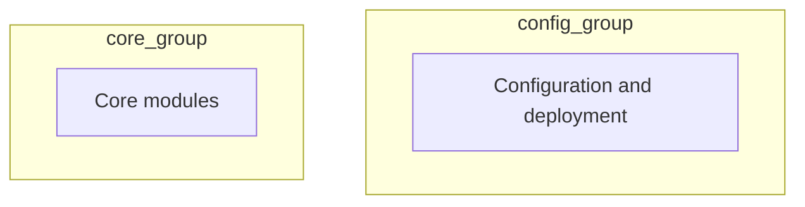

# Architecture report: lucide-icons/lucide

> Automated static analysis. **Observed** = directly seen in files/imports/AST; **Inferred** = interpretation from that evidence. Repository code was not executed.

## 1. Repository at a glance

| Item | Value |
| --- | --- |
| Repository | lucide-icons/lucide |
| Description | Beautiful & consistent icon toolkit made by the community. Lucide is an open-source icon library that provides 2000+ vector (svg) files for displaying icons and symbols in digital and non-digital projects.  |
| Language | TypeScript |
| Stars | 25757 |
| Licence | Other |
| Analysed commit / branch | 55782beff3a0133df79c417eb68f96e8f19e2404 / main |
| Framework(s) | React, Vue |
| Files analysed | 800 |
| Components | 2 |

## 2. Architecture in one minute

lucide-icons/lucide - Beautiful & consistent icon toolkit made by the community. Lucide is an open-source icon library that provides 2000+ vector (svg) files for displaying icons and symbols in digital and non-digital pro…. This repository was analysed statically from 800 file(s) (0 Python). Detected technologies (observed from imports/manifests): GitHub Actions, React, Vue, TypeScript. Files are grouped into 2 component(s): Configuration and deployment, Core modules. Findings below distinguish observed facts from inferred interpretation.

## 3. High-level block diagram

## 4. Main components

### Configuration and deployment (`config`)

- **Kind:** config
- **Status:** Observed
- **Confidence:** 0.85
- **Responsibility:** Groups 124 file(s) under configuration and deployment (observed from repository paths and static analysis).
- **Paths:** `brand-stopwords.json`, `categories/accessibility.json`, `categories/account.json`, `categories/animals.json`, `categories/arrows.json`, `categories/buildings.json`, `categories/charts.json`, `categories/communication.json`, `categories/connectivity.json`, `categories/cursors.json`, `categories/design.json`, `categories/development.json`, `categories/devices.json`, `categories/emoji.json`, `categories/files.json`, `categories/finance.json`, `categories/food-beverage.json`, `categories/gaming.json`, `categories/home.json`, `categories/layout.json`, `categories/letters-digits.json`, `categories/mail.json`, `categories/math.json`, `categories/medical.json`, `categories/multimedia.json`, `categories/nature.json`, `categories/navigation.json`, `categories/notifications.json`, `categories/people.json`, `categories/photography.json`, `categories/science.json`, `categories/seasons.json`, `categories/security.json`, `categories/shapes.json`, `categories/shopping.json`, `categories/social.json`, `categories/sports.json`, `categories/sustainability.json`, `categories/text.json`, `categories/time.json`, `categories/tools.json`, `categories/transportation.json`, `categories/travel.json`, `categories/weather.json`, `category.schema.json`, `cspell.json`, `group.schema.json`, `groups/chart.json`, `groups/check.json`, `groups/clock.json`, `groups/code.json`, `groups/cog.json`, `groups/currency.json`, `groups/dashed.json`, `groups/digit.json`, `groups/direction-down-left.json`, `groups/direction-down-right.json`, `groups/direction-down.json`, `groups/direction-left.json`, `groups/direction-right.json`, `groups/direction-up-left.json`, `groups/direction-up-right.json`, `groups/direction-up.json`, `groups/dot.json`, `groups/emoticon.json`, `groups/enter.json`, `groups/exclamation-mark.json`, `groups/exit.json`, `groups/graph.json`, `groups/heart.json`, `groups/key.json`, `groups/layout-resize.json`, `groups/letter.json`, `groups/line.json`, `groups/lock.json`, `groups/minus.json`, `groups/navigation-first.json`, `groups/navigation-last.json`, `groups/navigation-next.json`, `groups/navigation-previous.json`, `groups/off.json`, `groups/pause.json`, `groups/pen.json`, `groups/percent.json`, `groups/play.json`, `groups/plus.json`, `groups/position-bottom.json`, `groups/position-left.json`, `groups/position-right.json`, `groups/position-top.json`, `groups/question-mark.json`, `groups/search.json`, `groups/shield.json`, `groups/sort.json`, `groups/sparkles.json`, `groups/star.json`, `groups/stop.json`, `groups/sync.json`, `groups/user.json`, `groups/x.json`, `icon.schema.json`, `icons/a-arrow-down.json`, `icons/a-arrow-up.json`, `icons/a-large-small.json`, `icons/accessibility.json`, `icons/activity.json`, `icons/ad.json`, `icons/air-vent.json`, `icons/airplay.json`, `icons/alarm-clock-check.json`, `icons/alarm-clock-minus.json`, `icons/alarm-clock-off.json`, `icons/alarm-clock-plus.json`, `icons/alarm-clock.json`, `icons/alarm-smoke.json`, `icons/align-center-horizontal.json`, `icons/align-center-vertical.json`, `icons/align-end-horizontal.json`, `icons/align-end-vertical.json`, `icons/align-horizontal-distribute-center.json`, `icons/align-horizontal-distribute-end.json`, `icons/align-horizontal-distribute-start.json`, `icons/align-horizontal-justify-center.json`, `icons/align-horizontal-justify-end.json`
- **Evidence:** [brand-stopwords.json](https://github.com/lucide-icons/lucide/blob/55782beff3a0133df79c417eb68f96e8f19e2404/brand-stopwords.json); [categories/accessibility.json](https://github.com/lucide-icons/lucide/blob/55782beff3a0133df79c417eb68f96e8f19e2404/categories/accessibility.json); [categories/account.json](https://github.com/lucide-icons/lucide/blob/55782beff3a0133df79c417eb68f96e8f19e2404/categories/account.json); [categories/animals.json](https://github.com/lucide-icons/lucide/blob/55782beff3a0133df79c417eb68f96e8f19e2404/categories/animals.json); [categories/arrows.json](https://github.com/lucide-icons/lucide/blob/55782beff3a0133df79c417eb68f96e8f19e2404/categories/arrows.json); [categories/buildings.json](https://github.com/lucide-icons/lucide/blob/55782beff3a0133df79c417eb68f96e8f19e2404/categories/buildings.json); [categories/charts.json](https://github.com/lucide-icons/lucide/blob/55782beff3a0133df79c417eb68f96e8f19e2404/categories/charts.json); [categories/communication.json](https://github.com/lucide-icons/lucide/blob/55782beff3a0133df79c417eb68f96e8f19e2404/categories/communication.json)

### Core modules (`core`)

- **Kind:** core
- **Status:** Observed
- **Confidence:** 0.85
- **Responsibility:** Groups 1 file(s) under core modules (observed from repository paths and static analysis).
- **Paths:** `eslint.config.js`
- **Evidence:** [eslint.config.js](https://github.com/lucide-icons/lucide/blob/55782beff3a0133df79c417eb68f96e8f19e2404/eslint.config.js)

## 5. Execution flow

**Observed** entry point(s):

- [docs/.vitepress/theme/components/editors/preact/index.js](https://github.com/lucide-icons/lucide/blob/55782beff3a0133df79c417eb68f96e8f19e2404/docs/.vitepress/theme/components/editors/preact/index.js)

Representative flow (derived from observed entry points and the import graph; steps beyond the entry point are **Inferred**):

1. Execution starts at an observed entry point listed above, if present.
2. No internal import relationships between components were observed.

## 6. Project structure

### `(root)`

- `.editorconfig` - config (188 bytes)
- `.gitignore` - other (1816 bytes)
- `.npmignore` - other (165 bytes)
- `.prettierignore` - other (868 bytes)
- `BRAND_LOGOS_STATEMENT.md` - docs (3371 bytes)
- `CODE_OF_CONDUCT.md` - docs (8779 bytes)
- `CONTRIBUTING.md` - docs (8313 bytes)
- `LICENSE` - docs (3208 bytes)
- `README.md` - docs (8712 bytes)
- `brand-stopwords.json` - config (3313 bytes)
- `category.schema.json` - config (1098 bytes)
- `comment-markup.md` - docs (0 bytes)
- `cspell.json` - config (332 bytes)
- `eslint.config.js` - source, JavaScript (5495 bytes)
- `group.schema.json` - config (1281 bytes)
- `icon.schema.json` - config (6442 bytes)

### `.cspell`

- `.cspell/custom-words.txt` - docs (591 bytes)

### `.github`

- `.github/DISCUSSION_TEMPLATE/icon-design.yml` - config (2300 bytes)
- `.github/FUNDING.yml` - config (76 bytes)
- `.github/ISSUE_TEMPLATE/01_icon_request.yml` - config (2469 bytes)
- `.github/ISSUE_TEMPLATE/02_bug_report.yml` - config (3710 bytes)
- `.github/ISSUE_TEMPLATE/03_bug_report_site.yml` - config (2338 bytes)
- `.github/ISSUE_TEMPLATE/04_feature_request.yml` - config (2179 bytes)
- `.github/actions/icon-preview/.env.example` - config (308 bytes)
- `.github/actions/icon-preview/action.yml` - config (2211 bytes)
- `.github/actions/icon-preview/generateChangedIconsCommentMarkup.mts` - other (6844 bytes)
- `.github/actions/icon-preview/package.json` - manifest (443 bytes)
- `.github/actions/suggest-metadata/.env.example` - config (792 bytes)
- `.github/actions/suggest-metadata/action.yml` - config (1166 bytes)
- `.github/actions/suggest-metadata/package.json` - manifest (524 bytes)
- `.github/actions/suggest-metadata/src/iconIndex.mts` - other (6940 bytes)
- `.github/actions/suggest-metadata/src/metadata.mts` - other (1636 bytes)
- `.github/actions/suggest-metadata/src/model.mts` - other (5814 bytes)
- `.github/actions/suggest-metadata/src/pullRequest.mts` - other (5284 bytes)
- `.github/actions/suggest-metadata/src/referenceExamples.mts` - other (3833 bytes)
- `.github/actions/suggest-metadata/src/repository.mts` - other (3418 bytes)
- `.github/actions/suggest-metadata/src/suggestionComments.mts` - other (11236 bytes)
- `.github/actions/suggest-metadata/suggestMetaData.mts` - other (6444 bytes)
- `.github/conventional-commit-types.json` - config (107 bytes)
- `.github/copilot-instructions.md` - docs (452 bytes)
- `.github/dependabot.yml` - config (2710 bytes)
- `.github/instructions/groups.instructions.md` - docs (2636 bytes)
- `.github/instructions/metadata.instructions.md` - docs (11391 bytes)
- `.github/instructions/ux-writing.instructions.md` - docs (14035 bytes)
- `.github/labeler.yml` - config (2460 bytes)
- `.github/pull_request_template.md` - docs (3336 bytes)
- `.github/workflows/angular.yml` - ci, YAML (1226 bytes)
- `.github/workflows/ci.yml` - ci, YAML (5852 bytes)
- `.github/workflows/close-issue-with-banned-phrases.yml` - ci, YAML (5321 bytes)
- `.github/workflows/close-stale-prs.yml` - ci, YAML (785 bytes)
- `.github/workflows/docs.yml` - ci, YAML (1588 bytes)
- `.github/workflows/generate-pr-title.yml` - ci, YAML (3577 bytes)
- `.github/workflows/icons.yml` - ci, YAML (1277 bytes)
- `.github/workflows/labeler.yml` - ci, YAML (406 bytes)
- `.github/workflows/lint-code.yml` - ci, YAML (2457 bytes)
- `.github/workflows/linting-icons.yml` - ci, YAML (2879 bytes)
- `.github/workflows/lucide-astro.yml` - ci, YAML (1816 bytes)
- `.github/workflows/lucide-font.yml` - ci, YAML (1520 bytes)
- `.github/workflows/lucide-lab.yml` - ci, YAML (1299 bytes)
- `.github/workflows/lucide-preact.yml` - ci, YAML (1342 bytes)
- `.github/workflows/lucide-react-native.yml` - ci, YAML (1887 bytes)
- `.github/workflows/lucide-react.yml` - ci, YAML (2657 bytes)
- `.github/workflows/lucide-shared.yml` - ci, YAML (1240 bytes)
- `.github/workflows/lucide-solid.yml` - ci, YAML (2615 bytes)
- `.github/workflows/lucide-static.yml` - ci, YAML (1250 bytes)
- `.github/workflows/lucide-svelte-5.yml` - ci, YAML (2621 bytes)
- `.github/workflows/lucide-vue.yml` - ci, YAML (2590 bytes)
- `.github/workflows/lucide.yml` - ci, YAML (1795 bytes)
- `.github/workflows/pull-request-icon-preview.yml` - ci, YAML (2692 bytes)
- `.github/workflows/pull-request-metadata-suggestions.yml` - ci, YAML (1662 bytes)
- `.github/workflows/release-lab.yml` - ci, YAML (5123 bytes)
- `.github/workflows/release.yml` - ci, YAML (5690 bytes)
- `.github/workflows/request-review.yml` - ci, YAML (1140 bytes)
- `.github/workflows/solid-2.yml` - ci, YAML (2083 bytes)

### `.husky`

- `.husky/pre-commit` - other (33 bytes)

### `.vscode`

- `.vscode/launch.json` - config (439 bytes)
- `.vscode/settings.json` - config (181 bytes)
- `.vscode/svg.code-snippets` - other (2556 bytes)

### `.well-known`

- `.well-known/funding-manifest-urls` - other (32 bytes)

### `categories`

- `categories/accessibility.json` - config (202 bytes)
- `categories/account.json` - config (201 bytes)
- `categories/animals.json` - config (174 bytes)
- `categories/arrows.json` - config (195 bytes)
- `categories/buildings.json` - config (189 bytes)
- `categories/charts.json` - config (176 bytes)
- `categories/communication.json` - config (211 bytes)
- `categories/connectivity.json` - config (200 bytes)
- `categories/cursors.json` - config (180 bytes)
- `categories/design.json` - config (188 bytes)
- `categories/development.json` - config (208 bytes)
- `categories/devices.json` - config (189 bytes)
- `categories/emoji.json` - config (198 bytes)
- `categories/files.json` - config (201 bytes)
- `categories/finance.json` - config (188 bytes)
- `categories/food-beverage.json` - config (186 bytes)
- `categories/gaming.json` - config (196 bytes)
- `categories/home.json` - config (190 bytes)
- `categories/layout.json` - config (195 bytes)
- `categories/letters-digits.json` - config (221 bytes)
- `categories/mail.json` - config (183 bytes)
- `categories/math.json` - config (185 bytes)
- `categories/medical.json` - config (193 bytes)
- `categories/multimedia.json` - config (193 bytes)
- `categories/nature.json` - config (173 bytes)
- `categories/navigation.json` - config (199 bytes)
- `categories/notifications.json` - config (209 bytes)
- `categories/people.json` - config (187 bytes)
- `categories/photography.json` - config (184 bytes)
- `categories/science.json` - config (192 bytes)
- `categories/seasons.json` - config (186 bytes)
- `categories/security.json` - config (191 bytes)
- `categories/shapes.json` - config (152 bytes)
- `categories/shopping.json` - config (179 bytes)
- `categories/social.json` - config (194 bytes)
- `categories/sports.json` - config (181 bytes)
- `categories/sustainability.json` - config (203 bytes)
- `categories/text.json` - config (183 bytes)
- `categories/time.json` - config (191 bytes)
- `categories/tools.json` - config (176 bytes)
- `categories/transportation.json` - config (196 bytes)
- `categories/travel.json` - config (184 bytes)
- `categories/weather.json` - config (180 bytes)

### `docs`

- `docs/.vitepress/api/categories/index.get.ts` - docs (407 bytes)
- `docs/.vitepress/api/figma/data.ts` - docs (1261 bytes)
- `docs/.vitepress/api/gh-icon/[...data].get.tsx` - docs (2096 bytes)
- `docs/.vitepress/api/gh-icon/diff/[...data].get.tsx` - docs (1426 bytes)
- `docs/.vitepress/api/gh-icon/dpi/[...data].get.ts` - docs (2541 bytes)
- `docs/.vitepress/api/gh-icon/stroke-width/[...data].get.tsx` - docs (1199 bytes)
- `docs/.vitepress/api/gh-icon/symmetry/[...data].get.tsx` - docs (1957 bytes)
- `docs/.vitepress/api/icon-nodes/index.get.ts` - docs (733 bytes)
- `docs/.vitepress/api/icons/[iconName].get.ts` - docs (1440 bytes)
- `docs/.vitepress/api/lab/icon-details/index.get.ts` - docs (737 bytes)
- `docs/.vitepress/api/lab/icon-metadata/index.get.ts` - docs (453 bytes)
- `docs/.vitepress/api/lab/icon-nodes/index.get.ts` - docs (861 bytes)
- `docs/.vitepress/api/tags/index.get.ts` - docs (386 bytes)
- `docs/.vitepress/config.ts` - docs (4682 bytes)
- `docs/.vitepress/createOGImage.ts` - docs (2503 bytes)
- `docs/.vitepress/data/categoriesData.json` - config (2505 bytes)
- `docs/.vitepress/data/companiesData.json` - config (1150 bytes)
- `docs/.vitepress/data/componentLibrariesData.json` - config (556 bytes)
- `docs/.vitepress/data/lab/.gitkeep` - docs (0 bytes)
- `docs/.vitepress/data/packageData.json` - config (5446 bytes)
- `docs/.vitepress/data/packageData.thirdParty.json` - config (9880 bytes)
- `docs/.vitepress/data/teamData.json` - config (1367 bytes)
- `docs/.vitepress/getHeadConfig.ts` - docs (1671 bytes)
- `docs/.vitepress/getStructuredData.ts` - docs (3397 bytes)
- `docs/.vitepress/lib/SvgPreview/Backdrop.tsx` - docs (2190 bytes)
- `docs/.vitepress/lib/SvgPreview/Diff.tsx` - docs (1611 bytes)
- `docs/.vitepress/lib/SvgPreview/GapViolationHighlight.tsx` - docs (3575 bytes)
- `docs/.vitepress/lib/SvgPreview/index.tsx` - docs (13206 bytes)
- `docs/.vitepress/lib/SvgPreview/path-to-points.ts` - docs (639 bytes)
- `docs/.vitepress/lib/SvgPreview/types.ts` - docs (759 bytes)
- `docs/.vitepress/lib/SvgPreview/utils.ts` - docs (9719 bytes)
- `docs/.vitepress/lib/categories.ts` - docs (1031 bytes)
- `docs/.vitepress/lib/codeExamples/createCodeExamples.ts` - docs (2995 bytes)
- `docs/.vitepress/lib/codeExamples/createLabCodeExamples.ts` - docs (2421 bytes)
- `docs/.vitepress/lib/codeExamples/highLightCode.ts` - docs (905 bytes)
- `docs/.vitepress/lib/codeExamples/types.ts` - docs (90 bytes)
- `docs/.vitepress/lib/fetchPackages.ts` - docs (1015 bytes)
- `docs/.vitepress/lib/generateZip.ts` - docs (390 bytes)
- `docs/.vitepress/lib/getFallbackZip.tsx` - docs (633 bytes)
- `docs/.vitepress/lib/guideOGTemplate.svg` - docs (4518 bytes)
- `docs/.vitepress/lib/helpers.ts` - docs (716 bytes)
- `docs/.vitepress/lib/iconOGTemplate.svg` - docs (5477 bytes)
- `docs/.vitepress/markdown/example.ts` - docs (7000 bytes)
- `docs/.vitepress/markdown/sandpack.ts` - docs (3690 bytes)
- `docs/.vitepress/markdown/snackPlayer.ts` - docs (3002 bytes)
- `docs/.vitepress/markdown/types.ts` - docs (380 bytes)
- `docs/.vitepress/sidebar/angular.ts` - docs (2847 bytes)
- `docs/.vitepress/sidebar/astro.ts` - docs (1998 bytes)
- `docs/.vitepress/sidebar/index.ts` - docs (1666 bytes)
- `docs/.vitepress/sidebar/lucide.ts` - docs (2202 bytes)
- `docs/.vitepress/sidebar/preact.ts` - docs (2613 bytes)
- `docs/.vitepress/sidebar/react-native.ts` - docs (2417 bytes)
- `docs/.vitepress/sidebar/react.ts` - docs (2963 bytes)
- `docs/.vitepress/sidebar/resources.ts` - docs (3231 bytes)
- `docs/.vitepress/sidebar/solid.ts` - docs (2636 bytes)
- `docs/.vitepress/sidebar/static.ts` - docs (2144 bytes)
- `docs/.vitepress/sidebar/svelte.ts` - docs (2314 bytes)
- `docs/.vitepress/sidebar/vue.ts` - docs (2408 bytes)
- `docs/.vitepress/theme/components/PageContainer.vue` - docs (149 bytes)
- `docs/.vitepress/theme/components/SurveyAskOverlay.vue` - docs (3210 bytes)
- `docs/.vitepress/theme/components/base/Badge.vue` - docs (1724 bytes)
- `docs/.vitepress/theme/components/base/Button.vue` - docs (1743 bytes)
- `docs/.vitepress/theme/components/base/ButtonMenu.vue` - docs (4446 bytes)
- `docs/.vitepress/theme/components/base/Card.vue` - docs (1009 bytes)
- `docs/.vitepress/theme/components/base/CardGrid.vue` - docs (526 bytes)
- `docs/.vitepress/theme/components/base/Checkbox.vue` - docs (2347 bytes)
- `docs/.vitepress/theme/components/base/CodeGroup.vue` - docs (1106 bytes)
- `docs/.vitepress/theme/components/base/ColorPicker.vue` - docs (2239 bytes)
- `docs/.vitepress/theme/components/base/EndOfPage.vue` - docs (364 bytes)
- `docs/.vitepress/theme/components/base/FakeInput.vue` - docs (1658 bytes)
- `docs/.vitepress/theme/components/base/Faq.vue` - docs (1381 bytes)
- `docs/.vitepress/theme/components/base/FaqItem.vue` - docs (1243 bytes)
- `docs/.vitepress/theme/components/base/GridSection.vue` - docs (585 bytes)
- `docs/.vitepress/theme/components/base/Input.vue` - docs (4004 bytes)
- `docs/.vitepress/theme/components/base/InputField.vue` - docs (891 bytes)
- `docs/.vitepress/theme/components/base/InputSearch.vue` - docs (1379 bytes)
- `docs/.vitepress/theme/components/base/Kbd.vue` - docs (392 bytes)
- `docs/.vitepress/theme/components/base/Label.vue` - docs (218 bytes)
- `docs/.vitepress/theme/components/base/LayoutTop.vue` - docs (1372 bytes)
- `docs/.vitepress/theme/components/base/LucideIcon.vue` - docs (442 bytes)
- `docs/.vitepress/theme/components/base/MotionCounter.vue` - docs (1649 bytes)
- `docs/.vitepress/theme/components/base/OverviewLink.vue` - docs (2183 bytes)
- `docs/.vitepress/theme/components/base/OverviewLinkGrid.vue` - docs (536 bytes)
- `docs/.vitepress/theme/components/base/PageTabs.vue` - docs (1406 bytes)
- `docs/.vitepress/theme/components/base/RangeSlider.vue` - docs (3608 bytes)
- `docs/.vitepress/theme/components/base/ResetButton.vue` - docs (1096 bytes)
- `docs/.vitepress/theme/components/base/Select.vue` - docs (5706 bytes)
- `docs/.vitepress/theme/components/base/SelectIcon.vue` - docs (761 bytes)
- `docs/.vitepress/theme/components/base/Switch.vue` - docs (2767 bytes)
- `docs/.vitepress/theme/components/base/Toaster.vue` - docs (1438 bytes)
- `docs/.vitepress/theme/components/base/Tooltip.vue` - docs (1094 bytes)
- `docs/.vitepress/theme/components/editors/Sandpack.vue` - docs (1318 bytes)
- `docs/.vitepress/theme/components/editors/SandpackAngular.vue` - docs (2040 bytes)
- `docs/.vitepress/theme/components/editors/SandpackAstro.vue` - docs (429 bytes)
- `docs/.vitepress/theme/components/editors/SandpackPreact.vue` - docs (355 bytes)
- `docs/.vitepress/theme/components/editors/SandpackSolid.vue` - docs (1007 bytes)
- `docs/.vitepress/theme/components/editors/SandpackSvelte.vue` - docs (1299 bytes)
- `docs/.vitepress/theme/components/editors/SandpackVue.vue` - docs (512 bytes)
- `docs/.vitepress/theme/components/editors/SnackPlayer.vue` - docs (1032 bytes)
- `docs/.vitepress/theme/components/editors/preact/files.ts` - docs (439 bytes)
- `docs/.vitepress/theme/components/editors/preact/index.html` - docs (197 bytes)
- `docs/.vitepress/theme/components/editors/preact/index.js` - docs (176 bytes)
- `docs/.vitepress/theme/components/editors/preact/package.json` - manifest (342 bytes)
- `docs/.vitepress/theme/components/editors/preact/styles.css` - docs (869 bytes)
- `docs/.vitepress/theme/components/guide/FrameworkSelect.vue` - docs (3678 bytes)
- `docs/.vitepress/theme/components/home/HomeContainer.vue` - docs (517 bytes)
- `docs/.vitepress/theme/components/home/HomeHeroAfter.vue` - docs (1370 bytes)
- `docs/.vitepress/theme/components/home/HomeHeroIconsAnimation.vue` - docs (13987 bytes)
- `docs/.vitepress/theme/components/home/HomeHeroIconsCard.data.ts` - docs (1911 bytes)
- `docs/.vitepress/theme/components/home/HomeHeroIconsCard.vue` - docs (277 bytes)
- `docs/.vitepress/theme/components/home/HomeHeroInfoBefore.data.ts` - docs (509 bytes)
- `docs/.vitepress/theme/components/home/HomeHeroInfoBefore.vue` - docs (769 bytes)
- `docs/.vitepress/theme/components/home/HomeIconCustomizer.vue` - docs (4310 bytes)
- `docs/.vitepress/theme/components/home/HomeIconCustomizerIcons.vue` - docs (1968 bytes)
- `docs/.vitepress/theme/components/home/HomePackagesSection.data.ts` - docs (1920 bytes)
- `docs/.vitepress/theme/components/home/HomePackagesSection.vue` - docs (1928 bytes)
- `docs/.vitepress/theme/components/home/HomeSectionTitle.vue` - docs (498 bytes)
- `docs/.vitepress/theme/components/home/HomeSponsorCard.vue` - docs (1196 bytes)
- `docs/.vitepress/theme/components/home/HomeTeamSection.vue` - docs (1797 bytes)
- `docs/.vitepress/theme/components/home/RocketDuotoneIcon.ts` - docs (626 bytes)
- `docs/.vitepress/theme/components/home/TeamMemberCard.vue` - docs (3843 bytes)
- `docs/.vitepress/theme/components/icons/CarbonAdOverlay.vue` - docs (2200 bytes)
- `docs/.vitepress/theme/components/icons/CategoryList.data.ts` - docs (424 bytes)
- `docs/.vitepress/theme/components/icons/CategoryList.vue` - docs (3163 bytes)
- `docs/.vitepress/theme/components/icons/CategoryListItem.vue` - docs (3053 bytes)
- `docs/.vitepress/theme/components/icons/CopyCodeButton.vue` - docs (3309 bytes)
- `docs/.vitepress/theme/components/icons/CopySVGButton.vue` - docs (2528 bytes)
- `docs/.vitepress/theme/components/icons/EditInStudioButton.vue` - docs (845 bytes)
- `docs/.vitepress/theme/components/icons/IconContributors.vue` - docs (1949 bytes)
- `docs/.vitepress/theme/components/icons/IconDetail.vue` - docs (820 bytes)
- `docs/.vitepress/theme/components/icons/IconDetailName.vue` - docs (1469 bytes)
- `docs/.vitepress/theme/components/icons/IconDetailOverlay.vue` - docs (5114 bytes)
- `docs/.vitepress/theme/components/icons/IconGrid.vue` - docs (989 bytes)
- `docs/.vitepress/theme/components/icons/IconInfo.vue` - docs (4623 bytes)
- `docs/.vitepress/theme/components/icons/IconItem.vue` - docs (6675 bytes)
- `docs/.vitepress/theme/components/icons/IconPreview.vue` - docs (3643 bytes)
- `docs/.vitepress/theme/components/icons/IconPreviewSmall.vue` - docs (1780 bytes)
- `docs/.vitepress/theme/components/icons/IconShowcase.vue` - docs (12026 bytes)
- `docs/.vitepress/theme/components/icons/IconTags.vue` - docs (2248 bytes)
- `docs/.vitepress/theme/components/icons/IconsCategory.vue` - docs (1082 bytes)
- `docs/.vitepress/theme/components/icons/IconsCategoryOverview.vue` - docs (6567 bytes)
- `docs/.vitepress/theme/components/icons/IconsOverview.vue` - docs (9173 bytes)
- `docs/.vitepress/theme/components/icons/KeyboardShortcuts.vue` - docs (6746 bytes)
- `docs/.vitepress/theme/components/icons/NoResults.vue` - docs (6681 bytes)
- `docs/.vitepress/theme/components/icons/RelatedIcons.vue` - docs (335 bytes)
- `docs/.vitepress/theme/components/icons/SidebarExternalLibrarySelect.vue` - docs (1284 bytes)
- `docs/.vitepress/theme/components/icons/SidebarIconCustomizer.vue` - docs (3187 bytes)
- `docs/.vitepress/theme/components/icons/SidebarTitle.vue` - docs (300 bytes)
- `docs/.vitepress/theme/components/icons/StickyBar.vue` - docs (2155 bytes)
- `docs/.vitepress/theme/components/icons/confetti.css` - docs (4153 bytes)
- `docs/.vitepress/theme/components/overrides/Hero.vue` - docs (19489 bytes)
- `docs/.vitepress/theme/components/overrides/HeroMatrix.vue` - docs (5509 bytes)
- `docs/.vitepress/theme/components/overrides/VPCarbonAds.vue` - docs (3257 bytes)
- `docs/.vitepress/theme/components/overrides/VPFooter.vue` - docs (2816 bytes)
- `docs/.vitepress/theme/components/overrides/VPIconAlignLeft.vue` - docs (229 bytes)
- `docs/.vitepress/theme/components/overrides/VPNavBarSearch.vue` - docs (5009 bytes)
- `docs/.vitepress/theme/components/packages/PackageList.data.ts` - docs (1256 bytes)
- `docs/.vitepress/theme/components/packages/PackageList.vue` - docs (808 bytes)
- `docs/.vitepress/theme/components/packages/PackageListItem.vue` - docs (2387 bytes)
- `docs/.vitepress/theme/components/showcase/ShowcaseList.vue` - docs (883 bytes)
- `docs/.vitepress/theme/components/showcase/ShowcaseListItem.vue` - docs (2716 bytes)
- `docs/.vitepress/theme/components/sponsor/SponsorAmountPicker.vue` - docs (10658 bytes)
- `docs/.vitepress/theme/components/sponsor/SponsorAvatars.vue` - docs (2387 bytes)
- `docs/.vitepress/theme/components/sponsor/SponsorCta.vue` - docs (1453 bytes)
- `docs/.vitepress/theme/components/sponsor/SponsorFundingUses.vue` - docs (2418 bytes)
- `docs/.vitepress/theme/components/sponsor/SponsorHero.vue` - docs (4273 bytes)
- `docs/.vitepress/theme/components/sponsor/SponsorHeroAnimation.vue` - docs (7752 bytes)
- `docs/.vitepress/theme/components/sponsor/SponsorLogoGrid.vue` - docs (3489 bytes)
- `docs/.vitepress/theme/components/sponsor/SponsorSection.vue` - docs (844 bytes)
- `docs/.vitepress/theme/components/sponsor/SponsorSectionHeader.vue` - docs (658 bytes)
- `docs/.vitepress/theme/components/sponsor/SponsorStats.data.ts` - docs (2468 bytes)
- `docs/.vitepress/theme/components/sponsor/SponsorTierCard.vue` - docs (3445 bytes)
- `docs/.vitepress/theme/components/sponsor/SponsorTiers.vue` - docs (5864 bytes)
- `docs/.vitepress/theme/components/sponsor/SponsorWall.vue` - docs (894 bytes)
- `docs/.vitepress/theme/components/sponsor/sponsors.ts` - docs (853 bytes)
- `docs/.vitepress/theme/components/sponsor/tiers.ts` - docs (6079 bytes)
- `docs/.vitepress/theme/composables/useActiveAnchor.ts` - docs (2826 bytes)
- `docs/.vitepress/theme/composables/useCategoryView.ts` - docs (1763 bytes)
- `docs/.vitepress/theme/composables/useConfetti.ts` - docs (331 bytes)
- `docs/.vitepress/theme/composables/useExternalLibs.ts` - docs (1694 bytes)
- `docs/.vitepress/theme/composables/useFetchCategories.ts` - docs (367 bytes)
- `docs/.vitepress/theme/composables/useFetchTags.ts` - docs (349 bytes)
- `docs/.vitepress/theme/composables/useIconStyle.test.mts` - docs (3426 bytes)
- `docs/.vitepress/theme/composables/useIconStyle.ts` - docs (3139 bytes)
- `docs/.vitepress/theme/composables/useIconsWithExternalLibs.ts` - docs (738 bytes)
- `docs/.vitepress/theme/composables/useScrollToCategory.ts` - docs (1657 bytes)
- `docs/.vitepress/theme/composables/useSearch.ts` - docs (695 bytes)
- `docs/.vitepress/theme/composables/useSearchInput.ts` - docs (975 bytes)
- `docs/.vitepress/theme/composables/useTrackStyleChanges.ts` - docs (657 bytes)
- `docs/.vitepress/theme/iconStyleHead.js` - docs (1175 bytes)
- `docs/.vitepress/theme/index.ts` - docs (2111 bytes)
- `docs/.vitepress/theme/layouts/IconsSidebarNavAfter.vue` - docs (689 bytes)
- `docs/.vitepress/theme/layouts/NavBarSponsorButton.vue` - docs (1840 bytes)
- `docs/.vitepress/theme/layouts/SideBarNavBefore.vue` - docs (665 bytes)
- `docs/.vitepress/theme/sandpack-default.css` - docs (902 bytes)
- `docs/.vitepress/theme/sandpackTheme.json` - config (1073 bytes)
- `docs/.vitepress/theme/style.css` - docs (16938 bytes)
- `docs/.vitepress/theme/types.ts` - docs (1715 bytes)
- `docs/.vitepress/theme/utils/chunkArray.ts` - docs (257 bytes)
- `docs/.vitepress/theme/utils/downloadData.ts` - docs (181 bytes)
- `docs/.vitepress/theme/utils/getSVGIcon.ts` - docs (809 bytes)
- `docs/.vitepress/theme/utils/getStudioLink.ts` - docs (741 bytes)
- `docs/.vitepress/theme/utils/openpanel.ts` - docs (3665 bytes)
- `docs/.vitepress/theme/utils/underlineDirection.ts` - docs (953 bytes)
- `docs/.vitepress/theme/utils/useSearchPlaceholder.ts` - docs (1063 bytes)
- `docs/.vitepress/theme/utils/useSearchShortcut.ts` - docs (1303 bytes)
- `docs/.vitepress/transformPageData.ts` - docs (2524 bytes)
- `docs/.vitepress/types.d.ts` - docs (2391 bytes)
- `docs/README.md` - docs (423 bytes)
- `docs/brand-logo-statement.md` - docs (310 bytes)
- `docs/code-of-conduct.md` - docs (358 bytes)
- `docs/community.md` - docs (2779 bytes)
- `docs/contribute/icons/affinity-designer-guide.md` - docs (1008 bytes)
- `docs/contribute/icons/code-conventions.md` - docs (2355 bytes)
- `docs/contribute/icons/design-principles.md` - docs (11136 bytes)
- `docs/contribute/icons/figma-guide.md` - docs (1520 bytes)
- `docs/contribute/icons/illustrator-guide.md` - docs (1062 bytes)
- `docs/contribute/icons/index.md` - docs (1252 bytes)
- `docs/contribute/icons/inkscape-guide.md` - docs (1767 bytes)
- `docs/contribute/icons/metadata-conventions/index.md` - docs (6852 bytes)
- `docs/contribute/icons/metadata-conventions/tag-guide.md` - docs (4134 bytes)
- `docs/contribute/icons/metadata-conventions/use-case-guide.md` - docs (5421 bytes)
- `docs/contribute/icons/naming-conventions.md` - docs (8067 bytes)
- `docs/contribute/icons/specification.md` - docs (4387 bytes)
- `docs/contribute/index.md` - docs (156 bytes)
- `docs/guide/angular/advanced/accessibility.md` - docs (1806 bytes)
- `docs/guide/angular/advanced/combining-icons.md` - docs (3149 bytes)
- `docs/guide/angular/advanced/filled-icons.md` - docs (1716 bytes)
- `docs/guide/angular/advanced/global-styling.md` - docs (4858 bytes)
- `docs/guide/angular/advanced/icon-provider.md` - docs (3741 bytes)
- `docs/guide/angular/advanced/typescript.md` - docs (1088 bytes)
- `docs/guide/angular/advanced/with-lucide-lab.md` - docs (3596 bytes)
- `docs/guide/angular/basics/color.md` - docs (2127 bytes)
- `docs/guide/angular/basics/sizing.md` - docs (3024 bytes)
- `docs/guide/angular/basics/stroke-width.md` - docs (2401 bytes)
- `docs/guide/angular/getting-started.md` - docs (3273 bytes)
- `docs/guide/angular/index.md` - docs (1639 bytes)
- `docs/guide/angular/migration.md` - docs (5750 bytes)
- `docs/guide/astro/advanced/accessibility.md` - docs (1864 bytes)
- `docs/guide/astro/advanced/global-styling.md` - docs (1620 bytes)
- `docs/guide/astro/advanced/typescript.md` - docs (3023 bytes)
- `docs/guide/astro/advanced/with-lucide-lab.md` - docs (758 bytes)
- `docs/guide/astro/basics/color.md` - docs (1212 bytes)
- `docs/guide/astro/basics/sizing.md` - docs (1826 bytes)
- `docs/guide/astro/basics/stroke-width.md` - docs (1412 bytes)
- `docs/guide/astro/getting-started.md` - docs (2255 bytes)
- `docs/guide/astro/index.md` - docs (1717 bytes)
- `docs/guide/astro/migration.md` - docs (699 bytes)
- `docs/guide/icons/index.md` - docs (6881 bytes)
- `docs/guide/index.md` - docs (2915 bytes)
- `docs/guide/installation.md` - docs (4065 bytes)
- `docs/guide/lucide/advanced/accessibility.md` - docs (1799 bytes)
- `docs/guide/lucide/advanced/content-template-element.md` - docs (1458 bytes)
- `docs/guide/lucide/advanced/filled-icons.md` - docs (1749 bytes)
- `docs/guide/lucide/advanced/global-styling.md` - docs (3593 bytes)
- `docs/guide/lucide/advanced/shadow-dom.md` - docs (2057 bytes)
- `docs/guide/lucide/advanced/with-lucide-lab.md` - docs (1164 bytes)
- `docs/guide/lucide/basics/color.md` - docs (2002 bytes)
- `docs/guide/lucide/basics/sizing.md` - docs (3364 bytes)
- `docs/guide/lucide/basics/stroke-width.md` - docs (2272 bytes)
- `docs/guide/lucide/getting-started.md` - docs (3371 bytes)
- `docs/guide/lucide/index.md` - docs (2129 bytes)
- `docs/guide/lucide/migration.md` - docs (699 bytes)
- `docs/guide/preact/advanced/accessibility.md` - docs (1869 bytes)
- `docs/guide/preact/advanced/aliased-names.md` - docs (2269 bytes)
- `docs/guide/preact/advanced/combining-icons.md` - docs (2751 bytes)
- `docs/guide/preact/advanced/filled-icons.md` - docs (1339 bytes)
- `docs/guide/preact/advanced/global-styling.md` - docs (3988 bytes)
- `docs/guide/preact/advanced/typescript.md` - docs (2554 bytes)
- `docs/guide/preact/advanced/with-lucide-lab.md` - docs (728 bytes)
- `docs/guide/preact/basics/color.md` - docs (1902 bytes)
- `docs/guide/preact/basics/sizing.md` - docs (2764 bytes)
- `docs/guide/preact/basics/stroke-width.md` - docs (2027 bytes)
- `docs/guide/preact/getting-started.md` - docs (2314 bytes)
- `docs/guide/preact/index.md` - docs (2011 bytes)
- `docs/guide/preact/migration.md` - docs (699 bytes)
- `docs/guide/react-native/advanced/aliased-names.md` - docs (2354 bytes)
- `docs/guide/react-native/advanced/combining-icons.md` - docs (3352 bytes)
- `docs/guide/react-native/advanced/filled-icons.md` - docs (1493 bytes)
- `docs/guide/react-native/advanced/global-styling.md` - docs (881 bytes)
- `docs/guide/react-native/advanced/optimizations.md` - docs (2655 bytes)
- `docs/guide/react-native/advanced/typescript.md` - docs (2553 bytes)
- `docs/guide/react-native/advanced/with-lucide-lab.md` - docs (746 bytes)
- `docs/guide/react-native/basics/color.md` - docs (1036 bytes)
- `docs/guide/react-native/basics/sizing.md` - docs (1491 bytes)
- `docs/guide/react-native/basics/stroke-width.md` - docs (2509 bytes)
- `docs/guide/react-native/getting-started.md` - docs (2333 bytes)
- `docs/guide/react-native/index.md` - docs (2141 bytes)
- `docs/guide/react-native/migration.md` - docs (699 bytes)
- `docs/guide/react/advanced/accessibility.md` - docs (1865 bytes)
- `docs/guide/react/advanced/aliased-names.md` - docs (2263 bytes)
- `docs/guide/react/advanced/combining-icons.md` - docs (2669 bytes)
- `docs/guide/react/advanced/dynamic-icon-component.md` - docs (1334 bytes)
- `docs/guide/react/advanced/filled-icons.md` - docs (1315 bytes)
- `docs/guide/react/advanced/global-styling.md` - docs (3934 bytes)
- `docs/guide/react/advanced/typescript.md` - docs (2530 bytes)
- `docs/guide/react/advanced/with-lucide-lab.md` - docs (725 bytes)
- `docs/guide/react/basics/color.md` - docs (1837 bytes)
- `docs/guide/react/basics/sizing.md` - docs (2681 bytes)
- `docs/guide/react/basics/stroke-width.md` - docs (1987 bytes)
- `docs/guide/react/getting-started.md` - docs (2798 bytes)
- `docs/guide/react/index.md` - docs (1922 bytes)
- `docs/guide/react/migration-from-feather.md` - docs (1302 bytes)
- `docs/guide/react/migration.md` - docs (699 bytes)
- `docs/guide/solid/advanced/accessibility.md` - docs (1865 bytes)
- `docs/guide/solid/advanced/aliased-names.md` - docs (949 bytes)
- `docs/guide/solid/advanced/combining-icons.md` - docs (2785 bytes)
- `docs/guide/solid/advanced/filled-icons.md` - docs (1356 bytes)
- `docs/guide/solid/advanced/global-styling.md` - docs (4660 bytes)
- `docs/guide/solid/advanced/typescript.md` - docs (2616 bytes)
- `docs/guide/solid/advanced/with-lucide-lab.md` - docs (725 bytes)
- `docs/guide/solid/basics/color.md` - docs (1845 bytes)
- `docs/guide/solid/basics/sizing.md` - docs (2726 bytes)
- `docs/guide/solid/basics/stroke-width.md` - docs (2024 bytes)
- `docs/guide/solid/getting-started.md` - docs (3806 bytes)
- `docs/guide/solid/index.md` - docs (1994 bytes)
- `docs/guide/solid/migration.md` - docs (699 bytes)
- `docs/guide/static/font/color.md` - docs (1364 bytes)
- `docs/guide/static/font/index.md` - docs (2011 bytes)
- `docs/guide/static/font/sizing.md` - docs (911 bytes)
- `docs/guide/static/getting-started.md` - docs (1538 bytes)
- `docs/guide/static/index.md` - docs (2210 bytes)
- `docs/guide/static/js-modules/node.md` - docs (1325 bytes)
- `docs/guide/static/js-modules/web.md` - docs (1098 bytes)
- `docs/guide/static/link-as-image.md` - docs (2138 bytes)
- `docs/guide/static/migration.md` - docs (699 bytes)
- `docs/guide/static/svg-sprite.md` - docs (2891 bytes)
- `docs/guide/svelte/advanced/accessibility.md` - docs (1875 bytes)
- `docs/guide/svelte/advanced/combining-icons.md` - docs (2452 bytes)
- `docs/guide/svelte/advanced/filled-icons.md` - docs (1333 bytes)
- `docs/guide/svelte/advanced/global-styling.md` - docs (4558 bytes)
- `docs/guide/svelte/advanced/typescript.md` - docs (3812 bytes)
- `docs/guide/svelte/advanced/with-lucide-lab.md` - docs (768 bytes)
- `docs/guide/svelte/basics/color.md` - docs (1570 bytes)
- `docs/guide/svelte/basics/sizing.md` - docs (2810 bytes)
- `docs/guide/svelte/basics/stroke-width.md` - docs (1785 bytes)
- `docs/guide/svelte/getting-started.md` - docs (2315 bytes)
- `docs/guide/svelte/index.md` - docs (1838 bytes)
- `docs/guide/svelte/migration.md` - docs (699 bytes)
- `docs/guide/version-1.md` - docs (7910 bytes)
- `docs/guide/vscode.md` - docs (1402 bytes)
- `docs/guide/vue/advanced/accessibility.md` - docs (1861 bytes)
- `docs/guide/vue/advanced/aliased-names.md` - docs (2246 bytes)
- `docs/guide/vue/advanced/combining-icons.md` - docs (2569 bytes)
- `docs/guide/vue/advanced/filled-icons.md` - docs (1259 bytes)
- `docs/guide/vue/advanced/global-styling.md` - docs (3977 bytes)
- `docs/guide/vue/advanced/typescript.md` - docs (2728 bytes)
- `docs/guide/vue/advanced/with-lucide-lab.md` - docs (748 bytes)
- `docs/guide/vue/basics/color.md` - docs (1641 bytes)
- `docs/guide/vue/basics/sizing.md` - docs (2556 bytes)
- `docs/guide/vue/basics/stroke-width.md` - docs (1882 bytes)
- `docs/guide/vue/getting-started.md` - docs (2270 bytes)
- `docs/guide/vue/index.md` - docs (1771 bytes)
- `docs/guide/vue/migration.md` - docs (1086 bytes)
- `docs/how-to/accessibility.md` - docs (8541 bytes)
- `docs/how-to/icon-guide.md` - docs (10242 bytes)
- `docs/how-to/index.md` - docs (1576 bytes)
- `docs/icons/[name].md` - docs (5746 bytes)
- `docs/icons/[name].paths.ts` - docs (932 bytes)
- `docs/icons/categories.data.ts` - docs (373 bytes)
- `docs/icons/categories.md` - docs (856 bytes)
- `docs/icons/codeExamples.data.ts` - docs (221 bytes)
- `docs/icons/icons.data.ts` - docs (940 bytes)
- `docs/icons/index.md` - docs (712 bytes)
- `docs/icons/lab/[name].md` - docs (132 bytes)
- `docs/icons/lab/[name].paths.ts` - docs (621 bytes)
- `docs/icons/lab/codeExamples.data.ts` - docs (227 bytes)
- `docs/images/1px-border-radius.svg` - docs (5973 bytes)
- `docs/images/1px-element-spacing.svg` - docs (4136 bytes)
- `docs/images/1px-inner-gap.svg` - docs (613 bytes)
- `docs/images/1px-inner-spacing.svg` - docs (5564 bytes)
- `docs/images/1px-padding-violation.svg` - docs (8184 bytes)
- `docs/images/1px-padding.svg` - docs (5070 bytes)
- `docs/images/24px-24px-violation.svg` - docs (1435 bytes)
- `docs/images/24px-24px.svg` - docs (2742 bytes)
- `docs/images/2px-border-radius.svg` - docs (4160 bytes)
- `docs/images/2px-element-spacing-abrupt-cut.svg` - docs (4536 bytes)
- `docs/images/2px-element-spacing-connected.svg` - docs (4074 bytes)
- `docs/images/2px-element-spacing.svg` - docs (4126 bytes)
- `docs/images/2px-inner-gap.svg` - docs (1180 bytes)
- `docs/images/2px-inner-spacing.svg` - docs (6085 bytes)
- `docs/images/2px-stroke-violation.svg` - docs (57243 bytes)
- `docs/images/2px-stroke.svg` - docs (4181 bytes)
- `docs/images/a11y/contrast_do.svg` - docs (1636 bytes)
- `docs/images/a11y/contrast_dont.svg` - docs (1640 bytes)
- `docs/images/a11y/decorative_icons_do.svg` - docs (22926 bytes)
- `docs/images/a11y/decorative_icons_dont.svg` - docs (18246 bytes)
- `docs/images/a11y/distinct_use_case_do.svg` - docs (90231 bytes)
- `docs/images/a11y/distinct_use_case_dont.svg` - docs (89827 bytes)
- `docs/images/a11y/functional_icons_do.svg` - docs (82974 bytes)
- `docs/images/a11y/functional_icons_dont.svg` - docs (87751 bytes)
- `docs/images/a11y/icon_button_do.svg` - docs (6308 bytes)
- `docs/images/a11y/icon_button_dont.svg` - docs (9625 bytes)
- `docs/images/a11y/interactive_icons_do.svg` - docs (1030 bytes)
- `docs/images/a11y/interactive_icons_dont.svg` - docs (767 bytes)
- `docs/images/a11y/same_use_case_do.svg` - docs (29663 bytes)
- `docs/images/a11y/same_use_case_dont.svg` - docs (30028 bytes)
- `docs/images/a11y/state_do.svg` - docs (45477 bytes)
- `docs/images/a11y/state_dont.svg` - docs (42658 bytes)
- `docs/images/a11y/target_size_do.svg` - docs (4156 bytes)
- `docs/images/a11y/target_size_dont.svg` - docs (4156 bytes)
- `docs/images/border-radius-90deg.svg` - docs (5305 bytes)
- `docs/images/border-radius-arbitrary.svg` - docs (6052 bytes)
- `docs/images/border-radius-correct.svg` - docs (6481 bytes)
- `docs/images/border-radius-line-join-violation.svg` - docs (4345 bytes)
- `docs/images/border-radius-line-join.svg` - docs (4144 bytes)
- `docs/images/border-radius-violation.svg` - docs (3698 bytes)
- `docs/images/centered-strokes-violation.svg` - docs (6295 bytes)
- `docs/images/centered-strokes.svg` - docs (4421 bytes)
- `docs/images/curvature-smooth.svg` - docs (6018 bytes)
- `docs/images/curvature-uneven.svg` - docs (7466 bytes)
- `docs/images/density-high.svg` - docs (16430 bytes)
- `docs/images/density-ideal.svg` - docs (16347 bytes)
- `docs/images/density-optimal.svg` - docs (4565 bytes)
- `docs/images/density-too-dense.svg` - docs (4979 bytes)
- `docs/images/established-shapes-base-do.svg` - docs (3547 bytes)
- `docs/images/established-shapes-base-dont.svg` - docs (3403 bytes)
- `docs/images/established-shapes-consistency-do.svg` - docs (2552 bytes)
- `docs/images/established-shapes-consistency-dont.svg` - docs (2659 bytes)
- `docs/images/established-shapes-sub-do.svg` - docs (3126 bytes)
- `docs/images/established-shapes-sub-dont.svg` - docs (3343 bytes)
- `docs/images/how-to/appropriate_context_do.svg` - docs (128638 bytes)
- `docs/images/how-to/appropriate_context_dont.svg` - docs (129298 bytes)
- `docs/images/how-to/compact_interfaces_caution_1.svg` - docs (5176 bytes)
- `docs/images/how-to/compact_interfaces_caution_2.svg` - docs (11352 bytes)
- `docs/images/how-to/compact_interfaces_do.svg` - docs (27538 bytes)
- `docs/images/how-to/compact_interfaces_dont.svg` - docs (6310 bytes)
- `docs/images/how-to/compact_interfaces_labels_do.svg` - docs (47122 bytes)
- `docs/images/how-to/compact_interfaces_labels_dont.svg` - docs (13164 bytes)
- `docs/images/how-to/consistent_icon_function_do.svg` - docs (56772 bytes)
- `docs/images/how-to/consistent_icon_function_dont.svg` - docs (56837 bytes)
- `docs/images/how-to/consistent_icon_meaning_do.svg` - docs (19684 bytes)
- `docs/images/how-to/consistent_icon_meaning_dont.svg` - docs (19924 bytes)
- `docs/images/how-to/native_ui_elements_do.svg` - docs (21171 bytes)
- `docs/images/how-to/native_ui_elements_dont.svg` - docs (19039 bytes)
- `docs/images/how-to/state_do.svg` - docs (45481 bytes)
- `docs/images/how-to/visual_anchor_do.svg` - docs (43134 bytes)
- `docs/images/how-to/visual_anchor_dont.svg` - docs (40183 bytes)
- `docs/images/non-scaling-stroke-compare.svg` - docs (119472 bytes)
- `docs/images/optical-volume-high.svg` - docs (21379 bytes)
- `docs/images/optical-volume-ideal.svg` - docs (21208 bytes)
- `docs/images/optical-volume-low.svg` - docs (19986 bytes)
- `docs/images/package-logos/lucide-angular.svg` - docs (4610 bytes)
- `docs/images/package-logos/lucide-astro.svg` - docs (7645 bytes)
- `docs/images/package-logos/lucide-preact.svg` - docs (4541 bytes)
- `docs/images/package-logos/lucide-react-native.svg` - docs (6148 bytes)
- `docs/images/package-logos/lucide-react.svg` - docs (3225 bytes)
- `docs/images/package-logos/lucide-solid.svg` - docs (4664 bytes)
- `docs/images/package-logos/lucide-static.svg` - docs (4571 bytes)
- `docs/images/package-logos/lucide-svelte.svg` - docs (3714 bytes)
- `docs/images/package-logos/lucide-vue.svg` - docs (2848 bytes)
- `docs/images/package-logos/lucide.svg` - docs (3212 bytes)
- `docs/images/pixel-perfection-bad.svg` - docs (101799 bytes)
- `docs/images/pixel-perfection-diagonals-do.svg` - docs (13567 bytes)
- `docs/images/pixel-perfection-diagonals-dont.svg` - docs (15129 bytes)
- `docs/images/pixel-perfection-ideal.svg` - docs (9709 bytes)
- `docs/images/pixel-perfection-subelement-do.svg` - docs (4352 bytes)
- `docs/images/pixel-perfection-subelement-dont.svg` - docs (20391 bytes)
- `docs/images/round-caps-violation.svg` - docs (4740 bytes)
- `docs/images/round-caps.svg` - docs (4759 bytes)
- `docs/images/round-joints-violation.svg` - docs (4757 bytes)
- `docs/images/round-joints.svg` - docs (4134 bytes)
- `docs/images/version-1.svg` - docs (10119 bytes)
- `docs/images/visual-weight-consistent.svg` - docs (1388 bytes)
- `docs/images/visual-weight-uneven.svg` - docs (2228 bytes)
- `docs/images/visually-centered-do.svg` - docs (3853 bytes)
- `docs/images/visually-centered-dont.svg` - docs (3851 bytes)
- `docs/images/visually-centered-symmetrical-do.svg` - docs (3254 bytes)
- `docs/images/visually-centered-symmetrical-dont.svg` - docs (3161 bytes)
- `docs/index.md` - docs (4597 bytes)
- `docs/license.md` - docs (178 bytes)
- `docs/nitro.config.ts` - docs (323 bytes)
- `docs/package.json` - manifest (3226 bytes)
- `docs/packages.md` - docs (504 bytes)
- `docs/privacy.md` - docs (5689 bytes)
- `docs/public/browserconfig.xml` - docs (187 bytes)
- `docs/public/company-logos/mdn-dark.svg` - docs (1434 bytes)
- `docs/public/company-logos/mdn-light.svg` - docs (1434 bytes)
- `docs/public/company-logos/nuxt-dark.svg` - docs (1566 bytes)
- `docs/public/company-logos/nuxt-light.svg` - docs (1566 bytes)
- `docs/public/company-logos/obsidian-dark.svg` - docs (4305 bytes)
- `docs/public/company-logos/obsidian-light.svg` - docs (4281 bytes)
- `docs/public/company-logos/open-collective-dark.svg` - docs (3826 bytes)
- `docs/public/company-logos/open-collective-light.svg` - docs (3826 bytes)
- `docs/public/company-logos/supabase-dark.svg` - docs (3443 bytes)
- `docs/public/company-logos/supabase-light.svg` - docs (3440 bytes)
- `docs/public/company-logos/vercel-dark.svg` - docs (1107 bytes)
- `docs/public/company-logos/vercel-light.svg` - docs (1108 bytes)
- `docs/public/digitalocean.svg` - docs (7510 bytes)
- `docs/public/favicon.svg` - docs (720 bytes)
- `docs/public/framework-logos/11ty.svg` - docs (7351 bytes)
- `docs/public/framework-logos/angular-old.svg` - docs (446 bytes)
- `docs/public/framework-logos/angular.svg` - docs (1188 bytes)
- `docs/public/framework-logos/astro-dark.svg` - docs (2300 bytes)
- `docs/public/framework-logos/astro.svg` - docs (1298 bytes)
- `docs/public/framework-logos/flutter.svg` - docs (403 bytes)
- `docs/public/framework-logos/go.svg` - docs (2288 bytes)
- `docs/public/framework-logos/hyva-dark.svg` - docs (658 bytes)
- `docs/public/framework-logos/hyva.svg` - docs (658 bytes)
- `docs/public/framework-logos/java.svg` - docs (1312 bytes)
- `docs/public/framework-logos/js.svg` - docs (634 bytes)
- `docs/public/framework-logos/laravel.svg` - docs (2082 bytes)
- `docs/public/framework-logos/lit.svg` - docs (377 bytes)
- `docs/public/framework-logos/nuxt.svg` - docs (1216 bytes)
- `docs/public/framework-logos/preact.svg` - docs (969 bytes)
- `docs/public/framework-logos/rails.svg` - docs (4958 bytes)
- `docs/public/framework-logos/react-native.svg` - docs (4342 bytes)
- `docs/public/framework-logos/react.svg` - docs (540 bytes)
- `docs/public/framework-logos/slint.svg` - docs (800 bytes)
- `docs/public/framework-logos/solid.svg` - docs (2169 bytes)
- `docs/public/framework-logos/strapi.svg` - docs (930 bytes)
- `docs/public/framework-logos/svelte.svg` - docs (963 bytes)
- `docs/public/framework-logos/svg.svg` - docs (1726 bytes)
- `docs/public/framework-logos/ts.svg` - docs (1348 bytes)
- `docs/public/framework-logos/vue-next.svg` - docs (609 bytes)
- `docs/public/framework-logos/vue.svg` - docs (246 bytes)
- `docs/public/framework-logos/web-components.svg` - docs (936 bytes)
- `docs/public/funding.json` - config (3467 bytes)
- `docs/public/icons-raw/lucide.svg` - docs (2983 bytes)
- `docs/public/library-logos/reflex-dark.svg` - docs (522 bytes)
- `docs/public/library-logos/reflex-light.svg` - docs (522 bytes)
- `docs/public/library-logos/shadcn-ui-dark.svg` - docs (3747 bytes)
- `docs/public/library-logos/shadcn-ui-light.svg` - docs (3747 bytes)
- `docs/public/library-logos/tamagui.svg` - docs (2639 bytes)
- `docs/public/logo-icon.svg` - docs (590 bytes)
- `docs/public/logo-text.svg` - docs (2712 bytes)
- `docs/public/logo.dark.svg` - docs (587 bytes)
- `docs/public/logo.light.svg` - docs (590 bytes)
- `docs/public/logo.svg` - docs (554 bytes)
- `docs/public/lucide-logo-repo-dark.svg` - docs (2501 bytes)
- `docs/public/lucide-logo-repo.svg` - docs (2522 bytes)
- `docs/public/package-logos/dark/lucide-angular.svg` - docs (4470 bytes)
- `docs/public/package-logos/dark/lucide-astro.svg` - docs (7383 bytes)
- `docs/public/package-logos/dark/lucide-preact.svg` - docs (4407 bytes)
- `docs/public/package-logos/dark/lucide-react-native.svg` - docs (5976 bytes)
- `docs/public/package-logos/dark/lucide-react.svg` - docs (3087 bytes)
- `docs/public/package-logos/dark/lucide-solid.svg` - docs (4492 bytes)
- `docs/public/package-logos/dark/lucide-static.svg` - docs (4429 bytes)
- `docs/public/package-logos/dark/lucide-svelte.svg` - docs (3582 bytes)
- `docs/public/package-logos/dark/lucide-vue.svg` - docs (2724 bytes)
- `docs/public/package-logos/dark/lucide.svg` - docs (3084 bytes)
- `docs/public/package-logos/icons.svg` - docs (3545 bytes)
- `docs/public/package-logos/lucide-angular.svg` - docs (4712 bytes)
- `docs/public/package-logos/lucide-astro.svg` - docs (6755 bytes)
- `docs/public/package-logos/lucide-preact.svg` - docs (4627 bytes)
- `docs/public/package-logos/lucide-react-native.svg` - docs (6216 bytes)
- `docs/public/package-logos/lucide-react.svg` - docs (3305 bytes)
- `docs/public/package-logos/lucide-solid.svg` - docs (4758 bytes)
- `docs/public/package-logos/lucide-static.svg` - docs (4649 bytes)
- `docs/public/package-logos/lucide-svelte.svg` - docs (3796 bytes)
- `docs/public/package-logos/lucide-vue.svg` - docs (2938 bytes)
- `docs/public/package-logos/lucide.svg` - docs (3298 bytes)
- `docs/public/safari-pinned-tab.svg` - docs (3377 bytes)
- `docs/public/site.webmanifest` - docs (426 bytes)
- `docs/public/sponsors/dark/sourcegraph.svg` - docs (4559 bytes)
- `docs/public/sponsors/dark/zephyr-cloud.svg` - docs (3051 bytes)
- `docs/public/sponsors/paxhistoria.svg` - docs (3353 bytes)
- `docs/public/sponsors/pdfme.svg` - docs (11692 bytes)
- `docs/public/sponsors/scipress.svg` - docs (3417 bytes)
- `docs/public/sponsors/sourcegraph.svg` - docs (4556 bytes)
- `docs/public/sponsors/zephyr-cloud.svg` - docs (3072 bytes)
- `docs/public/vercel.svg` - docs (5336 bytes)
- `docs/scripts/helpers/openCollective.mts` - docs (4776 bytes)
- `docs/scripts/writeBrandStopwords.mts` - docs (564 bytes)
- `docs/scripts/writeCategoriesMetadata.mts` - docs (1230 bytes)
- `docs/scripts/writeIconDetails.mts` - docs (2277 bytes)
- `docs/scripts/writeIconMetaIndex.mts` - docs (882 bytes)
- `docs/scripts/writeIconNodes.mts` - docs (2326 bytes)
- `docs/scripts/writeIconRelatedIcons.mts` - docs (2284 bytes)
- `docs/scripts/writeLabIconMetaIndex.mts` - docs (1294 bytes)
- `docs/scripts/writeLabIconNodes.mts` - docs (2371 bytes)
- `docs/scripts/writeReleaseMetadata.mts` - docs (6068 bytes)
- `docs/scripts/writeSponsorsData.mts` - docs (2404 bytes)
- `docs/scripts/writeVercelOutput.mts` - docs (1828 bytes)
- `docs/scripts/writeiconPopularity.mts` - docs (4584 bytes)
- `docs/scripts/writeiconPopularityIndex.mts` - docs (1370 bytes)
- `docs/showcase.md` - docs (428 bytes)
- `docs/sponsor.md` - docs (2257 bytes)
- `docs/tsconfig.json` - config (373 bytes)
- `docs/vercel.json` - config (4072 bytes)

### `groups`

- `groups/chart.json` - config (363 bytes)
- `groups/check.json` - config (379 bytes)
- `groups/clock.json` - config (359 bytes)
- `groups/code.json` - config (202 bytes)
- `groups/cog.json` - config (346 bytes)
- `groups/currency.json` - config (517 bytes)
- `groups/dashed.json` - config (165 bytes)
- `groups/digit.json` - config (189 bytes)
- `groups/direction-down-left.json` - config (241 bytes)
- `groups/direction-down-right.json` - config (242 bytes)
- `groups/direction-down.json` - config (242 bytes)
- `groups/direction-left.json` - config (211 bytes)
- `groups/direction-right.json` - config (214 bytes)
- `groups/direction-up-left.json` - config (239 bytes)
- `groups/direction-up-right.json` - config (240 bytes)
- `groups/direction-up.json` - config (233 bytes)
- `groups/dot.json` - config (309 bytes)
- `groups/emoticon.json` - config (200 bytes)
- `groups/enter.json` - config (271 bytes)
- `groups/exclamation-mark.json` - config (388 bytes)
- `groups/exit.json` - config (258 bytes)
- `groups/graph.json` - config (254 bytes)
- `groups/heart.json` - config (228 bytes)
- `groups/key.json` - config (502 bytes)
- `groups/layout-resize.json` - config (217 bytes)
- `groups/letter.json` - config (187 bytes)
- `groups/line.json` - config (236 bytes)
- `groups/lock.json` - config (365 bytes)
- `groups/minus.json` - config (250 bytes)
- `groups/navigation-first.json` - config (286 bytes)
- `groups/navigation-last.json` - config (267 bytes)
- `groups/navigation-next.json` - config (220 bytes)
- `groups/navigation-previous.json` - config (233 bytes)
- `groups/off.json` - config (499 bytes)
- `groups/pause.json` - config (226 bytes)
- `groups/pen.json` - config (420 bytes)
- `groups/percent.json` - config (369 bytes)
- `groups/play.json` - config (313 bytes)
- `groups/plus.json` - config (259 bytes)
- `groups/position-bottom.json` - config (295 bytes)
- `groups/position-left.json` - config (262 bytes)
- `groups/position-right.json` - config (267 bytes)
- `groups/position-top.json` - config (283 bytes)
- `groups/question-mark.json` - config (539 bytes)
- `groups/search.json` - config (452 bytes)
- `groups/shield.json` - config (357 bytes)
- `groups/sort.json` - config (354 bytes)
- `groups/sparkles.json` - config (397 bytes)
- `groups/star.json` - config (391 bytes)
- `groups/stop.json` - config (262 bytes)
- `groups/sync.json` - config (272 bytes)
- `groups/user.json` - config (335 bytes)
- `groups/x.json` - config (414 bytes)

### `icons`

- `icons/a-arrow-down.json` - config (330 bytes)
- `icons/a-arrow-down.svg` - other (349 bytes)
- `icons/a-arrow-up.json` - config (341 bytes)
- `icons/a-arrow-up.svg` - other (349 bytes)
- `icons/a-large-small.json` - config (462 bytes)
- `icons/a-large-small.svg` - other (391 bytes)
- `icons/accessibility.json` - config (256 bytes)
- `icons/accessibility.svg` - other (398 bytes)
- `icons/activity.json` - config (652 bytes)
- `icons/activity.svg` - other (346 bytes)
- `icons/ad.json` - config (597 bytes)
- `icons/ad.svg` - other (434 bytes)
- `icons/air-vent.json` - config (259 bytes)
- `icons/air-vent.svg` - other (414 bytes)
- `icons/airplay.json` - config (305 bytes)
- `icons/airplay.svg` - other (327 bytes)
- `icons/alarm-clock-check.json` - config (533 bytes)
- `icons/alarm-clock-check.svg` - other (386 bytes)
- `icons/alarm-clock-minus.json` - config (566 bytes)
- `icons/alarm-clock-minus.svg` - other (380 bytes)
- `icons/alarm-clock-off.json` - config (439 bytes)
- `icons/alarm-clock-off.svg` - other (410 bytes)
- `icons/alarm-clock-plus.json` - config (510 bytes)
- `icons/alarm-clock-plus.svg` - other (404 bytes)
- `icons/alarm-clock.json` - config (292 bytes)
- `icons/alarm-clock.svg` - other (384 bytes)
- `icons/alarm-smoke.json` - config (345 bytes)
- `icons/alarm-smoke.svg` - other (481 bytes)
- `icons/align-center-horizontal.json` - config (192 bytes)
- `icons/align-center-horizontal.svg` - other (457 bytes)
- `icons/align-center-vertical.json` - config (192 bytes)
- `icons/align-center-vertical.svg` - other (457 bytes)
- `icons/align-end-horizontal.json` - config (222 bytes)
- `icons/align-end-horizontal.svg` - other (336 bytes)
- `icons/align-end-vertical.json` - config (221 bytes)
- `icons/align-end-vertical.svg` - other (336 bytes)
- `icons/align-horizontal-distribute-center.json` - config (245 bytes)
- `icons/align-horizontal-distribute-center.svg` - other (407 bytes)
- `icons/align-horizontal-distribute-end.json` - config (233 bytes)
- `icons/align-horizontal-distribute-end.svg` - other (361 bytes)
- `icons/align-horizontal-distribute-start.json` - config (232 bytes)
- `icons/align-horizontal-distribute-start.svg` - other (360 bytes)
- `icons/align-horizontal-justify-center.json` - config (206 bytes)
- `icons/align-horizontal-justify-center.svg` - other (337 bytes)
- `icons/align-horizontal-justify-end.json` - config (221 bytes)

## 7. Key dependencies and integrations

| Name | Category | Status | Confidence | Evidence |
| --- | --- | --- | --- | --- |
| GitHub Actions | ci | Observed | 0.90 | [.github/workflows/angular.yml](https://github.com/lucide-icons/lucide/blob/55782beff3a0133df79c417eb68f96e8f19e2404/.github/workflows/angular.yml); [.github/workflows/ci.yml](https://github.com/lucide-icons/lucide/blob/55782beff3a0133df79c417eb68f96e8f19e2404/.github/workflows/ci.yml); [.github/workflows/close-issue-with-banned-phrases.yml](https://github.com/lucide-icons/lucide/blob/55782beff3a0133df79c417eb68f96e8f19e2404/.github/workflows/close-issue-with-banned-phrases.yml); [.github/workflows/close-stale-prs.yml](https://github.com/lucide-icons/lucide/blob/55782beff3a0133df79c417eb68f96e8f19e2404/.github/workflows/close-stale-prs.yml) |
| React | framework | Observed | 0.90 | [docs/package.json:39](https://github.com/lucide-icons/lucide/blob/55782beff3a0133df79c417eb68f96e8f19e2404/docs/package.json#L39); [docs/package.json:40](https://github.com/lucide-icons/lucide/blob/55782beff3a0133df79c417eb68f96e8f19e2404/docs/package.json#L40) |
| Vue | framework | Observed | 0.85 | [docs/package.json:29](https://github.com/lucide-icons/lucide/blob/55782beff3a0133df79c417eb68f96e8f19e2404/docs/package.json#L29) |
| TypeScript | tooling | Observed | 0.85 | [docs/package.json:55](https://github.com/lucide-icons/lucide/blob/55782beff3a0133df79c417eb68f96e8f19e2404/docs/package.json#L55) |

## 8. Data and state

No database, cache, queue, or persistent-state usage was observed in the analysed files. State handling, if any, may be in-memory or in files that were not analysed.

## 9. Configuration and deployment clues

- `.editorconfig` (config)
- `.github/DISCUSSION_TEMPLATE/icon-design.yml` (config)
- `.github/FUNDING.yml` (config)
- `.github/ISSUE_TEMPLATE/01_icon_request.yml` (config)
- `.github/ISSUE_TEMPLATE/02_bug_report.yml` (config)
- `.github/ISSUE_TEMPLATE/03_bug_report_site.yml` (config)
- `.github/ISSUE_TEMPLATE/04_feature_request.yml` (config)
- `.github/actions/icon-preview/.env.example` (config)
- `.github/actions/icon-preview/action.yml` (config)
- `.github/actions/icon-preview/package.json` (manifest)
- `.github/actions/suggest-metadata/.env.example` (config)
- `.github/actions/suggest-metadata/action.yml` (config)
- `.github/actions/suggest-metadata/package.json` (manifest)
- `.github/conventional-commit-types.json` (config)
- `.github/dependabot.yml` (config)
- `.github/labeler.yml` (config)
- `.github/workflows/angular.yml` (ci)
- `.github/workflows/ci.yml` (ci)
- `.github/workflows/close-issue-with-banned-phrases.yml` (ci)
- `.github/workflows/close-stale-prs.yml` (ci)
- `.github/workflows/docs.yml` (ci)
- `.github/workflows/generate-pr-title.yml` (ci)
- `.github/workflows/icons.yml` (ci)
- `.github/workflows/labeler.yml` (ci)
- `.github/workflows/lint-code.yml` (ci)
- `.github/workflows/linting-icons.yml` (ci)
- `.github/workflows/lucide-astro.yml` (ci)
- `.github/workflows/lucide-font.yml` (ci)
- `.github/workflows/lucide-lab.yml` (ci)
- `.github/workflows/lucide-preact.yml` (ci)
- `.github/workflows/lucide-react-native.yml` (ci)
- `.github/workflows/lucide-react.yml` (ci)
- `.github/workflows/lucide-shared.yml` (ci)
- `.github/workflows/lucide-solid.yml` (ci)
- `.github/workflows/lucide-static.yml` (ci)
- `.github/workflows/lucide-svelte-5.yml` (ci)
- `.github/workflows/lucide-vue.yml` (ci)
- `.github/workflows/lucide.yml` (ci)
- `.github/workflows/pull-request-icon-preview.yml` (ci)
- `.github/workflows/pull-request-metadata-suggestions.yml` (ci)
- `.github/workflows/release-lab.yml` (ci)
- `.github/workflows/release.yml` (ci)
- `.github/workflows/request-review.yml` (ci)
- `.github/workflows/solid-2.yml` (ci)
- `.vscode/launch.json` (config)
- `.vscode/settings.json` (config)
- `brand-stopwords.json` (config)
- `categories/accessibility.json` (config)
- `categories/account.json` (config)
- `categories/animals.json` (config)
- `categories/arrows.json` (config)
- `categories/buildings.json` (config)
- `categories/charts.json` (config)
- `categories/communication.json` (config)
- `categories/connectivity.json` (config)
- `categories/cursors.json` (config)
- `categories/design.json` (config)
- `categories/development.json` (config)
- `categories/devices.json` (config)
- `categories/emoji.json` (config)
- `categories/files.json` (config)
- `categories/finance.json` (config)
- `categories/food-beverage.json` (config)
- `categories/gaming.json` (config)
- `categories/home.json` (config)
- `categories/layout.json` (config)
- `categories/letters-digits.json` (config)
- `categories/mail.json` (config)
- `categories/math.json` (config)
- `categories/medical.json` (config)
- `categories/multimedia.json` (config)
- `categories/nature.json` (config)
- `categories/navigation.json` (config)
- `categories/notifications.json` (config)
- `categories/people.json` (config)
- `categories/photography.json` (config)
- `categories/science.json` (config)
- `categories/seasons.json` (config)
- `categories/security.json` (config)
- `categories/shapes.json` (config)
- `categories/shopping.json` (config)
- `categories/social.json` (config)
- `categories/sports.json` (config)
- `categories/sustainability.json` (config)
- `categories/text.json` (config)
- `categories/time.json` (config)
- `categories/tools.json` (config)
- `categories/transportation.json` (config)
- `categories/travel.json` (config)
- `categories/weather.json` (config)
- `category.schema.json` (config)
- `cspell.json` (config)
- `docs/.vitepress/data/categoriesData.json` (config)
- `docs/.vitepress/data/companiesData.json` (config)
- `docs/.vitepress/data/componentLibrariesData.json` (config)
- `docs/.vitepress/data/packageData.json` (config)
- `docs/.vitepress/data/packageData.thirdParty.json` (config)
- `docs/.vitepress/data/teamData.json` (config)
- `docs/.vitepress/theme/components/editors/preact/package.json` (manifest)
- `docs/.vitepress/theme/sandpackTheme.json` (config)
- `docs/package.json` (manifest)
- `docs/public/funding.json` (config)
- `docs/tsconfig.json` (config)
- `docs/vercel.json` (config)
- `group.schema.json` (config)
- `groups/chart.json` (config)
- `groups/check.json` (config)
- `groups/clock.json` (config)
- `groups/code.json` (config)
- `groups/cog.json` (config)
- `groups/currency.json` (config)
- `groups/dashed.json` (config)
- `groups/digit.json` (config)
- `groups/direction-down-left.json` (config)
- `groups/direction-down-right.json` (config)
- `groups/direction-down.json` (config)
- `groups/direction-left.json` (config)
- `groups/direction-right.json` (config)
- `groups/direction-up-left.json` (config)
- `groups/direction-up-right.json` (config)
- `groups/direction-up.json` (config)
- `groups/dot.json` (config)
- `groups/emoticon.json` (config)
- `groups/enter.json` (config)
- `groups/exclamation-mark.json` (config)
- `groups/exit.json` (config)
- `groups/graph.json` (config)
- `groups/heart.json` (config)
- `groups/key.json` (config)
- `groups/layout-resize.json` (config)
- `groups/letter.json` (config)
- `groups/line.json` (config)
- `groups/lock.json` (config)
- `groups/minus.json` (config)
- `groups/navigation-first.json` (config)
- `groups/navigation-last.json` (config)
- `groups/navigation-next.json` (config)
- `groups/navigation-previous.json` (config)
- `groups/off.json` (config)
- `groups/pause.json` (config)
- `groups/pen.json` (config)
- `groups/percent.json` (config)
- `groups/play.json` (config)
- `groups/plus.json` (config)
- `groups/position-bottom.json` (config)
- `groups/position-left.json` (config)
- `groups/position-right.json` (config)
- `groups/position-top.json` (config)
- `groups/question-mark.json` (config)
- `groups/search.json` (config)
- `groups/shield.json` (config)
- `groups/sort.json` (config)
- `groups/sparkles.json` (config)
- `groups/star.json` (config)
- `groups/stop.json` (config)
- `groups/sync.json` (config)
- `groups/user.json` (config)
- `groups/x.json` (config)
- `icon.schema.json` (config)
- `icons/a-arrow-down.json` (config)
- `icons/a-arrow-up.json` (config)
- `icons/a-large-small.json` (config)
- `icons/accessibility.json` (config)
- `icons/activity.json` (config)
- `icons/ad.json` (config)
- `icons/air-vent.json` (config)
- `icons/airplay.json` (config)
- `icons/alarm-clock-check.json` (config)
- `icons/alarm-clock-minus.json` (config)
- `icons/alarm-clock-off.json` (config)
- `icons/alarm-clock-plus.json` (config)
- `icons/alarm-clock.json` (config)
- `icons/alarm-smoke.json` (config)
- `icons/align-center-horizontal.json` (config)
- `icons/align-center-vertical.json` (config)
- `icons/align-end-horizontal.json` (config)
- `icons/align-end-vertical.json` (config)
- `icons/align-horizontal-distribute-center.json` (config)
- `icons/align-horizontal-distribute-end.json` (config)
- `icons/align-horizontal-distribute-start.json` (config)
- `icons/align-horizontal-justify-center.json` (config)
- `icons/align-horizontal-justify-end.json` (config)

Environment variable *names* seen in example env files (values never recorded):

- `.github/actions/icon-preview/.env.example`: `CHANGED_FILES`
- `.github/actions/suggest-metadata/.env.example`: `GITHUB_TOKEN`, `OPENAI_API_KEY`, `PULL_REQUEST_NUMBER`

## 10. Design observations

- No strong design patterns could be established from the available evidence.

These observations are interpretations (**Inferred**) of the observed structure, not guarantees about runtime design.

## 11. Limitations and unknowns

- Static analysis only: repository code was not executed, installed, or imported at runtime.
- Components and relationships are inferred from file paths, imports, and AST structure; runtime behaviour, dynamic imports, and reflection may not be visible.
- No clear application entry point was observed in the analysed files.
- Repository text was treated as untrusted data; no instructions found in repository files were followed, and likely secret values were redacted/excluded.
- JavaScript and TypeScript files were inventoried from paths and package manifests. They were not parsed with a full language AST, and repository code was not executed.

## 12. Source references

- [.github/workflows/angular.yml](https://github.com/lucide-icons/lucide/blob/55782beff3a0133df79c417eb68f96e8f19e2404/.github/workflows/angular.yml)
- [.github/workflows/ci.yml](https://github.com/lucide-icons/lucide/blob/55782beff3a0133df79c417eb68f96e8f19e2404/.github/workflows/ci.yml)
- [.github/workflows/close-issue-with-banned-phrases.yml](https://github.com/lucide-icons/lucide/blob/55782beff3a0133df79c417eb68f96e8f19e2404/.github/workflows/close-issue-with-banned-phrases.yml)
- [.github/workflows/close-stale-prs.yml](https://github.com/lucide-icons/lucide/blob/55782beff3a0133df79c417eb68f96e8f19e2404/.github/workflows/close-stale-prs.yml)
- [.github/workflows/docs.yml](https://github.com/lucide-icons/lucide/blob/55782beff3a0133df79c417eb68f96e8f19e2404/.github/workflows/docs.yml)
- [.github/workflows/generate-pr-title.yml](https://github.com/lucide-icons/lucide/blob/55782beff3a0133df79c417eb68f96e8f19e2404/.github/workflows/generate-pr-title.yml)
- [.github/workflows/icons.yml](https://github.com/lucide-icons/lucide/blob/55782beff3a0133df79c417eb68f96e8f19e2404/.github/workflows/icons.yml)
- [.github/workflows/labeler.yml](https://github.com/lucide-icons/lucide/blob/55782beff3a0133df79c417eb68f96e8f19e2404/.github/workflows/labeler.yml)
- [brand-stopwords.json](https://github.com/lucide-icons/lucide/blob/55782beff3a0133df79c417eb68f96e8f19e2404/brand-stopwords.json)
- [categories/accessibility.json](https://github.com/lucide-icons/lucide/blob/55782beff3a0133df79c417eb68f96e8f19e2404/categories/accessibility.json)
- [categories/account.json](https://github.com/lucide-icons/lucide/blob/55782beff3a0133df79c417eb68f96e8f19e2404/categories/account.json)
- [categories/animals.json](https://github.com/lucide-icons/lucide/blob/55782beff3a0133df79c417eb68f96e8f19e2404/categories/animals.json)
- [categories/arrows.json](https://github.com/lucide-icons/lucide/blob/55782beff3a0133df79c417eb68f96e8f19e2404/categories/arrows.json)
- [categories/buildings.json](https://github.com/lucide-icons/lucide/blob/55782beff3a0133df79c417eb68f96e8f19e2404/categories/buildings.json)
- [categories/charts.json](https://github.com/lucide-icons/lucide/blob/55782beff3a0133df79c417eb68f96e8f19e2404/categories/charts.json)
- [categories/communication.json](https://github.com/lucide-icons/lucide/blob/55782beff3a0133df79c417eb68f96e8f19e2404/categories/communication.json)
- [docs/.vitepress/theme/components/editors/preact/index.js](https://github.com/lucide-icons/lucide/blob/55782beff3a0133df79c417eb68f96e8f19e2404/docs/.vitepress/theme/components/editors/preact/index.js)
- [docs/package.json:29](https://github.com/lucide-icons/lucide/blob/55782beff3a0133df79c417eb68f96e8f19e2404/docs/package.json#L29)
- [docs/package.json:39](https://github.com/lucide-icons/lucide/blob/55782beff3a0133df79c417eb68f96e8f19e2404/docs/package.json#L39)
- [docs/package.json:40](https://github.com/lucide-icons/lucide/blob/55782beff3a0133df79c417eb68f96e8f19e2404/docs/package.json#L40)
- [docs/package.json:55](https://github.com/lucide-icons/lucide/blob/55782beff3a0133df79c417eb68f96e8f19e2404/docs/package.json#L55)
- [eslint.config.js](https://github.com/lucide-icons/lucide/blob/55782beff3a0133df79c417eb68f96e8f19e2404/eslint.config.js)
