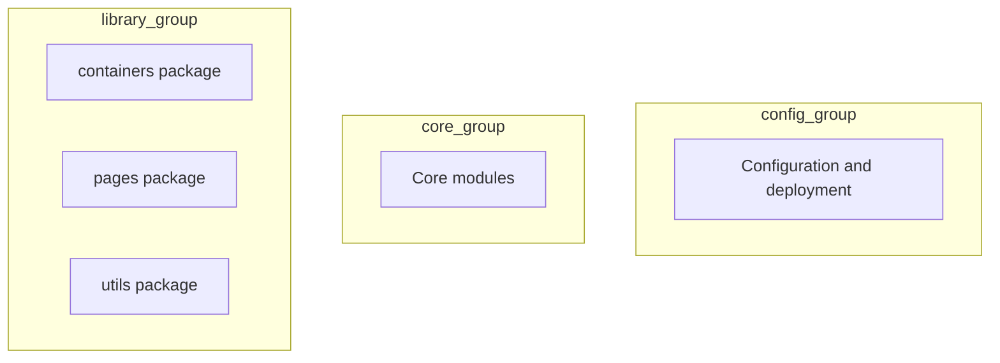

# Architecture report: lxieyang/chrome-extension-boilerplate-react

> Automated static analysis. **Observed** = directly seen in files/imports/AST; **Inferred** = interpretation from that evidence. Repository code was not executed.

## 1. Repository at a glance

| Item | Value |
| --- | --- |
| Repository | lxieyang/chrome-extension-boilerplate-react |
| Description | A Chrome Extensions boilerplate using React 18 and Webpack 5. |
| Language | JavaScript |
| Stars | 3921 |
| Licence | MIT |
| Analysed commit / branch | f7b0a5b89059ea943eaccd94aad3a429fb744644 / master |
| Framework(s) | React |
| Files analysed | 43 |
| Components | 5 |

## 2. Architecture in one minute

lxieyang/chrome-extension-boilerplate-react - A Chrome Extensions boilerplate using React 18 and Webpack 5.. This repository was analysed statically from 43 file(s) (0 Python). Detected technologies (observed from imports/manifests): React, TypeScript, webpack. Files are grouped into 5 component(s): Configuration and deployment, containers package, Core modules, pages package, utils package. Findings below distinguish observed facts from inferred interpretation.

## 3. High-level block diagram

## 4. Main components

### Configuration and deployment (`config`)

- **Kind:** config
- **Status:** Observed
- **Confidence:** 0.85
- **Responsibility:** Groups 3 file(s) under configuration and deployment (observed from repository paths and static analysis).
- **Paths:** `package.json`, `src/manifest.json`, `tsconfig.json`
- **Evidence:** [package.json](https://github.com/lxieyang/chrome-extension-boilerplate-react/blob/f7b0a5b89059ea943eaccd94aad3a429fb744644/package.json); [src/manifest.json](https://github.com/lxieyang/chrome-extension-boilerplate-react/blob/f7b0a5b89059ea943eaccd94aad3a429fb744644/src/manifest.json); [tsconfig.json](https://github.com/lxieyang/chrome-extension-boilerplate-react/blob/f7b0a5b89059ea943eaccd94aad3a429fb744644/tsconfig.json)

### containers package (`containers`)

- **Kind:** library
- **Status:** Observed
- **Confidence:** 0.85
- **Responsibility:** Groups 1 file(s) under containers package (observed from repository paths and static analysis).
- **Paths:** `src/containers/Greetings/Greetings.jsx`
- **Evidence:** [src/containers/Greetings/Greetings.jsx](https://github.com/lxieyang/chrome-extension-boilerplate-react/blob/f7b0a5b89059ea943eaccd94aad3a429fb744644/src/containers/Greetings/Greetings.jsx)

### Core modules (`core`)

- **Kind:** core
- **Status:** Observed
- **Confidence:** 0.85
- **Responsibility:** Groups 1 file(s) under core modules (observed from repository paths and static analysis).
- **Paths:** `webpack.config.js`
- **Evidence:** [webpack.config.js](https://github.com/lxieyang/chrome-extension-boilerplate-react/blob/f7b0a5b89059ea943eaccd94aad3a429fb744644/webpack.config.js)

### pages package (`pages`)

- **Kind:** library
- **Status:** Observed
- **Confidence:** 0.85
- **Responsibility:** Groups 12 file(s) under pages package (observed from repository paths and static analysis).
- **Paths:** `src/pages/Background/index.js`, `src/pages/Content/index.js`, `src/pages/Content/modules/print.js`, `src/pages/Devtools/index.js`, `src/pages/Newtab/Newtab.jsx`, `src/pages/Newtab/index.jsx`, `src/pages/Options/Options.tsx`, `src/pages/Options/index.jsx`, `src/pages/Panel/Panel.tsx`, `src/pages/Panel/index.jsx`, `src/pages/Popup/Popup.jsx`, `src/pages/Popup/index.jsx`
- **Evidence:** [src/pages/Background/index.js](https://github.com/lxieyang/chrome-extension-boilerplate-react/blob/f7b0a5b89059ea943eaccd94aad3a429fb744644/src/pages/Background/index.js); [src/pages/Content/index.js](https://github.com/lxieyang/chrome-extension-boilerplate-react/blob/f7b0a5b89059ea943eaccd94aad3a429fb744644/src/pages/Content/index.js); [src/pages/Content/modules/print.js](https://github.com/lxieyang/chrome-extension-boilerplate-react/blob/f7b0a5b89059ea943eaccd94aad3a429fb744644/src/pages/Content/modules/print.js); [src/pages/Devtools/index.js](https://github.com/lxieyang/chrome-extension-boilerplate-react/blob/f7b0a5b89059ea943eaccd94aad3a429fb744644/src/pages/Devtools/index.js); [src/pages/Newtab/Newtab.jsx](https://github.com/lxieyang/chrome-extension-boilerplate-react/blob/f7b0a5b89059ea943eaccd94aad3a429fb744644/src/pages/Newtab/Newtab.jsx); [src/pages/Newtab/index.jsx](https://github.com/lxieyang/chrome-extension-boilerplate-react/blob/f7b0a5b89059ea943eaccd94aad3a429fb744644/src/pages/Newtab/index.jsx); [src/pages/Options/Options.tsx](https://github.com/lxieyang/chrome-extension-boilerplate-react/blob/f7b0a5b89059ea943eaccd94aad3a429fb744644/src/pages/Options/Options.tsx); [src/pages/Options/index.jsx](https://github.com/lxieyang/chrome-extension-boilerplate-react/blob/f7b0a5b89059ea943eaccd94aad3a429fb744644/src/pages/Options/index.jsx)

### utils package (`utils`)

- **Kind:** library
- **Status:** Observed
- **Confidence:** 0.85
- **Responsibility:** Groups 3 file(s) under utils package (observed from repository paths and static analysis).
- **Paths:** `utils/build.js`, `utils/env.js`, `utils/webserver.js`
- **Evidence:** [utils/build.js](https://github.com/lxieyang/chrome-extension-boilerplate-react/blob/f7b0a5b89059ea943eaccd94aad3a429fb744644/utils/build.js); [utils/env.js](https://github.com/lxieyang/chrome-extension-boilerplate-react/blob/f7b0a5b89059ea943eaccd94aad3a429fb744644/utils/env.js); [utils/webserver.js](https://github.com/lxieyang/chrome-extension-boilerplate-react/blob/f7b0a5b89059ea943eaccd94aad3a429fb744644/utils/webserver.js)

## 5. Execution flow

**Observed** entry point(s):

- [src/pages/Background/index.js](https://github.com/lxieyang/chrome-extension-boilerplate-react/blob/f7b0a5b89059ea943eaccd94aad3a429fb744644/src/pages/Background/index.js)
- [src/pages/Content/index.js](https://github.com/lxieyang/chrome-extension-boilerplate-react/blob/f7b0a5b89059ea943eaccd94aad3a429fb744644/src/pages/Content/index.js)
- [src/pages/Devtools/index.js](https://github.com/lxieyang/chrome-extension-boilerplate-react/blob/f7b0a5b89059ea943eaccd94aad3a429fb744644/src/pages/Devtools/index.js)
- [src/pages/Newtab/index.jsx](https://github.com/lxieyang/chrome-extension-boilerplate-react/blob/f7b0a5b89059ea943eaccd94aad3a429fb744644/src/pages/Newtab/index.jsx)
- [src/pages/Options/index.jsx](https://github.com/lxieyang/chrome-extension-boilerplate-react/blob/f7b0a5b89059ea943eaccd94aad3a429fb744644/src/pages/Options/index.jsx)
- [src/pages/Panel/index.jsx](https://github.com/lxieyang/chrome-extension-boilerplate-react/blob/f7b0a5b89059ea943eaccd94aad3a429fb744644/src/pages/Panel/index.jsx)
- [src/pages/Popup/index.jsx](https://github.com/lxieyang/chrome-extension-boilerplate-react/blob/f7b0a5b89059ea943eaccd94aad3a429fb744644/src/pages/Popup/index.jsx)

Representative flow (derived from observed entry points and the import graph; steps beyond the entry point are **Inferred**):

1. Execution starts at an observed entry point listed above, if present.
2. No internal import relationships between components were observed.

## 6. Project structure

### `(root)`

- `.babelrc` - other (165 bytes)
- `.eslintrc` - other (74 bytes)
- `.gitignore` - other (282 bytes)
- `.prettierrc` - other (104 bytes)
- `LICENSE` - docs (1085 bytes)
- `README.md` - docs (7069 bytes)
- `package.json` - manifest (1978 bytes)
- `tsconfig.json` - config (512 bytes)
- `webpack.config.js` - source, JavaScript (6361 bytes)

### `.vscode`

- `.vscode/settings.json` - config (33 bytes)

### `src`

- `src/assets/img/logo.svg` - other (2671 bytes)
- `src/containers/Greetings/Greetings.jsx` - source, JavaScript (360 bytes)
- `src/manifest.json` - config (834 bytes)
- `src/pages/Background/index.js` - source, JavaScript (94 bytes)
- `src/pages/Content/content.styles.css` - other (0 bytes)
- `src/pages/Content/index.js` - source, JavaScript (224 bytes)
- `src/pages/Content/modules/print.js` - source, JavaScript (92 bytes)
- `src/pages/Devtools/index.html` - other (126 bytes)
- `src/pages/Devtools/index.js` - source, JavaScript (121 bytes)
- `src/pages/Newtab/Newtab.css` - other (564 bytes)
- `src/pages/Newtab/Newtab.jsx` - source, JavaScript (692 bytes)
- `src/pages/Newtab/Newtab.scss` - other (65 bytes)
- `src/pages/Newtab/index.css` - other (366 bytes)
- `src/pages/Newtab/index.html` - other (299 bytes)
- `src/pages/Newtab/index.jsx` - source, JavaScript (298 bytes)
- `src/pages/Options/Options.css` - other (139 bytes)
- `src/pages/Options/Options.tsx` - source, TypeScript (238 bytes)
- `src/pages/Options/index.css` - other (0 bytes)
- `src/pages/Options/index.html` - other (247 bytes)
- `src/pages/Options/index.jsx` - source, JavaScript (320 bytes)
- `src/pages/Panel/Panel.css` - other (71 bytes)
- `src/pages/Panel/Panel.tsx` - source, TypeScript (198 bytes)
- `src/pages/Panel/index.css` - other (0 bytes)
- `src/pages/Panel/index.html` - other (254 bytes)
- `src/pages/Panel/index.jsx` - source, JavaScript (295 bytes)
- `src/pages/Popup/Popup.css` - other (668 bytes)
- `src/pages/Popup/Popup.jsx` - source, JavaScript (658 bytes)
- `src/pages/Popup/index.css` - other (422 bytes)
- `src/pages/Popup/index.html` - other (244 bytes)
- `src/pages/Popup/index.jsx` - source, JavaScript (295 bytes)

### `utils`

- `utils/build.js` - source, JavaScript (743 bytes)
- `utils/env.js` - source, JavaScript (145 bytes)
- `utils/webserver.js` - source, JavaScript (1404 bytes)

## 7. Key dependencies and integrations

| Name | Category | Status | Confidence | Evidence |
| --- | --- | --- | --- | --- |
| React | framework | Observed | 0.90 | [package.json:2](https://github.com/lxieyang/chrome-extension-boilerplate-react/blob/f7b0a5b89059ea943eaccd94aad3a429fb744644/package.json#L2); [package.json:17](https://github.com/lxieyang/chrome-extension-boilerplate-react/blob/f7b0a5b89059ea943eaccd94aad3a429fb744644/package.json#L17) |
| TypeScript | tooling | Observed | 0.85 | [package.json:47](https://github.com/lxieyang/chrome-extension-boilerplate-react/blob/f7b0a5b89059ea943eaccd94aad3a429fb744644/package.json#L47) |
| webpack | tooling | Observed | 0.85 | [package.json:4](https://github.com/lxieyang/chrome-extension-boilerplate-react/blob/f7b0a5b89059ea943eaccd94aad3a429fb744644/package.json#L4) |

## 8. Data and state

No database, cache, queue, or persistent-state usage was observed in the analysed files. State handling, if any, may be in-memory or in files that were not analysed.

## 9. Configuration and deployment clues

- `.vscode/settings.json` (config)
- `package.json` (manifest)
- `src/manifest.json` (config)
- `tsconfig.json` (config)

## 10. Design observations

- No strong design patterns could be established from the available evidence.

These observations are interpretations (**Inferred**) of the observed structure, not guarantees about runtime design.

## 11. Limitations and unknowns

- Static analysis only: repository code was not executed, installed, or imported at runtime.
- Components and relationships are inferred from file paths, imports, and AST structure; runtime behaviour, dynamic imports, and reflection may not be visible.
- No clear application entry point was observed in the analysed files.
- Repository text was treated as untrusted data; no instructions found in repository files were followed, and likely secret values were redacted/excluded.
- JavaScript and TypeScript files were inventoried from paths and package manifests. They were not parsed with a full language AST, and repository code was not executed.
- The GitHub repository was marked archived at selection time.

## 12. Source references

- [package.json](https://github.com/lxieyang/chrome-extension-boilerplate-react/blob/f7b0a5b89059ea943eaccd94aad3a429fb744644/package.json)
- [package.json:2](https://github.com/lxieyang/chrome-extension-boilerplate-react/blob/f7b0a5b89059ea943eaccd94aad3a429fb744644/package.json#L2)
- [package.json:4](https://github.com/lxieyang/chrome-extension-boilerplate-react/blob/f7b0a5b89059ea943eaccd94aad3a429fb744644/package.json#L4)
- [package.json:17](https://github.com/lxieyang/chrome-extension-boilerplate-react/blob/f7b0a5b89059ea943eaccd94aad3a429fb744644/package.json#L17)
- [package.json:47](https://github.com/lxieyang/chrome-extension-boilerplate-react/blob/f7b0a5b89059ea943eaccd94aad3a429fb744644/package.json#L47)
- [src/containers/Greetings/Greetings.jsx](https://github.com/lxieyang/chrome-extension-boilerplate-react/blob/f7b0a5b89059ea943eaccd94aad3a429fb744644/src/containers/Greetings/Greetings.jsx)
- [src/manifest.json](https://github.com/lxieyang/chrome-extension-boilerplate-react/blob/f7b0a5b89059ea943eaccd94aad3a429fb744644/src/manifest.json)
- [src/pages/Background/index.js](https://github.com/lxieyang/chrome-extension-boilerplate-react/blob/f7b0a5b89059ea943eaccd94aad3a429fb744644/src/pages/Background/index.js)
- [src/pages/Content/index.js](https://github.com/lxieyang/chrome-extension-boilerplate-react/blob/f7b0a5b89059ea943eaccd94aad3a429fb744644/src/pages/Content/index.js)
- [src/pages/Content/modules/print.js](https://github.com/lxieyang/chrome-extension-boilerplate-react/blob/f7b0a5b89059ea943eaccd94aad3a429fb744644/src/pages/Content/modules/print.js)
- [src/pages/Devtools/index.js](https://github.com/lxieyang/chrome-extension-boilerplate-react/blob/f7b0a5b89059ea943eaccd94aad3a429fb744644/src/pages/Devtools/index.js)
- [src/pages/Newtab/Newtab.jsx](https://github.com/lxieyang/chrome-extension-boilerplate-react/blob/f7b0a5b89059ea943eaccd94aad3a429fb744644/src/pages/Newtab/Newtab.jsx)
- [src/pages/Newtab/index.jsx](https://github.com/lxieyang/chrome-extension-boilerplate-react/blob/f7b0a5b89059ea943eaccd94aad3a429fb744644/src/pages/Newtab/index.jsx)
- [src/pages/Options/Options.tsx](https://github.com/lxieyang/chrome-extension-boilerplate-react/blob/f7b0a5b89059ea943eaccd94aad3a429fb744644/src/pages/Options/Options.tsx)
- [src/pages/Options/index.jsx](https://github.com/lxieyang/chrome-extension-boilerplate-react/blob/f7b0a5b89059ea943eaccd94aad3a429fb744644/src/pages/Options/index.jsx)
- [src/pages/Panel/index.jsx](https://github.com/lxieyang/chrome-extension-boilerplate-react/blob/f7b0a5b89059ea943eaccd94aad3a429fb744644/src/pages/Panel/index.jsx)
- [src/pages/Popup/index.jsx](https://github.com/lxieyang/chrome-extension-boilerplate-react/blob/f7b0a5b89059ea943eaccd94aad3a429fb744644/src/pages/Popup/index.jsx)
- [tsconfig.json](https://github.com/lxieyang/chrome-extension-boilerplate-react/blob/f7b0a5b89059ea943eaccd94aad3a429fb744644/tsconfig.json)
- [utils/build.js](https://github.com/lxieyang/chrome-extension-boilerplate-react/blob/f7b0a5b89059ea943eaccd94aad3a429fb744644/utils/build.js)
- [utils/env.js](https://github.com/lxieyang/chrome-extension-boilerplate-react/blob/f7b0a5b89059ea943eaccd94aad3a429fb744644/utils/env.js)
- [utils/webserver.js](https://github.com/lxieyang/chrome-extension-boilerplate-react/blob/f7b0a5b89059ea943eaccd94aad3a429fb744644/utils/webserver.js)
- [webpack.config.js](https://github.com/lxieyang/chrome-extension-boilerplate-react/blob/f7b0a5b89059ea943eaccd94aad3a429fb744644/webpack.config.js)
