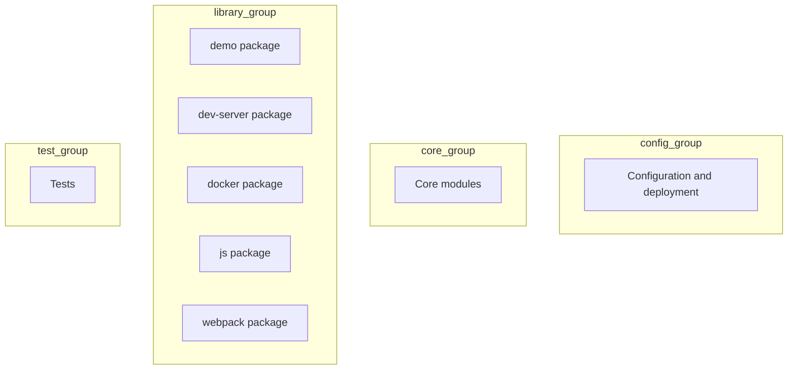

# Architecture report: mac-s-g/react-json-view

> Automated static analysis. **Observed** = directly seen in files/imports/AST; **Inferred** = interpretation from that evidence. Repository code was not executed.

## 1. Repository at a glance

| Item | Value |
| --- | --- |
| Repository | mac-s-g/react-json-view |
| Description | JSON viewer for react |
| Language | JavaScript |
| Stars | 3658 |
| Licence | MIT |
| Analysed commit / branch | 443465ebdaa236da8c5d0e7bda2b7e57ca5d5a7b / master |
| Framework(s) | React |
| Files analysed | 108 |
| Components | 8 |

## 2. Architecture in one minute

mac-s-g/react-json-view - JSON viewer for react. This repository was analysed statically from 108 file(s) (0 Python). Detected technologies (observed from imports/manifests): GitHub Actions, React, Docker, webpack. Files are grouped into 8 component(s): Configuration and deployment, Core modules, demo package, dev-server package, docker package, js package, Tests, webpack package. Findings below distinguish observed facts from inferred interpretation.

## 3. High-level block diagram

## 4. Main components

### Configuration and deployment (`config`)

- **Kind:** config
- **Status:** Observed
- **Confidence:** 0.85
- **Responsibility:** Groups 2 file(s) under configuration and deployment (observed from repository paths and static analysis).
- **Paths:** `Dockerfile`, `package.json`
- **Evidence:** [Dockerfile](https://github.com/mac-s-g/react-json-view/blob/443465ebdaa236da8c5d0e7bda2b7e57ca5d5a7b/Dockerfile); [package.json](https://github.com/mac-s-g/react-json-view/blob/443465ebdaa236da8c5d0e7bda2b7e57ca5d5a7b/package.json)

### Core modules (`core`)

- **Kind:** core
- **Status:** Observed
- **Confidence:** 0.85
- **Responsibility:** Groups 1 file(s) under core modules (observed from repository paths and static analysis).
- **Paths:** `index.d.ts`
- **Evidence:** [index.d.ts](https://github.com/mac-s-g/react-json-view/blob/443465ebdaa236da8c5d0e7bda2b7e57ca5d5a7b/index.d.ts)

### demo package (`demo`)

- **Kind:** library
- **Status:** Observed
- **Confidence:** 0.85
- **Responsibility:** Groups 4 file(s) under demo package (observed from repository paths and static analysis).
- **Paths:** `demo/src/js/components/Demo.js`, `demo/src/js/entry.js`, `demo/src/js/helpers/Code.js`, `demo/src/js/index.js`
- **Evidence:** [demo/src/js/components/Demo.js](https://github.com/mac-s-g/react-json-view/blob/443465ebdaa236da8c5d0e7bda2b7e57ca5d5a7b/demo/src/js/components/Demo.js); [demo/src/js/entry.js](https://github.com/mac-s-g/react-json-view/blob/443465ebdaa236da8c5d0e7bda2b7e57ca5d5a7b/demo/src/js/entry.js); [demo/src/js/helpers/Code.js](https://github.com/mac-s-g/react-json-view/blob/443465ebdaa236da8c5d0e7bda2b7e57ca5d5a7b/demo/src/js/helpers/Code.js); [demo/src/js/index.js](https://github.com/mac-s-g/react-json-view/blob/443465ebdaa236da8c5d0e7bda2b7e57ca5d5a7b/demo/src/js/index.js)

### dev-server package (`dev_server`)

- **Kind:** library
- **Status:** Observed
- **Confidence:** 0.85
- **Responsibility:** Groups 1 file(s) under dev-server package (observed from repository paths and static analysis).
- **Paths:** `dev-server/src/index.js`
- **Evidence:** [dev-server/src/index.js](https://github.com/mac-s-g/react-json-view/blob/443465ebdaa236da8c5d0e7bda2b7e57ca5d5a7b/dev-server/src/index.js)

### docker package (`docker`)

- **Kind:** library
- **Status:** Observed
- **Confidence:** 0.85
- **Responsibility:** Groups 16 file(s) under docker package (observed from repository paths and static analysis).
- **Paths:** `docker/build-container.sh`, `docker/build-demo.sh`, `docker/build-dist.sh`, `docker/coverage.sh`, `docker/debug.sh`, `docker/dev-server.sh`, `docker/entrypoints/build.sh`, `docker/entrypoints/coverage.sh`, `docker/entrypoints/debug.sh`, `docker/entrypoints/demo.sh`, `docker/entrypoints/dev-server.sh`, `docker/entrypoints/test-watch.sh`, `docker/entrypoints/test.sh`, `docker/shell.sh`, `docker/test-watch.sh`, `docker/test.sh`
- **Evidence:** [docker/build-container.sh](https://github.com/mac-s-g/react-json-view/blob/443465ebdaa236da8c5d0e7bda2b7e57ca5d5a7b/docker/build-container.sh); [docker/build-demo.sh](https://github.com/mac-s-g/react-json-view/blob/443465ebdaa236da8c5d0e7bda2b7e57ca5d5a7b/docker/build-demo.sh); [docker/build-dist.sh](https://github.com/mac-s-g/react-json-view/blob/443465ebdaa236da8c5d0e7bda2b7e57ca5d5a7b/docker/build-dist.sh); [docker/coverage.sh](https://github.com/mac-s-g/react-json-view/blob/443465ebdaa236da8c5d0e7bda2b7e57ca5d5a7b/docker/coverage.sh); [docker/debug.sh](https://github.com/mac-s-g/react-json-view/blob/443465ebdaa236da8c5d0e7bda2b7e57ca5d5a7b/docker/debug.sh); [docker/dev-server.sh](https://github.com/mac-s-g/react-json-view/blob/443465ebdaa236da8c5d0e7bda2b7e57ca5d5a7b/docker/dev-server.sh); [docker/entrypoints/build.sh](https://github.com/mac-s-g/react-json-view/blob/443465ebdaa236da8c5d0e7bda2b7e57ca5d5a7b/docker/entrypoints/build.sh); [docker/entrypoints/coverage.sh](https://github.com/mac-s-g/react-json-view/blob/443465ebdaa236da8c5d0e7bda2b7e57ca5d5a7b/docker/entrypoints/coverage.sh)

### js package (`js`)

- **Kind:** library
- **Status:** Observed
- **Confidence:** 0.85
- **Responsibility:** Groups 33 file(s) under js package (observed from repository paths and static analysis).
- **Paths:** `src/js/components/ArrayGroup.js`, `src/js/components/CopyToClipboard.js`, `src/js/components/DataTypes/Boolean.js`, `src/js/components/DataTypes/DataTypeLabel.js`, `src/js/components/DataTypes/DataTypes.js`, `src/js/components/DataTypes/Date.js`, `src/js/components/DataTypes/Float.js`, `src/js/components/DataTypes/Function.js`, `src/js/components/DataTypes/Integer.js`, `src/js/components/DataTypes/Nan.js`, `src/js/components/DataTypes/Null.js`, `src/js/components/DataTypes/Object.js`, `src/js/components/DataTypes/Regexp.js`, `src/js/components/DataTypes/String.js`, `src/js/components/DataTypes/Undefined.js`, `src/js/components/JsonViewer.js`, `src/js/components/ObjectKeyModal/AddKeyRequest.js`, `src/js/components/ObjectKeyModal/ObjectKeyModal.js`, `src/js/components/ObjectName.js`, `src/js/components/ToggleIcons.js`, `src/js/components/ValidationFailure.js`, `src/js/components/VariableEditor.js`, `src/js/components/VariableMeta.js`, `src/js/components/icons.js`, `src/js/helpers/dispatcher.js`, `src/js/helpers/parseInput.js`, `src/js/helpers/stringifyVariable.js`, `src/js/helpers/util.js`, `src/js/index.js`, `src/js/stores/ObjectAttributes.js`, `src/js/themes/base16/rjv-themes.js`, `src/js/themes/getStyle.js`, `src/js/themes/styleConstants.js`
- **Evidence:** [src/js/components/ArrayGroup.js](https://github.com/mac-s-g/react-json-view/blob/443465ebdaa236da8c5d0e7bda2b7e57ca5d5a7b/src/js/components/ArrayGroup.js); [src/js/components/CopyToClipboard.js](https://github.com/mac-s-g/react-json-view/blob/443465ebdaa236da8c5d0e7bda2b7e57ca5d5a7b/src/js/components/CopyToClipboard.js); [src/js/components/DataTypes/Boolean.js](https://github.com/mac-s-g/react-json-view/blob/443465ebdaa236da8c5d0e7bda2b7e57ca5d5a7b/src/js/components/DataTypes/Boolean.js); [src/js/components/DataTypes/DataTypeLabel.js](https://github.com/mac-s-g/react-json-view/blob/443465ebdaa236da8c5d0e7bda2b7e57ca5d5a7b/src/js/components/DataTypes/DataTypeLabel.js); [src/js/components/DataTypes/DataTypes.js](https://github.com/mac-s-g/react-json-view/blob/443465ebdaa236da8c5d0e7bda2b7e57ca5d5a7b/src/js/components/DataTypes/DataTypes.js); [src/js/components/DataTypes/Date.js](https://github.com/mac-s-g/react-json-view/blob/443465ebdaa236da8c5d0e7bda2b7e57ca5d5a7b/src/js/components/DataTypes/Date.js); [src/js/components/DataTypes/Float.js](https://github.com/mac-s-g/react-json-view/blob/443465ebdaa236da8c5d0e7bda2b7e57ca5d5a7b/src/js/components/DataTypes/Float.js); [src/js/components/DataTypes/Function.js](https://github.com/mac-s-g/react-json-view/blob/443465ebdaa236da8c5d0e7bda2b7e57ca5d5a7b/src/js/components/DataTypes/Function.js)

### Tests (`tests`)

- **Kind:** test
- **Status:** Observed
- **Confidence:** 0.85
- **Responsibility:** Groups 29 file(s) under tests (observed from repository paths and static analysis).
- **Paths:** `test/testHelpers/requireSources.js`, `test/tests/js/Index-test.js`, `test/tests/js/components/ArrayGroup-test.js`, `test/tests/js/components/CopyToClipboard-test.js`, `test/tests/js/components/DataTypes/Boolean-test.js`, `test/tests/js/components/DataTypes/DataTypeLabel-test.js`, `test/tests/js/components/DataTypes/Date-test.js`, `test/tests/js/components/DataTypes/Float-test.js`, `test/tests/js/components/DataTypes/Function-test.js`, `test/tests/js/components/DataTypes/Integer-test.js`, `test/tests/js/components/DataTypes/Nan-test.js`, `test/tests/js/components/DataTypes/Null-test.js`, `test/tests/js/components/DataTypes/Object-test.js`, `test/tests/js/components/DataTypes/Regex-test.js`, `test/tests/js/components/DataTypes/String-test.js`, `test/tests/js/components/DataTypes/Undefined-test.js`, `test/tests/js/components/ObjectKeyModal/AddKeyRequest-test.js`, `test/tests/js/components/ObjectKeyModal/ObjectKeyModal-test.js`, `test/tests/js/components/ObjectName-test.js`, `test/tests/js/components/ToggleIcons-test.js`, `test/tests/js/components/ValidationFailure-test.js`, `test/tests/js/components/VariableEditor-test.js`, `test/tests/js/components/VariableMeta-test.js`, `test/tests/js/components/icons-test.js`, `test/tests/js/helpers/Util-test.js`, `test/tests/js/helpers/parseInput-test.js`, `test/tests/js/helpers/stringifyVariable-test.js`, `test/tests/js/stores/ObjectAttributes-test.js`, `test/tests/js/themes/getStyle-test.js`
- **Evidence:** [test/testHelpers/requireSources.js](https://github.com/mac-s-g/react-json-view/blob/443465ebdaa236da8c5d0e7bda2b7e57ca5d5a7b/test/testHelpers/requireSources.js); [test/tests/js/Index-test.js](https://github.com/mac-s-g/react-json-view/blob/443465ebdaa236da8c5d0e7bda2b7e57ca5d5a7b/test/tests/js/Index-test.js); [test/tests/js/components/ArrayGroup-test.js](https://github.com/mac-s-g/react-json-view/blob/443465ebdaa236da8c5d0e7bda2b7e57ca5d5a7b/test/tests/js/components/ArrayGroup-test.js); [test/tests/js/components/CopyToClipboard-test.js](https://github.com/mac-s-g/react-json-view/blob/443465ebdaa236da8c5d0e7bda2b7e57ca5d5a7b/test/tests/js/components/CopyToClipboard-test.js); [test/tests/js/components/DataTypes/Boolean-test.js](https://github.com/mac-s-g/react-json-view/blob/443465ebdaa236da8c5d0e7bda2b7e57ca5d5a7b/test/tests/js/components/DataTypes/Boolean-test.js); [test/tests/js/components/DataTypes/DataTypeLabel-test.js](https://github.com/mac-s-g/react-json-view/blob/443465ebdaa236da8c5d0e7bda2b7e57ca5d5a7b/test/tests/js/components/DataTypes/DataTypeLabel-test.js); [test/tests/js/components/DataTypes/Date-test.js](https://github.com/mac-s-g/react-json-view/blob/443465ebdaa236da8c5d0e7bda2b7e57ca5d5a7b/test/tests/js/components/DataTypes/Date-test.js); [test/tests/js/components/DataTypes/Float-test.js](https://github.com/mac-s-g/react-json-view/blob/443465ebdaa236da8c5d0e7bda2b7e57ca5d5a7b/test/tests/js/components/DataTypes/Float-test.js)

### webpack package (`webpack`)

- **Kind:** library
- **Status:** Observed
- **Confidence:** 0.85
- **Responsibility:** Groups 3 file(s) under webpack package (observed from repository paths and static analysis).
- **Paths:** `webpack/webpack.config-demo.js`, `webpack/webpack.config-dev.js`, `webpack/webpack.config.js`
- **Evidence:** [webpack/webpack.config-demo.js](https://github.com/mac-s-g/react-json-view/blob/443465ebdaa236da8c5d0e7bda2b7e57ca5d5a7b/webpack/webpack.config-demo.js); [webpack/webpack.config-dev.js](https://github.com/mac-s-g/react-json-view/blob/443465ebdaa236da8c5d0e7bda2b7e57ca5d5a7b/webpack/webpack.config-dev.js); [webpack/webpack.config.js](https://github.com/mac-s-g/react-json-view/blob/443465ebdaa236da8c5d0e7bda2b7e57ca5d5a7b/webpack/webpack.config.js)

## 5. Execution flow

**Observed** entry point(s):

- [demo/src/js/index.js](https://github.com/mac-s-g/react-json-view/blob/443465ebdaa236da8c5d0e7bda2b7e57ca5d5a7b/demo/src/js/index.js)
- [dev-server/src/index.js](https://github.com/mac-s-g/react-json-view/blob/443465ebdaa236da8c5d0e7bda2b7e57ca5d5a7b/dev-server/src/index.js)
- [src/js/index.js](https://github.com/mac-s-g/react-json-view/blob/443465ebdaa236da8c5d0e7bda2b7e57ca5d5a7b/src/js/index.js)

Representative flow (derived from observed entry points and the import graph; steps beyond the entry point are **Inferred**):

1. Execution starts at an observed entry point listed above, if present.
2. No internal import relationships between components were observed.

## 6. Project structure

### `(root)`

- `.babelrc` - other (232 bytes)
- `.coveralls.yml` - config (70 bytes)
- `.eslintrc.json` - config (392 bytes)
- `.gitignore` - other (70 bytes)
- `.npmignore` - other (202 bytes)
- `.nycrc` - other (134 bytes)
- `.prettierrc.json` - config (315 bytes)
- `.travis.yml` - ci, YAML (146 bytes)
- `Dockerfile` - container (339 bytes)
- `LICENSE` - docs (1077 bytes)
- `README.md` - docs (9581 bytes)
- `index.d.ts` - source, TypeScript (7135 bytes)
- `package.json` - manifest (3851 bytes)

### `.github`

- `.github/workflows/ci-tests.yml` - ci, YAML (442 bytes)

### `demo`

- `demo/src/js/components/Demo.js` - source, JavaScript (16384 bytes)
- `demo/src/js/entry.js` - source, JavaScript (269 bytes)
- `demo/src/js/helpers/Code.js` - source, JavaScript (468 bytes)
- `demo/src/js/index.js` - source, JavaScript (307 bytes)
- `demo/src/style/scss/_variables.scss` - other (379 bytes)
- `demo/src/style/scss/global.scss` - other (395 bytes)
- `demo/src/style/scss/rjv-demo.scss` - other (788 bytes)

### `dev-server`

- `dev-server/src/index.js` - source, JavaScript (7820 bytes)

### `doc`

- `doc/example-usage.js` - source, JavaScript (1349 bytes)
- `doc/rjv-icon-alt.svg` - other (3437 bytes)
- `doc/rjv-icon.svg` - other (2367 bytes)

### `docker`

- `docker/README.md` - docs (5358 bytes)
- `docker/build-container.sh` - source, Shell (46 bytes)
- `docker/build-demo.sh` - source, Shell (610 bytes)
- `docker/build-dist.sh` - source, Shell (610 bytes)
- `docker/coverage.sh` - source, Shell (583 bytes)
- `docker/debug.sh` - source, Shell (498 bytes)
- `docker/dev-server.sh` - source, Shell (655 bytes)
- `docker/entrypoints/build.sh` - source, Shell (437 bytes)
- `docker/entrypoints/coverage.sh` - source, Shell (152 bytes)
- `docker/entrypoints/debug.sh` - source, Shell (154 bytes)
- `docker/entrypoints/demo.sh` - source, Shell (396 bytes)
- `docker/entrypoints/dev-server.sh` - source, Shell (112 bytes)
- `docker/entrypoints/test-watch.sh` - source, Shell (66 bytes)
- `docker/entrypoints/test.sh` - source, Shell (59 bytes)
- `docker/shell.sh` - source, Shell (432 bytes)
- `docker/test-watch.sh` - source, Shell (485 bytes)
- `docker/test.sh` - source, Shell (474 bytes)

### `src`

- `src/js/components/ArrayGroup.js` - source, JavaScript (5337 bytes)
- `src/js/components/CopyToClipboard.js` - source, JavaScript (2973 bytes)
- `src/js/components/DataTypes/Boolean.js` - source, JavaScript (484 bytes)
- `src/js/components/DataTypes/DataTypeLabel.js` - source, JavaScript (526 bytes)
- `src/js/components/DataTypes/DataTypes.js` - source, JavaScript (548 bytes)
- `src/js/components/DataTypes/Date.js` - source, JavaScript (833 bytes)
- `src/js/components/DataTypes/Float.js` - source, JavaScript (468 bytes)
- `src/js/components/DataTypes/Function.js` - source, JavaScript (2373 bytes)
- `src/js/components/DataTypes/Integer.js` - source, JavaScript (468 bytes)
- `src/js/components/DataTypes/Nan.js` - source, JavaScript (223 bytes)
- `src/js/components/DataTypes/Null.js` - source, JavaScript (225 bytes)
- `src/js/components/DataTypes/Object.js` - source, JavaScript (10162 bytes)
- `src/js/components/DataTypes/Regexp.js` - source, JavaScript (481 bytes)
- `src/js/components/DataTypes/String.js` - source, JavaScript (2143 bytes)
- `src/js/components/DataTypes/Undefined.js` - source, JavaScript (235 bytes)
- `src/js/components/JsonViewer.js` - source, JavaScript (924 bytes)
- `src/js/components/ObjectKeyModal/AddKeyRequest.js` - source, JavaScript (1385 bytes)
- `src/js/components/ObjectKeyModal/ObjectKeyModal.js` - source, JavaScript (3217 bytes)
- `src/js/components/ObjectName.js` - source, JavaScript (1319 bytes)
- `src/js/components/ToggleIcons.js` - source, JavaScript (1635 bytes)
- `src/js/components/ValidationFailure.js` - source, JavaScript (1015 bytes)
- `src/js/components/VariableEditor.js` - source, JavaScript (16381 bytes)
- `src/js/components/VariableMeta.js` - source, JavaScript (4793 bytes)
- `src/js/components/icons.js` - source, JavaScript (10446 bytes)
- `src/js/helpers/dispatcher.js` - source, JavaScript (99 bytes)
- `src/js/helpers/parseInput.js` - source, JavaScript (2322 bytes)
- `src/js/helpers/stringifyVariable.js` - source, JavaScript (864 bytes)
- `src/js/helpers/util.js` - source, JavaScript (1287 bytes)
- `src/js/index.js` - source, JavaScript (8247 bytes)
- `src/js/stores/ObjectAttributes.js` - source, JavaScript (3954 bytes)
- `src/js/themes/base16/rjv-themes.js` - source, JavaScript (1149 bytes)
- `src/js/themes/getStyle.js` - source, JavaScript (13634 bytes)
- `src/js/themes/styleConstants.js` - source, JavaScript (2218 bytes)
- `src/style/scss/global.scss` - other (1057 bytes)

### `test`

- `test/testHelpers/requireSources.js` - test, JavaScript (950 bytes)
- `test/tests/js/Index-test.js` - test, JavaScript (4360 bytes)
- `test/tests/js/components/ArrayGroup-test.js` - test, JavaScript (3307 bytes)
- `test/tests/js/components/CopyToClipboard-test.js` - test, JavaScript (1025 bytes)
- `test/tests/js/components/DataTypes/Boolean-test.js` - test, JavaScript (1702 bytes)
- `test/tests/js/components/DataTypes/DataTypeLabel-test.js` - test, JavaScript (1008 bytes)
- `test/tests/js/components/DataTypes/Date-test.js` - test, JavaScript (952 bytes)
- `test/tests/js/components/DataTypes/Float-test.js` - test, JavaScript (947 bytes)
- `test/tests/js/components/DataTypes/Function-test.js` - test, JavaScript (2632 bytes)
- `test/tests/js/components/DataTypes/Integer-test.js` - test, JavaScript (1042 bytes)
- `test/tests/js/components/DataTypes/Nan-test.js` - test, JavaScript (913 bytes)
- `test/tests/js/components/DataTypes/Null-test.js` - test, JavaScript (915 bytes)
- `test/tests/js/components/DataTypes/Object-test.js` - test, JavaScript (10728 bytes)
- `test/tests/js/components/DataTypes/Regex-test.js` - test, JavaScript (1038 bytes)
- `test/tests/js/components/DataTypes/String-test.js` - test, JavaScript (2113 bytes)
- `test/tests/js/components/DataTypes/Undefined-test.js` - test, JavaScript (966 bytes)
- `test/tests/js/components/ObjectKeyModal/AddKeyRequest-test.js` - test, JavaScript (1392 bytes)
- `test/tests/js/components/ObjectKeyModal/ObjectKeyModal-test.js` - test, JavaScript (5755 bytes)
- `test/tests/js/components/ObjectName-test.js` - test, JavaScript (2466 bytes)
- `test/tests/js/components/ToggleIcons-test.js` - test, JavaScript (2041 bytes)
- `test/tests/js/components/ValidationFailure-test.js` - test, JavaScript (1996 bytes)
- `test/tests/js/components/VariableEditor-test.js` - test, JavaScript (12395 bytes)
- `test/tests/js/components/VariableMeta-test.js` - test, JavaScript (3192 bytes)
- `test/tests/js/components/icons-test.js` - test, JavaScript (2517 bytes)
- `test/tests/js/helpers/Util-test.js` - test, JavaScript (3427 bytes)
- `test/tests/js/helpers/parseInput-test.js` - test, JavaScript (1922 bytes)
- `test/tests/js/helpers/stringifyVariable-test.js` - test, JavaScript (2553 bytes)
- `test/tests/js/stores/ObjectAttributes-test.js` - test, JavaScript (895 bytes)
- `test/tests/js/themes/getStyle-test.js` - test, JavaScript (862 bytes)

### `webpack`

- `webpack/webpack.config-demo.js` - source, JavaScript (1464 bytes)
- `webpack/webpack.config-dev.js` - source, JavaScript (1178 bytes)
- `webpack/webpack.config.js` - source, JavaScript (1138 bytes)

## 7. Key dependencies and integrations

| Name | Category | Status | Confidence | Evidence |
| --- | --- | --- | --- | --- |
| GitHub Actions | ci | Observed | 0.85 | [.github/workflows/ci-tests.yml](https://github.com/mac-s-g/react-json-view/blob/443465ebdaa236da8c5d0e7bda2b7e57ca5d5a7b/.github/workflows/ci-tests.yml) |
| React | framework | Observed | 0.90 | [package.json:2](https://github.com/mac-s-g/react-json-view/blob/443465ebdaa236da8c5d0e7bda2b7e57ca5d5a7b/package.json#L2); [package.json:35](https://github.com/mac-s-g/react-json-view/blob/443465ebdaa236da8c5d0e7bda2b7e57ca5d5a7b/package.json#L35) |
| Docker | tooling | Observed | 0.85 | [Dockerfile](https://github.com/mac-s-g/react-json-view/blob/443465ebdaa236da8c5d0e7bda2b7e57ca5d5a7b/Dockerfile) |
| webpack | tooling | Observed | 0.85 | [package.json:26](https://github.com/mac-s-g/react-json-view/blob/443465ebdaa236da8c5d0e7bda2b7e57ca5d5a7b/package.json#L26) |

## 8. Data and state

No database, cache, queue, or persistent-state usage was observed in the analysed files. State handling, if any, may be in-memory or in files that were not analysed.

## 9. Configuration and deployment clues

- `.coveralls.yml` (config)
- `.eslintrc.json` (config)
- `.github/workflows/ci-tests.yml` (ci)
- `.prettierrc.json` (config)
- `.travis.yml` (ci)
- `Dockerfile` (container)
- `package.json` (manifest)

## 10. Design observations

- Tests are present alongside source code (Observed from test file paths).

These observations are interpretations (**Inferred**) of the observed structure, not guarantees about runtime design.

## 11. Limitations and unknowns

- Static analysis only: repository code was not executed, installed, or imported at runtime.
- Components and relationships are inferred from file paths, imports, and AST structure; runtime behaviour, dynamic imports, and reflection may not be visible.
- 2 file(s) were skipped during inventory (2 x vendored/generated directory excluded).
- No clear application entry point was observed in the analysed files.
- Repository text was treated as untrusted data; no instructions found in repository files were followed, and likely secret values were redacted/excluded.
- JavaScript and TypeScript files were inventoried from paths and package manifests. They were not parsed with a full language AST, and repository code was not executed.

## 12. Source references

- [.github/workflows/ci-tests.yml](https://github.com/mac-s-g/react-json-view/blob/443465ebdaa236da8c5d0e7bda2b7e57ca5d5a7b/.github/workflows/ci-tests.yml)
- [Dockerfile](https://github.com/mac-s-g/react-json-view/blob/443465ebdaa236da8c5d0e7bda2b7e57ca5d5a7b/Dockerfile)
- [demo/src/js/components/Demo.js](https://github.com/mac-s-g/react-json-view/blob/443465ebdaa236da8c5d0e7bda2b7e57ca5d5a7b/demo/src/js/components/Demo.js)
- [demo/src/js/entry.js](https://github.com/mac-s-g/react-json-view/blob/443465ebdaa236da8c5d0e7bda2b7e57ca5d5a7b/demo/src/js/entry.js)
- [demo/src/js/helpers/Code.js](https://github.com/mac-s-g/react-json-view/blob/443465ebdaa236da8c5d0e7bda2b7e57ca5d5a7b/demo/src/js/helpers/Code.js)
- [demo/src/js/index.js](https://github.com/mac-s-g/react-json-view/blob/443465ebdaa236da8c5d0e7bda2b7e57ca5d5a7b/demo/src/js/index.js)
- [dev-server/src/index.js](https://github.com/mac-s-g/react-json-view/blob/443465ebdaa236da8c5d0e7bda2b7e57ca5d5a7b/dev-server/src/index.js)
- [docker/build-container.sh](https://github.com/mac-s-g/react-json-view/blob/443465ebdaa236da8c5d0e7bda2b7e57ca5d5a7b/docker/build-container.sh)
- [docker/build-demo.sh](https://github.com/mac-s-g/react-json-view/blob/443465ebdaa236da8c5d0e7bda2b7e57ca5d5a7b/docker/build-demo.sh)
- [docker/build-dist.sh](https://github.com/mac-s-g/react-json-view/blob/443465ebdaa236da8c5d0e7bda2b7e57ca5d5a7b/docker/build-dist.sh)
- [docker/coverage.sh](https://github.com/mac-s-g/react-json-view/blob/443465ebdaa236da8c5d0e7bda2b7e57ca5d5a7b/docker/coverage.sh)
- [docker/debug.sh](https://github.com/mac-s-g/react-json-view/blob/443465ebdaa236da8c5d0e7bda2b7e57ca5d5a7b/docker/debug.sh)
- [docker/dev-server.sh](https://github.com/mac-s-g/react-json-view/blob/443465ebdaa236da8c5d0e7bda2b7e57ca5d5a7b/docker/dev-server.sh)
- [docker/entrypoints/build.sh](https://github.com/mac-s-g/react-json-view/blob/443465ebdaa236da8c5d0e7bda2b7e57ca5d5a7b/docker/entrypoints/build.sh)
- [docker/entrypoints/coverage.sh](https://github.com/mac-s-g/react-json-view/blob/443465ebdaa236da8c5d0e7bda2b7e57ca5d5a7b/docker/entrypoints/coverage.sh)
- [index.d.ts](https://github.com/mac-s-g/react-json-view/blob/443465ebdaa236da8c5d0e7bda2b7e57ca5d5a7b/index.d.ts)
- [package.json](https://github.com/mac-s-g/react-json-view/blob/443465ebdaa236da8c5d0e7bda2b7e57ca5d5a7b/package.json)
- [package.json:2](https://github.com/mac-s-g/react-json-view/blob/443465ebdaa236da8c5d0e7bda2b7e57ca5d5a7b/package.json#L2)
- [package.json:26](https://github.com/mac-s-g/react-json-view/blob/443465ebdaa236da8c5d0e7bda2b7e57ca5d5a7b/package.json#L26)
- [package.json:35](https://github.com/mac-s-g/react-json-view/blob/443465ebdaa236da8c5d0e7bda2b7e57ca5d5a7b/package.json#L35)
- [src/js/components/ArrayGroup.js](https://github.com/mac-s-g/react-json-view/blob/443465ebdaa236da8c5d0e7bda2b7e57ca5d5a7b/src/js/components/ArrayGroup.js)
- [src/js/components/CopyToClipboard.js](https://github.com/mac-s-g/react-json-view/blob/443465ebdaa236da8c5d0e7bda2b7e57ca5d5a7b/src/js/components/CopyToClipboard.js)
- [src/js/components/DataTypes/Boolean.js](https://github.com/mac-s-g/react-json-view/blob/443465ebdaa236da8c5d0e7bda2b7e57ca5d5a7b/src/js/components/DataTypes/Boolean.js)
- [src/js/components/DataTypes/DataTypeLabel.js](https://github.com/mac-s-g/react-json-view/blob/443465ebdaa236da8c5d0e7bda2b7e57ca5d5a7b/src/js/components/DataTypes/DataTypeLabel.js)
- [src/js/components/DataTypes/DataTypes.js](https://github.com/mac-s-g/react-json-view/blob/443465ebdaa236da8c5d0e7bda2b7e57ca5d5a7b/src/js/components/DataTypes/DataTypes.js)
- [src/js/components/DataTypes/Date.js](https://github.com/mac-s-g/react-json-view/blob/443465ebdaa236da8c5d0e7bda2b7e57ca5d5a7b/src/js/components/DataTypes/Date.js)
- [src/js/components/DataTypes/Float.js](https://github.com/mac-s-g/react-json-view/blob/443465ebdaa236da8c5d0e7bda2b7e57ca5d5a7b/src/js/components/DataTypes/Float.js)
- [src/js/components/DataTypes/Function.js](https://github.com/mac-s-g/react-json-view/blob/443465ebdaa236da8c5d0e7bda2b7e57ca5d5a7b/src/js/components/DataTypes/Function.js)
- [src/js/index.js](https://github.com/mac-s-g/react-json-view/blob/443465ebdaa236da8c5d0e7bda2b7e57ca5d5a7b/src/js/index.js)
- [test/testHelpers/requireSources.js](https://github.com/mac-s-g/react-json-view/blob/443465ebdaa236da8c5d0e7bda2b7e57ca5d5a7b/test/testHelpers/requireSources.js)
- [test/tests/js/Index-test.js](https://github.com/mac-s-g/react-json-view/blob/443465ebdaa236da8c5d0e7bda2b7e57ca5d5a7b/test/tests/js/Index-test.js)
- [test/tests/js/components/ArrayGroup-test.js](https://github.com/mac-s-g/react-json-view/blob/443465ebdaa236da8c5d0e7bda2b7e57ca5d5a7b/test/tests/js/components/ArrayGroup-test.js)
- [test/tests/js/components/CopyToClipboard-test.js](https://github.com/mac-s-g/react-json-view/blob/443465ebdaa236da8c5d0e7bda2b7e57ca5d5a7b/test/tests/js/components/CopyToClipboard-test.js)
- [test/tests/js/components/DataTypes/Boolean-test.js](https://github.com/mac-s-g/react-json-view/blob/443465ebdaa236da8c5d0e7bda2b7e57ca5d5a7b/test/tests/js/components/DataTypes/Boolean-test.js)
- [test/tests/js/components/DataTypes/DataTypeLabel-test.js](https://github.com/mac-s-g/react-json-view/blob/443465ebdaa236da8c5d0e7bda2b7e57ca5d5a7b/test/tests/js/components/DataTypes/DataTypeLabel-test.js)
- [test/tests/js/components/DataTypes/Date-test.js](https://github.com/mac-s-g/react-json-view/blob/443465ebdaa236da8c5d0e7bda2b7e57ca5d5a7b/test/tests/js/components/DataTypes/Date-test.js)
- [test/tests/js/components/DataTypes/Float-test.js](https://github.com/mac-s-g/react-json-view/blob/443465ebdaa236da8c5d0e7bda2b7e57ca5d5a7b/test/tests/js/components/DataTypes/Float-test.js)
- [webpack/webpack.config-demo.js](https://github.com/mac-s-g/react-json-view/blob/443465ebdaa236da8c5d0e7bda2b7e57ca5d5a7b/webpack/webpack.config-demo.js)
- [webpack/webpack.config-dev.js](https://github.com/mac-s-g/react-json-view/blob/443465ebdaa236da8c5d0e7bda2b7e57ca5d5a7b/webpack/webpack.config-dev.js)
- [webpack/webpack.config.js](https://github.com/mac-s-g/react-json-view/blob/443465ebdaa236da8c5d0e7bda2b7e57ca5d5a7b/webpack/webpack.config.js)
