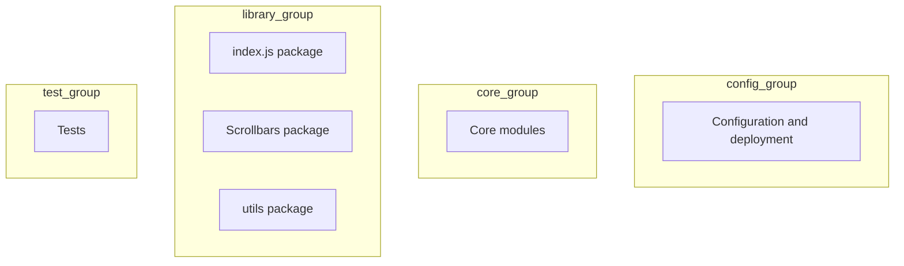

# Architecture report: malte-wessel/react-custom-scrollbars

> Automated static analysis. **Observed** = directly seen in files/imports/AST; **Inferred** = interpretation from that evidence. Repository code was not executed.

## 1. Repository at a glance

| Item | Value |
| --- | --- |
| Repository | malte-wessel/react-custom-scrollbars |
| Description | React scrollbars component |
| Language | JavaScript |
| Stars | 3212 |
| Licence | MIT |
| Analysed commit / branch | b353cc4956d6154d6a100f34c3a6202c75434186 / master |
| Framework(s) | React |
| Files analysed | 64 |
| Components | 6 |

## 2. Architecture in one minute

malte-wessel/react-custom-scrollbars - React scrollbars component. This repository was analysed statically from 64 file(s) (0 Python). Detected technologies (observed from imports/manifests): React, webpack. Files are grouped into 6 component(s): Configuration and deployment, Core modules, index.js package, Scrollbars package, Tests, utils package. Findings below distinguish observed facts from inferred interpretation.

## 3. High-level block diagram

## 4. Main components

### Configuration and deployment (`config`)

- **Kind:** config
- **Status:** Observed
- **Confidence:** 0.85
- **Responsibility:** Groups 1 file(s) under configuration and deployment (observed from repository paths and static analysis).
- **Paths:** `package.json`
- **Evidence:** [package.json](https://github.com/malte-wessel/react-custom-scrollbars/blob/b353cc4956d6154d6a100f34c3a6202c75434186/package.json)

### Core modules (`core`)

- **Kind:** core
- **Status:** Observed
- **Confidence:** 0.85
- **Responsibility:** Groups 4 file(s) under core modules (observed from repository paths and static analysis).
- **Paths:** `karma.conf.js`, `prepublish.js`, `test.js`, `webpack.config.js`
- **Evidence:** [karma.conf.js](https://github.com/malte-wessel/react-custom-scrollbars/blob/b353cc4956d6154d6a100f34c3a6202c75434186/karma.conf.js); [prepublish.js](https://github.com/malte-wessel/react-custom-scrollbars/blob/b353cc4956d6154d6a100f34c3a6202c75434186/prepublish.js); [test.js](https://github.com/malte-wessel/react-custom-scrollbars/blob/b353cc4956d6154d6a100f34c3a6202c75434186/test.js); [webpack.config.js](https://github.com/malte-wessel/react-custom-scrollbars/blob/b353cc4956d6154d6a100f34c3a6202c75434186/webpack.config.js)

### index.js package (`index_js`)

- **Kind:** library
- **Status:** Observed
- **Confidence:** 0.85
- **Responsibility:** Groups 1 file(s) under index.js package (observed from repository paths and static analysis).
- **Paths:** `src/index.js`
- **Evidence:** [src/index.js](https://github.com/malte-wessel/react-custom-scrollbars/blob/b353cc4956d6154d6a100f34c3a6202c75434186/src/index.js)

### Scrollbars package (`scrollbars`)

- **Kind:** library
- **Status:** Observed
- **Confidence:** 0.85
- **Responsibility:** Groups 3 file(s) under scrollbars package (observed from repository paths and static analysis).
- **Paths:** `src/Scrollbars/defaultRenderElements.js`, `src/Scrollbars/index.js`, `src/Scrollbars/styles.js`
- **Evidence:** [src/Scrollbars/defaultRenderElements.js](https://github.com/malte-wessel/react-custom-scrollbars/blob/b353cc4956d6154d6a100f34c3a6202c75434186/src/Scrollbars/defaultRenderElements.js); [src/Scrollbars/index.js](https://github.com/malte-wessel/react-custom-scrollbars/blob/b353cc4956d6154d6a100f34c3a6202c75434186/src/Scrollbars/index.js); [src/Scrollbars/styles.js](https://github.com/malte-wessel/react-custom-scrollbars/blob/b353cc4956d6154d6a100f34c3a6202c75434186/src/Scrollbars/styles.js)

### Tests (`tests`)

- **Kind:** test
- **Status:** Observed
- **Confidence:** 0.85
- **Responsibility:** Groups 17 file(s) under tests (observed from repository paths and static analysis).
- **Paths:** `test/.eslintrc`, `test/Scrollbars/autoHeight.js`, `test/Scrollbars/autoHide.js`, `test/Scrollbars/clickTrack.js`, `test/Scrollbars/dragThumb.js`, `test/Scrollbars/flexbox.js`, `test/Scrollbars/gettersSetters.js`, `test/Scrollbars/hideTracks.js`, `test/Scrollbars/index.js`, `test/Scrollbars/onUpdate.js`, `test/Scrollbars/rendering.js`, `test/Scrollbars/resizing.js`, `test/Scrollbars/scrolling.js`, `test/Scrollbars/universal.js`, `test/browser.spec.js`, `test/mobile.spec.js`, `test/utils.spec.js`
- **Evidence:** [test/.eslintrc](https://github.com/malte-wessel/react-custom-scrollbars/blob/b353cc4956d6154d6a100f34c3a6202c75434186/test/.eslintrc); [test/Scrollbars/autoHeight.js](https://github.com/malte-wessel/react-custom-scrollbars/blob/b353cc4956d6154d6a100f34c3a6202c75434186/test/Scrollbars/autoHeight.js); [test/Scrollbars/autoHide.js](https://github.com/malte-wessel/react-custom-scrollbars/blob/b353cc4956d6154d6a100f34c3a6202c75434186/test/Scrollbars/autoHide.js); [test/Scrollbars/clickTrack.js](https://github.com/malte-wessel/react-custom-scrollbars/blob/b353cc4956d6154d6a100f34c3a6202c75434186/test/Scrollbars/clickTrack.js); [test/Scrollbars/dragThumb.js](https://github.com/malte-wessel/react-custom-scrollbars/blob/b353cc4956d6154d6a100f34c3a6202c75434186/test/Scrollbars/dragThumb.js); [test/Scrollbars/flexbox.js](https://github.com/malte-wessel/react-custom-scrollbars/blob/b353cc4956d6154d6a100f34c3a6202c75434186/test/Scrollbars/flexbox.js); [test/Scrollbars/gettersSetters.js](https://github.com/malte-wessel/react-custom-scrollbars/blob/b353cc4956d6154d6a100f34c3a6202c75434186/test/Scrollbars/gettersSetters.js); [test/Scrollbars/hideTracks.js](https://github.com/malte-wessel/react-custom-scrollbars/blob/b353cc4956d6154d6a100f34c3a6202c75434186/test/Scrollbars/hideTracks.js)

### utils package (`utils`)

- **Kind:** library
- **Status:** Observed
- **Confidence:** 0.85
- **Responsibility:** Groups 5 file(s) under utils package (observed from repository paths and static analysis).
- **Paths:** `src/utils/getInnerHeight.js`, `src/utils/getInnerWidth.js`, `src/utils/getScrollbarWidth.js`, `src/utils/isString.js`, `src/utils/returnFalse.js`
- **Evidence:** [src/utils/getInnerHeight.js](https://github.com/malte-wessel/react-custom-scrollbars/blob/b353cc4956d6154d6a100f34c3a6202c75434186/src/utils/getInnerHeight.js); [src/utils/getInnerWidth.js](https://github.com/malte-wessel/react-custom-scrollbars/blob/b353cc4956d6154d6a100f34c3a6202c75434186/src/utils/getInnerWidth.js); [src/utils/getScrollbarWidth.js](https://github.com/malte-wessel/react-custom-scrollbars/blob/b353cc4956d6154d6a100f34c3a6202c75434186/src/utils/getScrollbarWidth.js); [src/utils/isString.js](https://github.com/malte-wessel/react-custom-scrollbars/blob/b353cc4956d6154d6a100f34c3a6202c75434186/src/utils/isString.js); [src/utils/returnFalse.js](https://github.com/malte-wessel/react-custom-scrollbars/blob/b353cc4956d6154d6a100f34c3a6202c75434186/src/utils/returnFalse.js)

## 5. Execution flow

**Observed** entry point(s):

- [examples/simple/server.js](https://github.com/malte-wessel/react-custom-scrollbars/blob/b353cc4956d6154d6a100f34c3a6202c75434186/examples/simple/server.js)
- [src/Scrollbars/index.js](https://github.com/malte-wessel/react-custom-scrollbars/blob/b353cc4956d6154d6a100f34c3a6202c75434186/src/Scrollbars/index.js)
- [src/index.js](https://github.com/malte-wessel/react-custom-scrollbars/blob/b353cc4956d6154d6a100f34c3a6202c75434186/src/index.js)

Representative flow (derived from observed entry points and the import graph; steps beyond the entry point are **Inferred**):

1. Execution starts at an observed entry point listed above, if present.
2. No internal import relationships between components were observed.

## 6. Project structure

### `(root)`

- `.babelrc` - other (50 bytes)
- `.eslintignore` - other (80 bytes)
- `.eslintrc` - other (902 bytes)
- `.gitignore` - other (77 bytes)
- `.npmignore` - other (43 bytes)
- `.nvmrc` - other (2 bytes)
- `.travis.yml` - ci, YAML (38 bytes)
- `CHANGELOG.md` - docs (178 bytes)
- `CODE_OF_CONDUCT.md` - docs (1424 bytes)
- `LICENSE.md` - docs (1090 bytes)
- `README.md` - docs (4082 bytes)
- `karma.conf.js` - source, JavaScript (1498 bytes)
- `package.json` - manifest (2595 bytes)
- `prepublish.js` - source, JavaScript (480 bytes)
- `test.js` - source, JavaScript (246 bytes)
- `webpack.config.js` - source, JavaScript (970 bytes)

### `docs`

- `docs/API.md` - docs (2828 bytes)
- `docs/README.md` - docs (391 bytes)
- `docs/customization.md` - docs (3439 bytes)
- `docs/upgrade-guide-v2-v3.md` - docs (789 bytes)
- `docs/usage.md` - docs (2839 bytes)
- `docs/v2-documentation.md` - docs (4830 bytes)

### `examples`

- `examples/simple/components/ColoredScrollbars/App.js` - source, JavaScript (7677 bytes)
- `examples/simple/components/ColoredScrollbars/ColoredScrollbars.js` - source, JavaScript (1769 bytes)
- `examples/simple/components/DefaultScrollbars/App.js` - source, JavaScript (7664 bytes)
- `examples/simple/components/ShadowScrollbars/App.js` - source, JavaScript (7673 bytes)
- `examples/simple/components/ShadowScrollbars/ShadowScrollbars.js` - source, JavaScript (2201 bytes)
- `examples/simple/components/SpringScrollbars/App.js` - source, JavaScript (8792 bytes)
- `examples/simple/components/SpringScrollbars/SpringScrollbars.js` - source, JavaScript (1740 bytes)
- `examples/simple/index.html` - other (5101 bytes)
- `examples/simple/index.js` - source, JavaScript (711 bytes)
- `examples/simple/package.json` - manifest (1541 bytes)
- `examples/simple/sass/app.scss` - other (2813 bytes)
- `examples/simple/sass/components.scss` - other (185 bytes)
- `examples/simple/sass/config.scss` - other (31258 bytes)
- `examples/simple/sass/type.scss` - other (152 bytes)
- `examples/simple/server.js` - source, JavaScript (399 bytes)
- `examples/simple/webpack.config.js` - source, JavaScript (1799 bytes)

### `src`

- `src/Scrollbars/defaultRenderElements.js` - source, JavaScript (1180 bytes)
- `src/Scrollbars/index.js` - source, JavaScript (22976 bytes)
- `src/Scrollbars/styles.js` - source, JavaScript (1257 bytes)
- `src/index.js` - source, JavaScript (89 bytes)
- `src/utils/getInnerHeight.js` - source, JavaScript (222 bytes)
- `src/utils/getInnerWidth.js` - source, JavaScript (219 bytes)
- `src/utils/getScrollbarWidth.js` - source, JavaScript (718 bytes)
- `src/utils/isString.js` - source, JavaScript (82 bytes)
- `src/utils/returnFalse.js` - source, JavaScript (60 bytes)

### `test`

- `test/.eslintrc` - test (271 bytes)
- `test/Scrollbars/autoHeight.js` - test, JavaScript (8763 bytes)
- `test/Scrollbars/autoHide.js` - test, JavaScript (19100 bytes)
- `test/Scrollbars/clickTrack.js` - test, JavaScript (2199 bytes)
- `test/Scrollbars/dragThumb.js` - test, JavaScript (4323 bytes)
- `test/Scrollbars/flexbox.js` - test, JavaScript (1576 bytes)
- `test/Scrollbars/gettersSetters.js` - test, JavaScript (4890 bytes)
- `test/Scrollbars/hideTracks.js` - test, JavaScript (2407 bytes)
- `test/Scrollbars/index.js` - test, JavaScript (1129 bytes)
- `test/Scrollbars/onUpdate.js` - test, JavaScript (2370 bytes)
- `test/Scrollbars/rendering.js` - test, JavaScript (15927 bytes)
- `test/Scrollbars/resizing.js` - test, JavaScript (1146 bytes)
- `test/Scrollbars/scrolling.js` - test, JavaScript (10952 bytes)
- `test/Scrollbars/universal.js` - test, JavaScript (5419 bytes)
- `test/browser.spec.js` - test, JavaScript (209 bytes)
- `test/mobile.spec.js` - test, JavaScript (580 bytes)
- `test/utils.spec.js` - test, JavaScript (252 bytes)

## 7. Key dependencies and integrations

| Name | Category | Status | Confidence | Evidence |
| --- | --- | --- | --- | --- |
| React | framework | Observed | 0.90 | [package.json:2](https://github.com/malte-wessel/react-custom-scrollbars/blob/b353cc4956d6154d6a100f34c3a6202c75434186/package.json#L2); [package.json:65](https://github.com/malte-wessel/react-custom-scrollbars/blob/b353cc4956d6154d6a100f34c3a6202c75434186/package.json#L65) |
| webpack | tooling | Observed | 0.90 | [examples/simple/package.json:8](https://github.com/malte-wessel/react-custom-scrollbars/blob/b353cc4956d6154d6a100f34c3a6202c75434186/examples/simple/package.json#L8); [package.json:9](https://github.com/malte-wessel/react-custom-scrollbars/blob/b353cc4956d6154d6a100f34c3a6202c75434186/package.json#L9) |

## 8. Data and state

No database, cache, queue, or persistent-state usage was observed in the analysed files. State handling, if any, may be in-memory or in files that were not analysed.

## 9. Configuration and deployment clues

- `.travis.yml` (ci)
- `examples/simple/package.json` (manifest)
- `package.json` (manifest)

## 10. Design observations

- Tests are present alongside source code (Observed from test file paths).

These observations are interpretations (**Inferred**) of the observed structure, not guarantees about runtime design.

## 11. Limitations and unknowns

- Static analysis only: repository code was not executed, installed, or imported at runtime.
- Components and relationships are inferred from file paths, imports, and AST structure; runtime behaviour, dynamic imports, and reflection may not be visible.
- 2 file(s) were skipped during inventory (2 x lockfile excluded).
- No clear application entry point was observed in the analysed files.
- Repository text was treated as untrusted data; no instructions found in repository files were followed, and likely secret values were redacted/excluded.
- JavaScript and TypeScript files were inventoried from paths and package manifests. They were not parsed with a full language AST, and repository code was not executed.

## 12. Source references

- [examples/simple/package.json:8](https://github.com/malte-wessel/react-custom-scrollbars/blob/b353cc4956d6154d6a100f34c3a6202c75434186/examples/simple/package.json#L8)
- [examples/simple/server.js](https://github.com/malte-wessel/react-custom-scrollbars/blob/b353cc4956d6154d6a100f34c3a6202c75434186/examples/simple/server.js)
- [karma.conf.js](https://github.com/malte-wessel/react-custom-scrollbars/blob/b353cc4956d6154d6a100f34c3a6202c75434186/karma.conf.js)
- [package.json](https://github.com/malte-wessel/react-custom-scrollbars/blob/b353cc4956d6154d6a100f34c3a6202c75434186/package.json)
- [package.json:2](https://github.com/malte-wessel/react-custom-scrollbars/blob/b353cc4956d6154d6a100f34c3a6202c75434186/package.json#L2)
- [package.json:9](https://github.com/malte-wessel/react-custom-scrollbars/blob/b353cc4956d6154d6a100f34c3a6202c75434186/package.json#L9)
- [package.json:65](https://github.com/malte-wessel/react-custom-scrollbars/blob/b353cc4956d6154d6a100f34c3a6202c75434186/package.json#L65)
- [prepublish.js](https://github.com/malte-wessel/react-custom-scrollbars/blob/b353cc4956d6154d6a100f34c3a6202c75434186/prepublish.js)
- [src/Scrollbars/defaultRenderElements.js](https://github.com/malte-wessel/react-custom-scrollbars/blob/b353cc4956d6154d6a100f34c3a6202c75434186/src/Scrollbars/defaultRenderElements.js)
- [src/Scrollbars/index.js](https://github.com/malte-wessel/react-custom-scrollbars/blob/b353cc4956d6154d6a100f34c3a6202c75434186/src/Scrollbars/index.js)
- [src/Scrollbars/styles.js](https://github.com/malte-wessel/react-custom-scrollbars/blob/b353cc4956d6154d6a100f34c3a6202c75434186/src/Scrollbars/styles.js)
- [src/index.js](https://github.com/malte-wessel/react-custom-scrollbars/blob/b353cc4956d6154d6a100f34c3a6202c75434186/src/index.js)
- [src/utils/getInnerHeight.js](https://github.com/malte-wessel/react-custom-scrollbars/blob/b353cc4956d6154d6a100f34c3a6202c75434186/src/utils/getInnerHeight.js)
- [src/utils/getInnerWidth.js](https://github.com/malte-wessel/react-custom-scrollbars/blob/b353cc4956d6154d6a100f34c3a6202c75434186/src/utils/getInnerWidth.js)
- [src/utils/getScrollbarWidth.js](https://github.com/malte-wessel/react-custom-scrollbars/blob/b353cc4956d6154d6a100f34c3a6202c75434186/src/utils/getScrollbarWidth.js)
- [src/utils/isString.js](https://github.com/malte-wessel/react-custom-scrollbars/blob/b353cc4956d6154d6a100f34c3a6202c75434186/src/utils/isString.js)
- [src/utils/returnFalse.js](https://github.com/malte-wessel/react-custom-scrollbars/blob/b353cc4956d6154d6a100f34c3a6202c75434186/src/utils/returnFalse.js)
- [test.js](https://github.com/malte-wessel/react-custom-scrollbars/blob/b353cc4956d6154d6a100f34c3a6202c75434186/test.js)
- [test/.eslintrc](https://github.com/malte-wessel/react-custom-scrollbars/blob/b353cc4956d6154d6a100f34c3a6202c75434186/test/.eslintrc)
- [test/Scrollbars/autoHeight.js](https://github.com/malte-wessel/react-custom-scrollbars/blob/b353cc4956d6154d6a100f34c3a6202c75434186/test/Scrollbars/autoHeight.js)
- [test/Scrollbars/autoHide.js](https://github.com/malte-wessel/react-custom-scrollbars/blob/b353cc4956d6154d6a100f34c3a6202c75434186/test/Scrollbars/autoHide.js)
- [test/Scrollbars/clickTrack.js](https://github.com/malte-wessel/react-custom-scrollbars/blob/b353cc4956d6154d6a100f34c3a6202c75434186/test/Scrollbars/clickTrack.js)
- [test/Scrollbars/dragThumb.js](https://github.com/malte-wessel/react-custom-scrollbars/blob/b353cc4956d6154d6a100f34c3a6202c75434186/test/Scrollbars/dragThumb.js)
- [test/Scrollbars/flexbox.js](https://github.com/malte-wessel/react-custom-scrollbars/blob/b353cc4956d6154d6a100f34c3a6202c75434186/test/Scrollbars/flexbox.js)
- [test/Scrollbars/gettersSetters.js](https://github.com/malte-wessel/react-custom-scrollbars/blob/b353cc4956d6154d6a100f34c3a6202c75434186/test/Scrollbars/gettersSetters.js)
- [test/Scrollbars/hideTracks.js](https://github.com/malte-wessel/react-custom-scrollbars/blob/b353cc4956d6154d6a100f34c3a6202c75434186/test/Scrollbars/hideTracks.js)
- [webpack.config.js](https://github.com/malte-wessel/react-custom-scrollbars/blob/b353cc4956d6154d6a100f34c3a6202c75434186/webpack.config.js)
