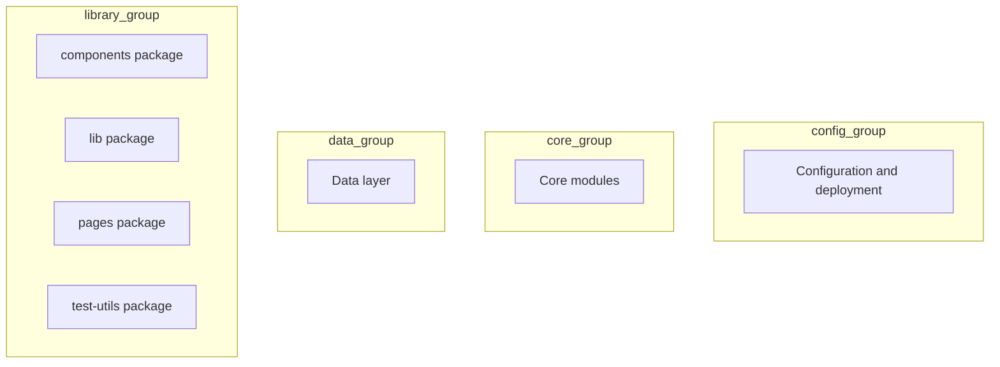

# Architecture report: mantinedev/ui.mantine.dev

> Automated static analysis. **Observed** = directly seen in files/imports/AST; **Inferred** = interpretation from that evidence. Repository code was not executed.

## 1. Repository at a glance

| Item | Value |
| --- | --- |
| Repository | mantinedev/ui.mantine.dev |
| Description | Mantine UI website and components |
| Language | TypeScript |
| Stars | 3946 |
| Licence | MIT |
| Analysed commit / branch | 963b955c5cef4bcc6008d40a0431e46ef771c254 / master |
| Framework(s) | Next.js, React |
| Files analysed | 732 |
| Components | 7 |

## 2. Architecture in one minute

mantinedev/ui.mantine.dev - Mantine UI website and components. This repository was analysed statically from 732 file(s) (0 Python). Detected technologies (observed from imports/manifests): GitHub Actions, Next.js, React, Jest, TypeScript. Files are grouped into 7 component(s): components package, Configuration and deployment, Core modules, Data layer, lib package, pages package, test-utils package. Findings below distinguish observed facts from inferred interpretation.

## 3. High-level block diagram

## 4. Main components

### components package (`components`)

- **Kind:** library
- **Status:** Observed
- **Confidence:** 0.85
- **Responsibility:** Groups 24 file(s) under components package (observed from repository paths and static analysis).
- **Paths:** `components/CategoryHeader/CategoryHeader.tsx`, `components/CategoryPage/CategoryPage.tsx`, `components/ChangelogPage/ChangelogPage.tsx`, `components/ComponentCanvas/CanvasHeader/CanvasHeader.tsx`, `components/ComponentCanvas/ComponentCanvas.tsx`, `components/ComponentPage/ComponentPage.tsx`, `components/ComponentPreview/ComponentPreview.tsx`, `components/ComponentPreviewControls/ComponentPreviewControls.tsx`, `components/GaScript/GaScript.tsx`, `components/GaScript/index.ts`, `components/HomePage/Banner/Banner.tsx`, `components/HomePage/Banner/data.ts`, `components/HomePage/CategoriesList/CategoriesList.tsx`, `components/HomePage/CategoryCard/CategoryCard.tsx`, `components/HomePage/HomePage.tsx`, `components/HotKeysHandler/HotKeysHandler.tsx`, `components/HotKeysHandler/index.ts`, `components/PageHead/PageHead.tsx`, `components/PageHead/index.ts`, `components/Search/Search.tsx`, `components/Search/index.ts`, `components/Shell/Shell.tsx`, `components/Shell/index.ts`, `components/StoryWrapper/StoryWrapper.tsx`
- **Evidence:** [components/CategoryHeader/CategoryHeader.tsx](https://github.com/mantinedev/ui.mantine.dev/blob/963b955c5cef4bcc6008d40a0431e46ef771c254/components/CategoryHeader/CategoryHeader.tsx); [components/CategoryPage/CategoryPage.tsx](https://github.com/mantinedev/ui.mantine.dev/blob/963b955c5cef4bcc6008d40a0431e46ef771c254/components/CategoryPage/CategoryPage.tsx); [components/ChangelogPage/ChangelogPage.tsx](https://github.com/mantinedev/ui.mantine.dev/blob/963b955c5cef4bcc6008d40a0431e46ef771c254/components/ChangelogPage/ChangelogPage.tsx); [components/ComponentCanvas/CanvasHeader/CanvasHeader.tsx](https://github.com/mantinedev/ui.mantine.dev/blob/963b955c5cef4bcc6008d40a0431e46ef771c254/components/ComponentCanvas/CanvasHeader/CanvasHeader.tsx); [components/ComponentCanvas/ComponentCanvas.tsx](https://github.com/mantinedev/ui.mantine.dev/blob/963b955c5cef4bcc6008d40a0431e46ef771c254/components/ComponentCanvas/ComponentCanvas.tsx); [components/ComponentPage/ComponentPage.tsx](https://github.com/mantinedev/ui.mantine.dev/blob/963b955c5cef4bcc6008d40a0431e46ef771c254/components/ComponentPage/ComponentPage.tsx); [components/ComponentPreview/ComponentPreview.tsx](https://github.com/mantinedev/ui.mantine.dev/blob/963b955c5cef4bcc6008d40a0431e46ef771c254/components/ComponentPreview/ComponentPreview.tsx); [components/ComponentPreviewControls/ComponentPreviewControls.tsx](https://github.com/mantinedev/ui.mantine.dev/blob/963b955c5cef4bcc6008d40a0431e46ef771c254/components/ComponentPreviewControls/ComponentPreviewControls.tsx)

### Configuration and deployment (`config`)

- **Kind:** config
- **Status:** Observed
- **Confidence:** 0.85
- **Responsibility:** Groups 126 file(s) under configuration and deployment (observed from repository paths and static analysis).
- **Paths:** `lib/ActionToggle/attributes.json`, `lib/ActionsGrid/attributes.json`, `lib/ArticleCard/attributes.json`, `lib/ArticleCardFooter/attributes.json`, `lib/ArticleCardImage/attributes.json`, `lib/ArticleCardVertical/attributes.json`, `lib/ArticlesCardsGrid/attributes.json`, `lib/AuthenticationForm/attributes.json`, `lib/AuthenticationImage/attributes.json`, `lib/AuthenticationTitle/attributes.json`, `lib/AutocompleteLoading/attributes.json`, `lib/BadgeCard/attributes.json`, `lib/ButtonCopy/attributes.json`, `lib/ButtonMenu/attributes.json`, `lib/ButtonProgress/attributes.json`, `lib/CardGradient/attributes.json`, `lib/CardWithStats/attributes.json`, `lib/CardsCarousel/attributes.json`, `lib/CarouselCard/attributes.json`, `lib/CheckboxCard/attributes.json`, `lib/CommentHtml/attributes.json`, `lib/CommentSimple/attributes.json`, `lib/ContactUs/attributes.json`, `lib/ContainedInputs/attributes.json`, `lib/CookiesBanner/attributes.json`, `lib/CurrencyInput/attributes.json`, `lib/CustomSwitch/attributes.json`, `lib/DndList/attributes.json`, `lib/DndListHandle/attributes.json`, `lib/DndTable/attributes.json`, `lib/DoubleHeader/attributes.json`, `lib/DoubleNavbar/attributes.json`, `lib/DropzoneButton/attributes.json`, `lib/EmailBanner/attributes.json`, `lib/FaqSimple/attributes.json`, `lib/FaqWithBg/attributes.json`, `lib/FaqWithHeader/attributes.json`, `lib/FaqWithImage/attributes.json`, `lib/FeaturesAsymmetrical/attributes.json`, `lib/FeaturesCard/attributes.json`, `lib/FeaturesCards/attributes.json`, `lib/FeaturesGrid/attributes.json`, `lib/FeaturesImages/attributes.json`, `lib/FeaturesTitle/attributes.json`, `lib/FloatingLabelInput/attributes.json`, `lib/FooterCentered/attributes.json`, `lib/FooterLinks/attributes.json`, `lib/FooterSimple/attributes.json`, `lib/FooterSocial/attributes.json`, `lib/ForgotPassword/attributes.json`, `lib/ForgotPasswordInput/attributes.json`, `lib/GetInTouch/attributes.json`, `lib/GetInTouchSimple/attributes.json`, `lib/GradientSegmentedControl/attributes.json`, `lib/GridAsymmetrical/attributes.json`, `lib/HeaderMegaMenu/attributes.json`, `lib/HeaderMenu/attributes.json`, `lib/HeaderSearch/attributes.json`, `lib/HeaderSimple/attributes.json`, `lib/HeaderTabs/attributes.json`, `lib/HeroBullets/attributes.json`, `lib/HeroContentLeft/attributes.json`, `lib/HeroImageBackground/attributes.json`, `lib/HeroImageRight/attributes.json`, `lib/HeroText/attributes.json`, `lib/HeroTitle/attributes.json`, `lib/ImageActionBanner/attributes.json`, `lib/ImageCard/attributes.json`, `lib/ImageCheckboxes/attributes.json`, `lib/InputTooltip/attributes.json`, `lib/InputValidation/attributes.json`, `lib/InputWithButton/attributes.json`, `lib/LanguagePicker/attributes.json`, `lib/LeadGrid/attributes.json`, `lib/NavbarLinksGroup/attributes.json`, `lib/NavbarMinimal/attributes.json`, `lib/NavbarMinimalColored/attributes.json`, `lib/NavbarNested/attributes.json`, `lib/NavbarSearch/attributes.json`, `lib/NavbarSegmented/attributes.json`, `lib/NavbarSimple/attributes.json`, `lib/NavbarSimpleColored/attributes.json`, `lib/NotFoundImage/attributes.json`, `lib/NotFoundTitle/attributes.json`, `lib/NothingFoundBackground/attributes.json`, `lib/PasswordStrength/attributes.json`, `lib/ProgressCard/attributes.json`, `lib/ProgressCardColored/attributes.json`, `lib/ServerError/attributes.json`, `lib/ServerOverload/attributes.json`, `lib/SliderHover/attributes.json`, `lib/SliderIcon/attributes.json`, `lib/SliderInput/attributes.json`, `lib/SliderLabel/attributes.json`, `lib/SliderMarks/attributes.json`, `lib/SliderWhite/attributes.json`, `lib/SocialButtons/attributes.json`, `lib/SplitButton/attributes.json`, `lib/StatsCard/attributes.json`, `lib/StatsControls/attributes.json`, `lib/StatsGrid/attributes.json`, `lib/StatsGridIcons/attributes.json`, `lib/StatsGroup/attributes.json`, `lib/StatsRing/attributes.json`, `lib/StatsRingCard/attributes.json`, `lib/StatsSegments/attributes.json`, `lib/Subgrid/attributes.json`, `lib/SwitchesCard/attributes.json`, `lib/TableOfContents/attributes.json`, `lib/TableOfContentsFloating/attributes.json`, `lib/TableReviews/attributes.json`, `lib/TableScrollArea/attributes.json`, `lib/TableSelection/attributes.json`, `lib/TableSort/attributes.json`, `lib/TaskCard/attributes.json`, `lib/UserButton/attributes.json`, `lib/UserCardImage/attributes.json`, `lib/UserInfoAction/attributes.json`, `lib/UserInfoIcons/attributes.json`, `lib/UserMenu/attributes.json`, `lib/UsersRolesTable/attributes.json`, `lib/UsersStack/attributes.json`, `lib/UsersTable/attributes.json`, `package.json`, `renovate.json`, `tsconfig.json`
- **Evidence:** [lib/ActionToggle/attributes.json](https://github.com/mantinedev/ui.mantine.dev/blob/963b955c5cef4bcc6008d40a0431e46ef771c254/lib/ActionToggle/attributes.json); [lib/ActionsGrid/attributes.json](https://github.com/mantinedev/ui.mantine.dev/blob/963b955c5cef4bcc6008d40a0431e46ef771c254/lib/ActionsGrid/attributes.json); [lib/ArticleCard/attributes.json](https://github.com/mantinedev/ui.mantine.dev/blob/963b955c5cef4bcc6008d40a0431e46ef771c254/lib/ArticleCard/attributes.json); [lib/ArticleCardFooter/attributes.json](https://github.com/mantinedev/ui.mantine.dev/blob/963b955c5cef4bcc6008d40a0431e46ef771c254/lib/ArticleCardFooter/attributes.json); [lib/ArticleCardImage/attributes.json](https://github.com/mantinedev/ui.mantine.dev/blob/963b955c5cef4bcc6008d40a0431e46ef771c254/lib/ArticleCardImage/attributes.json); [lib/ArticleCardVertical/attributes.json](https://github.com/mantinedev/ui.mantine.dev/blob/963b955c5cef4bcc6008d40a0431e46ef771c254/lib/ArticleCardVertical/attributes.json); [lib/ArticlesCardsGrid/attributes.json](https://github.com/mantinedev/ui.mantine.dev/blob/963b955c5cef4bcc6008d40a0431e46ef771c254/lib/ArticlesCardsGrid/attributes.json); [lib/AuthenticationForm/attributes.json](https://github.com/mantinedev/ui.mantine.dev/blob/963b955c5cef4bcc6008d40a0431e46ef771c254/lib/AuthenticationForm/attributes.json)

### Core modules (`core`)

- **Kind:** core
- **Status:** Observed
- **Confidence:** 0.85
- **Responsibility:** Groups 6 file(s) under core modules (observed from repository paths and static analysis).
- **Paths:** `global.d.ts`, `jest.config.js`, `jest.setup.js`, `next.config.mjs`, `oxfmt.config.mjs`, `postcss.config.cjs`
- **Evidence:** [global.d.ts](https://github.com/mantinedev/ui.mantine.dev/blob/963b955c5cef4bcc6008d40a0431e46ef771c254/global.d.ts); [jest.config.js](https://github.com/mantinedev/ui.mantine.dev/blob/963b955c5cef4bcc6008d40a0431e46ef771c254/jest.config.js); [jest.setup.js](https://github.com/mantinedev/ui.mantine.dev/blob/963b955c5cef4bcc6008d40a0431e46ef771c254/jest.setup.js); [next.config.mjs](https://github.com/mantinedev/ui.mantine.dev/blob/963b955c5cef4bcc6008d40a0431e46ef771c254/next.config.mjs); [oxfmt.config.mjs](https://github.com/mantinedev/ui.mantine.dev/blob/963b955c5cef4bcc6008d40a0431e46ef771c254/oxfmt.config.mjs); [postcss.config.cjs](https://github.com/mantinedev/ui.mantine.dev/blob/963b955c5cef4bcc6008d40a0431e46ef771c254/postcss.config.cjs)

### Data layer (`data_layer`)

- **Kind:** data
- **Status:** Observed
- **Confidence:** 0.85
- **Responsibility:** Groups 5 file(s) under data layer (observed from repository paths and static analysis).
- **Paths:** `data/categories.ts`, `data/components.ts`, `data/images/index.ts`, `data/index.ts`, `data/types.ts`
- **Evidence:** [data/categories.ts](https://github.com/mantinedev/ui.mantine.dev/blob/963b955c5cef4bcc6008d40a0431e46ef771c254/data/categories.ts); [data/components.ts](https://github.com/mantinedev/ui.mantine.dev/blob/963b955c5cef4bcc6008d40a0431e46ef771c254/data/components.ts); [data/images/index.ts](https://github.com/mantinedev/ui.mantine.dev/blob/963b955c5cef4bcc6008d40a0431e46ef771c254/data/images/index.ts); [data/index.ts](https://github.com/mantinedev/ui.mantine.dev/blob/963b955c5cef4bcc6008d40a0431e46ef771c254/data/index.ts); [data/types.ts](https://github.com/mantinedev/ui.mantine.dev/blob/963b955c5cef4bcc6008d40a0431e46ef771c254/data/types.ts)

### lib package (`lib`)

- **Kind:** library
- **Status:** Observed
- **Confidence:** 0.85
- **Responsibility:** Groups 384 file(s) under lib package (observed from repository paths and static analysis).
- **Paths:** `lib/ActionToggle/ActionToggle.story.tsx`, `lib/ActionToggle/ActionToggle.test.tsx`, `lib/ActionToggle/ActionToggle.tsx`, `lib/ActionsGrid/ActionsGrid.story.tsx`, `lib/ActionsGrid/ActionsGrid.test.tsx`, `lib/ActionsGrid/ActionsGrid.tsx`, `lib/ArticleCard/ArticleCard.story.tsx`, `lib/ArticleCard/ArticleCard.test.tsx`, `lib/ArticleCard/ArticleCard.tsx`, `lib/ArticleCardFooter/ArticleCardFooter.story.tsx`, `lib/ArticleCardFooter/ArticleCardFooter.test.tsx`, `lib/ArticleCardFooter/ArticleCardFooter.tsx`, `lib/ArticleCardImage/ArticleCardImage.story.tsx`, `lib/ArticleCardImage/ArticleCardImage.test.tsx`, `lib/ArticleCardImage/ArticleCardImage.tsx`, `lib/ArticleCardVertical/ArticleCardVertical.story.tsx`, `lib/ArticleCardVertical/ArticleCardVertical.test.tsx`, `lib/ArticleCardVertical/ArticleCardVertical.tsx`, `lib/ArticlesCardsGrid/ArticlesCardsGrid.story.tsx`, `lib/ArticlesCardsGrid/ArticlesCardsGrid.test.tsx`, `lib/ArticlesCardsGrid/ArticlesCardsGrid.tsx`, `lib/AuthenticationForm/AuthenticationForm.story.tsx`, `lib/AuthenticationForm/AuthenticationForm.test.tsx`, `lib/AuthenticationForm/AuthenticationForm.tsx`, `lib/AuthenticationForm/GoogleButton.tsx`, `lib/AuthenticationForm/TwitterButton.tsx`, `lib/AuthenticationImage/AuthenticationImage.story.tsx`, `lib/AuthenticationImage/AuthenticationImage.test.tsx`, `lib/AuthenticationImage/AuthenticationImage.tsx`, `lib/AuthenticationTitle/AuthenticationTitle.story.tsx`, `lib/AuthenticationTitle/AuthenticationTitle.test.tsx`, `lib/AuthenticationTitle/AuthenticationTitle.tsx`, `lib/AutocompleteLoading/AutocompleteLoading.story.tsx`, `lib/AutocompleteLoading/AutocompleteLoading.test.tsx`, `lib/AutocompleteLoading/AutocompleteLoading.tsx`, `lib/BadgeCard/BadgeCard.story.tsx`, `lib/BadgeCard/BadgeCard.test.tsx`, `lib/BadgeCard/BadgeCard.tsx`, `lib/ButtonCopy/ButtonCopy.story.tsx`, `lib/ButtonCopy/ButtonCopy.test.tsx`, `lib/ButtonCopy/ButtonCopy.tsx`, `lib/ButtonMenu/ButtonMenu.story.tsx`, `lib/ButtonMenu/ButtonMenu.test.tsx`, `lib/ButtonMenu/ButtonMenu.tsx`, `lib/ButtonProgress/ButtonProgress.story.tsx`, `lib/ButtonProgress/ButtonProgress.test.tsx`, `lib/ButtonProgress/ButtonProgress.tsx`, `lib/CardGradient/CardGradient.story.tsx`, `lib/CardGradient/CardGradient.test.tsx`, `lib/CardGradient/CardGradient.tsx`, `lib/CardWithStats/CardWithStats.story.tsx`, `lib/CardWithStats/CardWithStats.test.tsx`, `lib/CardWithStats/CardWithStats.tsx`, `lib/CardsCarousel/CardsCarousel.story.tsx`, `lib/CardsCarousel/CardsCarousel.test.tsx`, `lib/CardsCarousel/CardsCarousel.tsx`, `lib/CarouselCard/CarouselCard.story.tsx`, `lib/CarouselCard/CarouselCard.test.tsx`, `lib/CarouselCard/CarouselCard.tsx`, `lib/CheckboxCard/CheckboxCard.story.tsx`, `lib/CheckboxCard/CheckboxCard.test.tsx`, `lib/CheckboxCard/CheckboxCard.tsx`, `lib/CommentHtml/CommentHtml.story.tsx`, `lib/CommentHtml/CommentHtml.test.tsx`, `lib/CommentHtml/CommentHtml.tsx`, `lib/CommentSimple/CommentSimple.story.tsx`, `lib/CommentSimple/CommentSimple.test.tsx`, `lib/CommentSimple/CommentSimple.tsx`, `lib/ContactUs/ContactIcons.tsx`, `lib/ContactUs/ContactUs.story.tsx`, `lib/ContactUs/ContactUs.test.tsx`, `lib/ContactUs/ContactUs.tsx`, `lib/ContainedInputs/ContainedInputs.story.tsx`, `lib/ContainedInputs/ContainedInputs.test.tsx`, `lib/ContainedInputs/ContainedInputs.tsx`, `lib/CookiesBanner/CookiesBanner.story.tsx`, `lib/CookiesBanner/CookiesBanner.test.tsx`, `lib/CookiesBanner/CookiesBanner.tsx`, `lib/CurrencyInput/CurrencyInput.story.tsx`, `lib/CurrencyInput/CurrencyInput.test.tsx`, `lib/CurrencyInput/CurrencyInput.tsx`, `lib/CustomSwitch/CustomSwitch.story.tsx`, `lib/CustomSwitch/CustomSwitch.test.tsx`, `lib/CustomSwitch/CustomSwitch.tsx`, `lib/DndList/DndList.story.tsx`, `lib/DndList/DndList.test.tsx`, `lib/DndList/DndList.tsx`, `lib/DndListHandle/DndListHandle.story.tsx`, `lib/DndListHandle/DndListHandle.test.tsx`, `lib/DndListHandle/DndListHandle.tsx`, `lib/DndTable/DndTable.story.tsx`, `lib/DndTable/DndTable.test.tsx`, `lib/DndTable/DndTable.tsx`, `lib/DoubleHeader/DoubleHeader.story.tsx`, `lib/DoubleHeader/DoubleHeader.test.tsx`, `lib/DoubleHeader/DoubleHeader.tsx`, `lib/DoubleNavbar/DoubleNavbar.story.tsx`, `lib/DoubleNavbar/DoubleNavbar.test.tsx`, `lib/DoubleNavbar/DoubleNavbar.tsx`, `lib/DropzoneButton/DropzoneButton.story.tsx`, `lib/DropzoneButton/DropzoneButton.test.tsx`, `lib/DropzoneButton/DropzoneButton.tsx`, `lib/EmailBanner/EmailBanner.story.tsx`, `lib/EmailBanner/EmailBanner.test.tsx`, `lib/EmailBanner/EmailBanner.tsx`, `lib/FaqSimple/FaqSimple.story.tsx`, `lib/FaqSimple/FaqSimple.test.tsx`, `lib/FaqSimple/FaqSimple.tsx`, `lib/FaqWithBg/FaqWithBg.story.tsx`, `lib/FaqWithBg/FaqWithBg.test.tsx`, `lib/FaqWithBg/FaqWithBg.tsx`, `lib/FaqWithHeader/ContactIcons.tsx`, `lib/FaqWithHeader/FaqWithHeader.story.tsx`, `lib/FaqWithHeader/FaqWithHeader.test.tsx`, `lib/FaqWithHeader/FaqWithHeader.tsx`, `lib/FaqWithImage/FaqWithImage.story.tsx`, `lib/FaqWithImage/FaqWithImage.test.tsx`, `lib/FaqWithImage/FaqWithImage.tsx`, `lib/FeaturesAsymmetrical/FeaturesAsymmetrical.story.tsx`, `lib/FeaturesAsymmetrical/FeaturesAsymmetrical.test.tsx`, `lib/FeaturesAsymmetrical/FeaturesAsymmetrical.tsx`, `lib/FeaturesCard/FeaturesCard.story.tsx`, `lib/FeaturesCard/FeaturesCard.test.tsx`, `lib/FeaturesCard/FeaturesCard.tsx`, `lib/FeaturesCards/FeaturesCards.story.tsx`, `lib/FeaturesCards/FeaturesCards.test.tsx`, `lib/FeaturesCards/FeaturesCards.tsx`, `lib/FeaturesGrid/FeaturesGrid.story.tsx`, `lib/FeaturesGrid/FeaturesGrid.test.tsx`, `lib/FeaturesGrid/FeaturesGrid.tsx`, `lib/FeaturesImages/FeaturesImages.story.tsx`, `lib/FeaturesImages/FeaturesImages.test.tsx`, `lib/FeaturesImages/FeaturesImages.tsx`, `lib/FeaturesImages/images/index.ts`, `lib/FeaturesTitle/FeaturesTitle.story.tsx`, `lib/FeaturesTitle/FeaturesTitle.test.tsx`, `lib/FeaturesTitle/FeaturesTitle.tsx`, `lib/FloatingLabelInput/FloatingLabelInput.story.tsx`, `lib/FloatingLabelInput/FloatingLabelInput.test.tsx`, `lib/FloatingLabelInput/FloatingLabelInput.tsx`, `lib/FooterCentered/FooterCentered.story.tsx`, `lib/FooterCentered/FooterCentered.test.tsx`, `lib/FooterCentered/FooterCentered.tsx`, `lib/FooterLinks/FooterLinks.story.tsx`, `lib/FooterLinks/FooterLinks.test.tsx`, `lib/FooterLinks/FooterLinks.tsx`, `lib/FooterSimple/FooterSimple.story.tsx`, `lib/FooterSimple/FooterSimple.test.tsx`, `lib/FooterSimple/FooterSimple.tsx`, `lib/FooterSocial/FooterSocial.story.tsx`, `lib/FooterSocial/FooterSocial.test.tsx`, `lib/FooterSocial/FooterSocial.tsx`, `lib/ForgotPassword/ForgotPassword.story.tsx`, `lib/ForgotPassword/ForgotPassword.test.tsx`, `lib/ForgotPassword/ForgotPassword.tsx`, `lib/ForgotPasswordInput/ForgotPasswordInput.story.tsx`, `lib/ForgotPasswordInput/ForgotPasswordInput.test.tsx`, `lib/ForgotPasswordInput/ForgotPasswordInput.tsx`, `lib/GetInTouch/ContactIcons.tsx`, `lib/GetInTouch/GetInTouch.story.tsx`, `lib/GetInTouch/GetInTouch.test.tsx`, `lib/GetInTouch/GetInTouch.tsx`, `lib/GetInTouchSimple/GetInTouchSimple.story.tsx`, `lib/GetInTouchSimple/GetInTouchSimple.test.tsx`, `lib/GetInTouchSimple/GetInTouchSimple.tsx`, `lib/GradientSegmentedControl/GradientSegmentedControl.story.tsx`, `lib/GradientSegmentedControl/GradientSegmentedControl.test.tsx`, `lib/GradientSegmentedControl/GradientSegmentedControl.tsx`, `lib/GridAsymmetrical/GridAsymmetrical.story.tsx`, `lib/GridAsymmetrical/GridAsymmetrical.test.tsx`, `lib/GridAsymmetrical/GridAsymmetrical.tsx`, `lib/HeaderMegaMenu/HeaderMegaMenu.story.tsx`, `lib/HeaderMegaMenu/HeaderMegaMenu.test.tsx`, `lib/HeaderMegaMenu/HeaderMegaMenu.tsx`, `lib/HeaderMenu/HeaderMenu.story.tsx`, `lib/HeaderMenu/HeaderMenu.test.tsx`, `lib/HeaderMenu/HeaderMenu.tsx`, `lib/HeaderSearch/HeaderSearch.story.tsx`, `lib/HeaderSearch/HeaderSearch.test.tsx`, `lib/HeaderSearch/HeaderSearch.tsx`, `lib/HeaderSimple/HeaderSimple.story.tsx`, `lib/HeaderSimple/HeaderSimple.test.tsx`, `lib/HeaderSimple/HeaderSimple.tsx`, `lib/HeaderTabs/HeaderTabs.story.tsx`, `lib/HeaderTabs/HeaderTabs.test.tsx`, `lib/HeaderTabs/HeaderTabs.tsx`, `lib/HeroBullets/HeroBullets.story.tsx`, `lib/HeroBullets/HeroBullets.test.tsx`, `lib/HeroBullets/HeroBullets.tsx`, `lib/HeroContentLeft/HeroContentLeft.story.tsx`, `lib/HeroContentLeft/HeroContentLeft.test.tsx`, `lib/HeroContentLeft/HeroContentLeft.tsx`, `lib/HeroImageBackground/HeroImageBackground.story.tsx`, `lib/HeroImageBackground/HeroImageBackground.test.tsx`, `lib/HeroImageBackground/HeroImageBackground.tsx`, `lib/HeroImageRight/HeroImageRight.story.tsx`, `lib/HeroImageRight/HeroImageRight.test.tsx`, `lib/HeroImageRight/HeroImageRight.tsx`, `lib/HeroText/Dots.tsx`, `lib/HeroText/HeroText.story.tsx`, `lib/HeroText/HeroText.test.tsx`, `lib/HeroText/HeroText.tsx`, `lib/HeroTitle/HeroTitle.story.tsx`, `lib/HeroTitle/HeroTitle.test.tsx`, `lib/HeroTitle/HeroTitle.tsx`, `lib/ImageActionBanner/ImageActionBanner.story.tsx`, `lib/ImageActionBanner/ImageActionBanner.test.tsx`, `lib/ImageActionBanner/ImageActionBanner.tsx`, `lib/ImageCard/ImageCard.story.tsx`, `lib/ImageCard/ImageCard.test.tsx`, `lib/ImageCard/ImageCard.tsx`, `lib/ImageCheckboxes/ImageCheckboxes.story.tsx`, `lib/ImageCheckboxes/ImageCheckboxes.test.tsx`, `lib/ImageCheckboxes/ImageCheckboxes.tsx`, `lib/ImageCheckboxes/icons/index.ts`, `lib/InputTooltip/InputTooltip.story.tsx`, `lib/InputTooltip/InputTooltip.test.tsx`, `lib/InputTooltip/InputTooltip.tsx`, `lib/InputValidation/InputValidation.story.tsx`, `lib/InputValidation/InputValidation.test.tsx`, `lib/InputValidation/InputValidation.tsx`, `lib/InputWithButton/InputWithButton.story.tsx`, `lib/InputWithButton/InputWithButton.test.tsx`, `lib/InputWithButton/InputWithButton.tsx`, `lib/LanguagePicker/LanguagePicker.story.tsx`, `lib/LanguagePicker/LanguagePicker.test.tsx`, `lib/LanguagePicker/LanguagePicker.tsx`, `lib/LanguagePicker/images/index.ts`, `lib/LeadGrid/LeadGrid.story.tsx`, `lib/LeadGrid/LeadGrid.test.tsx`, `lib/LeadGrid/LeadGrid.tsx`, `lib/NavbarLinksGroup/NavbarLinksGroup.story.tsx`, `lib/NavbarLinksGroup/NavbarLinksGroup.test.tsx`, `lib/NavbarLinksGroup/NavbarLinksGroup.tsx`, `lib/NavbarMinimal/NavbarMinimal.story.tsx`, `lib/NavbarMinimal/NavbarMinimal.test.tsx`, `lib/NavbarMinimal/NavbarMinimal.tsx`, `lib/NavbarMinimalColored/NavbarMinimalColored.story.tsx`, `lib/NavbarMinimalColored/NavbarMinimalColored.test.tsx`, `lib/NavbarMinimalColored/NavbarMinimalColored.tsx`, `lib/NavbarNested/Logo.tsx`, `lib/NavbarNested/NavbarNested.story.tsx`, `lib/NavbarNested/NavbarNested.test.tsx`, `lib/NavbarNested/NavbarNested.tsx`, `lib/NavbarSearch/NavbarSearch.story.tsx`, `lib/NavbarSearch/NavbarSearch.test.tsx`, `lib/NavbarSearch/NavbarSearch.tsx`, `lib/NavbarSegmented/NavbarSegmented.story.tsx`, `lib/NavbarSegmented/NavbarSegmented.test.tsx`, `lib/NavbarSegmented/NavbarSegmented.tsx`, `lib/NavbarSimple/NavbarSimple.story.tsx`, `lib/NavbarSimple/NavbarSimple.test.tsx`, `lib/NavbarSimple/NavbarSimple.tsx`, `lib/NavbarSimpleColored/NavbarSimpleColored.story.tsx`, `lib/NavbarSimpleColored/NavbarSimpleColored.test.tsx`, `lib/NavbarSimpleColored/NavbarSimpleColored.tsx`, `lib/NotFoundImage/NotFoundImage.story.tsx`, `lib/NotFoundImage/NotFoundImage.test.tsx`, `lib/NotFoundImage/NotFoundImage.tsx`, `lib/NotFoundTitle/NotFoundTitle.story.tsx`, `lib/NotFoundTitle/NotFoundTitle.test.tsx`, `lib/NotFoundTitle/NotFoundTitle.tsx`, `lib/NothingFoundBackground/Illustration.tsx`, `lib/NothingFoundBackground/NothingFoundBackground.story.tsx`, `lib/NothingFoundBackground/NothingFoundBackground.test.tsx`, `lib/NothingFoundBackground/NothingFoundBackground.tsx`, `lib/PasswordStrength/PasswordStrength.story.tsx`, `lib/PasswordStrength/PasswordStrength.test.tsx`, `lib/PasswordStrength/PasswordStrength.tsx`, `lib/ProgressCard/ProgressCard.story.tsx`, `lib/ProgressCard/ProgressCard.test.tsx`, `lib/ProgressCard/ProgressCard.tsx`, `lib/ProgressCardColored/ProgressCardColored.story.tsx`, `lib/ProgressCardColored/ProgressCardColored.test.tsx`, `lib/ProgressCardColored/ProgressCardColored.tsx`, `lib/ServerError/ServerError.story.tsx`, `lib/ServerError/ServerError.test.tsx`, `lib/ServerError/ServerError.tsx`, `lib/ServerOverload/Illustration.tsx`, `lib/ServerOverload/ServerOverload.story.tsx`, `lib/ServerOverload/ServerOverload.test.tsx`, `lib/ServerOverload/ServerOverload.tsx`, `lib/SliderHover/SliderHover.story.tsx`, `lib/SliderHover/SliderHover.test.tsx`, `lib/SliderHover/SliderHover.tsx`, `lib/SliderIcon/SliderIcon.story.tsx`, `lib/SliderIcon/SliderIcon.test.tsx`, `lib/SliderIcon/SliderIcon.tsx`, `lib/SliderInput/SliderInput.story.tsx`, `lib/SliderInput/SliderInput.test.tsx`, `lib/SliderInput/SliderInput.tsx`, `lib/SliderLabel/SliderLabel.story.tsx`, `lib/SliderLabel/SliderLabel.test.tsx`, `lib/SliderLabel/SliderLabel.tsx`, `lib/SliderMarks/SliderMarks.story.tsx`, `lib/SliderMarks/SliderMarks.test.tsx`, `lib/SliderMarks/SliderMarks.tsx`, `lib/SliderWhite/SliderWhite.story.tsx`, `lib/SliderWhite/SliderWhite.test.tsx`, `lib/SliderWhite/SliderWhite.tsx`, `lib/SocialButtons/FacebookIcon.tsx`, `lib/SocialButtons/GoogleIcon.tsx`, `lib/SocialButtons/SocialButtons.story.tsx`, `lib/SocialButtons/SocialButtons.test.tsx`, `lib/SocialButtons/SocialButtons.tsx`, `lib/SplitButton/SplitButton.story.tsx`, `lib/SplitButton/SplitButton.test.tsx`, `lib/SplitButton/SplitButton.tsx`, `lib/StatsCard/StatsCard.story.tsx`, `lib/StatsCard/StatsCard.test.tsx`, `lib/StatsCard/StatsCard.tsx`, `lib/StatsControls/StatsControls.story.tsx`, `lib/StatsControls/StatsControls.test.tsx`, `lib/StatsControls/StatsControls.tsx`, `lib/StatsGrid/StatsGrid.story.tsx`, `lib/StatsGrid/StatsGrid.test.tsx`, `lib/StatsGrid/StatsGrid.tsx`, `lib/StatsGridIcons/StatsGridIcons.story.tsx`, `lib/StatsGridIcons/StatsGridIcons.test.tsx`, `lib/StatsGridIcons/StatsGridIcons.tsx`, `lib/StatsGroup/StatsGroup.story.tsx`, `lib/StatsGroup/StatsGroup.test.tsx`, `lib/StatsGroup/StatsGroup.tsx`, `lib/StatsRing/StatsRing.story.tsx`, `lib/StatsRing/StatsRing.test.tsx`, `lib/StatsRing/StatsRing.tsx`, `lib/StatsRingCard/StatsRingCard.story.tsx`, `lib/StatsRingCard/StatsRingCard.test.tsx`, `lib/StatsRingCard/StatsRingCard.tsx`, `lib/StatsSegments/StatsSegments.story.tsx`, `lib/StatsSegments/StatsSegments.test.tsx`, `lib/StatsSegments/StatsSegments.tsx`, `lib/Subgrid/Subgrid.story.tsx`, `lib/Subgrid/Subgrid.test.tsx`, `lib/Subgrid/Subgrid.tsx`, `lib/SwitchesCard/SwitchesCard.story.tsx`, `lib/SwitchesCard/SwitchesCard.test.tsx`, `lib/SwitchesCard/SwitchesCard.tsx`, `lib/TableOfContents/TableOfContents.story.tsx`, `lib/TableOfContents/TableOfContents.test.tsx`, `lib/TableOfContents/TableOfContents.tsx`, `lib/TableOfContentsFloating/TableOfContentsFloating.story.tsx`, `lib/TableOfContentsFloating/TableOfContentsFloating.test.tsx`, `lib/TableOfContentsFloating/TableOfContentsFloating.tsx`, `lib/TableReviews/TableReviews.story.tsx`, `lib/TableReviews/TableReviews.test.tsx`, `lib/TableReviews/TableReviews.tsx`, `lib/TableScrollArea/TableScrollArea.story.tsx`, `lib/TableScrollArea/TableScrollArea.test.tsx`, `lib/TableScrollArea/TableScrollArea.tsx`, `lib/TableSelection/TableSelection.story.tsx`, `lib/TableSelection/TableSelection.test.tsx`, `lib/TableSelection/TableSelection.tsx`, `lib/TableSort/TableSort.story.tsx`, `lib/TableSort/TableSort.test.tsx`, `lib/TableSort/TableSort.tsx`, `lib/TaskCard/TaskCard.story.tsx`, `lib/TaskCard/TaskCard.test.tsx`, `lib/TaskCard/TaskCard.tsx`, `lib/UserButton/UserButton.story.tsx`, `lib/UserButton/UserButton.test.tsx`, `lib/UserButton/UserButton.tsx`, `lib/UserCardImage/UserCardImage.story.tsx`, `lib/UserCardImage/UserCardImage.test.tsx`, `lib/UserCardImage/UserCardImage.tsx`, `lib/UserInfoAction/UserInfoAction.story.tsx`, `lib/UserInfoAction/UserInfoAction.test.tsx`, `lib/UserInfoAction/UserInfoAction.tsx`, `lib/UserInfoIcons/UserInfoIcons.story.tsx`, `lib/UserInfoIcons/UserInfoIcons.test.tsx`, `lib/UserInfoIcons/UserInfoIcons.tsx`, `lib/UserMenu/UserMenu.story.tsx`, `lib/UserMenu/UserMenu.test.tsx`, `lib/UserMenu/UserMenu.tsx`, `lib/UsersRolesTable/UsersRolesTable.story.tsx`, `lib/UsersRolesTable/UsersRolesTable.test.tsx`, `lib/UsersRolesTable/UsersRolesTable.tsx`, `lib/UsersStack/UsersStack.story.tsx`, `lib/UsersStack/UsersStack.test.tsx`, `lib/UsersStack/UsersStack.tsx`, `lib/UsersTable/UsersTable.story.tsx`, `lib/UsersTable/UsersTable.test.tsx`, `lib/UsersTable/UsersTable.tsx`, `lib/index.ts`
- **Evidence:** [lib/ActionToggle/ActionToggle.story.tsx](https://github.com/mantinedev/ui.mantine.dev/blob/963b955c5cef4bcc6008d40a0431e46ef771c254/lib/ActionToggle/ActionToggle.story.tsx); [lib/ActionToggle/ActionToggle.test.tsx](https://github.com/mantinedev/ui.mantine.dev/blob/963b955c5cef4bcc6008d40a0431e46ef771c254/lib/ActionToggle/ActionToggle.test.tsx); [lib/ActionToggle/ActionToggle.tsx](https://github.com/mantinedev/ui.mantine.dev/blob/963b955c5cef4bcc6008d40a0431e46ef771c254/lib/ActionToggle/ActionToggle.tsx); [lib/ActionsGrid/ActionsGrid.story.tsx](https://github.com/mantinedev/ui.mantine.dev/blob/963b955c5cef4bcc6008d40a0431e46ef771c254/lib/ActionsGrid/ActionsGrid.story.tsx); [lib/ActionsGrid/ActionsGrid.test.tsx](https://github.com/mantinedev/ui.mantine.dev/blob/963b955c5cef4bcc6008d40a0431e46ef771c254/lib/ActionsGrid/ActionsGrid.test.tsx); [lib/ActionsGrid/ActionsGrid.tsx](https://github.com/mantinedev/ui.mantine.dev/blob/963b955c5cef4bcc6008d40a0431e46ef771c254/lib/ActionsGrid/ActionsGrid.tsx); [lib/ArticleCard/ArticleCard.story.tsx](https://github.com/mantinedev/ui.mantine.dev/blob/963b955c5cef4bcc6008d40a0431e46ef771c254/lib/ArticleCard/ArticleCard.story.tsx); [lib/ArticleCard/ArticleCard.test.tsx](https://github.com/mantinedev/ui.mantine.dev/blob/963b955c5cef4bcc6008d40a0431e46ef771c254/lib/ArticleCard/ArticleCard.test.tsx)

### pages package (`pages`)

- **Kind:** library
- **Status:** Observed
- **Confidence:** 0.85
- **Responsibility:** Groups 6 file(s) under pages package (observed from repository paths and static analysis).
- **Paths:** `pages/_app.tsx`, `pages/_document.tsx`, `pages/category/[category].tsx`, `pages/changelog/[changelog].tsx`, `pages/component/[component].tsx`, `pages/index.tsx`
- **Evidence:** [pages/_app.tsx](https://github.com/mantinedev/ui.mantine.dev/blob/963b955c5cef4bcc6008d40a0431e46ef771c254/pages/_app.tsx); [pages/_document.tsx](https://github.com/mantinedev/ui.mantine.dev/blob/963b955c5cef4bcc6008d40a0431e46ef771c254/pages/_document.tsx); [pages/category/[category].tsx](https://github.com/mantinedev/ui.mantine.dev/blob/963b955c5cef4bcc6008d40a0431e46ef771c254/pages/category/%5Bcategory%5D.tsx); [pages/changelog/[changelog].tsx](https://github.com/mantinedev/ui.mantine.dev/blob/963b955c5cef4bcc6008d40a0431e46ef771c254/pages/changelog/%5Bchangelog%5D.tsx); [pages/component/[component].tsx](https://github.com/mantinedev/ui.mantine.dev/blob/963b955c5cef4bcc6008d40a0431e46ef771c254/pages/component/%5Bcomponent%5D.tsx); [pages/index.tsx](https://github.com/mantinedev/ui.mantine.dev/blob/963b955c5cef4bcc6008d40a0431e46ef771c254/pages/index.tsx)

### test-utils package (`test_utils`)

- **Kind:** library
- **Status:** Observed
- **Confidence:** 0.85
- **Responsibility:** Groups 3 file(s) under test-utils package (observed from repository paths and static analysis).
- **Paths:** `test-utils/axe.ts`, `test-utils/index.ts`, `test-utils/render.tsx`
- **Evidence:** [test-utils/axe.ts](https://github.com/mantinedev/ui.mantine.dev/blob/963b955c5cef4bcc6008d40a0431e46ef771c254/test-utils/axe.ts); [test-utils/index.ts](https://github.com/mantinedev/ui.mantine.dev/blob/963b955c5cef4bcc6008d40a0431e46ef771c254/test-utils/index.ts); [test-utils/render.tsx](https://github.com/mantinedev/ui.mantine.dev/blob/963b955c5cef4bcc6008d40a0431e46ef771c254/test-utils/render.tsx)

## 5. Execution flow

**Observed** entry point(s):

- [.storybook/main.ts](https://github.com/mantinedev/ui.mantine.dev/blob/963b955c5cef4bcc6008d40a0431e46ef771c254/.storybook/main.ts)
- [components/GaScript/index.ts](https://github.com/mantinedev/ui.mantine.dev/blob/963b955c5cef4bcc6008d40a0431e46ef771c254/components/GaScript/index.ts)
- [components/HotKeysHandler/index.ts](https://github.com/mantinedev/ui.mantine.dev/blob/963b955c5cef4bcc6008d40a0431e46ef771c254/components/HotKeysHandler/index.ts)
- [components/PageHead/index.ts](https://github.com/mantinedev/ui.mantine.dev/blob/963b955c5cef4bcc6008d40a0431e46ef771c254/components/PageHead/index.ts)
- [components/Search/index.ts](https://github.com/mantinedev/ui.mantine.dev/blob/963b955c5cef4bcc6008d40a0431e46ef771c254/components/Search/index.ts)
- [components/Shell/index.ts](https://github.com/mantinedev/ui.mantine.dev/blob/963b955c5cef4bcc6008d40a0431e46ef771c254/components/Shell/index.ts)
- [data/images/index.ts](https://github.com/mantinedev/ui.mantine.dev/blob/963b955c5cef4bcc6008d40a0431e46ef771c254/data/images/index.ts)
- [data/index.ts](https://github.com/mantinedev/ui.mantine.dev/blob/963b955c5cef4bcc6008d40a0431e46ef771c254/data/index.ts)
- [lib/FeaturesImages/images/index.ts](https://github.com/mantinedev/ui.mantine.dev/blob/963b955c5cef4bcc6008d40a0431e46ef771c254/lib/FeaturesImages/images/index.ts)
- [lib/ImageCheckboxes/icons/index.ts](https://github.com/mantinedev/ui.mantine.dev/blob/963b955c5cef4bcc6008d40a0431e46ef771c254/lib/ImageCheckboxes/icons/index.ts)
- [lib/LanguagePicker/images/index.ts](https://github.com/mantinedev/ui.mantine.dev/blob/963b955c5cef4bcc6008d40a0431e46ef771c254/lib/LanguagePicker/images/index.ts)
- [lib/index.ts](https://github.com/mantinedev/ui.mantine.dev/blob/963b955c5cef4bcc6008d40a0431e46ef771c254/lib/index.ts)

Representative flow (derived from observed entry points and the import graph; steps beyond the entry point are **Inferred**):

1. Execution starts at an observed entry point listed above, if present.
2. No internal import relationships between components were observed.

## 6. Project structure

### `(root)`

- `.gitignore` - other (549 bytes)
- `.nvmrc` - other (7 bytes)
- `.oxlintrc.json` - config (3103 bytes)
- `.yarnrc.yml` - config (103 bytes)
- `LICENCE` - other (1072 bytes)
- `README.md` - docs (695 bytes)
- `global.d.ts` - source, TypeScript (24 bytes)
- `jest.config.js` - source, JavaScript (675 bytes)
- `jest.setup.js` - source, JavaScript (660 bytes)
- `next.config.mjs` - source, JavaScript (154 bytes)
- `oxfmt.config.mjs` - source, JavaScript (119 bytes)
- `package.json` - manifest (2513 bytes)
- `postcss.config.cjs` - source, JavaScript (369 bytes)
- `renovate.json` - config (397 bytes)
- `tsconfig.json` - config (623 bytes)

### `.github`

- `.github/workflows/npm_test.yml` - ci, YAML (646 bytes)

### `.storybook`

- `.storybook/main.ts` - source, TypeScript (401 bytes)
- `.storybook/preview-head.html` - other (291 bytes)
- `.storybook/preview.tsx` - source, TypeScript (1113 bytes)

### `.vscode`

- `.vscode/settings.json` - config (433 bytes)

### `components`

- `components/CategoryHeader/CategoryHeader.module.css` - other (224 bytes)
- `components/CategoryHeader/CategoryHeader.tsx` - source, TypeScript (690 bytes)
- `components/CategoryPage/CategoryPage.tsx` - source, TypeScript (1244 bytes)
- `components/ChangelogPage/ChangelogPage.module.css` - other (122 bytes)
- `components/ChangelogPage/ChangelogPage.tsx` - source, TypeScript (1204 bytes)
- `components/ComponentCanvas/CanvasHeader/CanvasHeader.module.css` - other (1137 bytes)
- `components/ComponentCanvas/CanvasHeader/CanvasHeader.tsx` - source, TypeScript (2801 bytes)
- `components/ComponentCanvas/ComponentCanvas.module.css` - other (1619 bytes)
- `components/ComponentCanvas/ComponentCanvas.tsx` - source, TypeScript (1862 bytes)
- `components/ComponentPage/ComponentPage.tsx` - source, TypeScript (2370 bytes)
- `components/ComponentPreview/ComponentPreview.tsx` - source, TypeScript (574 bytes)
- `components/ComponentPreviewControls/ComponentPreviewControls.tsx` - source, TypeScript (381 bytes)
- `components/GaScript/GaScript.tsx` - source, TypeScript (507 bytes)
- `components/GaScript/index.ts` - source, TypeScript (39 bytes)
- `components/HomePage/Banner/Banner.module.css` - other (3022 bytes)
- `components/HomePage/Banner/Banner.tsx` - source, TypeScript (3013 bytes)
- `components/HomePage/Banner/data.ts` - source, TypeScript (662 bytes)
- `components/HomePage/CategoriesList/CategoriesList.module.css` - other (593 bytes)
- `components/HomePage/CategoriesList/CategoriesList.tsx` - source, TypeScript (1430 bytes)
- `components/HomePage/CategoryCard/CategoryCard.module.css` - other (785 bytes)
- `components/HomePage/CategoryCard/CategoryCard.tsx` - source, TypeScript (1081 bytes)
- `components/HomePage/HomePage.tsx` - source, TypeScript (726 bytes)
- `components/HotKeysHandler/HotKeysHandler.tsx` - source, TypeScript (447 bytes)
- `components/HotKeysHandler/index.ts` - source, TypeScript (51 bytes)
- `components/PageHead/PageHead.tsx` - source, TypeScript (779 bytes)
- `components/PageHead/index.ts` - source, TypeScript (39 bytes)
- `components/Search/Search.tsx` - source, TypeScript (908 bytes)
- `components/Search/index.ts` - source, TypeScript (51 bytes)
- `components/Shell/Shell.module.css` - other (137 bytes)
- `components/Shell/Shell.tsx` - source, TypeScript (1391 bytes)
- `components/Shell/index.ts` - source, TypeScript (33 bytes)
- `components/StoryWrapper/StoryWrapper.tsx` - source, TypeScript (458 bytes)

### `data`

- `data/categories.ts` - source, TypeScript (2369 bytes)
- `data/components.ts` - source, TypeScript (3391 bytes)
- `data/images/authentication-dark.svg` - other (13767 bytes)
- `data/images/authentication-light.svg` - other (13752 bytes)
- `data/images/banners-dark.svg` - other (6697 bytes)
- `data/images/banners-light.svg` - other (6691 bytes)
- `data/images/buttons-dark.svg` - other (218 bytes)
- `data/images/buttons-light.svg` - other (215 bytes)
- `data/images/cards-dark.svg` - other (3482 bytes)
- `data/images/cards-light.svg` - other (3467 bytes)
- `data/images/carousels-dark.svg` - other (864 bytes)
- `data/images/carousels-light.svg` - other (864 bytes)
- `data/images/color-scheme-dark.svg` - other (683 bytes)
- `data/images/color-scheme-light.svg` - other (724 bytes)
- `data/images/comments-dark.svg` - other (5592 bytes)
- `data/images/comments-light.svg` - other (5592 bytes)
- `data/images/contact-dark.svg` - other (16596 bytes)
- `data/images/contact-light.svg` - other (16584 bytes)
- `data/images/dnd-dark.svg` - other (533 bytes)
- `data/images/dnd-light.svg` - other (1201 bytes)
- `data/images/dropzones-dark.svg` - other (1249 bytes)
- `data/images/dropzones-light.svg` - other (1243 bytes)
- `data/images/error-pages-dark.svg` - other (1711 bytes)
- `data/images/error-pages-light.svg` - other (1711 bytes)
- `data/images/faq-dark.svg` - other (9981 bytes)
- `data/images/faq-light.svg` - other (9966 bytes)
- `data/images/features-dark.svg` - other (14524 bytes)
- `data/images/features-light.svg` - other (14506 bytes)
- `data/images/footers-dark.svg` - other (6848 bytes)
- `data/images/footers-light.svg` - other (6830 bytes)
- `data/images/grids-dark.svg` - other (359 bytes)
- `data/images/grids-light.svg` - other (439 bytes)
- `data/images/headers-dark.svg` - other (5623 bytes)
- `data/images/headers-light.svg` - other (5606 bytes)
- `data/images/hero-dark.svg` - other (7956 bytes)
- `data/images/hero-light.svg` - other (7950 bytes)
- `data/images/index.ts` - source, TypeScript (3837 bytes)
- `data/images/inputs-dark.svg` - other (5577 bytes)
- `data/images/inputs-light.svg` - other (5547 bytes)
- `data/images/navbars-dark.svg` - other (1920 bytes)
- `data/images/navbars-light.svg` - other (1914 bytes)
- `data/images/sliders-dark.svg` - other (338 bytes)
- `data/images/sliders-light.svg` - other (338 bytes)
- `data/images/stats-dark.svg` - other (3229 bytes)
- `data/images/stats-light.svg` - other (3226 bytes)
- `data/images/tables-dark.svg` - other (2551 bytes)
- `data/images/tables-light.svg` - other (2551 bytes)
- `data/images/toc-dark.svg` - other (737 bytes)
- `data/images/toc-light.svg` - other (734 bytes)
- `data/images/users-dark.svg` - other (1813 bytes)
- `data/images/users-light.svg` - other (1807 bytes)
- `data/index.ts` - source, TypeScript (55 bytes)
- `data/types.ts` - source, TypeScript (553 bytes)

### `lib`

- `lib/ActionToggle/ActionToggle.module.css` - other (226 bytes)
- `lib/ActionToggle/ActionToggle.story.tsx` - source, TypeScript (314 bytes)
- `lib/ActionToggle/ActionToggle.test.tsx` - source, TypeScript (329 bytes)
- `lib/ActionToggle/ActionToggle.tsx` - source, TypeScript (870 bytes)
- `lib/ActionToggle/attributes.json` - config (100 bytes)
- `lib/ActionsGrid/ActionsGrid.module.css` - other (616 bytes)
- `lib/ActionsGrid/ActionsGrid.story.tsx` - source, TypeScript (310 bytes)
- `lib/ActionsGrid/ActionsGrid.test.tsx` - source, TypeScript (230 bytes)
- `lib/ActionsGrid/ActionsGrid.tsx` - source, TypeScript (1642 bytes)
- `lib/ActionsGrid/attributes.json` - config (126 bytes)
- `lib/ArticleCard/ArticleCard.module.css` - other (888 bytes)
- `lib/ArticleCard/ArticleCard.story.tsx` - source, TypeScript (310 bytes)
- `lib/ArticleCard/ArticleCard.test.tsx` - source, TypeScript (324 bytes)
- `lib/ArticleCard/ArticleCard.tsx` - source, TypeScript (2607 bytes)
- `lib/ArticleCard/attributes.json` - config (149 bytes)
- `lib/ArticleCardFooter/ArticleCardFooter.module.css` - other (452 bytes)
- `lib/ArticleCardFooter/ArticleCardFooter.story.tsx` - source, TypeScript (334 bytes)
- `lib/ArticleCardFooter/ArticleCardFooter.test.tsx` - source, TypeScript (354 bytes)
- `lib/ArticleCardFooter/ArticleCardFooter.tsx` - source, TypeScript (2614 bytes)
- `lib/ArticleCardFooter/attributes.json` - config (150 bytes)
- `lib/ArticleCardImage/ArticleCardImage.module.css` - other (505 bytes)
- `lib/ArticleCardImage/ArticleCardImage.story.tsx` - source, TypeScript (330 bytes)
- `lib/ArticleCardImage/ArticleCardImage.test.tsx` - source, TypeScript (349 bytes)
- `lib/ArticleCardImage/ArticleCardImage.tsx` - source, TypeScript (1096 bytes)
- `lib/ArticleCardImage/attributes.json` - config (134 bytes)
- `lib/ArticleCardVertical/ArticleCardVertical.module.css` - other (482 bytes)
- `lib/ArticleCardVertical/ArticleCardVertical.story.tsx` - source, TypeScript (342 bytes)
- `lib/ArticleCardVertical/ArticleCardVertical.test.tsx` - source, TypeScript (364 bytes)
- `lib/ArticleCardVertical/ArticleCardVertical.tsx` - source, TypeScript (1630 bytes)
- `lib/ArticleCardVertical/attributes.json` - config (169 bytes)
- `lib/ArticlesCardsGrid/ArticlesCardsGrid.module.css` - other (682 bytes)
- `lib/ArticlesCardsGrid/ArticlesCardsGrid.story.tsx` - source, TypeScript (334 bytes)
- `lib/ArticlesCardsGrid/ArticlesCardsGrid.test.tsx` - source, TypeScript (354 bytes)
- `lib/ArticlesCardsGrid/ArticlesCardsGrid.tsx` - source, TypeScript (1897 bytes)
- `lib/ArticlesCardsGrid/attributes.json` - config (162 bytes)
- `lib/AuthenticationForm/AuthenticationForm.story.tsx` - source, TypeScript (338 bytes)
- `lib/AuthenticationForm/AuthenticationForm.test.tsx` - source, TypeScript (265 bytes)
- `lib/AuthenticationForm/AuthenticationForm.tsx` - source, TypeScript (3235 bytes)
- `lib/AuthenticationForm/GoogleButton.tsx` - source, TypeScript (1517 bytes)
- `lib/AuthenticationForm/TwitterButton.tsx` - source, TypeScript (318 bytes)
- `lib/AuthenticationForm/attributes.json` - config (146 bytes)
- `lib/AuthenticationImage/AuthenticationImage.module.css` - other (755 bytes)
- `lib/AuthenticationImage/AuthenticationImage.story.tsx` - source, TypeScript (342 bytes)
- `lib/AuthenticationImage/AuthenticationImage.test.tsx` - source, TypeScript (364 bytes)
- `lib/AuthenticationImage/AuthenticationImage.tsx` - source, TypeScript (1014 bytes)
- `lib/AuthenticationImage/attributes.json` - config (141 bytes)
- `lib/AuthenticationTitle/AuthenticationTitle.module.css` - other (218 bytes)
- `lib/AuthenticationTitle/AuthenticationTitle.story.tsx` - source, TypeScript (342 bytes)
- `lib/AuthenticationTitle/AuthenticationTitle.test.tsx` - source, TypeScript (364 bytes)
- `lib/AuthenticationTitle/AuthenticationTitle.tsx` - source, TypeScript (1079 bytes)
- `lib/AuthenticationTitle/attributes.json` - config (137 bytes)
- `lib/AutocompleteLoading/AutocompleteLoading.story.tsx` - source, TypeScript (342 bytes)
- `lib/AutocompleteLoading/AutocompleteLoading.test.tsx` - source, TypeScript (364 bytes)
- `lib/AutocompleteLoading/AutocompleteLoading.tsx` - source, TypeScript (1008 bytes)
- `lib/AutocompleteLoading/attributes.json` - config (124 bytes)
- `lib/BadgeCard/BadgeCard.module.css` - other (524 bytes)
- `lib/BadgeCard/BadgeCard.story.tsx` - source, TypeScript (302 bytes)
- `lib/BadgeCard/BadgeCard.test.tsx` - source, TypeScript (314 bytes)
- `lib/BadgeCard/BadgeCard.tsx` - source, TypeScript (2259 bytes)
- `lib/BadgeCard/attributes.json` - config (138 bytes)
- `lib/ButtonCopy/ButtonCopy.story.tsx` - source, TypeScript (306 bytes)
- `lib/ButtonCopy/ButtonCopy.test.tsx` - source, TypeScript (319 bytes)
- `lib/ButtonCopy/ButtonCopy.tsx` - source, TypeScript (947 bytes)
- `lib/ButtonCopy/attributes.json` - config (126 bytes)
- `lib/ButtonMenu/ButtonMenu.story.tsx` - source, TypeScript (306 bytes)
- `lib/ButtonMenu/ButtonMenu.test.tsx` - source, TypeScript (319 bytes)
- `lib/ButtonMenu/ButtonMenu.tsx` - source, TypeScript (1872 bytes)
- `lib/ButtonMenu/attributes.json` - config (118 bytes)
- `lib/ButtonProgress/ButtonProgress.module.css` - other (283 bytes)
- `lib/ButtonProgress/ButtonProgress.story.tsx` - source, TypeScript (322 bytes)
- `lib/ButtonProgress/ButtonProgress.test.tsx` - source, TypeScript (339 bytes)
- `lib/ButtonProgress/ButtonProgress.tsx` - source, TypeScript (1208 bytes)
- `lib/ButtonProgress/attributes.json` - config (130 bytes)
- `lib/CardGradient/CardGradient.module.css` - other (565 bytes)
- `lib/CardGradient/CardGradient.story.tsx` - source, TypeScript (314 bytes)
- `lib/CardGradient/CardGradient.test.tsx` - source, TypeScript (329 bytes)
- `lib/CardGradient/CardGradient.tsx` - source, TypeScript (972 bytes)
- `lib/CardGradient/attributes.json` - config (151 bytes)
- `lib/CardWithStats/CardWithStats.module.css` - other (422 bytes)
- `lib/CardWithStats/CardWithStats.story.tsx` - source, TypeScript (318 bytes)
- `lib/CardWithStats/CardWithStats.test.tsx` - source, TypeScript (334 bytes)
- `lib/CardWithStats/CardWithStats.tsx` - source, TypeScript (1502 bytes)
- `lib/CardWithStats/attributes.json` - config (137 bytes)
- `lib/CardsCarousel/CardsCarousel.module.css` - other (489 bytes)
- `lib/CardsCarousel/CardsCarousel.story.tsx` - source, TypeScript (318 bytes)
- `lib/CardsCarousel/CardsCarousel.test.tsx` - source, TypeScript (334 bytes)
- `lib/CardsCarousel/CardsCarousel.tsx` - source, TypeScript (3057 bytes)
- `lib/CardsCarousel/attributes.json` - config (178 bytes)
- `lib/CarouselCard/CarouselCard.module.css` - other (330 bytes)
- `lib/CarouselCard/CarouselCard.story.tsx` - source, TypeScript (314 bytes)
- `lib/CarouselCard/CarouselCard.test.tsx` - source, TypeScript (329 bytes)
- `lib/CarouselCard/CarouselCard.tsx` - source, TypeScript (2720 bytes)
- `lib/CarouselCard/attributes.json` - config (155 bytes)
- `lib/CheckboxCard/CheckboxCard.module.css` - other (418 bytes)
- `lib/CheckboxCard/CheckboxCard.story.tsx` - source, TypeScript (314 bytes)
- `lib/CheckboxCard/CheckboxCard.test.tsx` - source, TypeScript (329 bytes)
- `lib/CheckboxCard/CheckboxCard.tsx` - source, TypeScript (754 bytes)
- `lib/CheckboxCard/attributes.json` - config (119 bytes)
- `lib/CommentHtml/CommentHtml.module.css` - other (255 bytes)
- `lib/CommentHtml/CommentHtml.story.tsx` - source, TypeScript (310 bytes)
- `lib/CommentHtml/CommentHtml.test.tsx` - source, TypeScript (324 bytes)
- `lib/CommentHtml/CommentHtml.tsx` - source, TypeScript (1172 bytes)
- `lib/CommentHtml/attributes.json` - config (128 bytes)
- `lib/CommentSimple/CommentSimple.story.tsx` - source, TypeScript (318 bytes)
- `lib/CommentSimple/CommentSimple.test.tsx` - source, TypeScript (334 bytes)
- `lib/CommentSimple/CommentSimple.tsx` - source, TypeScript (842 bytes)
- `lib/CommentSimple/attributes.json` - config (110 bytes)
- `lib/ContactUs/ContactIcons.module.css` - other (282 bytes)
- `lib/ContactUs/ContactIcons.tsx` - source, TypeScript (1246 bytes)
- `lib/ContactUs/ContactUs.module.css` - other (1260 bytes)
- `lib/ContactUs/ContactUs.story.tsx` - source, TypeScript (302 bytes)
- `lib/ContactUs/ContactUs.test.tsx` - source, TypeScript (314 bytes)
- `lib/ContactUs/ContactUs.tsx` - source, TypeScript (2194 bytes)
- `lib/ContactUs/attributes.json` - config (140 bytes)
- `lib/ContainedInputs/ContainedInput.module.css` - other (290 bytes)
- `lib/ContainedInputs/ContainedInputs.story.tsx` - source, TypeScript (326 bytes)
- `lib/ContainedInputs/ContainedInputs.test.tsx` - source, TypeScript (344 bytes)
- `lib/ContainedInputs/ContainedInputs.tsx` - source, TypeScript (518 bytes)
- `lib/ContainedInputs/attributes.json` - config (131 bytes)
- `lib/CookiesBanner/CookiesBanner.story.tsx` - source, TypeScript (318 bytes)
- `lib/CookiesBanner/CookiesBanner.test.tsx` - source, TypeScript (334 bytes)
- `lib/CookiesBanner/CookiesBanner.tsx` - source, TypeScript (993 bytes)
- `lib/CookiesBanner/attributes.json` - config (134 bytes)
- `lib/CurrencyInput/CurrencyInput.story.tsx` - source, TypeScript (318 bytes)
- `lib/CurrencyInput/CurrencyInput.test.tsx` - source, TypeScript (334 bytes)
- `lib/CurrencyInput/CurrencyInput.tsx` - source, TypeScript (822 bytes)
- `lib/CurrencyInput/attributes.json` - config (134 bytes)
- `lib/CustomSwitch/CustomSwitch.module.css` - other (531 bytes)
- `lib/CustomSwitch/CustomSwitch.story.tsx` - source, TypeScript (314 bytes)
- `lib/CustomSwitch/CustomSwitch.test.tsx` - source, TypeScript (329 bytes)
- `lib/CustomSwitch/CustomSwitch.tsx` - source, TypeScript (284 bytes)
- `lib/CustomSwitch/attributes.json` - config (126 bytes)
- `lib/DndList/DndList.module.css` - other (506 bytes)
- `lib/DndList/DndList.story.tsx` - source, TypeScript (294 bytes)
- `lib/DndList/DndList.test.tsx` - source, TypeScript (304 bytes)
- `lib/DndList/DndList.tsx` - source, TypeScript (2549 bytes)
- `lib/DndList/attributes.json` - config (114 bytes)
- `lib/DndListHandle/DndListHandle.module.css` - other (805 bytes)
- `lib/DndListHandle/DndListHandle.story.tsx` - source, TypeScript (318 bytes)
- `lib/DndListHandle/DndListHandle.test.tsx` - source, TypeScript (334 bytes)
- `lib/DndListHandle/DndListHandle.tsx` - source, TypeScript (2652 bytes)
- `lib/DndListHandle/attributes.json` - config (126 bytes)
- `lib/DndTable/DndTable.module.css` - other (251 bytes)
- `lib/DndTable/DndTable.story.tsx` - source, TypeScript (298 bytes)
- `lib/DndTable/DndTable.test.tsx` - source, TypeScript (309 bytes)
- `lib/DndTable/DndTable.tsx` - source, TypeScript (3180 bytes)
- `lib/DndTable/attributes.json` - config (115 bytes)
- `lib/DoubleHeader/DoubleHeader.module.css` - other (1815 bytes)
- `lib/DoubleHeader/DoubleHeader.story.tsx` - source, TypeScript (314 bytes)
- `lib/DoubleHeader/DoubleHeader.test.tsx` - source, TypeScript (329 bytes)
- `lib/DoubleHeader/DoubleHeader.tsx` - source, TypeScript (2917 bytes)
- `lib/DoubleHeader/attributes.json` - config (131 bytes)
- `lib/DoubleNavbar/DoubleNavbar.module.css` - other (2605 bytes)
- `lib/DoubleNavbar/DoubleNavbar.story.tsx` - source, TypeScript (314 bytes)
- `lib/DoubleNavbar/DoubleNavbar.test.tsx` - source, TypeScript (329 bytes)
- `lib/DoubleNavbar/DoubleNavbar.tsx` - source, TypeScript (2323 bytes)
- `lib/DoubleNavbar/attributes.json` - config (104 bytes)
- `lib/DropzoneButton/DropzoneButton.module.css` - other (502 bytes)
- `lib/DropzoneButton/DropzoneButton.story.tsx` - source, TypeScript (322 bytes)
- `lib/DropzoneButton/DropzoneButton.test.tsx` - source, TypeScript (414 bytes)
- `lib/DropzoneButton/DropzoneButton.tsx` - source, TypeScript (1870 bytes)
- `lib/DropzoneButton/attributes.json` - config (124 bytes)
- `lib/EmailBanner/EmailBanner.module.css` - other (1245 bytes)
- `lib/EmailBanner/EmailBanner.story.tsx` - source, TypeScript (310 bytes)
- `lib/EmailBanner/EmailBanner.test.tsx` - source, TypeScript (324 bytes)
- `lib/EmailBanner/EmailBanner.tsx` - source, TypeScript (1093 bytes)
- `lib/EmailBanner/attributes.json` - config (154 bytes)
- `lib/EmailBanner/image.svg` - other (43740 bytes)
- `lib/FaqSimple/FaqSimple.module.css` - other (397 bytes)
- `lib/FaqSimple/FaqSimple.story.tsx` - source, TypeScript (302 bytes)
- `lib/FaqSimple/FaqSimple.test.tsx` - source, TypeScript (314 bytes)
- `lib/FaqSimple/FaqSimple.tsx` - source, TypeScript (2018 bytes)
- `lib/FaqSimple/attributes.json` - config (88 bytes)
- `lib/FaqWithBg/FaqWithBg.module.css` - other (1448 bytes)
- `lib/FaqWithBg/FaqWithBg.story.tsx` - source, TypeScript (302 bytes)
- `lib/FaqWithBg/FaqWithBg.test.tsx` - source, TypeScript (314 bytes)
- `lib/FaqWithBg/FaqWithBg.tsx` - source, TypeScript (2578 bytes)
- `lib/FaqWithBg/attributes.json` - config (119 bytes)
- `lib/FaqWithHeader/ContactIcons.module.css` - other (376 bytes)
- `lib/FaqWithHeader/ContactIcons.tsx` - source, TypeScript (1303 bytes)
- `lib/FaqWithHeader/FaqWithHeader.module.css` - other (2273 bytes)
- `lib/FaqWithHeader/FaqWithHeader.story.tsx` - source, TypeScript (318 bytes)
- `lib/FaqWithHeader/FaqWithHeader.test.tsx` - source, TypeScript (334 bytes)
- `lib/FaqWithHeader/FaqWithHeader.tsx` - source, TypeScript (1920 bytes)
- `lib/FaqWithHeader/attributes.json` - config (115 bytes)
- `lib/FaqWithImage/FaqWithImage.module.css` - other (499 bytes)
- `lib/FaqWithImage/FaqWithImage.story.tsx` - source, TypeScript (314 bytes)
- `lib/FaqWithImage/FaqWithImage.test.tsx` - source, TypeScript (329 bytes)
- `lib/FaqWithImage/FaqWithImage.tsx` - source, TypeScript (2103 bytes)
- `lib/FaqWithImage/attributes.json` - config (114 bytes)
- `lib/FaqWithImage/image.svg` - other (96154 bytes)
- `lib/FeaturesAsymmetrical/FeaturesAsymmetrical.module.css` - other (470 bytes)
- `lib/FeaturesAsymmetrical/FeaturesAsymmetrical.story.tsx` - source, TypeScript (346 bytes)
- `lib/FeaturesAsymmetrical/FeaturesAsymmetrical.test.tsx` - source, TypeScript (369 bytes)
- `lib/FeaturesAsymmetrical/FeaturesAsymmetrical.tsx` - source, TypeScript (1773 bytes)
- `lib/FeaturesAsymmetrical/attributes.json` - config (124 bytes)
- `lib/FeaturesCard/FeaturesCard.module.css` - other (727 bytes)
- `lib/FeaturesCard/FeaturesCard.story.tsx` - source, TypeScript (314 bytes)
- `lib/FeaturesCard/FeaturesCard.test.tsx` - source, TypeScript (329 bytes)
- `lib/FeaturesCard/FeaturesCard.tsx` - source, TypeScript (1951 bytes)
- `lib/FeaturesCard/attributes.json` - config (169 bytes)
- `lib/FeaturesCards/FeaturesCards.module.css` - other (716 bytes)
- `lib/FeaturesCards/FeaturesCards.story.tsx` - source, TypeScript (318 bytes)
- `lib/FeaturesCards/FeaturesCards.test.tsx` - source, TypeScript (334 bytes)
- `lib/FeaturesCards/FeaturesCards.tsx` - source, TypeScript (2114 bytes)
- `lib/FeaturesCards/attributes.json` - config (157 bytes)
- `lib/FeaturesGrid/FeaturesGrid.module.css` - other (478 bytes)
- `lib/FeaturesGrid/FeaturesGrid.story.tsx` - source, TypeScript (314 bytes)
- `lib/FeaturesGrid/FeaturesGrid.test.tsx` - source, TypeScript (329 bytes)
- `lib/FeaturesGrid/FeaturesGrid.tsx` - source, TypeScript (2610 bytes)
- `lib/FeaturesGrid/attributes.json` - config (133 bytes)
- `lib/FeaturesImages/FeaturesImages.module.css` - other (856 bytes)
- `lib/FeaturesImages/FeaturesImages.story.tsx` - source, TypeScript (322 bytes)
- `lib/FeaturesImages/FeaturesImages.test.tsx` - source, TypeScript (339 bytes)
- `lib/FeaturesImages/FeaturesImages.tsx` - source, TypeScript (1994 bytes)
- `lib/FeaturesImages/attributes.json` - config (130 bytes)
- `lib/FeaturesImages/images/accountants.svg` - other (7329 bytes)
- `lib/FeaturesImages/images/auditors.svg` - other (9579 bytes)
- `lib/FeaturesImages/images/index.ts` - source, TypeScript (304 bytes)
- `lib/FeaturesImages/images/lawyers.svg` - other (6823 bytes)
- `lib/FeaturesImages/images/others.svg` - other (6179 bytes)
- `lib/FeaturesTitle/FeaturesTitle.module.css` - other (330 bytes)
- `lib/FeaturesTitle/FeaturesTitle.story.tsx` - source, TypeScript (318 bytes)
- `lib/FeaturesTitle/FeaturesTitle.test.tsx` - source, TypeScript (334 bytes)
- `lib/FeaturesTitle/FeaturesTitle.tsx` - source, TypeScript (2395 bytes)
- `lib/FeaturesTitle/attributes.json` - config (145 bytes)
- `lib/FloatingLabelInput/FloatingLabelInput.module.css` - other (859 bytes)
- `lib/FloatingLabelInput/FloatingLabelInput.story.tsx` - source, TypeScript (338 bytes)
- `lib/FloatingLabelInput/FloatingLabelInput.test.tsx` - source, TypeScript (359 bytes)
- `lib/FloatingLabelInput/FloatingLabelInput.tsx` - source, TypeScript (778 bytes)
- `lib/FloatingLabelInput/attributes.json` - config (126 bytes)
- `lib/FooterCentered/FooterCentered.module.css` - other (509 bytes)
- `lib/FooterCentered/FooterCentered.story.tsx` - source, TypeScript (322 bytes)
- `lib/FooterCentered/FooterCentered.test.tsx` - source, TypeScript (339 bytes)
- `lib/FooterCentered/FooterCentered.tsx` - source, TypeScript (1503 bytes)
- `lib/FooterCentered/attributes.json` - config (130 bytes)
- `lib/FooterLinks/FooterLinks.module.css` - other (1952 bytes)
- `lib/FooterLinks/FooterLinks.story.tsx` - source, TypeScript (310 bytes)
- `lib/FooterLinks/FooterLinks.test.tsx` - source, TypeScript (324 bytes)
- `lib/FooterLinks/FooterLinks.tsx` - source, TypeScript (2690 bytes)
- `lib/FooterLinks/attributes.json` - config (121 bytes)
- `lib/FooterSimple/FooterSimple.module.css` - other (486 bytes)
- `lib/FooterSimple/FooterSimple.story.tsx` - source, TypeScript (314 bytes)
- `lib/FooterSimple/FooterSimple.test.tsx` - source, TypeScript (329 bytes)
- `lib/FooterSimple/FooterSimple.tsx` - source, TypeScript (802 bytes)
- `lib/FooterSimple/attributes.json` - config (117 bytes)
- `lib/FooterSocial/FooterSocial.module.css` - other (486 bytes)
- `lib/FooterSocial/FooterSocial.story.tsx` - source, TypeScript (314 bytes)
- `lib/FooterSocial/FooterSocial.test.tsx` - source, TypeScript (329 bytes)
- `lib/FooterSocial/FooterSocial.tsx` - source, TypeScript (1052 bytes)
- `lib/FooterSocial/attributes.json` - config (128 bytes)
- `lib/ForgotPassword/ForgotPassword.module.css` - other (309 bytes)
- `lib/ForgotPassword/ForgotPassword.story.tsx` - source, TypeScript (322 bytes)
- `lib/ForgotPassword/ForgotPassword.test.tsx` - source, TypeScript (339 bytes)
- `lib/ForgotPassword/ForgotPassword.tsx` - source, TypeScript (1112 bytes)
- `lib/ForgotPassword/attributes.json` - config (350 bytes)
- `lib/ForgotPasswordInput/ForgotPasswordInput.story.tsx` - source, TypeScript (342 bytes)
- `lib/ForgotPasswordInput/ForgotPasswordInput.test.tsx` - source, TypeScript (364 bytes)
- `lib/ForgotPasswordInput/ForgotPasswordInput.tsx` - source, TypeScript (534 bytes)
- `lib/ForgotPasswordInput/attributes.json` - config (131 bytes)
- `lib/GetInTouch/ContactIcons.module.css` - other (282 bytes)
- `lib/GetInTouch/ContactIcons.tsx` - source, TypeScript (1246 bytes)
- `lib/GetInTouch/GetInTouch.module.css` - other (1666 bytes)
- `lib/GetInTouch/GetInTouch.story.tsx` - source, TypeScript (306 bytes)
- `lib/GetInTouch/GetInTouch.test.tsx` - source, TypeScript (319 bytes)
- `lib/GetInTouch/GetInTouch.tsx` - source, TypeScript (1584 bytes)
- `lib/GetInTouch/attributes.json` - config (141 bytes)
- `lib/GetInTouch/bg.svg` - other (1853 bytes)
- `lib/GetInTouchSimple/GetInTouchSimple.story.tsx` - source, TypeScript (330 bytes)
- `lib/GetInTouchSimple/GetInTouchSimple.test.tsx` - source, TypeScript (349 bytes)
- `lib/GetInTouchSimple/GetInTouchSimple.tsx` - source, TypeScript (1754 bytes)
- `lib/GetInTouchSimple/attributes.json` - config (141 bytes)
- `lib/GradientSegmentedControl/GradientSegmentedControl.module.css` - other (530 bytes)
- `lib/GradientSegmentedControl/GradientSegmentedControl.story.tsx` - source, TypeScript (362 bytes)
- `lib/GradientSegmentedControl/GradientSegmentedControl.test.tsx` - source, TypeScript (389 bytes)
- `lib/GradientSegmentedControl/GradientSegmentedControl.tsx` - source, TypeScript (324 bytes)
- `lib/GradientSegmentedControl/attributes.json` - config (160 bytes)
- `lib/GridAsymmetrical/GridAsymmetrical.story.tsx` - source, TypeScript (330 bytes)
- `lib/GridAsymmetrical/GridAsymmetrical.test.tsx` - source, TypeScript (349 bytes)
- `lib/GridAsymmetrical/GridAsymmetrical.tsx` - source, TypeScript (701 bytes)
- `lib/GridAsymmetrical/attributes.json` - config (132 bytes)
- `lib/HeaderMegaMenu/HeaderMegaMenu.module.css` - other (1394 bytes)
- `lib/HeaderMegaMenu/HeaderMegaMenu.story.tsx` - source, TypeScript (322 bytes)
- `lib/HeaderMegaMenu/HeaderMegaMenu.test.tsx` - source, TypeScript (339 bytes)
- `lib/HeaderMegaMenu/HeaderMegaMenu.tsx` - source, TypeScript (5639 bytes)
- `lib/HeaderMegaMenu/attributes.json` - config (158 bytes)
- `lib/HeaderMenu/HeaderMenu.module.css` - other (1266 bytes)
- `lib/HeaderMenu/HeaderMenu.story.tsx` - source, TypeScript (306 bytes)
- `lib/HeaderMenu/HeaderMenu.test.tsx` - source, TypeScript (319 bytes)
- `lib/HeaderMenu/HeaderMenu.tsx` - source, TypeScript (4052 bytes)
- `lib/HeaderMenu/attributes.json` - config (121 bytes)
- `lib/HeaderSearch/HeaderSearch.module.css` - other (890 bytes)
- `lib/HeaderSearch/HeaderSearch.story.tsx` - source, TypeScript (314 bytes)
- `lib/HeaderSearch/HeaderSearch.test.tsx` - source, TypeScript (329 bytes)
- `lib/HeaderSearch/HeaderSearch.tsx` - source, TypeScript (2193 bytes)
- `lib/HeaderSearch/attributes.json` - config (122 bytes)
- `lib/HeaderSimple/HeaderSimple.module.css` - other (950 bytes)
- `lib/HeaderSimple/HeaderSimple.story.tsx` - source, TypeScript (314 bytes)
- `lib/HeaderSimple/HeaderSimple.test.tsx` - source, TypeScript (329 bytes)
- `lib/HeaderSimple/HeaderSimple.tsx` - source, TypeScript (1674 bytes)
- `lib/HeaderSimple/attributes.json` - config (117 bytes)
- `lib/HeaderTabs/HeaderTabs.module.css` - other (1860 bytes)
- `lib/HeaderTabs/HeaderTabs.story.tsx` - source, TypeScript (306 bytes)
- `lib/HeaderTabs/HeaderTabs.test.tsx` - source, TypeScript (319 bytes)
- `lib/HeaderTabs/HeaderTabs.tsx` - source, TypeScript (4918 bytes)
- `lib/HeaderTabs/attributes.json` - config (120 bytes)
- `lib/HeroBullets/HeroBullets.module.css` - other (971 bytes)
- `lib/HeroBullets/HeroBullets.story.tsx` - source, TypeScript (310 bytes)
- `lib/HeroBullets/HeroBullets.test.tsx` - source, TypeScript (324 bytes)
- `lib/HeroBullets/HeroBullets.tsx` - source, TypeScript (1996 bytes)
- `lib/HeroBullets/attributes.json` - config (118 bytes)
- `lib/HeroBullets/image.svg` - other (28501 bytes)
- `lib/HeroContentLeft/HeroContentLeft.module.css` - other (1251 bytes)
- `lib/HeroContentLeft/HeroContentLeft.story.tsx` - source, TypeScript (326 bytes)
- `lib/HeroContentLeft/HeroContentLeft.test.tsx` - source, TypeScript (344 bytes)
- `lib/HeroContentLeft/HeroContentLeft.tsx` - source, TypeScript (943 bytes)
- `lib/HeroContentLeft/attributes.json` - config (126 bytes)
- `lib/HeroImageBackground/HeroImageBackground.module.css` - other (1877 bytes)
- `lib/HeroImageBackground/HeroImageBackground.story.tsx` - source, TypeScript (342 bytes)
- `lib/HeroImageBackground/HeroImageBackground.test.tsx` - source, TypeScript (364 bytes)
- `lib/HeroImageBackground/HeroImageBackground.tsx` - source, TypeScript (1182 bytes)
- `lib/HeroImageBackground/attributes.json` - config (127 bytes)
- `lib/HeroImageRight/HeroImageRight.module.css` - other (1580 bytes)
- `lib/HeroImageRight/HeroImageRight.story.tsx` - source, TypeScript (322 bytes)
- `lib/HeroImageRight/HeroImageRight.test.tsx` - source, TypeScript (339 bytes)
- `lib/HeroImageRight/HeroImageRight.tsx` - source, TypeScript (1277 bytes)
- `lib/HeroImageRight/attributes.json` - config (129 bytes)
- `lib/HeroText/Dots.tsx` - source, TypeScript (6563 bytes)
- `lib/HeroText/HeroText.module.css` - other (1550 bytes)
- `lib/HeroText/HeroText.story.tsx` - source, TypeScript (298 bytes)
- `lib/HeroText/HeroText.test.tsx` - source, TypeScript (309 bytes)
- `lib/HeroText/HeroText.tsx` - source, TypeScript (1429 bytes)
- `lib/HeroText/attributes.json` - config (123 bytes)
- `lib/HeroTitle/HeroTitle.module.css` - other (1172 bytes)
- `lib/HeroTitle/HeroTitle.story.tsx` - source, TypeScript (302 bytes)
- `lib/HeroTitle/HeroTitle.test.tsx` - source, TypeScript (314 bytes)
- `lib/HeroTitle/HeroTitle.tsx` - source, TypeScript (1431 bytes)
- `lib/HeroTitle/attributes.json` - config (132 bytes)
- `lib/ImageActionBanner/ImageActionBanner.module.css` - other (845 bytes)
- `lib/ImageActionBanner/ImageActionBanner.story.tsx` - source, TypeScript (334 bytes)
- `lib/ImageActionBanner/ImageActionBanner.test.tsx` - source, TypeScript (354 bytes)
- `lib/ImageActionBanner/ImageActionBanner.tsx` - source, TypeScript (751 bytes)
- `lib/ImageActionBanner/attributes.json` - config (130 bytes)
- `lib/ImageCard/ImageCard.module.css` - other (828 bytes)
- `lib/ImageCard/ImageCard.story.tsx` - source, TypeScript (302 bytes)
- `lib/ImageCard/ImageCard.test.tsx` - source, TypeScript (314 bytes)
- `lib/ImageCard/ImageCard.tsx` - source, TypeScript (1693 bytes)
- `lib/ImageCard/attributes.json` - config (137 bytes)
- `lib/ImageCheckboxes/ImageCheckboxes.module.css` - other (599 bytes)
- `lib/ImageCheckboxes/ImageCheckboxes.story.tsx` - source, TypeScript (326 bytes)
- `lib/ImageCheckboxes/ImageCheckboxes.test.tsx` - source, TypeScript (344 bytes)
- `lib/ImageCheckboxes/ImageCheckboxes.tsx` - source, TypeScript (1969 bytes)
- `lib/ImageCheckboxes/attributes.json` - config (121 bytes)
- `lib/ImageCheckboxes/icons/index.ts` - source, TypeScript (237 bytes)
- `lib/InputTooltip/InputTooltip.story.tsx` - source, TypeScript (314 bytes)
- `lib/InputTooltip/InputTooltip.test.tsx` - source, TypeScript (329 bytes)
- `lib/InputTooltip/InputTooltip.tsx` - source, TypeScript (1554 bytes)
- `lib/InputTooltip/attributes.json` - config (120 bytes)
- `lib/InputValidation/InputValidation.module.css` - other (153 bytes)
- `lib/InputValidation/InputValidation.story.tsx` - source, TypeScript (326 bytes)
- `lib/InputValidation/InputValidation.test.tsx` - source, TypeScript (344 bytes)
- `lib/InputValidation/InputValidation.tsx` - source, TypeScript (470 bytes)
- `lib/InputValidation/attributes.json` - config (136 bytes)
- `lib/InputWithButton/InputWithButton.story.tsx` - source, TypeScript (326 bytes)
- `lib/InputWithButton/InputWithButton.test.tsx` - source, TypeScript (344 bytes)
- `lib/InputWithButton/InputWithButton.tsx` - source, TypeScript (768 bytes)
- `lib/InputWithButton/attributes.json` - config (128 bytes)
- `lib/LanguagePicker/LanguagePicker.module.css` - other (870 bytes)
- `lib/LanguagePicker/LanguagePicker.story.tsx` - source, TypeScript (322 bytes)
- `lib/LanguagePicker/LanguagePicker.test.tsx` - source, TypeScript (339 bytes)
- `lib/LanguagePicker/LanguagePicker.tsx` - source, TypeScript (1501 bytes)
- `lib/LanguagePicker/attributes.json` - config (116 bytes)
- `lib/LanguagePicker/images/index.ts` - source, TypeScript (314 bytes)
- `lib/LeadGrid/LeadGrid.story.tsx` - source, TypeScript (298 bytes)
- `lib/LeadGrid/LeadGrid.test.tsx` - source, TypeScript (309 bytes)
- `lib/LeadGrid/LeadGrid.tsx` - source, TypeScript (887 bytes)
- `lib/LeadGrid/attributes.json` - config (124 bytes)
- `lib/NavbarLinksGroup/NavbarLinksGroup.module.css` - other (1085 bytes)
- `lib/NavbarLinksGroup/NavbarLinksGroup.story.tsx` - source, TypeScript (330 bytes)
- `lib/NavbarLinksGroup/NavbarLinksGroup.test.tsx` - source, TypeScript (349 bytes)
- `lib/NavbarLinksGroup/NavbarLinksGroup.tsx` - source, TypeScript (1975 bytes)
- `lib/NavbarLinksGroup/attributes.json` - config (125 bytes)
- `lib/NavbarMinimal/NavbarMinimal.module.css` - other (769 bytes)
- `lib/NavbarMinimal/NavbarMinimal.story.tsx` - source, TypeScript (318 bytes)
- `lib/NavbarMinimal/NavbarMinimal.test.tsx` - source, TypeScript (334 bytes)
- `lib/NavbarMinimal/NavbarMinimal.tsx` - source, TypeScript (2018 bytes)
- `lib/NavbarMinimal/attributes.json` - config (102 bytes)
- `lib/NavbarMinimalColored/NavbarMinimalColored.module.css` - other (673 bytes)
- `lib/NavbarMinimalColored/NavbarMinimalColored.story.tsx` - source, TypeScript (346 bytes)
- `lib/NavbarMinimalColored/NavbarMinimalColored.test.tsx` - source, TypeScript (369 bytes)
- `lib/NavbarMinimalColored/NavbarMinimalColored.tsx` - source, TypeScript (2041 bytes)
- `lib/NavbarMinimalColored/attributes.json` - config (102 bytes)
- `lib/NavbarNested/Logo.tsx` - source, TypeScript (7257 bytes)
- `lib/NavbarNested/NavbarNested.module.css` - other (1130 bytes)
- `lib/NavbarNested/NavbarNested.story.tsx` - source, TypeScript (314 bytes)
- `lib/NavbarNested/NavbarNested.test.tsx` - source, TypeScript (329 bytes)
- `lib/NavbarNested/NavbarNested.tsx` - source, TypeScript (1923 bytes)
- `lib/NavbarNested/attributes.json` - config (106 bytes)
- `lib/NavbarSearch/NavbarSearch.module.css` - other (2637 bytes)
- `lib/NavbarSearch/NavbarSearch.story.tsx` - source, TypeScript (314 bytes)
- `lib/NavbarSearch/NavbarSearch.test.tsx` - source, TypeScript (329 bytes)
- `lib/NavbarSearch/NavbarSearch.tsx` - source, TypeScript (2899 bytes)
- `lib/NavbarSearch/attributes.json` - config (100 bytes)
- `lib/NavbarSegmented/NavbarSegmented.module.css` - other (1584 bytes)
- `lib/NavbarSegmented/NavbarSegmented.story.tsx` - source, TypeScript (326 bytes)
- `lib/NavbarSegmented/NavbarSegmented.test.tsx` - source, TypeScript (344 bytes)
- `lib/NavbarSegmented/NavbarSegmented.tsx` - source, TypeScript (2962 bytes)
- `lib/NavbarSegmented/attributes.json` - config (110 bytes)
- `lib/NavbarSimple/NavbarSimple.module.css` - other (1681 bytes)
- `lib/NavbarSimple/NavbarSimple.story.tsx` - source, TypeScript (314 bytes)
- `lib/NavbarSimple/NavbarSimple.test.tsx` - source, TypeScript (329 bytes)
- `lib/NavbarSimple/NavbarSimple.tsx` - source, TypeScript (2043 bytes)
- `lib/NavbarSimple/attributes.json` - config (95 bytes)
- `lib/NavbarSimpleColored/NavbarSimpleColored.module.css` - other (1482 bytes)
- `lib/NavbarSimpleColored/NavbarSimpleColored.story.tsx` - source, TypeScript (342 bytes)
- `lib/NavbarSimpleColored/NavbarSimpleColored.test.tsx` - source, TypeScript (364 bytes)
- `lib/NavbarSimpleColored/NavbarSimpleColored.tsx` - source, TypeScript (2145 bytes)
- `lib/NavbarSimpleColored/attributes.json` - config (95 bytes)
- `lib/NotFoundImage/NotFoundImage.module.css` - other (500 bytes)
- `lib/NotFoundImage/NotFoundImage.story.tsx` - source, TypeScript (318 bytes)
- `lib/NotFoundImage/NotFoundImage.test.tsx` - source, TypeScript (334 bytes)
- `lib/NotFoundImage/NotFoundImage.tsx` - source, TypeScript (1040 bytes)
- `lib/NotFoundImage/attributes.json` - config (127 bytes)
- `lib/NotFoundImage/image.svg` - other (74971 bytes)
- `lib/NotFoundTitle/NotFoundTitle.module.css` - other (663 bytes)
- `lib/NotFoundTitle/NotFoundTitle.story.tsx` - source, TypeScript (318 bytes)
- `lib/NotFoundTitle/NotFoundTitle.test.tsx` - source, TypeScript (334 bytes)
- `lib/NotFoundTitle/NotFoundTitle.tsx` - source, TypeScript (727 bytes)
- `lib/NotFoundTitle/attributes.json` - config (116 bytes)
- `lib/NothingFoundBackground/Illustration.tsx` - source, TypeScript (1589 bytes)
- `lib/NothingFoundBackground/NothingFoundBackground.module.css` - other (727 bytes)
- `lib/NothingFoundBackground/NothingFoundBackground.story.tsx` - source, TypeScript (354 bytes)
- `lib/NothingFoundBackground/NothingFoundBackground.test.tsx` - source, TypeScript (379 bytes)
- `lib/NothingFoundBackground/NothingFoundBackground.tsx` - source, TypeScript (939 bytes)
- `lib/NothingFoundBackground/attributes.json` - config (131 bytes)
- `lib/PasswordStrength/PasswordStrength.story.tsx` - source, TypeScript (330 bytes)
- `lib/PasswordStrength/PasswordStrength.test.tsx` - source, TypeScript (349 bytes)
- `lib/PasswordStrength/PasswordStrength.tsx` - source, TypeScript (2196 bytes)
- `lib/PasswordStrength/attributes.json` - config (129 bytes)
- `lib/ProgressCard/ProgressCard.story.tsx` - source, TypeScript (314 bytes)
- `lib/ProgressCard/ProgressCard.test.tsx` - source, TypeScript (329 bytes)
- `lib/ProgressCard/ProgressCard.tsx` - source, TypeScript (454 bytes)
- `lib/ProgressCard/attributes.json` - config (164 bytes)
- `lib/ProgressCardColored/ProgressCardColored.module.css` - other (318 bytes)
- `lib/ProgressCardColored/ProgressCardColored.story.tsx` - source, TypeScript (342 bytes)
- `lib/ProgressCardColored/ProgressCardColored.test.tsx` - source, TypeScript (364 bytes)
- `lib/ProgressCardColored/ProgressCardColored.tsx` - source, TypeScript (708 bytes)
- `lib/ProgressCardColored/attributes.json` - config (175 bytes)
- `lib/ServerError/ServerError.module.css` - other (793 bytes)
- `lib/ServerError/ServerError.story.tsx` - source, TypeScript (310 bytes)
- `lib/ServerError/ServerError.test.tsx` - source, TypeScript (324 bytes)
- `lib/ServerError/ServerError.tsx` - source, TypeScript (760 bytes)
- `lib/ServerError/attributes.json` - config (116 bytes)
- `lib/ServerOverload/Illustration.tsx` - source, TypeScript (2471 bytes)
- `lib/ServerOverload/ServerOverload.module.css` - other (858 bytes)
- `lib/ServerOverload/ServerOverload.story.tsx` - source, TypeScript (322 bytes)
- `lib/ServerOverload/ServerOverload.test.tsx` - source, TypeScript (339 bytes)
- `lib/ServerOverload/ServerOverload.tsx` - source, TypeScript (983 bytes)
- `lib/ServerOverload/attributes.json` - config (116 bytes)
- `lib/SliderHover/SliderHover.story.tsx` - source, TypeScript (310 bytes)
- `lib/SliderHover/SliderHover.test.tsx` - source, TypeScript (324 bytes)
- `lib/SliderHover/SliderHover.tsx` - source, TypeScript (447 bytes)
- `lib/SliderHover/attributes.json` - config (136 bytes)
- `lib/SliderIcon/SliderIcon.story.tsx` - source, TypeScript (306 bytes)
- `lib/SliderIcon/SliderIcon.test.tsx` - source, TypeScript (319 bytes)
- `lib/SliderIcon/SliderIcon.tsx` - source, TypeScript (871 bytes)
- `lib/SliderIcon/attributes.json` - config (124 bytes)
- `lib/SliderInput/SliderInput.module.css` - other (590 bytes)
- `lib/SliderInput/SliderInput.story.tsx` - source, TypeScript (310 bytes)
- `lib/SliderInput/SliderInput.test.tsx` - source, TypeScript (324 bytes)
- `lib/SliderInput/SliderInput.tsx` - source, TypeScript (899 bytes)
- `lib/SliderInput/attributes.json` - config (125 bytes)
- `lib/SliderLabel/SliderLabel.module.css` - other (315 bytes)
- `lib/SliderLabel/SliderLabel.story.tsx` - source, TypeScript (310 bytes)
- `lib/SliderLabel/SliderLabel.test.tsx` - source, TypeScript (324 bytes)
- `lib/SliderLabel/SliderLabel.tsx` - source, TypeScript (311 bytes)
- `lib/SliderLabel/attributes.json` - config (126 bytes)
- `lib/SliderMarks/SliderMarks.module.css` - other (246 bytes)
- `lib/SliderMarks/SliderMarks.story.tsx` - source, TypeScript (310 bytes)
- `lib/SliderMarks/SliderMarks.test.tsx` - source, TypeScript (324 bytes)
- `lib/SliderMarks/SliderMarks.tsx` - source, TypeScript (878 bytes)
- `lib/SliderMarks/attributes.json` - config (119 bytes)
- `lib/SliderWhite/SliderWhite.module.css` - other (261 bytes)
- `lib/SliderWhite/SliderWhite.story.tsx` - source, TypeScript (310 bytes)
- `lib/SliderWhite/SliderWhite.test.tsx` - source, TypeScript (324 bytes)
- `lib/SliderWhite/SliderWhite.tsx` - source, TypeScript (380 bytes)
- `lib/SliderWhite/attributes.json` - config (125 bytes)
- `lib/SocialButtons/FacebookIcon.tsx` - source, TypeScript (701 bytes)
- `lib/SocialButtons/GoogleIcon.tsx` - source, TypeScript (1294 bytes)
- `lib/SocialButtons/SocialButtons.module.css` - other (692 bytes)
- `lib/SocialButtons/SocialButtons.story.tsx` - source, TypeScript (318 bytes)
- `lib/SocialButtons/SocialButtons.test.tsx` - source, TypeScript (334 bytes)
- `lib/SocialButtons/SocialButtons.tsx` - source, TypeScript (1810 bytes)
- `lib/SocialButtons/attributes.json` - config (95 bytes)
- `lib/SplitButton/SplitButton.module.css` - other (219 bytes)
- `lib/SplitButton/SplitButton.story.tsx` - source, TypeScript (310 bytes)
- `lib/SplitButton/SplitButton.test.tsx` - source, TypeScript (324 bytes)
- `lib/SplitButton/SplitButton.tsx` - source, TypeScript (1417 bytes)
- `lib/SplitButton/attributes.json` - config (114 bytes)
- `lib/StatsCard/StatsCard.module.css` - other (306 bytes)
- `lib/StatsCard/StatsCard.story.tsx` - source, TypeScript (302 bytes)
- `lib/StatsCard/StatsCard.test.tsx` - source, TypeScript (314 bytes)
- `lib/StatsCard/StatsCard.tsx` - source, TypeScript (1023 bytes)
- `lib/StatsCard/attributes.json` - config (136 bytes)
- `lib/StatsControls/StatsControls.module.css` - other (2286 bytes)
- `lib/StatsControls/StatsControls.story.tsx` - source, TypeScript (318 bytes)
- `lib/StatsControls/StatsControls.test.tsx` - source, TypeScript (334 bytes)
- `lib/StatsControls/StatsControls.tsx` - source, TypeScript (1985 bytes)
- `lib/StatsControls/attributes.json` - config (141 bytes)
- `lib/StatsGrid/StatsGrid.module.css` - other (349 bytes)
- `lib/StatsGrid/StatsGrid.story.tsx` - source, TypeScript (302 bytes)
- `lib/StatsGrid/StatsGrid.test.tsx` - source, TypeScript (314 bytes)
- `lib/StatsGrid/StatsGrid.tsx` - source, TypeScript (1737 bytes)
- `lib/StatsGrid/attributes.json` - config (130 bytes)
- `lib/StatsGridIcons/StatsGridIcons.module.css` - other (123 bytes)
- `lib/StatsGridIcons/StatsGridIcons.story.tsx` - source, TypeScript (322 bytes)
- `lib/StatsGridIcons/StatsGridIcons.test.tsx` - source, TypeScript (339 bytes)
- `lib/StatsGridIcons/StatsGridIcons.tsx` - source, TypeScript (1657 bytes)
- `lib/StatsGridIcons/attributes.json` - config (146 bytes)
- `lib/StatsGroup/StatsGroup.module.css` - other (1238 bytes)
- `lib/StatsGroup/StatsGroup.story.tsx` - source, TypeScript (306 bytes)
- `lib/StatsGroup/StatsGroup.test.tsx` - source, TypeScript (319 bytes)
- `lib/StatsGroup/StatsGroup.tsx` - source, TypeScript (907 bytes)
- `lib/StatsGroup/attributes.json` - config (135 bytes)
- `lib/StatsRing/StatsRing.story.tsx` - source, TypeScript (302 bytes)
- `lib/StatsRing/StatsRing.test.tsx` - source, TypeScript (314 bytes)
- `lib/StatsRing/StatsRing.tsx` - source, TypeScript (1380 bytes)
- `lib/StatsRing/attributes.json` - config (164 bytes)
- `lib/StatsRingCard/StatsRingCard.module.css` - other (578 bytes)
- `lib/StatsRingCard/StatsRingCard.story.tsx` - source, TypeScript (318 bytes)
- `lib/StatsRingCard/StatsRingCard.test.tsx` - source, TypeScript (334 bytes)
- `lib/StatsRingCard/StatsRingCard.tsx` - source, TypeScript (1661 bytes)
- `lib/StatsRingCard/attributes.json` - config (168 bytes)
- `lib/StatsSegments/StatsSegments.module.css` - other (471 bytes)
- `lib/StatsSegments/StatsSegments.story.tsx` - source, TypeScript (318 bytes)
- `lib/StatsSegments/StatsSegments.test.tsx` - source, TypeScript (334 bytes)
- `lib/StatsSegments/StatsSegments.tsx` - source, TypeScript (2101 bytes)
- `lib/StatsSegments/attributes.json` - config (159 bytes)
- `lib/Subgrid/Subgrid.story.tsx` - source, TypeScript (294 bytes)
- `lib/Subgrid/Subgrid.test.tsx` - source, TypeScript (304 bytes)
- `lib/Subgrid/Subgrid.tsx` - source, TypeScript (1008 bytes)
- `lib/Subgrid/attributes.json` - config (126 bytes)
- `lib/SwitchesCard/SwitchesCard.module.css` - other (341 bytes)
- `lib/SwitchesCard/SwitchesCard.story.tsx` - source, TypeScript (314 bytes)
- `lib/SwitchesCard/SwitchesCard.test.tsx` - source, TypeScript (329 bytes)
- `lib/SwitchesCard/SwitchesCard.tsx` - source, TypeScript (1315 bytes)
- `lib/SwitchesCard/attributes.json` - config (162 bytes)
- `lib/TableOfContents/TableOfContents.module.css` - other (802 bytes)
- `lib/TableOfContents/TableOfContents.story.tsx` - source, TypeScript (326 bytes)
- `lib/TableOfContents/TableOfContents.test.tsx` - source, TypeScript (344 bytes)
- `lib/TableOfContents/TableOfContents.tsx` - source, TypeScript (1254 bytes)
- `lib/TableOfContents/attributes.json` - config (115 bytes)
- `lib/TableOfContentsFloating/TableOfContentsFloating.module.css` - other (1196 bytes)
- `lib/TableOfContentsFloating/TableOfContentsFloating.story.tsx` - source, TypeScript (358 bytes)
- `lib/TableOfContentsFloating/TableOfContentsFloating.test.tsx` - source, TypeScript (384 bytes)
- `lib/TableOfContentsFloating/TableOfContentsFloating.tsx` - source, TypeScript (1642 bytes)
- `lib/TableOfContentsFloating/attributes.json` - config (125 bytes)
- `lib/TableReviews/TableReviews.module.css` - other (147 bytes)
- `lib/TableReviews/TableReviews.story.tsx` - source, TypeScript (314 bytes)
- `lib/TableReviews/TableReviews.test.tsx` - source, TypeScript (329 bytes)
- `lib/TableReviews/TableReviews.tsx` - source, TypeScript (2919 bytes)
- `lib/TableReviews/attributes.json` - config (120 bytes)
- `lib/TableScrollArea/TableScrollArea.module.css` - other (381 bytes)
- `lib/TableScrollArea/TableScrollArea.story.tsx` - source, TypeScript (326 bytes)
- `lib/TableScrollArea/TableScrollArea.test.tsx` - source, TypeScript (344 bytes)
- `lib/TableScrollArea/TableScrollArea.tsx` - source, TypeScript (4246 bytes)
- `lib/TableScrollArea/attributes.json` - config (125 bytes)
- `lib/TableSelection/TableSelection.module.css` - other (70 bytes)
- `lib/TableSelection/TableSelection.story.tsx` - source, TypeScript (322 bytes)
- `lib/TableSelection/TableSelection.test.tsx` - source, TypeScript (339 bytes)
- `lib/TableSelection/TableSelection.tsx` - source, TypeScript (3106 bytes)
- `lib/TableSelection/attributes.json` - config (121 bytes)
- `lib/TableSort/TableSort.module.css` - other (294 bytes)
- `lib/TableSort/TableSort.story.tsx` - source, TypeScript (302 bytes)
- `lib/TableSort/TableSort.test.tsx` - source, TypeScript (314 bytes)
- `lib/TableSort/TableSort.tsx` - source, TypeScript (5882 bytes)
- `lib/TableSort/attributes.json` - config (127 bytes)
- `lib/TaskCard/TaskCard.story.tsx` - source, TypeScript (298 bytes)
- `lib/TaskCard/TaskCard.test.tsx` - source, TypeScript (309 bytes)
- `lib/TaskCard/TaskCard.tsx` - source, TypeScript (1780 bytes)
- `lib/TaskCard/attributes.json` - config (165 bytes)
- `lib/UserButton/UserButton.module.css` - other (273 bytes)
- `lib/UserButton/UserButton.story.tsx` - source, TypeScript (306 bytes)
- `lib/UserButton/UserButton.test.tsx` - source, TypeScript (319 bytes)
- `lib/UserButton/UserButton.tsx` - source, TypeScript (794 bytes)
- `lib/UserButton/attributes.json` - config (111 bytes)
- `lib/UserCardImage/UserCardImage.module.css` - other (117 bytes)
- `lib/UserCardImage/UserCardImage.story.tsx` - source, TypeScript (318 bytes)
- `lib/UserCardImage/UserCardImage.test.tsx` - source, TypeScript (334 bytes)
- `lib/UserCardImage/UserCardImage.tsx` - source, TypeScript (1531 bytes)
- `lib/UserCardImage/attributes.json` - config (138 bytes)
- `lib/UserInfoAction/UserInfoAction.story.tsx` - source, TypeScript (322 bytes)
- `lib/UserInfoAction/UserInfoAction.test.tsx` - source, TypeScript (339 bytes)
- `lib/UserInfoAction/UserInfoAction.tsx` - source, TypeScript (697 bytes)
- `lib/UserInfoAction/attributes.json` - config (139 bytes)
- `lib/UserInfoIcons/UserInfoIcons.module.css` - other (151 bytes)
- `lib/UserInfoIcons/UserInfoIcons.story.tsx` - source, TypeScript (318 bytes)
- `lib/UserInfoIcons/UserInfoIcons.test.tsx` - source, TypeScript (334 bytes)
- `lib/UserInfoIcons/UserInfoIcons.tsx` - source, TypeScript (1208 bytes)
- `lib/UserInfoIcons/attributes.json` - config (120 bytes)
- `lib/UserMenu/UserMenu.story.tsx` - source, TypeScript (298 bytes)
- `lib/UserMenu/UserMenu.test.tsx` - source, TypeScript (309 bytes)
- `lib/UserMenu/UserMenu.tsx` - source, TypeScript (2646 bytes)
- `lib/UserMenu/attributes.json` - config (89 bytes)
- `lib/UsersRolesTable/UsersRolesTable.story.tsx` - source, TypeScript (326 bytes)
- `lib/UsersRolesTable/UsersRolesTable.test.tsx` - source, TypeScript (344 bytes)
- `lib/UsersRolesTable/UsersRolesTable.tsx` - source, TypeScript (2954 bytes)
- `lib/UsersRolesTable/attributes.json` - config (123 bytes)
- `lib/UsersStack/UsersStack.story.tsx` - source, TypeScript (306 bytes)
- `lib/UsersStack/UsersStack.test.tsx` - source, TypeScript (319 bytes)
- `lib/UsersStack/UsersStack.tsx` - source, TypeScript (3455 bytes)
- `lib/UsersStack/attributes.json` - config (111 bytes)
- `lib/UsersTable/UsersTable.story.tsx` - source, TypeScript (306 bytes)
- `lib/UsersTable/UsersTable.test.tsx` - source, TypeScript (319 bytes)
- `lib/UsersTable/UsersTable.tsx` - source, TypeScript (3102 bytes)
- `lib/UsersTable/attributes.json` - config (116 bytes)
- `lib/index.ts` - source, TypeScript (8071 bytes)

### `pages`

- `pages/_app.tsx` - source, TypeScript (3309 bytes)
- `pages/_document.tsx` - source, TypeScript (690 bytes)
- `pages/category/[category].tsx` - source, TypeScript (791 bytes)
- `pages/changelog/[changelog].tsx` - source, TypeScript (772 bytes)
- `pages/component/[component].tsx` - source, TypeScript (766 bytes)
- `pages/index.tsx` - source, TypeScript (382 bytes)

### `public`

- `public/favicon.svg` - other (1006 bytes)

### `test-utils`

- `test-utils/axe.ts` - source, TypeScript (827 bytes)
- `test-utils/index.ts` - source, TypeScript (49 bytes)
- `test-utils/render.tsx` - source, TypeScript (752 bytes)

## 7. Key dependencies and integrations

| Name | Category | Status | Confidence | Evidence |
| --- | --- | --- | --- | --- |
| GitHub Actions | ci | Observed | 0.85 | [.github/workflows/npm_test.yml](https://github.com/mantinedev/ui.mantine.dev/blob/963b955c5cef4bcc6008d40a0431e46ef771c254/.github/workflows/npm_test.yml) |
| Next.js | framework | Observed | 0.85 | [package.json:2](https://github.com/mantinedev/ui.mantine.dev/blob/963b955c5cef4bcc6008d40a0431e46ef771c254/package.json#L2) |
| React | framework | Observed | 0.90 | [package.json:38](https://github.com/mantinedev/ui.mantine.dev/blob/963b955c5cef4bcc6008d40a0431e46ef771c254/package.json#L38); [package.json:44](https://github.com/mantinedev/ui.mantine.dev/blob/963b955c5cef4bcc6008d40a0431e46ef771c254/package.json#L44) |
| Jest | tooling | Observed | 0.85 | [package.json:16](https://github.com/mantinedev/ui.mantine.dev/blob/963b955c5cef4bcc6008d40a0431e46ef771c254/package.json#L16) |
| TypeScript | tooling | Observed | 0.85 | [package.json:72](https://github.com/mantinedev/ui.mantine.dev/blob/963b955c5cef4bcc6008d40a0431e46ef771c254/package.json#L72) |

## 8. Data and state

- Data component `data_layer` (Observed): Groups 5 file(s) under data layer (observed from repository paths and static analysis).

## 9. Configuration and deployment clues

- `.github/workflows/npm_test.yml` (ci)
- `.oxlintrc.json` (config)
- `.vscode/settings.json` (config)
- `.yarnrc.yml` (config)
- `lib/ActionToggle/attributes.json` (config)
- `lib/ActionsGrid/attributes.json` (config)
- `lib/ArticleCard/attributes.json` (config)
- `lib/ArticleCardFooter/attributes.json` (config)
- `lib/ArticleCardImage/attributes.json` (config)
- `lib/ArticleCardVertical/attributes.json` (config)
- `lib/ArticlesCardsGrid/attributes.json` (config)
- `lib/AuthenticationForm/attributes.json` (config)
- `lib/AuthenticationImage/attributes.json` (config)
- `lib/AuthenticationTitle/attributes.json` (config)
- `lib/AutocompleteLoading/attributes.json` (config)
- `lib/BadgeCard/attributes.json` (config)
- `lib/ButtonCopy/attributes.json` (config)
- `lib/ButtonMenu/attributes.json` (config)
- `lib/ButtonProgress/attributes.json` (config)
- `lib/CardGradient/attributes.json` (config)
- `lib/CardWithStats/attributes.json` (config)
- `lib/CardsCarousel/attributes.json` (config)
- `lib/CarouselCard/attributes.json` (config)
- `lib/CheckboxCard/attributes.json` (config)
- `lib/CommentHtml/attributes.json` (config)
- `lib/CommentSimple/attributes.json` (config)
- `lib/ContactUs/attributes.json` (config)
- `lib/ContainedInputs/attributes.json` (config)
- `lib/CookiesBanner/attributes.json` (config)
- `lib/CurrencyInput/attributes.json` (config)
- `lib/CustomSwitch/attributes.json` (config)
- `lib/DndList/attributes.json` (config)
- `lib/DndListHandle/attributes.json` (config)
- `lib/DndTable/attributes.json` (config)
- `lib/DoubleHeader/attributes.json` (config)
- `lib/DoubleNavbar/attributes.json` (config)
- `lib/DropzoneButton/attributes.json` (config)
- `lib/EmailBanner/attributes.json` (config)
- `lib/FaqSimple/attributes.json` (config)
- `lib/FaqWithBg/attributes.json` (config)
- `lib/FaqWithHeader/attributes.json` (config)
- `lib/FaqWithImage/attributes.json` (config)
- `lib/FeaturesAsymmetrical/attributes.json` (config)
- `lib/FeaturesCard/attributes.json` (config)
- `lib/FeaturesCards/attributes.json` (config)
- `lib/FeaturesGrid/attributes.json` (config)
- `lib/FeaturesImages/attributes.json` (config)
- `lib/FeaturesTitle/attributes.json` (config)
- `lib/FloatingLabelInput/attributes.json` (config)
- `lib/FooterCentered/attributes.json` (config)
- `lib/FooterLinks/attributes.json` (config)
- `lib/FooterSimple/attributes.json` (config)
- `lib/FooterSocial/attributes.json` (config)
- `lib/ForgotPassword/attributes.json` (config)
- `lib/ForgotPasswordInput/attributes.json` (config)
- `lib/GetInTouch/attributes.json` (config)
- `lib/GetInTouchSimple/attributes.json` (config)
- `lib/GradientSegmentedControl/attributes.json` (config)
- `lib/GridAsymmetrical/attributes.json` (config)
- `lib/HeaderMegaMenu/attributes.json` (config)
- `lib/HeaderMenu/attributes.json` (config)
- `lib/HeaderSearch/attributes.json` (config)
- `lib/HeaderSimple/attributes.json` (config)
- `lib/HeaderTabs/attributes.json` (config)
- `lib/HeroBullets/attributes.json` (config)
- `lib/HeroContentLeft/attributes.json` (config)
- `lib/HeroImageBackground/attributes.json` (config)
- `lib/HeroImageRight/attributes.json` (config)
- `lib/HeroText/attributes.json` (config)
- `lib/HeroTitle/attributes.json` (config)
- `lib/ImageActionBanner/attributes.json` (config)
- `lib/ImageCard/attributes.json` (config)
- `lib/ImageCheckboxes/attributes.json` (config)
- `lib/InputTooltip/attributes.json` (config)
- `lib/InputValidation/attributes.json` (config)
- `lib/InputWithButton/attributes.json` (config)
- `lib/LanguagePicker/attributes.json` (config)
- `lib/LeadGrid/attributes.json` (config)
- `lib/NavbarLinksGroup/attributes.json` (config)
- `lib/NavbarMinimal/attributes.json` (config)
- `lib/NavbarMinimalColored/attributes.json` (config)
- `lib/NavbarNested/attributes.json` (config)
- `lib/NavbarSearch/attributes.json` (config)
- `lib/NavbarSegmented/attributes.json` (config)
- `lib/NavbarSimple/attributes.json` (config)
- `lib/NavbarSimpleColored/attributes.json` (config)
- `lib/NotFoundImage/attributes.json` (config)
- `lib/NotFoundTitle/attributes.json` (config)
- `lib/NothingFoundBackground/attributes.json` (config)
- `lib/PasswordStrength/attributes.json` (config)
- `lib/ProgressCard/attributes.json` (config)
- `lib/ProgressCardColored/attributes.json` (config)
- `lib/ServerError/attributes.json` (config)
- `lib/ServerOverload/attributes.json` (config)
- `lib/SliderHover/attributes.json` (config)
- `lib/SliderIcon/attributes.json` (config)
- `lib/SliderInput/attributes.json` (config)
- `lib/SliderLabel/attributes.json` (config)
- `lib/SliderMarks/attributes.json` (config)
- `lib/SliderWhite/attributes.json` (config)
- `lib/SocialButtons/attributes.json` (config)
- `lib/SplitButton/attributes.json` (config)
- `lib/StatsCard/attributes.json` (config)
- `lib/StatsControls/attributes.json` (config)
- `lib/StatsGrid/attributes.json` (config)
- `lib/StatsGridIcons/attributes.json` (config)
- `lib/StatsGroup/attributes.json` (config)
- `lib/StatsRing/attributes.json` (config)
- `lib/StatsRingCard/attributes.json` (config)
- `lib/StatsSegments/attributes.json` (config)
- `lib/Subgrid/attributes.json` (config)
- `lib/SwitchesCard/attributes.json` (config)
- `lib/TableOfContents/attributes.json` (config)
- `lib/TableOfContentsFloating/attributes.json` (config)
- `lib/TableReviews/attributes.json` (config)
- `lib/TableScrollArea/attributes.json` (config)
- `lib/TableSelection/attributes.json` (config)
- `lib/TableSort/attributes.json` (config)
- `lib/TaskCard/attributes.json` (config)
- `lib/UserButton/attributes.json` (config)
- `lib/UserCardImage/attributes.json` (config)
- `lib/UserInfoAction/attributes.json` (config)
- `lib/UserInfoIcons/attributes.json` (config)
- `lib/UserMenu/attributes.json` (config)
- `lib/UsersRolesTable/attributes.json` (config)
- `lib/UsersStack/attributes.json` (config)
- `lib/UsersTable/attributes.json` (config)
- `package.json` (manifest)
- `renovate.json` (config)
- `tsconfig.json` (config)

## 10. Design observations

- Data-related code is grouped separately, suggesting a data-layer boundary (Inferred).

These observations are interpretations (**Inferred**) of the observed structure, not guarantees about runtime design.

## 11. Limitations and unknowns

- Static analysis only: repository code was not executed, installed, or imported at runtime.
- Components and relationships are inferred from file paths, imports, and AST structure; runtime behaviour, dynamic imports, and reflection may not be visible.
- No clear application entry point was observed in the analysed files.
- Repository text was treated as untrusted data; no instructions found in repository files were followed, and likely secret values were redacted/excluded.
- JavaScript and TypeScript files were inventoried from paths and package manifests. They were not parsed with a full language AST, and repository code was not executed.

## 12. Source references

- [.github/workflows/npm_test.yml](https://github.com/mantinedev/ui.mantine.dev/blob/963b955c5cef4bcc6008d40a0431e46ef771c254/.github/workflows/npm_test.yml)
- [.storybook/main.ts](https://github.com/mantinedev/ui.mantine.dev/blob/963b955c5cef4bcc6008d40a0431e46ef771c254/.storybook/main.ts)
- [components/CategoryHeader/CategoryHeader.tsx](https://github.com/mantinedev/ui.mantine.dev/blob/963b955c5cef4bcc6008d40a0431e46ef771c254/components/CategoryHeader/CategoryHeader.tsx)
- [components/CategoryPage/CategoryPage.tsx](https://github.com/mantinedev/ui.mantine.dev/blob/963b955c5cef4bcc6008d40a0431e46ef771c254/components/CategoryPage/CategoryPage.tsx)
- [components/ChangelogPage/ChangelogPage.tsx](https://github.com/mantinedev/ui.mantine.dev/blob/963b955c5cef4bcc6008d40a0431e46ef771c254/components/ChangelogPage/ChangelogPage.tsx)
- [components/ComponentCanvas/CanvasHeader/CanvasHeader.tsx](https://github.com/mantinedev/ui.mantine.dev/blob/963b955c5cef4bcc6008d40a0431e46ef771c254/components/ComponentCanvas/CanvasHeader/CanvasHeader.tsx)
- [components/ComponentCanvas/ComponentCanvas.tsx](https://github.com/mantinedev/ui.mantine.dev/blob/963b955c5cef4bcc6008d40a0431e46ef771c254/components/ComponentCanvas/ComponentCanvas.tsx)
- [components/ComponentPage/ComponentPage.tsx](https://github.com/mantinedev/ui.mantine.dev/blob/963b955c5cef4bcc6008d40a0431e46ef771c254/components/ComponentPage/ComponentPage.tsx)
- [components/ComponentPreview/ComponentPreview.tsx](https://github.com/mantinedev/ui.mantine.dev/blob/963b955c5cef4bcc6008d40a0431e46ef771c254/components/ComponentPreview/ComponentPreview.tsx)
- [components/ComponentPreviewControls/ComponentPreviewControls.tsx](https://github.com/mantinedev/ui.mantine.dev/blob/963b955c5cef4bcc6008d40a0431e46ef771c254/components/ComponentPreviewControls/ComponentPreviewControls.tsx)
- [components/GaScript/index.ts](https://github.com/mantinedev/ui.mantine.dev/blob/963b955c5cef4bcc6008d40a0431e46ef771c254/components/GaScript/index.ts)
- [components/HotKeysHandler/index.ts](https://github.com/mantinedev/ui.mantine.dev/blob/963b955c5cef4bcc6008d40a0431e46ef771c254/components/HotKeysHandler/index.ts)
- [components/PageHead/index.ts](https://github.com/mantinedev/ui.mantine.dev/blob/963b955c5cef4bcc6008d40a0431e46ef771c254/components/PageHead/index.ts)
- [components/Search/index.ts](https://github.com/mantinedev/ui.mantine.dev/blob/963b955c5cef4bcc6008d40a0431e46ef771c254/components/Search/index.ts)
- [components/Shell/index.ts](https://github.com/mantinedev/ui.mantine.dev/blob/963b955c5cef4bcc6008d40a0431e46ef771c254/components/Shell/index.ts)
- [data/categories.ts](https://github.com/mantinedev/ui.mantine.dev/blob/963b955c5cef4bcc6008d40a0431e46ef771c254/data/categories.ts)
- [data/components.ts](https://github.com/mantinedev/ui.mantine.dev/blob/963b955c5cef4bcc6008d40a0431e46ef771c254/data/components.ts)
- [data/images/index.ts](https://github.com/mantinedev/ui.mantine.dev/blob/963b955c5cef4bcc6008d40a0431e46ef771c254/data/images/index.ts)
- [data/index.ts](https://github.com/mantinedev/ui.mantine.dev/blob/963b955c5cef4bcc6008d40a0431e46ef771c254/data/index.ts)
- [data/types.ts](https://github.com/mantinedev/ui.mantine.dev/blob/963b955c5cef4bcc6008d40a0431e46ef771c254/data/types.ts)
- [global.d.ts](https://github.com/mantinedev/ui.mantine.dev/blob/963b955c5cef4bcc6008d40a0431e46ef771c254/global.d.ts)
- [jest.config.js](https://github.com/mantinedev/ui.mantine.dev/blob/963b955c5cef4bcc6008d40a0431e46ef771c254/jest.config.js)
- [jest.setup.js](https://github.com/mantinedev/ui.mantine.dev/blob/963b955c5cef4bcc6008d40a0431e46ef771c254/jest.setup.js)
- [lib/ActionToggle/ActionToggle.story.tsx](https://github.com/mantinedev/ui.mantine.dev/blob/963b955c5cef4bcc6008d40a0431e46ef771c254/lib/ActionToggle/ActionToggle.story.tsx)
- [lib/ActionToggle/ActionToggle.test.tsx](https://github.com/mantinedev/ui.mantine.dev/blob/963b955c5cef4bcc6008d40a0431e46ef771c254/lib/ActionToggle/ActionToggle.test.tsx)
- [lib/ActionToggle/ActionToggle.tsx](https://github.com/mantinedev/ui.mantine.dev/blob/963b955c5cef4bcc6008d40a0431e46ef771c254/lib/ActionToggle/ActionToggle.tsx)
- [lib/ActionToggle/attributes.json](https://github.com/mantinedev/ui.mantine.dev/blob/963b955c5cef4bcc6008d40a0431e46ef771c254/lib/ActionToggle/attributes.json)
- [lib/ActionsGrid/ActionsGrid.story.tsx](https://github.com/mantinedev/ui.mantine.dev/blob/963b955c5cef4bcc6008d40a0431e46ef771c254/lib/ActionsGrid/ActionsGrid.story.tsx)
- [lib/ActionsGrid/ActionsGrid.test.tsx](https://github.com/mantinedev/ui.mantine.dev/blob/963b955c5cef4bcc6008d40a0431e46ef771c254/lib/ActionsGrid/ActionsGrid.test.tsx)
- [lib/ActionsGrid/ActionsGrid.tsx](https://github.com/mantinedev/ui.mantine.dev/blob/963b955c5cef4bcc6008d40a0431e46ef771c254/lib/ActionsGrid/ActionsGrid.tsx)
- [lib/ActionsGrid/attributes.json](https://github.com/mantinedev/ui.mantine.dev/blob/963b955c5cef4bcc6008d40a0431e46ef771c254/lib/ActionsGrid/attributes.json)
- [lib/ArticleCard/ArticleCard.story.tsx](https://github.com/mantinedev/ui.mantine.dev/blob/963b955c5cef4bcc6008d40a0431e46ef771c254/lib/ArticleCard/ArticleCard.story.tsx)
- [lib/ArticleCard/ArticleCard.test.tsx](https://github.com/mantinedev/ui.mantine.dev/blob/963b955c5cef4bcc6008d40a0431e46ef771c254/lib/ArticleCard/ArticleCard.test.tsx)
- [lib/ArticleCard/attributes.json](https://github.com/mantinedev/ui.mantine.dev/blob/963b955c5cef4bcc6008d40a0431e46ef771c254/lib/ArticleCard/attributes.json)
- [lib/ArticleCardFooter/attributes.json](https://github.com/mantinedev/ui.mantine.dev/blob/963b955c5cef4bcc6008d40a0431e46ef771c254/lib/ArticleCardFooter/attributes.json)
- [lib/ArticleCardImage/attributes.json](https://github.com/mantinedev/ui.mantine.dev/blob/963b955c5cef4bcc6008d40a0431e46ef771c254/lib/ArticleCardImage/attributes.json)
- [lib/ArticleCardVertical/attributes.json](https://github.com/mantinedev/ui.mantine.dev/blob/963b955c5cef4bcc6008d40a0431e46ef771c254/lib/ArticleCardVertical/attributes.json)
- [lib/ArticlesCardsGrid/attributes.json](https://github.com/mantinedev/ui.mantine.dev/blob/963b955c5cef4bcc6008d40a0431e46ef771c254/lib/ArticlesCardsGrid/attributes.json)
- [lib/AuthenticationForm/attributes.json](https://github.com/mantinedev/ui.mantine.dev/blob/963b955c5cef4bcc6008d40a0431e46ef771c254/lib/AuthenticationForm/attributes.json)
- [lib/FeaturesImages/images/index.ts](https://github.com/mantinedev/ui.mantine.dev/blob/963b955c5cef4bcc6008d40a0431e46ef771c254/lib/FeaturesImages/images/index.ts)
- [lib/ImageCheckboxes/icons/index.ts](https://github.com/mantinedev/ui.mantine.dev/blob/963b955c5cef4bcc6008d40a0431e46ef771c254/lib/ImageCheckboxes/icons/index.ts)
- [lib/LanguagePicker/images/index.ts](https://github.com/mantinedev/ui.mantine.dev/blob/963b955c5cef4bcc6008d40a0431e46ef771c254/lib/LanguagePicker/images/index.ts)
- [lib/index.ts](https://github.com/mantinedev/ui.mantine.dev/blob/963b955c5cef4bcc6008d40a0431e46ef771c254/lib/index.ts)
- [next.config.mjs](https://github.com/mantinedev/ui.mantine.dev/blob/963b955c5cef4bcc6008d40a0431e46ef771c254/next.config.mjs)
- [oxfmt.config.mjs](https://github.com/mantinedev/ui.mantine.dev/blob/963b955c5cef4bcc6008d40a0431e46ef771c254/oxfmt.config.mjs)
- [package.json:2](https://github.com/mantinedev/ui.mantine.dev/blob/963b955c5cef4bcc6008d40a0431e46ef771c254/package.json#L2)
- [package.json:16](https://github.com/mantinedev/ui.mantine.dev/blob/963b955c5cef4bcc6008d40a0431e46ef771c254/package.json#L16)
- [package.json:38](https://github.com/mantinedev/ui.mantine.dev/blob/963b955c5cef4bcc6008d40a0431e46ef771c254/package.json#L38)
- [package.json:44](https://github.com/mantinedev/ui.mantine.dev/blob/963b955c5cef4bcc6008d40a0431e46ef771c254/package.json#L44)
- [package.json:72](https://github.com/mantinedev/ui.mantine.dev/blob/963b955c5cef4bcc6008d40a0431e46ef771c254/package.json#L72)
- [pages/_app.tsx](https://github.com/mantinedev/ui.mantine.dev/blob/963b955c5cef4bcc6008d40a0431e46ef771c254/pages/_app.tsx)
- [pages/_document.tsx](https://github.com/mantinedev/ui.mantine.dev/blob/963b955c5cef4bcc6008d40a0431e46ef771c254/pages/_document.tsx)
- [pages/category/[category].tsx](https://github.com/mantinedev/ui.mantine.dev/blob/963b955c5cef4bcc6008d40a0431e46ef771c254/pages/category/%5Bcategory%5D.tsx)
- [pages/changelog/[changelog].tsx](https://github.com/mantinedev/ui.mantine.dev/blob/963b955c5cef4bcc6008d40a0431e46ef771c254/pages/changelog/%5Bchangelog%5D.tsx)
- [pages/component/[component].tsx](https://github.com/mantinedev/ui.mantine.dev/blob/963b955c5cef4bcc6008d40a0431e46ef771c254/pages/component/%5Bcomponent%5D.tsx)
- [pages/index.tsx](https://github.com/mantinedev/ui.mantine.dev/blob/963b955c5cef4bcc6008d40a0431e46ef771c254/pages/index.tsx)
- [postcss.config.cjs](https://github.com/mantinedev/ui.mantine.dev/blob/963b955c5cef4bcc6008d40a0431e46ef771c254/postcss.config.cjs)
- [test-utils/axe.ts](https://github.com/mantinedev/ui.mantine.dev/blob/963b955c5cef4bcc6008d40a0431e46ef771c254/test-utils/axe.ts)
- [test-utils/index.ts](https://github.com/mantinedev/ui.mantine.dev/blob/963b955c5cef4bcc6008d40a0431e46ef771c254/test-utils/index.ts)
- [test-utils/render.tsx](https://github.com/mantinedev/ui.mantine.dev/blob/963b955c5cef4bcc6008d40a0431e46ef771c254/test-utils/render.tsx)
