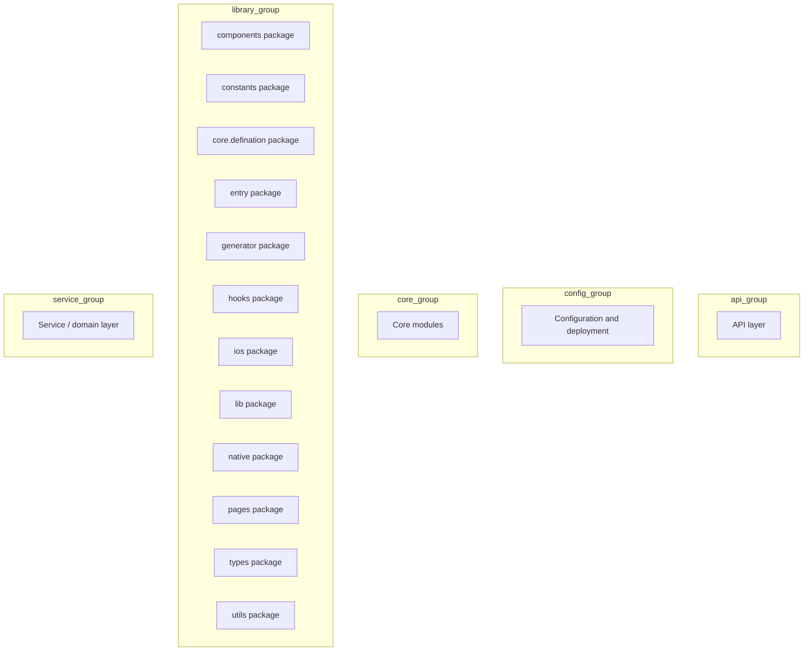

# Architecture report: maotoumao/MusicFree

> Automated static analysis. **Observed** = directly seen in files/imports/AST; **Inferred** = interpretation from that evidence. Repository code was not executed.

## 1. Repository at a glance

| Item | Value |
| --- | --- |
| Repository | maotoumao/MusicFree |
| Description | 插件化、定制化、无广告的免费音乐播放器 |
| Language | TypeScript |
| Stars | 28558 |
| Licence | AGPL-3.0 |
| Analysed commit / branch | d118b18b3d0c904400f7eea7bf99c0ceec6c1aee / master |
| Framework(s) | React |
| Files analysed | 442 |
| Components | 16 |

## 2. Architecture in one minute

maotoumao/MusicFree - 插件化、定制化、无广告的免费音乐播放器. This repository was analysed statically from 442 file(s) (0 Python). Detected technologies (observed from imports/manifests): GitHub Actions, React, axios, Jest, TypeScript. Files are grouped into 16 component(s): API layer, components package, Configuration and deployment, constants package, Core modules, core.defination package, entry package, generator package. Findings below distinguish observed facts from inferred interpretation.

## 3. High-level block diagram

## 4. Main components

### API layer (`api_layer`)

- **Kind:** api
- **Status:** Observed
- **Confidence:** 0.85
- **Responsibility:** Groups 3 file(s) under api layer (observed from repository paths and static analysis).
- **Paths:** `src/pages/setting/settingTypes/pluginSetting/views/pluginList.tsx`, `src/pages/setting/settingTypes/pluginSetting/views/pluginSort.tsx`, `src/pages/setting/settingTypes/pluginSetting/views/pluginSubscribe.tsx`
- **Evidence:** [src/pages/setting/settingTypes/pluginSetting/views/pluginList.tsx](https://github.com/maotoumao/MusicFree/blob/d118b18b3d0c904400f7eea7bf99c0ceec6c1aee/src/pages/setting/settingTypes/pluginSetting/views/pluginList.tsx); [src/pages/setting/settingTypes/pluginSetting/views/pluginSort.tsx](https://github.com/maotoumao/MusicFree/blob/d118b18b3d0c904400f7eea7bf99c0ceec6c1aee/src/pages/setting/settingTypes/pluginSetting/views/pluginSort.tsx); [src/pages/setting/settingTypes/pluginSetting/views/pluginSubscribe.tsx](https://github.com/maotoumao/MusicFree/blob/d118b18b3d0c904400f7eea7bf99c0ceec6c1aee/src/pages/setting/settingTypes/pluginSetting/views/pluginSubscribe.tsx)

### components package (`components`)

- **Kind:** library
- **Status:** Observed
- **Confidence:** 0.85
- **Responsibility:** Groups 98 file(s) under components package (observed from repository paths and static analysis).
- **Paths:** `src/components/base/SortableFlatList.tsx`, `src/components/base/appBar.tsx`, `src/components/base/button.tsx`, `src/components/base/checkbox.tsx`, `src/components/base/chip.tsx`, `src/components/base/colorBlock.tsx`, `src/components/base/divider.tsx`, `src/components/base/empty.tsx`, `src/components/base/fab.tsx`, `src/components/base/fastImage.tsx`, `src/components/base/horizontalSafeAreaView.tsx`, `src/components/base/icon.tsx`, `src/components/base/iconButton.tsx`, `src/components/base/iconTextButton.tsx`, `src/components/base/image.tsx`, `src/components/base/imageBtn.tsx`, `src/components/base/input.tsx`, `src/components/base/linkText.tsx`, `src/components/base/listEmpty.tsx`, `src/components/base/listFooter.tsx`, `src/components/base/listItem.tsx`, `src/components/base/loading.tsx`, `src/components/base/noPlugin.tsx`, `src/components/base/pageBackground.tsx`, `src/components/base/paragraph.tsx`, `src/components/base/playAllBar.tsx`, `src/components/base/portal.tsx`, `src/components/base/statusBar.tsx`, `src/components/base/switch.tsx`, `src/components/base/tag.tsx`, `src/components/base/textButton.tsx`, `src/components/base/themeText.tsx`, `src/components/base/tip.tsx`, `src/components/base/toast.tsx`, `src/components/base/typeTag.tsx`, `src/components/base/verticalSafeAreaView.tsx`, `src/components/debug/index.tsx`, `src/components/dialogs/components/base/index.tsx`, `src/components/dialogs/components/checkStorage.tsx`, `src/components/dialogs/components/downloadDialog.tsx`, `src/components/dialogs/components/editSheetDetail.tsx`, `src/components/dialogs/components/index.ts`, `src/components/dialogs/components/loadingDialog.tsx`, `src/components/dialogs/components/markdownDialog.tsx`, `src/components/dialogs/components/radioDialog.tsx`, `src/components/dialogs/components/setScheduleCloseTimeDialog.tsx`, `src/components/dialogs/components/simpleDialog.tsx`, `src/components/dialogs/components/subscribePluginDialog.tsx`, `src/components/dialogs/index.tsx`, `src/components/dialogs/useDialog.ts`, `src/components/errorBoundary/index.tsx`, `src/components/mediaItem/LyricItem.tsx`, `src/components/mediaItem/albumItem.tsx`, `src/components/mediaItem/musicItem.tsx`, `src/components/mediaItem/sheetItem.tsx`, `src/components/mediaItem/titleAndTag.tsx`, `src/components/mediaItem/topListItem.tsx`, `src/components/musicBar/index.tsx`, `src/components/musicBar/musicInfo.tsx`, `src/components/musicList/index.tsx`, `src/components/musicSheetPage/components/header.tsx`, `src/components/musicSheetPage/components/navBar.tsx`, `src/components/musicSheetPage/components/sheetMusicList.tsx`, `src/components/musicSheetPage/index.tsx`, `src/components/panels/base/panelBase.tsx`, `src/components/panels/base/panelFullscreen.tsx`, `src/components/panels/base/panelHeader.tsx`, `src/components/panels/index.tsx`, `src/components/panels/types/addToMusicSheet.tsx`, `src/components/panels/types/associateLrc.tsx`, `src/components/panels/types/colorPicker.tsx`, `src/components/panels/types/createMusicSheet.tsx`, `src/components/panels/types/editMusicSheetInfo.tsx`, `src/components/panels/types/imageViewer.tsx`, `src/components/panels/types/importMusicSheet.tsx`, `src/components/panels/types/index.ts`, `src/components/panels/types/musicComment/comment.tsx`, `src/components/panels/types/musicComment/index.tsx`, `src/components/panels/types/musicComment/useComments.ts`, `src/components/panels/types/musicItemLyricOptions.tsx`, `src/components/panels/types/musicItemOptions.tsx`, `src/components/panels/types/musicQuality.tsx`, `src/components/panels/types/playList/body.tsx`, `src/components/panels/types/playList/header.tsx`, `src/components/panels/types/playList/index.tsx`, `src/components/panels/types/playRate.tsx`, `src/components/panels/types/searchLrc/LyricList.tsx`, `src/components/panels/types/searchLrc/index.tsx`, `src/components/panels/types/searchLrc/searchResultStore.ts`, `src/components/panels/types/searchLrc/useSearchLrc.ts`, `src/components/panels/types/setFontSize.tsx`, `src/components/panels/types/setLyricOffset.tsx`, `src/components/panels/types/setUserVariables.tsx`, `src/components/panels/types/sheetTags.tsx`, `src/components/panels/types/simpleInput.tsx`, `src/components/panels/types/simpleSelect.tsx`, `src/components/panels/types/timingClose.tsx`, `src/components/panels/usePanel.ts`
- **Evidence:** [src/components/base/SortableFlatList.tsx](https://github.com/maotoumao/MusicFree/blob/d118b18b3d0c904400f7eea7bf99c0ceec6c1aee/src/components/base/SortableFlatList.tsx); [src/components/base/appBar.tsx](https://github.com/maotoumao/MusicFree/blob/d118b18b3d0c904400f7eea7bf99c0ceec6c1aee/src/components/base/appBar.tsx); [src/components/base/button.tsx](https://github.com/maotoumao/MusicFree/blob/d118b18b3d0c904400f7eea7bf99c0ceec6c1aee/src/components/base/button.tsx); [src/components/base/checkbox.tsx](https://github.com/maotoumao/MusicFree/blob/d118b18b3d0c904400f7eea7bf99c0ceec6c1aee/src/components/base/checkbox.tsx); [src/components/base/chip.tsx](https://github.com/maotoumao/MusicFree/blob/d118b18b3d0c904400f7eea7bf99c0ceec6c1aee/src/components/base/chip.tsx); [src/components/base/colorBlock.tsx](https://github.com/maotoumao/MusicFree/blob/d118b18b3d0c904400f7eea7bf99c0ceec6c1aee/src/components/base/colorBlock.tsx); [src/components/base/divider.tsx](https://github.com/maotoumao/MusicFree/blob/d118b18b3d0c904400f7eea7bf99c0ceec6c1aee/src/components/base/divider.tsx); [src/components/base/empty.tsx](https://github.com/maotoumao/MusicFree/blob/d118b18b3d0c904400f7eea7bf99c0ceec6c1aee/src/components/base/empty.tsx)

### Configuration and deployment (`config`)

- **Kind:** config
- **Status:** Observed
- **Confidence:** 0.85
- **Responsibility:** Groups 11 file(s) under configuration and deployment (observed from repository paths and static analysis).
- **Paths:** `android/app/build.gradle`, `android/build.gradle`, `app.json`, `ios/MusicFree/Images.xcassets/AppIcon.appiconset/Contents.json`, `ios/MusicFree/Images.xcassets/Contents.json`, `package.json`, `release/version.json`, `src/core/i18n/languages/en-us.json`, `src/core/i18n/languages/zh-cn.json`, `src/core/i18n/languages/zh-tw.json`, `tsconfig.json`
- **Evidence:** [android/app/build.gradle](https://github.com/maotoumao/MusicFree/blob/d118b18b3d0c904400f7eea7bf99c0ceec6c1aee/android/app/build.gradle); [android/build.gradle](https://github.com/maotoumao/MusicFree/blob/d118b18b3d0c904400f7eea7bf99c0ceec6c1aee/android/build.gradle); [app.json](https://github.com/maotoumao/MusicFree/blob/d118b18b3d0c904400f7eea7bf99c0ceec6c1aee/app.json); [ios/MusicFree/Images.xcassets/AppIcon.appiconset/Contents.json](https://github.com/maotoumao/MusicFree/blob/d118b18b3d0c904400f7eea7bf99c0ceec6c1aee/ios/MusicFree/Images.xcassets/AppIcon.appiconset/Contents.json); [ios/MusicFree/Images.xcassets/Contents.json](https://github.com/maotoumao/MusicFree/blob/d118b18b3d0c904400f7eea7bf99c0ceec6c1aee/ios/MusicFree/Images.xcassets/Contents.json); [package.json](https://github.com/maotoumao/MusicFree/blob/d118b18b3d0c904400f7eea7bf99c0ceec6c1aee/package.json); [release/version.json](https://github.com/maotoumao/MusicFree/blob/d118b18b3d0c904400f7eea7bf99c0ceec6c1aee/release/version.json); [src/core/i18n/languages/en-us.json](https://github.com/maotoumao/MusicFree/blob/d118b18b3d0c904400f7eea7bf99c0ceec6c1aee/src/core/i18n/languages/en-us.json)

### constants package (`constants`)

- **Kind:** library
- **Status:** Observed
- **Confidence:** 0.85
- **Responsibility:** Groups 6 file(s) under constants package (observed from repository paths and static analysis).
- **Paths:** `src/constants/assetsConst.ts`, `src/constants/commonConst.ts`, `src/constants/globalStyle.ts`, `src/constants/pathConst.ts`, `src/constants/repeatModeConst.ts`, `src/constants/uiConst.ts`
- **Evidence:** [src/constants/assetsConst.ts](https://github.com/maotoumao/MusicFree/blob/d118b18b3d0c904400f7eea7bf99c0ceec6c1aee/src/constants/assetsConst.ts); [src/constants/commonConst.ts](https://github.com/maotoumao/MusicFree/blob/d118b18b3d0c904400f7eea7bf99c0ceec6c1aee/src/constants/commonConst.ts); [src/constants/globalStyle.ts](https://github.com/maotoumao/MusicFree/blob/d118b18b3d0c904400f7eea7bf99c0ceec6c1aee/src/constants/globalStyle.ts); [src/constants/pathConst.ts](https://github.com/maotoumao/MusicFree/blob/d118b18b3d0c904400f7eea7bf99c0ceec6c1aee/src/constants/pathConst.ts); [src/constants/repeatModeConst.ts](https://github.com/maotoumao/MusicFree/blob/d118b18b3d0c904400f7eea7bf99c0ceec6c1aee/src/constants/repeatModeConst.ts); [src/constants/uiConst.ts](https://github.com/maotoumao/MusicFree/blob/d118b18b3d0c904400f7eea7bf99c0ceec6c1aee/src/constants/uiConst.ts)

### Core modules (`core`)

- **Kind:** core
- **Status:** Observed
- **Confidence:** 0.85
- **Responsibility:** Groups 4 file(s) under core modules (observed from repository paths and static analysis).
- **Paths:** `babel.config.js`, `index.js`, `jest.config.js`, `metro.config.js`
- **Evidence:** [babel.config.js](https://github.com/maotoumao/MusicFree/blob/d118b18b3d0c904400f7eea7bf99c0ceec6c1aee/babel.config.js); [index.js](https://github.com/maotoumao/MusicFree/blob/d118b18b3d0c904400f7eea7bf99c0ceec6c1aee/index.js); [jest.config.js](https://github.com/maotoumao/MusicFree/blob/d118b18b3d0c904400f7eea7bf99c0ceec6c1aee/jest.config.js); [metro.config.js](https://github.com/maotoumao/MusicFree/blob/d118b18b3d0c904400f7eea7bf99c0ceec6c1aee/metro.config.js)

### core.defination package (`core_defination`)

- **Kind:** library
- **Status:** Observed
- **Confidence:** 0.85
- **Responsibility:** Groups 1 file(s) under core.defination package (observed from repository paths and static analysis).
- **Paths:** `src/core.defination/trackPlayer/index.ts`
- **Evidence:** [src/core.defination/trackPlayer/index.ts](https://github.com/maotoumao/MusicFree/blob/d118b18b3d0c904400f7eea7bf99c0ceec6c1aee/src/core.defination/trackPlayer/index.ts)

### entry package (`entry`)

- **Kind:** library
- **Status:** Observed
- **Confidence:** 0.85
- **Responsibility:** Groups 4 file(s) under entry package (observed from repository paths and static analysis).
- **Paths:** `src/entry/bootstrap/BootstrapComponent.tsx`, `src/entry/bootstrap/bootstrap.atom.ts`, `src/entry/bootstrap/bootstrap.ts`, `src/entry/index.tsx`
- **Evidence:** [src/entry/bootstrap/BootstrapComponent.tsx](https://github.com/maotoumao/MusicFree/blob/d118b18b3d0c904400f7eea7bf99c0ceec6c1aee/src/entry/bootstrap/BootstrapComponent.tsx); [src/entry/bootstrap/bootstrap.atom.ts](https://github.com/maotoumao/MusicFree/blob/d118b18b3d0c904400f7eea7bf99c0ceec6c1aee/src/entry/bootstrap/bootstrap.atom.ts); [src/entry/bootstrap/bootstrap.ts](https://github.com/maotoumao/MusicFree/blob/d118b18b3d0c904400f7eea7bf99c0ceec6c1aee/src/entry/bootstrap/bootstrap.ts); [src/entry/index.tsx](https://github.com/maotoumao/MusicFree/blob/d118b18b3d0c904400f7eea7bf99c0ceec6c1aee/src/entry/index.tsx)

### generator package (`generator`)

- **Kind:** library
- **Status:** Observed
- **Confidence:** 0.85
- **Responsibility:** Groups 1 file(s) under generator package (observed from repository paths and static analysis).
- **Paths:** `generator/generate-assets.mjs`
- **Evidence:** [generator/generate-assets.mjs](https://github.com/maotoumao/MusicFree/blob/d118b18b3d0c904400f7eea7bf99c0ceec6c1aee/generator/generate-assets.mjs)

### hooks package (`hooks`)

- **Kind:** library
- **Status:** Observed
- **Confidence:** 0.85
- **Responsibility:** Groups 11 file(s) under hooks package (observed from repository paths and static analysis).
- **Paths:** `src/hooks/useCheckUpdate.ts`, `src/hooks/useColors.ts`, `src/hooks/useDelayFalsy.ts`, `src/hooks/useHardwareBack.ts`, `src/hooks/useLogRerender.ts`, `src/hooks/useMounted.ts`, `src/hooks/useOnceEffect.ts`, `src/hooks/useOrientation.ts`, `src/hooks/usePrimaryColor.ts`, `src/hooks/useRerender.ts`, `src/hooks/useTextColor.ts`
- **Evidence:** [src/hooks/useCheckUpdate.ts](https://github.com/maotoumao/MusicFree/blob/d118b18b3d0c904400f7eea7bf99c0ceec6c1aee/src/hooks/useCheckUpdate.ts); [src/hooks/useColors.ts](https://github.com/maotoumao/MusicFree/blob/d118b18b3d0c904400f7eea7bf99c0ceec6c1aee/src/hooks/useColors.ts); [src/hooks/useDelayFalsy.ts](https://github.com/maotoumao/MusicFree/blob/d118b18b3d0c904400f7eea7bf99c0ceec6c1aee/src/hooks/useDelayFalsy.ts); [src/hooks/useHardwareBack.ts](https://github.com/maotoumao/MusicFree/blob/d118b18b3d0c904400f7eea7bf99c0ceec6c1aee/src/hooks/useHardwareBack.ts); [src/hooks/useLogRerender.ts](https://github.com/maotoumao/MusicFree/blob/d118b18b3d0c904400f7eea7bf99c0ceec6c1aee/src/hooks/useLogRerender.ts); [src/hooks/useMounted.ts](https://github.com/maotoumao/MusicFree/blob/d118b18b3d0c904400f7eea7bf99c0ceec6c1aee/src/hooks/useMounted.ts); [src/hooks/useOnceEffect.ts](https://github.com/maotoumao/MusicFree/blob/d118b18b3d0c904400f7eea7bf99c0ceec6c1aee/src/hooks/useOnceEffect.ts); [src/hooks/useOrientation.ts](https://github.com/maotoumao/MusicFree/blob/d118b18b3d0c904400f7eea7bf99c0ceec6c1aee/src/hooks/useOrientation.ts)

### ios package (`ios`)

- **Kind:** library
- **Status:** Observed
- **Confidence:** 0.85
- **Responsibility:** Groups 1 file(s) under ios package (observed from repository paths and static analysis).
- **Paths:** `ios/MusicFree/AppDelegate.h`
- **Evidence:** [ios/MusicFree/AppDelegate.h](https://github.com/maotoumao/MusicFree/blob/d118b18b3d0c904400f7eea7bf99c0ceec6c1aee/ios/MusicFree/AppDelegate.h)

### lib package (`lib`)

- **Kind:** library
- **Status:** Observed
- **Confidence:** 0.85
- **Responsibility:** Groups 7 file(s) under lib package (observed from repository paths and static analysis).
- **Paths:** `src/lib/react-native-vdebug/index.js`, `src/lib/react-native-vdebug/src/event.js`, `src/lib/react-native-vdebug/src/hoc.js`, `src/lib/react-native-vdebug/src/log.js`, `src/lib/react-native-vdebug/src/network.js`, `src/lib/react-native-vdebug/src/storage.js`, `src/lib/react-native-vdebug/src/tool.js`
- **Evidence:** [src/lib/react-native-vdebug/index.js](https://github.com/maotoumao/MusicFree/blob/d118b18b3d0c904400f7eea7bf99c0ceec6c1aee/src/lib/react-native-vdebug/index.js); [src/lib/react-native-vdebug/src/event.js](https://github.com/maotoumao/MusicFree/blob/d118b18b3d0c904400f7eea7bf99c0ceec6c1aee/src/lib/react-native-vdebug/src/event.js); [src/lib/react-native-vdebug/src/hoc.js](https://github.com/maotoumao/MusicFree/blob/d118b18b3d0c904400f7eea7bf99c0ceec6c1aee/src/lib/react-native-vdebug/src/hoc.js); [src/lib/react-native-vdebug/src/log.js](https://github.com/maotoumao/MusicFree/blob/d118b18b3d0c904400f7eea7bf99c0ceec6c1aee/src/lib/react-native-vdebug/src/log.js); [src/lib/react-native-vdebug/src/network.js](https://github.com/maotoumao/MusicFree/blob/d118b18b3d0c904400f7eea7bf99c0ceec6c1aee/src/lib/react-native-vdebug/src/network.js); [src/lib/react-native-vdebug/src/storage.js](https://github.com/maotoumao/MusicFree/blob/d118b18b3d0c904400f7eea7bf99c0ceec6c1aee/src/lib/react-native-vdebug/src/storage.js); [src/lib/react-native-vdebug/src/tool.js](https://github.com/maotoumao/MusicFree/blob/d118b18b3d0c904400f7eea7bf99c0ceec6c1aee/src/lib/react-native-vdebug/src/tool.js)

### native package (`native`)

- **Kind:** library
- **Status:** Observed
- **Confidence:** 0.85
- **Responsibility:** Groups 3 file(s) under native package (observed from repository paths and static analysis).
- **Paths:** `src/native/lyricUtil/index.ts`, `src/native/mp3Util/index.ts`, `src/native/utils/index.ts`
- **Evidence:** [src/native/lyricUtil/index.ts](https://github.com/maotoumao/MusicFree/blob/d118b18b3d0c904400f7eea7bf99c0ceec6c1aee/src/native/lyricUtil/index.ts); [src/native/mp3Util/index.ts](https://github.com/maotoumao/MusicFree/blob/d118b18b3d0c904400f7eea7bf99c0ceec6c1aee/src/native/mp3Util/index.ts); [src/native/utils/index.ts](https://github.com/maotoumao/MusicFree/blob/d118b18b3d0c904400f7eea7bf99c0ceec6c1aee/src/native/utils/index.ts)

### pages package (`pages`)

- **Kind:** library
- **Status:** Observed
- **Confidence:** 0.85
- **Responsibility:** Groups 99 file(s) under pages package (observed from repository paths and static analysis).
- **Paths:** `src/pages/albumDetail/hooks/useAlbumMusicList.ts`, `src/pages/albumDetail/index.tsx`, `src/pages/artistDetail/components/body.tsx`, `src/pages/artistDetail/components/content/albumContentItem.tsx`, `src/pages/artistDetail/components/content/index.ts`, `src/pages/artistDetail/components/content/musicContentItem.tsx`, `src/pages/artistDetail/components/header.tsx`, `src/pages/artistDetail/components/resultList.tsx`, `src/pages/artistDetail/hooks/useQuery.ts`, `src/pages/artistDetail/index.tsx`, `src/pages/artistDetail/store/atoms.ts`, `src/pages/downloading/downloadingList.tsx`, `src/pages/downloading/index.tsx`, `src/pages/fileSelector/fileItem.tsx`, `src/pages/fileSelector/index.tsx`, `src/pages/history/index.tsx`, `src/pages/home/components/ActionButton.tsx`, `src/pages/home/components/drawer/index.tsx`, `src/pages/home/components/homeBody/index.tsx`, `src/pages/home/components/homeBody/operations.tsx`, `src/pages/home/components/homeBody/sheets.tsx`, `src/pages/home/components/homeBodyHorizontal/index.tsx`, `src/pages/home/components/homeBodyHorizontal/operations.tsx`, `src/pages/home/components/navBar.tsx`, `src/pages/home/index.tsx`, `src/pages/localMusic/index.tsx`, `src/pages/localMusic/mainPage/index.tsx`, `src/pages/localMusic/mainPage/localMusicList.tsx`, `src/pages/musicDetail/components/background.tsx`, `src/pages/musicDetail/components/bottom/index.tsx`, `src/pages/musicDetail/components/bottom/playControl.tsx`, `src/pages/musicDetail/components/bottom/seekBar.tsx`, `src/pages/musicDetail/components/content/albumCover/index.tsx`, `src/pages/musicDetail/components/content/albumCover/operations.tsx`, `src/pages/musicDetail/components/content/heartIcon/index.tsx`, `src/pages/musicDetail/components/content/index.tsx`, `src/pages/musicDetail/components/content/lyric/draggingTime.tsx`, `src/pages/musicDetail/components/content/lyric/index.tsx`, `src/pages/musicDetail/components/content/lyric/lyricItem.tsx`, `src/pages/musicDetail/components/content/lyric/lyricOperations.tsx`, `src/pages/musicDetail/components/navBar.tsx`, `src/pages/musicDetail/index.tsx`, `src/pages/musicListEditor/components/body.tsx`, `src/pages/musicListEditor/components/bottom.tsx`, `src/pages/musicListEditor/components/musicList.tsx`, `src/pages/musicListEditor/index.tsx`, `src/pages/musicListEditor/store/atom.ts`, `src/pages/permissions/index.tsx`, `src/pages/pluginSheetDetail/hooks/usePluginSheetMusicList.ts`, `src/pages/pluginSheetDetail/index.tsx`, `src/pages/recommendSheets/components/body/index.tsx`, `src/pages/recommendSheets/components/body/sheetBody.tsx`, `src/pages/recommendSheets/components/body/sheetList.tsx`, `src/pages/recommendSheets/hooks/useRecommendListTags.ts`, `src/pages/recommendSheets/hooks/useRecommendSheets.ts`, `src/pages/recommendSheets/index.tsx`, `src/pages/searchMusicList/index.tsx`, `src/pages/searchMusicList/searchResult.tsx`, `src/pages/searchPage/common/historySearch.ts`, `src/pages/searchPage/components/historyPanel.tsx`, `src/pages/searchPage/components/navBar.tsx`, `src/pages/searchPage/components/resultPanel/index.tsx`, `src/pages/searchPage/components/resultPanel/resultSubPanel.tsx`, `src/pages/searchPage/components/resultPanel/resultWrapper.tsx`, `src/pages/searchPage/components/resultPanel/results/albumResultItem.tsx`, `src/pages/searchPage/components/resultPanel/results/artistResultItem.tsx`, `src/pages/searchPage/components/resultPanel/results/defaultResults.tsx`, `src/pages/searchPage/components/resultPanel/results/index.ts`, `src/pages/searchPage/components/resultPanel/results/musicResultItem.tsx`, `src/pages/searchPage/components/resultPanel/results/musicSheetResultItem.tsx`, `src/pages/searchPage/hooks/useSearch.ts`, `src/pages/searchPage/index.tsx`, `src/pages/searchPage/store/atoms.ts`, `src/pages/setCustomTheme/body.tsx`, `src/pages/setCustomTheme/index.tsx`, `src/pages/setting/index.tsx`, `src/pages/setting/settingTypes/aboutSetting.tsx`, `src/pages/setting/settingTypes/backupSetting.tsx`, `src/pages/setting/settingTypes/basicSetting.tsx`, `src/pages/setting/settingTypes/index.ts`, `src/pages/setting/settingTypes/pluginSetting/components/pluginItem.tsx`, `src/pages/setting/settingTypes/pluginSetting/index.tsx`, `src/pages/setting/settingTypes/themeSetting/background.tsx`, `src/pages/setting/settingTypes/themeSetting/index.tsx`, `src/pages/setting/settingTypes/themeSetting/logoCard.tsx`, `src/pages/setting/settingTypes/themeSetting/mode.tsx`, `src/pages/setting/settingTypes/themeSetting/themeCard.tsx`, `src/pages/sheetDetail/components/header.tsx`, `src/pages/sheetDetail/components/navBar.tsx`, `src/pages/sheetDetail/components/sheetMusicList.tsx`, `src/pages/sheetDetail/index.tsx`, `src/pages/topList/components/boardPanel.tsx`, `src/pages/topList/components/boardPanelWrapper.tsx`, `src/pages/topList/components/topListBody.tsx`, `src/pages/topList/hooks/useGetTopList.ts`, `src/pages/topList/index.tsx`, `src/pages/topList/store/atoms.ts`, `src/pages/topListDetail/hooks/useTopListDetail.ts`, `src/pages/topListDetail/index.tsx`
- **Evidence:** [src/pages/albumDetail/hooks/useAlbumMusicList.ts](https://github.com/maotoumao/MusicFree/blob/d118b18b3d0c904400f7eea7bf99c0ceec6c1aee/src/pages/albumDetail/hooks/useAlbumMusicList.ts); [src/pages/albumDetail/index.tsx](https://github.com/maotoumao/MusicFree/blob/d118b18b3d0c904400f7eea7bf99c0ceec6c1aee/src/pages/albumDetail/index.tsx); [src/pages/artistDetail/components/body.tsx](https://github.com/maotoumao/MusicFree/blob/d118b18b3d0c904400f7eea7bf99c0ceec6c1aee/src/pages/artistDetail/components/body.tsx); [src/pages/artistDetail/components/content/albumContentItem.tsx](https://github.com/maotoumao/MusicFree/blob/d118b18b3d0c904400f7eea7bf99c0ceec6c1aee/src/pages/artistDetail/components/content/albumContentItem.tsx); [src/pages/artistDetail/components/content/index.ts](https://github.com/maotoumao/MusicFree/blob/d118b18b3d0c904400f7eea7bf99c0ceec6c1aee/src/pages/artistDetail/components/content/index.ts); [src/pages/artistDetail/components/content/musicContentItem.tsx](https://github.com/maotoumao/MusicFree/blob/d118b18b3d0c904400f7eea7bf99c0ceec6c1aee/src/pages/artistDetail/components/content/musicContentItem.tsx); [src/pages/artistDetail/components/header.tsx](https://github.com/maotoumao/MusicFree/blob/d118b18b3d0c904400f7eea7bf99c0ceec6c1aee/src/pages/artistDetail/components/header.tsx); [src/pages/artistDetail/components/resultList.tsx](https://github.com/maotoumao/MusicFree/blob/d118b18b3d0c904400f7eea7bf99c0ceec6c1aee/src/pages/artistDetail/components/resultList.tsx)

### Service / domain layer (`service_layer`)

- **Kind:** service
- **Status:** Observed
- **Confidence:** 0.85
- **Responsibility:** Groups 26 file(s) under service / domain layer (observed from repository paths and static analysis).
- **Paths:** `src/core/appConfig.ts`, `src/core/appMeta.ts`, `src/core/backup.ts`, `src/core/downloader.ts`, `src/core/i18n/index.ts`, `src/core/localMusicSheet.ts`, `src/core/lyricManager.ts`, `src/core/mediaCache.ts`, `src/core/musicHistory.ts`, `src/core/musicSheet/index.ts`, `src/core/musicSheet/migrate.ts`, `src/core/musicSheet/sortedMusicList.ts`, `src/core/musicSheet/storage.ts`, `src/core/pluginManager/index.ts`, `src/core/pluginManager/meta.ts`, `src/core/pluginManager/plugin.ts`, `src/core/router/index.ts`, `src/core/router/routes.tsx`, `src/core/theme.ts`, `src/core/trackPlayer/index.ts`, `src/service/index.ts`, `src/types/core/config.d.ts`, `src/types/core/i18n/index.d.ts`, `src/types/core/musicHistory.d.ts`, `src/types/core/pluginManager/index.d.ts`, `src/types/core/trackPlayer/index.d.ts`
- **Evidence:** [src/core/appConfig.ts](https://github.com/maotoumao/MusicFree/blob/d118b18b3d0c904400f7eea7bf99c0ceec6c1aee/src/core/appConfig.ts); [src/core/appMeta.ts](https://github.com/maotoumao/MusicFree/blob/d118b18b3d0c904400f7eea7bf99c0ceec6c1aee/src/core/appMeta.ts); [src/core/backup.ts](https://github.com/maotoumao/MusicFree/blob/d118b18b3d0c904400f7eea7bf99c0ceec6c1aee/src/core/backup.ts); [src/core/downloader.ts](https://github.com/maotoumao/MusicFree/blob/d118b18b3d0c904400f7eea7bf99c0ceec6c1aee/src/core/downloader.ts); [src/core/i18n/index.ts](https://github.com/maotoumao/MusicFree/blob/d118b18b3d0c904400f7eea7bf99c0ceec6c1aee/src/core/i18n/index.ts); [src/core/localMusicSheet.ts](https://github.com/maotoumao/MusicFree/blob/d118b18b3d0c904400f7eea7bf99c0ceec6c1aee/src/core/localMusicSheet.ts); [src/core/lyricManager.ts](https://github.com/maotoumao/MusicFree/blob/d118b18b3d0c904400f7eea7bf99c0ceec6c1aee/src/core/lyricManager.ts); [src/core/mediaCache.ts](https://github.com/maotoumao/MusicFree/blob/d118b18b3d0c904400f7eea7bf99c0ceec6c1aee/src/core/mediaCache.ts)

### types package (`types`)

- **Kind:** library
- **Status:** Observed
- **Confidence:** 0.85
- **Responsibility:** Groups 11 file(s) under types package (observed from repository paths and static analysis).
- **Paths:** `src/types/album.d.ts`, `src/types/artist.d.ts`, `src/types/common.d.ts`, `src/types/declarations.d.ts`, `src/types/infra.d.ts`, `src/types/lyric.d.ts`, `src/types/media.d.ts`, `src/types/music.d.ts`, `src/types/musicSheet.d.ts`, `src/types/musicSheetGroup.d.ts`, `src/types/plugin.d.ts`
- **Evidence:** [src/types/album.d.ts](https://github.com/maotoumao/MusicFree/blob/d118b18b3d0c904400f7eea7bf99c0ceec6c1aee/src/types/album.d.ts); [src/types/artist.d.ts](https://github.com/maotoumao/MusicFree/blob/d118b18b3d0c904400f7eea7bf99c0ceec6c1aee/src/types/artist.d.ts); [src/types/common.d.ts](https://github.com/maotoumao/MusicFree/blob/d118b18b3d0c904400f7eea7bf99c0ceec6c1aee/src/types/common.d.ts); [src/types/declarations.d.ts](https://github.com/maotoumao/MusicFree/blob/d118b18b3d0c904400f7eea7bf99c0ceec6c1aee/src/types/declarations.d.ts); [src/types/infra.d.ts](https://github.com/maotoumao/MusicFree/blob/d118b18b3d0c904400f7eea7bf99c0ceec6c1aee/src/types/infra.d.ts); [src/types/lyric.d.ts](https://github.com/maotoumao/MusicFree/blob/d118b18b3d0c904400f7eea7bf99c0ceec6c1aee/src/types/lyric.d.ts); [src/types/media.d.ts](https://github.com/maotoumao/MusicFree/blob/d118b18b3d0c904400f7eea7bf99c0ceec6c1aee/src/types/media.d.ts); [src/types/music.d.ts](https://github.com/maotoumao/MusicFree/blob/d118b18b3d0c904400f7eea7bf99c0ceec6c1aee/src/types/music.d.ts)

### utils package (`utils`)

- **Kind:** library
- **Status:** Observed
- **Confidence:** 0.85
- **Responsibility:** Groups 29 file(s) under utils package (observed from repository paths and static analysis).
- **Paths:** `src/utils/base64.ts`, `src/utils/checkUpdate.ts`, `src/utils/colorUtil.ts`, `src/utils/delay.ts`, `src/utils/eventBus.ts`, `src/utils/fileUtils.ts`, `src/utils/getOrCreateMMKV.ts`, `src/utils/getUrlExt.ts`, `src/utils/htmlUtil.ts`, `src/utils/jsonUtil.ts`, `src/utils/log.ts`, `src/utils/lrcParser.ts`, `src/utils/mediaExtra.ts`, `src/utils/mediaIndexMap.ts`, `src/utils/mediaUtils.ts`, `src/utils/minDistance.ts`, `src/utils/network.ts`, `src/utils/notImplementedFunction.ts`, `src/utils/openUrl.ts`, `src/utils/perfLogger.ts`, `src/utils/persistStatus.ts`, `src/utils/qualities.ts`, `src/utils/rpx.ts`, `src/utils/scheduleClose.ts`, `src/utils/stateMapper.ts`, `src/utils/storage.ts`, `src/utils/timeformat.ts`, `src/utils/toast.ts`, `src/utils/trackUtils.ts`
- **Evidence:** [src/utils/base64.ts](https://github.com/maotoumao/MusicFree/blob/d118b18b3d0c904400f7eea7bf99c0ceec6c1aee/src/utils/base64.ts); [src/utils/checkUpdate.ts](https://github.com/maotoumao/MusicFree/blob/d118b18b3d0c904400f7eea7bf99c0ceec6c1aee/src/utils/checkUpdate.ts); [src/utils/colorUtil.ts](https://github.com/maotoumao/MusicFree/blob/d118b18b3d0c904400f7eea7bf99c0ceec6c1aee/src/utils/colorUtil.ts); [src/utils/delay.ts](https://github.com/maotoumao/MusicFree/blob/d118b18b3d0c904400f7eea7bf99c0ceec6c1aee/src/utils/delay.ts); [src/utils/eventBus.ts](https://github.com/maotoumao/MusicFree/blob/d118b18b3d0c904400f7eea7bf99c0ceec6c1aee/src/utils/eventBus.ts); [src/utils/fileUtils.ts](https://github.com/maotoumao/MusicFree/blob/d118b18b3d0c904400f7eea7bf99c0ceec6c1aee/src/utils/fileUtils.ts); [src/utils/getOrCreateMMKV.ts](https://github.com/maotoumao/MusicFree/blob/d118b18b3d0c904400f7eea7bf99c0ceec6c1aee/src/utils/getOrCreateMMKV.ts); [src/utils/getUrlExt.ts](https://github.com/maotoumao/MusicFree/blob/d118b18b3d0c904400f7eea7bf99c0ceec6c1aee/src/utils/getUrlExt.ts)

## 5. Execution flow

**Observed** entry point(s):

- [index.js](https://github.com/maotoumao/MusicFree/blob/d118b18b3d0c904400f7eea7bf99c0ceec6c1aee/index.js)
- [src/components/debug/index.tsx](https://github.com/maotoumao/MusicFree/blob/d118b18b3d0c904400f7eea7bf99c0ceec6c1aee/src/components/debug/index.tsx)
- [src/components/dialogs/index.tsx](https://github.com/maotoumao/MusicFree/blob/d118b18b3d0c904400f7eea7bf99c0ceec6c1aee/src/components/dialogs/index.tsx)
- [src/components/errorBoundary/index.tsx](https://github.com/maotoumao/MusicFree/blob/d118b18b3d0c904400f7eea7bf99c0ceec6c1aee/src/components/errorBoundary/index.tsx)
- [src/components/musicBar/index.tsx](https://github.com/maotoumao/MusicFree/blob/d118b18b3d0c904400f7eea7bf99c0ceec6c1aee/src/components/musicBar/index.tsx)
- [src/components/musicList/index.tsx](https://github.com/maotoumao/MusicFree/blob/d118b18b3d0c904400f7eea7bf99c0ceec6c1aee/src/components/musicList/index.tsx)
- [src/components/musicSheetPage/index.tsx](https://github.com/maotoumao/MusicFree/blob/d118b18b3d0c904400f7eea7bf99c0ceec6c1aee/src/components/musicSheetPage/index.tsx)
- [src/components/panels/index.tsx](https://github.com/maotoumao/MusicFree/blob/d118b18b3d0c904400f7eea7bf99c0ceec6c1aee/src/components/panels/index.tsx)
- [src/core.defination/trackPlayer/index.ts](https://github.com/maotoumao/MusicFree/blob/d118b18b3d0c904400f7eea7bf99c0ceec6c1aee/src/core.defination/trackPlayer/index.ts)
- [src/core/i18n/index.ts](https://github.com/maotoumao/MusicFree/blob/d118b18b3d0c904400f7eea7bf99c0ceec6c1aee/src/core/i18n/index.ts)
- [src/core/musicSheet/index.ts](https://github.com/maotoumao/MusicFree/blob/d118b18b3d0c904400f7eea7bf99c0ceec6c1aee/src/core/musicSheet/index.ts)
- [src/core/pluginManager/index.ts](https://github.com/maotoumao/MusicFree/blob/d118b18b3d0c904400f7eea7bf99c0ceec6c1aee/src/core/pluginManager/index.ts)

Representative flow (derived from observed entry points and the import graph; steps beyond the entry point are **Inferred**):

1. Execution starts at an observed entry point listed above, if present.
2. No internal import relationships between components were observed.

## 6. Project structure

### `(root)`

- `.commitlintrc.json` - config (305 bytes)
- `.eslintignore` - other (9 bytes)
- `.eslintrc.js` - source, JavaScript (770 bytes)
- `.gitignore` - other (1261 bytes)
- `.prettierrc.js` - source, JavaScript (194 bytes)
- `.watchmanconfig` - other (3 bytes)
- `Gemfile` - other (349 bytes)
- `LICENSE` - docs (35184 bytes)
- `app.json` - config (56 bytes)
- `babel.config.js` - source, JavaScript (480 bytes)
- `changelog.md` - docs (18724 bytes)
- `index.js` - source, JavaScript (317 bytes)
- `jest.config.js` - source, JavaScript (50 bytes)
- `metro.config.js` - source, JavaScript (757 bytes)
- `package.json` - manifest (4637 bytes)
- `readme-en.md` - docs (11694 bytes)
- `readme.md` - docs (10110 bytes)
- `tsconfig.json` - config (423 bytes)

### `.bundle`

- `.bundle/config` - other (59 bytes)

### `.github`

- `.github/ISSUE_TEMPLATE/bug_report_zh.yaml` - config (1866 bytes)
- `.github/ISSUE_TEMPLATE/config.yml` - config (165 bytes)
- `.github/ISSUE_TEMPLATE/feature_request_zh.yaml` - config (1231 bytes)
- `.github/workflows/build-beta.yml` - ci, YAML (4052 bytes)

### `.husky`

- `.husky/commit-msg` - other (20 bytes)
- `.husky/pre-commit` - other (20 bytes)

### `android`

- `android/app/build.gradle` - manifest (7303 bytes)
- `android/app/proguard-rules.pro` - other (435 bytes)
- `android/app/src/debug/AndroidManifest.xml` - other (313 bytes)
- `android/app/src/main/AndroidManifest.xml` - other (8753 bytes)
- `android/app/src/main/java/fun/upup/musicfree/MainActivity.kt` - other (1342 bytes)
- `android/app/src/main/java/fun/upup/musicfree/MainApplication.kt` - other (2425 bytes)
- `android/app/src/main/java/fun/upup/musicfree/lyricUtil/LyricUtilModule.kt` - other (5971 bytes)
- `android/app/src/main/java/fun/upup/musicfree/lyricUtil/LyricUtilPackage.kt` - other (701 bytes)
- `android/app/src/main/java/fun/upup/musicfree/lyricUtil/LyricView.kt` - other (8502 bytes)
- `android/app/src/main/java/fun/upup/musicfree/mp3Util/Mp3UtilModule.kt` - other (7781 bytes)
- `android/app/src/main/java/fun/upup/musicfree/mp3Util/Mp3UtilPackage.kt` - other (695 bytes)
- `android/app/src/main/java/fun/upup/musicfree/utils/UtilsModule.kt` - other (5370 bytes)
- `android/app/src/main/java/fun/upup/musicfree/utils/UtilsPackage.kt` - other (689 bytes)
- `android/app/src/main/res/drawable/rn_edit_text_material.xml` - other (1917 bytes)
- `android/app/src/main/res/drawable/splashscreen.xml` - other (151 bytes)
- `android/app/src/main/res/mipmap-anydpi-v26/ic_launcher.xml` - other (269 bytes)
- `android/app/src/main/res/mipmap-anydpi-v26/ic_launcher_round.xml` - other (269 bytes)
- `android/app/src/main/res/values/colors.xml` - other (121 bytes)
- `android/app/src/main/res/values/ic_launcher_background.xml` - other (123 bytes)
- `android/app/src/main/res/values/strings.xml` - other (433 bytes)
- `android/app/src/main/res/values/styles.xml` - other (757 bytes)
- `android/build.gradle` - manifest (797 bytes)
- `android/gradle.properties` - other (1737 bytes)
- `android/gradle/wrapper/gradle-wrapper.properties` - other (335 bytes)
- `android/gradlew` - other (8762 bytes)
- `android/gradlew.bat` - other (2966 bytes)
- `android/settings.gradle` - other (815 bytes)

### `generator`

- `generator/generate-assets.mjs` - source, JavaScript (1995 bytes)

### `ios`

- `ios/.xcode.env` - other (482 bytes)
- `ios/MusicFree.xcodeproj/project.pbxproj` - other (29845 bytes)
- `ios/MusicFree.xcodeproj/xcshareddata/xcschemes/MusicFreeNew.xcscheme` - other (3294 bytes)
- `ios/MusicFree/AppDelegate.h` - source, C/C++ (133 bytes)
- `ios/MusicFree/AppDelegate.mm` - other (853 bytes)
- `ios/MusicFree/Images.xcassets/AppIcon.appiconset/Contents.json` - config (849 bytes)
- `ios/MusicFree/Images.xcassets/Contents.json` - config (63 bytes)
- `ios/MusicFree/Info.plist` - other (1617 bytes)
- `ios/MusicFree/LaunchScreen.storyboard` - other (4233 bytes)
- `ios/MusicFree/PrivacyInfo.xcprivacy` - other (1062 bytes)
- `ios/MusicFree/main.m` - other (199 bytes)
- `ios/MusicFreeTests/Info.plist` - other (733 bytes)
- `ios/MusicFreeTests/MusicFreeNewTests.m` - other (1994 bytes)
- `ios/Podfile` - other (1928 bytes)

### `release`

- `release/version.json` - config (255 bytes)

### `src`

- `src/assets/icons/alarm-outline.svg` - other (744 bytes)
- `src/assets/icons/album-outline.svg` - other (562 bytes)
- `src/assets/icons/archive-box-x-mark.svg` - other (519 bytes)
- `src/assets/icons/arrow-down-tray.svg` - other (310 bytes)
- `src/assets/icons/arrow-left.svg` - other (237 bytes)
- `src/assets/icons/arrow-long-left.svg` - other (240 bytes)
- `src/assets/icons/arrow-path.svg` - other (369 bytes)
- `src/assets/icons/arrow-right-end-on-rectangle.svg` - other (352 bytes)
- `src/assets/icons/arrow-up-tray.svg` - other (310 bytes)
- `src/assets/icons/arrow-uturn-left.svg` - other (244 bytes)
- `src/assets/icons/arrows-left-right.svg` - other (276 bytes)
- `src/assets/icons/bars-3.svg` - other (246 bytes)
- `src/assets/icons/bookmark-square.svg` - other (361 bytes)
- `src/assets/icons/chat-bubble-oval-left-ellipsis.svg` - other (625 bytes)
- `src/assets/icons/check-circle-outline.svg` - other (264 bytes)
- `src/assets/icons/check-circle.svg` - other (387 bytes)
- `src/assets/icons/check.svg` - other (223 bytes)
- `src/assets/icons/circle-stack.svg` - other (559 bytes)
- `src/assets/icons/clock-outline.svg` - other (250 bytes)
- `src/assets/icons/code-bracket-square.svg` - other (371 bytes)
- `src/assets/icons/cog-8-tooth.svg` - other (1374 bytes)
- `src/assets/icons/crosshair.svg` - other (695 bytes)
- `src/assets/icons/document-outline.svg` - other (459 bytes)
- `src/assets/icons/ellipsis-vertical.svg` - other (288 bytes)
- `src/assets/icons/exclamation-circle.svg` - other (383 bytes)
- `src/assets/icons/fire-outline.svg` - other (525 bytes)
- `src/assets/icons/fire.svg` - other (525 bytes)
- `src/assets/icons/folder-music-outline.svg` - other (429 bytes)
- `src/assets/icons/folder-outline.svg` - other (461 bytes)
- `src/assets/icons/folder-plus.svg` - other (405 bytes)
- `src/assets/icons/font-size.svg` - other (1360 bytes)
- `src/assets/icons/hand-thumb-up.svg` - other (927 bytes)
- `src/assets/icons/heart-outline.svg` - other (359 bytes)
- `src/assets/icons/heart.svg` - other (506 bytes)
- `src/assets/icons/home-outline.svg` - other (436 bytes)
- `src/assets/icons/identification.svg` - other (518 bytes)
- `src/assets/icons/inbox-arrow-down.svg` - other (592 bytes)
- `src/assets/icons/information-circle.svg` - other (354 bytes)
- `src/assets/icons/javascript.svg` - other (1824 bytes)
- `src/assets/icons/language.svg` - other (441 bytes)
- `src/assets/icons/link-slash.svg` - other (531 bytes)
- `src/assets/icons/link.svg` - other (371 bytes)
- `src/assets/icons/lyric.svg` - other (1435 bytes)
- `src/assets/icons/magnifying-glass.svg` - other (279 bytes)
- `src/assets/icons/minus.svg` - other (237 bytes)
- `src/assets/icons/motion-play.svg` - other (1376 bytes)
- `src/assets/icons/musical-note.svg` - other (456 bytes)
- `src/assets/icons/pause-circle-outline.svg` - other (258 bytes)
- `src/assets/icons/pause.svg` - other (376 bytes)
- `src/assets/icons/pencil-outline.svg` - other (365 bytes)
- `src/assets/icons/pencil-square.svg` - other (458 bytes)
- `src/assets/icons/play-circle-outline.svg` - other (420 bytes)
- `src/assets/icons/play-circle.svg` - other (385 bytes)
- `src/assets/icons/play.svg` - other (296 bytes)
- `src/assets/icons/playlist.svg` - other (1287 bytes)
- `src/assets/icons/plus.svg` - other (224 bytes)
- `src/assets/icons/power-outline.svg` - other (240 bytes)
- `src/assets/icons/question-mark-circle.svg` - other (398 bytes)
- `src/assets/icons/repeat-song-1.svg` - other (646 bytes)
- `src/assets/icons/repeat-song.svg` - other (760 bytes)
- `src/assets/icons/share.svg` - other (463 bytes)
- `src/assets/icons/shield-keyhole-outline.svg` - other (637 bytes)
- `src/assets/icons/shuffle.svg` - other (648 bytes)
- `src/assets/icons/skip-left.svg` - other (707 bytes)
- `src/assets/icons/skip-right.svg` - other (709 bytes)
- `src/assets/icons/sort-outline.svg` - other (187 bytes)
- `src/assets/icons/strategy.svg` - other (888 bytes)
- `src/assets/icons/t-shirt-outline.svg` - other (676 bytes)
- `src/assets/icons/translation.svg` - other (1538 bytes)
- `src/assets/icons/trash-outline.svg` - other (615 bytes)
- `src/assets/icons/trophy.svg` - other (832 bytes)
- `src/assets/icons/user.svg` - other (347 bytes)
- `src/assets/icons/x-mark.svg` - other (222 bytes)
- `src/components/base/SortableFlatList.tsx` - source, TypeScript (16120 bytes)
- `src/components/base/appBar.tsx` - source, TypeScript (9577 bytes)
- `src/components/base/button.tsx` - source, TypeScript (1322 bytes)
- `src/components/base/checkbox.tsx` - source, TypeScript (1740 bytes)
- `src/components/base/chip.tsx` - source, TypeScript (1609 bytes)
- `src/components/base/colorBlock.tsx` - source, TypeScript (1254 bytes)
- `src/components/base/divider.tsx` - source, TypeScript (800 bytes)
- `src/components/base/empty.tsx` - source, TypeScript (707 bytes)
- `src/components/base/fab.tsx` - source, TypeScript (1500 bytes)
- `src/components/base/fastImage.tsx` - source, TypeScript (1283 bytes)
- `src/components/base/horizontalSafeAreaView.tsx` - source, TypeScript (579 bytes)
- `src/components/base/icon.tsx` - source, TypeScript (9474 bytes)
- `src/components/base/iconButton.tsx` - source, TypeScript (1980 bytes)
- `src/components/base/iconTextButton.tsx` - source, TypeScript (1327 bytes)
- `src/components/base/image.tsx` - source, TypeScript (421 bytes)
- `src/components/base/imageBtn.tsx` - source, TypeScript (1312 bytes)
- `src/components/base/input.tsx` - source, TypeScript (1136 bytes)
- `src/components/base/linkText.tsx` - source, TypeScript (1394 bytes)
- `src/components/base/listEmpty.tsx` - source, TypeScript (2037 bytes)
- `src/components/base/listFooter.tsx` - source, TypeScript (2342 bytes)
- `src/components/base/listItem.tsx` - source, TypeScript (9406 bytes)
- `src/components/base/loading.tsx` - source, TypeScript (1217 bytes)
- `src/components/base/noPlugin.tsx` - source, TypeScript (1048 bytes)
- `src/components/base/pageBackground.tsx` - source, TypeScript (1342 bytes)
- `src/components/base/paragraph.tsx` - source, TypeScript (553 bytes)
- `src/components/base/playAllBar.tsx` - source, TypeScript (4541 bytes)
- `src/components/base/portal.tsx` - source, TypeScript (2084 bytes)
- `src/components/base/statusBar.tsx` - source, TypeScript (892 bytes)
- `src/components/base/switch.tsx` - source, TypeScript (2004 bytes)
- `src/components/base/tag.tsx` - source, TypeScript (1170 bytes)
- `src/components/base/textButton.tsx` - source, TypeScript (1072 bytes)
- `src/components/base/themeText.tsx` - source, TypeScript (1151 bytes)
- `src/components/base/tip.tsx` - source, TypeScript (9343 bytes)
- `src/components/base/toast.tsx` - source, TypeScript (6356 bytes)
- `src/components/base/typeTag.tsx` - source, TypeScript (1523 bytes)
- `src/components/base/verticalSafeAreaView.tsx` - source, TypeScript (573 bytes)
- `src/components/debug/index.tsx` - source, TypeScript (631 bytes)
- `src/components/dialogs/components/base/index.tsx` - source, TypeScript (8829 bytes)
- `src/components/dialogs/components/checkStorage.tsx` - source, TypeScript (3097 bytes)
- `src/components/dialogs/components/downloadDialog.tsx` - source, TypeScript (4557 bytes)
- `src/components/dialogs/components/editSheetDetail.tsx` - source, TypeScript (5406 bytes)
- `src/components/dialogs/components/index.ts` - source, TypeScript (819 bytes)
- `src/components/dialogs/components/loadingDialog.tsx` - source, TypeScript (1826 bytes)
- `src/components/dialogs/components/markdownDialog.tsx` - source, TypeScript (10428 bytes)
- `src/components/dialogs/components/radioDialog.tsx` - source, TypeScript (4471 bytes)
- `src/components/dialogs/components/setScheduleCloseTimeDialog.tsx` - source, TypeScript (5678 bytes)
- `src/components/dialogs/components/simpleDialog.tsx` - source, TypeScript (1376 bytes)
- `src/components/dialogs/components/subscribePluginDialog.tsx` - source, TypeScript (5197 bytes)
- `src/components/dialogs/index.tsx` - source, TypeScript (427 bytes)
- `src/components/dialogs/useDialog.ts` - source, TypeScript (1238 bytes)
- `src/components/errorBoundary/index.tsx` - source, TypeScript (13304 bytes)
- `src/components/mediaItem/LyricItem.tsx` - source, TypeScript (1076 bytes)
- `src/components/mediaItem/albumItem.tsx` - source, TypeScript (1755 bytes)
- `src/components/mediaItem/musicItem.tsx` - source, TypeScript (4126 bytes)
- `src/components/mediaItem/sheetItem.tsx` - source, TypeScript (1144 bytes)
- `src/components/mediaItem/titleAndTag.tsx` - source, TypeScript (900 bytes)
- `src/components/mediaItem/topListItem.tsx` - source, TypeScript (1137 bytes)
- `src/components/musicBar/index.tsx` - source, TypeScript (4602 bytes)
- `src/components/musicBar/musicInfo.tsx` - source, TypeScript (7314 bytes)
- `src/components/musicList/index.tsx` - source, TypeScript (6520 bytes)
- `src/components/musicSheetPage/components/header.tsx` - source, TypeScript (3566 bytes)
- `src/components/musicSheetPage/components/navBar.tsx` - source, TypeScript (1280 bytes)
- `src/components/musicSheetPage/components/sheetMusicList.tsx` - source, TypeScript (2387 bytes)
- `src/components/musicSheetPage/index.tsx` - source, TypeScript (1483 bytes)
- `src/components/panels/base/panelBase.tsx` - source, TypeScript (6541 bytes)
- `src/components/panels/base/panelFullscreen.tsx` - source, TypeScript (5552 bytes)
- `src/components/panels/base/panelHeader.tsx` - source, TypeScript (2394 bytes)
- `src/components/panels/index.tsx` - source, TypeScript (389 bytes)
- `src/components/panels/types/addToMusicSheet.tsx` - source, TypeScript (6112 bytes)
- `src/components/panels/types/associateLrc.tsx` - source, TypeScript (4574 bytes)
- `src/components/panels/types/colorPicker.tsx` - source, TypeScript (15799 bytes)
- `src/components/panels/types/createMusicSheet.tsx` - source, TypeScript (3071 bytes)
- `src/components/panels/types/editMusicSheetInfo.tsx` - source, TypeScript (6317 bytes)
- `src/components/panels/types/imageViewer.tsx` - source, TypeScript (2661 bytes)
- `src/components/panels/types/importMusicSheet.tsx` - source, TypeScript (5370 bytes)
- `src/components/panels/types/index.ts` - source, TypeScript (1852 bytes)
- `src/components/panels/types/musicComment/comment.tsx` - source, TypeScript (3220 bytes)
- `src/components/panels/types/musicComment/index.tsx` - source, TypeScript (3514 bytes)
- `src/components/panels/types/musicComment/useComments.ts` - source, TypeScript (3757 bytes)
- `src/components/panels/types/musicItemLyricOptions.tsx` - source, TypeScript (11594 bytes)
- `src/components/panels/types/musicItemOptions.tsx` - source, TypeScript (12223 bytes)
- `src/components/panels/types/musicQuality.tsx` - source, TypeScript (3571 bytes)
- `src/components/panels/types/playList/body.tsx` - source, TypeScript (4592 bytes)
- `src/components/panels/types/playList/header.tsx` - source, TypeScript (2148 bytes)
- `src/components/panels/types/playList/index.tsx` - source, TypeScript (567 bytes)
- `src/components/panels/types/playRate.tsx` - source, TypeScript (2422 bytes)
- `src/components/panels/types/searchLrc/LyricList.tsx` - source, TypeScript (2541 bytes)
- `src/components/panels/types/searchLrc/index.tsx` - source, TypeScript (5970 bytes)
- `src/components/panels/types/searchLrc/searchResultStore.ts` - source, TypeScript (426 bytes)
- `src/components/panels/types/searchLrc/useSearchLrc.ts` - source, TypeScript (6124 bytes)
- `src/components/panels/types/setFontSize.tsx` - source, TypeScript (3008 bytes)
- `src/components/panels/types/setLyricOffset.tsx` - source, TypeScript (4176 bytes)
- `src/components/panels/types/setUserVariables.tsx` - source, TypeScript (4158 bytes)
- `src/components/panels/types/sheetTags.tsx` - source, TypeScript (3976 bytes)
- `src/components/panels/types/simpleInput.tsx` - source, TypeScript (3910 bytes)
- `src/components/panels/types/simpleSelect.tsx` - source, TypeScript (2515 bytes)
- `src/components/panels/types/timingClose.tsx` - source, TypeScript (4960 bytes)
- `src/components/panels/usePanel.ts` - source, TypeScript (883 bytes)
- `src/constants/assetsConst.ts` - source, TypeScript (65455 bytes)
- `src/constants/commonConst.ts` - source, TypeScript (2404 bytes)
- `src/constants/globalStyle.ts` - source, TypeScript (674 bytes)
- `src/constants/pathConst.ts` - source, TypeScript (859 bytes)
- `src/constants/repeatModeConst.ts` - source, TypeScript (496 bytes)
- `src/constants/uiConst.ts` - source, TypeScript (995 bytes)
- `src/core.defination/trackPlayer/index.ts` - source, TypeScript (239 bytes)
- `src/core/appConfig.ts` - source, TypeScript (8225 bytes)
- `src/core/appMeta.ts` - source, TypeScript (1068 bytes)
- `src/core/backup.ts` - source, TypeScript (2114 bytes)
- `src/core/downloader.ts` - source, TypeScript (15402 bytes)
- `src/core/i18n/index.ts` - source, TypeScript (1874 bytes)
- `src/core/i18n/languages/en-us.json` - config (26653 bytes)
- `src/core/i18n/languages/zh-cn.json` - config (25807 bytes)
- `src/core/i18n/languages/zh-tw.json` - config (25817 bytes)
- `src/core/localMusicSheet.ts` - source, TypeScript (8068 bytes)
- `src/core/lyricManager.ts` - source, TypeScript (13973 bytes)
- `src/core/mediaCache.ts` - source, TypeScript (2352 bytes)
- `src/core/musicHistory.ts` - source, TypeScript (2762 bytes)
- `src/core/musicSheet/index.ts` - source, TypeScript (19019 bytes)
- `src/core/musicSheet/migrate.ts` - source, TypeScript (1776 bytes)
- `src/core/musicSheet/sortedMusicList.ts` - source, TypeScript (8108 bytes)
- `src/core/musicSheet/storage.ts` - source, TypeScript (2838 bytes)
- `src/core/pluginManager/index.ts` - source, TypeScript (22722 bytes)
- `src/core/pluginManager/meta.ts` - source, TypeScript (4869 bytes)
- `src/core/pluginManager/plugin.ts` - source, TypeScript (35572 bytes)
- `src/core/router/index.ts` - source, TypeScript (3588 bytes)
- `src/core/router/routes.tsx` - source, TypeScript (2882 bytes)
- `src/core/theme.ts` - source, TypeScript (6300 bytes)
- `src/core/trackPlayer/index.ts` - source, TypeScript (35843 bytes)
- `src/entry/bootstrap/BootstrapComponent.tsx` - source, TypeScript (2379 bytes)
- `src/entry/bootstrap/bootstrap.atom.ts` - source, TypeScript (245 bytes)
- `src/entry/bootstrap/bootstrap.ts` - source, TypeScript (11131 bytes)
- `src/entry/index.tsx` - source, TypeScript (2703 bytes)
- `src/hooks/useCheckUpdate.ts` - source, TypeScript (1411 bytes)
- `src/hooks/useColors.ts` - source, TypeScript (1397 bytes)
- `src/hooks/useDelayFalsy.ts` - source, TypeScript (821 bytes)
- `src/hooks/useHardwareBack.ts` - source, TypeScript (798 bytes)
- `src/hooks/useLogRerender.ts` - source, TypeScript (623 bytes)
- `src/hooks/useMounted.ts` - source, TypeScript (484 bytes)
- `src/hooks/useOnceEffect.ts` - source, TypeScript (443 bytes)
- `src/hooks/useOrientation.ts` - source, TypeScript (1024 bytes)
- `src/hooks/usePrimaryColor.ts` - source, TypeScript (143 bytes)
- `src/hooks/useRerender.ts` - source, TypeScript (247 bytes)
- `src/hooks/useTextColor.ts` - source, TypeScript (137 bytes)
- `src/lib/react-native-vdebug/index.js` - source, JavaScript (17861 bytes)
- `src/lib/react-native-vdebug/src/event.js` - source, JavaScript (1230 bytes)
- `src/lib/react-native-vdebug/src/hoc.js` - source, JavaScript (545 bytes)
- `src/lib/react-native-vdebug/src/log.js` - source, JavaScript (10745 bytes)
- `src/lib/react-native-vdebug/src/network.js` - source, JavaScript (24852 bytes)
- `src/lib/react-native-vdebug/src/storage.js` - source, JavaScript (109 bytes)
- `src/lib/react-native-vdebug/src/tool.js` - source, JavaScript (1498 bytes)
- `src/native/lyricUtil/index.ts` - source, TypeScript (2115 bytes)
- `src/native/mp3Util/index.ts` - source, TypeScript (821 bytes)
- `src/native/utils/index.ts` - source, TypeScript (453 bytes)
- `src/pages/albumDetail/hooks/useAlbumMusicList.ts` - source, TypeScript (2844 bytes)
- `src/pages/albumDetail/index.tsx` - source, TypeScript (760 bytes)
- `src/pages/artistDetail/components/body.tsx` - source, TypeScript (3020 bytes)
- `src/pages/artistDetail/components/content/albumContentItem.tsx` - source, TypeScript (291 bytes)
- `src/pages/artistDetail/components/content/index.ts` - source, TypeScript (296 bytes)
- `src/pages/artistDetail/components/content/musicContentItem.tsx` - source, TypeScript (291 bytes)
- `src/pages/artistDetail/components/header.tsx` - source, TypeScript (4335 bytes)
- `src/pages/artistDetail/components/resultList.tsx` - source, TypeScript (2790 bytes)
- `src/pages/artistDetail/hooks/useQuery.ts` - source, TypeScript (2623 bytes)
- `src/pages/artistDetail/index.tsx` - source, TypeScript (2613 bytes)
- `src/pages/artistDetail/store/atoms.ts` - source, TypeScript (593 bytes)
- `src/pages/downloading/downloadingList.tsx` - source, TypeScript (2847 bytes)
- `src/pages/downloading/index.tsx` - source, TypeScript (708 bytes)
- `src/pages/fileSelector/fileItem.tsx` - source, TypeScript (3034 bytes)
- `src/pages/fileSelector/index.tsx` - source, TypeScript (11381 bytes)
- `src/pages/history/index.tsx` - source, TypeScript (2397 bytes)
- `src/pages/home/components/ActionButton.tsx` - source, TypeScript (1872 bytes)
- `src/pages/home/components/drawer/index.tsx` - source, TypeScript (10274 bytes)
- `src/pages/home/components/homeBody/index.tsx` - source, TypeScript (449 bytes)
- `src/pages/home/components/homeBody/operations.tsx` - source, TypeScript (1967 bytes)
- `src/pages/home/components/homeBody/sheets.tsx` - source, TypeScript (9373 bytes)
- `src/pages/home/components/homeBodyHorizontal/index.tsx` - source, TypeScript (448 bytes)
- `src/pages/home/components/homeBodyHorizontal/operations.tsx` - source, TypeScript (2074 bytes)
- `src/pages/home/components/navBar.tsx` - source, TypeScript (2666 bytes)
- `src/pages/home/index.tsx` - source, TypeScript (2557 bytes)
- `src/pages/localMusic/index.tsx` - source, TypeScript (366 bytes)
- `src/pages/localMusic/mainPage/index.tsx` - source, TypeScript (4054 bytes)
- `src/pages/localMusic/mainPage/localMusicList.tsx` - source, TypeScript (1024 bytes)
- `src/pages/musicDetail/components/background.tsx` - source, TypeScript (1221 bytes)
- `src/pages/musicDetail/components/bottom/index.tsx` - source, TypeScript (760 bytes)
- `src/pages/musicDetail/components/bottom/playControl.tsx` - source, TypeScript (3093 bytes)
- `src/pages/musicDetail/components/bottom/seekBar.tsx` - source, TypeScript (2267 bytes)
- `src/pages/musicDetail/components/content/albumCover/index.tsx` - source, TypeScript (2014 bytes)
- `src/pages/musicDetail/components/content/albumCover/operations.tsx` - source, TypeScript (5413 bytes)
- `src/pages/musicDetail/components/content/heartIcon/index.tsx` - source, TypeScript (1059 bytes)
- `src/pages/musicDetail/components/content/index.tsx` - source, TypeScript (1086 bytes)
- `src/pages/musicDetail/components/content/lyric/draggingTime.tsx` - source, TypeScript (846 bytes)
- `src/pages/musicDetail/components/content/lyric/index.tsx` - source, TypeScript (15879 bytes)
- `src/pages/musicDetail/components/content/lyric/lyricItem.tsx` - source, TypeScript (2121 bytes)
- `src/pages/musicDetail/components/content/lyric/lyricOperations.tsx` - source, TypeScript (5109 bytes)
- `src/pages/musicDetail/components/navBar.tsx` - source, TypeScript (3412 bytes)
- `src/pages/musicDetail/index.tsx` - source, TypeScript (1856 bytes)
- `src/pages/musicListEditor/components/body.tsx` - source, TypeScript (4283 bytes)
- `src/pages/musicListEditor/components/bottom.tsx` - source, TypeScript (5063 bytes)
- `src/pages/musicListEditor/components/musicList.tsx` - source, TypeScript (2762 bytes)
- `src/pages/musicListEditor/index.tsx` - source, TypeScript (1305 bytes)
- `src/pages/musicListEditor/store/atom.ts` - source, TypeScript (343 bytes)
- `src/pages/permissions/index.tsx` - source, TypeScript (4194 bytes)
- `src/pages/pluginSheetDetail/hooks/usePluginSheetMusicList.ts` - source, TypeScript (2871 bytes)
- `src/pages/pluginSheetDetail/index.tsx` - source, TypeScript (797 bytes)
- `src/pages/recommendSheets/components/body/index.tsx` - source, TypeScript (2420 bytes)
- `src/pages/recommendSheets/components/body/sheetBody.tsx` - source, TypeScript (2666 bytes)
- `src/pages/recommendSheets/components/body/sheetList.tsx` - source, TypeScript (1755 bytes)
- `src/pages/recommendSheets/hooks/useRecommendListTags.ts` - source, TypeScript (748 bytes)
- `src/pages/recommendSheets/hooks/useRecommendSheets.ts` - source, TypeScript (2475 bytes)
- `src/pages/recommendSheets/index.tsx` - source, TypeScript (693 bytes)
- `src/pages/searchMusicList/index.tsx` - source, TypeScript (2678 bytes)
- `src/pages/searchMusicList/searchResult.tsx` - source, TypeScript (752 bytes)
- `src/pages/searchPage/common/historySearch.ts` - source, TypeScript (682 bytes)
- `src/pages/searchPage/components/historyPanel.tsx` - source, TypeScript (3997 bytes)
- `src/pages/searchPage/components/navBar.tsx` - source, TypeScript (4555 bytes)
- `src/pages/searchPage/components/resultPanel/index.tsx` - source, TypeScript (2637 bytes)
- `src/pages/searchPage/components/resultPanel/resultSubPanel.tsx` - source, TypeScript (4287 bytes)
- `src/pages/searchPage/components/resultPanel/resultWrapper.tsx` - source, TypeScript (3173 bytes)
- `src/pages/searchPage/components/resultPanel/results/albumResultItem.tsx` - source, TypeScript (327 bytes)
- `src/pages/searchPage/components/resultPanel/results/artistResultItem.tsx` - source, TypeScript (1769 bytes)
- `src/pages/searchPage/components/resultPanel/results/defaultResults.tsx` - source, TypeScript (409 bytes)
- `src/pages/searchPage/components/resultPanel/results/index.ts` - source, TypeScript (1089 bytes)
- `src/pages/searchPage/components/resultPanel/results/musicResultItem.tsx` - source, TypeScript (1208 bytes)
- `src/pages/searchPage/components/resultPanel/results/musicSheetResultItem.tsx` - source, TypeScript (384 bytes)
- `src/pages/searchPage/hooks/useSearch.ts` - source, TypeScript (7447 bytes)
- `src/pages/searchPage/index.tsx` - source, TypeScript (2025 bytes)
- `src/pages/searchPage/store/atoms.ts` - source, TypeScript (1195 bytes)
- `src/pages/setCustomTheme/body.tsx` - source, TypeScript (10377 bytes)
- `src/pages/setCustomTheme/index.tsx` - source, TypeScript (1340 bytes)
- `src/pages/setting/index.tsx` - source, TypeScript (1430 bytes)
- `src/pages/setting/settingTypes/aboutSetting.tsx` - source, TypeScript (8415 bytes)
- `src/pages/setting/settingTypes/backupSetting.tsx` - source, TypeScript (12531 bytes)
- `src/pages/setting/settingTypes/basicSetting.tsx` - source, TypeScript (37740 bytes)
- `src/pages/setting/settingTypes/index.ts` - source, TypeScript (1184 bytes)
- `src/pages/setting/settingTypes/pluginSetting/components/pluginItem.tsx` - source, TypeScript (14368 bytes)
- `src/pages/setting/settingTypes/pluginSetting/index.tsx` - source, TypeScript (1128 bytes)
- `src/pages/setting/settingTypes/pluginSetting/views/pluginList.tsx` - source, TypeScript (14859 bytes)
- `src/pages/setting/settingTypes/pluginSetting/views/pluginSort.tsx` - source, TypeScript (2821 bytes)
- `src/pages/setting/settingTypes/pluginSetting/views/pluginSubscribe.tsx` - source, TypeScript (5952 bytes)
- `src/pages/setting/settingTypes/themeSetting/background.tsx` - source, TypeScript (6011 bytes)
- `src/pages/setting/settingTypes/themeSetting/index.tsx` - source, TypeScript (520 bytes)
- `src/pages/setting/settingTypes/themeSetting/logoCard.tsx` - source, TypeScript (1912 bytes)
- `src/pages/setting/settingTypes/themeSetting/mode.tsx` - source, TypeScript (2385 bytes)
- `src/pages/setting/settingTypes/themeSetting/themeCard.tsx` - source, TypeScript (2541 bytes)
- `src/pages/sheetDetail/components/header.tsx` - source, TypeScript (2108 bytes)
- `src/pages/sheetDetail/components/navBar.tsx` - source, TypeScript (5322 bytes)
- `src/pages/sheetDetail/components/sheetMusicList.tsx` - source, TypeScript (1046 bytes)
- `src/pages/sheetDetail/index.tsx` - source, TypeScript (611 bytes)
- `src/pages/topList/components/boardPanel.tsx` - source, TypeScript (1898 bytes)
- `src/pages/topList/components/boardPanelWrapper.tsx` - source, TypeScript (677 bytes)
- `src/pages/topList/components/topListBody.tsx` - source, TypeScript (2652 bytes)
- `src/pages/topList/hooks/useGetTopList.ts` - source, TypeScript (1937 bytes)
- `src/pages/topList/index.tsx` - source, TypeScript (822 bytes)
- `src/pages/topList/store/atoms.ts` - source, TypeScript (311 bytes)
- `src/pages/topListDetail/hooks/useTopListDetail.ts` - source, TypeScript (2509 bytes)
- `src/pages/topListDetail/index.tsx` - source, TypeScript (700 bytes)
- `src/service/index.ts` - source, TypeScript (2446 bytes)
- `src/types/album.d.ts` - source, TypeScript (397 bytes)
- `src/types/artist.d.ts` - source, TypeScript (508 bytes)
- `src/types/common.d.ts` - source, TypeScript (1761 bytes)
- `src/types/core/config.d.ts` - source, TypeScript (2769 bytes)
- `src/types/core/i18n/index.d.ts` - source, TypeScript (29522 bytes)
- `src/types/core/musicHistory.d.ts` - source, TypeScript (729 bytes)
- `src/types/core/pluginManager/index.d.ts` - source, TypeScript (6107 bytes)
- `src/types/core/trackPlayer/index.d.ts` - source, TypeScript (5344 bytes)
- `src/types/declarations.d.ts` - source, TypeScript (174 bytes)
- `src/types/infra.d.ts` - source, TypeScript (83 bytes)
- `src/types/lyric.d.ts` - source, TypeScript (625 bytes)
- `src/types/media.d.ts` - source, TypeScript (501 bytes)
- `src/types/music.d.ts` - source, TypeScript (1796 bytes)
- `src/types/musicSheet.d.ts` - source, TypeScript (646 bytes)
- `src/types/musicSheetGroup.d.ts` - source, TypeScript (166 bytes)
- `src/types/plugin.d.ts` - source, TypeScript (5196 bytes)
- `src/utils/base64.ts` - source, TypeScript (1575 bytes)
- `src/utils/checkUpdate.ts` - source, TypeScript (1036 bytes)
- `src/utils/colorUtil.ts` - source, TypeScript (575 bytes)
- `src/utils/delay.ts` - source, TypeScript (339 bytes)
- `src/utils/eventBus.ts` - source, TypeScript (1083 bytes)
- `src/utils/fileUtils.ts` - source, TypeScript (6301 bytes)
- `src/utils/getOrCreateMMKV.ts` - source, TypeScript (559 bytes)
- `src/utils/getUrlExt.ts` - source, TypeScript (365 bytes)
- `src/utils/htmlUtil.ts` - source, TypeScript (1927 bytes)
- `src/utils/jsonUtil.ts` - source, TypeScript (335 bytes)
- `src/utils/log.ts` - source, TypeScript (3136 bytes)
- `src/utils/lrcParser.ts` - source, TypeScript (6911 bytes)
- `src/utils/mediaExtra.ts` - source, TypeScript (7184 bytes)
- `src/utils/mediaIndexMap.ts` - source, TypeScript (1189 bytes)
- `src/utils/mediaUtils.ts` - source, TypeScript (2797 bytes)
- `src/utils/minDistance.ts` - source, TypeScript (1154 bytes)
- `src/utils/network.ts` - source, TypeScript (1392 bytes)
- `src/utils/notImplementedFunction.ts` - source, TypeScript (76 bytes)
- `src/utils/openUrl.ts` - source, TypeScript (266 bytes)
- `src/utils/perfLogger.ts` - source, TypeScript (273 bytes)
- `src/utils/persistStatus.ts` - source, TypeScript (2287 bytes)
- `src/utils/qualities.ts` - source, TypeScript (777 bytes)
- `src/utils/rpx.ts` - source, TypeScript (887 bytes)
- `src/utils/scheduleClose.ts` - source, TypeScript (2766 bytes)
- `src/utils/stateMapper.ts` - source, TypeScript (1407 bytes)
- `src/utils/storage.ts` - source, TypeScript (1029 bytes)
- `src/utils/timeformat.ts` - source, TypeScript (493 bytes)
- `src/utils/toast.ts` - source, TypeScript (421 bytes)
- `src/utils/trackUtils.ts` - source, TypeScript (404 bytes)

## 7. Key dependencies and integrations

| Name | Category | Status | Confidence | Evidence |
| --- | --- | --- | --- | --- |
| GitHub Actions | ci | Observed | 0.85 | [.github/workflows/build-beta.yml](https://github.com/maotoumao/MusicFree/blob/d118b18b3d0c904400f7eea7bf99c0ceec6c1aee/.github/workflows/build-beta.yml) |
| React | framework | Observed | 0.85 | [package.json:11](https://github.com/maotoumao/MusicFree/blob/d118b18b3d0c904400f7eea7bf99c0ceec6c1aee/package.json#L11) |
| axios | library | Observed | 0.85 | [package.json:34](https://github.com/maotoumao/MusicFree/blob/d118b18b3d0c904400f7eea7bf99c0ceec6c1aee/package.json#L34) |
| Jest | tooling | Observed | 0.85 | [package.json:16](https://github.com/maotoumao/MusicFree/blob/d118b18b3d0c904400f7eea7bf99c0ceec6c1aee/package.json#L16) |
| TypeScript | tooling | Observed | 0.85 | [package.json:98](https://github.com/maotoumao/MusicFree/blob/d118b18b3d0c904400f7eea7bf99c0ceec6c1aee/package.json#L98) |

## 8. Data and state

No database, cache, queue, or persistent-state usage was observed in the analysed files. State handling, if any, may be in-memory or in files that were not analysed.

## 9. Configuration and deployment clues

- `.commitlintrc.json` (config)
- `.github/ISSUE_TEMPLATE/bug_report_zh.yaml` (config)
- `.github/ISSUE_TEMPLATE/config.yml` (config)
- `.github/ISSUE_TEMPLATE/feature_request_zh.yaml` (config)
- `.github/workflows/build-beta.yml` (ci)
- `android/app/build.gradle` (manifest)
- `android/build.gradle` (manifest)
- `app.json` (config)
- `ios/MusicFree/Images.xcassets/AppIcon.appiconset/Contents.json` (config)
- `ios/MusicFree/Images.xcassets/Contents.json` (config)
- `package.json` (manifest)
- `release/version.json` (config)
- `src/core/i18n/languages/en-us.json` (config)
- `src/core/i18n/languages/zh-cn.json` (config)
- `src/core/i18n/languages/zh-tw.json` (config)
- `tsconfig.json` (config)

## 10. Design observations

- An entry/API layer is separated from other code (Inferred from paths and decorators).
- Service/domain code is distinct from entry and data code, suggesting layered separation (Inferred).

These observations are interpretations (**Inferred**) of the observed structure, not guarantees about runtime design.

## 11. Limitations and unknowns

- Static analysis only: repository code was not executed, installed, or imported at runtime.
- Components and relationships are inferred from file paths, imports, and AST structure; runtime behaviour, dynamic imports, and reflection may not be visible.
- No clear application entry point was observed in the analysed files.
- Repository text was treated as untrusted data; no instructions found in repository files were followed, and likely secret values were redacted/excluded.
- JavaScript and TypeScript files were inventoried from paths and package manifests. They were not parsed with a full language AST, and repository code was not executed.

## 12. Source references

- [.github/workflows/build-beta.yml](https://github.com/maotoumao/MusicFree/blob/d118b18b3d0c904400f7eea7bf99c0ceec6c1aee/.github/workflows/build-beta.yml)
- [android/app/build.gradle](https://github.com/maotoumao/MusicFree/blob/d118b18b3d0c904400f7eea7bf99c0ceec6c1aee/android/app/build.gradle)
- [android/build.gradle](https://github.com/maotoumao/MusicFree/blob/d118b18b3d0c904400f7eea7bf99c0ceec6c1aee/android/build.gradle)
- [app.json](https://github.com/maotoumao/MusicFree/blob/d118b18b3d0c904400f7eea7bf99c0ceec6c1aee/app.json)
- [babel.config.js](https://github.com/maotoumao/MusicFree/blob/d118b18b3d0c904400f7eea7bf99c0ceec6c1aee/babel.config.js)
- [generator/generate-assets.mjs](https://github.com/maotoumao/MusicFree/blob/d118b18b3d0c904400f7eea7bf99c0ceec6c1aee/generator/generate-assets.mjs)
- [index.js](https://github.com/maotoumao/MusicFree/blob/d118b18b3d0c904400f7eea7bf99c0ceec6c1aee/index.js)
- [ios/MusicFree/AppDelegate.h](https://github.com/maotoumao/MusicFree/blob/d118b18b3d0c904400f7eea7bf99c0ceec6c1aee/ios/MusicFree/AppDelegate.h)
- [ios/MusicFree/Images.xcassets/AppIcon.appiconset/Contents.json](https://github.com/maotoumao/MusicFree/blob/d118b18b3d0c904400f7eea7bf99c0ceec6c1aee/ios/MusicFree/Images.xcassets/AppIcon.appiconset/Contents.json)
- [ios/MusicFree/Images.xcassets/Contents.json](https://github.com/maotoumao/MusicFree/blob/d118b18b3d0c904400f7eea7bf99c0ceec6c1aee/ios/MusicFree/Images.xcassets/Contents.json)
- [jest.config.js](https://github.com/maotoumao/MusicFree/blob/d118b18b3d0c904400f7eea7bf99c0ceec6c1aee/jest.config.js)
- [metro.config.js](https://github.com/maotoumao/MusicFree/blob/d118b18b3d0c904400f7eea7bf99c0ceec6c1aee/metro.config.js)
- [package.json](https://github.com/maotoumao/MusicFree/blob/d118b18b3d0c904400f7eea7bf99c0ceec6c1aee/package.json)
- [package.json:11](https://github.com/maotoumao/MusicFree/blob/d118b18b3d0c904400f7eea7bf99c0ceec6c1aee/package.json#L11)
- [package.json:16](https://github.com/maotoumao/MusicFree/blob/d118b18b3d0c904400f7eea7bf99c0ceec6c1aee/package.json#L16)
- [package.json:34](https://github.com/maotoumao/MusicFree/blob/d118b18b3d0c904400f7eea7bf99c0ceec6c1aee/package.json#L34)
- [package.json:98](https://github.com/maotoumao/MusicFree/blob/d118b18b3d0c904400f7eea7bf99c0ceec6c1aee/package.json#L98)
- [release/version.json](https://github.com/maotoumao/MusicFree/blob/d118b18b3d0c904400f7eea7bf99c0ceec6c1aee/release/version.json)
- [src/components/base/SortableFlatList.tsx](https://github.com/maotoumao/MusicFree/blob/d118b18b3d0c904400f7eea7bf99c0ceec6c1aee/src/components/base/SortableFlatList.tsx)
- [src/components/base/appBar.tsx](https://github.com/maotoumao/MusicFree/blob/d118b18b3d0c904400f7eea7bf99c0ceec6c1aee/src/components/base/appBar.tsx)
- [src/components/base/button.tsx](https://github.com/maotoumao/MusicFree/blob/d118b18b3d0c904400f7eea7bf99c0ceec6c1aee/src/components/base/button.tsx)
- [src/components/base/checkbox.tsx](https://github.com/maotoumao/MusicFree/blob/d118b18b3d0c904400f7eea7bf99c0ceec6c1aee/src/components/base/checkbox.tsx)
- [src/components/base/chip.tsx](https://github.com/maotoumao/MusicFree/blob/d118b18b3d0c904400f7eea7bf99c0ceec6c1aee/src/components/base/chip.tsx)
- [src/components/base/colorBlock.tsx](https://github.com/maotoumao/MusicFree/blob/d118b18b3d0c904400f7eea7bf99c0ceec6c1aee/src/components/base/colorBlock.tsx)
- [src/components/base/divider.tsx](https://github.com/maotoumao/MusicFree/blob/d118b18b3d0c904400f7eea7bf99c0ceec6c1aee/src/components/base/divider.tsx)
- [src/components/base/empty.tsx](https://github.com/maotoumao/MusicFree/blob/d118b18b3d0c904400f7eea7bf99c0ceec6c1aee/src/components/base/empty.tsx)
- [src/components/debug/index.tsx](https://github.com/maotoumao/MusicFree/blob/d118b18b3d0c904400f7eea7bf99c0ceec6c1aee/src/components/debug/index.tsx)
- [src/components/dialogs/index.tsx](https://github.com/maotoumao/MusicFree/blob/d118b18b3d0c904400f7eea7bf99c0ceec6c1aee/src/components/dialogs/index.tsx)
- [src/components/errorBoundary/index.tsx](https://github.com/maotoumao/MusicFree/blob/d118b18b3d0c904400f7eea7bf99c0ceec6c1aee/src/components/errorBoundary/index.tsx)
- [src/components/musicBar/index.tsx](https://github.com/maotoumao/MusicFree/blob/d118b18b3d0c904400f7eea7bf99c0ceec6c1aee/src/components/musicBar/index.tsx)
- [src/components/musicList/index.tsx](https://github.com/maotoumao/MusicFree/blob/d118b18b3d0c904400f7eea7bf99c0ceec6c1aee/src/components/musicList/index.tsx)
- [src/components/musicSheetPage/index.tsx](https://github.com/maotoumao/MusicFree/blob/d118b18b3d0c904400f7eea7bf99c0ceec6c1aee/src/components/musicSheetPage/index.tsx)
- [src/components/panels/index.tsx](https://github.com/maotoumao/MusicFree/blob/d118b18b3d0c904400f7eea7bf99c0ceec6c1aee/src/components/panels/index.tsx)
- [src/constants/assetsConst.ts](https://github.com/maotoumao/MusicFree/blob/d118b18b3d0c904400f7eea7bf99c0ceec6c1aee/src/constants/assetsConst.ts)
- [src/constants/commonConst.ts](https://github.com/maotoumao/MusicFree/blob/d118b18b3d0c904400f7eea7bf99c0ceec6c1aee/src/constants/commonConst.ts)
- [src/constants/globalStyle.ts](https://github.com/maotoumao/MusicFree/blob/d118b18b3d0c904400f7eea7bf99c0ceec6c1aee/src/constants/globalStyle.ts)
- [src/constants/pathConst.ts](https://github.com/maotoumao/MusicFree/blob/d118b18b3d0c904400f7eea7bf99c0ceec6c1aee/src/constants/pathConst.ts)
- [src/constants/repeatModeConst.ts](https://github.com/maotoumao/MusicFree/blob/d118b18b3d0c904400f7eea7bf99c0ceec6c1aee/src/constants/repeatModeConst.ts)
- [src/constants/uiConst.ts](https://github.com/maotoumao/MusicFree/blob/d118b18b3d0c904400f7eea7bf99c0ceec6c1aee/src/constants/uiConst.ts)
- [src/core.defination/trackPlayer/index.ts](https://github.com/maotoumao/MusicFree/blob/d118b18b3d0c904400f7eea7bf99c0ceec6c1aee/src/core.defination/trackPlayer/index.ts)
- [src/core/appConfig.ts](https://github.com/maotoumao/MusicFree/blob/d118b18b3d0c904400f7eea7bf99c0ceec6c1aee/src/core/appConfig.ts)
- [src/core/appMeta.ts](https://github.com/maotoumao/MusicFree/blob/d118b18b3d0c904400f7eea7bf99c0ceec6c1aee/src/core/appMeta.ts)
- [src/core/backup.ts](https://github.com/maotoumao/MusicFree/blob/d118b18b3d0c904400f7eea7bf99c0ceec6c1aee/src/core/backup.ts)
- [src/core/downloader.ts](https://github.com/maotoumao/MusicFree/blob/d118b18b3d0c904400f7eea7bf99c0ceec6c1aee/src/core/downloader.ts)
- [src/core/i18n/index.ts](https://github.com/maotoumao/MusicFree/blob/d118b18b3d0c904400f7eea7bf99c0ceec6c1aee/src/core/i18n/index.ts)
- [src/core/i18n/languages/en-us.json](https://github.com/maotoumao/MusicFree/blob/d118b18b3d0c904400f7eea7bf99c0ceec6c1aee/src/core/i18n/languages/en-us.json)
- [src/core/localMusicSheet.ts](https://github.com/maotoumao/MusicFree/blob/d118b18b3d0c904400f7eea7bf99c0ceec6c1aee/src/core/localMusicSheet.ts)
- [src/core/lyricManager.ts](https://github.com/maotoumao/MusicFree/blob/d118b18b3d0c904400f7eea7bf99c0ceec6c1aee/src/core/lyricManager.ts)
- [src/core/mediaCache.ts](https://github.com/maotoumao/MusicFree/blob/d118b18b3d0c904400f7eea7bf99c0ceec6c1aee/src/core/mediaCache.ts)
- [src/core/musicSheet/index.ts](https://github.com/maotoumao/MusicFree/blob/d118b18b3d0c904400f7eea7bf99c0ceec6c1aee/src/core/musicSheet/index.ts)
- [src/core/pluginManager/index.ts](https://github.com/maotoumao/MusicFree/blob/d118b18b3d0c904400f7eea7bf99c0ceec6c1aee/src/core/pluginManager/index.ts)
- [src/entry/bootstrap/BootstrapComponent.tsx](https://github.com/maotoumao/MusicFree/blob/d118b18b3d0c904400f7eea7bf99c0ceec6c1aee/src/entry/bootstrap/BootstrapComponent.tsx)
- [src/entry/bootstrap/bootstrap.atom.ts](https://github.com/maotoumao/MusicFree/blob/d118b18b3d0c904400f7eea7bf99c0ceec6c1aee/src/entry/bootstrap/bootstrap.atom.ts)
- [src/entry/bootstrap/bootstrap.ts](https://github.com/maotoumao/MusicFree/blob/d118b18b3d0c904400f7eea7bf99c0ceec6c1aee/src/entry/bootstrap/bootstrap.ts)
- [src/entry/index.tsx](https://github.com/maotoumao/MusicFree/blob/d118b18b3d0c904400f7eea7bf99c0ceec6c1aee/src/entry/index.tsx)
- [src/hooks/useCheckUpdate.ts](https://github.com/maotoumao/MusicFree/blob/d118b18b3d0c904400f7eea7bf99c0ceec6c1aee/src/hooks/useCheckUpdate.ts)
- [src/hooks/useColors.ts](https://github.com/maotoumao/MusicFree/blob/d118b18b3d0c904400f7eea7bf99c0ceec6c1aee/src/hooks/useColors.ts)
- [src/hooks/useDelayFalsy.ts](https://github.com/maotoumao/MusicFree/blob/d118b18b3d0c904400f7eea7bf99c0ceec6c1aee/src/hooks/useDelayFalsy.ts)
- [src/hooks/useHardwareBack.ts](https://github.com/maotoumao/MusicFree/blob/d118b18b3d0c904400f7eea7bf99c0ceec6c1aee/src/hooks/useHardwareBack.ts)
- [src/hooks/useLogRerender.ts](https://github.com/maotoumao/MusicFree/blob/d118b18b3d0c904400f7eea7bf99c0ceec6c1aee/src/hooks/useLogRerender.ts)
- [src/hooks/useMounted.ts](https://github.com/maotoumao/MusicFree/blob/d118b18b3d0c904400f7eea7bf99c0ceec6c1aee/src/hooks/useMounted.ts)
- [src/hooks/useOnceEffect.ts](https://github.com/maotoumao/MusicFree/blob/d118b18b3d0c904400f7eea7bf99c0ceec6c1aee/src/hooks/useOnceEffect.ts)
- [src/hooks/useOrientation.ts](https://github.com/maotoumao/MusicFree/blob/d118b18b3d0c904400f7eea7bf99c0ceec6c1aee/src/hooks/useOrientation.ts)
- [src/lib/react-native-vdebug/index.js](https://github.com/maotoumao/MusicFree/blob/d118b18b3d0c904400f7eea7bf99c0ceec6c1aee/src/lib/react-native-vdebug/index.js)
- [src/lib/react-native-vdebug/src/event.js](https://github.com/maotoumao/MusicFree/blob/d118b18b3d0c904400f7eea7bf99c0ceec6c1aee/src/lib/react-native-vdebug/src/event.js)
- [src/lib/react-native-vdebug/src/hoc.js](https://github.com/maotoumao/MusicFree/blob/d118b18b3d0c904400f7eea7bf99c0ceec6c1aee/src/lib/react-native-vdebug/src/hoc.js)
- [src/lib/react-native-vdebug/src/log.js](https://github.com/maotoumao/MusicFree/blob/d118b18b3d0c904400f7eea7bf99c0ceec6c1aee/src/lib/react-native-vdebug/src/log.js)
- [src/lib/react-native-vdebug/src/network.js](https://github.com/maotoumao/MusicFree/blob/d118b18b3d0c904400f7eea7bf99c0ceec6c1aee/src/lib/react-native-vdebug/src/network.js)
- [src/lib/react-native-vdebug/src/storage.js](https://github.com/maotoumao/MusicFree/blob/d118b18b3d0c904400f7eea7bf99c0ceec6c1aee/src/lib/react-native-vdebug/src/storage.js)
- [src/lib/react-native-vdebug/src/tool.js](https://github.com/maotoumao/MusicFree/blob/d118b18b3d0c904400f7eea7bf99c0ceec6c1aee/src/lib/react-native-vdebug/src/tool.js)
- [src/native/lyricUtil/index.ts](https://github.com/maotoumao/MusicFree/blob/d118b18b3d0c904400f7eea7bf99c0ceec6c1aee/src/native/lyricUtil/index.ts)
- [src/native/mp3Util/index.ts](https://github.com/maotoumao/MusicFree/blob/d118b18b3d0c904400f7eea7bf99c0ceec6c1aee/src/native/mp3Util/index.ts)
- [src/native/utils/index.ts](https://github.com/maotoumao/MusicFree/blob/d118b18b3d0c904400f7eea7bf99c0ceec6c1aee/src/native/utils/index.ts)
- [src/pages/albumDetail/hooks/useAlbumMusicList.ts](https://github.com/maotoumao/MusicFree/blob/d118b18b3d0c904400f7eea7bf99c0ceec6c1aee/src/pages/albumDetail/hooks/useAlbumMusicList.ts)
- [src/pages/albumDetail/index.tsx](https://github.com/maotoumao/MusicFree/blob/d118b18b3d0c904400f7eea7bf99c0ceec6c1aee/src/pages/albumDetail/index.tsx)
- [src/pages/artistDetail/components/body.tsx](https://github.com/maotoumao/MusicFree/blob/d118b18b3d0c904400f7eea7bf99c0ceec6c1aee/src/pages/artistDetail/components/body.tsx)
- [src/pages/artistDetail/components/content/albumContentItem.tsx](https://github.com/maotoumao/MusicFree/blob/d118b18b3d0c904400f7eea7bf99c0ceec6c1aee/src/pages/artistDetail/components/content/albumContentItem.tsx)
- [src/pages/artistDetail/components/content/index.ts](https://github.com/maotoumao/MusicFree/blob/d118b18b3d0c904400f7eea7bf99c0ceec6c1aee/src/pages/artistDetail/components/content/index.ts)
- [src/pages/artistDetail/components/content/musicContentItem.tsx](https://github.com/maotoumao/MusicFree/blob/d118b18b3d0c904400f7eea7bf99c0ceec6c1aee/src/pages/artistDetail/components/content/musicContentItem.tsx)
- [src/pages/artistDetail/components/header.tsx](https://github.com/maotoumao/MusicFree/blob/d118b18b3d0c904400f7eea7bf99c0ceec6c1aee/src/pages/artistDetail/components/header.tsx)
- [src/pages/artistDetail/components/resultList.tsx](https://github.com/maotoumao/MusicFree/blob/d118b18b3d0c904400f7eea7bf99c0ceec6c1aee/src/pages/artistDetail/components/resultList.tsx)
- [src/pages/setting/settingTypes/pluginSetting/views/pluginList.tsx](https://github.com/maotoumao/MusicFree/blob/d118b18b3d0c904400f7eea7bf99c0ceec6c1aee/src/pages/setting/settingTypes/pluginSetting/views/pluginList.tsx)
- [src/pages/setting/settingTypes/pluginSetting/views/pluginSort.tsx](https://github.com/maotoumao/MusicFree/blob/d118b18b3d0c904400f7eea7bf99c0ceec6c1aee/src/pages/setting/settingTypes/pluginSetting/views/pluginSort.tsx)
- [src/pages/setting/settingTypes/pluginSetting/views/pluginSubscribe.tsx](https://github.com/maotoumao/MusicFree/blob/d118b18b3d0c904400f7eea7bf99c0ceec6c1aee/src/pages/setting/settingTypes/pluginSetting/views/pluginSubscribe.tsx)
- [src/types/album.d.ts](https://github.com/maotoumao/MusicFree/blob/d118b18b3d0c904400f7eea7bf99c0ceec6c1aee/src/types/album.d.ts)
- [src/types/artist.d.ts](https://github.com/maotoumao/MusicFree/blob/d118b18b3d0c904400f7eea7bf99c0ceec6c1aee/src/types/artist.d.ts)
- [src/types/common.d.ts](https://github.com/maotoumao/MusicFree/blob/d118b18b3d0c904400f7eea7bf99c0ceec6c1aee/src/types/common.d.ts)
- [src/types/declarations.d.ts](https://github.com/maotoumao/MusicFree/blob/d118b18b3d0c904400f7eea7bf99c0ceec6c1aee/src/types/declarations.d.ts)
- [src/types/infra.d.ts](https://github.com/maotoumao/MusicFree/blob/d118b18b3d0c904400f7eea7bf99c0ceec6c1aee/src/types/infra.d.ts)
- [src/types/lyric.d.ts](https://github.com/maotoumao/MusicFree/blob/d118b18b3d0c904400f7eea7bf99c0ceec6c1aee/src/types/lyric.d.ts)
- [src/types/media.d.ts](https://github.com/maotoumao/MusicFree/blob/d118b18b3d0c904400f7eea7bf99c0ceec6c1aee/src/types/media.d.ts)
- [src/types/music.d.ts](https://github.com/maotoumao/MusicFree/blob/d118b18b3d0c904400f7eea7bf99c0ceec6c1aee/src/types/music.d.ts)
- [src/utils/base64.ts](https://github.com/maotoumao/MusicFree/blob/d118b18b3d0c904400f7eea7bf99c0ceec6c1aee/src/utils/base64.ts)
- [src/utils/checkUpdate.ts](https://github.com/maotoumao/MusicFree/blob/d118b18b3d0c904400f7eea7bf99c0ceec6c1aee/src/utils/checkUpdate.ts)
- [src/utils/colorUtil.ts](https://github.com/maotoumao/MusicFree/blob/d118b18b3d0c904400f7eea7bf99c0ceec6c1aee/src/utils/colorUtil.ts)
- [src/utils/delay.ts](https://github.com/maotoumao/MusicFree/blob/d118b18b3d0c904400f7eea7bf99c0ceec6c1aee/src/utils/delay.ts)
- [src/utils/eventBus.ts](https://github.com/maotoumao/MusicFree/blob/d118b18b3d0c904400f7eea7bf99c0ceec6c1aee/src/utils/eventBus.ts)
- [src/utils/fileUtils.ts](https://github.com/maotoumao/MusicFree/blob/d118b18b3d0c904400f7eea7bf99c0ceec6c1aee/src/utils/fileUtils.ts)
- [src/utils/getOrCreateMMKV.ts](https://github.com/maotoumao/MusicFree/blob/d118b18b3d0c904400f7eea7bf99c0ceec6c1aee/src/utils/getOrCreateMMKV.ts)
- [src/utils/getUrlExt.ts](https://github.com/maotoumao/MusicFree/blob/d118b18b3d0c904400f7eea7bf99c0ceec6c1aee/src/utils/getUrlExt.ts)
