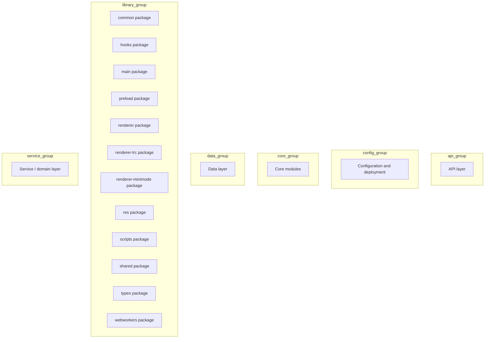

# Architecture report: maotoumao/MusicFreeDesktop

> Automated static analysis. **Observed** = directly seen in files/imports/AST; **Inferred** = interpretation from that evidence. Repository code was not executed.

## 1. Repository at a glance

| Item | Value |
| --- | --- |
| Repository | maotoumao/MusicFreeDesktop |
| Description | 插件化、定制化、无广告的免费音乐播放器 |
| Language | TypeScript |
| Stars | 9151 |
| Licence | AGPL-3.0 |
| Analysed commit / branch | f3b526a6c1ea9313b277810a8e12003605a98982 / master |
| Framework(s) | Electron, React |
| Files analysed | 475 |
| Components | 17 |

## 2. Architecture in one minute

maotoumao/MusicFreeDesktop - 插件化、定制化、无广告的免费音乐播放器. This repository was analysed statically from 475 file(s) (0 Python). Detected technologies (observed from imports/manifests): GitHub Actions, Electron, React, axios, React Router, TypeScript. Files are grouped into 17 component(s): API layer, common package, Configuration and deployment, Core modules, Data layer, hooks package, main package, preload package. Findings below distinguish observed facts from inferred interpretation.

## 3. High-level block diagram

## 4. Main components

### API layer (`api_layer`)

- **Kind:** api
- **Status:** Observed
- **Confidence:** 0.85
- **Responsibility:** Groups 68 file(s) under api layer (observed from repository paths and static analysis).
- **Paths:** `src/renderer/pages/main-page/views/album-view/hooks/useAlbumDetail.ts`, `src/renderer/pages/main-page/views/album-view/index.tsx`, `src/renderer/pages/main-page/views/artist-view/components/Body/index.tsx`, `src/renderer/pages/main-page/views/artist-view/components/Body/widgets/AlbumResult/index.tsx`, `src/renderer/pages/main-page/views/artist-view/components/Body/widgets/MusicResult/index.tsx`, `src/renderer/pages/main-page/views/artist-view/components/Header/index.tsx`, `src/renderer/pages/main-page/views/artist-view/hooks/useQueryArtist.ts`, `src/renderer/pages/main-page/views/artist-view/index.tsx`, `src/renderer/pages/main-page/views/artist-view/store/index.ts`, `src/renderer/pages/main-page/views/download-view/components/Downloaded/index.tsx`, `src/renderer/pages/main-page/views/download-view/components/Downloading/DownloadStatus.tsx`, `src/renderer/pages/main-page/views/download-view/components/Downloading/index.tsx`, `src/renderer/pages/main-page/views/download-view/index.tsx`, `src/renderer/pages/main-page/views/local-music-view/index.tsx`, `src/renderer/pages/main-page/views/local-music-view/views/album/index.tsx`, `src/renderer/pages/main-page/views/local-music-view/views/artist/index.tsx`, `src/renderer/pages/main-page/views/local-music-view/views/folder/index.tsx`, `src/renderer/pages/main-page/views/local-music-view/views/list/index.tsx`, `src/renderer/pages/main-page/views/music-sheet-view/index.tsx`, `src/renderer/pages/main-page/views/music-sheet-view/local-sheet/index.tsx`, `src/renderer/pages/main-page/views/music-sheet-view/remote-sheet/hooks/usePluginSheetMusicList.ts`, `src/renderer/pages/main-page/views/music-sheet-view/remote-sheet/index.tsx`, `src/renderer/pages/main-page/views/music-sheet-view/store/musicSheetStore.ts`, `src/renderer/pages/main-page/views/plugin-manager-view/components/plugin-table/index.tsx`, `src/renderer/pages/main-page/views/plugin-manager-view/index.tsx`, `src/renderer/pages/main-page/views/recently-play-view/index.tsx`, `src/renderer/pages/main-page/views/recommend-sheets-view/components/Body/index.tsx`, `src/renderer/pages/main-page/views/recommend-sheets-view/components/Body/tag-panel.tsx`, `src/renderer/pages/main-page/views/recommend-sheets-view/hooks/useRecommendListTags.ts`, `src/renderer/pages/main-page/views/recommend-sheets-view/hooks/useRecommendSheets.ts`, `src/renderer/pages/main-page/views/recommend-sheets-view/index.tsx`, `src/renderer/pages/main-page/views/search-view/components/SearchResult/AlbumResult/index.tsx`, `src/renderer/pages/main-page/views/search-view/components/SearchResult/ArtistResult/index.tsx`, `src/renderer/pages/main-page/views/search-view/components/SearchResult/MusicResult/index.tsx`, `src/renderer/pages/main-page/views/search-view/components/SearchResult/SheetResult/index.tsx`, `src/renderer/pages/main-page/views/search-view/components/SearchResult/index.tsx`, `src/renderer/pages/main-page/views/search-view/hooks/useSearch.ts`, `src/renderer/pages/main-page/views/search-view/index.tsx`, `src/renderer/pages/main-page/views/search-view/store/search-result.ts`, `src/renderer/pages/main-page/views/setting-view/components/CheckBoxSettingItem/index.tsx`, `src/renderer/pages/main-page/views/setting-view/components/ColorPickerSettingItem/index.tsx`, `src/renderer/pages/main-page/views/setting-view/components/FontPickerSettingItem/index.tsx`, `src/renderer/pages/main-page/views/setting-view/components/InputSettingItem/index.tsx`, `src/renderer/pages/main-page/views/setting-view/components/ListBoxSettingItem/index.tsx`, `src/renderer/pages/main-page/views/setting-view/components/MultiRadioGroupSettingItem/index.tsx`, `src/renderer/pages/main-page/views/setting-view/components/PathSettingItem/index.tsx`, `src/renderer/pages/main-page/views/setting-view/components/RadioGroupSettingItem/index.tsx`, `src/renderer/pages/main-page/views/setting-view/index.tsx`, `src/renderer/pages/main-page/views/setting-view/routers/About/index.tsx`, `src/renderer/pages/main-page/views/setting-view/routers/Backup/index.tsx`, `src/renderer/pages/main-page/views/setting-view/routers/Download/index.tsx`, `src/renderer/pages/main-page/views/setting-view/routers/Lyric/index.tsx`, `src/renderer/pages/main-page/views/setting-view/routers/Network/index.tsx`, `src/renderer/pages/main-page/views/setting-view/routers/Normal/index.tsx`, `src/renderer/pages/main-page/views/setting-view/routers/PlayMusic/index.tsx`, `src/renderer/pages/main-page/views/setting-view/routers/Plugin/index.tsx`, `src/renderer/pages/main-page/views/setting-view/routers/ShortCut/index.tsx`, `src/renderer/pages/main-page/views/setting-view/routers/index.ts`, `src/renderer/pages/main-page/views/theme-view/components/LocalThemes/index.tsx`, `src/renderer/pages/main-page/views/theme-view/components/RemoteThemes/hooks/useRemoteThemes.ts`, `src/renderer/pages/main-page/views/theme-view/components/RemoteThemes/index.tsx`, `src/renderer/pages/main-page/views/theme-view/components/ThemeItem/index.tsx`, `src/renderer/pages/main-page/views/theme-view/index.tsx`, `src/renderer/pages/main-page/views/toplist-detail-view/hooks/useTopListDetail.ts`, `src/renderer/pages/main-page/views/toplist-detail-view/index.tsx`, `src/renderer/pages/main-page/views/toplist-view/hooks/useGetTopList.ts`, `src/renderer/pages/main-page/views/toplist-view/index.tsx`, `src/renderer/pages/main-page/views/toplist-view/store/index.ts`
- **Evidence:** [src/renderer/pages/main-page/views/album-view/hooks/useAlbumDetail.ts](https://github.com/maotoumao/MusicFreeDesktop/blob/f3b526a6c1ea9313b277810a8e12003605a98982/src/renderer/pages/main-page/views/album-view/hooks/useAlbumDetail.ts); [src/renderer/pages/main-page/views/album-view/index.tsx](https://github.com/maotoumao/MusicFreeDesktop/blob/f3b526a6c1ea9313b277810a8e12003605a98982/src/renderer/pages/main-page/views/album-view/index.tsx); [src/renderer/pages/main-page/views/artist-view/components/Body/index.tsx](https://github.com/maotoumao/MusicFreeDesktop/blob/f3b526a6c1ea9313b277810a8e12003605a98982/src/renderer/pages/main-page/views/artist-view/components/Body/index.tsx); [src/renderer/pages/main-page/views/artist-view/components/Body/widgets/AlbumResult/index.tsx](https://github.com/maotoumao/MusicFreeDesktop/blob/f3b526a6c1ea9313b277810a8e12003605a98982/src/renderer/pages/main-page/views/artist-view/components/Body/widgets/AlbumResult/index.tsx); [src/renderer/pages/main-page/views/artist-view/components/Body/widgets/MusicResult/index.tsx](https://github.com/maotoumao/MusicFreeDesktop/blob/f3b526a6c1ea9313b277810a8e12003605a98982/src/renderer/pages/main-page/views/artist-view/components/Body/widgets/MusicResult/index.tsx); [src/renderer/pages/main-page/views/artist-view/components/Header/index.tsx](https://github.com/maotoumao/MusicFreeDesktop/blob/f3b526a6c1ea9313b277810a8e12003605a98982/src/renderer/pages/main-page/views/artist-view/components/Header/index.tsx); [src/renderer/pages/main-page/views/artist-view/hooks/useQueryArtist.ts](https://github.com/maotoumao/MusicFreeDesktop/blob/f3b526a6c1ea9313b277810a8e12003605a98982/src/renderer/pages/main-page/views/artist-view/hooks/useQueryArtist.ts); [src/renderer/pages/main-page/views/artist-view/index.tsx](https://github.com/maotoumao/MusicFreeDesktop/blob/f3b526a6c1ea9313b277810a8e12003605a98982/src/renderer/pages/main-page/views/artist-view/index.tsx)

### common package (`common`)

- **Kind:** library
- **Status:** Observed
- **Confidence:** 0.85
- **Responsibility:** Groups 17 file(s) under common package (observed from repository paths and static analysis).
- **Paths:** `src/common/async-memoize.ts`, `src/common/camel-to-snake.ts`, `src/common/constant.ts`, `src/common/debounce.ts`, `src/common/event-wrapper.ts`, `src/common/file-util.ts`, `src/common/get-resource-path.ts`, `src/common/index-map.ts`, `src/common/is-renderer.ts`, `src/common/media-util.ts`, `src/common/normalize-util.ts`, `src/common/safe-serialization.ts`, `src/common/store.ts`, `src/common/thumb-bar-util.ts`, `src/common/time-util.ts`, `src/common/unique-map.ts`, `src/common/void-callback.ts`
- **Evidence:** [src/common/async-memoize.ts](https://github.com/maotoumao/MusicFreeDesktop/blob/f3b526a6c1ea9313b277810a8e12003605a98982/src/common/async-memoize.ts); [src/common/camel-to-snake.ts](https://github.com/maotoumao/MusicFreeDesktop/blob/f3b526a6c1ea9313b277810a8e12003605a98982/src/common/camel-to-snake.ts); [src/common/constant.ts](https://github.com/maotoumao/MusicFreeDesktop/blob/f3b526a6c1ea9313b277810a8e12003605a98982/src/common/constant.ts); [src/common/debounce.ts](https://github.com/maotoumao/MusicFreeDesktop/blob/f3b526a6c1ea9313b277810a8e12003605a98982/src/common/debounce.ts); [src/common/event-wrapper.ts](https://github.com/maotoumao/MusicFreeDesktop/blob/f3b526a6c1ea9313b277810a8e12003605a98982/src/common/event-wrapper.ts); [src/common/file-util.ts](https://github.com/maotoumao/MusicFreeDesktop/blob/f3b526a6c1ea9313b277810a8e12003605a98982/src/common/file-util.ts); [src/common/get-resource-path.ts](https://github.com/maotoumao/MusicFreeDesktop/blob/f3b526a6c1ea9313b277810a8e12003605a98982/src/common/get-resource-path.ts); [src/common/index-map.ts](https://github.com/maotoumao/MusicFreeDesktop/blob/f3b526a6c1ea9313b277810a8e12003605a98982/src/common/index-map.ts)

### Configuration and deployment (`config`)

- **Kind:** config
- **Status:** Observed
- **Confidence:** 0.85
- **Responsibility:** Groups 10 file(s) under configuration and deployment (observed from repository paths and static analysis).
- **Paths:** `config/webpack.main.config.ts`, `config/webpack.plugins.ts`, `config/webpack.renderer.config.ts`, `config/webpack.rules.ts`, `package.json`, `release/version.json`, `res/lang/en-US.json`, `res/lang/zh-CN.json`, `res/lang/zh-TW.json`, `tsconfig.json`
- **Evidence:** [config/webpack.main.config.ts](https://github.com/maotoumao/MusicFreeDesktop/blob/f3b526a6c1ea9313b277810a8e12003605a98982/config/webpack.main.config.ts); [config/webpack.plugins.ts](https://github.com/maotoumao/MusicFreeDesktop/blob/f3b526a6c1ea9313b277810a8e12003605a98982/config/webpack.plugins.ts); [config/webpack.renderer.config.ts](https://github.com/maotoumao/MusicFreeDesktop/blob/f3b526a6c1ea9313b277810a8e12003605a98982/config/webpack.renderer.config.ts); [config/webpack.rules.ts](https://github.com/maotoumao/MusicFreeDesktop/blob/f3b526a6c1ea9313b277810a8e12003605a98982/config/webpack.rules.ts); [package.json](https://github.com/maotoumao/MusicFreeDesktop/blob/f3b526a6c1ea9313b277810a8e12003605a98982/package.json); [release/version.json](https://github.com/maotoumao/MusicFreeDesktop/blob/f3b526a6c1ea9313b277810a8e12003605a98982/release/version.json); [res/lang/en-US.json](https://github.com/maotoumao/MusicFreeDesktop/blob/f3b526a6c1ea9313b277810a8e12003605a98982/res/lang/en-US.json); [res/lang/zh-CN.json](https://github.com/maotoumao/MusicFreeDesktop/blob/f3b526a6c1ea9313b277810a8e12003605a98982/res/lang/zh-CN.json)

### Core modules (`core`)

- **Kind:** core
- **Status:** Observed
- **Confidence:** 0.85
- **Responsibility:** Groups 2 file(s) under core modules (observed from repository paths and static analysis).
- **Paths:** `eslint.config.mjs`, `forge.config.ts`
- **Evidence:** [eslint.config.mjs](https://github.com/maotoumao/MusicFreeDesktop/blob/f3b526a6c1ea9313b277810a8e12003605a98982/eslint.config.mjs); [forge.config.ts](https://github.com/maotoumao/MusicFreeDesktop/blob/f3b526a6c1ea9313b277810a8e12003605a98982/forge.config.ts)

### Data layer (`data_layer`)

- **Kind:** data
- **Status:** Observed
- **Confidence:** 0.85
- **Responsibility:** Groups 5 file(s) under data layer (observed from repository paths and static analysis).
- **Paths:** `src/renderer/core/db/music-sheet-db.ts`, `src/shared/database/main.ts`, `src/shared/database/preload-backup.ts`, `src/shared/database/preload.ts`, `src/shared/database/renderer.ts`
- **Evidence:** [src/renderer/core/db/music-sheet-db.ts](https://github.com/maotoumao/MusicFreeDesktop/blob/f3b526a6c1ea9313b277810a8e12003605a98982/src/renderer/core/db/music-sheet-db.ts); [src/shared/database/main.ts](https://github.com/maotoumao/MusicFreeDesktop/blob/f3b526a6c1ea9313b277810a8e12003605a98982/src/shared/database/main.ts); [src/shared/database/preload-backup.ts](https://github.com/maotoumao/MusicFreeDesktop/blob/f3b526a6c1ea9313b277810a8e12003605a98982/src/shared/database/preload-backup.ts); [src/shared/database/preload.ts](https://github.com/maotoumao/MusicFreeDesktop/blob/f3b526a6c1ea9313b277810a8e12003605a98982/src/shared/database/preload.ts); [src/shared/database/renderer.ts](https://github.com/maotoumao/MusicFreeDesktop/blob/f3b526a6c1ea9313b277810a8e12003605a98982/src/shared/database/renderer.ts)

### hooks package (`hooks`)

- **Kind:** library
- **Status:** Observed
- **Confidence:** 0.85
- **Responsibility:** Groups 6 file(s) under hooks package (observed from repository paths and static analysis).
- **Paths:** `src/hooks/useAppConfig.ts`, `src/hooks/useLocalFonts.ts`, `src/hooks/useMediaDevices.ts`, `src/hooks/useMounted.ts`, `src/hooks/useStateRef.ts`, `src/hooks/useVirtualList.ts`
- **Evidence:** [src/hooks/useAppConfig.ts](https://github.com/maotoumao/MusicFreeDesktop/blob/f3b526a6c1ea9313b277810a8e12003605a98982/src/hooks/useAppConfig.ts); [src/hooks/useLocalFonts.ts](https://github.com/maotoumao/MusicFreeDesktop/blob/f3b526a6c1ea9313b277810a8e12003605a98982/src/hooks/useLocalFonts.ts); [src/hooks/useMediaDevices.ts](https://github.com/maotoumao/MusicFreeDesktop/blob/f3b526a6c1ea9313b277810a8e12003605a98982/src/hooks/useMediaDevices.ts); [src/hooks/useMounted.ts](https://github.com/maotoumao/MusicFreeDesktop/blob/f3b526a6c1ea9313b277810a8e12003605a98982/src/hooks/useMounted.ts); [src/hooks/useStateRef.ts](https://github.com/maotoumao/MusicFreeDesktop/blob/f3b526a6c1ea9313b277810a8e12003605a98982/src/hooks/useStateRef.ts); [src/hooks/useVirtualList.ts](https://github.com/maotoumao/MusicFreeDesktop/blob/f3b526a6c1ea9313b277810a8e12003605a98982/src/hooks/useVirtualList.ts)

### main package (`main`)

- **Kind:** library
- **Status:** Observed
- **Confidence:** 0.85
- **Responsibility:** Groups 5 file(s) under main package (observed from repository paths and static analysis).
- **Paths:** `src/main/deep-link/index.ts`, `src/main/index.ts`, `src/main/native_modules/TaskbarThumbnailManager/TaskbarThumbnailManager.node.d.ts`, `src/main/tray-manager/index.ts`, `src/main/window-manager/index.ts`
- **Evidence:** [src/main/deep-link/index.ts](https://github.com/maotoumao/MusicFreeDesktop/blob/f3b526a6c1ea9313b277810a8e12003605a98982/src/main/deep-link/index.ts); [src/main/index.ts](https://github.com/maotoumao/MusicFreeDesktop/blob/f3b526a6c1ea9313b277810a8e12003605a98982/src/main/index.ts); [src/main/native_modules/TaskbarThumbnailManager/TaskbarThumbnailManager.node.d.ts](https://github.com/maotoumao/MusicFreeDesktop/blob/f3b526a6c1ea9313b277810a8e12003605a98982/src/main/native_modules/TaskbarThumbnailManager/TaskbarThumbnailManager.node.d.ts); [src/main/tray-manager/index.ts](https://github.com/maotoumao/MusicFreeDesktop/blob/f3b526a6c1ea9313b277810a8e12003605a98982/src/main/tray-manager/index.ts); [src/main/window-manager/index.ts](https://github.com/maotoumao/MusicFreeDesktop/blob/f3b526a6c1ea9313b277810a8e12003605a98982/src/main/window-manager/index.ts)

### preload package (`preload`)

- **Kind:** library
- **Status:** Observed
- **Confidence:** 0.85
- **Responsibility:** Groups 3 file(s) under preload package (observed from repository paths and static analysis).
- **Paths:** `src/preload/common-preload.ts`, `src/preload/extension.ts`, `src/preload/index.ts`
- **Evidence:** [src/preload/common-preload.ts](https://github.com/maotoumao/MusicFreeDesktop/blob/f3b526a6c1ea9313b277810a8e12003605a98982/src/preload/common-preload.ts); [src/preload/extension.ts](https://github.com/maotoumao/MusicFreeDesktop/blob/f3b526a6c1ea9313b277810a8e12003605a98982/src/preload/extension.ts); [src/preload/index.ts](https://github.com/maotoumao/MusicFreeDesktop/blob/f3b526a6c1ea9313b277810a8e12003605a98982/src/preload/index.ts)

### renderer package (`renderer`)

- **Kind:** library
- **Status:** Observed
- **Confidence:** 0.85
- **Responsibility:** Groups 83 file(s) under renderer package (observed from repository paths and static analysis).
- **Paths:** `src/renderer/app.tsx`, `src/renderer/components/A/index.tsx`, `src/renderer/components/AnimatedDiv/index.tsx`, `src/renderer/components/ArtistItem/index.tsx`, `src/renderer/components/BottomLoadingState/index.tsx`, `src/renderer/components/Checkbox/index.tsx`, `src/renderer/components/Condition/index.tsx`, `src/renderer/components/ContextMenu/index.tsx`, `src/renderer/components/DragReceiver/index.tsx`, `src/renderer/components/Empty/index.tsx`, `src/renderer/components/Header/index.tsx`, `src/renderer/components/Header/widgets/Navigator/index.tsx`, `src/renderer/components/Header/widgets/SearchHistory/index.tsx`, `src/renderer/components/Loading/index.tsx`, `src/renderer/components/Modal/index.tsx`, `src/renderer/components/Modal/templates/AddMusicToSheet/index.tsx`, `src/renderer/components/Modal/templates/AddNewSheet/index.tsx`, `src/renderer/components/Modal/templates/Base/index.tsx`, `src/renderer/components/Modal/templates/ExitConfirm/index.tsx`, `src/renderer/components/Modal/templates/ImportMusicSheet/index.tsx`, `src/renderer/components/Modal/templates/PluginSubscription/index.tsx`, `src/renderer/components/Modal/templates/Reconfirm/index.tsx`, `src/renderer/components/Modal/templates/SearchLyric/hooks/searchResultStore.ts`, `src/renderer/components/Modal/templates/SearchLyric/hooks/useSearchLyric.ts`, `src/renderer/components/Modal/templates/SearchLyric/index.tsx`, `src/renderer/components/Modal/templates/SearchLyric/searchResult.tsx`, `src/renderer/components/Modal/templates/SelectOne/index.tsx`, `src/renderer/components/Modal/templates/SimpleInputWithState/index.tsx`, `src/renderer/components/Modal/templates/Sparkles/index.tsx`, `src/renderer/components/Modal/templates/Update/index.tsx`, `src/renderer/components/Modal/templates/WatchLocalDir/index.tsx`, `src/renderer/components/Modal/templates/index.ts`, `src/renderer/components/MusicBar/index.tsx`, `src/renderer/components/MusicBar/widgets/Controller/index.tsx`, `src/renderer/components/MusicBar/widgets/Extra/index.tsx`, `src/renderer/components/MusicBar/widgets/MusicInfo/index.tsx`, `src/renderer/components/MusicBar/widgets/Slider/index.tsx`, `src/renderer/components/MusicDetail/index.tsx`, `src/renderer/components/MusicDetail/store.ts`, `src/renderer/components/MusicDetail/widgets/Header/index.tsx`, `src/renderer/components/MusicDetail/widgets/Lyric/index.tsx`, `src/renderer/components/MusicDownloaded/index.tsx`, `src/renderer/components/MusicFavorite/index.tsx`, `src/renderer/components/MusicList/index.tsx`, `src/renderer/components/MusicSheetlikeItem/index.tsx`, `src/renderer/components/MusicSheetlikeList/index.tsx`, `src/renderer/components/MusicSheetlikeView/components/Body/index.tsx`, `src/renderer/components/MusicSheetlikeView/components/Header/index.tsx`, `src/renderer/components/MusicSheetlikeView/index.tsx`, `src/renderer/components/MusicSheetlikeView/store.ts`, `src/renderer/components/NoPlugin/index.tsx`, `src/renderer/components/Panel/index.tsx`, `src/renderer/components/Panel/templates/Base/index.tsx`, `src/renderer/components/Panel/templates/MusicComment/index.tsx`, `src/renderer/components/Panel/templates/MusicComment/useComment.ts`, `src/renderer/components/Panel/templates/PlayList/index.tsx`, `src/renderer/components/Panel/templates/UserVariables/index.tsx`, `src/renderer/components/Panel/templates/index.ts`, `src/renderer/components/SvgAsset/index.tsx`, `src/renderer/components/SwitchCase/index.tsx`, `src/renderer/components/Tag/index.tsx`, `src/renderer/document/bootstrap.ts`, `src/renderer/document/fallback.tsx`, `src/renderer/document/index.tsx`, `src/renderer/document/useBootstrap.ts`, `src/renderer/pages/main-page/components/SideBar/index.tsx`, `src/renderer/pages/main-page/components/SideBar/widgets/ListItem/index.tsx`, `src/renderer/pages/main-page/components/SideBar/widgets/MySheets/index.tsx`, `src/renderer/pages/main-page/components/SideBar/widgets/StarredSheets/index.tsx`, `src/renderer/pages/main-page/index.tsx`, `src/renderer/utils/check-update.ts`, `src/renderer/utils/classnames.ts`, `src/renderer/utils/create-tmp-file.ts`, `src/renderer/utils/get-text-width.ts`, `src/renderer/utils/get-url-ext.ts`, `src/renderer/utils/groupBy.ts`, `src/renderer/utils/img-on-error.ts`, `src/renderer/utils/is-local-music.ts`, `src/renderer/utils/lyric-parser.ts`, `src/renderer/utils/preload-util.ts`, `src/renderer/utils/raf2.ts`, `src/renderer/utils/search-history.ts`, `src/renderer/utils/user-perference.ts`
- **Evidence:** [src/renderer/app.tsx](https://github.com/maotoumao/MusicFreeDesktop/blob/f3b526a6c1ea9313b277810a8e12003605a98982/src/renderer/app.tsx); [src/renderer/components/A/index.tsx](https://github.com/maotoumao/MusicFreeDesktop/blob/f3b526a6c1ea9313b277810a8e12003605a98982/src/renderer/components/A/index.tsx); [src/renderer/components/AnimatedDiv/index.tsx](https://github.com/maotoumao/MusicFreeDesktop/blob/f3b526a6c1ea9313b277810a8e12003605a98982/src/renderer/components/AnimatedDiv/index.tsx); [src/renderer/components/ArtistItem/index.tsx](https://github.com/maotoumao/MusicFreeDesktop/blob/f3b526a6c1ea9313b277810a8e12003605a98982/src/renderer/components/ArtistItem/index.tsx); [src/renderer/components/BottomLoadingState/index.tsx](https://github.com/maotoumao/MusicFreeDesktop/blob/f3b526a6c1ea9313b277810a8e12003605a98982/src/renderer/components/BottomLoadingState/index.tsx); [src/renderer/components/Checkbox/index.tsx](https://github.com/maotoumao/MusicFreeDesktop/blob/f3b526a6c1ea9313b277810a8e12003605a98982/src/renderer/components/Checkbox/index.tsx); [src/renderer/components/Condition/index.tsx](https://github.com/maotoumao/MusicFreeDesktop/blob/f3b526a6c1ea9313b277810a8e12003605a98982/src/renderer/components/Condition/index.tsx); [src/renderer/components/ContextMenu/index.tsx](https://github.com/maotoumao/MusicFreeDesktop/blob/f3b526a6c1ea9313b277810a8e12003605a98982/src/renderer/components/ContextMenu/index.tsx)

### renderer-lrc package (`renderer_lrc`)

- **Kind:** library
- **Status:** Observed
- **Confidence:** 0.85
- **Responsibility:** Groups 3 file(s) under renderer-lrc package (observed from repository paths and static analysis).
- **Paths:** `src/renderer-lrc/document/bootstrap.ts`, `src/renderer-lrc/document/index.tsx`, `src/renderer-lrc/pages/index.tsx`
- **Evidence:** [src/renderer-lrc/document/bootstrap.ts](https://github.com/maotoumao/MusicFreeDesktop/blob/f3b526a6c1ea9313b277810a8e12003605a98982/src/renderer-lrc/document/bootstrap.ts); [src/renderer-lrc/document/index.tsx](https://github.com/maotoumao/MusicFreeDesktop/blob/f3b526a6c1ea9313b277810a8e12003605a98982/src/renderer-lrc/document/index.tsx); [src/renderer-lrc/pages/index.tsx](https://github.com/maotoumao/MusicFreeDesktop/blob/f3b526a6c1ea9313b277810a8e12003605a98982/src/renderer-lrc/pages/index.tsx)

### renderer-minimode package (`renderer_minimode`)

- **Kind:** library
- **Status:** Observed
- **Confidence:** 0.85
- **Responsibility:** Groups 3 file(s) under renderer-minimode package (observed from repository paths and static analysis).
- **Paths:** `src/renderer-minimode/document/bootstrap.ts`, `src/renderer-minimode/document/index.tsx`, `src/renderer-minimode/pages/index.tsx`
- **Evidence:** [src/renderer-minimode/document/bootstrap.ts](https://github.com/maotoumao/MusicFreeDesktop/blob/f3b526a6c1ea9313b277810a8e12003605a98982/src/renderer-minimode/document/bootstrap.ts); [src/renderer-minimode/document/index.tsx](https://github.com/maotoumao/MusicFreeDesktop/blob/f3b526a6c1ea9313b277810a8e12003605a98982/src/renderer-minimode/document/index.tsx); [src/renderer-minimode/pages/index.tsx](https://github.com/maotoumao/MusicFreeDesktop/blob/f3b526a6c1ea9313b277810a8e12003605a98982/src/renderer-minimode/pages/index.tsx)

### res package (`res`)

- **Kind:** library
- **Status:** Observed
- **Confidence:** 0.85
- **Responsibility:** Groups 1 file(s) under res package (observed from repository paths and static analysis).
- **Paths:** `res/.service/request-forwarder.js`
- **Evidence:** [res/.service/request-forwarder.js](https://github.com/maotoumao/MusicFreeDesktop/blob/f3b526a6c1ea9313b277810a8e12003605a98982/res/.service/request-forwarder.js)

### scripts package (`scripts`)

- **Kind:** library
- **Status:** Observed
- **Confidence:** 0.85
- **Responsibility:** Groups 1 file(s) under scripts package (observed from repository paths and static analysis).
- **Paths:** `scripts/feishu-upload.js`
- **Evidence:** [scripts/feishu-upload.js](https://github.com/maotoumao/MusicFreeDesktop/blob/f3b526a6c1ea9313b277810a8e12003605a98982/scripts/feishu-upload.js)

### Service / domain layer (`service_layer`)

- **Kind:** service
- **Status:** Observed
- **Confidence:** 0.85
- **Responsibility:** Groups 21 file(s) under service / domain layer (observed from repository paths and static analysis).
- **Paths:** `src/renderer/core/backup-resume/index.ts`, `src/renderer/core/downloader/downloaded-sheet.ts`, `src/renderer/core/downloader/ee.ts`, `src/renderer/core/downloader/index.new.ts`, `src/renderer/core/downloader/index.ts`, `src/renderer/core/downloader/store.ts`, `src/renderer/core/link-lyric/index.ts`, `src/renderer/core/local-music/index.ts`, `src/renderer/core/local-music/store.ts`, `src/renderer/core/music-sheet/backend/index.ts`, `src/renderer/core/music-sheet/common/default-sheet.ts`, `src/renderer/core/music-sheet/frontend/index.old.ts`, `src/renderer/core/music-sheet/frontend/index.ts`, `src/renderer/core/music-sheet/index.ts`, `src/renderer/core/recently-playlist/index.ts`, `src/renderer/core/track-player/controller/audio-controller.ts`, `src/renderer/core/track-player/controller/controller-base.ts`, `src/renderer/core/track-player/enum.ts`, `src/renderer/core/track-player/hooks.ts`, `src/renderer/core/track-player/index.ts`, `src/renderer/core/track-player/store.ts`
- **Evidence:** [src/renderer/core/backup-resume/index.ts](https://github.com/maotoumao/MusicFreeDesktop/blob/f3b526a6c1ea9313b277810a8e12003605a98982/src/renderer/core/backup-resume/index.ts); [src/renderer/core/downloader/downloaded-sheet.ts](https://github.com/maotoumao/MusicFreeDesktop/blob/f3b526a6c1ea9313b277810a8e12003605a98982/src/renderer/core/downloader/downloaded-sheet.ts); [src/renderer/core/downloader/ee.ts](https://github.com/maotoumao/MusicFreeDesktop/blob/f3b526a6c1ea9313b277810a8e12003605a98982/src/renderer/core/downloader/ee.ts); [src/renderer/core/downloader/index.new.ts](https://github.com/maotoumao/MusicFreeDesktop/blob/f3b526a6c1ea9313b277810a8e12003605a98982/src/renderer/core/downloader/index.new.ts); [src/renderer/core/downloader/index.ts](https://github.com/maotoumao/MusicFreeDesktop/blob/f3b526a6c1ea9313b277810a8e12003605a98982/src/renderer/core/downloader/index.ts); [src/renderer/core/downloader/store.ts](https://github.com/maotoumao/MusicFreeDesktop/blob/f3b526a6c1ea9313b277810a8e12003605a98982/src/renderer/core/downloader/store.ts); [src/renderer/core/link-lyric/index.ts](https://github.com/maotoumao/MusicFreeDesktop/blob/f3b526a6c1ea9313b277810a8e12003605a98982/src/renderer/core/link-lyric/index.ts); [src/renderer/core/local-music/index.ts](https://github.com/maotoumao/MusicFreeDesktop/blob/f3b526a6c1ea9313b277810a8e12003605a98982/src/renderer/core/local-music/index.ts)

### shared package (`shared`)

- **Kind:** library
- **Status:** Observed
- **Confidence:** 0.85
- **Responsibility:** Groups 46 file(s) under shared package (observed from repository paths and static analysis).
- **Paths:** `src/shared/app-config/default-app-config.ts`, `src/shared/app-config/main.ts`, `src/shared/app-config/preload.ts`, `src/shared/app-config/renderer.ts`, `src/shared/global-context/internal/common.ts`, `src/shared/global-context/main.ts`, `src/shared/global-context/preload.ts`, `src/shared/global-context/renderer.ts`, `src/shared/global-context/type.d.ts`, `src/shared/i18n/main.ts`, `src/shared/i18n/preload.ts`, `src/shared/i18n/renderer.ts`, `src/shared/i18n/type.d.ts`, `src/shared/logger/main.ts`, `src/shared/logger/renderer.ts`, `src/shared/message-bus/main.ts`, `src/shared/message-bus/preload/extension.ts`, `src/shared/message-bus/preload/main.ts`, `src/shared/message-bus/renderer/extension.ts`, `src/shared/message-bus/renderer/main.ts`, `src/shared/message-bus/type.d.ts`, `src/shared/plugin-manager/main/index.ts`, `src/shared/plugin-manager/main/internal-plugins/local-plugin.ts`, `src/shared/plugin-manager/main/plugin-methods.ts`, `src/shared/plugin-manager/main/plugin.ts`, `src/shared/plugin-manager/main/polyfill/react-native-cookies.ts`, `src/shared/plugin-manager/main/polyfill/storage.ts`, `src/shared/plugin-manager/preload.ts`, `src/shared/plugin-manager/renderer.ts`, `src/shared/service-manager/common.ts`, `src/shared/service-manager/main.ts`, `src/shared/service-manager/preload.ts`, `src/shared/service-manager/renderer.ts`, `src/shared/short-cut/main.ts`, `src/shared/short-cut/preload.ts`, `src/shared/short-cut/renderer.ts`, `src/shared/themepack/main.ts`, `src/shared/themepack/preload.ts`, `src/shared/themepack/renderer.ts`, `src/shared/themepack/type.d.ts`, `src/shared/utils/main.ts`, `src/shared/utils/preload.ts`, `src/shared/utils/renderer.ts`, `src/shared/window-drag/main.ts`, `src/shared/window-drag/preload.ts`, `src/shared/window-drag/renderer.ts`
- **Evidence:** [src/shared/app-config/default-app-config.ts](https://github.com/maotoumao/MusicFreeDesktop/blob/f3b526a6c1ea9313b277810a8e12003605a98982/src/shared/app-config/default-app-config.ts); [src/shared/app-config/main.ts](https://github.com/maotoumao/MusicFreeDesktop/blob/f3b526a6c1ea9313b277810a8e12003605a98982/src/shared/app-config/main.ts); [src/shared/app-config/preload.ts](https://github.com/maotoumao/MusicFreeDesktop/blob/f3b526a6c1ea9313b277810a8e12003605a98982/src/shared/app-config/preload.ts); [src/shared/app-config/renderer.ts](https://github.com/maotoumao/MusicFreeDesktop/blob/f3b526a6c1ea9313b277810a8e12003605a98982/src/shared/app-config/renderer.ts); [src/shared/global-context/internal/common.ts](https://github.com/maotoumao/MusicFreeDesktop/blob/f3b526a6c1ea9313b277810a8e12003605a98982/src/shared/global-context/internal/common.ts); [src/shared/global-context/main.ts](https://github.com/maotoumao/MusicFreeDesktop/blob/f3b526a6c1ea9313b277810a8e12003605a98982/src/shared/global-context/main.ts); [src/shared/global-context/preload.ts](https://github.com/maotoumao/MusicFreeDesktop/blob/f3b526a6c1ea9313b277810a8e12003605a98982/src/shared/global-context/preload.ts); [src/shared/global-context/renderer.ts](https://github.com/maotoumao/MusicFreeDesktop/blob/f3b526a6c1ea9313b277810a8e12003605a98982/src/shared/global-context/renderer.ts)

### types package (`types`)

- **Kind:** library
- **Status:** Observed
- **Confidence:** 0.85
- **Responsibility:** Groups 11 file(s) under types package (observed from repository paths and static analysis).
- **Paths:** `src/types/app-config.d.ts`, `src/types/assets.d.ts`, `src/types/audio-controller.d.ts`, `src/types/common.d.ts`, `src/types/main/window-manager.d.ts`, `src/types/media.d.ts`, `src/types/model.d.ts`, `src/types/plugin.d.ts`, `src/types/preload.d.ts`, `src/types/user-perference.d.ts`, `src/types/window.d.ts`
- **Evidence:** [src/types/app-config.d.ts](https://github.com/maotoumao/MusicFreeDesktop/blob/f3b526a6c1ea9313b277810a8e12003605a98982/src/types/app-config.d.ts); [src/types/assets.d.ts](https://github.com/maotoumao/MusicFreeDesktop/blob/f3b526a6c1ea9313b277810a8e12003605a98982/src/types/assets.d.ts); [src/types/audio-controller.d.ts](https://github.com/maotoumao/MusicFreeDesktop/blob/f3b526a6c1ea9313b277810a8e12003605a98982/src/types/audio-controller.d.ts); [src/types/common.d.ts](https://github.com/maotoumao/MusicFreeDesktop/blob/f3b526a6c1ea9313b277810a8e12003605a98982/src/types/common.d.ts); [src/types/main/window-manager.d.ts](https://github.com/maotoumao/MusicFreeDesktop/blob/f3b526a6c1ea9313b277810a8e12003605a98982/src/types/main/window-manager.d.ts); [src/types/media.d.ts](https://github.com/maotoumao/MusicFreeDesktop/blob/f3b526a6c1ea9313b277810a8e12003605a98982/src/types/media.d.ts); [src/types/model.d.ts](https://github.com/maotoumao/MusicFreeDesktop/blob/f3b526a6c1ea9313b277810a8e12003605a98982/src/types/model.d.ts); [src/types/plugin.d.ts](https://github.com/maotoumao/MusicFreeDesktop/blob/f3b526a6c1ea9313b277810a8e12003605a98982/src/types/plugin.d.ts)

### webworkers package (`webworkers`)

- **Kind:** library
- **Status:** Observed
- **Confidence:** 0.85
- **Responsibility:** Groups 6 file(s) under webworkers package (observed from repository paths and static analysis).
- **Paths:** `src/webworkers/db-worker.ts`, `src/webworkers/db-worker/const.ts`, `src/webworkers/db-worker/index.ts`, `src/webworkers/db-worker/utils.ts`, `src/webworkers/downloader.ts`, `src/webworkers/local-file-watcher.ts`
- **Evidence:** [src/webworkers/db-worker.ts](https://github.com/maotoumao/MusicFreeDesktop/blob/f3b526a6c1ea9313b277810a8e12003605a98982/src/webworkers/db-worker.ts); [src/webworkers/db-worker/const.ts](https://github.com/maotoumao/MusicFreeDesktop/blob/f3b526a6c1ea9313b277810a8e12003605a98982/src/webworkers/db-worker/const.ts); [src/webworkers/db-worker/index.ts](https://github.com/maotoumao/MusicFreeDesktop/blob/f3b526a6c1ea9313b277810a8e12003605a98982/src/webworkers/db-worker/index.ts); [src/webworkers/db-worker/utils.ts](https://github.com/maotoumao/MusicFreeDesktop/blob/f3b526a6c1ea9313b277810a8e12003605a98982/src/webworkers/db-worker/utils.ts); [src/webworkers/downloader.ts](https://github.com/maotoumao/MusicFreeDesktop/blob/f3b526a6c1ea9313b277810a8e12003605a98982/src/webworkers/downloader.ts); [src/webworkers/local-file-watcher.ts](https://github.com/maotoumao/MusicFreeDesktop/blob/f3b526a6c1ea9313b277810a8e12003605a98982/src/webworkers/local-file-watcher.ts)

## 5. Execution flow

**Observed** entry point(s):

- [src/main/deep-link/index.ts](https://github.com/maotoumao/MusicFreeDesktop/blob/f3b526a6c1ea9313b277810a8e12003605a98982/src/main/deep-link/index.ts)
- [src/main/index.ts](https://github.com/maotoumao/MusicFreeDesktop/blob/f3b526a6c1ea9313b277810a8e12003605a98982/src/main/index.ts)
- [src/main/tray-manager/index.ts](https://github.com/maotoumao/MusicFreeDesktop/blob/f3b526a6c1ea9313b277810a8e12003605a98982/src/main/tray-manager/index.ts)
- [src/main/window-manager/index.ts](https://github.com/maotoumao/MusicFreeDesktop/blob/f3b526a6c1ea9313b277810a8e12003605a98982/src/main/window-manager/index.ts)
- [src/preload/index.ts](https://github.com/maotoumao/MusicFreeDesktop/blob/f3b526a6c1ea9313b277810a8e12003605a98982/src/preload/index.ts)
- [src/renderer-lrc/document/index.tsx](https://github.com/maotoumao/MusicFreeDesktop/blob/f3b526a6c1ea9313b277810a8e12003605a98982/src/renderer-lrc/document/index.tsx)
- [src/renderer-lrc/pages/index.tsx](https://github.com/maotoumao/MusicFreeDesktop/blob/f3b526a6c1ea9313b277810a8e12003605a98982/src/renderer-lrc/pages/index.tsx)
- [src/renderer-minimode/document/index.tsx](https://github.com/maotoumao/MusicFreeDesktop/blob/f3b526a6c1ea9313b277810a8e12003605a98982/src/renderer-minimode/document/index.tsx)
- [src/renderer-minimode/pages/index.tsx](https://github.com/maotoumao/MusicFreeDesktop/blob/f3b526a6c1ea9313b277810a8e12003605a98982/src/renderer-minimode/pages/index.tsx)
- [src/renderer/app.tsx](https://github.com/maotoumao/MusicFreeDesktop/blob/f3b526a6c1ea9313b277810a8e12003605a98982/src/renderer/app.tsx)
- [src/renderer/document/index.tsx](https://github.com/maotoumao/MusicFreeDesktop/blob/f3b526a6c1ea9313b277810a8e12003605a98982/src/renderer/document/index.tsx)
- [src/shared/app-config/main.ts](https://github.com/maotoumao/MusicFreeDesktop/blob/f3b526a6c1ea9313b277810a8e12003605a98982/src/shared/app-config/main.ts)

Representative flow (derived from observed entry points and the import graph; steps beyond the entry point are **Inferred**):

1. Execution starts at an observed entry point listed above, if present.
2. No internal import relationships between components were observed.

## 6. Project structure

### `(root)`

- `.gitignore` - other (1287 bytes)
- `LICENSE` - docs (34523 bytes)
- `README.md` - docs (6548 bytes)
- `changelog.md` - docs (6007 bytes)
- `eslint.config.mjs` - source, JavaScript (3540 bytes)
- `forge.config.ts` - source, TypeScript (3273 bytes)
- `package.json` - manifest (3751 bytes)
- `tsconfig.json` - config (648 bytes)

### `.github`

- `.github/PULL_REQUEST_TEMPLATE.md` - docs (684 bytes)
- `.github/workflows/build.yml` - ci, YAML (7341 bytes)
- `.github/workflows/release.yml` - ci, YAML (3984 bytes)

### `.husky`

- `.husky/pre-commit` - other (73 bytes)

### `.vscode`

- `.vscode/settings.json` - config (284 bytes)

### `config`

- `config/webpack.main.config.ts` - source, TypeScript (807 bytes)
- `config/webpack.plugins.ts` - source, TypeScript (685 bytes)
- `config/webpack.renderer.config.ts` - source, TypeScript (1367 bytes)
- `config/webpack.rules.ts` - source, TypeScript (953 bytes)

### `release`

- `release/build-windows.iss` - other (2081 bytes)
- `release/version.json` - config (227 bytes)

### `res`

- `res/.service/request-forwarder.js` - source, JavaScript (3213 bytes)
- `res/lang/en-US.json` - config (14970 bytes)
- `res/lang/zh-CN.json` - config (14537 bytes)
- `res/lang/zh-TW.json` - config (14581 bytes)

### `scripts`

- `scripts/feishu-upload.js` - source, JavaScript (12934 bytes)

### `src`

- `src/assets/icons/album.svg` - other (551 bytes)
- `src/assets/icons/array-download-tray.svg` - other (304 bytes)
- `src/assets/icons/arrow-left-end-on-rectangle.svg` - other (353 bytes)
- `src/assets/icons/cd.svg` - other (758 bytes)
- `src/assets/icons/chat-bubble-left-ellipsis.svg` - other (691 bytes)
- `src/assets/icons/check-circle.svg` - other (259 bytes)
- `src/assets/icons/check.svg` - other (221 bytes)
- `src/assets/icons/chevron-double-down.svg` - other (249 bytes)
- `src/assets/icons/chevron-double-up.svg` - other (248 bytes)
- `src/assets/icons/chevron-down.svg` - other (227 bytes)
- `src/assets/icons/chevron-left.svg` - other (227 bytes)
- `src/assets/icons/chevron-right.svg` - other (225 bytes)
- `src/assets/icons/clock.svg` - other (247 bytes)
- `src/assets/icons/code-bracket-square.svg` - other (361 bytes)
- `src/assets/icons/cog-8-tooth.svg` - other (1358 bytes)
- `src/assets/icons/dashboard-speed.svg` - other (2133 bytes)
- `src/assets/icons/document-plus.svg` - other (467 bytes)
- `src/assets/icons/fire.svg` - other (500 bytes)
- `src/assets/icons/folder-open.svg` - other (522 bytes)
- `src/assets/icons/font-size-larger.svg` - other (1864 bytes)
- `src/assets/icons/font-size-smaller.svg` - other (1674 bytes)
- `src/assets/icons/hand-thumb-up.svg` - other (924 bytes)
- `src/assets/icons/headphone.svg` - other (716 bytes)
- `src/assets/icons/heart-outline.svg` - other (357 bytes)
- `src/assets/icons/heart.svg` - other (496 bytes)
- `src/assets/icons/hq.svg` - other (1308 bytes)
- `src/assets/icons/identification.svg` - other (502 bytes)
- `src/assets/icons/language.svg` - other (441 bytes)
- `src/assets/icons/list-bullet.svg` - other (468 bytes)
- `src/assets/icons/lock-closed.svg` - other (368 bytes)
- `src/assets/icons/lock-open.svg` - other (367 bytes)
- `src/assets/icons/logo.svg` - other (5213 bytes)
- `src/assets/icons/lq.svg` - other (1223 bytes)
- `src/assets/icons/lyric-en.svg` - other (1373 bytes)
- `src/assets/icons/lyric.svg` - other (1475 bytes)
- `src/assets/icons/magnifying-glass.svg` - other (316 bytes)
- `src/assets/icons/minus.svg` - other (212 bytes)
- `src/assets/icons/motion-play.svg` - other (1371 bytes)
- `src/assets/icons/musical-note.svg` - other (453 bytes)
- `src/assets/icons/pause.svg` - other (362 bytes)
- `src/assets/icons/pencil-square.svg` - other (455 bytes)
- `src/assets/icons/picture-in-picture-line.svg` - other (362 bytes)
- `src/assets/icons/play.svg` - other (295 bytes)
- `src/assets/icons/playlist.svg` - other (1284 bytes)
- `src/assets/icons/plus-circle.svg` - other (246 bytes)
- `src/assets/icons/plus.svg` - other (222 bytes)
- `src/assets/icons/question-mark-circle.svg` - other (399 bytes)
- `src/assets/icons/repeat-song-1.svg` - other (640 bytes)
- `src/assets/icons/repeat-song.svg` - other (753 bytes)
- `src/assets/icons/rolling-1s.svg` - other (656 bytes)
- `src/assets/icons/sd.svg` - other (2368 bytes)
- `src/assets/icons/shuffle.svg` - other (644 bytes)
- `src/assets/icons/skip-left.svg` - other (704 bytes)
- `src/assets/icons/skip-right.svg` - other (706 bytes)
- `src/assets/icons/sort-asc.svg` - other (594 bytes)
- `src/assets/icons/sort-desc.svg` - other (594 bytes)
- `src/assets/icons/sort.svg` - other (801 bytes)
- `src/assets/icons/sparkles.svg` - other (793 bytes)
- `src/assets/icons/speaker-wave.svg` - other (462 bytes)
- `src/assets/icons/speaker-x-mark.svg` - other (466 bytes)
- `src/assets/icons/sq.svg` - other (2752 bytes)
- `src/assets/icons/square.svg` - other (252 bytes)
- `src/assets/icons/t-shirt-line.svg` - other (676 bytes)
- `src/assets/icons/trash.svg` - other (607 bytes)
- `src/assets/icons/trophy.svg` - other (829 bytes)
- `src/assets/icons/user.svg` - other (344 bytes)
- `src/assets/icons/x-mark.svg` - other (220 bytes)
- `src/common/async-memoize.ts` - source, TypeScript (265 bytes)
- `src/common/camel-to-snake.ts` - source, TypeScript (174 bytes)
- `src/common/constant.ts` - source, TypeScript (4710 bytes)
- `src/common/debounce.ts` - source, TypeScript (333 bytes)
- `src/common/event-wrapper.ts` - source, TypeScript (1403 bytes)
- `src/common/file-util.ts` - source, TypeScript (4433 bytes)
- `src/common/get-resource-path.ts` - source, TypeScript (427 bytes)
- `src/common/index-map.ts` - source, TypeScript (1387 bytes)
- `src/common/is-renderer.ts` - source, TypeScript (249 bytes)
- `src/common/media-util.ts` - source, TypeScript (4476 bytes)
- `src/common/normalize-util.ts` - source, TypeScript (2436 bytes)
- `src/common/safe-serialization.ts` - source, TypeScript (265 bytes)
- `src/common/store.ts` - source, TypeScript (1908 bytes)
- `src/common/thumb-bar-util.ts` - source, TypeScript (3829 bytes)
- `src/common/time-util.ts` - source, TypeScript (682 bytes)
- `src/common/unique-map.ts` - source, TypeScript (1751 bytes)
- `src/common/void-callback.ts` - source, TypeScript (90 bytes)
- `src/hooks/useAppConfig.ts` - source, TypeScript (704 bytes)
- `src/hooks/useLocalFonts.ts` - source, TypeScript (567 bytes)
- `src/hooks/useMediaDevices.ts` - source, TypeScript (469 bytes)
- `src/hooks/useMounted.ts` - source, TypeScript (286 bytes)
- `src/hooks/useStateRef.ts` - source, TypeScript (257 bytes)
- `src/hooks/useVirtualList.ts` - source, TypeScript (4177 bytes)
- `src/main/deep-link/index.ts` - source, TypeScript (1440 bytes)
- `src/main/index.ts` - source, TypeScript (8903 bytes)
- `src/main/native_modules/TaskbarThumbnailManager/TaskbarThumbnailManager.node.d.ts` - source, TypeScript (354 bytes)
- `src/main/tray-manager/index.ts` - source, TypeScript (10215 bytes)
- `src/main/window-manager/index.ts` - source, TypeScript (18164 bytes)
- `src/preload/common-preload.ts` - source, TypeScript (520 bytes)
- `src/preload/extension.ts` - source, TypeScript (77 bytes)
- `src/preload/index.ts` - source, TypeScript (348 bytes)
- `src/renderer-lrc/document/bootstrap.ts` - source, TypeScript (388 bytes)
- `src/renderer-lrc/document/index.html` - other (280 bytes)
- `src/renderer-lrc/document/index.tsx` - source, TypeScript (612 bytes)
- `src/renderer-lrc/document/styles/index.scss` - other (2061 bytes)
- `src/renderer-lrc/pages/index.scss` - other (1221 bytes)
- `src/renderer-lrc/pages/index.tsx` - source, TypeScript (9269 bytes)
- `src/renderer-minimode/document/bootstrap.ts` - source, TypeScript (431 bytes)
- `src/renderer-minimode/document/index.html` - other (280 bytes)
- `src/renderer-minimode/document/index.tsx` - source, TypeScript (606 bytes)
- `src/renderer-minimode/document/styles/index.scss` - other (2061 bytes)
- `src/renderer-minimode/pages/index.scss` - other (2082 bytes)
- `src/renderer-minimode/pages/index.tsx` - source, TypeScript (3927 bytes)
- `src/renderer/app.scss` - other (2519 bytes)
- `src/renderer/app.tsx` - source, TypeScript (629 bytes)
- `src/renderer/components/A/index.tsx` - source, TypeScript (521 bytes)
- `src/renderer/components/AnimatedDiv/index.tsx` - source, TypeScript (2019 bytes)
- `src/renderer/components/ArtistItem/index.scss` - other (1676 bytes)
- `src/renderer/components/ArtistItem/index.tsx` - source, TypeScript (2116 bytes)
- `src/renderer/components/BottomLoadingState/index.scss` - other (964 bytes)
- `src/renderer/components/BottomLoadingState/index.tsx` - source, TypeScript (1963 bytes)
- `src/renderer/components/Checkbox/index.scss` - other (232 bytes)
- `src/renderer/components/Checkbox/index.tsx` - source, TypeScript (663 bytes)
- `src/renderer/components/Condition/index.tsx` - source, TypeScript (1626 bytes)
- `src/renderer/components/ContextMenu/index.scss` - other (914 bytes)
- `src/renderer/components/ContextMenu/index.tsx` - source, TypeScript (9462 bytes)
- `src/renderer/components/DragReceiver/index.scss` - other (555 bytes)
- `src/renderer/components/DragReceiver/index.tsx` - source, TypeScript (2246 bytes)
- `src/renderer/components/Empty/index.scss` - other (145 bytes)
- `src/renderer/components/Empty/index.tsx` - source, TypeScript (424 bytes)
- `src/renderer/components/Header/index.scss` - other (2882 bytes)
- `src/renderer/components/Header/index.tsx` - source, TypeScript (6981 bytes)
- `src/renderer/components/Header/widgets/Navigator/index.scss` - other (566 bytes)
- `src/renderer/components/Header/widgets/Navigator/index.tsx` - source, TypeScript (1587 bytes)
- `src/renderer/components/Header/widgets/SearchHistory/index.scss` - other (1030 bytes)
- `src/renderer/components/Header/widgets/SearchHistory/index.tsx` - source, TypeScript (3472 bytes)
- `src/renderer/components/Loading/index.scss` - other (1284 bytes)
- `src/renderer/components/Loading/index.tsx` - source, TypeScript (504 bytes)
- `src/renderer/components/Modal/index.tsx` - source, TypeScript (997 bytes)
- `src/renderer/components/Modal/templates/AddMusicToSheet/index.scss` - other (814 bytes)
- `src/renderer/components/Modal/templates/AddMusicToSheet/index.tsx` - source, TypeScript (3016 bytes)
- `src/renderer/components/Modal/templates/AddNewSheet/index.tsx` - source, TypeScript (1346 bytes)
- `src/renderer/components/Modal/templates/Base/index.scss` - other (862 bytes)
- `src/renderer/components/Modal/templates/Base/index.tsx` - source, TypeScript (2235 bytes)
- `src/renderer/components/Modal/templates/ExitConfirm/index.scss` - other (95 bytes)
- `src/renderer/components/Modal/templates/ExitConfirm/index.tsx` - source, TypeScript (382 bytes)
- `src/renderer/components/Modal/templates/ImportMusicSheet/index.scss` - other (365 bytes)
- `src/renderer/components/Modal/templates/ImportMusicSheet/index.tsx` - source, TypeScript (3315 bytes)
- `src/renderer/components/Modal/templates/PluginSubscription/index.scss` - other (770 bytes)
- `src/renderer/components/Modal/templates/PluginSubscription/index.tsx` - source, TypeScript (4219 bytes)
- `src/renderer/components/Modal/templates/Reconfirm/index.scss` - other (476 bytes)
- `src/renderer/components/Modal/templates/Reconfirm/index.tsx` - source, TypeScript (1452 bytes)
- `src/renderer/components/Modal/templates/SearchLyric/hooks/searchResultStore.ts` - source, TypeScript (398 bytes)
- `src/renderer/components/Modal/templates/SearchLyric/hooks/useSearchLyric.ts` - source, TypeScript (5845 bytes)
- `src/renderer/components/Modal/templates/SearchLyric/index.scss` - other (766 bytes)
- `src/renderer/components/Modal/templates/SearchLyric/index.tsx` - source, TypeScript (3382 bytes)
- `src/renderer/components/Modal/templates/SearchLyric/searchResult.scss` - other (993 bytes)
- `src/renderer/components/Modal/templates/SearchLyric/searchResult.tsx` - source, TypeScript (3989 bytes)
- `src/renderer/components/Modal/templates/SelectOne/index.scss` - other (1081 bytes)
- `src/renderer/components/Modal/templates/SelectOne/index.tsx` - source, TypeScript (3624 bytes)
- `src/renderer/components/Modal/templates/SimpleInputWithState/index.scss` - other (674 bytes)
- `src/renderer/components/Modal/templates/SimpleInputWithState/index.tsx` - source, TypeScript (3886 bytes)
- `src/renderer/components/Modal/templates/Sparkles/index.scss` - other (659 bytes)
- `src/renderer/components/Modal/templates/Sparkles/index.tsx` - source, TypeScript (3308 bytes)
- `src/renderer/components/Modal/templates/Update/index.scss` - other (573 bytes)
- `src/renderer/components/Modal/templates/Update/index.tsx` - source, TypeScript (2258 bytes)
- `src/renderer/components/Modal/templates/WatchLocalDir/index.scss` - other (1461 bytes)
- `src/renderer/components/Modal/templates/WatchLocalDir/index.tsx` - source, TypeScript (8794 bytes)
- `src/renderer/components/Modal/templates/index.ts` - source, TypeScript (798 bytes)
- `src/renderer/components/MusicBar/index.scss` - other (246 bytes)
- `src/renderer/components/MusicBar/index.tsx` - source, TypeScript (462 bytes)
- `src/renderer/components/MusicBar/widgets/Controller/index.scss` - other (656 bytes)
- `src/renderer/components/MusicBar/widgets/Controller/index.tsx` - source, TypeScript (1609 bytes)
- `src/renderer/components/MusicBar/widgets/Extra/index.scss` - other (1018 bytes)
- `src/renderer/components/MusicBar/widgets/Extra/index.tsx` - source, TypeScript (11423 bytes)
- `src/renderer/components/MusicBar/widgets/MusicInfo/index.scss` - other (2381 bytes)
- `src/renderer/components/MusicBar/widgets/MusicInfo/index.tsx` - source, TypeScript (5416 bytes)
- `src/renderer/components/MusicBar/widgets/Slider/index.scss` - other (671 bytes)
- `src/renderer/components/MusicBar/widgets/Slider/index.tsx` - source, TypeScript (2510 bytes)
- `src/renderer/components/MusicDetail/index.scss` - other (2092 bytes)
- `src/renderer/components/MusicDetail/index.tsx` - source, TypeScript (3426 bytes)
- `src/renderer/components/MusicDetail/store.ts` - source, TypeScript (92 bytes)
- `src/renderer/components/MusicDetail/widgets/Header/index.scss` - other (912 bytes)
- `src/renderer/components/MusicDetail/widgets/Header/index.tsx` - source, TypeScript (1985 bytes)
- `src/renderer/components/MusicDetail/widgets/Lyric/index.scss` - other (2530 bytes)
- `src/renderer/components/MusicDetail/widgets/Lyric/index.tsx` - source, TypeScript (14245 bytes)
- `src/renderer/components/MusicDownloaded/index.scss` - other (244 bytes)
- `src/renderer/components/MusicDownloaded/index.tsx` - source, TypeScript (1908 bytes)
- `src/renderer/components/MusicFavorite/index.tsx` - source, TypeScript (1120 bytes)
- `src/renderer/components/MusicList/index.scss` - other (1747 bytes)
- `src/renderer/components/MusicList/index.tsx` - source, TypeScript (25234 bytes)
- `src/renderer/components/MusicSheetlikeItem/index.scss` - other (1818 bytes)
- `src/renderer/components/MusicSheetlikeItem/index.tsx` - source, TypeScript (2548 bytes)
- `src/renderer/components/MusicSheetlikeList/index.scss` - other (231 bytes)
- `src/renderer/components/MusicSheetlikeList/index.tsx` - source, TypeScript (1760 bytes)
- `src/renderer/components/MusicSheetlikeView/components/Body/index.scss` - other (817 bytes)
- `src/renderer/components/MusicSheetlikeView/components/Body/index.tsx` - source, TypeScript (5976 bytes)
- `src/renderer/components/MusicSheetlikeView/components/Header/index.scss` - other (1270 bytes)
- `src/renderer/components/MusicSheetlikeView/components/Header/index.tsx` - source, TypeScript (3163 bytes)
- `src/renderer/components/MusicSheetlikeView/index.scss` - other (53 bytes)
- `src/renderer/components/MusicSheetlikeView/index.tsx` - source, TypeScript (1411 bytes)
- `src/renderer/components/MusicSheetlikeView/store.ts` - source, TypeScript (172 bytes)
- `src/renderer/components/NoPlugin/index.scss` - other (198 bytes)
- `src/renderer/components/NoPlugin/index.tsx` - source, TypeScript (1446 bytes)
- `src/renderer/components/Panel/index.tsx` - source, TypeScript (1036 bytes)
- `src/renderer/components/Panel/templates/Base/index.scss` - other (1286 bytes)
- `src/renderer/components/Panel/templates/Base/index.tsx` - source, TypeScript (3059 bytes)
- `src/renderer/components/Panel/templates/MusicComment/index.scss` - other (999 bytes)
- `src/renderer/components/Panel/templates/MusicComment/index.tsx` - source, TypeScript (2268 bytes)
- `src/renderer/components/Panel/templates/MusicComment/useComment.ts` - source, TypeScript (1382 bytes)
- `src/renderer/components/Panel/templates/PlayList/index.scss` - other (1570 bytes)
- `src/renderer/components/Panel/templates/PlayList/index.tsx` - source, TypeScript (12528 bytes)
- `src/renderer/components/Panel/templates/UserVariables/index.scss` - other (760 bytes)
- `src/renderer/components/Panel/templates/UserVariables/index.tsx` - source, TypeScript (2710 bytes)
- `src/renderer/components/Panel/templates/index.ts` - source, TypeScript (232 bytes)
- `src/renderer/components/SvgAsset/index.tsx` - source, TypeScript (2033 bytes)
- `src/renderer/components/SwitchCase/index.tsx` - source, TypeScript (682 bytes)
- `src/renderer/components/Tag/index.scss` - other (405 bytes)
- `src/renderer/components/Tag/index.tsx` - source, TypeScript (508 bytes)
- `src/renderer/core/backup-resume/index.ts` - source, TypeScript (1356 bytes)
- `src/renderer/core/db/music-sheet-db.ts` - source, TypeScript (961 bytes)
- `src/renderer/core/downloader/downloaded-sheet.ts` - source, TypeScript (8659 bytes)
- `src/renderer/core/downloader/ee.ts` - source, TypeScript (234 bytes)
- `src/renderer/core/downloader/index.new.ts` - source, TypeScript (9237 bytes)
- `src/renderer/core/downloader/index.ts` - source, TypeScript (7750 bytes)
- `src/renderer/core/downloader/store.ts` - source, TypeScript (142 bytes)
- `src/renderer/core/link-lyric/index.ts` - source, TypeScript (2960 bytes)
- `src/renderer/core/local-music/index.ts` - source, TypeScript (5020 bytes)
- `src/renderer/core/local-music/store.ts` - source, TypeScript (171 bytes)
- `src/renderer/core/music-sheet/backend/index.ts` - source, TypeScript (15521 bytes)
- `src/renderer/core/music-sheet/common/default-sheet.ts` - source, TypeScript (288 bytes)
- `src/renderer/core/music-sheet/frontend/index.old.ts` - source, TypeScript (10075 bytes)
- `src/renderer/core/music-sheet/frontend/index.ts` - source, TypeScript (29 bytes)
- `src/renderer/core/music-sheet/index.ts` - source, TypeScript (225 bytes)
- `src/renderer/core/recently-playlist/index.ts` - source, TypeScript (2577 bytes)
- `src/renderer/core/track-player/controller/audio-controller.ts` - source, TypeScript (8225 bytes)
- `src/renderer/core/track-player/controller/controller-base.ts` - source, TypeScript (591 bytes)
- `src/renderer/core/track-player/enum.ts` - source, TypeScript (1113 bytes)
- `src/renderer/core/track-player/hooks.ts` - source, TypeScript (800 bytes)
- `src/renderer/core/track-player/index.ts` - source, TypeScript (24935 bytes)
- `src/renderer/core/track-player/store.ts` - source, TypeScript (1269 bytes)
- `src/renderer/document/bootstrap.ts` - source, TypeScript (8996 bytes)
- `src/renderer/document/fallback.tsx` - source, TypeScript (2095 bytes)
- `src/renderer/document/index.html` - other (319 bytes)
- `src/renderer/document/index.tsx` - source, TypeScript (2229 bytes)
- `src/renderer/document/styles/base.scss` - other (1870 bytes)
- `src/renderer/document/styles/components.scss` - other (3406 bytes)
- `src/renderer/document/styles/fallback.scss` - other (5702 bytes)
- `src/renderer/document/styles/index.scss` - other (211 bytes)
- `src/renderer/document/styles/tables.scss` - other (1527 bytes)
- `src/renderer/document/styles/utilities.scss` - other (934 bytes)
- `src/renderer/document/styles/variables.scss` - other (2922 bytes)
- `src/renderer/document/useBootstrap.ts` - source, TypeScript (791 bytes)
- `src/renderer/pages/main-page/components/SideBar/index.scss` - other (240 bytes)
- `src/renderer/pages/main-page/components/SideBar/index.tsx` - source, TypeScript (1900 bytes)
- `src/renderer/pages/main-page/components/SideBar/widgets/ListItem/index.scss` - other (877 bytes)
- `src/renderer/pages/main-page/components/SideBar/widgets/ListItem/index.tsx` - source, TypeScript (789 bytes)
- `src/renderer/pages/main-page/components/SideBar/widgets/MySheets/index.scss` - other (1035 bytes)
- `src/renderer/pages/main-page/components/SideBar/widgets/MySheets/index.tsx` - source, TypeScript (6606 bytes)
- `src/renderer/pages/main-page/components/SideBar/widgets/StarredSheets/index.scss` - other (765 bytes)
- `src/renderer/pages/main-page/components/SideBar/widgets/StarredSheets/index.tsx` - source, TypeScript (4008 bytes)
- `src/renderer/pages/main-page/index.scss` - other (323 bytes)
- `src/renderer/pages/main-page/index.tsx` - source, TypeScript (2782 bytes)
- `src/renderer/pages/main-page/views/album-view/hooks/useAlbumDetail.ts` - source, TypeScript (2854 bytes)
- `src/renderer/pages/main-page/views/album-view/index.scss` - other (0 bytes)
- `src/renderer/pages/main-page/views/album-view/index.tsx` - source, TypeScript (1028 bytes)
- `src/renderer/pages/main-page/views/artist-view/components/Body/index.scss` - other (116 bytes)
- `src/renderer/pages/main-page/views/artist-view/components/Body/index.tsx` - source, TypeScript (2038 bytes)
- `src/renderer/pages/main-page/views/artist-view/components/Body/widgets/AlbumResult/index.scss` - other (62 bytes)
- `src/renderer/pages/main-page/views/artist-view/components/Body/widgets/AlbumResult/index.tsx` - source, TypeScript (1846 bytes)
- `src/renderer/pages/main-page/views/artist-view/components/Body/widgets/MusicResult/index.tsx` - source, TypeScript (1227 bytes)
- `src/renderer/pages/main-page/views/artist-view/components/Header/index.scss` - other (1178 bytes)
- `src/renderer/pages/main-page/views/artist-view/components/Header/index.tsx` - source, TypeScript (1620 bytes)
- `src/renderer/pages/main-page/views/artist-view/hooks/useQueryArtist.ts` - source, TypeScript (2317 bytes)
- `src/renderer/pages/main-page/views/artist-view/index.scss` - other (26 bytes)
- `src/renderer/pages/main-page/views/artist-view/index.tsx` - source, TypeScript (970 bytes)
- `src/renderer/pages/main-page/views/artist-view/store/index.ts` - source, TypeScript (553 bytes)
- `src/renderer/pages/main-page/views/download-view/components/Downloaded/index.tsx` - source, TypeScript (748 bytes)
- `src/renderer/pages/main-page/views/download-view/components/Downloading/DownloadStatus.tsx` - source, TypeScript (1460 bytes)
- `src/renderer/pages/main-page/views/download-view/components/Downloading/index.scss` - other (159 bytes)
- `src/renderer/pages/main-page/views/download-view/components/Downloading/index.tsx` - source, TypeScript (5444 bytes)
- `src/renderer/pages/main-page/views/download-view/index.scss` - other (220 bytes)
- `src/renderer/pages/main-page/views/download-view/index.tsx` - source, TypeScript (1249 bytes)
- `src/renderer/pages/main-page/views/local-music-view/index.scss` - other (1138 bytes)
- `src/renderer/pages/main-page/views/local-music-view/index.tsx` - source, TypeScript (6300 bytes)
- `src/renderer/pages/main-page/views/local-music-view/views/album/index.scss` - other (765 bytes)
- `src/renderer/pages/main-page/views/local-music-view/views/album/index.tsx` - source, TypeScript (1813 bytes)
- `src/renderer/pages/main-page/views/local-music-view/views/artist/index.scss` - other (767 bytes)
- `src/renderer/pages/main-page/views/local-music-view/views/artist/index.tsx` - source, TypeScript (2084 bytes)
- `src/renderer/pages/main-page/views/local-music-view/views/folder/index.scss` - other (767 bytes)
- `src/renderer/pages/main-page/views/local-music-view/views/folder/index.tsx` - source, TypeScript (2132 bytes)
- `src/renderer/pages/main-page/views/local-music-view/views/list/index.tsx` - source, TypeScript (706 bytes)
- `src/renderer/pages/main-page/views/music-sheet-view/index.scss` - other (0 bytes)
- `src/renderer/pages/main-page/views/music-sheet-view/index.tsx` - source, TypeScript (664 bytes)
- `src/renderer/pages/main-page/views/music-sheet-view/local-sheet/index.tsx` - source, TypeScript (888 bytes)
- `src/renderer/pages/main-page/views/music-sheet-view/remote-sheet/hooks/usePluginSheetMusicList.ts` - source, TypeScript (3874 bytes)
- `src/renderer/pages/main-page/views/music-sheet-view/remote-sheet/index.tsx` - source, TypeScript (2089 bytes)
- `src/renderer/pages/main-page/views/music-sheet-view/store/musicSheetStore.ts` - source, TypeScript (100 bytes)
- `src/renderer/pages/main-page/views/plugin-manager-view/components/plugin-table/index.scss` - other (314 bytes)
- `src/renderer/pages/main-page/views/plugin-manager-view/components/plugin-table/index.tsx` - source, TypeScript (13195 bytes)
- `src/renderer/pages/main-page/views/plugin-manager-view/index.scss` - other (519 bytes)
- `src/renderer/pages/main-page/views/plugin-manager-view/index.tsx` - source, TypeScript (8232 bytes)
- `src/renderer/pages/main-page/views/recently-play-view/index.tsx` - source, TypeScript (1297 bytes)
- `src/renderer/pages/main-page/views/recommend-sheets-view/components/Body/index.scss` - other (969 bytes)
- `src/renderer/pages/main-page/views/recommend-sheets-view/components/Body/index.tsx` - source, TypeScript (5192 bytes)
- `src/renderer/pages/main-page/views/recommend-sheets-view/components/Body/tag-panel.scss` - other (835 bytes)
- `src/renderer/pages/main-page/views/recommend-sheets-view/components/Body/tag-panel.tsx` - source, TypeScript (2024 bytes)
- `src/renderer/pages/main-page/views/recommend-sheets-view/hooks/useRecommendListTags.ts` - source, TypeScript (805 bytes)
- `src/renderer/pages/main-page/views/recommend-sheets-view/hooks/useRecommendSheets.ts` - source, TypeScript (1875 bytes)
- `src/renderer/pages/main-page/views/recommend-sheets-view/index.tsx` - source, TypeScript (2178 bytes)
- `src/renderer/pages/main-page/views/search-view/components/SearchResult/AlbumResult/index.scss` - other (178 bytes)
- `src/renderer/pages/main-page/views/search-view/components/SearchResult/AlbumResult/index.tsx` - source, TypeScript (1267 bytes)
- `src/renderer/pages/main-page/views/search-view/components/SearchResult/ArtistResult/index.scss` - other (162 bytes)
- `src/renderer/pages/main-page/views/search-view/components/SearchResult/ArtistResult/index.tsx` - source, TypeScript (1570 bytes)
- `src/renderer/pages/main-page/views/search-view/components/SearchResult/MusicResult/index.tsx` - source, TypeScript (975 bytes)
- `src/renderer/pages/main-page/views/search-view/components/SearchResult/SheetResult/index.scss` - other (178 bytes)
- `src/renderer/pages/main-page/views/search-view/components/SearchResult/SheetResult/index.tsx` - source, TypeScript (1265 bytes)
- `src/renderer/pages/main-page/views/search-view/components/SearchResult/index.scss` - other (492 bytes)
- `src/renderer/pages/main-page/views/search-view/components/SearchResult/index.tsx` - source, TypeScript (4891 bytes)
- `src/renderer/pages/main-page/views/search-view/hooks/useSearch.ts` - source, TypeScript (6543 bytes)
- `src/renderer/pages/main-page/views/search-view/index.scss` - other (294 bytes)
- `src/renderer/pages/main-page/views/search-view/index.tsx` - source, TypeScript (3175 bytes)
- `src/renderer/pages/main-page/views/search-view/store/search-result.ts` - source, TypeScript (1037 bytes)
- `src/renderer/pages/main-page/views/setting-view/components/CheckBoxSettingItem/index.tsx` - source, TypeScript (1664 bytes)
- `src/renderer/pages/main-page/views/setting-view/components/ColorPickerSettingItem/index.scss` - other (1002 bytes)
- `src/renderer/pages/main-page/views/setting-view/components/ColorPickerSettingItem/index.tsx` - source, TypeScript (3287 bytes)
- `src/renderer/pages/main-page/views/setting-view/components/FontPickerSettingItem/index.scss` - other (1425 bytes)
- `src/renderer/pages/main-page/views/setting-view/components/FontPickerSettingItem/index.tsx` - source, TypeScript (1879 bytes)
- `src/renderer/pages/main-page/views/setting-view/components/InputSettingItem/index.scss` - other (264 bytes)
- `src/renderer/pages/main-page/views/setting-view/components/InputSettingItem/index.tsx` - source, TypeScript (2199 bytes)
- `src/renderer/pages/main-page/views/setting-view/components/ListBoxSettingItem/index.scss` - other (2115 bytes)
- `src/renderer/pages/main-page/views/setting-view/components/ListBoxSettingItem/index.tsx` - source, TypeScript (5756 bytes)
- `src/renderer/pages/main-page/views/setting-view/components/MultiRadioGroupSettingItem/index.scss` - other (152 bytes)
- `src/renderer/pages/main-page/views/setting-view/components/MultiRadioGroupSettingItem/index.tsx` - source, TypeScript (2908 bytes)
- `src/renderer/pages/main-page/views/setting-view/components/PathSettingItem/index.scss` - other (352 bytes)
- `src/renderer/pages/main-page/views/setting-view/components/PathSettingItem/index.tsx` - source, TypeScript (2418 bytes)
- `src/renderer/pages/main-page/views/setting-view/components/RadioGroupSettingItem/index.scss` - other (152 bytes)
- `src/renderer/pages/main-page/views/setting-view/components/RadioGroupSettingItem/index.tsx` - source, TypeScript (2755 bytes)
- `src/renderer/pages/main-page/views/setting-view/index.scss` - other (1431 bytes)
- `src/renderer/pages/main-page/views/setting-view/index.tsx` - source, TypeScript (4194 bytes)
- `src/renderer/pages/main-page/views/setting-view/routers/About/index.scss` - other (191 bytes)
- `src/renderer/pages/main-page/views/setting-view/routers/About/index.tsx` - source, TypeScript (2537 bytes)
- `src/renderer/pages/main-page/views/setting-view/routers/Backup/index.scss` - other (214 bytes)
- `src/renderer/pages/main-page/views/setting-view/routers/Backup/index.tsx` - source, TypeScript (9048 bytes)
- `src/renderer/pages/main-page/views/setting-view/routers/Download/index.scss` - other (53 bytes)
- `src/renderer/pages/main-page/views/setting-view/routers/Download/index.tsx` - source, TypeScript (1940 bytes)
- `src/renderer/pages/main-page/views/setting-view/routers/Lyric/index.scss` - other (0 bytes)
- `src/renderer/pages/main-page/views/setting-view/routers/Lyric/index.tsx` - source, TypeScript (2475 bytes)
- `src/renderer/pages/main-page/views/setting-view/routers/Network/index.scss` - other (335 bytes)
- `src/renderer/pages/main-page/views/setting-view/routers/Network/index.tsx` - source, TypeScript (2934 bytes)
- `src/renderer/pages/main-page/views/setting-view/routers/Normal/index.scss` - other (52 bytes)
- `src/renderer/pages/main-page/views/setting-view/routers/Normal/index.tsx` - source, TypeScript (3386 bytes)
- `src/renderer/pages/main-page/views/setting-view/routers/PlayMusic/index.scss` - other (58 bytes)
- `src/renderer/pages/main-page/views/setting-view/routers/PlayMusic/index.tsx` - source, TypeScript (3961 bytes)
- `src/renderer/pages/main-page/views/setting-view/routers/Plugin/index.scss` - other (54 bytes)
- `src/renderer/pages/main-page/views/setting-view/routers/Plugin/index.tsx` - source, TypeScript (690 bytes)
- `src/renderer/pages/main-page/views/setting-view/routers/ShortCut/index.scss` - other (1042 bytes)
- `src/renderer/pages/main-page/views/setting-view/routers/ShortCut/index.tsx` - source, TypeScript (9087 bytes)
- `src/renderer/pages/main-page/views/setting-view/routers/index.ts` - source, TypeScript (896 bytes)
- `src/renderer/pages/main-page/views/theme-view/components/LocalThemes/index.scss` - other (413 bytes)
- `src/renderer/pages/main-page/views/theme-view/components/LocalThemes/index.tsx` - source, TypeScript (5135 bytes)
- `src/renderer/pages/main-page/views/theme-view/components/RemoteThemes/hooks/useRemoteThemes.ts` - source, TypeScript (3463 bytes)
- `src/renderer/pages/main-page/views/theme-view/components/RemoteThemes/index.scss` - other (414 bytes)
- `src/renderer/pages/main-page/views/theme-view/components/RemoteThemes/index.tsx` - source, TypeScript (2694 bytes)
- `src/renderer/pages/main-page/views/theme-view/components/ThemeItem/index.scss` - other (1931 bytes)
- `src/renderer/pages/main-page/views/theme-view/components/ThemeItem/index.tsx` - source, TypeScript (5141 bytes)
- `src/renderer/pages/main-page/views/theme-view/index.scss` - other (0 bytes)
- `src/renderer/pages/main-page/views/theme-view/index.tsx` - source, TypeScript (1120 bytes)
- `src/renderer/pages/main-page/views/toplist-detail-view/hooks/useTopListDetail.ts` - source, TypeScript (1854 bytes)
- `src/renderer/pages/main-page/views/toplist-detail-view/index.tsx` - source, TypeScript (706 bytes)
- `src/renderer/pages/main-page/views/toplist-view/hooks/useGetTopList.ts` - source, TypeScript (1863 bytes)
- `src/renderer/pages/main-page/views/toplist-view/index.scss` - other (374 bytes)
- `src/renderer/pages/main-page/views/toplist-view/index.tsx` - source, TypeScript (4868 bytes)
- `src/renderer/pages/main-page/views/toplist-view/store/index.ts` - source, TypeScript (293 bytes)
- `src/renderer/utils/check-update.ts` - source, TypeScript (769 bytes)
- `src/renderer/utils/classnames.ts` - source, TypeScript (224 bytes)
- `src/renderer/utils/create-tmp-file.ts` - source, TypeScript (652 bytes)
- `src/renderer/utils/get-text-width.ts` - source, TypeScript (555 bytes)
- `src/renderer/utils/get-url-ext.ts` - source, TypeScript (193 bytes)
- `src/renderer/utils/groupBy.ts` - source, TypeScript (810 bytes)
- `src/renderer/utils/img-on-error.ts` - source, TypeScript (224 bytes)
- `src/renderer/utils/is-local-music.ts` - source, TypeScript (177 bytes)
- `src/renderer/utils/lyric-parser.ts` - source, TypeScript (6436 bytes)
- `src/renderer/utils/preload-util.ts` - source, TypeScript (0 bytes)
- `src/renderer/utils/raf2.ts` - source, TypeScript (134 bytes)
- `src/renderer/utils/search-history.ts` - source, TypeScript (1042 bytes)
- `src/renderer/utils/user-perference.ts` - source, TypeScript (4518 bytes)
- `src/shared/app-config/default-app-config.ts` - source, TypeScript (1133 bytes)
- `src/shared/app-config/main.ts` - source, TypeScript (9163 bytes)
- `src/shared/app-config/preload.ts` - source, TypeScript (671 bytes)
- `src/shared/app-config/renderer.ts` - source, TypeScript (1747 bytes)
- `src/shared/database/main.ts` - source, TypeScript (18 bytes)
- `src/shared/database/preload-backup.ts` - source, TypeScript (31308 bytes)
- `src/shared/database/preload.ts` - source, TypeScript (25047 bytes)
- `src/shared/database/renderer.ts` - source, TypeScript (0 bytes)
- `src/shared/global-context/internal/common.ts` - source, TypeScript (133 bytes)
- `src/shared/global-context/main.ts` - source, TypeScript (1056 bytes)
- `src/shared/global-context/preload.ts` - source, TypeScript (487 bytes)
- `src/shared/global-context/renderer.ts` - source, TypeScript (184 bytes)
- `src/shared/global-context/type.d.ts` - source, TypeScript (401 bytes)
- `src/shared/i18n/main.ts` - source, TypeScript (3848 bytes)
- `src/shared/i18n/preload.ts` - source, TypeScript (498 bytes)
- `src/shared/i18n/renderer.ts` - source, TypeScript (1284 bytes)
- `src/shared/i18n/type.d.ts` - source, TypeScript (307 bytes)
- `src/shared/logger/main.ts` - source, TypeScript (683 bytes)
- `src/shared/logger/renderer.ts` - source, TypeScript (692 bytes)
- `src/shared/message-bus/main.ts` - source, TypeScript (3277 bytes)
- `src/shared/message-bus/preload/extension.ts` - source, TypeScript (2622 bytes)
- `src/shared/message-bus/preload/main.ts` - source, TypeScript (4519 bytes)
- `src/shared/message-bus/renderer/extension.ts` - source, TypeScript (1721 bytes)
- `src/shared/message-bus/renderer/main.ts` - source, TypeScript (470 bytes)
- `src/shared/message-bus/type.d.ts` - source, TypeScript (1697 bytes)
- `src/shared/plugin-manager/main/index.ts` - source, TypeScript (10132 bytes)
- `src/shared/plugin-manager/main/internal-plugins/local-plugin.ts` - source, TypeScript (942 bytes)
- `src/shared/plugin-manager/main/plugin-methods.ts` - source, TypeScript (15783 bytes)
- `src/shared/plugin-manager/main/plugin.ts` - source, TypeScript (5994 bytes)
- `src/shared/plugin-manager/main/polyfill/react-native-cookies.ts` - source, TypeScript (1034 bytes)
- `src/shared/plugin-manager/main/polyfill/storage.ts` - source, TypeScript (2102 bytes)
- `src/shared/plugin-manager/preload.ts` - source, TypeScript (1845 bytes)
- `src/shared/plugin-manager/renderer.ts` - source, TypeScript (4926 bytes)
- `src/shared/service-manager/common.ts` - source, TypeScript (72 bytes)
- `src/shared/service-manager/main.ts` - source, TypeScript (4216 bytes)
- `src/shared/service-manager/preload.ts` - source, TypeScript (925 bytes)
- `src/shared/service-manager/renderer.ts` - source, TypeScript (939 bytes)
- `src/shared/short-cut/main.ts` - source, TypeScript (3313 bytes)
- `src/shared/short-cut/preload.ts` - source, TypeScript (474 bytes)
- `src/shared/short-cut/renderer.ts` - source, TypeScript (3230 bytes)
- `src/shared/themepack/main.ts` - source, TypeScript (18 bytes)
- `src/shared/themepack/preload.ts` - source, TypeScript (8823 bytes)
- `src/shared/themepack/renderer.ts` - source, TypeScript (3776 bytes)
- `src/shared/themepack/type.d.ts` - source, TypeScript (51 bytes)
- `src/shared/utils/main.ts` - source, TypeScript (5459 bytes)
- `src/shared/utils/preload.ts` - source, TypeScript (3943 bytes)
- `src/shared/utils/renderer.ts` - source, TypeScript (1926 bytes)
- `src/shared/window-drag/main.ts` - source, TypeScript (4263 bytes)
- `src/shared/window-drag/preload.ts` - source, TypeScript (259 bytes)
- `src/shared/window-drag/renderer.ts` - source, TypeScript (1465 bytes)
- `src/types/app-config.d.ts` - source, TypeScript (3488 bytes)
- `src/types/assets.d.ts` - source, TypeScript (427 bytes)
- `src/types/audio-controller.d.ts` - source, TypeScript (1341 bytes)
- `src/types/common.d.ts` - source, TypeScript (1448 bytes)
- `src/types/main/window-manager.d.ts` - source, TypeScript (1280 bytes)
- `src/types/media.d.ts` - source, TypeScript (3590 bytes)
- `src/types/model.d.ts` - source, TypeScript (1241 bytes)
- `src/types/plugin.d.ts` - source, TypeScript (4747 bytes)
- `src/types/preload.d.ts` - source, TypeScript (57 bytes)
- `src/types/user-perference.d.ts` - source, TypeScript (1110 bytes)
- `src/types/window.d.ts` - source, TypeScript (292 bytes)
- `src/webworkers/db-worker.ts` - source, TypeScript (1561 bytes)
- `src/webworkers/db-worker/const.ts` - source, TypeScript (358 bytes)
- `src/webworkers/db-worker/index.ts` - source, TypeScript (584 bytes)
- `src/webworkers/db-worker/utils.ts` - source, TypeScript (1176 bytes)
- `src/webworkers/downloader.ts` - source, TypeScript (6933 bytes)
- `src/webworkers/local-file-watcher.ts` - source, TypeScript (3395 bytes)

## 7. Key dependencies and integrations

| Name | Category | Status | Confidence | Evidence |
| --- | --- | --- | --- | --- |
| GitHub Actions | ci | Observed | 0.90 | [.github/workflows/build.yml](https://github.com/maotoumao/MusicFreeDesktop/blob/f3b526a6c1ea9313b277810a8e12003605a98982/.github/workflows/build.yml); [.github/workflows/release.yml](https://github.com/maotoumao/MusicFreeDesktop/blob/f3b526a6c1ea9313b277810a8e12003605a98982/.github/workflows/release.yml) |
| Electron | framework | Observed | 0.85 | [package.json:8](https://github.com/maotoumao/MusicFreeDesktop/blob/f3b526a6c1ea9313b277810a8e12003605a98982/package.json#L8) |
| React | framework | Observed | 0.90 | [package.json:31](https://github.com/maotoumao/MusicFreeDesktop/blob/f3b526a6c1ea9313b277810a8e12003605a98982/package.json#L31); [package.json:52](https://github.com/maotoumao/MusicFreeDesktop/blob/f3b526a6c1ea9313b277810a8e12003605a98982/package.json#L52) |
| axios | library | Observed | 0.85 | [package.json:82](https://github.com/maotoumao/MusicFreeDesktop/blob/f3b526a6c1ea9313b277810a8e12003605a98982/package.json#L82) |
| React Router | library | Observed | 0.85 | [package.json:117](https://github.com/maotoumao/MusicFreeDesktop/blob/f3b526a6c1ea9313b277810a8e12003605a98982/package.json#L117) |
| TypeScript | tooling | Observed | 0.85 | [package.json:54](https://github.com/maotoumao/MusicFreeDesktop/blob/f3b526a6c1ea9313b277810a8e12003605a98982/package.json#L54) |

## 8. Data and state

- Data component `data_layer` (Observed): Groups 5 file(s) under data layer (observed from repository paths and static analysis).

## 9. Configuration and deployment clues

- `.github/workflows/build.yml` (ci)
- `.github/workflows/release.yml` (ci)
- `.vscode/settings.json` (config)
- `package.json` (manifest)
- `release/version.json` (config)
- `res/lang/en-US.json` (config)
- `res/lang/zh-CN.json` (config)
- `res/lang/zh-TW.json` (config)
- `tsconfig.json` (config)

## 10. Design observations

- An entry/API layer is separated from other code (Inferred from paths and decorators).
- Data-related code is grouped separately, suggesting a data-layer boundary (Inferred).
- Service/domain code is distinct from entry and data code, suggesting layered separation (Inferred).

These observations are interpretations (**Inferred**) of the observed structure, not guarantees about runtime design.

## 11. Limitations and unknowns

- Static analysis only: repository code was not executed, installed, or imported at runtime.
- Components and relationships are inferred from file paths, imports, and AST structure; runtime behaviour, dynamic imports, and reflection may not be visible.
- No clear application entry point was observed in the analysed files.
- Repository text was treated as untrusted data; no instructions found in repository files were followed, and likely secret values were redacted/excluded.
- JavaScript and TypeScript files were inventoried from paths and package manifests. They were not parsed with a full language AST, and repository code was not executed.

## 12. Source references

- [.github/workflows/build.yml](https://github.com/maotoumao/MusicFreeDesktop/blob/f3b526a6c1ea9313b277810a8e12003605a98982/.github/workflows/build.yml)
- [.github/workflows/release.yml](https://github.com/maotoumao/MusicFreeDesktop/blob/f3b526a6c1ea9313b277810a8e12003605a98982/.github/workflows/release.yml)
- [config/webpack.main.config.ts](https://github.com/maotoumao/MusicFreeDesktop/blob/f3b526a6c1ea9313b277810a8e12003605a98982/config/webpack.main.config.ts)
- [config/webpack.plugins.ts](https://github.com/maotoumao/MusicFreeDesktop/blob/f3b526a6c1ea9313b277810a8e12003605a98982/config/webpack.plugins.ts)
- [config/webpack.renderer.config.ts](https://github.com/maotoumao/MusicFreeDesktop/blob/f3b526a6c1ea9313b277810a8e12003605a98982/config/webpack.renderer.config.ts)
- [config/webpack.rules.ts](https://github.com/maotoumao/MusicFreeDesktop/blob/f3b526a6c1ea9313b277810a8e12003605a98982/config/webpack.rules.ts)
- [eslint.config.mjs](https://github.com/maotoumao/MusicFreeDesktop/blob/f3b526a6c1ea9313b277810a8e12003605a98982/eslint.config.mjs)
- [forge.config.ts](https://github.com/maotoumao/MusicFreeDesktop/blob/f3b526a6c1ea9313b277810a8e12003605a98982/forge.config.ts)
- [package.json](https://github.com/maotoumao/MusicFreeDesktop/blob/f3b526a6c1ea9313b277810a8e12003605a98982/package.json)
- [package.json:8](https://github.com/maotoumao/MusicFreeDesktop/blob/f3b526a6c1ea9313b277810a8e12003605a98982/package.json#L8)
- [package.json:31](https://github.com/maotoumao/MusicFreeDesktop/blob/f3b526a6c1ea9313b277810a8e12003605a98982/package.json#L31)
- [package.json:52](https://github.com/maotoumao/MusicFreeDesktop/blob/f3b526a6c1ea9313b277810a8e12003605a98982/package.json#L52)
- [package.json:54](https://github.com/maotoumao/MusicFreeDesktop/blob/f3b526a6c1ea9313b277810a8e12003605a98982/package.json#L54)
- [package.json:82](https://github.com/maotoumao/MusicFreeDesktop/blob/f3b526a6c1ea9313b277810a8e12003605a98982/package.json#L82)
- [package.json:117](https://github.com/maotoumao/MusicFreeDesktop/blob/f3b526a6c1ea9313b277810a8e12003605a98982/package.json#L117)
- [release/version.json](https://github.com/maotoumao/MusicFreeDesktop/blob/f3b526a6c1ea9313b277810a8e12003605a98982/release/version.json)
- [res/.service/request-forwarder.js](https://github.com/maotoumao/MusicFreeDesktop/blob/f3b526a6c1ea9313b277810a8e12003605a98982/res/.service/request-forwarder.js)
- [res/lang/en-US.json](https://github.com/maotoumao/MusicFreeDesktop/blob/f3b526a6c1ea9313b277810a8e12003605a98982/res/lang/en-US.json)
- [res/lang/zh-CN.json](https://github.com/maotoumao/MusicFreeDesktop/blob/f3b526a6c1ea9313b277810a8e12003605a98982/res/lang/zh-CN.json)
- [scripts/feishu-upload.js](https://github.com/maotoumao/MusicFreeDesktop/blob/f3b526a6c1ea9313b277810a8e12003605a98982/scripts/feishu-upload.js)
- [src/common/async-memoize.ts](https://github.com/maotoumao/MusicFreeDesktop/blob/f3b526a6c1ea9313b277810a8e12003605a98982/src/common/async-memoize.ts)
- [src/common/camel-to-snake.ts](https://github.com/maotoumao/MusicFreeDesktop/blob/f3b526a6c1ea9313b277810a8e12003605a98982/src/common/camel-to-snake.ts)
- [src/common/constant.ts](https://github.com/maotoumao/MusicFreeDesktop/blob/f3b526a6c1ea9313b277810a8e12003605a98982/src/common/constant.ts)
- [src/common/debounce.ts](https://github.com/maotoumao/MusicFreeDesktop/blob/f3b526a6c1ea9313b277810a8e12003605a98982/src/common/debounce.ts)
- [src/common/event-wrapper.ts](https://github.com/maotoumao/MusicFreeDesktop/blob/f3b526a6c1ea9313b277810a8e12003605a98982/src/common/event-wrapper.ts)
- [src/common/file-util.ts](https://github.com/maotoumao/MusicFreeDesktop/blob/f3b526a6c1ea9313b277810a8e12003605a98982/src/common/file-util.ts)
- [src/common/get-resource-path.ts](https://github.com/maotoumao/MusicFreeDesktop/blob/f3b526a6c1ea9313b277810a8e12003605a98982/src/common/get-resource-path.ts)
- [src/common/index-map.ts](https://github.com/maotoumao/MusicFreeDesktop/blob/f3b526a6c1ea9313b277810a8e12003605a98982/src/common/index-map.ts)
- [src/hooks/useAppConfig.ts](https://github.com/maotoumao/MusicFreeDesktop/blob/f3b526a6c1ea9313b277810a8e12003605a98982/src/hooks/useAppConfig.ts)
- [src/hooks/useLocalFonts.ts](https://github.com/maotoumao/MusicFreeDesktop/blob/f3b526a6c1ea9313b277810a8e12003605a98982/src/hooks/useLocalFonts.ts)
- [src/hooks/useMediaDevices.ts](https://github.com/maotoumao/MusicFreeDesktop/blob/f3b526a6c1ea9313b277810a8e12003605a98982/src/hooks/useMediaDevices.ts)
- [src/hooks/useMounted.ts](https://github.com/maotoumao/MusicFreeDesktop/blob/f3b526a6c1ea9313b277810a8e12003605a98982/src/hooks/useMounted.ts)
- [src/hooks/useStateRef.ts](https://github.com/maotoumao/MusicFreeDesktop/blob/f3b526a6c1ea9313b277810a8e12003605a98982/src/hooks/useStateRef.ts)
- [src/hooks/useVirtualList.ts](https://github.com/maotoumao/MusicFreeDesktop/blob/f3b526a6c1ea9313b277810a8e12003605a98982/src/hooks/useVirtualList.ts)
- [src/main/deep-link/index.ts](https://github.com/maotoumao/MusicFreeDesktop/blob/f3b526a6c1ea9313b277810a8e12003605a98982/src/main/deep-link/index.ts)
- [src/main/index.ts](https://github.com/maotoumao/MusicFreeDesktop/blob/f3b526a6c1ea9313b277810a8e12003605a98982/src/main/index.ts)
- [src/main/native_modules/TaskbarThumbnailManager/TaskbarThumbnailManager.node.d.ts](https://github.com/maotoumao/MusicFreeDesktop/blob/f3b526a6c1ea9313b277810a8e12003605a98982/src/main/native_modules/TaskbarThumbnailManager/TaskbarThumbnailManager.node.d.ts)
- [src/main/tray-manager/index.ts](https://github.com/maotoumao/MusicFreeDesktop/blob/f3b526a6c1ea9313b277810a8e12003605a98982/src/main/tray-manager/index.ts)
- [src/main/window-manager/index.ts](https://github.com/maotoumao/MusicFreeDesktop/blob/f3b526a6c1ea9313b277810a8e12003605a98982/src/main/window-manager/index.ts)
- [src/preload/common-preload.ts](https://github.com/maotoumao/MusicFreeDesktop/blob/f3b526a6c1ea9313b277810a8e12003605a98982/src/preload/common-preload.ts)
- [src/preload/extension.ts](https://github.com/maotoumao/MusicFreeDesktop/blob/f3b526a6c1ea9313b277810a8e12003605a98982/src/preload/extension.ts)
- [src/preload/index.ts](https://github.com/maotoumao/MusicFreeDesktop/blob/f3b526a6c1ea9313b277810a8e12003605a98982/src/preload/index.ts)
- [src/renderer-lrc/document/bootstrap.ts](https://github.com/maotoumao/MusicFreeDesktop/blob/f3b526a6c1ea9313b277810a8e12003605a98982/src/renderer-lrc/document/bootstrap.ts)
- [src/renderer-lrc/document/index.tsx](https://github.com/maotoumao/MusicFreeDesktop/blob/f3b526a6c1ea9313b277810a8e12003605a98982/src/renderer-lrc/document/index.tsx)
- [src/renderer-lrc/pages/index.tsx](https://github.com/maotoumao/MusicFreeDesktop/blob/f3b526a6c1ea9313b277810a8e12003605a98982/src/renderer-lrc/pages/index.tsx)
- [src/renderer-minimode/document/bootstrap.ts](https://github.com/maotoumao/MusicFreeDesktop/blob/f3b526a6c1ea9313b277810a8e12003605a98982/src/renderer-minimode/document/bootstrap.ts)
- [src/renderer-minimode/document/index.tsx](https://github.com/maotoumao/MusicFreeDesktop/blob/f3b526a6c1ea9313b277810a8e12003605a98982/src/renderer-minimode/document/index.tsx)
- [src/renderer-minimode/pages/index.tsx](https://github.com/maotoumao/MusicFreeDesktop/blob/f3b526a6c1ea9313b277810a8e12003605a98982/src/renderer-minimode/pages/index.tsx)
- [src/renderer/app.tsx](https://github.com/maotoumao/MusicFreeDesktop/blob/f3b526a6c1ea9313b277810a8e12003605a98982/src/renderer/app.tsx)
- [src/renderer/components/A/index.tsx](https://github.com/maotoumao/MusicFreeDesktop/blob/f3b526a6c1ea9313b277810a8e12003605a98982/src/renderer/components/A/index.tsx)
- [src/renderer/components/AnimatedDiv/index.tsx](https://github.com/maotoumao/MusicFreeDesktop/blob/f3b526a6c1ea9313b277810a8e12003605a98982/src/renderer/components/AnimatedDiv/index.tsx)
- [src/renderer/components/ArtistItem/index.tsx](https://github.com/maotoumao/MusicFreeDesktop/blob/f3b526a6c1ea9313b277810a8e12003605a98982/src/renderer/components/ArtistItem/index.tsx)
- [src/renderer/components/BottomLoadingState/index.tsx](https://github.com/maotoumao/MusicFreeDesktop/blob/f3b526a6c1ea9313b277810a8e12003605a98982/src/renderer/components/BottomLoadingState/index.tsx)
- [src/renderer/components/Checkbox/index.tsx](https://github.com/maotoumao/MusicFreeDesktop/blob/f3b526a6c1ea9313b277810a8e12003605a98982/src/renderer/components/Checkbox/index.tsx)
- [src/renderer/components/Condition/index.tsx](https://github.com/maotoumao/MusicFreeDesktop/blob/f3b526a6c1ea9313b277810a8e12003605a98982/src/renderer/components/Condition/index.tsx)
- [src/renderer/components/ContextMenu/index.tsx](https://github.com/maotoumao/MusicFreeDesktop/blob/f3b526a6c1ea9313b277810a8e12003605a98982/src/renderer/components/ContextMenu/index.tsx)
- [src/renderer/core/backup-resume/index.ts](https://github.com/maotoumao/MusicFreeDesktop/blob/f3b526a6c1ea9313b277810a8e12003605a98982/src/renderer/core/backup-resume/index.ts)
- [src/renderer/core/db/music-sheet-db.ts](https://github.com/maotoumao/MusicFreeDesktop/blob/f3b526a6c1ea9313b277810a8e12003605a98982/src/renderer/core/db/music-sheet-db.ts)
- [src/renderer/core/downloader/downloaded-sheet.ts](https://github.com/maotoumao/MusicFreeDesktop/blob/f3b526a6c1ea9313b277810a8e12003605a98982/src/renderer/core/downloader/downloaded-sheet.ts)
- [src/renderer/core/downloader/ee.ts](https://github.com/maotoumao/MusicFreeDesktop/blob/f3b526a6c1ea9313b277810a8e12003605a98982/src/renderer/core/downloader/ee.ts)
- [src/renderer/core/downloader/index.new.ts](https://github.com/maotoumao/MusicFreeDesktop/blob/f3b526a6c1ea9313b277810a8e12003605a98982/src/renderer/core/downloader/index.new.ts)
- [src/renderer/core/downloader/index.ts](https://github.com/maotoumao/MusicFreeDesktop/blob/f3b526a6c1ea9313b277810a8e12003605a98982/src/renderer/core/downloader/index.ts)
- [src/renderer/core/downloader/store.ts](https://github.com/maotoumao/MusicFreeDesktop/blob/f3b526a6c1ea9313b277810a8e12003605a98982/src/renderer/core/downloader/store.ts)
- [src/renderer/core/link-lyric/index.ts](https://github.com/maotoumao/MusicFreeDesktop/blob/f3b526a6c1ea9313b277810a8e12003605a98982/src/renderer/core/link-lyric/index.ts)
- [src/renderer/core/local-music/index.ts](https://github.com/maotoumao/MusicFreeDesktop/blob/f3b526a6c1ea9313b277810a8e12003605a98982/src/renderer/core/local-music/index.ts)
- [src/renderer/document/index.tsx](https://github.com/maotoumao/MusicFreeDesktop/blob/f3b526a6c1ea9313b277810a8e12003605a98982/src/renderer/document/index.tsx)
- [src/renderer/pages/main-page/views/album-view/hooks/useAlbumDetail.ts](https://github.com/maotoumao/MusicFreeDesktop/blob/f3b526a6c1ea9313b277810a8e12003605a98982/src/renderer/pages/main-page/views/album-view/hooks/useAlbumDetail.ts)
- [src/renderer/pages/main-page/views/album-view/index.tsx](https://github.com/maotoumao/MusicFreeDesktop/blob/f3b526a6c1ea9313b277810a8e12003605a98982/src/renderer/pages/main-page/views/album-view/index.tsx)
- [src/renderer/pages/main-page/views/artist-view/components/Body/index.tsx](https://github.com/maotoumao/MusicFreeDesktop/blob/f3b526a6c1ea9313b277810a8e12003605a98982/src/renderer/pages/main-page/views/artist-view/components/Body/index.tsx)
- [src/renderer/pages/main-page/views/artist-view/components/Body/widgets/AlbumResult/index.tsx](https://github.com/maotoumao/MusicFreeDesktop/blob/f3b526a6c1ea9313b277810a8e12003605a98982/src/renderer/pages/main-page/views/artist-view/components/Body/widgets/AlbumResult/index.tsx)
- [src/renderer/pages/main-page/views/artist-view/components/Body/widgets/MusicResult/index.tsx](https://github.com/maotoumao/MusicFreeDesktop/blob/f3b526a6c1ea9313b277810a8e12003605a98982/src/renderer/pages/main-page/views/artist-view/components/Body/widgets/MusicResult/index.tsx)
- [src/renderer/pages/main-page/views/artist-view/components/Header/index.tsx](https://github.com/maotoumao/MusicFreeDesktop/blob/f3b526a6c1ea9313b277810a8e12003605a98982/src/renderer/pages/main-page/views/artist-view/components/Header/index.tsx)
- [src/renderer/pages/main-page/views/artist-view/hooks/useQueryArtist.ts](https://github.com/maotoumao/MusicFreeDesktop/blob/f3b526a6c1ea9313b277810a8e12003605a98982/src/renderer/pages/main-page/views/artist-view/hooks/useQueryArtist.ts)
- [src/renderer/pages/main-page/views/artist-view/index.tsx](https://github.com/maotoumao/MusicFreeDesktop/blob/f3b526a6c1ea9313b277810a8e12003605a98982/src/renderer/pages/main-page/views/artist-view/index.tsx)
- [src/shared/app-config/default-app-config.ts](https://github.com/maotoumao/MusicFreeDesktop/blob/f3b526a6c1ea9313b277810a8e12003605a98982/src/shared/app-config/default-app-config.ts)
- [src/shared/app-config/main.ts](https://github.com/maotoumao/MusicFreeDesktop/blob/f3b526a6c1ea9313b277810a8e12003605a98982/src/shared/app-config/main.ts)
- [src/shared/app-config/preload.ts](https://github.com/maotoumao/MusicFreeDesktop/blob/f3b526a6c1ea9313b277810a8e12003605a98982/src/shared/app-config/preload.ts)
- [src/shared/app-config/renderer.ts](https://github.com/maotoumao/MusicFreeDesktop/blob/f3b526a6c1ea9313b277810a8e12003605a98982/src/shared/app-config/renderer.ts)
- [src/shared/database/main.ts](https://github.com/maotoumao/MusicFreeDesktop/blob/f3b526a6c1ea9313b277810a8e12003605a98982/src/shared/database/main.ts)
- [src/shared/database/preload-backup.ts](https://github.com/maotoumao/MusicFreeDesktop/blob/f3b526a6c1ea9313b277810a8e12003605a98982/src/shared/database/preload-backup.ts)
- [src/shared/database/preload.ts](https://github.com/maotoumao/MusicFreeDesktop/blob/f3b526a6c1ea9313b277810a8e12003605a98982/src/shared/database/preload.ts)
- [src/shared/database/renderer.ts](https://github.com/maotoumao/MusicFreeDesktop/blob/f3b526a6c1ea9313b277810a8e12003605a98982/src/shared/database/renderer.ts)
- [src/shared/global-context/internal/common.ts](https://github.com/maotoumao/MusicFreeDesktop/blob/f3b526a6c1ea9313b277810a8e12003605a98982/src/shared/global-context/internal/common.ts)
- [src/shared/global-context/main.ts](https://github.com/maotoumao/MusicFreeDesktop/blob/f3b526a6c1ea9313b277810a8e12003605a98982/src/shared/global-context/main.ts)
- [src/shared/global-context/preload.ts](https://github.com/maotoumao/MusicFreeDesktop/blob/f3b526a6c1ea9313b277810a8e12003605a98982/src/shared/global-context/preload.ts)
- [src/shared/global-context/renderer.ts](https://github.com/maotoumao/MusicFreeDesktop/blob/f3b526a6c1ea9313b277810a8e12003605a98982/src/shared/global-context/renderer.ts)
- [src/types/app-config.d.ts](https://github.com/maotoumao/MusicFreeDesktop/blob/f3b526a6c1ea9313b277810a8e12003605a98982/src/types/app-config.d.ts)
- [src/types/assets.d.ts](https://github.com/maotoumao/MusicFreeDesktop/blob/f3b526a6c1ea9313b277810a8e12003605a98982/src/types/assets.d.ts)
- [src/types/audio-controller.d.ts](https://github.com/maotoumao/MusicFreeDesktop/blob/f3b526a6c1ea9313b277810a8e12003605a98982/src/types/audio-controller.d.ts)
- [src/types/common.d.ts](https://github.com/maotoumao/MusicFreeDesktop/blob/f3b526a6c1ea9313b277810a8e12003605a98982/src/types/common.d.ts)
- [src/types/main/window-manager.d.ts](https://github.com/maotoumao/MusicFreeDesktop/blob/f3b526a6c1ea9313b277810a8e12003605a98982/src/types/main/window-manager.d.ts)
- [src/types/media.d.ts](https://github.com/maotoumao/MusicFreeDesktop/blob/f3b526a6c1ea9313b277810a8e12003605a98982/src/types/media.d.ts)
- [src/types/model.d.ts](https://github.com/maotoumao/MusicFreeDesktop/blob/f3b526a6c1ea9313b277810a8e12003605a98982/src/types/model.d.ts)
- [src/types/plugin.d.ts](https://github.com/maotoumao/MusicFreeDesktop/blob/f3b526a6c1ea9313b277810a8e12003605a98982/src/types/plugin.d.ts)
- [src/webworkers/db-worker.ts](https://github.com/maotoumao/MusicFreeDesktop/blob/f3b526a6c1ea9313b277810a8e12003605a98982/src/webworkers/db-worker.ts)
- [src/webworkers/db-worker/const.ts](https://github.com/maotoumao/MusicFreeDesktop/blob/f3b526a6c1ea9313b277810a8e12003605a98982/src/webworkers/db-worker/const.ts)
- [src/webworkers/db-worker/index.ts](https://github.com/maotoumao/MusicFreeDesktop/blob/f3b526a6c1ea9313b277810a8e12003605a98982/src/webworkers/db-worker/index.ts)
- [src/webworkers/db-worker/utils.ts](https://github.com/maotoumao/MusicFreeDesktop/blob/f3b526a6c1ea9313b277810a8e12003605a98982/src/webworkers/db-worker/utils.ts)
- [src/webworkers/downloader.ts](https://github.com/maotoumao/MusicFreeDesktop/blob/f3b526a6c1ea9313b277810a8e12003605a98982/src/webworkers/downloader.ts)
- [src/webworkers/local-file-watcher.ts](https://github.com/maotoumao/MusicFreeDesktop/blob/f3b526a6c1ea9313b277810a8e12003605a98982/src/webworkers/local-file-watcher.ts)
