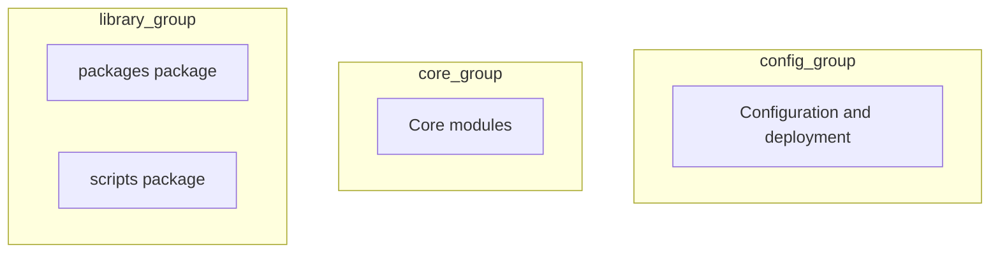

# Architecture report: margelo/react-native-mmkv

> Automated static analysis. **Observed** = directly seen in files/imports/AST; **Inferred** = interpretation from that evidence. Repository code was not executed.

## 1. Repository at a glance

| Item | Value |
| --- | --- |
| Repository | margelo/react-native-mmkv |
| Description | ⚡️ The fastest key/value storage for React Native. ~30x faster than AsyncStorage! |
| Language | TypeScript |
| Stars | 8530 |
| Licence | MIT |
| Analysed commit / branch | 0ec4c96323aee2601f921b1cb8361f6adfc65e13 / main |
| Framework(s) | React |
| Files analysed | 178 |
| Components | 4 |

## 2. Architecture in one minute

margelo/react-native-mmkv - ⚡️ The fastest key/value storage for React Native. ~30x faster than AsyncStorage!. This repository was analysed statically from 178 file(s) (0 Python). Detected technologies (observed from imports/manifests): GitHub Actions, React, Jest, TypeScript. Files are grouped into 4 component(s): Configuration and deployment, Core modules, packages package, scripts package. Findings below distinguish observed facts from inferred interpretation.

## 3. High-level block diagram

## 4. Main components

### Configuration and deployment (`config`)

- **Kind:** config
- **Status:** Observed
- **Confidence:** 0.85
- **Responsibility:** Groups 6 file(s) under configuration and deployment (observed from repository paths and static analysis).
- **Paths:** `bunfig.toml`, `package.json`, `packages/react-native-mmkv/android/build.gradle`, `packages/react-native-mmkv/nitro.json`, `packages/react-native-mmkv/package.json`, `packages/react-native-mmkv/tsconfig.json`
- **Evidence:** [bunfig.toml](https://github.com/margelo/react-native-mmkv/blob/0ec4c96323aee2601f921b1cb8361f6adfc65e13/bunfig.toml); [package.json](https://github.com/margelo/react-native-mmkv/blob/0ec4c96323aee2601f921b1cb8361f6adfc65e13/package.json); [packages/react-native-mmkv/android/build.gradle](https://github.com/margelo/react-native-mmkv/blob/0ec4c96323aee2601f921b1cb8361f6adfc65e13/packages/react-native-mmkv/android/build.gradle); [packages/react-native-mmkv/nitro.json](https://github.com/margelo/react-native-mmkv/blob/0ec4c96323aee2601f921b1cb8361f6adfc65e13/packages/react-native-mmkv/nitro.json); [packages/react-native-mmkv/package.json](https://github.com/margelo/react-native-mmkv/blob/0ec4c96323aee2601f921b1cb8361f6adfc65e13/packages/react-native-mmkv/package.json); [packages/react-native-mmkv/tsconfig.json](https://github.com/margelo/react-native-mmkv/blob/0ec4c96323aee2601f921b1cb8361f6adfc65e13/packages/react-native-mmkv/tsconfig.json)

### Core modules (`core`)

- **Kind:** core
- **Status:** Observed
- **Confidence:** 0.85
- **Responsibility:** Groups 2 file(s) under core modules (observed from repository paths and static analysis).
- **Paths:** `babel.config.js`, `jest.config.js`
- **Evidence:** [babel.config.js](https://github.com/margelo/react-native-mmkv/blob/0ec4c96323aee2601f921b1cb8361f6adfc65e13/babel.config.js); [jest.config.js](https://github.com/margelo/react-native-mmkv/blob/0ec4c96323aee2601f921b1cb8361f6adfc65e13/jest.config.js)

### packages package (`packages`)

- **Kind:** library
- **Status:** Observed
- **Confidence:** 0.85
- **Responsibility:** Groups 51 file(s) under packages package (observed from repository paths and static analysis).
- **Paths:** `packages/react-native-mmkv/__bun_tests__/use-jest-instead.test.ts`, `packages/react-native-mmkv/__mocks__/react-native-nitro-modules.js`, `packages/react-native-mmkv/android/src/main/cpp/cpp-adapter.cpp`, `packages/react-native-mmkv/android/src/main/java/com/margelo/nitro/mmkv/NitroMmkvPackage.java`, `packages/react-native-mmkv/babel.config.js`, `packages/react-native-mmkv/cpp/HybridMMKV.cpp`, `packages/react-native-mmkv/cpp/HybridMMKVFactory.cpp`, `packages/react-native-mmkv/cpp/MMKVValueChangedListenerRegistry.cpp`, `packages/react-native-mmkv/nitrogen/generated/android/NitroMmkvOnLoad.cpp`, `packages/react-native-mmkv/nitrogen/generated/android/c++/JHybridMMKVPlatformContextSpec.cpp`, `packages/react-native-mmkv/nitrogen/generated/ios/NitroMmkv+autolinking.rb`, `packages/react-native-mmkv/nitrogen/generated/ios/NitroMmkv-Swift-Cxx-Bridge.cpp`, `packages/react-native-mmkv/nitrogen/generated/ios/c++/HybridMMKVPlatformContextSpecSwift.cpp`, `packages/react-native-mmkv/nitrogen/generated/shared/c++/HybridMMKVFactorySpec.cpp`, `packages/react-native-mmkv/nitrogen/generated/shared/c++/HybridMMKVPlatformContextSpec.cpp`, `packages/react-native-mmkv/nitrogen/generated/shared/c++/HybridMMKVSpec.cpp`, `packages/react-native-mmkv/react-native.config.js`, `packages/react-native-mmkv/src/__tests__/contentChangedListener.test.ts`, `packages/react-native-mmkv/src/__tests__/hooks.test.tsx`, `packages/react-native-mmkv/src/addContentChangedListener/addContentChangedListener.mock.ts`, `packages/react-native-mmkv/src/addContentChangedListener/addContentChangedListener.ts`, `packages/react-native-mmkv/src/addContentChangedListener/addContentChangedListener.web.ts`, `packages/react-native-mmkv/src/addMemoryWarningListener/addMemoryWarningListener.mock.ts`, `packages/react-native-mmkv/src/addMemoryWarningListener/addMemoryWarningListener.ts`, `packages/react-native-mmkv/src/addMemoryWarningListener/addMemoryWarningListener.web.ts`, `packages/react-native-mmkv/src/createMMKV/createMMKV.ts`, `packages/react-native-mmkv/src/createMMKV/createMMKV.web.ts`, `packages/react-native-mmkv/src/createMMKV/createMockMMKV.ts`, `packages/react-native-mmkv/src/createMMKV/getDefaultMMKVInstance.ts`, `packages/react-native-mmkv/src/deleteMMKV/deleteMMKV.ts`, `packages/react-native-mmkv/src/deleteMMKV/deleteMMKV.web.ts`, `packages/react-native-mmkv/src/existsMMKV/existsMMKV.ts`, `packages/react-native-mmkv/src/existsMMKV/existsMMKV.web.ts`, `packages/react-native-mmkv/src/getMMKVFactory.ts`, `packages/react-native-mmkv/src/hooks/createMMKVHook.ts`, `packages/react-native-mmkv/src/hooks/useMMKV.ts`, `packages/react-native-mmkv/src/hooks/useMMKVBoolean.ts`, `packages/react-native-mmkv/src/hooks/useMMKVBuffer.ts`, `packages/react-native-mmkv/src/hooks/useMMKVKeys.ts`, `packages/react-native-mmkv/src/hooks/useMMKVListener.ts`, `packages/react-native-mmkv/src/hooks/useMMKVNumber.ts`, `packages/react-native-mmkv/src/hooks/useMMKVObject.ts`, `packages/react-native-mmkv/src/hooks/useMMKVString.ts`, `packages/react-native-mmkv/src/index.ts`, `packages/react-native-mmkv/src/isTest.ts`, `packages/react-native-mmkv/src/specs/MMKV.nitro.ts`, `packages/react-native-mmkv/src/specs/MMKVFactory.nitro.ts`, `packages/react-native-mmkv/src/specs/MMKVPlatformContext.nitro.ts`, `packages/react-native-mmkv/src/web/createTextDecoder.ts`, `packages/react-native-mmkv/src/web/createTextEncoder.ts`, `packages/react-native-mmkv/src/web/getLocalStorage.ts`
- **Evidence:** [packages/react-native-mmkv/__bun_tests__/use-jest-instead.test.ts](https://github.com/margelo/react-native-mmkv/blob/0ec4c96323aee2601f921b1cb8361f6adfc65e13/packages/react-native-mmkv/__bun_tests__/use-jest-instead.test.ts); [packages/react-native-mmkv/__mocks__/react-native-nitro-modules.js](https://github.com/margelo/react-native-mmkv/blob/0ec4c96323aee2601f921b1cb8361f6adfc65e13/packages/react-native-mmkv/__mocks__/react-native-nitro-modules.js); [packages/react-native-mmkv/android/src/main/cpp/cpp-adapter.cpp](https://github.com/margelo/react-native-mmkv/blob/0ec4c96323aee2601f921b1cb8361f6adfc65e13/packages/react-native-mmkv/android/src/main/cpp/cpp-adapter.cpp); [packages/react-native-mmkv/android/src/main/java/com/margelo/nitro/mmkv/NitroMmkvPackage.java](https://github.com/margelo/react-native-mmkv/blob/0ec4c96323aee2601f921b1cb8361f6adfc65e13/packages/react-native-mmkv/android/src/main/java/com/margelo/nitro/mmkv/NitroMmkvPackage.java); [packages/react-native-mmkv/babel.config.js](https://github.com/margelo/react-native-mmkv/blob/0ec4c96323aee2601f921b1cb8361f6adfc65e13/packages/react-native-mmkv/babel.config.js); [packages/react-native-mmkv/cpp/HybridMMKV.cpp](https://github.com/margelo/react-native-mmkv/blob/0ec4c96323aee2601f921b1cb8361f6adfc65e13/packages/react-native-mmkv/cpp/HybridMMKV.cpp); [packages/react-native-mmkv/cpp/HybridMMKVFactory.cpp](https://github.com/margelo/react-native-mmkv/blob/0ec4c96323aee2601f921b1cb8361f6adfc65e13/packages/react-native-mmkv/cpp/HybridMMKVFactory.cpp); [packages/react-native-mmkv/cpp/MMKVValueChangedListenerRegistry.cpp](https://github.com/margelo/react-native-mmkv/blob/0ec4c96323aee2601f921b1cb8361f6adfc65e13/packages/react-native-mmkv/cpp/MMKVValueChangedListenerRegistry.cpp)

### scripts package (`scripts`)

- **Kind:** library
- **Status:** Observed
- **Confidence:** 0.85
- **Responsibility:** Groups 2 file(s) under scripts package (observed from repository paths and static analysis).
- **Paths:** `scripts/clang-format.sh`, `scripts/release.sh`
- **Evidence:** [scripts/clang-format.sh](https://github.com/margelo/react-native-mmkv/blob/0ec4c96323aee2601f921b1cb8361f6adfc65e13/scripts/clang-format.sh); [scripts/release.sh](https://github.com/margelo/react-native-mmkv/blob/0ec4c96323aee2601f921b1cb8361f6adfc65e13/scripts/release.sh)

## 5. Execution flow

**Observed** entry point(s):

- [packages/react-native-mmkv/src/index.ts](https://github.com/margelo/react-native-mmkv/blob/0ec4c96323aee2601f921b1cb8361f6adfc65e13/packages/react-native-mmkv/src/index.ts)

Representative flow (derived from observed entry points and the import graph; steps beyond the entry point are **Inferred**):

1. Execution starts at an observed entry point listed above, if present.
2. No internal import relationships between components were observed.

## 6. Project structure

### `(root)`

- `.clang-format` - other (525 bytes)
- `.gitignore` - other (204 bytes)
- `CODE_OF_CONDUCT.md` - docs (5489 bytes)
- `CONTRIBUTING.md` - docs (4729 bytes)
- `LICENSE` - docs (1068 bytes)
- `README.md` - docs (12770 bytes)
- `README_V3.md` - docs (12043 bytes)
- `babel.config.js` - source, JavaScript (286 bytes)
- `bunfig.toml` - config (240 bytes)
- `jest.config.js` - source, JavaScript (977 bytes)
- `package.json` - manifest (2498 bytes)

### `.github`

- `.github/FUNDING.yml` - config (612 bytes)
- `.github/dependabot.yml` - config (314 bytes)
- `.github/funding-octocat.svg` - other (16744 bytes)
- `.github/workflows/build-android-release.yml` - ci, YAML (1431 bytes)
- `.github/workflows/build-android.yml` - ci, YAML (1762 bytes)
- `.github/workflows/build-ios-release.yml` - ci, YAML (2328 bytes)
- `.github/workflows/build-ios.yml` - ci, YAML (2180 bytes)
- `.github/workflows/harness-android.yml` - ci, YAML (4731 bytes)
- `.github/workflows/harness-ios.yml` - ci, YAML (3898 bytes)
- `.github/workflows/harness-web.yml` - ci, YAML (2106 bytes)
- `.github/workflows/lint-cpp.yml` - ci, YAML (957 bytes)
- `.github/workflows/lint-typescript.yml` - ci, YAML (2012 bytes)
- `.github/workflows/run-nitrogen.yml` - ci, YAML (1085 bytes)
- `.github/workflows/test-js.yml` - ci, YAML (501 bytes)
- `.github/workflows/update-lockfiles.yml` - ci, YAML (1303 bytes)

### `docs`

- `docs/HOOKS.md` - docs (1755 bytes)
- `docs/LISTENERS.md` - docs (581 bytes)
- `docs/MIGRATE_FROM_ASYNC_STORAGE.md` - docs (2584 bytes)
- `docs/V4_UPGRADE_GUIDE.md` - docs (3174 bytes)
- `docs/WRAPPER_JOTAI.md` - docs (1505 bytes)
- `docs/WRAPPER_MOBX.md` - docs (503 bytes)
- `docs/WRAPPER_MOBXPERSIST.md` - docs (825 bytes)
- `docs/WRAPPER_REACT_QUERY.md` - docs (1328 bytes)
- `docs/WRAPPER_RECOIL.md` - docs (517 bytes)
- `docs/WRAPPER_REDUX.md` - docs (608 bytes)
- `docs/WRAPPER_TINYBASE.md` - docs (946 bytes)
- `docs/WRAPPER_ZUSTAND_PERSIST_MIDDLEWARE.md` - docs (599 bytes)

### `example`

- `example/.eslintrc.js` - source, JavaScript (64 bytes)
- `example/.gitignore` - other (1085 bytes)
- `example/.prettierrc.js` - source, JavaScript (92 bytes)
- `example/.watchmanconfig` - other (3 bytes)
- `example/Gemfile` - other (500 bytes)
- `example/Gemfile.lock` - other (2966 bytes)
- `example/README.md` - docs (3582 bytes)
- `example/__tests__/MMKV.harness.ts` - source, TypeScript (45048 bytes)
- `example/android/app/build.gradle` - manifest (4738 bytes)
- `example/android/app/proguard-rules.pro` - other (435 bytes)
- `example/android/app/src/main/AndroidManifest.xml` - other (1065 bytes)
- `example/android/app/src/main/java/com/margelo/mmkv/example/MainActivity.kt` - other (862 bytes)
- `example/android/app/src/main/java/com/margelo/mmkv/example/MainApplication.kt` - other (692 bytes)
- `example/android/app/src/main/res/drawable/rn_edit_text_material.xml` - other (1917 bytes)
- `example/android/app/src/main/res/values/strings.xml` - other (74 bytes)
- `example/android/app/src/main/res/values/styles.xml` - other (282 bytes)
- `example/android/build.gradle` - manifest (562 bytes)
- `example/android/gradle.properties` - other (1975 bytes)
- `example/android/gradle/wrapper/gradle-wrapper.properties` - other (339 bytes)
- `example/android/gradlew` - other (8618 bytes)
- `example/android/gradlew.bat` - other (2895 bytes)
- `example/android/settings.gradle` - other (348 bytes)
- `example/app.json` - config (60 bytes)
- `example/babel.config.js` - source, JavaScript (122 bytes)
- `example/index.js` - source, JavaScript (191 bytes)
- `example/index.web.js` - source, JavaScript (629 bytes)
- `example/ios/.xcode.env` - other (482 bytes)
- `example/ios/MmkvExample.xcodeproj/project.pbxproj` - other (19064 bytes)
- `example/ios/MmkvExample.xcodeproj/xcshareddata/xcschemes/MmkvExample.xcscheme` - other (3318 bytes)
- `example/ios/MmkvExample.xcworkspace/contents.xcworkspacedata` - other (229 bytes)
- `example/ios/MmkvExample/AppDelegate.swift` - other (1234 bytes)
- `example/ios/MmkvExample/Images.xcassets/AppIcon.appiconset/Contents.json` - config (849 bytes)
- `example/ios/MmkvExample/Images.xcassets/Contents.json` - config (63 bytes)
- `example/ios/MmkvExample/Info.plist` - other (1626 bytes)
- `example/ios/MmkvExample/LaunchScreen.storyboard` - other (4235 bytes)
- `example/ios/MmkvExample/PrivacyInfo.xcprivacy` - other (986 bytes)
- `example/ios/Podfile` - other (1039 bytes)
- `example/ios/Podfile.lock` - other (67757 bytes)
- `example/jest.config.js` - source, JavaScript (235 bytes)
- `example/metro.config.js` - source, JavaScript (1559 bytes)
- `example/package.json` - manifest (2155 bytes)
- `example/rn-harness.config.mjs` - source, JavaScript (1273 bytes)
- `example/scripts/web-dev.mjs` - source, JavaScript (4251 bytes)
- `example/scripts/web-proxy.mjs` - source, JavaScript (2133 bytes)
- `example/src/App.tsx` - source, TypeScript (3851 bytes)
- `example/tsconfig.json` - config (134 bytes)

### `packages`

- `packages/react-native-mmkv/.gitignore` - other (749 bytes)
- `packages/react-native-mmkv/.watchmanconfig` - other (2 bytes)
- `packages/react-native-mmkv/NitroMmkv.podspec` - other (1757 bytes)
- `packages/react-native-mmkv/README.md` - docs (70 bytes)
- `packages/react-native-mmkv/__bun_tests__/use-jest-instead.test.ts` - source, TypeScript (625 bytes)
- `packages/react-native-mmkv/__mocks__/react-native-nitro-modules.js` - source, JavaScript (244 bytes)
- `packages/react-native-mmkv/android/CMakeLists.txt` - docs (1218 bytes)
- `packages/react-native-mmkv/android/build.gradle` - manifest (3976 bytes)
- `packages/react-native-mmkv/android/fix-prefab.gradle` - other (2231 bytes)
- `packages/react-native-mmkv/android/gradle.properties` - other (154 bytes)
- `packages/react-native-mmkv/android/src/main/AndroidManifest.xml` - other (82 bytes)
- `packages/react-native-mmkv/android/src/main/cpp/cpp-adapter.cpp` - source, C++ (225 bytes)
- `packages/react-native-mmkv/android/src/main/java/com/margelo/nitro/mmkv/HybridMMKVPlatformContext.kt` - other (689 bytes)
- `packages/react-native-mmkv/android/src/main/java/com/margelo/nitro/mmkv/NitroMmkvPackage.java` - source, Java (802 bytes)
- `packages/react-native-mmkv/babel.config.js` - source, JavaScript (71 bytes)
- `packages/react-native-mmkv/cpp/HybridMMKV.cpp` - source, C++ (9342 bytes)
- `packages/react-native-mmkv/cpp/HybridMMKV.hpp` - other (1930 bytes)
- `packages/react-native-mmkv/cpp/HybridMMKVFactory.cpp` - source, C++ (972 bytes)
- `packages/react-native-mmkv/cpp/HybridMMKVFactory.hpp` - other (658 bytes)
- `packages/react-native-mmkv/cpp/MMKVTypes.hpp` - other (1666 bytes)
- `packages/react-native-mmkv/cpp/MMKVValueChangedListenerRegistry.cpp` - source, C++ (2072 bytes)
- `packages/react-native-mmkv/cpp/MMKVValueChangedListenerRegistry.hpp` - other (1133 bytes)
- `packages/react-native-mmkv/cpp/ManagedMMBuffer.hpp` - other (728 bytes)
- `packages/react-native-mmkv/ios/HybridMMKVPlatformContext.swift` - other (1334 bytes)
- `packages/react-native-mmkv/nitro.json` - config (764 bytes)
- `packages/react-native-mmkv/nitrogen/generated/.gitattributes` - other (28 bytes)
- `packages/react-native-mmkv/nitrogen/generated/android/NitroMmkv+autolinking.cmake` - other (2987 bytes)
- `packages/react-native-mmkv/nitrogen/generated/android/NitroMmkv+autolinking.gradle` - other (681 bytes)
- `packages/react-native-mmkv/nitrogen/generated/android/NitroMmkvOnLoad.cpp` - source, C++ (2383 bytes)
- `packages/react-native-mmkv/nitrogen/generated/android/NitroMmkvOnLoad.hpp` - other (1008 bytes)
- `packages/react-native-mmkv/nitrogen/generated/android/c++/JHybridMMKVPlatformContextSpec.cpp` - source, C++ (2398 bytes)
- `packages/react-native-mmkv/nitrogen/generated/android/c++/JHybridMMKVPlatformContextSpec.hpp` - other (2187 bytes)
- `packages/react-native-mmkv/nitrogen/generated/android/kotlin/com/margelo/nitro/mmkv/HybridMMKVPlatformContextSpec.kt` - other (1589 bytes)
- `packages/react-native-mmkv/nitrogen/generated/android/kotlin/com/margelo/nitro/mmkv/NitroMmkvOnLoad.kt` - other (1019 bytes)
- `packages/react-native-mmkv/nitrogen/generated/ios/NitroMmkv+autolinking.rb` - source, Ruby (2124 bytes)
- `packages/react-native-mmkv/nitrogen/generated/ios/NitroMmkv-Swift-Cxx-Bridge.cpp` - source, C++ (1601 bytes)
- `packages/react-native-mmkv/nitrogen/generated/ios/NitroMmkv-Swift-Cxx-Bridge.hpp` - other (3533 bytes)
- `packages/react-native-mmkv/nitrogen/generated/ios/NitroMmkv-Swift-Cxx-Umbrella.hpp` - other (1689 bytes)
- `packages/react-native-mmkv/nitrogen/generated/ios/NitroMmkvAutolinking.mm` - other (1362 bytes)
- `packages/react-native-mmkv/nitrogen/generated/ios/NitroMmkvAutolinking.swift` - other (925 bytes)
- `packages/react-native-mmkv/nitrogen/generated/ios/c++/HybridMMKVPlatformContextSpecSwift.cpp` - source, C++ (316 bytes)
- `packages/react-native-mmkv/nitrogen/generated/ios/c++/HybridMMKVPlatformContextSpecSwift.hpp` - other (2850 bytes)
- `packages/react-native-mmkv/nitrogen/generated/ios/swift/HybridMMKVPlatformContextSpec.swift` - other (1825 bytes)
- `packages/react-native-mmkv/nitrogen/generated/ios/swift/HybridMMKVPlatformContextSpec_cxx.swift` - other (5405 bytes)
- `packages/react-native-mmkv/nitrogen/generated/shared/c++/Configuration.hpp` - other (7349 bytes)
- `packages/react-native-mmkv/nitrogen/generated/shared/c++/EncryptionType.hpp` - other (2886 bytes)
- `packages/react-native-mmkv/nitrogen/generated/shared/c++/HybridMMKVFactorySpec.cpp` - source, C++ (995 bytes)
- `packages/react-native-mmkv/nitrogen/generated/shared/c++/HybridMMKVFactorySpec.hpp` - other (2072 bytes)
- `packages/react-native-mmkv/nitrogen/generated/shared/c++/HybridMMKVPlatformContextSpec.cpp` - source, C++ (770 bytes)
- `packages/react-native-mmkv/nitrogen/generated/shared/c++/HybridMMKVPlatformContextSpec.hpp` - other (1625 bytes)
- `packages/react-native-mmkv/nitrogen/generated/shared/c++/HybridMMKVSpec.cpp` - source, C++ (2251 bytes)
- `packages/react-native-mmkv/nitrogen/generated/shared/c++/HybridMMKVSpec.hpp` - other (3327 bytes)
- `packages/react-native-mmkv/nitrogen/generated/shared/c++/Listener.hpp` - other (2703 bytes)
- `packages/react-native-mmkv/nitrogen/generated/shared/c++/Mode.hpp` - other (2837 bytes)
- `packages/react-native-mmkv/nitrogen/generated/shared/c++/RecoveryStrategy.hpp` - other (3038 bytes)
- `packages/react-native-mmkv/package.json` - manifest (2999 bytes)
- `packages/react-native-mmkv/react-native.config.js` - source, JavaScript (387 bytes)
- `packages/react-native-mmkv/src/__tests__/contentChangedListener.test.ts` - source, TypeScript (1800 bytes)
- `packages/react-native-mmkv/src/__tests__/hooks.test.tsx` - source, TypeScript (3904 bytes)
- `packages/react-native-mmkv/src/addContentChangedListener/addContentChangedListener.mock.ts` - source, TypeScript (148 bytes)
- `packages/react-native-mmkv/src/addContentChangedListener/addContentChangedListener.ts` - source, TypeScript (1014 bytes)
- `packages/react-native-mmkv/src/addContentChangedListener/addContentChangedListener.web.ts` - source, TypeScript (132 bytes)
- `packages/react-native-mmkv/src/addMemoryWarningListener/addMemoryWarningListener.mock.ts` - source, TypeScript (157 bytes)
- `packages/react-native-mmkv/src/addMemoryWarningListener/addMemoryWarningListener.ts` - source, TypeScript (1246 bytes)
- `packages/react-native-mmkv/src/addMemoryWarningListener/addMemoryWarningListener.web.ts` - source, TypeScript (184 bytes)
- `packages/react-native-mmkv/src/createMMKV/createMMKV.ts` - source, TypeScript (1551 bytes)
- `packages/react-native-mmkv/src/createMMKV/createMMKV.web.ts` - source, TypeScript (4579 bytes)
- `packages/react-native-mmkv/src/createMMKV/createMockMMKV.ts` - source, TypeScript (2973 bytes)
- `packages/react-native-mmkv/src/createMMKV/getDefaultMMKVInstance.ts` - source, TypeScript (279 bytes)
- `packages/react-native-mmkv/src/deleteMMKV/deleteMMKV.ts` - source, TypeScript (245 bytes)
- `packages/react-native-mmkv/src/deleteMMKV/deleteMMKV.web.ts` - source, TypeScript (437 bytes)
- `packages/react-native-mmkv/src/existsMMKV/existsMMKV.ts` - source, TypeScript (245 bytes)
- `packages/react-native-mmkv/src/existsMMKV/existsMMKV.web.ts` - source, TypeScript (312 bytes)
- `packages/react-native-mmkv/src/getMMKVFactory.ts` - source, TypeScript (923 bytes)
- `packages/react-native-mmkv/src/hooks/createMMKVHook.ts` - source, TypeScript (2218 bytes)
- `packages/react-native-mmkv/src/hooks/useMMKV.ts` - source, TypeScript (1595 bytes)
- `packages/react-native-mmkv/src/hooks/useMMKVBoolean.ts` - source, TypeScript (423 bytes)
- `packages/react-native-mmkv/src/hooks/useMMKVBuffer.ts` - source, TypeScript (433 bytes)
- `packages/react-native-mmkv/src/hooks/useMMKVKeys.ts` - source, TypeScript (1061 bytes)
- `packages/react-native-mmkv/src/hooks/useMMKVListener.ts` - source, TypeScript (1020 bytes)
- `packages/react-native-mmkv/src/hooks/useMMKVNumber.ts` - source, TypeScript (387 bytes)
- `packages/react-native-mmkv/src/hooks/useMMKVObject.ts` - source, TypeScript (1535 bytes)
- `packages/react-native-mmkv/src/hooks/useMMKVString.ts` - source, TypeScript (398 bytes)
- `packages/react-native-mmkv/src/index.ts` - source, TypeScript (797 bytes)
- `packages/react-native-mmkv/src/isTest.ts` - source, TypeScript (255 bytes)
- `packages/react-native-mmkv/src/specs/MMKV.nitro.ts` - source, TypeScript (4871 bytes)
- `packages/react-native-mmkv/src/specs/MMKVFactory.nitro.ts` - source, TypeScript (4585 bytes)
- `packages/react-native-mmkv/src/specs/MMKVPlatformContext.nitro.ts` - source, TypeScript (533 bytes)
- `packages/react-native-mmkv/src/web/createTextDecoder.ts` - source, TypeScript (369 bytes)
- `packages/react-native-mmkv/src/web/createTextEncoder.ts` - source, TypeScript (437 bytes)
- `packages/react-native-mmkv/src/web/getLocalStorage.ts` - source, TypeScript (1178 bytes)
- `packages/react-native-mmkv/tsconfig.json` - config (733 bytes)

### `scripts`

- `scripts/clang-format.sh` - source, Shell (645 bytes)
- `scripts/release.sh` - source, Shell (313 bytes)

## 7. Key dependencies and integrations

| Name | Category | Status | Confidence | Evidence |
| --- | --- | --- | --- | --- |
| GitHub Actions | ci | Observed | 0.90 | [.github/workflows/build-android-release.yml](https://github.com/margelo/react-native-mmkv/blob/0ec4c96323aee2601f921b1cb8361f6adfc65e13/.github/workflows/build-android-release.yml); [.github/workflows/build-android.yml](https://github.com/margelo/react-native-mmkv/blob/0ec4c96323aee2601f921b1cb8361f6adfc65e13/.github/workflows/build-android.yml); [.github/workflows/build-ios-release.yml](https://github.com/margelo/react-native-mmkv/blob/0ec4c96323aee2601f921b1cb8361f6adfc65e13/.github/workflows/build-ios-release.yml); [.github/workflows/build-ios.yml](https://github.com/margelo/react-native-mmkv/blob/0ec4c96323aee2601f921b1cb8361f6adfc65e13/.github/workflows/build-ios.yml) |
| React | framework | Observed | 0.90 | [example/package.json:6](https://github.com/margelo/react-native-mmkv/blob/0ec4c96323aee2601f921b1cb8361f6adfc65e13/example/package.json#L6); [example/package.json:24](https://github.com/margelo/react-native-mmkv/blob/0ec4c96323aee2601f921b1cb8361f6adfc65e13/example/package.json#L24); [packages/react-native-mmkv/package.json:2](https://github.com/margelo/react-native-mmkv/blob/0ec4c96323aee2601f921b1cb8361f6adfc65e13/packages/react-native-mmkv/package.json#L2); [packages/react-native-mmkv/package.json:67](https://github.com/margelo/react-native-mmkv/blob/0ec4c96323aee2601f921b1cb8361f6adfc65e13/packages/react-native-mmkv/package.json#L67) |
| Jest | tooling | Observed | 0.85 | [example/package.json:11](https://github.com/margelo/react-native-mmkv/blob/0ec4c96323aee2601f921b1cb8361f6adfc65e13/example/package.json#L11) |
| TypeScript | tooling | Observed | 0.90 | [example/package.json:45](https://github.com/margelo/react-native-mmkv/blob/0ec4c96323aee2601f921b1cb8361f6adfc65e13/example/package.json#L45); [packages/react-native-mmkv/package.json:38](https://github.com/margelo/react-native-mmkv/blob/0ec4c96323aee2601f921b1cb8361f6adfc65e13/packages/react-native-mmkv/package.json#L38) |

## 8. Data and state

No database, cache, queue, or persistent-state usage was observed in the analysed files. State handling, if any, may be in-memory or in files that were not analysed.

## 9. Configuration and deployment clues

- `.github/FUNDING.yml` (config)
- `.github/dependabot.yml` (config)
- `.github/workflows/build-android-release.yml` (ci)
- `.github/workflows/build-android.yml` (ci)
- `.github/workflows/build-ios-release.yml` (ci)
- `.github/workflows/build-ios.yml` (ci)
- `.github/workflows/harness-android.yml` (ci)
- `.github/workflows/harness-ios.yml` (ci)
- `.github/workflows/harness-web.yml` (ci)
- `.github/workflows/lint-cpp.yml` (ci)
- `.github/workflows/lint-typescript.yml` (ci)
- `.github/workflows/run-nitrogen.yml` (ci)
- `.github/workflows/test-js.yml` (ci)
- `.github/workflows/update-lockfiles.yml` (ci)
- `bunfig.toml` (config)
- `example/android/app/build.gradle` (manifest)
- `example/android/build.gradle` (manifest)
- `example/app.json` (config)
- `example/ios/MmkvExample/Images.xcassets/AppIcon.appiconset/Contents.json` (config)
- `example/ios/MmkvExample/Images.xcassets/Contents.json` (config)
- `example/package.json` (manifest)
- `example/tsconfig.json` (config)
- `package.json` (manifest)
- `packages/react-native-mmkv/android/build.gradle` (manifest)
- `packages/react-native-mmkv/nitro.json` (config)
- `packages/react-native-mmkv/package.json` (manifest)
- `packages/react-native-mmkv/tsconfig.json` (config)

## 10. Design observations

- No strong design patterns could be established from the available evidence.

These observations are interpretations (**Inferred**) of the observed structure, not guarantees about runtime design.

## 11. Limitations and unknowns

- Static analysis only: repository code was not executed, installed, or imported at runtime.
- Components and relationships are inferred from file paths, imports, and AST structure; runtime behaviour, dynamic imports, and reflection may not be visible.
- No clear application entry point was observed in the analysed files.
- Repository text was treated as untrusted data; no instructions found in repository files were followed, and likely secret values were redacted/excluded.
- JavaScript and TypeScript files were inventoried from paths and package manifests. They were not parsed with a full language AST, and repository code was not executed.

## 12. Source references

- [.github/workflows/build-android-release.yml](https://github.com/margelo/react-native-mmkv/blob/0ec4c96323aee2601f921b1cb8361f6adfc65e13/.github/workflows/build-android-release.yml)
- [.github/workflows/build-android.yml](https://github.com/margelo/react-native-mmkv/blob/0ec4c96323aee2601f921b1cb8361f6adfc65e13/.github/workflows/build-android.yml)
- [.github/workflows/build-ios-release.yml](https://github.com/margelo/react-native-mmkv/blob/0ec4c96323aee2601f921b1cb8361f6adfc65e13/.github/workflows/build-ios-release.yml)
- [.github/workflows/build-ios.yml](https://github.com/margelo/react-native-mmkv/blob/0ec4c96323aee2601f921b1cb8361f6adfc65e13/.github/workflows/build-ios.yml)
- [.github/workflows/harness-android.yml](https://github.com/margelo/react-native-mmkv/blob/0ec4c96323aee2601f921b1cb8361f6adfc65e13/.github/workflows/harness-android.yml)
- [.github/workflows/harness-ios.yml](https://github.com/margelo/react-native-mmkv/blob/0ec4c96323aee2601f921b1cb8361f6adfc65e13/.github/workflows/harness-ios.yml)
- [.github/workflows/harness-web.yml](https://github.com/margelo/react-native-mmkv/blob/0ec4c96323aee2601f921b1cb8361f6adfc65e13/.github/workflows/harness-web.yml)
- [.github/workflows/lint-cpp.yml](https://github.com/margelo/react-native-mmkv/blob/0ec4c96323aee2601f921b1cb8361f6adfc65e13/.github/workflows/lint-cpp.yml)
- [babel.config.js](https://github.com/margelo/react-native-mmkv/blob/0ec4c96323aee2601f921b1cb8361f6adfc65e13/babel.config.js)
- [bunfig.toml](https://github.com/margelo/react-native-mmkv/blob/0ec4c96323aee2601f921b1cb8361f6adfc65e13/bunfig.toml)
- [example/package.json:6](https://github.com/margelo/react-native-mmkv/blob/0ec4c96323aee2601f921b1cb8361f6adfc65e13/example/package.json#L6)
- [example/package.json:11](https://github.com/margelo/react-native-mmkv/blob/0ec4c96323aee2601f921b1cb8361f6adfc65e13/example/package.json#L11)
- [example/package.json:24](https://github.com/margelo/react-native-mmkv/blob/0ec4c96323aee2601f921b1cb8361f6adfc65e13/example/package.json#L24)
- [example/package.json:45](https://github.com/margelo/react-native-mmkv/blob/0ec4c96323aee2601f921b1cb8361f6adfc65e13/example/package.json#L45)
- [jest.config.js](https://github.com/margelo/react-native-mmkv/blob/0ec4c96323aee2601f921b1cb8361f6adfc65e13/jest.config.js)
- [package.json](https://github.com/margelo/react-native-mmkv/blob/0ec4c96323aee2601f921b1cb8361f6adfc65e13/package.json)
- [packages/react-native-mmkv/__bun_tests__/use-jest-instead.test.ts](https://github.com/margelo/react-native-mmkv/blob/0ec4c96323aee2601f921b1cb8361f6adfc65e13/packages/react-native-mmkv/__bun_tests__/use-jest-instead.test.ts)
- [packages/react-native-mmkv/__mocks__/react-native-nitro-modules.js](https://github.com/margelo/react-native-mmkv/blob/0ec4c96323aee2601f921b1cb8361f6adfc65e13/packages/react-native-mmkv/__mocks__/react-native-nitro-modules.js)
- [packages/react-native-mmkv/android/build.gradle](https://github.com/margelo/react-native-mmkv/blob/0ec4c96323aee2601f921b1cb8361f6adfc65e13/packages/react-native-mmkv/android/build.gradle)
- [packages/react-native-mmkv/android/src/main/cpp/cpp-adapter.cpp](https://github.com/margelo/react-native-mmkv/blob/0ec4c96323aee2601f921b1cb8361f6adfc65e13/packages/react-native-mmkv/android/src/main/cpp/cpp-adapter.cpp)
- [packages/react-native-mmkv/android/src/main/java/com/margelo/nitro/mmkv/NitroMmkvPackage.java](https://github.com/margelo/react-native-mmkv/blob/0ec4c96323aee2601f921b1cb8361f6adfc65e13/packages/react-native-mmkv/android/src/main/java/com/margelo/nitro/mmkv/NitroMmkvPackage.java)
- [packages/react-native-mmkv/babel.config.js](https://github.com/margelo/react-native-mmkv/blob/0ec4c96323aee2601f921b1cb8361f6adfc65e13/packages/react-native-mmkv/babel.config.js)
- [packages/react-native-mmkv/cpp/HybridMMKV.cpp](https://github.com/margelo/react-native-mmkv/blob/0ec4c96323aee2601f921b1cb8361f6adfc65e13/packages/react-native-mmkv/cpp/HybridMMKV.cpp)
- [packages/react-native-mmkv/cpp/HybridMMKVFactory.cpp](https://github.com/margelo/react-native-mmkv/blob/0ec4c96323aee2601f921b1cb8361f6adfc65e13/packages/react-native-mmkv/cpp/HybridMMKVFactory.cpp)
- [packages/react-native-mmkv/cpp/MMKVValueChangedListenerRegistry.cpp](https://github.com/margelo/react-native-mmkv/blob/0ec4c96323aee2601f921b1cb8361f6adfc65e13/packages/react-native-mmkv/cpp/MMKVValueChangedListenerRegistry.cpp)
- [packages/react-native-mmkv/nitro.json](https://github.com/margelo/react-native-mmkv/blob/0ec4c96323aee2601f921b1cb8361f6adfc65e13/packages/react-native-mmkv/nitro.json)
- [packages/react-native-mmkv/package.json](https://github.com/margelo/react-native-mmkv/blob/0ec4c96323aee2601f921b1cb8361f6adfc65e13/packages/react-native-mmkv/package.json)
- [packages/react-native-mmkv/package.json:2](https://github.com/margelo/react-native-mmkv/blob/0ec4c96323aee2601f921b1cb8361f6adfc65e13/packages/react-native-mmkv/package.json#L2)
- [packages/react-native-mmkv/package.json:38](https://github.com/margelo/react-native-mmkv/blob/0ec4c96323aee2601f921b1cb8361f6adfc65e13/packages/react-native-mmkv/package.json#L38)
- [packages/react-native-mmkv/package.json:67](https://github.com/margelo/react-native-mmkv/blob/0ec4c96323aee2601f921b1cb8361f6adfc65e13/packages/react-native-mmkv/package.json#L67)
- [packages/react-native-mmkv/src/index.ts](https://github.com/margelo/react-native-mmkv/blob/0ec4c96323aee2601f921b1cb8361f6adfc65e13/packages/react-native-mmkv/src/index.ts)
- [packages/react-native-mmkv/tsconfig.json](https://github.com/margelo/react-native-mmkv/blob/0ec4c96323aee2601f921b1cb8361f6adfc65e13/packages/react-native-mmkv/tsconfig.json)
- [scripts/clang-format.sh](https://github.com/margelo/react-native-mmkv/blob/0ec4c96323aee2601f921b1cb8361f6adfc65e13/scripts/clang-format.sh)
- [scripts/release.sh](https://github.com/margelo/react-native-mmkv/blob/0ec4c96323aee2601f921b1cb8361f6adfc65e13/scripts/release.sh)
