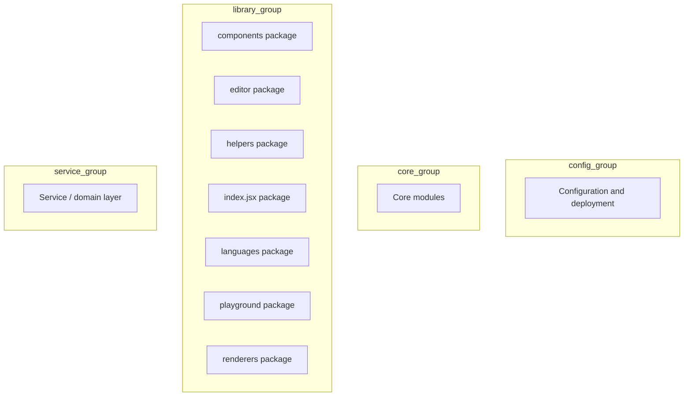

# Architecture report: margox/braft-editor

> Automated static analysis. **Observed** = directly seen in files/imports/AST; **Inferred** = interpretation from that evidence. Repository code was not executed.

## 1. Repository at a glance

| Item | Value |
| --- | --- |
| Repository | margox/braft-editor |
| Description | 美观易用的React富文本编辑器，基于draft-js开发 |
| Language | JavaScript |
| Stars | 4573 |
| Licence | MIT |
| Analysed commit / branch | 099025513256bf74ca48d98698a5f837130f6262 / master |
| Framework(s) | Express, React |
| Files analysed | 108 |
| Components | 10 |

## 2. Architecture in one minute

margox/braft-editor - 美观易用的React富文本编辑器，基于draft-js开发. This repository was analysed statically from 108 file(s) (0 Python). Detected technologies (observed from imports/manifests): Express, React, webpack. Files are grouped into 10 component(s): components package, Configuration and deployment, Core modules, editor package, helpers package, index.jsx package, languages package, playground package. Findings below distinguish observed facts from inferred interpretation.

## 3. High-level block diagram

## 4. Main components

### components package (`components`)

- **Kind:** library
- **Status:** Observed
- **Confidence:** 0.85
- **Responsibility:** Groups 4 file(s) under components package (observed from repository paths and static analysis).
- **Paths:** `src/components/common/ColorPicker/index.jsx`, `src/components/common/DropDown/index.jsx`, `src/components/common/Modal/index.jsx`, `src/components/common/Switch/index.jsx`
- **Evidence:** [src/components/common/ColorPicker/index.jsx](https://github.com/margox/braft-editor/blob/099025513256bf74ca48d98698a5f837130f6262/src/components/common/ColorPicker/index.jsx); [src/components/common/DropDown/index.jsx](https://github.com/margox/braft-editor/blob/099025513256bf74ca48d98698a5f837130f6262/src/components/common/DropDown/index.jsx); [src/components/common/Modal/index.jsx](https://github.com/margox/braft-editor/blob/099025513256bf74ca48d98698a5f837130f6262/src/components/common/Modal/index.jsx); [src/components/common/Switch/index.jsx](https://github.com/margox/braft-editor/blob/099025513256bf74ca48d98698a5f837130f6262/src/components/common/Switch/index.jsx)

### Configuration and deployment (`config`)

- **Kind:** config
- **Status:** Observed
- **Confidence:** 0.85
- **Responsibility:** Groups 9 file(s) under configuration and deployment (observed from repository paths and static analysis).
- **Paths:** `jsconfig.json`, `package.json`, `src/assets/icons/icons.json`, `src/configs/controls.js`, `src/configs/handlers.js`, `src/configs/keybindings.js`, `src/configs/maps.js`, `src/configs/props.js`, `tea.yaml`
- **Evidence:** [jsconfig.json](https://github.com/margox/braft-editor/blob/099025513256bf74ca48d98698a5f837130f6262/jsconfig.json); [package.json](https://github.com/margox/braft-editor/blob/099025513256bf74ca48d98698a5f837130f6262/package.json); [src/assets/icons/icons.json](https://github.com/margox/braft-editor/blob/099025513256bf74ca48d98698a5f837130f6262/src/assets/icons/icons.json); [src/configs/controls.js](https://github.com/margox/braft-editor/blob/099025513256bf74ca48d98698a5f837130f6262/src/configs/controls.js); [src/configs/handlers.js](https://github.com/margox/braft-editor/blob/099025513256bf74ca48d98698a5f837130f6262/src/configs/handlers.js); [src/configs/keybindings.js](https://github.com/margox/braft-editor/blob/099025513256bf74ca48d98698a5f837130f6262/src/configs/keybindings.js); [src/configs/maps.js](https://github.com/margox/braft-editor/blob/099025513256bf74ca48d98698a5f837130f6262/src/configs/maps.js); [src/configs/props.js](https://github.com/margox/braft-editor/blob/099025513256bf74ca48d98698a5f837130f6262/src/configs/props.js)

### Core modules (`core`)

- **Kind:** core
- **Status:** Observed
- **Confidence:** 0.85
- **Responsibility:** Groups 1 file(s) under core modules (observed from repository paths and static analysis).
- **Paths:** `index.d.ts`
- **Evidence:** [index.d.ts](https://github.com/margox/braft-editor/blob/099025513256bf74ca48d98698a5f837130f6262/index.d.ts)

### editor package (`editor`)

- **Kind:** library
- **Status:** Observed
- **Confidence:** 0.85
- **Responsibility:** Groups 1 file(s) under editor package (observed from repository paths and static analysis).
- **Paths:** `src/editor/index.jsx`
- **Evidence:** [src/editor/index.jsx](https://github.com/margox/braft-editor/blob/099025513256bf74ca48d98698a5f837130f6262/src/editor/index.jsx)

### helpers package (`helpers`)

- **Kind:** library
- **Status:** Observed
- **Confidence:** 0.85
- **Responsibility:** Groups 2 file(s) under helpers package (observed from repository paths and static analysis).
- **Paths:** `src/helpers/extension.js`, `src/helpers/responsive.js`
- **Evidence:** [src/helpers/extension.js](https://github.com/margox/braft-editor/blob/099025513256bf74ca48d98698a5f837130f6262/src/helpers/extension.js); [src/helpers/responsive.js](https://github.com/margox/braft-editor/blob/099025513256bf74ca48d98698a5f837130f6262/src/helpers/responsive.js)

### index.jsx package (`index_jsx`)

- **Kind:** library
- **Status:** Observed
- **Confidence:** 0.85
- **Responsibility:** Groups 1 file(s) under index.jsx package (observed from repository paths and static analysis).
- **Paths:** `src/index.jsx`
- **Evidence:** [src/index.jsx](https://github.com/margox/braft-editor/blob/099025513256bf74ca48d98698a5f837130f6262/src/index.jsx)

### languages package (`languages`)

- **Kind:** library
- **Status:** Observed
- **Confidence:** 0.85
- **Responsibility:** Groups 15 file(s) under languages package (observed from repository paths and static analysis).
- **Paths:** `src/languages/en.js`, `src/languages/fa.js`, `src/languages/fr.js`, `src/languages/index.js`, `src/languages/is.js`, `src/languages/jpn.js`, `src/languages/kr.js`, `src/languages/nl.js`, `src/languages/pl.js`, `src/languages/pt-br.js`, `src/languages/ru.js`, `src/languages/tr.js`, `src/languages/vi-vn.js`, `src/languages/zh-hant.js`, `src/languages/zh.js`
- **Evidence:** [src/languages/en.js](https://github.com/margox/braft-editor/blob/099025513256bf74ca48d98698a5f837130f6262/src/languages/en.js); [src/languages/fa.js](https://github.com/margox/braft-editor/blob/099025513256bf74ca48d98698a5f837130f6262/src/languages/fa.js); [src/languages/fr.js](https://github.com/margox/braft-editor/blob/099025513256bf74ca48d98698a5f837130f6262/src/languages/fr.js); [src/languages/index.js](https://github.com/margox/braft-editor/blob/099025513256bf74ca48d98698a5f837130f6262/src/languages/index.js); [src/languages/is.js](https://github.com/margox/braft-editor/blob/099025513256bf74ca48d98698a5f837130f6262/src/languages/is.js); [src/languages/jpn.js](https://github.com/margox/braft-editor/blob/099025513256bf74ca48d98698a5f837130f6262/src/languages/jpn.js); [src/languages/kr.js](https://github.com/margox/braft-editor/blob/099025513256bf74ca48d98698a5f837130f6262/src/languages/kr.js); [src/languages/nl.js](https://github.com/margox/braft-editor/blob/099025513256bf74ca48d98698a5f837130f6262/src/languages/nl.js)

### playground package (`playground`)

- **Kind:** library
- **Status:** Observed
- **Confidence:** 0.85
- **Responsibility:** Groups 10 file(s) under playground package (observed from repository paths and static analysis).
- **Paths:** `playground/argv.js`, `playground/devMiddlewares.js`, `playground/index.jsx`, `playground/logger.js`, `playground/port.js`, `playground/server.js`, `playground/webpack/scss-output.js`, `playground/webpack/webpack.base.js`, `playground/webpack/webpack.config.dev.js`, `playground/webpack/webpack.config.prod.js`
- **Evidence:** [playground/argv.js](https://github.com/margox/braft-editor/blob/099025513256bf74ca48d98698a5f837130f6262/playground/argv.js); [playground/devMiddlewares.js](https://github.com/margox/braft-editor/blob/099025513256bf74ca48d98698a5f837130f6262/playground/devMiddlewares.js); [playground/index.jsx](https://github.com/margox/braft-editor/blob/099025513256bf74ca48d98698a5f837130f6262/playground/index.jsx); [playground/logger.js](https://github.com/margox/braft-editor/blob/099025513256bf74ca48d98698a5f837130f6262/playground/logger.js); [playground/port.js](https://github.com/margox/braft-editor/blob/099025513256bf74ca48d98698a5f837130f6262/playground/port.js); [playground/server.js](https://github.com/margox/braft-editor/blob/099025513256bf74ca48d98698a5f837130f6262/playground/server.js); [playground/webpack/scss-output.js](https://github.com/margox/braft-editor/blob/099025513256bf74ca48d98698a5f837130f6262/playground/webpack/scss-output.js); [playground/webpack/webpack.base.js](https://github.com/margox/braft-editor/blob/099025513256bf74ca48d98698a5f837130f6262/playground/webpack/webpack.base.js)

### renderers package (`renderers`)

- **Kind:** library
- **Status:** Observed
- **Confidence:** 0.85
- **Responsibility:** Groups 13 file(s) under renderers package (observed from repository paths and static analysis).
- **Paths:** `src/renderers/atomics/Audio/index.jsx`, `src/renderers/atomics/Embed/index.jsx`, `src/renderers/atomics/HorizontalLine/index.jsx`, `src/renderers/atomics/Image/index.jsx`, `src/renderers/atomics/Video/index.jsx`, `src/renderers/block/blockRenderMap.js`, `src/renderers/block/blockRendererFn.js`, `src/renderers/block/blockStyleFn.js`, `src/renderers/decorators/Link/index.jsx`, `src/renderers/decorators/index.js`, `src/renderers/index.js`, `src/renderers/inline/inlineStyleFn.js`, `src/renderers/inline/inlineStyleMap.js`
- **Evidence:** [src/renderers/atomics/Audio/index.jsx](https://github.com/margox/braft-editor/blob/099025513256bf74ca48d98698a5f837130f6262/src/renderers/atomics/Audio/index.jsx); [src/renderers/atomics/Embed/index.jsx](https://github.com/margox/braft-editor/blob/099025513256bf74ca48d98698a5f837130f6262/src/renderers/atomics/Embed/index.jsx); [src/renderers/atomics/HorizontalLine/index.jsx](https://github.com/margox/braft-editor/blob/099025513256bf74ca48d98698a5f837130f6262/src/renderers/atomics/HorizontalLine/index.jsx); [src/renderers/atomics/Image/index.jsx](https://github.com/margox/braft-editor/blob/099025513256bf74ca48d98698a5f837130f6262/src/renderers/atomics/Image/index.jsx); [src/renderers/atomics/Video/index.jsx](https://github.com/margox/braft-editor/blob/099025513256bf74ca48d98698a5f837130f6262/src/renderers/atomics/Video/index.jsx); [src/renderers/block/blockRenderMap.js](https://github.com/margox/braft-editor/blob/099025513256bf74ca48d98698a5f837130f6262/src/renderers/block/blockRenderMap.js); [src/renderers/block/blockRendererFn.js](https://github.com/margox/braft-editor/blob/099025513256bf74ca48d98698a5f837130f6262/src/renderers/block/blockRendererFn.js); [src/renderers/block/blockStyleFn.js](https://github.com/margox/braft-editor/blob/099025513256bf74ca48d98698a5f837130f6262/src/renderers/block/blockStyleFn.js)

### Service / domain layer (`service_layer`)

- **Kind:** service
- **Status:** Observed
- **Confidence:** 0.85
- **Responsibility:** Groups 13 file(s) under service / domain layer (observed from repository paths and static analysis).
- **Paths:** `src/components/business/ControlBar/index.jsx`, `src/components/business/ControlGroup/index.jsx`, `src/components/business/EmojiPicker/index.jsx`, `src/components/business/FontFamily/index.jsx`, `src/components/business/FontSize/index.jsx`, `src/components/business/Headings/index.jsx`, `src/components/business/LetterSpacing/index.jsx`, `src/components/business/LineHeight/index.jsx`, `src/components/business/LinkEditor/index.jsx`, `src/components/business/PlayerModal/index.jsx`, `src/components/business/TextAlign/index.jsx`, `src/components/business/TextColor/index.jsx`, `src/components/business/TextIndent/index.jsx`
- **Evidence:** [src/components/business/ControlBar/index.jsx](https://github.com/margox/braft-editor/blob/099025513256bf74ca48d98698a5f837130f6262/src/components/business/ControlBar/index.jsx); [src/components/business/ControlGroup/index.jsx](https://github.com/margox/braft-editor/blob/099025513256bf74ca48d98698a5f837130f6262/src/components/business/ControlGroup/index.jsx); [src/components/business/EmojiPicker/index.jsx](https://github.com/margox/braft-editor/blob/099025513256bf74ca48d98698a5f837130f6262/src/components/business/EmojiPicker/index.jsx); [src/components/business/FontFamily/index.jsx](https://github.com/margox/braft-editor/blob/099025513256bf74ca48d98698a5f837130f6262/src/components/business/FontFamily/index.jsx); [src/components/business/FontSize/index.jsx](https://github.com/margox/braft-editor/blob/099025513256bf74ca48d98698a5f837130f6262/src/components/business/FontSize/index.jsx); [src/components/business/Headings/index.jsx](https://github.com/margox/braft-editor/blob/099025513256bf74ca48d98698a5f837130f6262/src/components/business/Headings/index.jsx); [src/components/business/LetterSpacing/index.jsx](https://github.com/margox/braft-editor/blob/099025513256bf74ca48d98698a5f837130f6262/src/components/business/LetterSpacing/index.jsx); [src/components/business/LineHeight/index.jsx](https://github.com/margox/braft-editor/blob/099025513256bf74ca48d98698a5f837130f6262/src/components/business/LineHeight/index.jsx)

## 5. Execution flow

**Observed** entry point(s):

- [playground/index.jsx](https://github.com/margox/braft-editor/blob/099025513256bf74ca48d98698a5f837130f6262/playground/index.jsx)
- [playground/server.js](https://github.com/margox/braft-editor/blob/099025513256bf74ca48d98698a5f837130f6262/playground/server.js)
- [src/editor/index.jsx](https://github.com/margox/braft-editor/blob/099025513256bf74ca48d98698a5f837130f6262/src/editor/index.jsx)
- [src/index.jsx](https://github.com/margox/braft-editor/blob/099025513256bf74ca48d98698a5f837130f6262/src/index.jsx)
- [src/languages/index.js](https://github.com/margox/braft-editor/blob/099025513256bf74ca48d98698a5f837130f6262/src/languages/index.js)
- [src/renderers/decorators/index.js](https://github.com/margox/braft-editor/blob/099025513256bf74ca48d98698a5f837130f6262/src/renderers/decorators/index.js)
- [src/renderers/index.js](https://github.com/margox/braft-editor/blob/099025513256bf74ca48d98698a5f837130f6262/src/renderers/index.js)

Representative flow (derived from observed entry points and the import graph; steps beyond the entry point are **Inferred**):

1. Execution starts at an observed entry point listed above, if present.
2. No internal import relationships between components were observed.

## 6. Project structure

### `(root)`

- `.babelrc` - other (326 bytes)
- `.editorconfig` - config (208 bytes)
- `.eslintignore` - other (38 bytes)
- `.eslintrc.js` - source, JavaScript (2891 bytes)
- `.gitattributes` - other (119 bytes)
- `.gitignore` - other (388 bytes)
- `.npmignore` - other (167 bytes)
- `.prettierignore` - other (55 bytes)
- `.prettierrc` - other (151 bytes)
- `CHANGELOG.md` - docs (18314 bytes)
- `LICENSE` - docs (1082 bytes)
- `README.md` - docs (10143 bytes)
- `index.d.ts` - source, TypeScript (7118 bytes)
- `jsconfig.json` - config (277 bytes)
- `package.json` - manifest (3242 bytes)
- `tea.yaml` - config (126 bytes)

### `.vscode`

- `.vscode/settings.json` - config (316 bytes)

### `playground`

- `playground/argv.js` - source, JavaScript (201 bytes)
- `playground/devMiddlewares.js` - source, JavaScript (1599 bytes)
- `playground/index.html` - other (1136 bytes)
- `playground/index.jsx` - source, JavaScript (2308 bytes)
- `playground/logger.js` - source, JavaScript (1112 bytes)
- `playground/port.js` - source, JavaScript (105 bytes)
- `playground/server.js` - source, JavaScript (1361 bytes)
- `playground/webpack/scss-output.js` - source, JavaScript (468 bytes)
- `playground/webpack/webpack.base.js` - source, JavaScript (1423 bytes)
- `playground/webpack/webpack.config.dev.js` - source, JavaScript (722 bytes)
- `playground/webpack/webpack.config.prod.js` - source, JavaScript (1306 bytes)

### `src`

- `src/assets/icons/icons.json` - config (45529 bytes)
- `src/assets/scss/_base.scss` - other (48 bytes)
- `src/assets/scss/_braft.scss` - other (5503 bytes)
- `src/assets/scss/_config.scss` - other (91 bytes)
- `src/assets/scss/_icons.scss` - other (4327 bytes)
- `src/assets/scss/_inc.scss` - other (17 bytes)
- `src/assets/scss/output.scss` - other (751 bytes)
- `src/components/business/ControlBar/index.jsx` - source, JavaScript (17855 bytes)
- `src/components/business/ControlBar/style.scss` - other (2691 bytes)
- `src/components/business/ControlGroup/index.jsx` - source, JavaScript (251 bytes)
- `src/components/business/EmojiPicker/index.jsx` - source, JavaScript (1553 bytes)
- `src/components/business/EmojiPicker/style.scss` - other (1118 bytes)
- `src/components/business/FontFamily/index.jsx` - source, JavaScript (2347 bytes)
- `src/components/business/FontFamily/style.scss` - other (129 bytes)
- `src/components/business/FontSize/index.jsx` - source, JavaScript (2124 bytes)
- `src/components/business/FontSize/style.scss` - other (611 bytes)
- `src/components/business/Headings/index.jsx` - source, JavaScript (1749 bytes)
- `src/components/business/Headings/style.scss` - other (549 bytes)
- `src/components/business/LetterSpacing/index.jsx` - source, JavaScript (2330 bytes)
- `src/components/business/LetterSpacing/style.scss` - other (621 bytes)
- `src/components/business/LineHeight/index.jsx` - source, JavaScript (2188 bytes)
- `src/components/business/LineHeight/style.scss` - other (615 bytes)
- `src/components/business/LinkEditor/index.jsx` - source, JavaScript (6465 bytes)
- `src/components/business/LinkEditor/style.scss` - other (1436 bytes)
- `src/components/business/PlayerModal/index.jsx` - source, JavaScript (1555 bytes)
- `src/components/business/PlayerModal/style.scss` - other (1909 bytes)
- `src/components/business/TextAlign/index.jsx` - source, JavaScript (2038 bytes)
- `src/components/business/TextColor/index.jsx` - source, JavaScript (4066 bytes)
- `src/components/business/TextColor/style.scss` - other (929 bytes)
- `src/components/business/TextIndent/index.jsx` - source, JavaScript (2128 bytes)
- `src/components/common/ColorPicker/index.jsx` - source, JavaScript (1179 bytes)
- `src/components/common/ColorPicker/style.scss` - other (549 bytes)
- `src/components/common/DropDown/index.jsx` - source, JavaScript (4473 bytes)
- `src/components/common/DropDown/style.scss` - other (3133 bytes)
- `src/components/common/Modal/index.jsx` - source, JavaScript (6661 bytes)
- `src/components/common/Modal/style.scss` - other (1941 bytes)
- `src/components/common/Switch/index.jsx` - source, JavaScript (573 bytes)
- `src/components/common/Switch/style.scss` - other (494 bytes)
- `src/configs/controls.js` - source, JavaScript (4918 bytes)
- `src/configs/handlers.js` - source, JavaScript (9135 bytes)
- `src/configs/keybindings.js` - source, JavaScript (470 bytes)
- `src/configs/maps.js` - source, JavaScript (1438 bytes)
- `src/configs/props.js` - source, JavaScript (4803 bytes)
- `src/editor/index.jsx` - source, JavaScript (16494 bytes)
- `src/helpers/extension.js` - source, JavaScript (9850 bytes)
- `src/helpers/responsive.js` - source, JavaScript (868 bytes)
- `src/index.jsx` - source, JavaScript (4010 bytes)
- `src/languages/en.js` - source, JavaScript (1963 bytes)
- `src/languages/fa.js` - source, JavaScript (2245 bytes)
- `src/languages/fr.js` - source, JavaScript (2132 bytes)
- `src/languages/index.js` - source, JavaScript (399 bytes)
- `src/languages/is.js` - source, JavaScript (1990 bytes)
- `src/languages/jpn.js` - source, JavaScript (2292 bytes)
- `src/languages/kr.js` - source, JavaScript (2047 bytes)
- `src/languages/nl.js` - source, JavaScript (2001 bytes)
- `src/languages/pl.js` - source, JavaScript (1889 bytes)
- `src/languages/pt-br.js` - source, JavaScript (2112 bytes)
- `src/languages/ru.js` - source, JavaScript (2749 bytes)
- `src/languages/tr.js` - source, JavaScript (2027 bytes)
- `src/languages/vi-vn.js` - source, JavaScript (2254 bytes)
- `src/languages/zh-hant.js` - source, JavaScript (1899 bytes)
- `src/languages/zh.js` - source, JavaScript (1887 bytes)
- `src/renderers/atomics/Audio/index.jsx` - source, JavaScript (1056 bytes)
- `src/renderers/atomics/Audio/style.scss` - other (122 bytes)
- `src/renderers/atomics/Embed/index.jsx` - source, JavaScript (1068 bytes)
- `src/renderers/atomics/Embed/style.scss` - other (19 bytes)
- `src/renderers/atomics/HorizontalLine/index.jsx` - source, JavaScript (656 bytes)
- `src/renderers/atomics/HorizontalLine/style.scss` - other (432 bytes)
- `src/renderers/atomics/Image/index.jsx` - source, JavaScript (16925 bytes)
- `src/renderers/atomics/Image/style.scss` - other (2394 bytes)
- `src/renderers/atomics/Video/index.jsx` - source, JavaScript (1122 bytes)
- `src/renderers/atomics/Video/style.scss` - other (166 bytes)
- `src/renderers/block/blockRenderMap.js` - source, JavaScript (1226 bytes)
- `src/renderers/block/blockRendererFn.js` - source, JavaScript (2841 bytes)
- `src/renderers/block/blockStyleFn.js` - source, JavaScript (610 bytes)
- `src/renderers/decorators/Link/index.jsx` - source, JavaScript (937 bytes)
- `src/renderers/decorators/index.js` - source, JavaScript (2005 bytes)
- `src/renderers/index.js` - source, JavaScript (633 bytes)
- `src/renderers/inline/inlineStyleFn.js` - source, JavaScript (1727 bytes)
- `src/renderers/inline/inlineStyleMap.js` - source, JavaScript (462 bytes)

## 7. Key dependencies and integrations

| Name | Category | Status | Confidence | Evidence |
| --- | --- | --- | --- | --- |
| Express | framework | Observed | 0.85 | [package.json:57](https://github.com/margox/braft-editor/blob/099025513256bf74ca48d98698a5f837130f6262/package.json#L57) |
| React | framework | Observed | 0.90 | [package.json:33](https://github.com/margox/braft-editor/blob/099025513256bf74ca48d98698a5f837130f6262/package.json#L33); [package.json:70](https://github.com/margox/braft-editor/blob/099025513256bf74ca48d98698a5f837130f6262/package.json#L70) |
| webpack | tooling | Observed | 0.85 | [package.json:9](https://github.com/margox/braft-editor/blob/099025513256bf74ca48d98698a5f837130f6262/package.json#L9) |

## 8. Data and state

No database, cache, queue, or persistent-state usage was observed in the analysed files. State handling, if any, may be in-memory or in files that were not analysed.

## 9. Configuration and deployment clues

- `.editorconfig` (config)
- `.vscode/settings.json` (config)
- `jsconfig.json` (config)
- `package.json` (manifest)
- `src/assets/icons/icons.json` (config)
- `tea.yaml` (config)

## 10. Design observations

- Service/domain code is distinct from entry and data code, suggesting layered separation (Inferred).

These observations are interpretations (**Inferred**) of the observed structure, not guarantees about runtime design.

## 11. Limitations and unknowns

- Static analysis only: repository code was not executed, installed, or imported at runtime.
- Components and relationships are inferred from file paths, imports, and AST structure; runtime behaviour, dynamic imports, and reflection may not be visible.
- 2 file(s) were skipped during inventory (2 x vendored/generated directory excluded).
- No clear application entry point was observed in the analysed files.
- Repository text was treated as untrusted data; no instructions found in repository files were followed, and likely secret values were redacted/excluded.
- JavaScript and TypeScript files were inventoried from paths and package manifests. They were not parsed with a full language AST, and repository code was not executed.

## 12. Source references

- [index.d.ts](https://github.com/margox/braft-editor/blob/099025513256bf74ca48d98698a5f837130f6262/index.d.ts)
- [jsconfig.json](https://github.com/margox/braft-editor/blob/099025513256bf74ca48d98698a5f837130f6262/jsconfig.json)
- [package.json](https://github.com/margox/braft-editor/blob/099025513256bf74ca48d98698a5f837130f6262/package.json)
- [package.json:9](https://github.com/margox/braft-editor/blob/099025513256bf74ca48d98698a5f837130f6262/package.json#L9)
- [package.json:33](https://github.com/margox/braft-editor/blob/099025513256bf74ca48d98698a5f837130f6262/package.json#L33)
- [package.json:57](https://github.com/margox/braft-editor/blob/099025513256bf74ca48d98698a5f837130f6262/package.json#L57)
- [package.json:70](https://github.com/margox/braft-editor/blob/099025513256bf74ca48d98698a5f837130f6262/package.json#L70)
- [playground/argv.js](https://github.com/margox/braft-editor/blob/099025513256bf74ca48d98698a5f837130f6262/playground/argv.js)
- [playground/devMiddlewares.js](https://github.com/margox/braft-editor/blob/099025513256bf74ca48d98698a5f837130f6262/playground/devMiddlewares.js)
- [playground/index.jsx](https://github.com/margox/braft-editor/blob/099025513256bf74ca48d98698a5f837130f6262/playground/index.jsx)
- [playground/logger.js](https://github.com/margox/braft-editor/blob/099025513256bf74ca48d98698a5f837130f6262/playground/logger.js)
- [playground/port.js](https://github.com/margox/braft-editor/blob/099025513256bf74ca48d98698a5f837130f6262/playground/port.js)
- [playground/server.js](https://github.com/margox/braft-editor/blob/099025513256bf74ca48d98698a5f837130f6262/playground/server.js)
- [playground/webpack/scss-output.js](https://github.com/margox/braft-editor/blob/099025513256bf74ca48d98698a5f837130f6262/playground/webpack/scss-output.js)
- [playground/webpack/webpack.base.js](https://github.com/margox/braft-editor/blob/099025513256bf74ca48d98698a5f837130f6262/playground/webpack/webpack.base.js)
- [src/assets/icons/icons.json](https://github.com/margox/braft-editor/blob/099025513256bf74ca48d98698a5f837130f6262/src/assets/icons/icons.json)
- [src/components/business/ControlBar/index.jsx](https://github.com/margox/braft-editor/blob/099025513256bf74ca48d98698a5f837130f6262/src/components/business/ControlBar/index.jsx)
- [src/components/business/ControlGroup/index.jsx](https://github.com/margox/braft-editor/blob/099025513256bf74ca48d98698a5f837130f6262/src/components/business/ControlGroup/index.jsx)
- [src/components/business/EmojiPicker/index.jsx](https://github.com/margox/braft-editor/blob/099025513256bf74ca48d98698a5f837130f6262/src/components/business/EmojiPicker/index.jsx)
- [src/components/business/FontFamily/index.jsx](https://github.com/margox/braft-editor/blob/099025513256bf74ca48d98698a5f837130f6262/src/components/business/FontFamily/index.jsx)
- [src/components/business/FontSize/index.jsx](https://github.com/margox/braft-editor/blob/099025513256bf74ca48d98698a5f837130f6262/src/components/business/FontSize/index.jsx)
- [src/components/business/Headings/index.jsx](https://github.com/margox/braft-editor/blob/099025513256bf74ca48d98698a5f837130f6262/src/components/business/Headings/index.jsx)
- [src/components/business/LetterSpacing/index.jsx](https://github.com/margox/braft-editor/blob/099025513256bf74ca48d98698a5f837130f6262/src/components/business/LetterSpacing/index.jsx)
- [src/components/business/LineHeight/index.jsx](https://github.com/margox/braft-editor/blob/099025513256bf74ca48d98698a5f837130f6262/src/components/business/LineHeight/index.jsx)
- [src/components/common/ColorPicker/index.jsx](https://github.com/margox/braft-editor/blob/099025513256bf74ca48d98698a5f837130f6262/src/components/common/ColorPicker/index.jsx)
- [src/components/common/DropDown/index.jsx](https://github.com/margox/braft-editor/blob/099025513256bf74ca48d98698a5f837130f6262/src/components/common/DropDown/index.jsx)
- [src/components/common/Modal/index.jsx](https://github.com/margox/braft-editor/blob/099025513256bf74ca48d98698a5f837130f6262/src/components/common/Modal/index.jsx)
- [src/components/common/Switch/index.jsx](https://github.com/margox/braft-editor/blob/099025513256bf74ca48d98698a5f837130f6262/src/components/common/Switch/index.jsx)
- [src/configs/controls.js](https://github.com/margox/braft-editor/blob/099025513256bf74ca48d98698a5f837130f6262/src/configs/controls.js)
- [src/configs/handlers.js](https://github.com/margox/braft-editor/blob/099025513256bf74ca48d98698a5f837130f6262/src/configs/handlers.js)
- [src/configs/keybindings.js](https://github.com/margox/braft-editor/blob/099025513256bf74ca48d98698a5f837130f6262/src/configs/keybindings.js)
- [src/configs/maps.js](https://github.com/margox/braft-editor/blob/099025513256bf74ca48d98698a5f837130f6262/src/configs/maps.js)
- [src/configs/props.js](https://github.com/margox/braft-editor/blob/099025513256bf74ca48d98698a5f837130f6262/src/configs/props.js)
- [src/editor/index.jsx](https://github.com/margox/braft-editor/blob/099025513256bf74ca48d98698a5f837130f6262/src/editor/index.jsx)
- [src/helpers/extension.js](https://github.com/margox/braft-editor/blob/099025513256bf74ca48d98698a5f837130f6262/src/helpers/extension.js)
- [src/helpers/responsive.js](https://github.com/margox/braft-editor/blob/099025513256bf74ca48d98698a5f837130f6262/src/helpers/responsive.js)
- [src/index.jsx](https://github.com/margox/braft-editor/blob/099025513256bf74ca48d98698a5f837130f6262/src/index.jsx)
- [src/languages/en.js](https://github.com/margox/braft-editor/blob/099025513256bf74ca48d98698a5f837130f6262/src/languages/en.js)
- [src/languages/fa.js](https://github.com/margox/braft-editor/blob/099025513256bf74ca48d98698a5f837130f6262/src/languages/fa.js)
- [src/languages/fr.js](https://github.com/margox/braft-editor/blob/099025513256bf74ca48d98698a5f837130f6262/src/languages/fr.js)
- [src/languages/index.js](https://github.com/margox/braft-editor/blob/099025513256bf74ca48d98698a5f837130f6262/src/languages/index.js)
- [src/languages/is.js](https://github.com/margox/braft-editor/blob/099025513256bf74ca48d98698a5f837130f6262/src/languages/is.js)
- [src/languages/jpn.js](https://github.com/margox/braft-editor/blob/099025513256bf74ca48d98698a5f837130f6262/src/languages/jpn.js)
- [src/languages/kr.js](https://github.com/margox/braft-editor/blob/099025513256bf74ca48d98698a5f837130f6262/src/languages/kr.js)
- [src/languages/nl.js](https://github.com/margox/braft-editor/blob/099025513256bf74ca48d98698a5f837130f6262/src/languages/nl.js)
- [src/renderers/atomics/Audio/index.jsx](https://github.com/margox/braft-editor/blob/099025513256bf74ca48d98698a5f837130f6262/src/renderers/atomics/Audio/index.jsx)
- [src/renderers/atomics/Embed/index.jsx](https://github.com/margox/braft-editor/blob/099025513256bf74ca48d98698a5f837130f6262/src/renderers/atomics/Embed/index.jsx)
- [src/renderers/atomics/HorizontalLine/index.jsx](https://github.com/margox/braft-editor/blob/099025513256bf74ca48d98698a5f837130f6262/src/renderers/atomics/HorizontalLine/index.jsx)
- [src/renderers/atomics/Image/index.jsx](https://github.com/margox/braft-editor/blob/099025513256bf74ca48d98698a5f837130f6262/src/renderers/atomics/Image/index.jsx)
- [src/renderers/atomics/Video/index.jsx](https://github.com/margox/braft-editor/blob/099025513256bf74ca48d98698a5f837130f6262/src/renderers/atomics/Video/index.jsx)
- [src/renderers/block/blockRenderMap.js](https://github.com/margox/braft-editor/blob/099025513256bf74ca48d98698a5f837130f6262/src/renderers/block/blockRenderMap.js)
- [src/renderers/block/blockRendererFn.js](https://github.com/margox/braft-editor/blob/099025513256bf74ca48d98698a5f837130f6262/src/renderers/block/blockRendererFn.js)
- [src/renderers/block/blockStyleFn.js](https://github.com/margox/braft-editor/blob/099025513256bf74ca48d98698a5f837130f6262/src/renderers/block/blockStyleFn.js)
- [src/renderers/decorators/index.js](https://github.com/margox/braft-editor/blob/099025513256bf74ca48d98698a5f837130f6262/src/renderers/decorators/index.js)
- [src/renderers/index.js](https://github.com/margox/braft-editor/blob/099025513256bf74ca48d98698a5f837130f6262/src/renderers/index.js)
