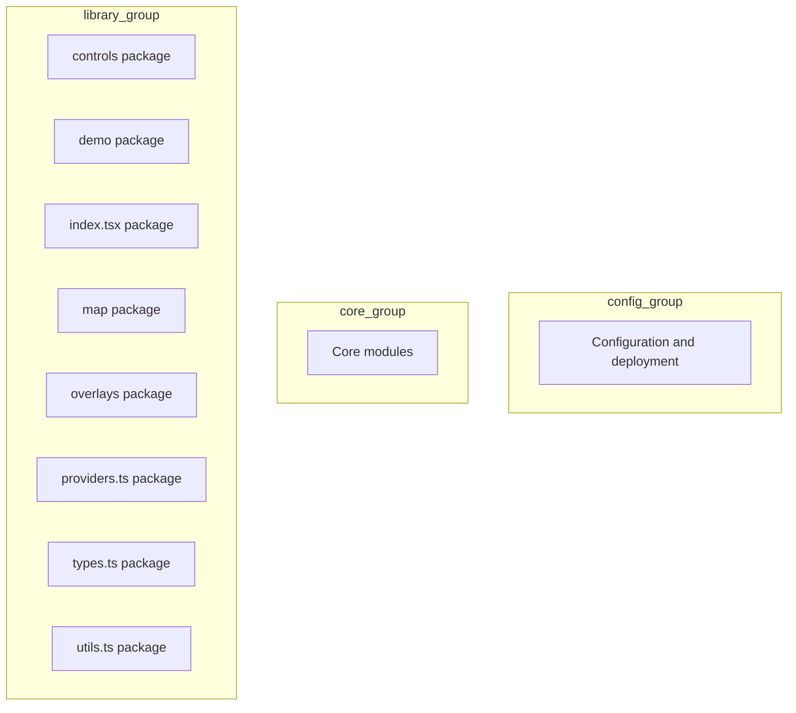

# Architecture report: mariusandra/pigeon-maps

> Automated static analysis. **Observed** = directly seen in files/imports/AST; **Inferred** = interpretation from that evidence. Repository code was not executed.

## 1. Repository at a glance

| Item | Value |
| --- | --- |
| Repository | mariusandra/pigeon-maps |
| Description | ReactJS Maps without external dependencies |
| Language | TypeScript |
| Stars | 3520 |
| Licence | MIT |
| Analysed commit / branch | 3da030e2966fa27e563c0f4db3efb9dfd1356719 / main |
| Framework(s) | React |
| Files analysed | 26 |
| Components | 10 |

## 2. Architecture in one minute

mariusandra/pigeon-maps - ReactJS Maps without external dependencies. This repository was analysed statically from 26 file(s) (0 Python). Detected technologies (observed from imports/manifests): React, TypeScript, webpack. Files are grouped into 10 component(s): Configuration and deployment, controls package, Core modules, demo package, index.tsx package, map package, overlays package, providers.ts package. Findings below distinguish observed facts from inferred interpretation.

## 3. High-level block diagram

## 4. Main components

### Configuration and deployment (`config`)

- **Kind:** config
- **Status:** Observed
- **Confidence:** 0.85
- **Responsibility:** Groups 3 file(s) under configuration and deployment (observed from repository paths and static analysis).
- **Paths:** `package.json`, `providers/package.json`, `tsconfig.json`
- **Evidence:** [package.json](https://github.com/mariusandra/pigeon-maps/blob/3da030e2966fa27e563c0f4db3efb9dfd1356719/package.json); [providers/package.json](https://github.com/mariusandra/pigeon-maps/blob/3da030e2966fa27e563c0f4db3efb9dfd1356719/providers/package.json); [tsconfig.json](https://github.com/mariusandra/pigeon-maps/blob/3da030e2966fa27e563c0f4db3efb9dfd1356719/tsconfig.json)

### controls package (`controls`)

- **Kind:** library
- **Status:** Observed
- **Confidence:** 0.85
- **Responsibility:** Groups 1 file(s) under controls package (observed from repository paths and static analysis).
- **Paths:** `src/controls/ZoomControl.tsx`
- **Evidence:** [src/controls/ZoomControl.tsx](https://github.com/mariusandra/pigeon-maps/blob/3da030e2966fa27e563c0f4db3efb9dfd1356719/src/controls/ZoomControl.tsx)

### Core modules (`core`)

- **Kind:** core
- **Status:** Observed
- **Confidence:** 0.85
- **Responsibility:** Groups 2 file(s) under core modules (observed from repository paths and static analysis).
- **Paths:** `rollup.config.js`, `webpack.config.js`
- **Evidence:** [rollup.config.js](https://github.com/mariusandra/pigeon-maps/blob/3da030e2966fa27e563c0f4db3efb9dfd1356719/rollup.config.js); [webpack.config.js](https://github.com/mariusandra/pigeon-maps/blob/3da030e2966fa27e563c0f4db3efb9dfd1356719/webpack.config.js)

### demo package (`demo`)

- **Kind:** library
- **Status:** Observed
- **Confidence:** 0.85
- **Responsibility:** Groups 3 file(s) under demo package (observed from repository paths and static analysis).
- **Paths:** `demo/Demo.tsx`, `demo/PigeonIcon.tsx`, `demo/index.tsx`
- **Evidence:** [demo/Demo.tsx](https://github.com/mariusandra/pigeon-maps/blob/3da030e2966fa27e563c0f4db3efb9dfd1356719/demo/Demo.tsx); [demo/PigeonIcon.tsx](https://github.com/mariusandra/pigeon-maps/blob/3da030e2966fa27e563c0f4db3efb9dfd1356719/demo/PigeonIcon.tsx); [demo/index.tsx](https://github.com/mariusandra/pigeon-maps/blob/3da030e2966fa27e563c0f4db3efb9dfd1356719/demo/index.tsx)

### index.tsx package (`index_tsx`)

- **Kind:** library
- **Status:** Observed
- **Confidence:** 0.85
- **Responsibility:** Groups 1 file(s) under index.tsx package (observed from repository paths and static analysis).
- **Paths:** `src/index.tsx`
- **Evidence:** [src/index.tsx](https://github.com/mariusandra/pigeon-maps/blob/3da030e2966fa27e563c0f4db3efb9dfd1356719/src/index.tsx)

### map package (`map`)

- **Kind:** library
- **Status:** Observed
- **Confidence:** 0.85
- **Responsibility:** Groups 1 file(s) under map package (observed from repository paths and static analysis).
- **Paths:** `src/map/Map.tsx`
- **Evidence:** [src/map/Map.tsx](https://github.com/mariusandra/pigeon-maps/blob/3da030e2966fa27e563c0f4db3efb9dfd1356719/src/map/Map.tsx)

### overlays package (`overlays`)

- **Kind:** library
- **Status:** Observed
- **Confidence:** 0.85
- **Responsibility:** Groups 4 file(s) under overlays package (observed from repository paths and static analysis).
- **Paths:** `src/overlays/Draggable.tsx`, `src/overlays/GeoJson.tsx`, `src/overlays/Marker.tsx`, `src/overlays/Overlay.tsx`
- **Evidence:** [src/overlays/Draggable.tsx](https://github.com/mariusandra/pigeon-maps/blob/3da030e2966fa27e563c0f4db3efb9dfd1356719/src/overlays/Draggable.tsx); [src/overlays/GeoJson.tsx](https://github.com/mariusandra/pigeon-maps/blob/3da030e2966fa27e563c0f4db3efb9dfd1356719/src/overlays/GeoJson.tsx); [src/overlays/Marker.tsx](https://github.com/mariusandra/pigeon-maps/blob/3da030e2966fa27e563c0f4db3efb9dfd1356719/src/overlays/Marker.tsx); [src/overlays/Overlay.tsx](https://github.com/mariusandra/pigeon-maps/blob/3da030e2966fa27e563c0f4db3efb9dfd1356719/src/overlays/Overlay.tsx)

### providers.ts package (`providers_ts`)

- **Kind:** library
- **Status:** Observed
- **Confidence:** 0.85
- **Responsibility:** Groups 1 file(s) under providers.ts package (observed from repository paths and static analysis).
- **Paths:** `src/providers.ts`
- **Evidence:** [src/providers.ts](https://github.com/mariusandra/pigeon-maps/blob/3da030e2966fa27e563c0f4db3efb9dfd1356719/src/providers.ts)

### types.ts package (`types_ts`)

- **Kind:** library
- **Status:** Observed
- **Confidence:** 0.85
- **Responsibility:** Groups 1 file(s) under types.ts package (observed from repository paths and static analysis).
- **Paths:** `src/types.ts`
- **Evidence:** [src/types.ts](https://github.com/mariusandra/pigeon-maps/blob/3da030e2966fa27e563c0f4db3efb9dfd1356719/src/types.ts)

### utils.ts package (`utils_ts`)

- **Kind:** library
- **Status:** Observed
- **Confidence:** 0.85
- **Responsibility:** Groups 1 file(s) under utils.ts package (observed from repository paths and static analysis).
- **Paths:** `src/utils.ts`
- **Evidence:** [src/utils.ts](https://github.com/mariusandra/pigeon-maps/blob/3da030e2966fa27e563c0f4db3efb9dfd1356719/src/utils.ts)

## 5. Execution flow

**Observed** entry point(s):

- [demo/index.tsx](https://github.com/mariusandra/pigeon-maps/blob/3da030e2966fa27e563c0f4db3efb9dfd1356719/demo/index.tsx)
- [src/index.tsx](https://github.com/mariusandra/pigeon-maps/blob/3da030e2966fa27e563c0f4db3efb9dfd1356719/src/index.tsx)

Representative flow (derived from observed entry points and the import graph; steps beyond the entry point are **Inferred**):

1. Execution starts at an observed entry point listed above, if present.
2. No internal import relationships between components were observed.

## 6. Project structure

### `(root)`

- `.babelrc` - other (1293 bytes)
- `.eslintrc.js` - source, JavaScript (1265 bytes)
- `.gitignore` - other (52 bytes)
- `.prettierrc.js` - source, JavaScript (125 bytes)
- `CHANGELOG.md` - docs (7273 bytes)
- `LICENSE.md` - docs (1105 bytes)
- `README.md` - docs (2238 bytes)
- `package.json` - manifest (3610 bytes)
- `rollup.config.js` - source, JavaScript (1049 bytes)
- `tsconfig.json` - config (447 bytes)
- `webpack.config.js` - source, JavaScript (1144 bytes)

### `demo`

- `demo/Demo.tsx` - source, TypeScript (9702 bytes)
- `demo/PigeonIcon.tsx` - source, TypeScript (10130 bytes)
- `demo/index.html` - other (426 bytes)
- `demo/index.tsx` - source, TypeScript (172 bytes)

### `providers`

- `providers/package.json` - manifest (168 bytes)

### `src`

- `src/controls/ZoomControl.tsx` - source, TypeScript (1471 bytes)
- `src/index.tsx` - source, TypeScript (322 bytes)
- `src/map/Map.tsx` - source, TypeScript (42950 bytes)
- `src/overlays/Draggable.tsx` - source, TypeScript (5053 bytes)
- `src/overlays/GeoJson.tsx` - source, TypeScript (6952 bytes)
- `src/overlays/Marker.tsx` - source, TypeScript (3072 bytes)
- `src/overlays/Overlay.tsx` - source, TypeScript (557 bytes)
- `src/providers.ts` - source, TypeScript (1007 bytes)
- `src/types.ts` - source, TypeScript (3199 bytes)
- `src/utils.ts` - source, TypeScript (763 bytes)

## 7. Key dependencies and integrations

| Name | Category | Status | Confidence | Evidence |
| --- | --- | --- | --- | --- |
| React | framework | Observed | 0.90 | [package.json:4](https://github.com/mariusandra/pigeon-maps/blob/3da030e2966fa27e563c0f4db3efb9dfd1356719/package.json#L4); [package.json:83](https://github.com/mariusandra/pigeon-maps/blob/3da030e2966fa27e563c0f4db3efb9dfd1356719/package.json#L83) |
| TypeScript | tooling | Observed | 0.85 | [package.json:59](https://github.com/mariusandra/pigeon-maps/blob/3da030e2966fa27e563c0f4db3efb9dfd1356719/package.json#L59) |
| webpack | tooling | Observed | 0.85 | [package.json:19](https://github.com/mariusandra/pigeon-maps/blob/3da030e2966fa27e563c0f4db3efb9dfd1356719/package.json#L19) |

## 8. Data and state

No database, cache, queue, or persistent-state usage was observed in the analysed files. State handling, if any, may be in-memory or in files that were not analysed.

## 9. Configuration and deployment clues

- `package.json` (manifest)
- `providers/package.json` (manifest)
- `tsconfig.json` (config)

## 10. Design observations

- No strong design patterns could be established from the available evidence.

These observations are interpretations (**Inferred**) of the observed structure, not guarantees about runtime design.

## 11. Limitations and unknowns

- Static analysis only: repository code was not executed, installed, or imported at runtime.
- Components and relationships are inferred from file paths, imports, and AST structure; runtime behaviour, dynamic imports, and reflection may not be visible.
- No clear application entry point was observed in the analysed files.
- Repository text was treated as untrusted data; no instructions found in repository files were followed, and likely secret values were redacted/excluded.
- JavaScript and TypeScript files were inventoried from paths and package manifests. They were not parsed with a full language AST, and repository code was not executed.

## 12. Source references

- [demo/Demo.tsx](https://github.com/mariusandra/pigeon-maps/blob/3da030e2966fa27e563c0f4db3efb9dfd1356719/demo/Demo.tsx)
- [demo/PigeonIcon.tsx](https://github.com/mariusandra/pigeon-maps/blob/3da030e2966fa27e563c0f4db3efb9dfd1356719/demo/PigeonIcon.tsx)
- [demo/index.tsx](https://github.com/mariusandra/pigeon-maps/blob/3da030e2966fa27e563c0f4db3efb9dfd1356719/demo/index.tsx)
- [package.json](https://github.com/mariusandra/pigeon-maps/blob/3da030e2966fa27e563c0f4db3efb9dfd1356719/package.json)
- [package.json:4](https://github.com/mariusandra/pigeon-maps/blob/3da030e2966fa27e563c0f4db3efb9dfd1356719/package.json#L4)
- [package.json:19](https://github.com/mariusandra/pigeon-maps/blob/3da030e2966fa27e563c0f4db3efb9dfd1356719/package.json#L19)
- [package.json:59](https://github.com/mariusandra/pigeon-maps/blob/3da030e2966fa27e563c0f4db3efb9dfd1356719/package.json#L59)
- [package.json:83](https://github.com/mariusandra/pigeon-maps/blob/3da030e2966fa27e563c0f4db3efb9dfd1356719/package.json#L83)
- [providers/package.json](https://github.com/mariusandra/pigeon-maps/blob/3da030e2966fa27e563c0f4db3efb9dfd1356719/providers/package.json)
- [rollup.config.js](https://github.com/mariusandra/pigeon-maps/blob/3da030e2966fa27e563c0f4db3efb9dfd1356719/rollup.config.js)
- [src/controls/ZoomControl.tsx](https://github.com/mariusandra/pigeon-maps/blob/3da030e2966fa27e563c0f4db3efb9dfd1356719/src/controls/ZoomControl.tsx)
- [src/index.tsx](https://github.com/mariusandra/pigeon-maps/blob/3da030e2966fa27e563c0f4db3efb9dfd1356719/src/index.tsx)
- [src/map/Map.tsx](https://github.com/mariusandra/pigeon-maps/blob/3da030e2966fa27e563c0f4db3efb9dfd1356719/src/map/Map.tsx)
- [src/overlays/Draggable.tsx](https://github.com/mariusandra/pigeon-maps/blob/3da030e2966fa27e563c0f4db3efb9dfd1356719/src/overlays/Draggable.tsx)
- [src/overlays/GeoJson.tsx](https://github.com/mariusandra/pigeon-maps/blob/3da030e2966fa27e563c0f4db3efb9dfd1356719/src/overlays/GeoJson.tsx)
- [src/overlays/Marker.tsx](https://github.com/mariusandra/pigeon-maps/blob/3da030e2966fa27e563c0f4db3efb9dfd1356719/src/overlays/Marker.tsx)
- [src/overlays/Overlay.tsx](https://github.com/mariusandra/pigeon-maps/blob/3da030e2966fa27e563c0f4db3efb9dfd1356719/src/overlays/Overlay.tsx)
- [src/providers.ts](https://github.com/mariusandra/pigeon-maps/blob/3da030e2966fa27e563c0f4db3efb9dfd1356719/src/providers.ts)
- [src/types.ts](https://github.com/mariusandra/pigeon-maps/blob/3da030e2966fa27e563c0f4db3efb9dfd1356719/src/types.ts)
- [src/utils.ts](https://github.com/mariusandra/pigeon-maps/blob/3da030e2966fa27e563c0f4db3efb9dfd1356719/src/utils.ts)
- [tsconfig.json](https://github.com/mariusandra/pigeon-maps/blob/3da030e2966fa27e563c0f4db3efb9dfd1356719/tsconfig.json)
- [webpack.config.js](https://github.com/mariusandra/pigeon-maps/blob/3da030e2966fa27e563c0f4db3efb9dfd1356719/webpack.config.js)
