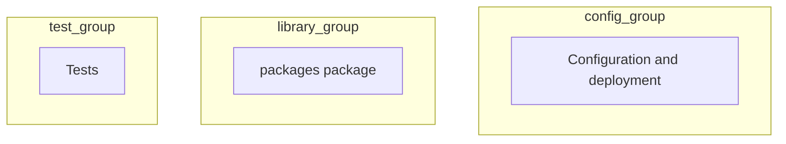

# Architecture report: markdoc/markdoc

> Automated static analysis. **Observed** = directly seen in files/imports/AST; **Inferred** = interpretation from that evidence. Repository code was not executed.

## 1. Repository at a glance

| Item | Value |
| --- | --- |
| Repository | markdoc/markdoc |
| Description | A powerful, flexible, Markdown-based authoring framework. |
| Language | TypeScript |
| Stars | 8525 |
| Licence | MIT |
| Analysed commit / branch | 30a77b3c23c2d9279ee07d185faf95060b6cab75 / main |
| Framework(s) | Next.js, React |
| Files analysed | 108 |
| Components | 3 |

## 2. Architecture in one minute

markdoc/markdoc - A powerful, flexible, Markdown-based authoring framework.. This repository was analysed statically from 108 file(s) (0 Python). Detected technologies (observed from imports/manifests): GitHub Actions, Next.js, React, Jest, TypeScript. Files are grouped into 3 component(s): Configuration and deployment, packages package, Tests. Findings below distinguish observed facts from inferred interpretation.

## 3. High-level block diagram

## 4. Main components

### Configuration and deployment (`config`)

- **Kind:** config
- **Status:** Observed
- **Confidence:** 0.85
- **Responsibility:** Groups 9 file(s) under configuration and deployment (observed from repository paths and static analysis).
- **Paths:** `package.json`, `packages/markdoc/package.json`, `packages/markdoc/spec/marktest/tests.yaml`, `packages/markdoc/spec/support/jasmine.json`, `packages/markdoc/tsconfig.json`, `packages/next.js/babel.config.json`, `packages/next.js/package.json`, `pnpm-workspace.yaml`, `turbo.json`
- **Evidence:** [package.json](https://github.com/markdoc/markdoc/blob/30a77b3c23c2d9279ee07d185faf95060b6cab75/package.json); [packages/markdoc/package.json](https://github.com/markdoc/markdoc/blob/30a77b3c23c2d9279ee07d185faf95060b6cab75/packages/markdoc/package.json); [packages/markdoc/spec/marktest/tests.yaml](https://github.com/markdoc/markdoc/blob/30a77b3c23c2d9279ee07d185faf95060b6cab75/packages/markdoc/spec/marktest/tests.yaml); [packages/markdoc/spec/support/jasmine.json](https://github.com/markdoc/markdoc/blob/30a77b3c23c2d9279ee07d185faf95060b6cab75/packages/markdoc/spec/support/jasmine.json); [packages/markdoc/tsconfig.json](https://github.com/markdoc/markdoc/blob/30a77b3c23c2d9279ee07d185faf95060b6cab75/packages/markdoc/tsconfig.json); [packages/next.js/babel.config.json](https://github.com/markdoc/markdoc/blob/30a77b3c23c2d9279ee07d185faf95060b6cab75/packages/next.js/babel.config.json); [packages/next.js/package.json](https://github.com/markdoc/markdoc/blob/30a77b3c23c2d9279ee07d185faf95060b6cab75/packages/next.js/package.json); [pnpm-workspace.yaml](https://github.com/markdoc/markdoc/blob/30a77b3c23c2d9279ee07d185faf95060b6cab75/pnpm-workspace.yaml)

### packages package (`packages`)

- **Kind:** library
- **Status:** Observed
- **Confidence:** 0.85
- **Responsibility:** Groups 67 file(s) under packages package (observed from repository paths and static analysis).
- **Paths:** `packages/markdoc/build.js`, `packages/markdoc/eslint.config.mjs`, `packages/markdoc/index.ts`, `packages/markdoc/spec/marktest/index.ts`, `packages/markdoc/spec/marktest/react-shim.ts`, `packages/markdoc/spec/support/matchers.d.ts`, `packages/markdoc/spec/support/matchers.helper.ts`, `packages/markdoc/spec/types/check.mjs`, `packages/markdoc/spec/types/consumer.ts`, `packages/markdoc/spec/types/react.ts`, `packages/markdoc/spec/types/tokenizer-options.ts`, `packages/markdoc/src/ast/base.ts`, `packages/markdoc/src/ast/function.ts`, `packages/markdoc/src/ast/index.ts`, `packages/markdoc/src/ast/node.test.ts`, `packages/markdoc/src/ast/node.ts`, `packages/markdoc/src/ast/variable.test.ts`, `packages/markdoc/src/ast/variable.ts`, `packages/markdoc/src/formatter.test.ts`, `packages/markdoc/src/formatter.ts`, `packages/markdoc/src/functions/index.test.ts`, `packages/markdoc/src/functions/index.ts`, `packages/markdoc/src/grammar/tag.d.ts`, `packages/markdoc/src/grammar/tag.js`, `packages/markdoc/src/grammar/tag.test.ts`, `packages/markdoc/src/parser.test.ts`, `packages/markdoc/src/parser.ts`, `packages/markdoc/src/renderers/html.test.ts`, `packages/markdoc/src/renderers/html.ts`, `packages/markdoc/src/renderers/index.ts`, `packages/markdoc/src/renderers/react/react.test.ts`, `packages/markdoc/src/renderers/react/react.ts`, `packages/markdoc/src/renderers/react/static.ts`, `packages/markdoc/src/schema-types/class.ts`, `packages/markdoc/src/schema-types/conditional.ts`, `packages/markdoc/src/schema-types/id.ts`, `packages/markdoc/src/schema.ts`, `packages/markdoc/src/tag.test.ts`, `packages/markdoc/src/tag.ts`, `packages/markdoc/src/tags/conditional.ts`, `packages/markdoc/src/tags/index.ts`, `packages/markdoc/src/tags/partial.ts`, `packages/markdoc/src/tags/slot.ts`, `packages/markdoc/src/tags/table.ts`, `packages/markdoc/src/tokenizer/index.ts`, `packages/markdoc/src/tokenizer/plugins/annotations.test.ts`, `packages/markdoc/src/tokenizer/plugins/annotations.ts`, `packages/markdoc/src/tokenizer/plugins/comments.test.ts`, `packages/markdoc/src/tokenizer/plugins/comments.ts`, `packages/markdoc/src/tokenizer/plugins/frontmatter.test.ts`, `packages/markdoc/src/tokenizer/plugins/frontmatter.ts`, `packages/markdoc/src/tokenizer/plugins/link.test.ts`, `packages/markdoc/src/tokenizer/plugins/link.ts`, `packages/markdoc/src/transformer.ts`, `packages/markdoc/src/transforms/index.ts`, `packages/markdoc/src/transforms/table.test.ts`, `packages/markdoc/src/transforms/table.ts`, `packages/markdoc/src/types.ts`, `packages/markdoc/src/utils.test.ts`, `packages/markdoc/src/utils.ts`, `packages/markdoc/src/validator.test.ts`, `packages/markdoc/src/validator.ts`, `packages/next.js/src/index.d.ts`, `packages/next.js/src/index.js`, `packages/next.js/src/loader.js`, `packages/next.js/src/runtime.js`, `packages/next.js/src/tags.js`
- **Evidence:** [packages/markdoc/build.js](https://github.com/markdoc/markdoc/blob/30a77b3c23c2d9279ee07d185faf95060b6cab75/packages/markdoc/build.js); [packages/markdoc/eslint.config.mjs](https://github.com/markdoc/markdoc/blob/30a77b3c23c2d9279ee07d185faf95060b6cab75/packages/markdoc/eslint.config.mjs); [packages/markdoc/index.ts](https://github.com/markdoc/markdoc/blob/30a77b3c23c2d9279ee07d185faf95060b6cab75/packages/markdoc/index.ts); [packages/markdoc/spec/marktest/index.ts](https://github.com/markdoc/markdoc/blob/30a77b3c23c2d9279ee07d185faf95060b6cab75/packages/markdoc/spec/marktest/index.ts); [packages/markdoc/spec/marktest/react-shim.ts](https://github.com/markdoc/markdoc/blob/30a77b3c23c2d9279ee07d185faf95060b6cab75/packages/markdoc/spec/marktest/react-shim.ts); [packages/markdoc/spec/support/matchers.d.ts](https://github.com/markdoc/markdoc/blob/30a77b3c23c2d9279ee07d185faf95060b6cab75/packages/markdoc/spec/support/matchers.d.ts); [packages/markdoc/spec/support/matchers.helper.ts](https://github.com/markdoc/markdoc/blob/30a77b3c23c2d9279ee07d185faf95060b6cab75/packages/markdoc/spec/support/matchers.helper.ts); [packages/markdoc/spec/types/check.mjs](https://github.com/markdoc/markdoc/blob/30a77b3c23c2d9279ee07d185faf95060b6cab75/packages/markdoc/spec/types/check.mjs)

### Tests (`tests`)

- **Kind:** test
- **Status:** Observed
- **Confidence:** 0.85
- **Responsibility:** Groups 11 file(s) under tests (observed from repository paths and static analysis).
- **Paths:** `packages/next.js/tests/__snapshots__/index.test.js.snap`, `packages/next.js/tests/fixture.md`, `packages/next.js/tests/index.test.js`, `packages/next.js/tests/schemas/ejectedConfig/config.js`, `packages/next.js/tests/schemas/ejectedConfig/tags.ts`, `packages/next.js/tests/schemas/files/nodes.js`, `packages/next.js/tests/schemas/files/tags.js`, `packages/next.js/tests/schemas/folders/nodes/index.js`, `packages/next.js/tests/schemas/folders/tags/index.js`, `packages/next.js/tests/schemas/partials/partials/footer.md`, `packages/next.js/tests/schemas/typescript/tags.ts`
- **Evidence:** [packages/next.js/tests/__snapshots__/index.test.js.snap](https://github.com/markdoc/markdoc/blob/30a77b3c23c2d9279ee07d185faf95060b6cab75/packages/next.js/tests/__snapshots__/index.test.js.snap); [packages/next.js/tests/fixture.md](https://github.com/markdoc/markdoc/blob/30a77b3c23c2d9279ee07d185faf95060b6cab75/packages/next.js/tests/fixture.md); [packages/next.js/tests/index.test.js](https://github.com/markdoc/markdoc/blob/30a77b3c23c2d9279ee07d185faf95060b6cab75/packages/next.js/tests/index.test.js); [packages/next.js/tests/schemas/ejectedConfig/config.js](https://github.com/markdoc/markdoc/blob/30a77b3c23c2d9279ee07d185faf95060b6cab75/packages/next.js/tests/schemas/ejectedConfig/config.js); [packages/next.js/tests/schemas/ejectedConfig/tags.ts](https://github.com/markdoc/markdoc/blob/30a77b3c23c2d9279ee07d185faf95060b6cab75/packages/next.js/tests/schemas/ejectedConfig/tags.ts); [packages/next.js/tests/schemas/files/nodes.js](https://github.com/markdoc/markdoc/blob/30a77b3c23c2d9279ee07d185faf95060b6cab75/packages/next.js/tests/schemas/files/nodes.js); [packages/next.js/tests/schemas/files/tags.js](https://github.com/markdoc/markdoc/blob/30a77b3c23c2d9279ee07d185faf95060b6cab75/packages/next.js/tests/schemas/files/tags.js); [packages/next.js/tests/schemas/folders/nodes/index.js](https://github.com/markdoc/markdoc/blob/30a77b3c23c2d9279ee07d185faf95060b6cab75/packages/next.js/tests/schemas/folders/nodes/index.js)

## 5. Execution flow

**Observed** entry point(s):

- [packages/markdoc/index.ts](https://github.com/markdoc/markdoc/blob/30a77b3c23c2d9279ee07d185faf95060b6cab75/packages/markdoc/index.ts)
- [packages/next.js/src/index.js](https://github.com/markdoc/markdoc/blob/30a77b3c23c2d9279ee07d185faf95060b6cab75/packages/next.js/src/index.js)

Representative flow (derived from observed entry points and the import graph; steps beyond the entry point are **Inferred**):

1. Execution starts at an observed entry point listed above, if present.
2. No internal import relationships between components were observed.

## 6. Project structure

### `(root)`

- `.gitignore` - other (110 bytes)
- `.node-version` - other (8 bytes)
- `.prettierrc` - other (52 bytes)
- `AGENTS.md` - docs (1341 bytes)
- `LICENSE` - docs (1095 bytes)
- `README.md` - docs (4079 bytes)
- `package.json` - manifest (948 bytes)
- `pnpm-workspace.yaml` - config (188 bytes)
- `turbo.json` - config (796 bytes)

### `.changeset`

- `.changeset/README.md` - docs (1961 bytes)
- `.changeset/config.json` - config (357 bytes)

### `.github`

- `.github/CODE_OF_CONDUCT.md` - docs (3353 bytes)
- `.github/CONTRIBUTING.md` - docs (2177 bytes)
- `.github/ISSUE_TEMPLATE/bug_report.yml` - config (1045 bytes)
- `.github/workflows/release.yml` - ci, YAML (3228 bytes)
- `.github/workflows/validate.yml` - ci, YAML (1422 bytes)

### `.vscode`

- `.vscode/launch.json` - config (1033 bytes)

### `packages`

- `packages/markdoc/CHANGELOG.md` - docs (275 bytes)
- `packages/markdoc/LICENSE` - docs (1095 bytes)
- `packages/markdoc/build.js` - source, JavaScript (378 bytes)
- `packages/markdoc/eslint.config.mjs` - source, JavaScript (959 bytes)
- `packages/markdoc/index.ts` - source, TypeScript (3815 bytes)
- `packages/markdoc/package.json` - manifest (2220 bytes)
- `packages/markdoc/spec/marktest/index.ts` - source, TypeScript (3790 bytes)
- `packages/markdoc/spec/marktest/react-shim.ts` - source, TypeScript (409 bytes)
- `packages/markdoc/spec/marktest/tests.yaml` - config (38816 bytes)
- `packages/markdoc/spec/support/jasmine.json` - config (191 bytes)
- `packages/markdoc/spec/support/matchers.d.ts` - source, TypeScript (208 bytes)
- `packages/markdoc/spec/support/matchers.helper.ts` - source, TypeScript (699 bytes)
- `packages/markdoc/spec/types/check.mjs` - source, JavaScript (4203 bytes)
- `packages/markdoc/spec/types/consumer.ts` - source, TypeScript (890 bytes)
- `packages/markdoc/spec/types/react.ts` - source, TypeScript (474 bytes)
- `packages/markdoc/spec/types/tokenizer-options.ts` - source, TypeScript (537 bytes)
- `packages/markdoc/src/ast/base.ts` - source, TypeScript (1832 bytes)
- `packages/markdoc/src/ast/function.ts` - source, TypeScript (534 bytes)
- `packages/markdoc/src/ast/index.ts` - source, TypeScript (564 bytes)
- `packages/markdoc/src/ast/node.test.ts` - source, TypeScript (13703 bytes)
- `packages/markdoc/src/ast/node.ts` - source, TypeScript (1972 bytes)
- `packages/markdoc/src/ast/variable.test.ts` - source, TypeScript (900 bytes)
- `packages/markdoc/src/ast/variable.ts` - source, TypeScript (402 bytes)
- `packages/markdoc/src/formatter.test.ts` - source, TypeScript (15313 bytes)
- `packages/markdoc/src/formatter.ts` - source, TypeScript (13208 bytes)
- `packages/markdoc/src/functions/index.test.ts` - source, TypeScript (786 bytes)
- `packages/markdoc/src/functions/index.ts` - source, TypeScript (1002 bytes)
- `packages/markdoc/src/grammar/tag.d.ts` - source, TypeScript (483 bytes)
- `packages/markdoc/src/grammar/tag.js` - source, JavaScript (42440 bytes)
- `packages/markdoc/src/grammar/tag.pegjs` - other (3663 bytes)
- `packages/markdoc/src/grammar/tag.test.ts` - source, TypeScript (12860 bytes)
- `packages/markdoc/src/parser.test.ts` - source, TypeScript (28310 bytes)
- `packages/markdoc/src/parser.ts` - source, TypeScript (6439 bytes)
- `packages/markdoc/src/renderers/html.test.ts` - source, TypeScript (2373 bytes)
- `packages/markdoc/src/renderers/html.ts` - source, TypeScript (1178 bytes)
- `packages/markdoc/src/renderers/index.ts` - source, TypeScript (150 bytes)
- `packages/markdoc/src/renderers/react/react.test.ts` - source, TypeScript (6771 bytes)
- `packages/markdoc/src/renderers/react/react.ts` - source, TypeScript (2114 bytes)
- `packages/markdoc/src/renderers/react/static.ts` - source, TypeScript (2171 bytes)
- `packages/markdoc/src/schema-types/class.ts` - source, TypeScript (699 bytes)
- `packages/markdoc/src/schema-types/conditional.ts` - source, TypeScript (849 bytes)
- `packages/markdoc/src/schema-types/id.ts` - source, TypeScript (427 bytes)
- `packages/markdoc/src/schema.ts` - source, TypeScript (4816 bytes)
- `packages/markdoc/src/tag.test.ts` - source, TypeScript (523 bytes)
- `packages/markdoc/src/tag.ts` - source, TypeScript (561 bytes)
- `packages/markdoc/src/tags/conditional.ts` - source, TypeScript (1611 bytes)
- `packages/markdoc/src/tags/index.ts` - source, TypeScript (228 bytes)
- `packages/markdoc/src/tags/partial.ts` - source, TypeScript (1308 bytes)
- `packages/markdoc/src/tags/slot.ts` - source, TypeScript (142 bytes)
- `packages/markdoc/src/tags/table.ts` - source, TypeScript (115 bytes)
- `packages/markdoc/src/tokenizer/index.ts` - source, TypeScript (1801 bytes)
- `packages/markdoc/src/tokenizer/plugins/annotations.test.ts` - source, TypeScript (16169 bytes)
- `packages/markdoc/src/tokenizer/plugins/annotations.ts` - source, TypeScript (4632 bytes)
- `packages/markdoc/src/tokenizer/plugins/comments.test.ts` - source, TypeScript (2726 bytes)
- `packages/markdoc/src/tokenizer/plugins/comments.ts` - source, TypeScript (1348 bytes)
- `packages/markdoc/src/tokenizer/plugins/frontmatter.test.ts` - source, TypeScript (1577 bytes)
- `packages/markdoc/src/tokenizer/plugins/frontmatter.ts` - source, TypeScript (976 bytes)
- `packages/markdoc/src/tokenizer/plugins/link.test.ts` - source, TypeScript (3311 bytes)
- `packages/markdoc/src/tokenizer/plugins/link.ts` - source, TypeScript (991 bytes)
- `packages/markdoc/src/transformer.ts` - source, TypeScript (2699 bytes)
- `packages/markdoc/src/transforms/index.ts` - source, TypeScript (53 bytes)
- `packages/markdoc/src/transforms/table.test.ts` - source, TypeScript (5673 bytes)
- `packages/markdoc/src/transforms/table.ts` - source, TypeScript (2633 bytes)
- `packages/markdoc/src/types.ts` - source, TypeScript (5188 bytes)
- `packages/markdoc/src/utils.test.ts` - source, TypeScript (5356 bytes)
- `packages/markdoc/src/utils.ts` - source, TypeScript (4165 bytes)
- `packages/markdoc/src/validator.test.ts` - source, TypeScript (24732 bytes)
- `packages/markdoc/src/validator.ts` - source, TypeScript (9727 bytes)
- `packages/markdoc/tsconfig.json` - config (358 bytes)
- `packages/next.js/CHANGELOG.md` - docs (374 bytes)
- `packages/next.js/LICENSE` - docs (1095 bytes)
- `packages/next.js/README.md` - docs (2925 bytes)
- `packages/next.js/babel.config.json` - config (116 bytes)
- `packages/next.js/package.json` - manifest (1212 bytes)
- `packages/next.js/src/index.d.ts` - source, TypeScript (925 bytes)
- `packages/next.js/src/index.js` - source, JavaScript (2387 bytes)
- `packages/next.js/src/loader.js` - source, JavaScript (8796 bytes)
- `packages/next.js/src/runtime.js` - source, JavaScript (1310 bytes)
- `packages/next.js/src/tags.js` - source, JavaScript (2854 bytes)
- `packages/next.js/tests/__snapshots__/index.test.js.snap` - test (10624 bytes)
- `packages/next.js/tests/fixture.md` - test (76 bytes)
- `packages/next.js/tests/index.test.js` - test, JavaScript (12196 bytes)
- `packages/next.js/tests/schemas/ejectedConfig/config.js` - test, JavaScript (90 bytes)
- `packages/next.js/tests/schemas/ejectedConfig/tags.ts` - test, TypeScript (191 bytes)
- `packages/next.js/tests/schemas/files/nodes.js` - test, JavaScript (65 bytes)
- `packages/next.js/tests/schemas/files/tags.js` - test, JavaScript (68 bytes)
- `packages/next.js/tests/schemas/folders/nodes/index.js` - test, JavaScript (65 bytes)
- `packages/next.js/tests/schemas/folders/tags/index.js` - test, JavaScript (68 bytes)
- `packages/next.js/tests/schemas/partials/partials/footer.md` - test (7 bytes)
- `packages/next.js/tests/schemas/typescript/tags.ts` - test, TypeScript (160 bytes)

### `patches`

- `patches/markdown-it@15.0.1.patch` - other (16290 bytes)

## 7. Key dependencies and integrations

| Name | Category | Status | Confidence | Evidence |
| --- | --- | --- | --- | --- |
| GitHub Actions | ci | Observed | 0.90 | [.github/workflows/release.yml](https://github.com/markdoc/markdoc/blob/30a77b3c23c2d9279ee07d185faf95060b6cab75/.github/workflows/release.yml); [.github/workflows/validate.yml](https://github.com/markdoc/markdoc/blob/30a77b3c23c2d9279ee07d185faf95060b6cab75/.github/workflows/validate.yml) |
| Next.js | framework | Observed | 0.90 | [packages/next.js/package.json:2](https://github.com/markdoc/markdoc/blob/30a77b3c23c2d9279ee07d185faf95060b6cab75/packages/next.js/package.json#L2) |
| React | framework | Observed | 0.90 | [packages/markdoc/package.json:36](https://github.com/markdoc/markdoc/blob/30a77b3c23c2d9279ee07d185faf95060b6cab75/packages/markdoc/package.json#L36); [packages/next.js/package.json:31](https://github.com/markdoc/markdoc/blob/30a77b3c23c2d9279ee07d185faf95060b6cab75/packages/next.js/package.json#L31) |
| Jest | tooling | Observed | 0.85 | [packages/next.js/package.json:17](https://github.com/markdoc/markdoc/blob/30a77b3c23c2d9279ee07d185faf95060b6cab75/packages/next.js/package.json#L17) |
| TypeScript | tooling | Observed | 0.90 | [packages/markdoc/package.json:61](https://github.com/markdoc/markdoc/blob/30a77b3c23c2d9279ee07d185faf95060b6cab75/packages/markdoc/package.json#L61); [packages/next.js/package.json:33](https://github.com/markdoc/markdoc/blob/30a77b3c23c2d9279ee07d185faf95060b6cab75/packages/next.js/package.json#L33) |

## 8. Data and state

No database, cache, queue, or persistent-state usage was observed in the analysed files. State handling, if any, may be in-memory or in files that were not analysed.

## 9. Configuration and deployment clues

- `.changeset/config.json` (config)
- `.github/ISSUE_TEMPLATE/bug_report.yml` (config)
- `.github/workflows/release.yml` (ci)
- `.github/workflows/validate.yml` (ci)
- `.vscode/launch.json` (config)
- `package.json` (manifest)
- `packages/markdoc/package.json` (manifest)
- `packages/markdoc/spec/marktest/tests.yaml` (config)
- `packages/markdoc/spec/support/jasmine.json` (config)
- `packages/markdoc/tsconfig.json` (config)
- `packages/next.js/babel.config.json` (config)
- `packages/next.js/package.json` (manifest)
- `pnpm-workspace.yaml` (config)
- `turbo.json` (config)

## 10. Design observations

- Tests are present alongside source code (Observed from test file paths).

These observations are interpretations (**Inferred**) of the observed structure, not guarantees about runtime design.

## 11. Limitations and unknowns

- Static analysis only: repository code was not executed, installed, or imported at runtime.
- Components and relationships are inferred from file paths, imports, and AST structure; runtime behaviour, dynamic imports, and reflection may not be visible.
- 1 file(s) were skipped during inventory (1 x lockfile excluded).
- No clear application entry point was observed in the analysed files.
- Repository text was treated as untrusted data; no instructions found in repository files were followed, and likely secret values were redacted/excluded.
- JavaScript and TypeScript files were inventoried from paths and package manifests. They were not parsed with a full language AST, and repository code was not executed.

## 12. Source references

- [.github/workflows/release.yml](https://github.com/markdoc/markdoc/blob/30a77b3c23c2d9279ee07d185faf95060b6cab75/.github/workflows/release.yml)
- [.github/workflows/validate.yml](https://github.com/markdoc/markdoc/blob/30a77b3c23c2d9279ee07d185faf95060b6cab75/.github/workflows/validate.yml)
- [package.json](https://github.com/markdoc/markdoc/blob/30a77b3c23c2d9279ee07d185faf95060b6cab75/package.json)
- [packages/markdoc/build.js](https://github.com/markdoc/markdoc/blob/30a77b3c23c2d9279ee07d185faf95060b6cab75/packages/markdoc/build.js)
- [packages/markdoc/eslint.config.mjs](https://github.com/markdoc/markdoc/blob/30a77b3c23c2d9279ee07d185faf95060b6cab75/packages/markdoc/eslint.config.mjs)
- [packages/markdoc/index.ts](https://github.com/markdoc/markdoc/blob/30a77b3c23c2d9279ee07d185faf95060b6cab75/packages/markdoc/index.ts)
- [packages/markdoc/package.json](https://github.com/markdoc/markdoc/blob/30a77b3c23c2d9279ee07d185faf95060b6cab75/packages/markdoc/package.json)
- [packages/markdoc/package.json:36](https://github.com/markdoc/markdoc/blob/30a77b3c23c2d9279ee07d185faf95060b6cab75/packages/markdoc/package.json#L36)
- [packages/markdoc/package.json:61](https://github.com/markdoc/markdoc/blob/30a77b3c23c2d9279ee07d185faf95060b6cab75/packages/markdoc/package.json#L61)
- [packages/markdoc/spec/marktest/index.ts](https://github.com/markdoc/markdoc/blob/30a77b3c23c2d9279ee07d185faf95060b6cab75/packages/markdoc/spec/marktest/index.ts)
- [packages/markdoc/spec/marktest/react-shim.ts](https://github.com/markdoc/markdoc/blob/30a77b3c23c2d9279ee07d185faf95060b6cab75/packages/markdoc/spec/marktest/react-shim.ts)
- [packages/markdoc/spec/marktest/tests.yaml](https://github.com/markdoc/markdoc/blob/30a77b3c23c2d9279ee07d185faf95060b6cab75/packages/markdoc/spec/marktest/tests.yaml)
- [packages/markdoc/spec/support/jasmine.json](https://github.com/markdoc/markdoc/blob/30a77b3c23c2d9279ee07d185faf95060b6cab75/packages/markdoc/spec/support/jasmine.json)
- [packages/markdoc/spec/support/matchers.d.ts](https://github.com/markdoc/markdoc/blob/30a77b3c23c2d9279ee07d185faf95060b6cab75/packages/markdoc/spec/support/matchers.d.ts)
- [packages/markdoc/spec/support/matchers.helper.ts](https://github.com/markdoc/markdoc/blob/30a77b3c23c2d9279ee07d185faf95060b6cab75/packages/markdoc/spec/support/matchers.helper.ts)
- [packages/markdoc/spec/types/check.mjs](https://github.com/markdoc/markdoc/blob/30a77b3c23c2d9279ee07d185faf95060b6cab75/packages/markdoc/spec/types/check.mjs)
- [packages/markdoc/tsconfig.json](https://github.com/markdoc/markdoc/blob/30a77b3c23c2d9279ee07d185faf95060b6cab75/packages/markdoc/tsconfig.json)
- [packages/next.js/babel.config.json](https://github.com/markdoc/markdoc/blob/30a77b3c23c2d9279ee07d185faf95060b6cab75/packages/next.js/babel.config.json)
- [packages/next.js/package.json](https://github.com/markdoc/markdoc/blob/30a77b3c23c2d9279ee07d185faf95060b6cab75/packages/next.js/package.json)
- [packages/next.js/package.json:2](https://github.com/markdoc/markdoc/blob/30a77b3c23c2d9279ee07d185faf95060b6cab75/packages/next.js/package.json#L2)
- [packages/next.js/package.json:17](https://github.com/markdoc/markdoc/blob/30a77b3c23c2d9279ee07d185faf95060b6cab75/packages/next.js/package.json#L17)
- [packages/next.js/package.json:31](https://github.com/markdoc/markdoc/blob/30a77b3c23c2d9279ee07d185faf95060b6cab75/packages/next.js/package.json#L31)
- [packages/next.js/package.json:33](https://github.com/markdoc/markdoc/blob/30a77b3c23c2d9279ee07d185faf95060b6cab75/packages/next.js/package.json#L33)
- [packages/next.js/src/index.js](https://github.com/markdoc/markdoc/blob/30a77b3c23c2d9279ee07d185faf95060b6cab75/packages/next.js/src/index.js)
- [packages/next.js/tests/__snapshots__/index.test.js.snap](https://github.com/markdoc/markdoc/blob/30a77b3c23c2d9279ee07d185faf95060b6cab75/packages/next.js/tests/__snapshots__/index.test.js.snap)
- [packages/next.js/tests/fixture.md](https://github.com/markdoc/markdoc/blob/30a77b3c23c2d9279ee07d185faf95060b6cab75/packages/next.js/tests/fixture.md)
- [packages/next.js/tests/index.test.js](https://github.com/markdoc/markdoc/blob/30a77b3c23c2d9279ee07d185faf95060b6cab75/packages/next.js/tests/index.test.js)
- [packages/next.js/tests/schemas/ejectedConfig/config.js](https://github.com/markdoc/markdoc/blob/30a77b3c23c2d9279ee07d185faf95060b6cab75/packages/next.js/tests/schemas/ejectedConfig/config.js)
- [packages/next.js/tests/schemas/ejectedConfig/tags.ts](https://github.com/markdoc/markdoc/blob/30a77b3c23c2d9279ee07d185faf95060b6cab75/packages/next.js/tests/schemas/ejectedConfig/tags.ts)
- [packages/next.js/tests/schemas/files/nodes.js](https://github.com/markdoc/markdoc/blob/30a77b3c23c2d9279ee07d185faf95060b6cab75/packages/next.js/tests/schemas/files/nodes.js)
- [packages/next.js/tests/schemas/files/tags.js](https://github.com/markdoc/markdoc/blob/30a77b3c23c2d9279ee07d185faf95060b6cab75/packages/next.js/tests/schemas/files/tags.js)
- [packages/next.js/tests/schemas/folders/nodes/index.js](https://github.com/markdoc/markdoc/blob/30a77b3c23c2d9279ee07d185faf95060b6cab75/packages/next.js/tests/schemas/folders/nodes/index.js)
- [pnpm-workspace.yaml](https://github.com/markdoc/markdoc/blob/30a77b3c23c2d9279ee07d185faf95060b6cab75/pnpm-workspace.yaml)
