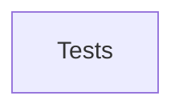

# Architecture report: mars/create-react-app-buildpack

> Automated static analysis. **Observed** = directly seen in files/imports/AST; **Inferred** = interpretation from that evidence. Repository code was not executed.

## 1. Repository at a glance

| Item | Value |
| --- | --- |
| Repository | mars/create-react-app-buildpack |
| Description | ⚛️ Heroku Buildpack for create-react-app: static hosting for React.js web apps |
| Language | Shell |
| Stars | 3232 |
| Licence | MIT |
| Analysed commit / branch | e0678acf1272b730126fcda4886d14dcb052adb6 / master |
| Framework(s) | None detected |
| Files analysed | 8 |
| Components | 1 |

## 2. Architecture in one minute

mars/create-react-app-buildpack - ⚛️ Heroku Buildpack for create-react-app: static hosting for React.js web apps. This repository was analysed statically from 8 file(s) (0 Python). Detected technologies (observed from imports/manifests): no known frameworks/libraries. Files are grouped into 1 component(s): Tests. Findings below distinguish observed facts from inferred interpretation.

## 3. High-level block diagram

## 4. Main components

### Tests (`tests`)

- **Kind:** test
- **Status:** Observed
- **Confidence:** 0.85
- **Responsibility:** Groups 1 file(s) under tests (observed from repository paths and static analysis).
- **Paths:** `bin/test`
- **Evidence:** [bin/test](https://github.com/mars/create-react-app-buildpack/blob/e0678acf1272b730126fcda4886d14dcb052adb6/bin/test)

## 5. Execution flow

No entry point was observed; the startup flow below is therefore limited.

Representative flow (derived from observed entry points and the import graph; steps beyond the entry point are **Inferred**):

1. Execution starts at an observed entry point listed above, if present.
2. No internal import relationships between components were observed.

## 6. Project structure

### `(root)`

- `.buildpacks` - other (217 bytes)
- `LICENSE` - docs (1074 bytes)
- `README.md` - docs (665 bytes)

### `bin`

- `bin/compile` - other (1986 bytes)
- `bin/detect` - other (160 bytes)
- `bin/release` - other (256 bytes)
- `bin/test` - test (395 bytes)
- `bin/test-compile` - other (250 bytes)

## 7. Key dependencies and integrations

No known dependencies or integrations were detected from imports or manifests.

## 8. Data and state

No database, cache, queue, or persistent-state usage was observed in the analysed files. State handling, if any, may be in-memory or in files that were not analysed.

## 9. Configuration and deployment clues

No configuration, manifest, CI, or container files were observed.

## 10. Design observations

- Tests are present alongside source code (Observed from test file paths).
- The analysed code appears small or monolithic; few component boundaries were observed.

These observations are interpretations (**Inferred**) of the observed structure, not guarantees about runtime design.

## 11. Limitations and unknowns

- Static analysis only: repository code was not executed, installed, or imported at runtime.
- Components and relationships are inferred from file paths, imports, and AST structure; runtime behaviour, dynamic imports, and reflection may not be visible.
- No clear application entry point was observed in the analysed files.
- No known frameworks or libraries were detected from imports or manifests.
- Repository text was treated as untrusted data; no instructions found in repository files were followed, and likely secret values were redacted/excluded.
- The GitHub repository was marked archived at selection time.

## 12. Source references

- [bin/test](https://github.com/mars/create-react-app-buildpack/blob/e0678acf1272b730126fcda4886d14dcb052adb6/bin/test)
