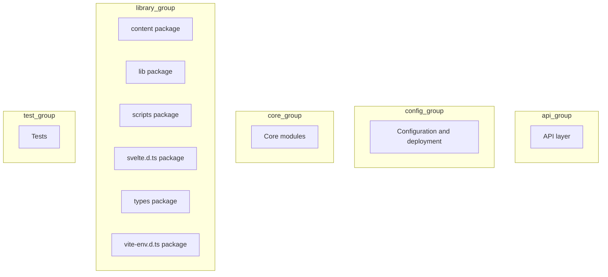

# Architecture report: matschik/component-party.dev

> Automated static analysis. **Observed** = directly seen in files/imports/AST; **Inferred** = interpretation from that evidence. Repository code was not executed.

## 1. Repository at a glance

| Item | Value |
| --- | --- |
| Repository | matschik/component-party.dev |
| Description | 🎉 Web component JS frameworks overview by their syntax and features |
| Language | TypeScript |
| Stars | 3347 |
| Licence | MIT |
| Analysed commit / branch | ef3b7a29ad97749f1134a5de1083e7ff9ebdfb77 / main |
| Framework(s) | Svelte |
| Files analysed | 678 |
| Components | 10 |

## 2. Architecture in one minute

matschik/component-party.dev - 🎉 Web component JS frameworks overview by their syntax and features. This repository was analysed statically from 678 file(s) (0 Python). Detected technologies (observed from imports/manifests): GitHub Actions, Svelte, Tailwind CSS, TypeScript, Vite, Vitest. Files are grouped into 10 component(s): API layer, Configuration and deployment, content package, Core modules, lib package, scripts package, svelte.d.ts package, Tests. Findings below distinguish observed facts from inferred interpretation.

## 3. High-level block diagram

## 4. Main components

### API layer (`api_layer`)

- **Kind:** api
- **Status:** Observed
- **Confidence:** 0.85
- **Responsibility:** Groups 12 file(s) under api layer (observed from repository paths and static analysis).
- **Paths:** `src/routes/+error.svelte`, `src/routes/+layout.svelte`, `src/routes/+layout.ts`, `src/routes/+page.svelte`, `src/routes/+page.ts`, `src/routes/_redirects/+server.ts`, `src/routes/compare/[comparison]/+page.svelte`, `src/routes/compare/[comparison]/+page.ts`, `src/routes/og/[comparison].png/+server.ts`, `src/routes/og/gallery/+page.svelte`, `src/routes/og/gallery/+page.ts`, `src/routes/sitemap.xml/+server.ts`
- **Evidence:** [src/routes/+error.svelte](https://github.com/matschik/component-party.dev/blob/ef3b7a29ad97749f1134a5de1083e7ff9ebdfb77/src/routes/%2Berror.svelte); [src/routes/+layout.svelte](https://github.com/matschik/component-party.dev/blob/ef3b7a29ad97749f1134a5de1083e7ff9ebdfb77/src/routes/%2Blayout.svelte); [src/routes/+layout.ts](https://github.com/matschik/component-party.dev/blob/ef3b7a29ad97749f1134a5de1083e7ff9ebdfb77/src/routes/%2Blayout.ts); [src/routes/+page.svelte](https://github.com/matschik/component-party.dev/blob/ef3b7a29ad97749f1134a5de1083e7ff9ebdfb77/src/routes/%2Bpage.svelte); [src/routes/+page.ts](https://github.com/matschik/component-party.dev/blob/ef3b7a29ad97749f1134a5de1083e7ff9ebdfb77/src/routes/%2Bpage.ts); [src/routes/_redirects/+server.ts](https://github.com/matschik/component-party.dev/blob/ef3b7a29ad97749f1134a5de1083e7ff9ebdfb77/src/routes/_redirects/%2Bserver.ts); [src/routes/compare/[comparison]/+page.svelte](https://github.com/matschik/component-party.dev/blob/ef3b7a29ad97749f1134a5de1083e7ff9ebdfb77/src/routes/compare/%5Bcomparison%5D/%2Bpage.svelte); [src/routes/compare/[comparison]/+page.ts](https://github.com/matschik/component-party.dev/blob/ef3b7a29ad97749f1134a5de1083e7ff9ebdfb77/src/routes/compare/%5Bcomparison%5D/%2Bpage.ts)

### Configuration and deployment (`config`)

- **Kind:** config
- **Status:** Observed
- **Confidence:** 0.85
- **Responsibility:** Groups 7 file(s) under configuration and deployment (observed from repository paths and static analysis).
- **Paths:** `knip.json`, `package.json`, `pnpm-workspace.yaml`, `renovate.json`, `static/manifest.json`, `tsconfig.json`, `tsconfig.node.json`
- **Evidence:** [knip.json](https://github.com/matschik/component-party.dev/blob/ef3b7a29ad97749f1134a5de1083e7ff9ebdfb77/knip.json); [package.json](https://github.com/matschik/component-party.dev/blob/ef3b7a29ad97749f1134a5de1083e7ff9ebdfb77/package.json); [pnpm-workspace.yaml](https://github.com/matschik/component-party.dev/blob/ef3b7a29ad97749f1134a5de1083e7ff9ebdfb77/pnpm-workspace.yaml); [renovate.json](https://github.com/matschik/component-party.dev/blob/ef3b7a29ad97749f1134a5de1083e7ff9ebdfb77/renovate.json); [static/manifest.json](https://github.com/matschik/component-party.dev/blob/ef3b7a29ad97749f1134a5de1083e7ff9ebdfb77/static/manifest.json); [tsconfig.json](https://github.com/matschik/component-party.dev/blob/ef3b7a29ad97749f1134a5de1083e7ff9ebdfb77/tsconfig.json); [tsconfig.node.json](https://github.com/matschik/component-party.dev/blob/ef3b7a29ad97749f1134a5de1083e7ff9ebdfb77/tsconfig.node.json)

### content package (`content`)

- **Kind:** library
- **Status:** Observed
- **Confidence:** 0.85
- **Responsibility:** Groups 385 file(s) under content package (observed from repository paths and static analysis).
- **Paths:** `content/1-reactivity/1-declare-state/angularClassic/name.component.ts`, `content/1-reactivity/1-declare-state/angularRenaissance/name.component.ts`, `content/1-reactivity/1-declare-state/aurelia1/name.ts`, `content/1-reactivity/1-declare-state/aurelia2/name.ts`, `content/1-reactivity/1-declare-state/emberOctane/name.js`, `content/1-reactivity/1-declare-state/lit/name.js`, `content/1-reactivity/1-declare-state/mithril/Name.js`, `content/1-reactivity/1-declare-state/qwik/Name.tsx`, `content/1-reactivity/1-declare-state/react/Name.jsx`, `content/1-reactivity/1-declare-state/solid/Name.jsx`, `content/1-reactivity/1-declare-state/svelte4/Name.svelte`, `content/1-reactivity/1-declare-state/svelte5/Name.svelte`, `content/1-reactivity/1-declare-state/vue2/Name.vue`, `content/1-reactivity/1-declare-state/vue3/Name.vue`, `content/1-reactivity/2-update-state/angularClassic/name.component.ts`, `content/1-reactivity/2-update-state/angularRenaissance/name.component.ts`, `content/1-reactivity/2-update-state/aurelia1/name.ts`, `content/1-reactivity/2-update-state/aurelia2/name.ts`, `content/1-reactivity/2-update-state/emberOctane/name.js`, `content/1-reactivity/2-update-state/lit/name.js`, `content/1-reactivity/2-update-state/mithril/Name.js`, `content/1-reactivity/2-update-state/qwik/Name.tsx`, `content/1-reactivity/2-update-state/react/Name.jsx`, `content/1-reactivity/2-update-state/solid/Name.jsx`, `content/1-reactivity/2-update-state/svelte4/Name.svelte`, `content/1-reactivity/2-update-state/svelte5/Name.svelte`, `content/1-reactivity/2-update-state/vue2/Name.vue`, `content/1-reactivity/2-update-state/vue3/Name.vue`, `content/1-reactivity/3-computed-state/angularClassic/doublecount.component.ts`, `content/1-reactivity/3-computed-state/angularRenaissance/doublecount.component.ts`, `content/1-reactivity/3-computed-state/aurelia1/double-count.ts`, `content/1-reactivity/3-computed-state/aurelia2/double-count.ts`, `content/1-reactivity/3-computed-state/emberOctane/double-count.js`, `content/1-reactivity/3-computed-state/lit/double-count.js`, `content/1-reactivity/3-computed-state/mithril/DoubleCount.js`, `content/1-reactivity/3-computed-state/qwik/DoubleCount.tsx`, `content/1-reactivity/3-computed-state/react/DoubleCount.jsx`, `content/1-reactivity/3-computed-state/solid/DoubleCount.jsx`, `content/1-reactivity/3-computed-state/svelte4/DoubleCount.svelte`, `content/1-reactivity/3-computed-state/svelte5/DoubleCount.svelte`, `content/1-reactivity/3-computed-state/vue2/DoubleCount.vue`, `content/1-reactivity/3-computed-state/vue3/DoubleCount.vue`, `content/2-templating/1-minimal-template/angularClassic/helloworld.component.ts`, `content/2-templating/1-minimal-template/angularRenaissance/helloworld.component.ts`, `content/2-templating/1-minimal-template/lit/hello-world.js`, `content/2-templating/1-minimal-template/mithril/HelloWorld.js`, `content/2-templating/1-minimal-template/qwik/HelloWorld.tsx`, `content/2-templating/1-minimal-template/react/HelloWorld.jsx`, `content/2-templating/1-minimal-template/solid/HelloWorld.jsx`, `content/2-templating/1-minimal-template/svelte4/HelloWorld.svelte`, `content/2-templating/1-minimal-template/svelte5/HelloWorld.svelte`, `content/2-templating/1-minimal-template/vue2/HelloWorld.vue`, `content/2-templating/1-minimal-template/vue3/HelloWorld.vue`, `content/2-templating/2-styling/angularClassic/cssstyle.component.ts`, `content/2-templating/2-styling/angularRenaissance/cssstyle.component.ts`, `content/2-templating/2-styling/lit/css-style.js`, `content/2-templating/2-styling/mithril/CssStyle.js`, `content/2-templating/2-styling/qwik/CssStyle.tsx`, `content/2-templating/2-styling/react/CssStyle.jsx`, `content/2-templating/2-styling/solid/CssStyle.jsx`, `content/2-templating/2-styling/svelte4/CssStyle.svelte`, `content/2-templating/2-styling/svelte5/CssStyle.svelte`, `content/2-templating/2-styling/vue2/CssStyle.vue`, `content/2-templating/2-styling/vue3/CssStyle.vue`, `content/2-templating/3-loop/angularClassic/colors.component.ts`, `content/2-templating/3-loop/angularRenaissance/colors.component.ts`, `content/2-templating/3-loop/aurelia1/colors.ts`, `content/2-templating/3-loop/aurelia2/colors.ts`, `content/2-templating/3-loop/lit/colors-list.js`, `content/2-templating/3-loop/mithril/Colors.js`, `content/2-templating/3-loop/qwik/Colors.tsx`, `content/2-templating/3-loop/react/Colors.jsx`, `content/2-templating/3-loop/solid/Colors.jsx`, `content/2-templating/3-loop/svelte4/Colors.svelte`, `content/2-templating/3-loop/svelte5/Colors.svelte`, `content/2-templating/3-loop/vue2/Colors.vue`, `content/2-templating/3-loop/vue3/Colors.vue`, `content/2-templating/4-event-click/angularClassic/counter.component.ts`, `content/2-templating/4-event-click/angularRenaissance/counter.component.ts`, `content/2-templating/4-event-click/aurelia1/counter.ts`, `content/2-templating/4-event-click/aurelia2/counter.ts`, `content/2-templating/4-event-click/emberOctane/counter.js`, `content/2-templating/4-event-click/lit/x-counter.js`, `content/2-templating/4-event-click/mithril/Counter.js`, `content/2-templating/4-event-click/qwik/Counter.tsx`, `content/2-templating/4-event-click/react/Counter.jsx`, `content/2-templating/4-event-click/solid/Counter.jsx`, `content/2-templating/4-event-click/svelte4/Counter.svelte`, `content/2-templating/4-event-click/svelte5/Counter.svelte`, `content/2-templating/4-event-click/vue2/Counter.vue`, `content/2-templating/4-event-click/vue3/Counter.vue`, `content/2-templating/5-dom-ref/angularClassic/inputfocused.component.ts`, `content/2-templating/5-dom-ref/angularRenaissance/inputfocused.component.ts`, `content/2-templating/5-dom-ref/aurelia1/input-focused.ts`, `content/2-templating/5-dom-ref/aurelia2/input-focused.ts`, `content/2-templating/5-dom-ref/emberOctane/input-focused.js`, `content/2-templating/5-dom-ref/lit/input-focused.js`, `content/2-templating/5-dom-ref/mithril/InputFocused.js`, `content/2-templating/5-dom-ref/qwik/InputFocused.tsx`, `content/2-templating/5-dom-ref/react/InputFocused.jsx`, `content/2-templating/5-dom-ref/solid/InputFocused.jsx`, `content/2-templating/5-dom-ref/svelte4/InputFocused.svelte`, `content/2-templating/5-dom-ref/svelte5/InputFocused.svelte`, `content/2-templating/5-dom-ref/vue2/InputFocused.vue`, `content/2-templating/5-dom-ref/vue3/InputFocused.vue`, `content/2-templating/6-conditional/angularClassic/trafficlight.component.ts`, `content/2-templating/6-conditional/angularRenaissance/trafficlight.component.ts`, `content/2-templating/6-conditional/aurelia1/traffic-light.ts`, `content/2-templating/6-conditional/aurelia2/traffic-light.ts`, `content/2-templating/6-conditional/emberOctane/traffic-light.js`, `content/2-templating/6-conditional/lit/traffic-light.js`, `content/2-templating/6-conditional/mithril/TrafficLight.js`, `content/2-templating/6-conditional/qwik/TrafficLight.tsx`, `content/2-templating/6-conditional/react/TrafficLight.jsx`, `content/2-templating/6-conditional/solid/TrafficLight.jsx`, `content/2-templating/6-conditional/svelte4/TrafficLight.svelte`, `content/2-templating/6-conditional/svelte5/TrafficLight.svelte`, `content/2-templating/6-conditional/vue2/TrafficLight.vue`, `content/2-templating/6-conditional/vue3/TrafficLight.vue`, `content/3-lifecycle/1-on-mount/angularClassic/pagetitle.component.ts`, `content/3-lifecycle/1-on-mount/angularRenaissance/pagetitle.component.ts`, `content/3-lifecycle/1-on-mount/aurelia1/page-title.ts`, `content/3-lifecycle/1-on-mount/aurelia2/page-title.ts`, `content/3-lifecycle/1-on-mount/emberOctane/page-title.js`, `content/3-lifecycle/1-on-mount/lit/page-title.js`, `content/3-lifecycle/1-on-mount/mithril/PageTitle.js`, `content/3-lifecycle/1-on-mount/qwik/PageTitle.tsx`, `content/3-lifecycle/1-on-mount/react/PageTitle.jsx`, `content/3-lifecycle/1-on-mount/solid/PageTitle.jsx`, `content/3-lifecycle/1-on-mount/svelte4/PageTitle.svelte`, `content/3-lifecycle/1-on-mount/svelte5/PageTitle.svelte`, `content/3-lifecycle/1-on-mount/vue2/PageTitle.vue`, `content/3-lifecycle/1-on-mount/vue3/PageTitle.vue`, `content/3-lifecycle/2-on-unmount/angularClassic/time.component.ts`, `content/3-lifecycle/2-on-unmount/angularRenaissance/time.component.ts`, `content/3-lifecycle/2-on-unmount/aurelia1/time.ts`, `content/3-lifecycle/2-on-unmount/aurelia2/time.ts`, `content/3-lifecycle/2-on-unmount/emberOctane/time.js`, `content/3-lifecycle/2-on-unmount/lit/x-time.js`, `content/3-lifecycle/2-on-unmount/mithril/Time.js`, `content/3-lifecycle/2-on-unmount/qwik/Time.tsx`, `content/3-lifecycle/2-on-unmount/react/Time.jsx`, `content/3-lifecycle/2-on-unmount/solid/Time.jsx`, `content/3-lifecycle/2-on-unmount/svelte4/Time.svelte`, `content/3-lifecycle/2-on-unmount/svelte5/Time.svelte`, `content/3-lifecycle/2-on-unmount/vue2/Time.vue`, `content/3-lifecycle/2-on-unmount/vue3/Time.vue`, `content/4-component-composition/1-props/angularClassic/app.component.ts`, `content/4-component-composition/1-props/angularClassic/userprofile.component.ts`, `content/4-component-composition/1-props/angularRenaissance/app.component.ts`, `content/4-component-composition/1-props/angularRenaissance/userprofile.component.ts`, `content/4-component-composition/1-props/aurelia1/app.ts`, `content/4-component-composition/1-props/aurelia1/user-profile.ts`, `content/4-component-composition/1-props/aurelia2/app.ts`, `content/4-component-composition/1-props/aurelia2/user-profile.ts`, `content/4-component-composition/1-props/emberOctane/user-profile.js`, `content/4-component-composition/1-props/lit/user-profile.js`, `content/4-component-composition/1-props/lit/x-app.js`, `content/4-component-composition/1-props/mithril/App.js`, `content/4-component-composition/1-props/mithril/UserProfile.js`, `content/4-component-composition/1-props/qwik/App.tsx`, `content/4-component-composition/1-props/qwik/UserProfile.tsx`, `content/4-component-composition/1-props/react/App.jsx`, `content/4-component-composition/1-props/react/UserProfile.jsx`, `content/4-component-composition/1-props/solid/App.jsx`, `content/4-component-composition/1-props/solid/UserProfile.jsx`, `content/4-component-composition/1-props/svelte4/App.svelte`, `content/4-component-composition/1-props/svelte4/UserProfile.svelte`, `content/4-component-composition/1-props/svelte5/App.svelte`, `content/4-component-composition/1-props/svelte5/UserProfile.svelte`, `content/4-component-composition/1-props/vue2/App.vue`, `content/4-component-composition/1-props/vue2/UserProfile.vue`, `content/4-component-composition/1-props/vue3/App.vue`, `content/4-component-composition/1-props/vue3/UserProfile.vue`, `content/4-component-composition/2-emit-to-parent/angularClassic/answer-button.component.ts`, `content/4-component-composition/2-emit-to-parent/angularClassic/app.component.ts`, `content/4-component-composition/2-emit-to-parent/angularRenaissance/answer-button.component.ts`, `content/4-component-composition/2-emit-to-parent/angularRenaissance/app.component.ts`, `content/4-component-composition/2-emit-to-parent/aurelia1/answer-button.ts`, `content/4-component-composition/2-emit-to-parent/aurelia1/app.ts`, `content/4-component-composition/2-emit-to-parent/aurelia2/answer-button.ts`, `content/4-component-composition/2-emit-to-parent/aurelia2/app.ts`, `content/4-component-composition/2-emit-to-parent/emberOctane/app.js`, `content/4-component-composition/2-emit-to-parent/lit/answer-button.js`, `content/4-component-composition/2-emit-to-parent/lit/x-app.js`, `content/4-component-composition/2-emit-to-parent/mithril/AnswerButton.js`, `content/4-component-composition/2-emit-to-parent/mithril/App.js`, `content/4-component-composition/2-emit-to-parent/qwik/AnswerButton.tsx`, `content/4-component-composition/2-emit-to-parent/qwik/App.tsx`, `content/4-component-composition/2-emit-to-parent/react/AnswerButton.jsx`, `content/4-component-composition/2-emit-to-parent/react/App.jsx`, `content/4-component-composition/2-emit-to-parent/solid/AnswerButton.jsx`, `content/4-component-composition/2-emit-to-parent/solid/App.jsx`, `content/4-component-composition/2-emit-to-parent/svelte4/AnswerButton.svelte`, `content/4-component-composition/2-emit-to-parent/svelte4/App.svelte`, `content/4-component-composition/2-emit-to-parent/svelte5/AnswerButton.svelte`, `content/4-component-composition/2-emit-to-parent/svelte5/App.svelte`, `content/4-component-composition/2-emit-to-parent/vue2/AnswerButton.vue`, `content/4-component-composition/2-emit-to-parent/vue2/App.vue`, `content/4-component-composition/2-emit-to-parent/vue3/AnswerButton.vue`, `content/4-component-composition/2-emit-to-parent/vue3/App.vue`, `content/4-component-composition/3-slot/angularClassic/app.component.ts`, `content/4-component-composition/3-slot/angularClassic/funny-button.component.ts`, `content/4-component-composition/3-slot/angularRenaissance/app.component.ts`, `content/4-component-composition/3-slot/angularRenaissance/funny-button.component.ts`, `content/4-component-composition/3-slot/lit/funny-button.js`, `content/4-component-composition/3-slot/lit/x-app.js`, `content/4-component-composition/3-slot/mithril/App.js`, `content/4-component-composition/3-slot/mithril/FunnyButton.js`, `content/4-component-composition/3-slot/qwik/App.tsx`, `content/4-component-composition/3-slot/qwik/FunnyButton.tsx`, `content/4-component-composition/3-slot/react/App.jsx`, `content/4-component-composition/3-slot/react/FunnyButton.jsx`, `content/4-component-composition/3-slot/solid/App.jsx`, `content/4-component-composition/3-slot/solid/FunnyButton.jsx`, `content/4-component-composition/3-slot/svelte4/App.svelte`, `content/4-component-composition/3-slot/svelte4/FunnyButton.svelte`, `content/4-component-composition/3-slot/svelte5/App.svelte`, `content/4-component-composition/3-slot/svelte5/FunnyButton.svelte`, `content/4-component-composition/3-slot/vue2/App.vue`, `content/4-component-composition/3-slot/vue2/FunnyButton.vue`, `content/4-component-composition/3-slot/vue3/App.vue`, `content/4-component-composition/3-slot/vue3/FunnyButton.vue`, `content/4-component-composition/4-slot-fallback/angularClassic/app.component.ts`, `content/4-component-composition/4-slot-fallback/angularClassic/funny-button.component.ts`, `content/4-component-composition/4-slot-fallback/angularRenaissance/app.component.ts`, `content/4-component-composition/4-slot-fallback/angularRenaissance/funny-button.component.ts`, `content/4-component-composition/4-slot-fallback/lit/funny-button.js`, `content/4-component-composition/4-slot-fallback/lit/x-app.js`, `content/4-component-composition/4-slot-fallback/mithril/App.js`, `content/4-component-composition/4-slot-fallback/mithril/FunnyButton.js`, `content/4-component-composition/4-slot-fallback/qwik/App.tsx`, `content/4-component-composition/4-slot-fallback/qwik/FunnyButton.tsx`, `content/4-component-composition/4-slot-fallback/react/App.jsx`, `content/4-component-composition/4-slot-fallback/react/FunnyButton.jsx`, `content/4-component-composition/4-slot-fallback/solid/App.jsx`, `content/4-component-composition/4-slot-fallback/solid/FunnyButton.jsx`, `content/4-component-composition/4-slot-fallback/svelte4/App.svelte`, `content/4-component-composition/4-slot-fallback/svelte4/FunnyButton.svelte`, `content/4-component-composition/4-slot-fallback/svelte5/App.svelte`, `content/4-component-composition/4-slot-fallback/svelte5/FunnyButton.svelte`, `content/4-component-composition/4-slot-fallback/vue2/App.vue`, `content/4-component-composition/4-slot-fallback/vue2/FunnyButton.vue`, `content/4-component-composition/4-slot-fallback/vue3/App.vue`, `content/4-component-composition/4-slot-fallback/vue3/FunnyButton.vue`, `content/4-component-composition/5-context/angularClassic/app.component.ts`, `content/4-component-composition/5-context/angularClassic/user-profile.component.ts`, `content/4-component-composition/5-context/angularClassic/user.service.ts`, `content/4-component-composition/5-context/angularRenaissance/app.component.ts`, `content/4-component-composition/5-context/angularRenaissance/user-profile.component.ts`, `content/4-component-composition/5-context/angularRenaissance/user.service.ts`, `content/4-component-composition/5-context/aurelia2/app.ts`, `content/4-component-composition/5-context/aurelia2/user-profile.ts`, `content/4-component-composition/5-context/emberOctane/user-profile.js`, `content/4-component-composition/5-context/emberOctane/user-service.js`, `content/4-component-composition/5-context/emberPolaris/user-service.js`, `content/4-component-composition/5-context/lit/app-x.js`, `content/4-component-composition/5-context/lit/user-context.js`, `content/4-component-composition/5-context/lit/user-profile.js`, `content/4-component-composition/5-context/mithril/App.js`, `content/4-component-composition/5-context/mithril/UserProfile.js`, `content/4-component-composition/5-context/qwik/App.tsx`, `content/4-component-composition/5-context/qwik/UserProfile.tsx`, `content/4-component-composition/5-context/react/App.jsx`, `content/4-component-composition/5-context/react/UserContext.jsx`, `content/4-component-composition/5-context/react/UserProfile.jsx`, `content/4-component-composition/5-context/solid/App.jsx`, `content/4-component-composition/5-context/solid/UserContext.jsx`, `content/4-component-composition/5-context/solid/UserProfile.jsx`, `content/4-component-composition/5-context/svelte4/App.svelte`, `content/4-component-composition/5-context/svelte4/UserProfile.svelte`, `content/4-component-composition/5-context/svelte4/createUserStore.js`, `content/4-component-composition/5-context/svelte5/App.svelte`, `content/4-component-composition/5-context/svelte5/UserProfile.svelte`, `content/4-component-composition/5-context/svelte5/createUserState.svelte.js`, `content/4-component-composition/5-context/vue2/App.vue`, `content/4-component-composition/5-context/vue2/UserProfile.vue`, `content/4-component-composition/5-context/vue3/App.vue`, `content/4-component-composition/5-context/vue3/UserProfile.vue`, `content/6-form-input/1-input-text/angularClassic/input-hello.component.ts`, `content/6-form-input/1-input-text/angularRenaissance/input-hello.component.ts`, `content/6-form-input/1-input-text/aurelia1/input-hello.ts`, `content/6-form-input/1-input-text/aurelia2/input-hello.ts`, `content/6-form-input/1-input-text/emberOctane/input-hello.js`, `content/6-form-input/1-input-text/lit/input-hello.js`, `content/6-form-input/1-input-text/mithril/InputHello.js`, `content/6-form-input/1-input-text/qwik/InputHello.tsx`, `content/6-form-input/1-input-text/react/InputHello.jsx`, `content/6-form-input/1-input-text/solid/InputHello.jsx`, `content/6-form-input/1-input-text/svelte4/InputHello.svelte`, `content/6-form-input/1-input-text/svelte5/InputHello.svelte`, `content/6-form-input/1-input-text/vue2/InputHello.vue`, `content/6-form-input/1-input-text/vue3/InputHello.vue`, `content/6-form-input/2-checkbox/angularClassic/is-available.component.ts`, `content/6-form-input/2-checkbox/angularRenaissance/is-available.component.ts`, `content/6-form-input/2-checkbox/aurelia1/is-available.ts`, `content/6-form-input/2-checkbox/aurelia2/is-available.ts`, `content/6-form-input/2-checkbox/emberOctane/is-available.js`, `content/6-form-input/2-checkbox/lit/is-available.js`, `content/6-form-input/2-checkbox/mithril/IsAvailable.js`, `content/6-form-input/2-checkbox/qwik/IsAvailable.tsx`, `content/6-form-input/2-checkbox/react/IsAvailable.jsx`, `content/6-form-input/2-checkbox/solid/IsAvailable.jsx`, `content/6-form-input/2-checkbox/svelte4/IsAvailable.svelte`, `content/6-form-input/2-checkbox/svelte5/IsAvailable.svelte`, `content/6-form-input/2-checkbox/vue2/IsAvailable.vue`, `content/6-form-input/2-checkbox/vue3/IsAvailable.vue`, `content/6-form-input/3-radio/angularClassic/pick-pill.component.ts`, `content/6-form-input/3-radio/angularRenaissance/pick-pill.component.ts`, `content/6-form-input/3-radio/aurelia1/pick-pill.ts`, `content/6-form-input/3-radio/aurelia2/pick-pill.ts`, `content/6-form-input/3-radio/emberOctane/pick-pill.js`, `content/6-form-input/3-radio/lit/pick-pill.js`, `content/6-form-input/3-radio/mithril/PickPill.js`, `content/6-form-input/3-radio/qwik/PickPill.tsx`, `content/6-form-input/3-radio/react/PickPill.jsx`, `content/6-form-input/3-radio/solid/PickPill.jsx`, `content/6-form-input/3-radio/svelte4/PickPill.svelte`, `content/6-form-input/3-radio/svelte5/PickPill.svelte`, `content/6-form-input/3-radio/vue2/PickPill.vue`, `content/6-form-input/3-radio/vue3/PickPill.vue`, `content/6-form-input/4-select/angularClassic/color-select.component.ts`, `content/6-form-input/4-select/angularRenaissance/color-select.component.ts`, `content/6-form-input/4-select/aurelia1/color-select.ts`, `content/6-form-input/4-select/aurelia2/color-select.ts`, `content/6-form-input/4-select/emberOctane/color-select.js`, `content/6-form-input/4-select/lit/color-select.js`, `content/6-form-input/4-select/mithril/ColorSelect.js`, `content/6-form-input/4-select/qwik/ColorSelect.tsx`, `content/6-form-input/4-select/react/ColorSelect.jsx`, `content/6-form-input/4-select/solid/ColorSelect.jsx`, `content/6-form-input/4-select/svelte4/ColorSelect.svelte`, `content/6-form-input/4-select/svelte5/ColorSelect.svelte`, `content/6-form-input/4-select/vue2/ColorSelect.vue`, `content/6-form-input/4-select/vue3/ColorSelect.vue`, `content/7-webapp-features/1-render-app/angularClassic/app.component.ts`, `content/7-webapp-features/1-render-app/angularClassic/app.module.ts`, `content/7-webapp-features/1-render-app/angularClassic/main.ts`, `content/7-webapp-features/1-render-app/angularRenaissance/app.component.ts`, `content/7-webapp-features/1-render-app/angularRenaissance/main.ts`, `content/7-webapp-features/1-render-app/aurelia2/app.ts`, `content/7-webapp-features/1-render-app/aurelia2/main.ts`, `content/7-webapp-features/1-render-app/emberPolaris/Index.js`, `content/7-webapp-features/1-render-app/lit/app.js`, `content/7-webapp-features/1-render-app/marko/app.js`, `content/7-webapp-features/1-render-app/mithril/App.js`, `content/7-webapp-features/1-render-app/mithril/main.js`, `content/7-webapp-features/1-render-app/qwik/app.tsx`, `content/7-webapp-features/1-render-app/qwik/main.tsx`, `content/7-webapp-features/1-render-app/react/App.jsx`, `content/7-webapp-features/1-render-app/react/main.jsx`, `content/7-webapp-features/1-render-app/ripple/main.js`, `content/7-webapp-features/1-render-app/solid/App.jsx`, `content/7-webapp-features/1-render-app/solid/main.jsx`, `content/7-webapp-features/1-render-app/svelte4/App.svelte`, `content/7-webapp-features/1-render-app/svelte4/app.js`, `content/7-webapp-features/1-render-app/svelte5/App.svelte`, `content/7-webapp-features/1-render-app/svelte5/app.js`, `content/7-webapp-features/1-render-app/vue2/App.vue`, `content/7-webapp-features/1-render-app/vue2/main.js`, `content/7-webapp-features/1-render-app/vue3/App.vue`, `content/7-webapp-features/1-render-app/vue3/main.js`, `content/7-webapp-features/2-fetch-data/angularClassic/user.service.ts`, `content/7-webapp-features/2-fetch-data/angularClassic/users.component.ts`, `content/7-webapp-features/2-fetch-data/angularRenaissance/user.service.ts`, `content/7-webapp-features/2-fetch-data/angularRenaissance/users.component.ts`, `content/7-webapp-features/2-fetch-data/aurelia1/UseFetchUsers.ts`, `content/7-webapp-features/2-fetch-data/aurelia1/app.ts`, `content/7-webapp-features/2-fetch-data/aurelia2/UseFetchUsers.ts`, `content/7-webapp-features/2-fetch-data/aurelia2/app.ts`, `content/7-webapp-features/2-fetch-data/emberOctane/app.js`, `content/7-webapp-features/2-fetch-data/lit/fetch-users-task.js`, `content/7-webapp-features/2-fetch-data/lit/x-app.js`, `content/7-webapp-features/2-fetch-data/mithril/App.js`, `content/7-webapp-features/2-fetch-data/qwik/App.tsx`, `content/7-webapp-features/2-fetch-data/react/App.jsx`, `content/7-webapp-features/2-fetch-data/react/useFetchUsers.js`, `content/7-webapp-features/2-fetch-data/solid/App.jsx`, `content/7-webapp-features/2-fetch-data/svelte4/App.svelte`, `content/7-webapp-features/2-fetch-data/svelte4/useFetchUsers.js`, `content/7-webapp-features/2-fetch-data/svelte5/App.svelte`, `content/7-webapp-features/2-fetch-data/svelte5/useFetchUsers.svelte.js`, `content/7-webapp-features/2-fetch-data/vue2/App.vue`, `content/7-webapp-features/2-fetch-data/vue3/App.vue`, `content/7-webapp-features/2-fetch-data/vue3/useFetchUsers.js`
- **Evidence:** [content/1-reactivity/1-declare-state/angularClassic/name.component.ts](https://github.com/matschik/component-party.dev/blob/ef3b7a29ad97749f1134a5de1083e7ff9ebdfb77/content/1-reactivity/1-declare-state/angularClassic/name.component.ts); [content/1-reactivity/1-declare-state/angularRenaissance/name.component.ts](https://github.com/matschik/component-party.dev/blob/ef3b7a29ad97749f1134a5de1083e7ff9ebdfb77/content/1-reactivity/1-declare-state/angularRenaissance/name.component.ts); [content/1-reactivity/1-declare-state/aurelia1/name.ts](https://github.com/matschik/component-party.dev/blob/ef3b7a29ad97749f1134a5de1083e7ff9ebdfb77/content/1-reactivity/1-declare-state/aurelia1/name.ts); [content/1-reactivity/1-declare-state/aurelia2/name.ts](https://github.com/matschik/component-party.dev/blob/ef3b7a29ad97749f1134a5de1083e7ff9ebdfb77/content/1-reactivity/1-declare-state/aurelia2/name.ts); [content/1-reactivity/1-declare-state/emberOctane/name.js](https://github.com/matschik/component-party.dev/blob/ef3b7a29ad97749f1134a5de1083e7ff9ebdfb77/content/1-reactivity/1-declare-state/emberOctane/name.js); [content/1-reactivity/1-declare-state/lit/name.js](https://github.com/matschik/component-party.dev/blob/ef3b7a29ad97749f1134a5de1083e7ff9ebdfb77/content/1-reactivity/1-declare-state/lit/name.js); [content/1-reactivity/1-declare-state/mithril/Name.js](https://github.com/matschik/component-party.dev/blob/ef3b7a29ad97749f1134a5de1083e7ff9ebdfb77/content/1-reactivity/1-declare-state/mithril/Name.js); [content/1-reactivity/1-declare-state/qwik/Name.tsx](https://github.com/matschik/component-party.dev/blob/ef3b7a29ad97749f1134a5de1083e7ff9ebdfb77/content/1-reactivity/1-declare-state/qwik/Name.tsx)

### Core modules (`core`)

- **Kind:** core
- **Status:** Observed
- **Confidence:** 0.85
- **Responsibility:** Groups 4 file(s) under core modules (observed from repository paths and static analysis).
- **Paths:** `frameworks.ts`, `playwright.config.ts`, `vite.config.ts`, `void.config.ts`
- **Evidence:** [frameworks.ts](https://github.com/matschik/component-party.dev/blob/ef3b7a29ad97749f1134a5de1083e7ff9ebdfb77/frameworks.ts); [playwright.config.ts](https://github.com/matschik/component-party.dev/blob/ef3b7a29ad97749f1134a5de1083e7ff9ebdfb77/playwright.config.ts); [vite.config.ts](https://github.com/matschik/component-party.dev/blob/ef3b7a29ad97749f1134a5de1083e7ff9ebdfb77/vite.config.ts); [void.config.ts](https://github.com/matschik/component-party.dev/blob/ef3b7a29ad97749f1134a5de1083e7ff9ebdfb77/void.config.ts)

### lib package (`lib`)

- **Kind:** library
- **Status:** Observed
- **Confidence:** 0.85
- **Responsibility:** Groups 19 file(s) under lib package (observed from repository paths and static analysis).
- **Paths:** `src/lib/buildDate.ts`, `src/lib/comparisonPairs.test.ts`, `src/lib/comparisonPairs.ts`, `src/lib/components/Aside.svelte`, `src/lib/components/CodeEditor.svelte`, `src/lib/components/Comparison.svelte`, `src/lib/components/Footer.svelte`, `src/lib/components/FrameworkLabel.svelte`, `src/lib/components/GithubStarButton.svelte`, `src/lib/components/Header.svelte`, `src/lib/components/TransitionWithClass.svelte`, `src/lib/constants.ts`, `src/lib/copyToClipboard.ts`, `src/lib/createLocaleStorage.ts`, `src/lib/footerNavigation.ts`, `src/lib/frameworkUrl.test.ts`, `src/lib/frameworkUrl.ts`, `src/lib/seo.ts`, `src/lib/types.ts`
- **Evidence:** [src/lib/buildDate.ts](https://github.com/matschik/component-party.dev/blob/ef3b7a29ad97749f1134a5de1083e7ff9ebdfb77/src/lib/buildDate.ts); [src/lib/comparisonPairs.test.ts](https://github.com/matschik/component-party.dev/blob/ef3b7a29ad97749f1134a5de1083e7ff9ebdfb77/src/lib/comparisonPairs.test.ts); [src/lib/comparisonPairs.ts](https://github.com/matschik/component-party.dev/blob/ef3b7a29ad97749f1134a5de1083e7ff9ebdfb77/src/lib/comparisonPairs.ts); [src/lib/components/Aside.svelte](https://github.com/matschik/component-party.dev/blob/ef3b7a29ad97749f1134a5de1083e7ff9ebdfb77/src/lib/components/Aside.svelte); [src/lib/components/CodeEditor.svelte](https://github.com/matschik/component-party.dev/blob/ef3b7a29ad97749f1134a5de1083e7ff9ebdfb77/src/lib/components/CodeEditor.svelte); [src/lib/components/Comparison.svelte](https://github.com/matschik/component-party.dev/blob/ef3b7a29ad97749f1134a5de1083e7ff9ebdfb77/src/lib/components/Comparison.svelte); [src/lib/components/Footer.svelte](https://github.com/matschik/component-party.dev/blob/ef3b7a29ad97749f1134a5de1083e7ff9ebdfb77/src/lib/components/Footer.svelte); [src/lib/components/FrameworkLabel.svelte](https://github.com/matschik/component-party.dev/blob/ef3b7a29ad97749f1134a5de1083e7ff9ebdfb77/src/lib/components/FrameworkLabel.svelte)

### scripts package (`scripts`)

- **Kind:** library
- **Status:** Observed
- **Confidence:** 0.85
- **Responsibility:** Groups 4 file(s) under scripts package (observed from repository paths and static analysis).
- **Paths:** `scripts/check-toolchain.sh`, `scripts/generateContent.ts`, `scripts/generateReadMeProgress.ts`, `scripts/npmDownloadStats.ts`
- **Evidence:** [scripts/check-toolchain.sh](https://github.com/matschik/component-party.dev/blob/ef3b7a29ad97749f1134a5de1083e7ff9ebdfb77/scripts/check-toolchain.sh); [scripts/generateContent.ts](https://github.com/matschik/component-party.dev/blob/ef3b7a29ad97749f1134a5de1083e7ff9ebdfb77/scripts/generateContent.ts); [scripts/generateReadMeProgress.ts](https://github.com/matschik/component-party.dev/blob/ef3b7a29ad97749f1134a5de1083e7ff9ebdfb77/scripts/generateReadMeProgress.ts); [scripts/npmDownloadStats.ts](https://github.com/matschik/component-party.dev/blob/ef3b7a29ad97749f1134a5de1083e7ff9ebdfb77/scripts/npmDownloadStats.ts)

### svelte.d.ts package (`svelte_d_ts`)

- **Kind:** library
- **Status:** Observed
- **Confidence:** 0.85
- **Responsibility:** Groups 1 file(s) under svelte.d.ts package (observed from repository paths and static analysis).
- **Paths:** `src/svelte.d.ts`
- **Evidence:** [src/svelte.d.ts](https://github.com/matschik/component-party.dev/blob/ef3b7a29ad97749f1134a5de1083e7ff9ebdfb77/src/svelte.d.ts)

### Tests (`tests`)

- **Kind:** test
- **Status:** Observed
- **Confidence:** 0.85
- **Responsibility:** Groups 7 file(s) under tests (observed from repository paths and static analysis).
- **Paths:** `test/e2e/config/test-config.ts`, `test/e2e/framework-comparison.test.ts`, `test/e2e/home.test.ts`, `test/e2e/integration.test.ts`, `test/e2e/utils/test-helpers.ts`, `test/og-jsonld.test.ts`, `test/prerender.test.ts`
- **Evidence:** [test/e2e/config/test-config.ts](https://github.com/matschik/component-party.dev/blob/ef3b7a29ad97749f1134a5de1083e7ff9ebdfb77/test/e2e/config/test-config.ts); [test/e2e/framework-comparison.test.ts](https://github.com/matschik/component-party.dev/blob/ef3b7a29ad97749f1134a5de1083e7ff9ebdfb77/test/e2e/framework-comparison.test.ts); [test/e2e/home.test.ts](https://github.com/matschik/component-party.dev/blob/ef3b7a29ad97749f1134a5de1083e7ff9ebdfb77/test/e2e/home.test.ts); [test/e2e/integration.test.ts](https://github.com/matschik/component-party.dev/blob/ef3b7a29ad97749f1134a5de1083e7ff9ebdfb77/test/e2e/integration.test.ts); [test/e2e/utils/test-helpers.ts](https://github.com/matschik/component-party.dev/blob/ef3b7a29ad97749f1134a5de1083e7ff9ebdfb77/test/e2e/utils/test-helpers.ts); [test/og-jsonld.test.ts](https://github.com/matschik/component-party.dev/blob/ef3b7a29ad97749f1134a5de1083e7ff9ebdfb77/test/og-jsonld.test.ts); [test/prerender.test.ts](https://github.com/matschik/component-party.dev/blob/ef3b7a29ad97749f1134a5de1083e7ff9ebdfb77/test/prerender.test.ts)

### types package (`types`)

- **Kind:** library
- **Status:** Observed
- **Confidence:** 0.85
- **Responsibility:** Groups 1 file(s) under types package (observed from repository paths and static analysis).
- **Paths:** `types/micache.d.ts`
- **Evidence:** [types/micache.d.ts](https://github.com/matschik/component-party.dev/blob/ef3b7a29ad97749f1134a5de1083e7ff9ebdfb77/types/micache.d.ts)

### vite-env.d.ts package (`vite_env_d_ts`)

- **Kind:** library
- **Status:** Observed
- **Confidence:** 0.85
- **Responsibility:** Groups 1 file(s) under vite-env.d.ts package (observed from repository paths and static analysis).
- **Paths:** `src/vite-env.d.ts`
- **Evidence:** [src/vite-env.d.ts](https://github.com/matschik/component-party.dev/blob/ef3b7a29ad97749f1134a5de1083e7ff9ebdfb77/src/vite-env.d.ts)

## 5. Execution flow

No entry point was observed; the startup flow below is therefore limited.

Representative flow (derived from observed entry points and the import graph; steps beyond the entry point are **Inferred**):

1. Execution starts at an observed entry point listed above, if present.
2. No internal import relationships between components were observed.

## 6. Project structure

### `(root)`

- `.git-blame-ignore-revs` - other (264 bytes)
- `.gitignore` - other (600 bytes)
- `.node-version` - other (8 bytes)
- `CONTRIBUTING.md` - docs (860 bytes)
- `LICENSE` - docs (1077 bytes)
- `README.md` - docs (15909 bytes)
- `frameworks.ts` - source, TypeScript (11834 bytes)
- `knip.json` - config (127 bytes)
- `package.json` - manifest (2465 bytes)
- `playwright.config.ts` - source, TypeScript (831 bytes)
- `pnpm-workspace.yaml` - config (164 bytes)
- `renovate.json` - config (1547 bytes)
- `tsconfig.json` - config (576 bytes)
- `tsconfig.node.json` - config (656 bytes)
- `vite.config.ts` - source, TypeScript (1683 bytes)
- `void.config.ts` - source, TypeScript (1476 bytes)

### `.github`

- `.github/actions/setup-node-pnpm/action.yml` - config (706 bytes)
- `.github/workflows/ci.yml` - ci, YAML (1851 bytes)
- `.github/workflows/setup-node-pnpm.yml` - ci, YAML (811 bytes)

### `.vite-hooks`

- `.vite-hooks/pre-commit` - other (10 bytes)

### `.vscode`

- `.vscode/extensions.json` - config (105 bytes)

### `content`

- `content/1-reactivity/1-declare-state/alpine/index.html` - other (50 bytes)
- `content/1-reactivity/1-declare-state/angularClassic/name.component.ts` - source, TypeScript (287 bytes)
- `content/1-reactivity/1-declare-state/angularRenaissance/name.component.ts` - source, TypeScript (191 bytes)
- `content/1-reactivity/1-declare-state/aurelia1/name.html` - other (48 bytes)
- `content/1-reactivity/1-declare-state/aurelia1/name.ts` - source, TypeScript (39 bytes)
- `content/1-reactivity/1-declare-state/aurelia2/name.html` - other (23 bytes)
- `content/1-reactivity/1-declare-state/aurelia2/name.ts` - source, TypeScript (39 bytes)
- `content/1-reactivity/1-declare-state/emberOctane/name.hbs` - other (28 bytes)
- `content/1-reactivity/1-declare-state/emberOctane/name.js` - source, JavaScript (119 bytes)
- `content/1-reactivity/1-declare-state/emberPolaris/name.gjs` - other (180 bytes)
- `content/1-reactivity/1-declare-state/lit/name.js` - source, JavaScript (259 bytes)
- `content/1-reactivity/1-declare-state/marko/Name.marko` - other (41 bytes)
- `content/1-reactivity/1-declare-state/mithril/Name.js` - source, JavaScript (141 bytes)
- `content/1-reactivity/1-declare-state/qwik/Name.tsx` - source, TypeScript (175 bytes)
- `content/1-reactivity/1-declare-state/react/Name.jsx` - source, JavaScript (138 bytes)
- `content/1-reactivity/1-declare-state/ripple/Name.tsrx` - other (134 bytes)
- `content/1-reactivity/1-declare-state/solid/Name.jsx` - source, JavaScript (151 bytes)
- `content/1-reactivity/1-declare-state/svelte4/Name.svelte` - source, Svelte (63 bytes)
- `content/1-reactivity/1-declare-state/svelte5/Name.svelte` - source, Svelte (71 bytes)
- `content/1-reactivity/1-declare-state/vue2/Name.vue` - source, Vue (147 bytes)
- `content/1-reactivity/1-declare-state/vue3/Name.vue` - source, Vue (130 bytes)
- `content/1-reactivity/2-update-state/alpine/index.html` - other (73 bytes)
- `content/1-reactivity/2-update-state/angularClassic/name.component.ts` - source, TypeScript (334 bytes)
- `content/1-reactivity/2-update-state/angularRenaissance/name.component.ts` - source, TypeScript (241 bytes)
- `content/1-reactivity/2-update-state/aurelia1/name.html` - other (48 bytes)
- `content/1-reactivity/2-update-state/aurelia1/name.ts` - source, TypeScript (86 bytes)
- `content/1-reactivity/2-update-state/aurelia2/name.html` - other (23 bytes)
- `content/1-reactivity/2-update-state/aurelia2/name.ts` - source, TypeScript (86 bytes)
- `content/1-reactivity/2-update-state/emberOctane/name.hbs` - other (28 bytes)
- `content/1-reactivity/2-update-state/emberOctane/name.js` - source, JavaScript (256 bytes)
- `content/1-reactivity/2-update-state/emberPolaris/name.gjs` - other (320 bytes)
- `content/1-reactivity/2-update-state/lit/name.js` - source, JavaScript (319 bytes)
- `content/1-reactivity/2-update-state/marko/Name.marko` - other (72 bytes)
- `content/1-reactivity/2-update-state/mithril/Name.js` - source, JavaScript (157 bytes)
- `content/1-reactivity/2-update-state/qwik/Name.tsx` - source, TypeScript (236 bytes)
- `content/1-reactivity/2-update-state/react/Name.jsx` - source, JavaScript (210 bytes)
- `content/1-reactivity/2-update-state/ripple/Name.tsrx` - other (151 bytes)
- `content/1-reactivity/2-update-state/solid/Name.jsx` - source, JavaScript (179 bytes)
- `content/1-reactivity/2-update-state/svelte4/Name.svelte` - source, Svelte (80 bytes)
- `content/1-reactivity/2-update-state/svelte5/Name.svelte` - source, Svelte (88 bytes)
- `content/1-reactivity/2-update-state/vue2/Name.vue` - source, Vue (190 bytes)
- `content/1-reactivity/2-update-state/vue3/Name.vue` - source, Vue (151 bytes)
- `content/1-reactivity/3-computed-state/alpine/index.html` - other (109 bytes)
- `content/1-reactivity/3-computed-state/angularClassic/doublecount.component.ts` - source, TypeScript (376 bytes)
- `content/1-reactivity/3-computed-state/angularRenaissance/doublecount.component.ts` - source, TypeScript (267 bytes)
- `content/1-reactivity/3-computed-state/aurelia1/double-count.html` - other (51 bytes)
- `content/1-reactivity/3-computed-state/aurelia1/double-count.ts` - source, TypeScript (83 bytes)
- `content/1-reactivity/3-computed-state/aurelia2/double-count.html` - other (26 bytes)
- `content/1-reactivity/3-computed-state/aurelia2/double-count.ts` - source, TypeScript (83 bytes)
- `content/1-reactivity/3-computed-state/emberOctane/double-count.hbs` - other (31 bytes)
- `content/1-reactivity/3-computed-state/emberOctane/double-count.js` - source, JavaScript (190 bytes)
- `content/1-reactivity/3-computed-state/emberPolaris/double-count.gjs` - other (254 bytes)
- `content/1-reactivity/3-computed-state/lit/double-count.js` - source, JavaScript (305 bytes)
- `content/1-reactivity/3-computed-state/marko/DoubleCount.marko` - other (71 bytes)
- `content/1-reactivity/3-computed-state/mithril/DoubleCount.js` - source, JavaScript (172 bytes)
- `content/1-reactivity/3-computed-state/qwik/DoubleCount.tsx` - source, TypeScript (255 bytes)
- `content/1-reactivity/3-computed-state/react/DoubleCount.jsx` - source, JavaScript (178 bytes)
- `content/1-reactivity/3-computed-state/ripple/DoubleCount.tsrx` - other (186 bytes)
- `content/1-reactivity/3-computed-state/solid/DoubleCount.jsx` - source, JavaScript (199 bytes)
- `content/1-reactivity/3-computed-state/svelte4/DoubleCount.svelte` - source, Svelte (93 bytes)
- `content/1-reactivity/3-computed-state/svelte5/DoubleCount.svelte` - source, Svelte (114 bytes)
- `content/1-reactivity/3-computed-state/vue2/DoubleCount.vue` - source, Vue (222 bytes)
- `content/1-reactivity/3-computed-state/vue3/DoubleCount.vue` - source, Vue (193 bytes)
- `content/2-templating/1-minimal-template/alpine/index.html` - other (21 bytes)
- `content/2-templating/1-minimal-template/angularClassic/helloworld.component.ts` - source, TypeScript (294 bytes)
- `content/2-templating/1-minimal-template/angularRenaissance/helloworld.component.ts` - source, TypeScript (163 bytes)
- `content/2-templating/1-minimal-template/aurelia1/hello-world.html` - other (46 bytes)
- `content/2-templating/1-minimal-template/aurelia2/hello-world.html` - other (21 bytes)
- `content/2-templating/1-minimal-template/emberOctane/hello-world.hbs` - other (20 bytes)
- `content/2-templating/1-minimal-template/emberPolaris/hello-world.gjs` - other (45 bytes)
- `content/2-templating/1-minimal-template/lit/hello-world.js` - source, JavaScript (225 bytes)
- `content/2-templating/1-minimal-template/marko/HelloWorld.marko` - other (21 bytes)
- `content/2-templating/1-minimal-template/mithril/HelloWorld.js` - source, JavaScript (123 bytes)
- `content/2-templating/1-minimal-template/qwik/HelloWorld.tsx` - source, TypeScript (70 bytes)
- `content/2-templating/1-minimal-template/react/HelloWorld.jsx` - source, JavaScript (72 bytes)
- `content/2-templating/1-minimal-template/ripple/HelloWorld.tsrx` - other (74 bytes)
- `content/2-templating/1-minimal-template/solid/HelloWorld.jsx` - source, JavaScript (73 bytes)
- `content/2-templating/1-minimal-template/svelte4/HelloWorld.svelte` - source, Svelte (21 bytes)
- `content/2-templating/1-minimal-template/svelte5/HelloWorld.svelte` - source, Svelte (21 bytes)
- `content/2-templating/1-minimal-template/vue2/HelloWorld.vue` - source, Vue (46 bytes)
- `content/2-templating/1-minimal-template/vue3/HelloWorld.vue` - source, Vue (46 bytes)
- `content/2-templating/2-styling/alpine/index.html` - other (137 bytes)
- `content/2-templating/2-styling/angularClassic/cssstyle.component.ts` - source, TypeScript (436 bytes)
- `content/2-templating/2-styling/angularRenaissance/cssstyle.component.ts` - source, TypeScript (292 bytes)
- `content/2-templating/2-styling/aurelia1/css-style.css` - other (25 bytes)
- `content/2-templating/2-styling/aurelia1/css-style.html` - other (159 bytes)
- `content/2-templating/2-styling/aurelia2/css-style.css` - other (25 bytes)
- `content/2-templating/2-styling/aurelia2/css-style.html` - other (88 bytes)
- `content/2-templating/2-styling/emberOctane/css-style.css` - other (83 bytes)
- `content/2-templating/2-styling/emberOctane/css-style.hbs` - other (88 bytes)
- `content/2-templating/2-styling/emberPolaris/css-style.gjs` - other (174 bytes)
- `content/2-templating/2-styling/lit/css-style.js` - source, JavaScript (449 bytes)
- `content/2-templating/2-styling/marko/CssStyle.marko` - other (276 bytes)
- `content/2-templating/2-styling/mithril/CssStyle.js` - source, JavaScript (259 bytes)
- `content/2-templating/2-styling/mithril/style.css` - other (25 bytes)
- `content/2-templating/2-styling/qwik/CssStyle.tsx` - source, TypeScript (302 bytes)
- `content/2-templating/2-styling/react/CssStyle.jsx` - source, JavaScript (202 bytes)
- `content/2-templating/2-styling/react/style.css` - other (25 bytes)
- `content/2-templating/2-styling/ripple/CssStyle.tsrx` - other (232 bytes)
- `content/2-templating/2-styling/solid/CssStyle.jsx` - source, JavaScript (201 bytes)
- `content/2-templating/2-styling/solid/style.css` - other (25 bytes)
- `content/2-templating/2-styling/svelte4/CssStyle.svelte` - source, Svelte (138 bytes)
- `content/2-templating/2-styling/svelte5/CssStyle.svelte` - source, Svelte (138 bytes)
- `content/2-templating/2-styling/vue2/CssStyle.vue` - source, Vue (186 bytes)
- `content/2-templating/2-styling/vue3/CssStyle.vue` - source, Vue (165 bytes)
- `content/2-templating/3-loop/alpine/index.html` - other (137 bytes)
- `content/2-templating/3-loop/angularClassic/colors.component.ts` - source, TypeScript (445 bytes)
- `content/2-templating/3-loop/angularRenaissance/colors.component.ts` - source, TypeScript (275 bytes)
- `content/2-templating/3-loop/aurelia1/colors.html` - other (89 bytes)
- `content/2-templating/3-loop/aurelia1/colors.ts` - source, TypeScript (61 bytes)
- `content/2-templating/3-loop/aurelia2/colors.html` - other (60 bytes)
- `content/2-templating/3-loop/aurelia2/colors.ts` - source, TypeScript (61 bytes)
- `content/2-templating/3-loop/emberOctane/colors.hbs` - other (97 bytes)
- `content/2-templating/3-loop/emberPolaris/colors.gjs` - other (150 bytes)
- `content/2-templating/3-loop/lit/colors-list.js` - source, JavaScript (448 bytes)
- `content/2-templating/3-loop/marko/Colors.marko` - other (85 bytes)
- `content/2-templating/3-loop/mithril/Colors.js` - source, JavaScript (236 bytes)
- `content/2-templating/3-loop/qwik/Colors.tsx` - source, TypeScript (249 bytes)
- `content/2-templating/3-loop/react/Colors.jsx` - source, JavaScript (193 bytes)
- `content/2-templating/3-loop/ripple/Colors.tsrx` - other (178 bytes)
- `content/2-templating/3-loop/solid/Colors.jsx` - source, JavaScript (210 bytes)
- `content/2-templating/3-loop/svelte4/Colors.svelte` - source, Svelte (139 bytes)
- `content/2-templating/3-loop/svelte5/Colors.svelte` - source, Svelte (139 bytes)
- `content/2-templating/3-loop/vue2/Colors.vue` - source, Vue (228 bytes)
- `content/2-templating/3-loop/vue3/Colors.vue` - source, Vue (179 bytes)
- `content/2-templating/4-event-click/alpine/index.html` - other (125 bytes)
- `content/2-templating/4-event-click/angularClassic/counter.component.ts` - source, TypeScript (403 bytes)
- `content/2-templating/4-event-click/angularRenaissance/counter.component.ts` - source, TypeScript (325 bytes)
- `content/2-templating/4-event-click/aurelia1/counter.html` - other (105 bytes)
- `content/2-templating/4-event-click/aurelia1/counter.ts` - source, TypeScript (90 bytes)
- `content/2-templating/4-event-click/aurelia2/counter.html` - other (76 bytes)
- `content/2-templating/4-event-click/aurelia2/counter.ts` - source, TypeScript (90 bytes)
- `content/2-templating/4-event-click/emberOctane/counter.hbs` - other (85 bytes)
- `content/2-templating/4-event-click/emberOctane/counter.js` - source, JavaScript (203 bytes)
- `content/2-templating/4-event-click/emberPolaris/counter.gjs` - other (325 bytes)
- `content/2-templating/4-event-click/lit/x-counter.js` - source, JavaScript (389 bytes)
- `content/2-templating/4-event-click/marko/Counter.marko` - other (81 bytes)
- `content/2-templating/4-event-click/mithril/Counter.js` - source, JavaScript (291 bytes)
- `content/2-templating/4-event-click/qwik/Counter.tsx` - source, TypeScript (326 bytes)
- `content/2-templating/4-event-click/react/Counter.jsx` - source, JavaScript (298 bytes)
- `content/2-templating/4-event-click/ripple/Counter.tsrx` - other (245 bytes)
- `content/2-templating/4-event-click/solid/Counter.jsx` - source, JavaScript (302 bytes)
- `content/2-templating/4-event-click/svelte4/Counter.svelte` - source, Svelte (155 bytes)
- `content/2-templating/4-event-click/svelte5/Counter.svelte` - source, Svelte (162 bytes)
- `content/2-templating/4-event-click/vue2/Counter.vue` - source, Vue (280 bytes)
- `content/2-templating/4-event-click/vue3/Counter.vue` - source, Vue (222 bytes)
- `content/2-templating/5-dom-ref/alpine/index.html` - other (32 bytes)
- `content/2-templating/5-dom-ref/angularClassic/inputfocused.component.ts` - source, TypeScript (523 bytes)
- `content/2-templating/5-dom-ref/angularRenaissance/inputfocused.component.ts` - source, TypeScript (403 bytes)
- `content/2-templating/5-dom-ref/aurelia1/input-focused.html` - other (54 bytes)
- `content/2-templating/5-dom-ref/aurelia1/input-focused.ts` - source, TypeScript (115 bytes)
- `content/2-templating/5-dom-ref/aurelia2/input-focused.html` - other (29 bytes)
- `content/2-templating/5-dom-ref/aurelia2/input-focused.ts` - source, TypeScript (115 bytes)
- `content/2-templating/5-dom-ref/emberOctane/input-focused.hbs` - other (28 bytes)
- `content/2-templating/5-dom-ref/emberOctane/input-focused.js` - source, JavaScript (544 bytes)
- `content/2-templating/5-dom-ref/emberPolaris/input-focused.gjs` - other (151 bytes)
- `content/2-templating/5-dom-ref/lit/input-focused.js` - source, JavaScript (322 bytes)
- `content/2-templating/5-dom-ref/marko/InputFocused.marko` - other (66 bytes)
- `content/2-templating/5-dom-ref/mithril/InputFocused.js` - source, JavaScript (279 bytes)
- `content/2-templating/5-dom-ref/qwik/InputFocused.tsx` - source, TypeScript (328 bytes)
- `content/2-templating/5-dom-ref/react/InputFocused.jsx` - source, JavaScript (230 bytes)
- `content/2-templating/5-dom-ref/ripple/InputFocused.tsrx` - other (137 bytes)
- `content/2-templating/5-dom-ref/solid/InputFocused.jsx` - source, JavaScript (192 bytes)
- `content/2-templating/5-dom-ref/svelte4/InputFocused.svelte` - source, Svelte (163 bytes)
- `content/2-templating/5-dom-ref/svelte5/InputFocused.svelte` - source, Svelte (126 bytes)
- `content/2-templating/5-dom-ref/vue2/InputFocused.vue` - source, Vue (150 bytes)
- `content/2-templating/5-dom-ref/vue3/InputFocused.vue` - source, Vue (236 bytes)
- `content/2-templating/6-conditional/alpine/index.html` - other (525 bytes)
- `content/2-templating/6-conditional/angularClassic/trafficlight.component.ts` - source, TypeScript (921 bytes)
- `content/2-templating/6-conditional/angularRenaissance/trafficlight.component.ts` - source, TypeScript (755 bytes)
- `content/2-templating/6-conditional/aurelia1/traffic-light.html` - other (287 bytes)
- `content/2-templating/6-conditional/aurelia1/traffic-light.ts` - source, TypeScript (292 bytes)
- `content/2-templating/6-conditional/aurelia2/traffic-light.html` - other (223 bytes)
- `content/2-templating/6-conditional/aurelia2/traffic-light.ts` - source, TypeScript (245 bytes)
- `content/2-templating/6-conditional/emberOctane/traffic-light.hbs` - other (258 bytes)
- `content/2-templating/6-conditional/emberOctane/traffic-light.js` - source, JavaScript (387 bytes)
- `content/2-templating/6-conditional/emberPolaris/traffic-light.gjs` - other (722 bytes)
- `content/2-templating/6-conditional/lit/traffic-light.js` - source, JavaScript (843 bytes)
- `content/2-templating/6-conditional/marko/TrafficLight.marko` - other (362 bytes)
- `content/2-templating/6-conditional/mithril/TrafficLight.js` - source, JavaScript (698 bytes)
- `content/2-templating/6-conditional/qwik/TrafficLight.tsx` - source, TypeScript (721 bytes)
- `content/2-templating/6-conditional/react/TrafficLight.jsx` - source, JavaScript (621 bytes)
- `content/2-templating/6-conditional/ripple/TrafficLight.tsrx` - other (648 bytes)
- `content/2-templating/6-conditional/solid/TrafficLight.jsx` - source, JavaScript (829 bytes)
- `content/2-templating/6-conditional/svelte4/TrafficLight.svelte` - source, Svelte (484 bytes)
- `content/2-templating/6-conditional/svelte5/TrafficLight.svelte` - source, Svelte (504 bytes)
- `content/2-templating/6-conditional/vue2/TrafficLight.vue` - source, Vue (672 bytes)
- `content/2-templating/6-conditional/vue3/TrafficLight.vue` - source, Vue (583 bytes)
- `content/3-lifecycle/1-on-mount/alpine/index.html` - other (145 bytes)
- `content/3-lifecycle/1-on-mount/angularClassic/pagetitle.component.ts` - source, TypeScript (405 bytes)
- `content/3-lifecycle/1-on-mount/angularRenaissance/pagetitle.component.ts` - source, TypeScript (298 bytes)
- `content/3-lifecycle/1-on-mount/aurelia1/page-title.html` - other (60 bytes)
- `content/3-lifecycle/1-on-mount/aurelia1/page-title.ts` - source, TypeScript (108 bytes)
- `content/3-lifecycle/1-on-mount/aurelia2/page-title.html` - other (35 bytes)
- `content/3-lifecycle/1-on-mount/aurelia2/page-title.ts` - source, TypeScript (108 bytes)
- `content/3-lifecycle/1-on-mount/emberOctane/page-title.hbs` - other (42 bytes)
- `content/3-lifecycle/1-on-mount/emberOctane/page-title.js` - source, JavaScript (134 bytes)
- `content/3-lifecycle/1-on-mount/emberPolaris/page-title.gjs` - other (105 bytes)
- `content/3-lifecycle/1-on-mount/lit/page-title.js` - source, JavaScript (373 bytes)
- `content/3-lifecycle/1-on-mount/marko/PageTitle.marko` - other (95 bytes)
- `content/3-lifecycle/1-on-mount/mithril/PageTitle.js` - source, JavaScript (139 bytes)
- `content/3-lifecycle/1-on-mount/qwik/PageTitle.tsx` - source, TypeScript (288 bytes)
- `content/3-lifecycle/1-on-mount/react/PageTitle.jsx` - source, JavaScript (243 bytes)
- `content/3-lifecycle/1-on-mount/ripple/PageTitle.tsrx` - other (215 bytes)
- `content/3-lifecycle/1-on-mount/solid/PageTitle.jsx` - source, JavaScript (248 bytes)
- `content/3-lifecycle/1-on-mount/svelte4/PageTitle.svelte` - source, Svelte (165 bytes)
- `content/3-lifecycle/1-on-mount/svelte5/PageTitle.svelte` - source, Svelte (137 bytes)
- `content/3-lifecycle/1-on-mount/vue2/PageTitle.vue` - source, Vue (213 bytes)
- `content/3-lifecycle/1-on-mount/vue3/PageTitle.vue` - source, Vue (209 bytes)
- `content/3-lifecycle/2-on-unmount/alpine/index.html` - other (265 bytes)
- `content/3-lifecycle/2-on-unmount/angularClassic/time.component.ts` - source, TypeScript (496 bytes)
- `content/3-lifecycle/2-on-unmount/angularRenaissance/time.component.ts` - source, TypeScript (405 bytes)
- `content/3-lifecycle/2-on-unmount/aurelia1/time.html` - other (54 bytes)
- `content/3-lifecycle/2-on-unmount/aurelia1/time.ts` - source, TypeScript (262 bytes)
- `content/3-lifecycle/2-on-unmount/aurelia2/time.html` - other (29 bytes)
- `content/3-lifecycle/2-on-unmount/aurelia2/time.ts` - source, TypeScript (264 bytes)
- `content/3-lifecycle/2-on-unmount/emberOctane/time.hbs` - other (34 bytes)
- `content/3-lifecycle/2-on-unmount/emberOctane/time.js` - source, JavaScript (465 bytes)
- `content/3-lifecycle/2-on-unmount/emberPolaris/time.gjs` - other (532 bytes)
- `content/3-lifecycle/2-on-unmount/lit/x-time.js` - source, JavaScript (529 bytes)
- `content/3-lifecycle/2-on-unmount/marko/Time.marko` - other (192 bytes)
- `content/3-lifecycle/2-on-unmount/mithril/Time.js` - source, JavaScript (324 bytes)
- `content/3-lifecycle/2-on-unmount/qwik/Time.tsx` - source, TypeScript (428 bytes)
- `content/3-lifecycle/2-on-unmount/react/Time.jsx` - source, JavaScript (360 bytes)
- `content/3-lifecycle/2-on-unmount/ripple/Time.tsrx` - other (337 bytes)
- `content/3-lifecycle/2-on-unmount/solid/Time.jsx` - source, JavaScript (339 bytes)
- `content/3-lifecycle/2-on-unmount/svelte4/Time.svelte` - source, Svelte (268 bytes)
- `content/3-lifecycle/2-on-unmount/svelte5/Time.svelte` - source, Svelte (265 bytes)
- `content/3-lifecycle/2-on-unmount/vue2/Time.vue` - source, Vue (374 bytes)
- `content/3-lifecycle/2-on-unmount/vue3/Time.vue` - source, Vue (317 bytes)
- `content/4-component-composition/1-props/alpine/index.html` - other (520 bytes)
- `content/4-component-composition/1-props/angularClassic/app.component.ts` - source, TypeScript (501 bytes)
- `content/4-component-composition/1-props/angularClassic/userprofile.component.ts` - source, TypeScript (633 bytes)
- `content/4-component-composition/1-props/angularRenaissance/app.component.ts` - source, TypeScript (372 bytes)
- `content/4-component-composition/1-props/angularRenaissance/userprofile.component.ts` - source, TypeScript (473 bytes)
- `content/4-component-composition/1-props/aurelia1/app.html` - other (211 bytes)
- `content/4-component-composition/1-props/aurelia1/app.ts` - source, TypeScript (108 bytes)
- `content/4-component-composition/1-props/aurelia1/user-profile.html` - other (201 bytes)
- `content/4-component-composition/1-props/aurelia1/user-profile.ts` - source, TypeScript (236 bytes)
- `content/4-component-composition/1-props/aurelia2/app.html` - other (119 bytes)
- `content/4-component-composition/1-props/aurelia2/app.ts` - source, TypeScript (244 bytes)
- `content/4-component-composition/1-props/aurelia2/user-profile.html` - other (170 bytes)
- `content/4-component-composition/1-props/aurelia2/user-profile.ts` - source, TypeScript (179 bytes)
- `content/4-component-composition/1-props/emberOctane/app.hbs` - other (118 bytes)
- `content/4-component-composition/1-props/emberOctane/user-profile.hbs` - other (172 bytes)
- `content/4-component-composition/1-props/emberOctane/user-profile.js` - source, JavaScript (179 bytes)
- `content/4-component-composition/1-props/emberPolaris/app.gjs` - other (238 bytes)
- `content/4-component-composition/1-props/emberPolaris/user-profile.gjs` - other (245 bytes)
- `content/4-component-composition/1-props/lit/user-profile.js` - source, JavaScript (619 bytes)
- `content/4-component-composition/1-props/lit/x-app.js` - source, JavaScript (355 bytes)
- `content/4-component-composition/1-props/marko/App.marko` - other (96 bytes)
- `content/4-component-composition/1-props/marko/UserProfile.marko` - other (266 bytes)
- `content/4-component-composition/1-props/mithril/App.js` - source, JavaScript (286 bytes)
- `content/4-component-composition/1-props/mithril/UserProfile.js` - source, JavaScript (374 bytes)
- `content/4-component-composition/1-props/qwik/App.tsx` - source, TypeScript (285 bytes)
- `content/4-component-composition/1-props/qwik/UserProfile.tsx` - source, TypeScript (565 bytes)
- `content/4-component-composition/1-props/react/App.jsx` - source, JavaScript (220 bytes)
- `content/4-component-composition/1-props/react/UserProfile.jsx` - source, JavaScript (592 bytes)
- `content/4-component-composition/1-props/ripple/App.tsrx` - other (197 bytes)
- `content/4-component-composition/1-props/ripple/UserProfile.tsrx` - other (475 bytes)
- `content/4-component-composition/1-props/solid/App.jsx` - source, JavaScript (220 bytes)
- `content/4-component-composition/1-props/solid/UserProfile.jsx` - source, JavaScript (455 bytes)
- `content/4-component-composition/1-props/svelte4/App.svelte` - source, Svelte (170 bytes)
- `content/4-component-composition/1-props/svelte4/UserProfile.svelte` - source, Svelte (307 bytes)
- `content/4-component-composition/1-props/svelte5/App.svelte` - source, Svelte (170 bytes)
- `content/4-component-composition/1-props/svelte5/UserProfile.svelte` - source, Svelte (297 bytes)
- `content/4-component-composition/1-props/vue2/App.vue` - source, Vue (262 bytes)
- `content/4-component-composition/1-props/vue2/UserProfile.vue` - source, Vue (642 bytes)
- `content/4-component-composition/1-props/vue3/App.vue` - source, Vue (210 bytes)
- `content/4-component-composition/1-props/vue3/UserProfile.vue` - source, Vue (606 bytes)
- `content/4-component-composition/2-emit-to-parent/alpine/index.html` - other (317 bytes)
- `content/4-component-composition/2-emit-to-parent/angularClassic/answer-button.component.ts` - source, TypeScript (488 bytes)
- `content/4-component-composition/2-emit-to-parent/angularClassic/app.component.ts` - source, TypeScript (643 bytes)
- `content/4-component-composition/2-emit-to-parent/angularRenaissance/answer-button.component.ts` - source, TypeScript (284 bytes)
- `content/4-component-composition/2-emit-to-parent/angularRenaissance/app.component.ts` - source, TypeScript (537 bytes)
- `content/4-component-composition/2-emit-to-parent/aurelia1/answer-button.html` - other (121 bytes)
- `content/4-component-composition/2-emit-to-parent/aurelia1/answer-button.ts` - source, TypeScript (274 bytes)
- `content/4-component-composition/2-emit-to-parent/aurelia1/app.html` - other (228 bytes)
- `content/4-component-composition/2-emit-to-parent/aurelia1/app.ts` - source, TypeScript (126 bytes)
- `content/4-component-composition/2-emit-to-parent/aurelia2/answer-button.html` - other (109 bytes)
- `content/4-component-composition/2-emit-to-parent/aurelia2/answer-button.ts` - source, TypeScript (94 bytes)
- `content/4-component-composition/2-emit-to-parent/aurelia2/app.html` - other (147 bytes)
- `content/4-component-composition/2-emit-to-parent/aurelia2/app.ts` - source, TypeScript (112 bytes)
- `content/4-component-composition/2-emit-to-parent/emberOctane/answer-button.hbs` - other (87 bytes)
- `content/4-component-composition/2-emit-to-parent/emberOctane/app.hbs` - other (154 bytes)
- `content/4-component-composition/2-emit-to-parent/emberOctane/app.js` - source, JavaScript (251 bytes)
- `content/4-component-composition/2-emit-to-parent/emberPolaris/answer-button.gjs` - other (115 bytes)
- `content/4-component-composition/2-emit-to-parent/emberPolaris/app.gjs` - other (486 bytes)
- `content/4-component-composition/2-emit-to-parent/lit/answer-button.js` - source, JavaScript (436 bytes)
- `content/4-component-composition/2-emit-to-parent/lit/x-app.js` - source, JavaScript (567 bytes)
- `content/4-component-composition/2-emit-to-parent/marko/AnswerButton.marko` - other (80 bytes)
- `content/4-component-composition/2-emit-to-parent/marko/App.marko` - other (178 bytes)
- `content/4-component-composition/2-emit-to-parent/mithril/AnswerButton.js` - source, JavaScript (223 bytes)
- `content/4-component-composition/2-emit-to-parent/mithril/App.js` - source, JavaScript (456 bytes)
- `content/4-component-composition/2-emit-to-parent/qwik/AnswerButton.tsx` - source, TypeScript (370 bytes)
- `content/4-component-composition/2-emit-to-parent/qwik/App.tsx` - source, TypeScript (546 bytes)
- `content/4-component-composition/2-emit-to-parent/react/AnswerButton.jsx` - source, JavaScript (291 bytes)
- `content/4-component-composition/2-emit-to-parent/react/App.jsx` - source, JavaScript (459 bytes)
- `content/4-component-composition/2-emit-to-parent/ripple/AnswerButton.tsrx` - other (247 bytes)
- `content/4-component-composition/2-emit-to-parent/ripple/App.tsrx` - other (423 bytes)
- `content/4-component-composition/2-emit-to-parent/solid/AnswerButton.jsx` - source, JavaScript (191 bytes)
- `content/4-component-composition/2-emit-to-parent/solid/App.jsx` - source, JavaScript (479 bytes)
- `content/4-component-composition/2-emit-to-parent/svelte4/AnswerButton.svelte` - source, Svelte (298 bytes)
- `content/4-component-composition/2-emit-to-parent/svelte4/App.svelte` - source, Svelte (338 bytes)
- `content/4-component-composition/2-emit-to-parent/svelte5/AnswerButton.svelte` - source, Svelte (127 bytes)
- `content/4-component-composition/2-emit-to-parent/svelte5/App.svelte` - source, Svelte (344 bytes)
- `content/4-component-composition/2-emit-to-parent/vue2/AnswerButton.vue` - source, Vue (279 bytes)
- `content/4-component-composition/2-emit-to-parent/vue2/App.vue` - source, Vue (511 bytes)
- `content/4-component-composition/2-emit-to-parent/vue3/AnswerButton.vue` - source, Vue (249 bytes)
- `content/4-component-composition/2-emit-to-parent/vue3/App.vue` - source, Vue (405 bytes)
- `content/4-component-composition/3-slot/alpine/index.html` - other (534 bytes)
- `content/4-component-composition/3-slot/angularClassic/app.component.ts` - source, TypeScript (382 bytes)
- `content/4-component-composition/3-slot/angularClassic/funny-button.component.ts` - source, TypeScript (738 bytes)
- `content/4-component-composition/3-slot/angularRenaissance/app.component.ts` - source, TypeScript (275 bytes)
- `content/4-component-composition/3-slot/angularRenaissance/funny-button.component.ts` - source, TypeScript (555 bytes)
- `content/4-component-composition/3-slot/aurelia1/app.html` - other (110 bytes)
- `content/4-component-composition/3-slot/aurelia1/funny-button.html` - other (408 bytes)
- `content/4-component-composition/3-slot/aurelia2/app.html` - other (40 bytes)
- `content/4-component-composition/3-slot/aurelia2/funny-button.html` - other (392 bytes)
- `content/4-component-composition/3-slot/emberOctane/app.hbs` - other (38 bytes)
- `content/4-component-composition/3-slot/emberOctane/funny-button.hbs` - other (345 bytes)
- `content/4-component-composition/3-slot/emberPolaris/app.gjs` - other (105 bytes)
- `content/4-component-composition/3-slot/emberPolaris/funny-button.gjs` - other (59 bytes)
- `content/4-component-composition/3-slot/lit/funny-button.js` - source, JavaScript (748 bytes)
- `content/4-component-composition/3-slot/lit/x-app.js` - source, JavaScript (257 bytes)
- `content/4-component-composition/3-slot/marko/App.marko` - other (37 bytes)
- `content/4-component-composition/3-slot/marko/FunnyButton.marko` - other (417 bytes)
- `content/4-component-composition/3-slot/mithril/App.js` - source, JavaScript (170 bytes)
- `content/4-component-composition/3-slot/mithril/FunnyButton.js` - source, JavaScript (567 bytes)
- `content/4-component-composition/3-slot/qwik/App.tsx` - source, TypeScript (123 bytes)
- `content/4-component-composition/3-slot/qwik/FunnyButton.tsx` - source, TypeScript (574 bytes)
- `content/4-component-composition/3-slot/react/App.jsx` - source, JavaScript (127 bytes)
- `content/4-component-composition/3-slot/react/FunnyButton.jsx` - source, JavaScript (599 bytes)
- `content/4-component-composition/3-slot/ripple/App.tsrx` - other (126 bytes)
- `content/4-component-composition/3-slot/ripple/FunnyButton.tsrx` - other (631 bytes)
- `content/4-component-composition/3-slot/solid/App.jsx` - source, JavaScript (127 bytes)
- `content/4-component-composition/3-slot/solid/FunnyButton.jsx` - source, JavaScript (509 bytes)
- `content/4-component-composition/3-slot/svelte4/App.svelte` - source, Svelte (107 bytes)
- `content/4-component-composition/3-slot/svelte4/FunnyButton.svelte` - source, Svelte (304 bytes)
- `content/4-component-composition/3-slot/svelte5/App.svelte` - source, Svelte (107 bytes)
- `content/4-component-composition/3-slot/svelte5/FunnyButton.svelte` - source, Svelte (367 bytes)
- `content/4-component-composition/3-slot/vue2/App.vue` - source, Vue (187 bytes)
- `content/4-component-composition/3-slot/vue2/FunnyButton.vue` - source, Vue (403 bytes)
- `content/4-component-composition/3-slot/vue3/App.vue` - source, Vue (135 bytes)
- `content/4-component-composition/3-slot/vue3/FunnyButton.vue` - source, Vue (403 bytes)
- `content/4-component-composition/4-slot-fallback/alpine/index.html` - other (918 bytes)
- `content/4-component-composition/4-slot-fallback/angularClassic/app.component.ts` - source, TypeScript (424 bytes)
- `content/4-component-composition/4-slot-fallback/angularClassic/funny-button.component.ts` - source, TypeScript (1086 bytes)
- `content/4-component-composition/4-slot-fallback/angularRenaissance/app.component.ts` - source, TypeScript (314 bytes)
- `content/4-component-composition/4-slot-fallback/angularRenaissance/funny-button.component.ts` - source, TypeScript (609 bytes)
- `content/4-component-composition/4-slot-fallback/aurelia1/app.html` - other (142 bytes)
- `content/4-component-composition/4-slot-fallback/aurelia1/funny-button.html` - other (433 bytes)
- `content/4-component-composition/4-slot-fallback/aurelia2/app.html` - other (70 bytes)
- `content/4-component-composition/4-slot-fallback/aurelia2/funny-button.html` - other (404 bytes)
- `content/4-component-composition/4-slot-fallback/emberOctane/app.hbs` - other (57 bytes)
- `content/4-component-composition/4-slot-fallback/emberOctane/funny-button.hbs` - other (428 bytes)
- `content/4-component-composition/4-slot-fallback/emberPolaris/app.gjs` - other (127 bytes)
- `content/4-component-composition/4-slot-fallback/emberPolaris/funny-button.gjs` - other (146 bytes)
- `content/4-component-composition/4-slot-fallback/lit/funny-button.js` - source, JavaScript (688 bytes)
- `content/4-component-composition/4-slot-fallback/lit/x-app.js` - source, JavaScript (305 bytes)
- `content/4-component-composition/4-slot-fallback/marko/App.marko` - other (57 bytes)
- `content/4-component-composition/4-slot-fallback/marko/FunnyButton.marko` - other (456 bytes)
- `content/4-component-composition/4-slot-fallback/mithril/App.js` - source, JavaScript (193 bytes)
- `content/4-component-composition/4-slot-fallback/mithril/FunnyButton.js` - source, JavaScript (596 bytes)
- `content/4-component-composition/4-slot-fallback/qwik/App.tsx` - source, TypeScript (172 bytes)
- `content/4-component-composition/4-slot-fallback/qwik/FunnyButton.tsx` - source, TypeScript (996 bytes)
- `content/4-component-composition/4-slot-fallback/react/App.jsx` - source, JavaScript (181 bytes)
- `content/4-component-composition/4-slot-fallback/react/FunnyButton.jsx` - source, JavaScript (632 bytes)
- `content/4-component-composition/4-slot-fallback/ripple/App.tsrx` - other (164 bytes)
- `content/4-component-composition/4-slot-fallback/ripple/FunnyButton.tsrx` - other (731 bytes)
- `content/4-component-composition/4-slot-fallback/solid/App.jsx` - source, JavaScript (181 bytes)
- `content/4-component-composition/4-slot-fallback/solid/FunnyButton.jsx` - source, JavaScript (542 bytes)
- `content/4-component-composition/4-slot-fallback/svelte4/App.svelte` - source, Svelte (128 bytes)
- `content/4-component-composition/4-slot-fallback/svelte4/FunnyButton.svelte` - source, Svelte (346 bytes)
- `content/4-component-composition/4-slot-fallback/svelte5/App.svelte` - source, Svelte (128 bytes)
- `content/4-component-composition/4-slot-fallback/svelte5/FunnyButton.svelte` - source, Svelte (438 bytes)
- `content/4-component-composition/4-slot-fallback/vue2/App.vue` - source, Vue (231 bytes)
- `content/4-component-composition/4-slot-fallback/vue2/FunnyButton.vue` - source, Vue (449 bytes)
- `content/4-component-composition/4-slot-fallback/vue3/App.vue` - source, Vue (158 bytes)
- `content/4-component-composition/4-slot-fallback/vue3/FunnyButton.vue` - source, Vue (449 bytes)
- `content/4-component-composition/5-context/alpine/index.html` - other (790 bytes)
- `content/4-component-composition/5-context/angularClassic/app.component.ts` - source, TypeScript (548 bytes)
- `content/4-component-composition/5-context/angularClassic/user-profile.component.ts` - source, TypeScript (639 bytes)
- `content/4-component-composition/5-context/angularClassic/user.service.ts` - source, TypeScript (255 bytes)
- `content/4-component-composition/5-context/angularRenaissance/app.component.ts` - source, TypeScript (448 bytes)
- `content/4-component-composition/5-context/angularRenaissance/user-profile.component.ts` - source, TypeScript (513 bytes)
- `content/4-component-composition/5-context/angularRenaissance/user.service.ts` - source, TypeScript (293 bytes)
- `content/4-component-composition/5-context/aurelia2/app.html` - other (60 bytes)
- `content/4-component-composition/5-context/aurelia2/app.ts` - source, TypeScript (76 bytes)
- `content/4-component-composition/5-context/aurelia2/user-profile.html` - other (195 bytes)
- `content/4-component-composition/5-context/aurelia2/user-profile.ts` - source, TypeScript (138 bytes)
- `content/4-component-composition/5-context/emberOctane/app.hbs` - other (15 bytes)
- `content/4-component-composition/5-context/emberOctane/user-profile.hbs` - other (222 bytes)
- `content/4-component-composition/5-context/emberOctane/user-profile.js` - source, JavaScript (229 bytes)
- `content/4-component-composition/5-context/emberOctane/user-service.js` - source, JavaScript (477 bytes)
- `content/4-component-composition/5-context/emberPolaris/app.gjs` - other (86 bytes)
- `content/4-component-composition/5-context/emberPolaris/user-profile.gjs` - other (514 bytes)
- `content/4-component-composition/5-context/emberPolaris/user-service.js` - source, JavaScript (434 bytes)
- `content/4-component-composition/5-context/lit/app-x.js` - source, JavaScript (834 bytes)
- `content/4-component-composition/5-context/lit/user-context.js` - source, JavaScript (96 bytes)
- `content/4-component-composition/5-context/lit/user-profile.js` - source, JavaScript (785 bytes)
- `content/4-component-composition/5-context/marko/App.marko` - other (276 bytes)
- `content/4-component-composition/5-context/marko/UserProfile.marko` - other (237 bytes)
- `content/4-component-composition/5-context/mithril/App.js` - source, JavaScript (429 bytes)
- `content/4-component-composition/5-context/mithril/UserProfile.js` - source, JavaScript (462 bytes)
- `content/4-component-composition/5-context/qwik/App.tsx` - source, TypeScript (616 bytes)
- `content/4-component-composition/5-context/qwik/UserProfile.tsx` - source, TypeScript (468 bytes)
- `content/4-component-composition/5-context/react/App.jsx` - source, JavaScript (583 bytes)
- `content/4-component-composition/5-context/react/UserContext.jsx` - source, JavaScript (84 bytes)
- `content/4-component-composition/5-context/react/UserProfile.jsx` - source, JavaScript (423 bytes)
- `content/4-component-composition/5-context/ripple/App.tsrx` - other (392 bytes)
- `content/4-component-composition/5-context/ripple/UserContext.tsrx` - other (77 bytes)
- `content/4-component-composition/5-context/ripple/UserProfile.tsrx` - other (337 bytes)
- `content/4-component-composition/5-context/solid/App.jsx` - source, JavaScript (574 bytes)
- `content/4-component-composition/5-context/solid/UserContext.jsx` - source, JavaScript (87 bytes)
- `content/4-component-composition/5-context/solid/UserProfile.jsx` - source, JavaScript (428 bytes)
- `content/4-component-composition/5-context/svelte4/App.svelte` - source, Svelte (377 bytes)
- `content/4-component-composition/5-context/svelte4/UserProfile.svelte` - source, Svelte (312 bytes)
- `content/4-component-composition/5-context/svelte4/createUserStore.js` - source, JavaScript (339 bytes)
- `content/4-component-composition/5-context/svelte5/App.svelte` - source, Svelte (368 bytes)
- `content/4-component-composition/5-context/svelte5/UserProfile.svelte` - source, Svelte (286 bytes)
- `content/4-component-composition/5-context/svelte5/createUserState.svelte.js` - source, JavaScript (236 bytes)
- `content/4-component-composition/5-context/vue2/App.vue` - source, Vue (601 bytes)
- `content/4-component-composition/5-context/vue2/UserProfile.vue` - source, Vue (300 bytes)
- `content/4-component-composition/5-context/vue3/App.vue` - source, Vue (402 bytes)
- `content/4-component-composition/5-context/vue3/UserProfile.vue` - source, Vue (340 bytes)
- `content/6-form-input/1-input-text/alpine/index.html` - other (97 bytes)
- `content/6-form-input/1-input-text/angularClassic/input-hello.component.ts` - source, TypeScript (419 bytes)
- `content/6-form-input/1-input-text/angularRenaissance/input-hello.component.ts` - source, TypeScript (305 bytes)
- `content/6-form-input/1-input-text/aurelia1/input-hello.html` - other (70 bytes)
- `content/6-form-input/1-input-text/aurelia1/input-hello.ts` - source, TypeScript (61 bytes)
- `content/6-form-input/1-input-text/aurelia2/input-hello.html` - other (36 bytes)
- `content/6-form-input/1-input-text/aurelia2/input-hello.ts` - source, TypeScript (61 bytes)
- `content/6-form-input/1-input-text/emberOctane/input-hello.hbs` - other (82 bytes)
- `content/6-form-input/1-input-text/emberOctane/input-hello.js` - source, JavaScript (239 bytes)
- `content/6-form-input/1-input-text/emberPolaris/input-hello.gjs` - other (358 bytes)
- `content/6-form-input/1-input-text/lit/input-hello.js` - source, JavaScript (405 bytes)
- `content/6-form-input/1-input-text/marko/InputHello.marko` - other (60 bytes)
- `content/6-form-input/1-input-text/mithril/InputHello.js` - source, JavaScript (274 bytes)
- `content/6-form-input/1-input-text/qwik/InputHello.tsx` - source, TypeScript (251 bytes)
- `content/6-form-input/1-input-text/react/InputHello.jsx` - source, JavaScript (303 bytes)
- `content/6-form-input/1-input-text/ripple/InputHello.tsrx` - other (217 bytes)
- `content/6-form-input/1-input-text/solid/InputHello.jsx` - source, JavaScript (317 bytes)
- `content/6-form-input/1-input-text/svelte4/InputHello.svelte` - source, Svelte (90 bytes)
- `content/6-form-input/1-input-text/svelte5/InputHello.svelte` - source, Svelte (98 bytes)
- `content/6-form-input/1-input-text/vue2/InputHello.vue` - source, Vue (194 bytes)
- `content/6-form-input/1-input-text/vue3/InputHello.vue` - source, Vue (156 bytes)
- `content/6-form-input/2-checkbox/alpine/index.html` - other (161 bytes)
- `content/6-form-input/2-checkbox/angularClassic/is-available.component.ts` - source, TypeScript (504 bytes)
- `content/6-form-input/2-checkbox/angularRenaissance/is-available.component.ts` - source, TypeScript (385 bytes)
- `content/6-form-input/2-checkbox/aurelia1/is-available.html` - other (161 bytes)
- `content/6-form-input/2-checkbox/aurelia1/is-available.ts` - source, TypeScript (52 bytes)
- `content/6-form-input/2-checkbox/aurelia2/is-available.html` - other (134 bytes)
- `content/6-form-input/2-checkbox/aurelia2/is-available.ts` - source, TypeScript (52 bytes)
- `content/6-form-input/2-checkbox/emberOctane/is-available.hbs` - other (161 bytes)
- `content/6-form-input/2-checkbox/emberOctane/is-available.js` - source, JavaScript (248 bytes)
- `content/6-form-input/2-checkbox/emberPolaris/is-available.gjs` - other (466 bytes)
- `content/6-form-input/2-checkbox/lit/is-available.js` - source, JavaScript (519 bytes)
- `content/6-form-input/2-checkbox/marko/IsAvailable.marko` - other (116 bytes)
- `content/6-form-input/2-checkbox/mithril/IsAvailable.js` - source, JavaScript (428 bytes)
- `content/6-form-input/2-checkbox/qwik/IsAvailable.tsx` - source, TypeScript (333 bytes)
- `content/6-form-input/2-checkbox/react/IsAvailable.jsx` - source, JavaScript (424 bytes)
- `content/6-form-input/2-checkbox/ripple/IsAvailable.tsrx` - other (326 bytes)
- `content/6-form-input/2-checkbox/solid/IsAvailable.jsx` - source, JavaScript (454 bytes)
- `content/6-form-input/2-checkbox/svelte4/IsAvailable.svelte` - source, Svelte (165 bytes)
- `content/6-form-input/2-checkbox/svelte5/IsAvailable.svelte` - source, Svelte (173 bytes)
- `content/6-form-input/2-checkbox/vue2/IsAvailable.vue` - source, Vue (262 bytes)
- `content/6-form-input/2-checkbox/vue3/IsAvailable.vue` - source, Vue (225 bytes)
- `content/6-form-input/3-radio/alpine/index.html` - other (315 bytes)
- `content/6-form-input/3-radio/angularClassic/pick-pill.component.ts` - source, TypeScript (635 bytes)
- `content/6-form-input/3-radio/angularRenaissance/pick-pill.component.ts` - source, TypeScript (527 bytes)
- `content/6-form-input/3-radio/aurelia1/pick-pill.html` - other (288 bytes)
- `content/6-form-input/3-radio/aurelia1/pick-pill.ts` - source, TypeScript (44 bytes)
- `content/6-form-input/3-radio/aurelia2/pick-pill.html` - other (255 bytes)
- `content/6-form-input/3-radio/aurelia2/pick-pill.ts` - source, TypeScript (44 bytes)
- `content/6-form-input/3-radio/emberOctane/pick-pill.hbs` - other (379 bytes)
- `content/6-form-input/3-radio/emberOctane/pick-pill.js` - source, JavaScript (234 bytes)
- `content/6-form-input/3-radio/emberPolaris/pick-pill.gjs` - other (710 bytes)
- `content/6-form-input/3-radio/lit/pick-pill.js` - source, JavaScript (815 bytes)
- `content/6-form-input/3-radio/marko/PickPill.marko` - other (272 bytes)
- `content/6-form-input/3-radio/mithril/PickPill.js` - source, JavaScript (619 bytes)
- `content/6-form-input/3-radio/qwik/PickPill.tsx` - source, TypeScript (666 bytes)
- `content/6-form-input/3-radio/react/PickPill.jsx` - source, JavaScript (669 bytes)
- `content/6-form-input/3-radio/ripple/PickPill.tsrx` - other (504 bytes)
- `content/6-form-input/3-radio/solid/PickPill.jsx` - source, JavaScript (677 bytes)
- `content/6-form-input/3-radio/svelte4/PickPill.svelte` - source, Svelte (292 bytes)
- `content/6-form-input/3-radio/svelte5/PickPill.svelte` - source, Svelte (300 bytes)
- `content/6-form-input/3-radio/vue2/PickPill.vue` - source, Vue (405 bytes)
- `content/6-form-input/3-radio/vue3/PickPill.vue` - source, Vue (362 bytes)
- `content/6-form-input/4-select/alpine/index.html` - other (524 bytes)
- `content/6-form-input/4-select/angularClassic/color-select.component.ts` - source, TypeScript (754 bytes)
- `content/6-form-input/4-select/angularRenaissance/color-select.component.ts` - source, TypeScript (637 bytes)
- `content/6-form-input/4-select/aurelia1/color-select.html` - other (274 bytes)
- `content/6-form-input/4-select/aurelia1/color-select.ts` - source, TypeScript (200 bytes)
- `content/6-form-input/4-select/aurelia2/color-select.html` - other (231 bytes)
- `content/6-form-input/4-select/aurelia2/color-select.ts` - source, TypeScript (213 bytes)
- `content/6-form-input/4-select/emberOctane/color-select.hbs` - other (259 bytes)
- `content/6-form-input/4-select/emberOctane/color-select.js` - source, JavaScript (398 bytes)
- `content/6-form-input/4-select/emberPolaris/color-select.gjs` - other (785 bytes)
- `content/6-form-input/4-select/lit/color-select.js` - source, JavaScript (923 bytes)
- `content/6-form-input/4-select/marko/ColorSelect.marko` - other (343 bytes)
- `content/6-form-input/4-select/mithril/ColorSelect.js` - source, JavaScript (587 bytes)
- `content/6-form-input/4-select/qwik/ColorSelect.tsx` - source, TypeScript (659 bytes)
- `content/6-form-input/4-select/react/ColorSelect.jsx` - source, JavaScript (618 bytes)
- `content/6-form-input/4-select/ripple/ColorSelect.tsrx` - other (517 bytes)
- `content/6-form-input/4-select/solid/ColorSelect.jsx` - source, JavaScript (658 bytes)
- `content/6-form-input/4-select/svelte4/ColorSelect.svelte` - source, Svelte (381 bytes)
- `content/6-form-input/4-select/svelte5/ColorSelect.svelte` - source, Svelte (389 bytes)
- `content/6-form-input/4-select/vue2/ColorSelect.vue` - source, Vue (515 bytes)
- `content/6-form-input/4-select/vue3/ColorSelect.vue` - source, Vue (471 bytes)
- `content/7-webapp-features/1-render-app/alpine/index.html` - other (21 bytes)
- `content/7-webapp-features/1-render-app/angularClassic/app.component.ts` - source, TypeScript (149 bytes)
- `content/7-webapp-features/1-render-app/angularClassic/app.module.ts` - source, TypeScript (193 bytes)
- `content/7-webapp-features/1-render-app/angularClassic/index.html` - other (76 bytes)
- `content/7-webapp-features/1-render-app/angularClassic/main.ts` - source, TypeScript (213 bytes)
- `content/7-webapp-features/1-render-app/angularRenaissance/app.component.ts` - source, TypeScript (149 bytes)
- `content/7-webapp-features/1-render-app/angularRenaissance/index.html` - other (76 bytes)
- `content/7-webapp-features/1-render-app/angularRenaissance/main.ts` - source, TypeScript (186 bytes)
- `content/7-webapp-features/1-render-app/aurelia2/app.html` - other (21 bytes)
- `content/7-webapp-features/1-render-app/aurelia2/app.ts` - source, TypeScript (20 bytes)
- `content/7-webapp-features/1-render-app/aurelia2/index.html` - other (138 bytes)
- `content/7-webapp-features/1-render-app/aurelia2/main.ts` - source, TypeScript (91 bytes)
- `content/7-webapp-features/1-render-app/emberPolaris/App.gjs` - other (45 bytes)
- `content/7-webapp-features/1-render-app/emberPolaris/Index.js` - source, JavaScript (128 bytes)
- `content/7-webapp-features/1-render-app/emberPolaris/index.html` - other (103 bytes)
- `content/7-webapp-features/1-render-app/lit/app.js` - source, JavaScript (213 bytes)
- `content/7-webapp-features/1-render-app/lit/index.html` - other (135 bytes)
- `content/7-webapp-features/1-render-app/marko/App.marko` - other (21 bytes)
- `content/7-webapp-features/1-render-app/marko/app.js` - source, JavaScript (79 bytes)
- `content/7-webapp-features/1-render-app/marko/index.html` - other (126 bytes)
- `content/7-webapp-features/1-render-app/mithril/App.js` - source, JavaScript (109 bytes)
- `content/7-webapp-features/1-render-app/mithril/index.html` - other (128 bytes)
- `content/7-webapp-features/1-render-app/mithril/main.js` - source, JavaScript (96 bytes)
- `content/7-webapp-features/1-render-app/qwik/app.tsx` - source, TypeScript (132 bytes)
- `content/7-webapp-features/1-render-app/qwik/index.html` - other (128 bytes)
- `content/7-webapp-features/1-render-app/qwik/main.tsx` - source, TypeScript (182 bytes)
- `content/7-webapp-features/1-render-app/react/App.jsx` - source, JavaScript (65 bytes)
- `content/7-webapp-features/1-render-app/react/index.html` - other (128 bytes)
- `content/7-webapp-features/1-render-app/react/main.jsx` - source, JavaScript (213 bytes)
- `content/7-webapp-features/1-render-app/ripple/App.tsrx` - other (59 bytes)
- `content/7-webapp-features/1-render-app/ripple/index.html` - other (127 bytes)
- `content/7-webapp-features/1-render-app/ripple/main.js` - source, JavaScript (126 bytes)
- `content/7-webapp-features/1-render-app/solid/App.jsx` - source, JavaScript (65 bytes)
- `content/7-webapp-features/1-render-app/solid/index.html` - other (128 bytes)
- `content/7-webapp-features/1-render-app/solid/main.jsx` - source, JavaScript (120 bytes)
- `content/7-webapp-features/1-render-app/svelte4/App.svelte` - source, Svelte (21 bytes)
- `content/7-webapp-features/1-render-app/svelte4/app.js` - source, JavaScript (122 bytes)
- `content/7-webapp-features/1-render-app/svelte4/index.html` - other (126 bytes)
- `content/7-webapp-features/1-render-app/svelte5/App.svelte` - source, Svelte (21 bytes)
- `content/7-webapp-features/1-render-app/svelte5/app.js` - source, JavaScript (157 bytes)
- `content/7-webapp-features/1-render-app/svelte5/index.html` - other (126 bytes)
- `content/7-webapp-features/1-render-app/vue2/App.vue` - source, Vue (101 bytes)
- `content/7-webapp-features/1-render-app/vue2/index.html` - other (127 bytes)
- `content/7-webapp-features/1-render-app/vue2/main.js` - source, JavaScript (126 bytes)
- `content/7-webapp-features/1-render-app/vue3/App.vue` - source, Vue (46 bytes)
- `content/7-webapp-features/1-render-app/vue3/index.html` - other (127 bytes)
- `content/7-webapp-features/1-render-app/vue3/main.js` - source, JavaScript (93 bytes)
- `content/7-webapp-features/2-fetch-data/alpine/index.html` - other (885 bytes)
- `content/7-webapp-features/2-fetch-data/angularClassic/user.service.ts` - source, TypeScript (1132 bytes)
- `content/7-webapp-features/2-fetch-data/angularClassic/users.component.ts` - source, TypeScript (990 bytes)
- `content/7-webapp-features/2-fetch-data/angularRenaissance/user.service.ts` - source, TypeScript (518 bytes)
- `content/7-webapp-features/2-fetch-data/angularRenaissance/users.component.ts` - source, TypeScript (802 bytes)
- `content/7-webapp-features/2-fetch-data/aurelia1/UseFetchUsers.ts` - source, TypeScript (431 bytes)
- `content/7-webapp-features/2-fetch-data/aurelia1/app.html` - other (323 bytes)
- `content/7-webapp-features/2-fetch-data/aurelia1/app.ts` - source, TypeScript (601 bytes)
- `content/7-webapp-features/2-fetch-data/aurelia2/UseFetchUsers.ts` - source, TypeScript (431 bytes)
- `content/7-webapp-features/2-fetch-data/aurelia2/app.html` - other (349 bytes)
- `content/7-webapp-features/2-fetch-data/aurelia2/app.ts` - source, TypeScript (126 bytes)
- `content/7-webapp-features/2-fetch-data/emberOctane/app.hbs` - other (428 bytes)
- `content/7-webapp-features/2-fetch-data/emberOctane/app.js` - source, JavaScript (832 bytes)
- `content/7-webapp-features/2-fetch-data/emberPolaris/App.gjs` - other (1166 bytes)
- `content/7-webapp-features/2-fetch-data/lit/fetch-users-task.js` - source, JavaScript (353 bytes)
- `content/7-webapp-features/2-fetch-data/lit/x-app.js` - source, JavaScript (757 bytes)
- `content/7-webapp-features/2-fetch-data/marko/App.marko` - other (460 bytes)
- `content/7-webapp-features/2-fetch-data/mithril/App.js` - source, JavaScript (815 bytes)
- `content/7-webapp-features/2-fetch-data/qwik/App.tsx` - source, TypeScript (924 bytes)
- `content/7-webapp-features/2-fetch-data/react/App.jsx` - source, JavaScript (652 bytes)
- `content/7-webapp-features/2-fetch-data/react/useFetchUsers.js` - source, JavaScript (663 bytes)
- `content/7-webapp-features/2-fetch-data/ripple/App.tsrx` - other (552 bytes)
- `content/7-webapp-features/2-fetch-data/ripple/useFetchUsers.tsrx` - other (555 bytes)
- `content/7-webapp-features/2-fetch-data/solid/App.jsx` - source, JavaScript (869 bytes)
- `content/7-webapp-features/2-fetch-data/svelte4/App.svelte` - source, Svelte (476 bytes)
- `content/7-webapp-features/2-fetch-data/svelte4/useFetchUsers.js` - source, JavaScript (568 bytes)
- `content/7-webapp-features/2-fetch-data/svelte5/App.svelte` - source, Svelte (493 bytes)
- `content/7-webapp-features/2-fetch-data/svelte5/useFetchUsers.svelte.js` - source, JavaScript (544 bytes)
- `content/7-webapp-features/2-fetch-data/vue2/App.vue` - source, Vue (981 bytes)
- `content/7-webapp-features/2-fetch-data/vue3/App.vue` - source, Vue (495 bytes)
- `content/7-webapp-features/2-fetch-data/vue3/useFetchUsers.js` - source, JavaScript (575 bytes)

### `docs`

- `docs/superpowers/plans/2026-06-21-og-images-jsonld.md` - docs (24674 bytes)
- `docs/superpowers/plans/2026-06-21-sveltekit-ssg-migration.md` - docs (39175 bytes)
- `docs/superpowers/specs/2026-06-21-og-images-jsonld-design.md` - docs (10266 bytes)
- `docs/superpowers/specs/2026-06-21-sveltekit-ssg-migration-design.md` - docs (10901 bytes)

### `scripts`

- `scripts/check-toolchain.sh` - source, Shell (784 bytes)
- `scripts/generateContent.ts` - source, TypeScript (462 bytes)
- `scripts/generateReadMeProgress.ts` - source, TypeScript (4334 bytes)
- `scripts/npmDownloadStats.ts` - source, TypeScript (1161 bytes)

### `src`

- `src/app.css` - other (544 bytes)
- `src/app.html` - other (2472 bytes)
- `src/lib/buildDate.ts` - source, TypeScript (324 bytes)
- `src/lib/comparisonPairs.test.ts` - source, TypeScript (743 bytes)
- `src/lib/comparisonPairs.ts` - source, TypeScript (347 bytes)
- `src/lib/components/Aside.svelte` - source, Svelte (4542 bytes)
- `src/lib/components/CodeEditor.svelte` - source, Svelte (3083 bytes)
- `src/lib/components/Comparison.svelte` - source, Svelte (23018 bytes)
- `src/lib/components/Footer.svelte` - source, Svelte (2663 bytes)
- `src/lib/components/FrameworkLabel.svelte` - source, Svelte (898 bytes)
- `src/lib/components/GithubStarButton.svelte` - source, Svelte (3740 bytes)
- `src/lib/components/Header.svelte` - source, Svelte (889 bytes)
- `src/lib/components/TransitionWithClass.svelte` - source, Svelte (2400 bytes)
- `src/lib/constants.ts` - source, TypeScript (87 bytes)
- `src/lib/copyToClipboard.ts` - source, TypeScript (987 bytes)
- `src/lib/createLocaleStorage.ts` - source, TypeScript (906 bytes)
- `src/lib/footerNavigation.ts` - source, TypeScript (1557 bytes)
- `src/lib/frameworkUrl.test.ts` - source, TypeScript (1580 bytes)
- `src/lib/frameworkUrl.ts` - source, TypeScript (1471 bytes)
- `src/lib/seo.ts` - source, TypeScript (1885 bytes)
- `src/lib/types.ts` - source, TypeScript (293 bytes)
- `src/routes/+error.svelte` - source, Svelte (1996 bytes)
- `src/routes/+layout.svelte` - source, Svelte (235 bytes)
- `src/routes/+layout.ts` - source, TypeScript (70 bytes)
- `src/routes/+page.svelte` - source, Svelte (1364 bytes)
- `src/routes/+page.ts` - source, TypeScript (470 bytes)
- `src/routes/_redirects/+server.ts` - source, TypeScript (438 bytes)
- `src/routes/compare/[comparison]/+page.svelte` - source, Svelte (3622 bytes)
- `src/routes/compare/[comparison]/+page.ts` - source, TypeScript (1253 bytes)
- `src/routes/og/[comparison].png/+server.ts` - source, TypeScript (1017 bytes)
- `src/routes/og/gallery/+page.svelte` - source, Svelte (1247 bytes)
- `src/routes/og/gallery/+page.ts` - source, TypeScript (805 bytes)
- `src/routes/sitemap.xml/+server.ts` - source, TypeScript (701 bytes)
- `src/svelte.d.ts` - source, TypeScript (131 bytes)
- `src/vite-env.d.ts` - source, TypeScript (244 bytes)

### `static`

- `static/_headers` - other (289 bytes)
- `static/framework/alpine.svg` - other (261 bytes)
- `static/framework/angular-renaissance.svg` - other (1363 bytes)
- `static/framework/angular.svg` - other (870 bytes)
- `static/framework/aurelia.svg` - other (11657 bytes)
- `static/framework/ember.svg` - other (966 bytes)
- `static/framework/lit.svg` - other (711 bytes)
- `static/framework/marko.svg` - other (1711 bytes)
- `static/framework/mithril.svg` - other (1757 bytes)
- `static/framework/qwik.svg` - other (941 bytes)
- `static/framework/react.svg` - other (2863 bytes)
- `static/framework/ripple.svg` - other (708 bytes)
- `static/framework/solid.svg` - other (1598 bytes)
- `static/framework/svelte.svg` - other (1892 bytes)
- `static/framework/vue.svg` - other (441 bytes)
- `static/manifest.json` - config (1901 bytes)
- `static/popper.svg` - other (3153 bytes)
- `static/robots.txt` - docs (186 bytes)

### `test`

- `test/e2e/config/test-config.ts` - test, TypeScript (842 bytes)
- `test/e2e/framework-comparison.test.ts` - test, TypeScript (3305 bytes)
- `test/e2e/home.test.ts` - test, TypeScript (2875 bytes)
- `test/e2e/integration.test.ts` - test, TypeScript (3690 bytes)
- `test/e2e/utils/test-helpers.ts` - test, TypeScript (3304 bytes)
- `test/og-jsonld.test.ts` - test, TypeScript (1885 bytes)
- `test/prerender.test.ts` - test, TypeScript (972 bytes)

### `types`

- `types/micache.d.ts` - source, TypeScript (292 bytes)

## 7. Key dependencies and integrations

| Name | Category | Status | Confidence | Evidence |
| --- | --- | --- | --- | --- |
| GitHub Actions | ci | Observed | 0.90 | [.github/workflows/ci.yml](https://github.com/matschik/component-party.dev/blob/ef3b7a29ad97749f1134a5de1083e7ff9ebdfb77/.github/workflows/ci.yml); [.github/workflows/setup-node-pnpm.yml](https://github.com/matschik/component-party.dev/blob/ef3b7a29ad97749f1134a5de1083e7ff9ebdfb77/.github/workflows/setup-node-pnpm.yml) |
| Svelte | framework | Observed | 0.85 | [package.json:18](https://github.com/matschik/component-party.dev/blob/ef3b7a29ad97749f1134a5de1083e7ff9ebdfb77/package.json#L18) |
| Tailwind CSS | library | Observed | 0.85 | [package.json:47](https://github.com/matschik/component-party.dev/blob/ef3b7a29ad97749f1134a5de1083e7ff9ebdfb77/package.json#L47) |
| TypeScript | tooling | Observed | 0.85 | [package.json:65](https://github.com/matschik/component-party.dev/blob/ef3b7a29ad97749f1134a5de1083e7ff9ebdfb77/package.json#L65) |
| Vite | tooling | Observed | 0.85 | [package.json:46](https://github.com/matschik/component-party.dev/blob/ef3b7a29ad97749f1134a5de1083e7ff9ebdfb77/package.json#L46) |
| Vitest | tooling | Observed | 0.85 | [package.json:68](https://github.com/matschik/component-party.dev/blob/ef3b7a29ad97749f1134a5de1083e7ff9ebdfb77/package.json#L68) |

## 8. Data and state

No database, cache, queue, or persistent-state usage was observed in the analysed files. State handling, if any, may be in-memory or in files that were not analysed.

## 9. Configuration and deployment clues

- `.github/actions/setup-node-pnpm/action.yml` (config)
- `.github/workflows/ci.yml` (ci)
- `.github/workflows/setup-node-pnpm.yml` (ci)
- `.vscode/extensions.json` (config)
- `knip.json` (config)
- `package.json` (manifest)
- `pnpm-workspace.yaml` (config)
- `renovate.json` (config)
- `static/manifest.json` (config)
- `tsconfig.json` (config)
- `tsconfig.node.json` (config)

## 10. Design observations

- An entry/API layer is separated from other code (Inferred from paths and decorators).
- Tests are present alongside source code (Observed from test file paths).

These observations are interpretations (**Inferred**) of the observed structure, not guarantees about runtime design.

## 11. Limitations and unknowns

- Static analysis only: repository code was not executed, installed, or imported at runtime.
- Components and relationships are inferred from file paths, imports, and AST structure; runtime behaviour, dynamic imports, and reflection may not be visible.
- 13 file(s) were skipped during inventory (13 x vendored/generated directory excluded).
- No clear application entry point was observed in the analysed files.
- Repository text was treated as untrusted data; no instructions found in repository files were followed, and likely secret values were redacted/excluded.
- JavaScript and TypeScript files were inventoried from paths and package manifests. They were not parsed with a full language AST, and repository code was not executed.

## 12. Source references

- [.github/workflows/ci.yml](https://github.com/matschik/component-party.dev/blob/ef3b7a29ad97749f1134a5de1083e7ff9ebdfb77/.github/workflows/ci.yml)
- [.github/workflows/setup-node-pnpm.yml](https://github.com/matschik/component-party.dev/blob/ef3b7a29ad97749f1134a5de1083e7ff9ebdfb77/.github/workflows/setup-node-pnpm.yml)
- [content/1-reactivity/1-declare-state/angularClassic/name.component.ts](https://github.com/matschik/component-party.dev/blob/ef3b7a29ad97749f1134a5de1083e7ff9ebdfb77/content/1-reactivity/1-declare-state/angularClassic/name.component.ts)
- [content/1-reactivity/1-declare-state/angularRenaissance/name.component.ts](https://github.com/matschik/component-party.dev/blob/ef3b7a29ad97749f1134a5de1083e7ff9ebdfb77/content/1-reactivity/1-declare-state/angularRenaissance/name.component.ts)
- [content/1-reactivity/1-declare-state/aurelia1/name.ts](https://github.com/matschik/component-party.dev/blob/ef3b7a29ad97749f1134a5de1083e7ff9ebdfb77/content/1-reactivity/1-declare-state/aurelia1/name.ts)
- [content/1-reactivity/1-declare-state/aurelia2/name.ts](https://github.com/matschik/component-party.dev/blob/ef3b7a29ad97749f1134a5de1083e7ff9ebdfb77/content/1-reactivity/1-declare-state/aurelia2/name.ts)
- [content/1-reactivity/1-declare-state/emberOctane/name.js](https://github.com/matschik/component-party.dev/blob/ef3b7a29ad97749f1134a5de1083e7ff9ebdfb77/content/1-reactivity/1-declare-state/emberOctane/name.js)
- [content/1-reactivity/1-declare-state/lit/name.js](https://github.com/matschik/component-party.dev/blob/ef3b7a29ad97749f1134a5de1083e7ff9ebdfb77/content/1-reactivity/1-declare-state/lit/name.js)
- [content/1-reactivity/1-declare-state/mithril/Name.js](https://github.com/matschik/component-party.dev/blob/ef3b7a29ad97749f1134a5de1083e7ff9ebdfb77/content/1-reactivity/1-declare-state/mithril/Name.js)
- [content/1-reactivity/1-declare-state/qwik/Name.tsx](https://github.com/matschik/component-party.dev/blob/ef3b7a29ad97749f1134a5de1083e7ff9ebdfb77/content/1-reactivity/1-declare-state/qwik/Name.tsx)
- [frameworks.ts](https://github.com/matschik/component-party.dev/blob/ef3b7a29ad97749f1134a5de1083e7ff9ebdfb77/frameworks.ts)
- [knip.json](https://github.com/matschik/component-party.dev/blob/ef3b7a29ad97749f1134a5de1083e7ff9ebdfb77/knip.json)
- [package.json](https://github.com/matschik/component-party.dev/blob/ef3b7a29ad97749f1134a5de1083e7ff9ebdfb77/package.json)
- [package.json:18](https://github.com/matschik/component-party.dev/blob/ef3b7a29ad97749f1134a5de1083e7ff9ebdfb77/package.json#L18)
- [package.json:46](https://github.com/matschik/component-party.dev/blob/ef3b7a29ad97749f1134a5de1083e7ff9ebdfb77/package.json#L46)
- [package.json:47](https://github.com/matschik/component-party.dev/blob/ef3b7a29ad97749f1134a5de1083e7ff9ebdfb77/package.json#L47)
- [package.json:65](https://github.com/matschik/component-party.dev/blob/ef3b7a29ad97749f1134a5de1083e7ff9ebdfb77/package.json#L65)
- [package.json:68](https://github.com/matschik/component-party.dev/blob/ef3b7a29ad97749f1134a5de1083e7ff9ebdfb77/package.json#L68)
- [playwright.config.ts](https://github.com/matschik/component-party.dev/blob/ef3b7a29ad97749f1134a5de1083e7ff9ebdfb77/playwright.config.ts)
- [pnpm-workspace.yaml](https://github.com/matschik/component-party.dev/blob/ef3b7a29ad97749f1134a5de1083e7ff9ebdfb77/pnpm-workspace.yaml)
- [renovate.json](https://github.com/matschik/component-party.dev/blob/ef3b7a29ad97749f1134a5de1083e7ff9ebdfb77/renovate.json)
- [scripts/check-toolchain.sh](https://github.com/matschik/component-party.dev/blob/ef3b7a29ad97749f1134a5de1083e7ff9ebdfb77/scripts/check-toolchain.sh)
- [scripts/generateContent.ts](https://github.com/matschik/component-party.dev/blob/ef3b7a29ad97749f1134a5de1083e7ff9ebdfb77/scripts/generateContent.ts)
- [scripts/generateReadMeProgress.ts](https://github.com/matschik/component-party.dev/blob/ef3b7a29ad97749f1134a5de1083e7ff9ebdfb77/scripts/generateReadMeProgress.ts)
- [scripts/npmDownloadStats.ts](https://github.com/matschik/component-party.dev/blob/ef3b7a29ad97749f1134a5de1083e7ff9ebdfb77/scripts/npmDownloadStats.ts)
- [src/lib/buildDate.ts](https://github.com/matschik/component-party.dev/blob/ef3b7a29ad97749f1134a5de1083e7ff9ebdfb77/src/lib/buildDate.ts)
- [src/lib/comparisonPairs.test.ts](https://github.com/matschik/component-party.dev/blob/ef3b7a29ad97749f1134a5de1083e7ff9ebdfb77/src/lib/comparisonPairs.test.ts)
- [src/lib/comparisonPairs.ts](https://github.com/matschik/component-party.dev/blob/ef3b7a29ad97749f1134a5de1083e7ff9ebdfb77/src/lib/comparisonPairs.ts)
- [src/lib/components/Aside.svelte](https://github.com/matschik/component-party.dev/blob/ef3b7a29ad97749f1134a5de1083e7ff9ebdfb77/src/lib/components/Aside.svelte)
- [src/lib/components/CodeEditor.svelte](https://github.com/matschik/component-party.dev/blob/ef3b7a29ad97749f1134a5de1083e7ff9ebdfb77/src/lib/components/CodeEditor.svelte)
- [src/lib/components/Comparison.svelte](https://github.com/matschik/component-party.dev/blob/ef3b7a29ad97749f1134a5de1083e7ff9ebdfb77/src/lib/components/Comparison.svelte)
- [src/lib/components/Footer.svelte](https://github.com/matschik/component-party.dev/blob/ef3b7a29ad97749f1134a5de1083e7ff9ebdfb77/src/lib/components/Footer.svelte)
- [src/lib/components/FrameworkLabel.svelte](https://github.com/matschik/component-party.dev/blob/ef3b7a29ad97749f1134a5de1083e7ff9ebdfb77/src/lib/components/FrameworkLabel.svelte)
- [src/routes/+error.svelte](https://github.com/matschik/component-party.dev/blob/ef3b7a29ad97749f1134a5de1083e7ff9ebdfb77/src/routes/%2Berror.svelte)
- [src/routes/+layout.svelte](https://github.com/matschik/component-party.dev/blob/ef3b7a29ad97749f1134a5de1083e7ff9ebdfb77/src/routes/%2Blayout.svelte)
- [src/routes/+layout.ts](https://github.com/matschik/component-party.dev/blob/ef3b7a29ad97749f1134a5de1083e7ff9ebdfb77/src/routes/%2Blayout.ts)
- [src/routes/+page.svelte](https://github.com/matschik/component-party.dev/blob/ef3b7a29ad97749f1134a5de1083e7ff9ebdfb77/src/routes/%2Bpage.svelte)
- [src/routes/+page.ts](https://github.com/matschik/component-party.dev/blob/ef3b7a29ad97749f1134a5de1083e7ff9ebdfb77/src/routes/%2Bpage.ts)
- [src/routes/_redirects/+server.ts](https://github.com/matschik/component-party.dev/blob/ef3b7a29ad97749f1134a5de1083e7ff9ebdfb77/src/routes/_redirects/%2Bserver.ts)
- [src/routes/compare/[comparison]/+page.svelte](https://github.com/matschik/component-party.dev/blob/ef3b7a29ad97749f1134a5de1083e7ff9ebdfb77/src/routes/compare/%5Bcomparison%5D/%2Bpage.svelte)
- [src/routes/compare/[comparison]/+page.ts](https://github.com/matschik/component-party.dev/blob/ef3b7a29ad97749f1134a5de1083e7ff9ebdfb77/src/routes/compare/%5Bcomparison%5D/%2Bpage.ts)
- [src/svelte.d.ts](https://github.com/matschik/component-party.dev/blob/ef3b7a29ad97749f1134a5de1083e7ff9ebdfb77/src/svelte.d.ts)
- [src/vite-env.d.ts](https://github.com/matschik/component-party.dev/blob/ef3b7a29ad97749f1134a5de1083e7ff9ebdfb77/src/vite-env.d.ts)
- [static/manifest.json](https://github.com/matschik/component-party.dev/blob/ef3b7a29ad97749f1134a5de1083e7ff9ebdfb77/static/manifest.json)
- [test/e2e/config/test-config.ts](https://github.com/matschik/component-party.dev/blob/ef3b7a29ad97749f1134a5de1083e7ff9ebdfb77/test/e2e/config/test-config.ts)
- [test/e2e/framework-comparison.test.ts](https://github.com/matschik/component-party.dev/blob/ef3b7a29ad97749f1134a5de1083e7ff9ebdfb77/test/e2e/framework-comparison.test.ts)
- [test/e2e/home.test.ts](https://github.com/matschik/component-party.dev/blob/ef3b7a29ad97749f1134a5de1083e7ff9ebdfb77/test/e2e/home.test.ts)
- [test/e2e/integration.test.ts](https://github.com/matschik/component-party.dev/blob/ef3b7a29ad97749f1134a5de1083e7ff9ebdfb77/test/e2e/integration.test.ts)
- [test/e2e/utils/test-helpers.ts](https://github.com/matschik/component-party.dev/blob/ef3b7a29ad97749f1134a5de1083e7ff9ebdfb77/test/e2e/utils/test-helpers.ts)
- [test/og-jsonld.test.ts](https://github.com/matschik/component-party.dev/blob/ef3b7a29ad97749f1134a5de1083e7ff9ebdfb77/test/og-jsonld.test.ts)
- [test/prerender.test.ts](https://github.com/matschik/component-party.dev/blob/ef3b7a29ad97749f1134a5de1083e7ff9ebdfb77/test/prerender.test.ts)
- [tsconfig.json](https://github.com/matschik/component-party.dev/blob/ef3b7a29ad97749f1134a5de1083e7ff9ebdfb77/tsconfig.json)
- [tsconfig.node.json](https://github.com/matschik/component-party.dev/blob/ef3b7a29ad97749f1134a5de1083e7ff9ebdfb77/tsconfig.node.json)
- [types/micache.d.ts](https://github.com/matschik/component-party.dev/blob/ef3b7a29ad97749f1134a5de1083e7ff9ebdfb77/types/micache.d.ts)
- [vite.config.ts](https://github.com/matschik/component-party.dev/blob/ef3b7a29ad97749f1134a5de1083e7ff9ebdfb77/vite.config.ts)
- [void.config.ts](https://github.com/matschik/component-party.dev/blob/ef3b7a29ad97749f1134a5de1083e7ff9ebdfb77/void.config.ts)
