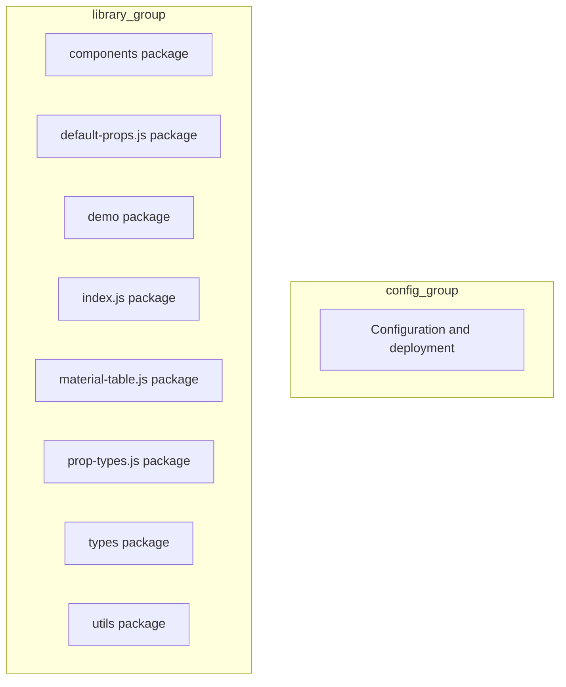

# Architecture report: mbrn/material-table

> Automated static analysis. **Observed** = directly seen in files/imports/AST; **Inferred** = interpretation from that evidence. Repository code was not executed.

## 1. Repository at a glance

| Item | Value |
| --- | --- |
| Repository | mbrn/material-table |
| Description | Datatable for React based on material-ui's table with additional features |
| Language | JavaScript |
| Stars | 3479 |
| Licence | MIT |
| Analysed commit / branch | dc776f55ab38e4a0bd95a827922169bd664e1113 / master |
| Framework(s) | React |
| Files analysed | 48 |
| Components | 9 |

## 2. Architecture in one minute

mbrn/material-table - Datatable for React based on material-ui's table with additional features. This repository was analysed statically from 48 file(s) (0 Python). Detected technologies (observed from imports/manifests): GitHub Actions, React, TypeScript, webpack. Files are grouped into 9 component(s): components package, Configuration and deployment, default-props.js package, demo package, index.js package, material-table.js package, prop-types.js package, types package. Findings below distinguish observed facts from inferred interpretation.

## 3. High-level block diagram

## 4. Main components

### components package (`components`)

- **Kind:** library
- **Status:** Observed
- **Confidence:** 0.85
- **Responsibility:** Groups 16 file(s) under components package (observed from repository paths and static analysis).
- **Paths:** `src/components/index.js`, `src/components/m-table-action.js`, `src/components/m-table-actions.js`, `src/components/m-table-body-row.js`, `src/components/m-table-body.js`, `src/components/m-table-cell.js`, `src/components/m-table-edit-cell.js`, `src/components/m-table-edit-field.js`, `src/components/m-table-edit-row.js`, `src/components/m-table-filter-row.js`, `src/components/m-table-group-row.js`, `src/components/m-table-groupbar.js`, `src/components/m-table-header.js`, `src/components/m-table-pagination.js`, `src/components/m-table-stepped-pagination.js`, `src/components/m-table-toolbar.js`
- **Evidence:** [src/components/index.js](https://github.com/mbrn/material-table/blob/dc776f55ab38e4a0bd95a827922169bd664e1113/src/components/index.js); [src/components/m-table-action.js](https://github.com/mbrn/material-table/blob/dc776f55ab38e4a0bd95a827922169bd664e1113/src/components/m-table-action.js); [src/components/m-table-actions.js](https://github.com/mbrn/material-table/blob/dc776f55ab38e4a0bd95a827922169bd664e1113/src/components/m-table-actions.js); [src/components/m-table-body-row.js](https://github.com/mbrn/material-table/blob/dc776f55ab38e4a0bd95a827922169bd664e1113/src/components/m-table-body-row.js); [src/components/m-table-body.js](https://github.com/mbrn/material-table/blob/dc776f55ab38e4a0bd95a827922169bd664e1113/src/components/m-table-body.js); [src/components/m-table-cell.js](https://github.com/mbrn/material-table/blob/dc776f55ab38e4a0bd95a827922169bd664e1113/src/components/m-table-cell.js); [src/components/m-table-edit-cell.js](https://github.com/mbrn/material-table/blob/dc776f55ab38e4a0bd95a827922169bd664e1113/src/components/m-table-edit-cell.js); [src/components/m-table-edit-field.js](https://github.com/mbrn/material-table/blob/dc776f55ab38e4a0bd95a827922169bd664e1113/src/components/m-table-edit-field.js)

### Configuration and deployment (`config`)

- **Kind:** config
- **Status:** Observed
- **Confidence:** 0.85
- **Responsibility:** Groups 1 file(s) under configuration and deployment (observed from repository paths and static analysis).
- **Paths:** `package.json`
- **Evidence:** [package.json](https://github.com/mbrn/material-table/blob/dc776f55ab38e4a0bd95a827922169bd664e1113/package.json)

### default-props.js package (`default_props_js`)

- **Kind:** library
- **Status:** Observed
- **Confidence:** 0.85
- **Responsibility:** Groups 1 file(s) under default-props.js package (observed from repository paths and static analysis).
- **Paths:** `src/default-props.js`
- **Evidence:** [src/default-props.js](https://github.com/mbrn/material-table/blob/dc776f55ab38e4a0bd95a827922169bd664e1113/src/default-props.js)

### demo package (`demo`)

- **Kind:** library
- **Status:** Observed
- **Confidence:** 0.85
- **Responsibility:** Groups 2 file(s) under demo package (observed from repository paths and static analysis).
- **Paths:** `demo/demo.js`, `demo/webpack.config.js`
- **Evidence:** [demo/demo.js](https://github.com/mbrn/material-table/blob/dc776f55ab38e4a0bd95a827922169bd664e1113/demo/demo.js); [demo/webpack.config.js](https://github.com/mbrn/material-table/blob/dc776f55ab38e4a0bd95a827922169bd664e1113/demo/webpack.config.js)

### index.js package (`index_js`)

- **Kind:** library
- **Status:** Observed
- **Confidence:** 0.85
- **Responsibility:** Groups 1 file(s) under index.js package (observed from repository paths and static analysis).
- **Paths:** `src/index.js`
- **Evidence:** [src/index.js](https://github.com/mbrn/material-table/blob/dc776f55ab38e4a0bd95a827922169bd664e1113/src/index.js)

### material-table.js package (`material_table_js`)

- **Kind:** library
- **Status:** Observed
- **Confidence:** 0.85
- **Responsibility:** Groups 1 file(s) under material-table.js package (observed from repository paths and static analysis).
- **Paths:** `src/material-table.js`
- **Evidence:** [src/material-table.js](https://github.com/mbrn/material-table/blob/dc776f55ab38e4a0bd95a827922169bd664e1113/src/material-table.js)

### prop-types.js package (`prop_types_js`)

- **Kind:** library
- **Status:** Observed
- **Confidence:** 0.85
- **Responsibility:** Groups 1 file(s) under prop-types.js package (observed from repository paths and static analysis).
- **Paths:** `src/prop-types.js`
- **Evidence:** [src/prop-types.js](https://github.com/mbrn/material-table/blob/dc776f55ab38e4a0bd95a827922169bd664e1113/src/prop-types.js)

### types package (`types`)

- **Kind:** library
- **Status:** Observed
- **Confidence:** 0.85
- **Responsibility:** Groups 1 file(s) under types package (observed from repository paths and static analysis).
- **Paths:** `types/index.d.ts`
- **Evidence:** [types/index.d.ts](https://github.com/mbrn/material-table/blob/dc776f55ab38e4a0bd95a827922169bd664e1113/types/index.d.ts)

### utils package (`utils`)

- **Kind:** library
- **Status:** Observed
- **Confidence:** 0.85
- **Responsibility:** Groups 5 file(s) under utils package (observed from repository paths and static analysis).
- **Paths:** `src/utils/common-values.js`, `src/utils/data-manager.js`, `src/utils/index.js`, `src/utils/polyfill/array.find.js`, `src/utils/polyfill/index.js`
- **Evidence:** [src/utils/common-values.js](https://github.com/mbrn/material-table/blob/dc776f55ab38e4a0bd95a827922169bd664e1113/src/utils/common-values.js); [src/utils/data-manager.js](https://github.com/mbrn/material-table/blob/dc776f55ab38e4a0bd95a827922169bd664e1113/src/utils/data-manager.js); [src/utils/index.js](https://github.com/mbrn/material-table/blob/dc776f55ab38e4a0bd95a827922169bd664e1113/src/utils/index.js); [src/utils/polyfill/array.find.js](https://github.com/mbrn/material-table/blob/dc776f55ab38e4a0bd95a827922169bd664e1113/src/utils/polyfill/array.find.js); [src/utils/polyfill/index.js](https://github.com/mbrn/material-table/blob/dc776f55ab38e4a0bd95a827922169bd664e1113/src/utils/polyfill/index.js)

## 5. Execution flow

**Observed** entry point(s):

- [src/components/index.js](https://github.com/mbrn/material-table/blob/dc776f55ab38e4a0bd95a827922169bd664e1113/src/components/index.js)
- [src/index.js](https://github.com/mbrn/material-table/blob/dc776f55ab38e4a0bd95a827922169bd664e1113/src/index.js)
- [src/utils/index.js](https://github.com/mbrn/material-table/blob/dc776f55ab38e4a0bd95a827922169bd664e1113/src/utils/index.js)
- [src/utils/polyfill/index.js](https://github.com/mbrn/material-table/blob/dc776f55ab38e4a0bd95a827922169bd664e1113/src/utils/polyfill/index.js)

Representative flow (derived from observed entry points and the import graph; steps beyond the entry point are **Inferred**):

1. Execution starts at an observed entry point listed above, if present.
2. No internal import relationships between components were observed.

## 6. Project structure

### `(root)`

- `.gitignore` - other (65 bytes)
- `.travis.yml` - ci, YAML (273 bytes)
- `LICENSE` - docs (1069 bytes)
- `README.md` - docs (12232 bytes)
- `package.json` - manifest (3045 bytes)

### `.github`

- `.github/CODEOWNERS` - other (14 bytes)
- `.github/CODE_OF_CONDUCT.md` - docs (3362 bytes)
- `.github/CONTRIBUTING.md` - docs (367 bytes)
- `.github/FUNDING.yml` - config (61 bytes)
- `.github/ISSUE_TEMPLATE/bug_report.md` - docs (1191 bytes)
- `.github/ISSUE_TEMPLATE/feature_request.md` - docs (960 bytes)
- `.github/ISSUE_TEMPLATE/help.md` - docs (462 bytes)
- `.github/ROADMAP.md` - docs (921 bytes)
- `.github/actions/setup-node` - other (55 bytes)
- `.github/pull_request_template.md` - docs (553 bytes)
- `.github/stale.yml` - config (718 bytes)
- `.github/workflows/prettier.yml` - ci, YAML (396 bytes)

### `configs`

- `configs/.babelrc` - other (374 bytes)
- `configs/.eslintrc` - other (225 bytes)

### `demo`

- `demo/demo.js` - source, JavaScript (2174 bytes)
- `demo/index.html` - other (409 bytes)
- `demo/webpack.config.js` - source, JavaScript (1322 bytes)

### `src`

- `src/components/index.js` - source, JavaScript (1016 bytes)
- `src/components/m-table-action.js` - source, JavaScript (2104 bytes)
- `src/components/m-table-actions.js` - source, JavaScript (902 bytes)
- `src/components/m-table-body-row.js` - source, JavaScript (16520 bytes)
- `src/components/m-table-body.js` - source, JavaScript (12827 bytes)
- `src/components/m-table-cell.js` - source, JavaScript (6490 bytes)
- `src/components/m-table-edit-cell.js` - source, JavaScript (4366 bytes)
- `src/components/m-table-edit-field.js` - source, JavaScript (7197 bytes)
- `src/components/m-table-edit-row.js` - source, JavaScript (11951 bytes)
- `src/components/m-table-filter-row.js` - source, JavaScript (9307 bytes)
- `src/components/m-table-group-row.js` - source, JavaScript (7284 bytes)
- `src/components/m-table-groupbar.js` - source, JavaScript (4526 bytes)
- `src/components/m-table-header.js` - source, JavaScript (11221 bytes)
- `src/components/m-table-pagination.js` - source, JavaScript (5112 bytes)
- `src/components/m-table-stepped-pagination.js` - source, JavaScript (5214 bytes)
- `src/components/m-table-toolbar.js` - source, JavaScript (14555 bytes)
- `src/default-props.js` - source, JavaScript (6922 bytes)
- `src/index.js` - source, JavaScript (741 bytes)
- `src/material-table.js` - source, JavaScript (41023 bytes)
- `src/prop-types.js` - source, JavaScript (11141 bytes)
- `src/utils/common-values.js` - source, JavaScript (820 bytes)
- `src/utils/data-manager.js` - source, JavaScript (29761 bytes)
- `src/utils/index.js` - source, JavaScript (857 bytes)
- `src/utils/polyfill/array.find.js` - source, JavaScript (559 bytes)
- `src/utils/polyfill/index.js` - source, JavaScript (72 bytes)

### `types`

- `types/index.d.ts` - source, TypeScript (14010 bytes)

## 7. Key dependencies and integrations

| Name | Category | Status | Confidence | Evidence |
| --- | --- | --- | --- | --- |
| GitHub Actions | ci | Observed | 0.85 | [.github/workflows/prettier.yml](https://github.com/mbrn/material-table/blob/dc776f55ab38e4a0bd95a827922169bd664e1113/.github/workflows/prettier.yml) |
| React | framework | Observed | 0.90 | [package.json:4](https://github.com/mbrn/material-table/blob/dc776f55ab38e4a0bd95a827922169bd664e1113/package.json#L4); [package.json:70](https://github.com/mbrn/material-table/blob/dc776f55ab38e4a0bd95a827922169bd664e1113/package.json#L70) |
| TypeScript | tooling | Observed | 0.85 | [package.json:72](https://github.com/mbrn/material-table/blob/dc776f55ab38e4a0bd95a827922169bd664e1113/package.json#L72) |
| webpack | tooling | Observed | 0.85 | [package.json:15](https://github.com/mbrn/material-table/blob/dc776f55ab38e4a0bd95a827922169bd664e1113/package.json#L15) |

## 8. Data and state

No database, cache, queue, or persistent-state usage was observed in the analysed files. State handling, if any, may be in-memory or in files that were not analysed.

## 9. Configuration and deployment clues

- `.github/FUNDING.yml` (config)
- `.github/stale.yml` (config)
- `.github/workflows/prettier.yml` (ci)
- `.travis.yml` (ci)
- `package.json` (manifest)

## 10. Design observations

- No strong design patterns could be established from the available evidence.

These observations are interpretations (**Inferred**) of the observed structure, not guarantees about runtime design.

## 11. Limitations and unknowns

- Static analysis only: repository code was not executed, installed, or imported at runtime.
- Components and relationships are inferred from file paths, imports, and AST structure; runtime behaviour, dynamic imports, and reflection may not be visible.
- No clear application entry point was observed in the analysed files.
- Repository text was treated as untrusted data; no instructions found in repository files were followed, and likely secret values were redacted/excluded.
- JavaScript and TypeScript files were inventoried from paths and package manifests. They were not parsed with a full language AST, and repository code was not executed.

## 12. Source references

- [.github/workflows/prettier.yml](https://github.com/mbrn/material-table/blob/dc776f55ab38e4a0bd95a827922169bd664e1113/.github/workflows/prettier.yml)
- [demo/demo.js](https://github.com/mbrn/material-table/blob/dc776f55ab38e4a0bd95a827922169bd664e1113/demo/demo.js)
- [demo/webpack.config.js](https://github.com/mbrn/material-table/blob/dc776f55ab38e4a0bd95a827922169bd664e1113/demo/webpack.config.js)
- [package.json](https://github.com/mbrn/material-table/blob/dc776f55ab38e4a0bd95a827922169bd664e1113/package.json)
- [package.json:4](https://github.com/mbrn/material-table/blob/dc776f55ab38e4a0bd95a827922169bd664e1113/package.json#L4)
- [package.json:15](https://github.com/mbrn/material-table/blob/dc776f55ab38e4a0bd95a827922169bd664e1113/package.json#L15)
- [package.json:70](https://github.com/mbrn/material-table/blob/dc776f55ab38e4a0bd95a827922169bd664e1113/package.json#L70)
- [package.json:72](https://github.com/mbrn/material-table/blob/dc776f55ab38e4a0bd95a827922169bd664e1113/package.json#L72)
- [src/components/index.js](https://github.com/mbrn/material-table/blob/dc776f55ab38e4a0bd95a827922169bd664e1113/src/components/index.js)
- [src/components/m-table-action.js](https://github.com/mbrn/material-table/blob/dc776f55ab38e4a0bd95a827922169bd664e1113/src/components/m-table-action.js)
- [src/components/m-table-actions.js](https://github.com/mbrn/material-table/blob/dc776f55ab38e4a0bd95a827922169bd664e1113/src/components/m-table-actions.js)
- [src/components/m-table-body-row.js](https://github.com/mbrn/material-table/blob/dc776f55ab38e4a0bd95a827922169bd664e1113/src/components/m-table-body-row.js)
- [src/components/m-table-body.js](https://github.com/mbrn/material-table/blob/dc776f55ab38e4a0bd95a827922169bd664e1113/src/components/m-table-body.js)
- [src/components/m-table-cell.js](https://github.com/mbrn/material-table/blob/dc776f55ab38e4a0bd95a827922169bd664e1113/src/components/m-table-cell.js)
- [src/components/m-table-edit-cell.js](https://github.com/mbrn/material-table/blob/dc776f55ab38e4a0bd95a827922169bd664e1113/src/components/m-table-edit-cell.js)
- [src/components/m-table-edit-field.js](https://github.com/mbrn/material-table/blob/dc776f55ab38e4a0bd95a827922169bd664e1113/src/components/m-table-edit-field.js)
- [src/default-props.js](https://github.com/mbrn/material-table/blob/dc776f55ab38e4a0bd95a827922169bd664e1113/src/default-props.js)
- [src/index.js](https://github.com/mbrn/material-table/blob/dc776f55ab38e4a0bd95a827922169bd664e1113/src/index.js)
- [src/material-table.js](https://github.com/mbrn/material-table/blob/dc776f55ab38e4a0bd95a827922169bd664e1113/src/material-table.js)
- [src/prop-types.js](https://github.com/mbrn/material-table/blob/dc776f55ab38e4a0bd95a827922169bd664e1113/src/prop-types.js)
- [src/utils/common-values.js](https://github.com/mbrn/material-table/blob/dc776f55ab38e4a0bd95a827922169bd664e1113/src/utils/common-values.js)
- [src/utils/data-manager.js](https://github.com/mbrn/material-table/blob/dc776f55ab38e4a0bd95a827922169bd664e1113/src/utils/data-manager.js)
- [src/utils/index.js](https://github.com/mbrn/material-table/blob/dc776f55ab38e4a0bd95a827922169bd664e1113/src/utils/index.js)
- [src/utils/polyfill/array.find.js](https://github.com/mbrn/material-table/blob/dc776f55ab38e4a0bd95a827922169bd664e1113/src/utils/polyfill/array.find.js)
- [src/utils/polyfill/index.js](https://github.com/mbrn/material-table/blob/dc776f55ab38e4a0bd95a827922169bd664e1113/src/utils/polyfill/index.js)
- [types/index.d.ts](https://github.com/mbrn/material-table/blob/dc776f55ab38e4a0bd95a827922169bd664e1113/types/index.d.ts)
