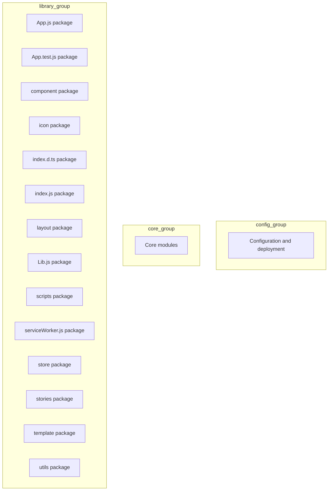

# Architecture report: mdnice/markdown-nice

> Automated static analysis. **Observed** = directly seen in files/imports/AST; **Inferred** = interpretation from that evidence. Repository code was not executed.

## 1. Repository at a glance

| Item | Value |
| --- | --- |
| Repository | mdnice/markdown-nice |
| Description | 支持主题设计的 Markdown 编辑器，让排版变 Nice |
| Language | JavaScript |
| Stars | 4679 |
| Licence | GPL-3.0 |
| Analysed commit / branch | 6525a5aba371209c2840593e8f537b4a69137a4b / master |
| Framework(s) | React |
| Files analysed | 187 |
| Components | 16 |

## 2. Architecture in one minute

mdnice/markdown-nice - 支持主题设计的 Markdown 编辑器，让排版变 Nice. This repository was analysed statically from 187 file(s) (0 Python). Detected technologies (observed from imports/manifests): React, axios, Jest, webpack. Files are grouped into 16 component(s): App.js package, App.test.js package, component package, Configuration and deployment, Core modules, icon package, index.d.ts package, index.js package. Findings below distinguish observed facts from inferred interpretation.

## 3. High-level block diagram

## 4. Main components

### App.js package (`app_js`)

- **Kind:** library
- **Status:** Observed
- **Confidence:** 0.85
- **Responsibility:** Groups 1 file(s) under app.js package (observed from repository paths and static analysis).
- **Paths:** `src/App.js`
- **Evidence:** [src/App.js](https://github.com/mdnice/markdown-nice/blob/6525a5aba371209c2840593e8f537b4a69137a4b/src/App.js)

### App.test.js package (`app_test_js`)

- **Kind:** library
- **Status:** Observed
- **Confidence:** 0.85
- **Responsibility:** Groups 1 file(s) under app.test.js package (observed from repository paths and static analysis).
- **Paths:** `src/App.test.js`
- **Evidence:** [src/App.test.js](https://github.com/mdnice/markdown-nice/blob/6525a5aba371209c2840593e8f537b4a69137a4b/src/App.test.js)

### component package (`component`)

- **Kind:** library
- **Status:** Observed
- **Confidence:** 0.85
- **Responsibility:** Groups 59 file(s) under component package (observed from repository paths and static analysis).
- **Paths:** `src/component/Dialog/AboutDialog.js`, `src/component/Dialog/FormDialog.js`, `src/component/Dialog/HistoryDialog.js`, `src/component/Dialog/ImageDialog.js`, `src/component/Dialog/LinkDialog.js`, `src/component/Dialog/SitDownDialog.js`, `src/component/Dialog/TutorialDialog.js`, `src/component/Dialog/VersionDialog.js`, `src/component/ImageHosting/AliOSS.js`, `src/component/ImageHosting/GitHub.js`, `src/component/ImageHosting/Gitee.js`, `src/component/ImageHosting/QiniuOSS.js`, `src/component/LocalHistory/index.js`, `src/component/LocalHistory/indexdb.js`, `src/component/LocalHistory/util.js`, `src/component/MenuLeft/CodeTheme.js`, `src/component/MenuLeft/File.js`, `src/component/MenuLeft/File/ExportMarkdown.js`, `src/component/MenuLeft/File/ExportPdf.js`, `src/component/MenuLeft/File/ImportFile.js`, `src/component/MenuLeft/Function.js`, `src/component/MenuLeft/Function/History.js`, `src/component/MenuLeft/Function/Reset.js`, `src/component/MenuLeft/Function/Search.js`, `src/component/MenuLeft/Function/SitDown.js`, `src/component/MenuLeft/Help.js`, `src/component/MenuLeft/Help/About.js`, `src/component/MenuLeft/Help/Document.js`, `src/component/MenuLeft/Help/Question.js`, `src/component/MenuLeft/Help/Version.js`, `src/component/MenuLeft/LogIn.js`, `src/component/MenuLeft/Paragraph.js`, `src/component/MenuLeft/Pattern.js`, `src/component/MenuLeft/Pattern/Bold.js`, `src/component/MenuLeft/Pattern/Code.js`, `src/component/MenuLeft/Pattern/Del.js`, `src/component/MenuLeft/Pattern/Font.js`, `src/component/MenuLeft/Pattern/Form.js`, `src/component/MenuLeft/Pattern/Format.js`, `src/component/MenuLeft/Pattern/Image.js`, `src/component/MenuLeft/Pattern/InlineCode.js`, `src/component/MenuLeft/Pattern/Italic.js`, `src/component/MenuLeft/Pattern/Link.js`, `src/component/MenuLeft/Pattern/LinkToFoot.js`, `src/component/MenuLeft/Setting.js`, `src/component/MenuLeft/Setting/ContainImgName.js`, `src/component/MenuLeft/Setting/SyncScroll.js`, `src/component/MenuLeft/Theme.js`, `src/component/MenuLeft/Tutorial.js`, `src/component/MenuLeft/View.js`, `src/component/MenuLeft/View/EditArea.js`, `src/component/MenuLeft/View/FullScreen.js`, `src/component/MenuLeft/View/PreviewArea.js`, `src/component/MenuLeft/View/ThemeArea.js`, `src/component/SearchBox/index.js`, `src/component/Sidebar/Juejin.js`, `src/component/Sidebar/PreviewType.js`, `src/component/Sidebar/Wechat.js`, `src/component/Sidebar/Zhihu.js`
- **Evidence:** [src/component/Dialog/AboutDialog.js](https://github.com/mdnice/markdown-nice/blob/6525a5aba371209c2840593e8f537b4a69137a4b/src/component/Dialog/AboutDialog.js); [src/component/Dialog/FormDialog.js](https://github.com/mdnice/markdown-nice/blob/6525a5aba371209c2840593e8f537b4a69137a4b/src/component/Dialog/FormDialog.js); [src/component/Dialog/HistoryDialog.js](https://github.com/mdnice/markdown-nice/blob/6525a5aba371209c2840593e8f537b4a69137a4b/src/component/Dialog/HistoryDialog.js); [src/component/Dialog/ImageDialog.js](https://github.com/mdnice/markdown-nice/blob/6525a5aba371209c2840593e8f537b4a69137a4b/src/component/Dialog/ImageDialog.js); [src/component/Dialog/LinkDialog.js](https://github.com/mdnice/markdown-nice/blob/6525a5aba371209c2840593e8f537b4a69137a4b/src/component/Dialog/LinkDialog.js); [src/component/Dialog/SitDownDialog.js](https://github.com/mdnice/markdown-nice/blob/6525a5aba371209c2840593e8f537b4a69137a4b/src/component/Dialog/SitDownDialog.js); [src/component/Dialog/TutorialDialog.js](https://github.com/mdnice/markdown-nice/blob/6525a5aba371209c2840593e8f537b4a69137a4b/src/component/Dialog/TutorialDialog.js); [src/component/Dialog/VersionDialog.js](https://github.com/mdnice/markdown-nice/blob/6525a5aba371209c2840593e8f537b4a69137a4b/src/component/Dialog/VersionDialog.js)

### Configuration and deployment (`config`)

- **Kind:** config
- **Status:** Observed
- **Confidence:** 0.85
- **Responsibility:** Groups 9 file(s) under configuration and deployment (observed from repository paths and static analysis).
- **Paths:** `config/env.js`, `config/jest/cssTransform.js`, `config/jest/fileTransform.js`, `config/paths.js`, `config/webpack.config.js`, `config/webpack.config.lib.js`, `config/webpackDevServer.config.js`, `package.json`, `public/manifest.json`
- **Evidence:** [config/env.js](https://github.com/mdnice/markdown-nice/blob/6525a5aba371209c2840593e8f537b4a69137a4b/config/env.js); [config/jest/cssTransform.js](https://github.com/mdnice/markdown-nice/blob/6525a5aba371209c2840593e8f537b4a69137a4b/config/jest/cssTransform.js); [config/jest/fileTransform.js](https://github.com/mdnice/markdown-nice/blob/6525a5aba371209c2840593e8f537b4a69137a4b/config/jest/fileTransform.js); [config/paths.js](https://github.com/mdnice/markdown-nice/blob/6525a5aba371209c2840593e8f537b4a69137a4b/config/paths.js); [config/webpack.config.js](https://github.com/mdnice/markdown-nice/blob/6525a5aba371209c2840593e8f537b4a69137a4b/config/webpack.config.js); [config/webpack.config.lib.js](https://github.com/mdnice/markdown-nice/blob/6525a5aba371209c2840593e8f537b4a69137a4b/config/webpack.config.lib.js); [config/webpackDevServer.config.js](https://github.com/mdnice/markdown-nice/blob/6525a5aba371209c2840593e8f537b4a69137a4b/config/webpackDevServer.config.js); [package.json](https://github.com/mdnice/markdown-nice/blob/6525a5aba371209c2840593e8f537b4a69137a4b/package.json)

### Core modules (`core`)

- **Kind:** core
- **Status:** Observed
- **Confidence:** 0.85
- **Responsibility:** Groups 2 file(s) under core modules (observed from repository paths and static analysis).
- **Paths:** `main.js`, `watch.js`
- **Evidence:** [main.js](https://github.com/mdnice/markdown-nice/blob/6525a5aba371209c2840593e8f537b4a69137a4b/main.js); [watch.js](https://github.com/mdnice/markdown-nice/blob/6525a5aba371209c2840593e8f537b4a69137a4b/watch.js)

### icon package (`icon`)

- **Kind:** library
- **Status:** Observed
- **Confidence:** 0.85
- **Responsibility:** Groups 19 file(s) under icon package (observed from repository paths and static analysis).
- **Paths:** `src/icon/Close.js`, `src/icon/Copy.js`, `src/icon/Down.js`, `src/icon/Environment.js`, `src/icon/FontCase.js`, `src/icon/GitHub.js`, `src/icon/Inbox.js`, `src/icon/Juejin.js`, `src/icon/Mobile.js`, `src/icon/More.js`, `src/icon/PC.js`, `src/icon/Rabbit.js`, `src/icon/Replace.js`, `src/icon/ReplaceAll.js`, `src/icon/Smile.js`, `src/icon/User.js`, `src/icon/Wechat.js`, `src/icon/Zhihu.js`, `src/icon/index.js`
- **Evidence:** [src/icon/Close.js](https://github.com/mdnice/markdown-nice/blob/6525a5aba371209c2840593e8f537b4a69137a4b/src/icon/Close.js); [src/icon/Copy.js](https://github.com/mdnice/markdown-nice/blob/6525a5aba371209c2840593e8f537b4a69137a4b/src/icon/Copy.js); [src/icon/Down.js](https://github.com/mdnice/markdown-nice/blob/6525a5aba371209c2840593e8f537b4a69137a4b/src/icon/Down.js); [src/icon/Environment.js](https://github.com/mdnice/markdown-nice/blob/6525a5aba371209c2840593e8f537b4a69137a4b/src/icon/Environment.js); [src/icon/FontCase.js](https://github.com/mdnice/markdown-nice/blob/6525a5aba371209c2840593e8f537b4a69137a4b/src/icon/FontCase.js); [src/icon/GitHub.js](https://github.com/mdnice/markdown-nice/blob/6525a5aba371209c2840593e8f537b4a69137a4b/src/icon/GitHub.js); [src/icon/Inbox.js](https://github.com/mdnice/markdown-nice/blob/6525a5aba371209c2840593e8f537b4a69137a4b/src/icon/Inbox.js); [src/icon/Juejin.js](https://github.com/mdnice/markdown-nice/blob/6525a5aba371209c2840593e8f537b4a69137a4b/src/icon/Juejin.js)

### index.d.ts package (`index_d_ts`)

- **Kind:** library
- **Status:** Observed
- **Confidence:** 0.85
- **Responsibility:** Groups 1 file(s) under index.d.ts package (observed from repository paths and static analysis).
- **Paths:** `src/index.d.ts`
- **Evidence:** [src/index.d.ts](https://github.com/mdnice/markdown-nice/blob/6525a5aba371209c2840593e8f537b4a69137a4b/src/index.d.ts)

### index.js package (`index_js`)

- **Kind:** library
- **Status:** Observed
- **Confidence:** 0.85
- **Responsibility:** Groups 1 file(s) under index.js package (observed from repository paths and static analysis).
- **Paths:** `src/index.js`
- **Evidence:** [src/index.js](https://github.com/mdnice/markdown-nice/blob/6525a5aba371209c2840593e8f537b4a69137a4b/src/index.js)

### layout package (`layout`)

- **Kind:** library
- **Status:** Observed
- **Confidence:** 0.85
- **Responsibility:** Groups 6 file(s) under layout package (observed from repository paths and static analysis).
- **Paths:** `src/layout/Dialog.js`, `src/layout/EditorMenu.js`, `src/layout/Footer.js`, `src/layout/Navbar.js`, `src/layout/Sidebar.js`, `src/layout/StyleEditor.js`
- **Evidence:** [src/layout/Dialog.js](https://github.com/mdnice/markdown-nice/blob/6525a5aba371209c2840593e8f537b4a69137a4b/src/layout/Dialog.js); [src/layout/EditorMenu.js](https://github.com/mdnice/markdown-nice/blob/6525a5aba371209c2840593e8f537b4a69137a4b/src/layout/EditorMenu.js); [src/layout/Footer.js](https://github.com/mdnice/markdown-nice/blob/6525a5aba371209c2840593e8f537b4a69137a4b/src/layout/Footer.js); [src/layout/Navbar.js](https://github.com/mdnice/markdown-nice/blob/6525a5aba371209c2840593e8f537b4a69137a4b/src/layout/Navbar.js); [src/layout/Sidebar.js](https://github.com/mdnice/markdown-nice/blob/6525a5aba371209c2840593e8f537b4a69137a4b/src/layout/Sidebar.js); [src/layout/StyleEditor.js](https://github.com/mdnice/markdown-nice/blob/6525a5aba371209c2840593e8f537b4a69137a4b/src/layout/StyleEditor.js)

### Lib.js package (`lib_js`)

- **Kind:** library
- **Status:** Observed
- **Confidence:** 0.85
- **Responsibility:** Groups 1 file(s) under lib.js package (observed from repository paths and static analysis).
- **Paths:** `src/Lib.js`
- **Evidence:** [src/Lib.js](https://github.com/mdnice/markdown-nice/blob/6525a5aba371209c2840593e8f537b4a69137a4b/src/Lib.js)

### scripts package (`scripts`)

- **Kind:** library
- **Status:** Observed
- **Confidence:** 0.85
- **Responsibility:** Groups 3 file(s) under scripts package (observed from repository paths and static analysis).
- **Paths:** `scripts/build.js`, `scripts/start.js`, `scripts/test.js`
- **Evidence:** [scripts/build.js](https://github.com/mdnice/markdown-nice/blob/6525a5aba371209c2840593e8f537b4a69137a4b/scripts/build.js); [scripts/start.js](https://github.com/mdnice/markdown-nice/blob/6525a5aba371209c2840593e8f537b4a69137a4b/scripts/start.js); [scripts/test.js](https://github.com/mdnice/markdown-nice/blob/6525a5aba371209c2840593e8f537b4a69137a4b/scripts/test.js)

### serviceWorker.js package (`serviceworker_js`)

- **Kind:** library
- **Status:** Observed
- **Confidence:** 0.85
- **Responsibility:** Groups 1 file(s) under serviceworker.js package (observed from repository paths and static analysis).
- **Paths:** `src/serviceWorker.js`
- **Evidence:** [src/serviceWorker.js](https://github.com/mdnice/markdown-nice/blob/6525a5aba371209c2840593e8f537b4a69137a4b/src/serviceWorker.js)

### store package (`store`)

- **Kind:** library
- **Status:** Observed
- **Confidence:** 0.85
- **Responsibility:** Groups 8 file(s) under store package (observed from repository paths and static analysis).
- **Paths:** `src/store/content.js`, `src/store/dialog.js`, `src/store/footer.js`, `src/store/imageHosting.js`, `src/store/navbar.js`, `src/store/title.js`, `src/store/userInfo.js`, `src/store/view.js`
- **Evidence:** [src/store/content.js](https://github.com/mdnice/markdown-nice/blob/6525a5aba371209c2840593e8f537b4a69137a4b/src/store/content.js); [src/store/dialog.js](https://github.com/mdnice/markdown-nice/blob/6525a5aba371209c2840593e8f537b4a69137a4b/src/store/dialog.js); [src/store/footer.js](https://github.com/mdnice/markdown-nice/blob/6525a5aba371209c2840593e8f537b4a69137a4b/src/store/footer.js); [src/store/imageHosting.js](https://github.com/mdnice/markdown-nice/blob/6525a5aba371209c2840593e8f537b4a69137a4b/src/store/imageHosting.js); [src/store/navbar.js](https://github.com/mdnice/markdown-nice/blob/6525a5aba371209c2840593e8f537b4a69137a4b/src/store/navbar.js); [src/store/title.js](https://github.com/mdnice/markdown-nice/blob/6525a5aba371209c2840593e8f537b4a69137a4b/src/store/title.js); [src/store/userInfo.js](https://github.com/mdnice/markdown-nice/blob/6525a5aba371209c2840593e8f537b4a69137a4b/src/store/userInfo.js); [src/store/view.js](https://github.com/mdnice/markdown-nice/blob/6525a5aba371209c2840593e8f537b4a69137a4b/src/store/view.js)

### stories package (`stories`)

- **Kind:** library
- **Status:** Observed
- **Confidence:** 0.85
- **Responsibility:** Groups 5 file(s) under stories package (observed from repository paths and static analysis).
- **Paths:** `stories/allImageHosting.js`, `stories/defaultImageHosting.js`, `stories/index.js`, `stories/noneImageHosting.js`, `stories/online.js`
- **Evidence:** [stories/allImageHosting.js](https://github.com/mdnice/markdown-nice/blob/6525a5aba371209c2840593e8f537b4a69137a4b/stories/allImageHosting.js); [stories/defaultImageHosting.js](https://github.com/mdnice/markdown-nice/blob/6525a5aba371209c2840593e8f537b4a69137a4b/stories/defaultImageHosting.js); [stories/index.js](https://github.com/mdnice/markdown-nice/blob/6525a5aba371209c2840593e8f537b4a69137a4b/stories/index.js); [stories/noneImageHosting.js](https://github.com/mdnice/markdown-nice/blob/6525a5aba371209c2840593e8f537b4a69137a4b/stories/noneImageHosting.js); [stories/online.js](https://github.com/mdnice/markdown-nice/blob/6525a5aba371209c2840593e8f537b4a69137a4b/stories/online.js)

### template package (`template`)

- **Kind:** library
- **Status:** Observed
- **Confidence:** 0.85
- **Responsibility:** Groups 16 file(s) under template package (observed from repository paths and static analysis).
- **Paths:** `src/template/basic.js`, `src/template/code/atomOneDark.js`, `src/template/code/atomOneLight.js`, `src/template/code/github.js`, `src/template/code/monokai.js`, `src/template/code/vs2015.js`, `src/template/code/xcode.js`, `src/template/index.js`, `src/template/macCode/macAtomOneDark.js`, `src/template/macCode/macAtomOneLight.js`, `src/template/macCode/macGithub.js`, `src/template/macCode/macMonokai.js`, `src/template/macCode/macVs2015.js`, `src/template/macCode/macXcode.js`, `src/template/markdown/custom.js`, `src/template/markdown/normal.js`
- **Evidence:** [src/template/basic.js](https://github.com/mdnice/markdown-nice/blob/6525a5aba371209c2840593e8f537b4a69137a4b/src/template/basic.js); [src/template/code/atomOneDark.js](https://github.com/mdnice/markdown-nice/blob/6525a5aba371209c2840593e8f537b4a69137a4b/src/template/code/atomOneDark.js); [src/template/code/atomOneLight.js](https://github.com/mdnice/markdown-nice/blob/6525a5aba371209c2840593e8f537b4a69137a4b/src/template/code/atomOneLight.js); [src/template/code/github.js](https://github.com/mdnice/markdown-nice/blob/6525a5aba371209c2840593e8f537b4a69137a4b/src/template/code/github.js); [src/template/code/monokai.js](https://github.com/mdnice/markdown-nice/blob/6525a5aba371209c2840593e8f537b4a69137a4b/src/template/code/monokai.js); [src/template/code/vs2015.js](https://github.com/mdnice/markdown-nice/blob/6525a5aba371209c2840593e8f537b4a69137a4b/src/template/code/vs2015.js); [src/template/code/xcode.js](https://github.com/mdnice/markdown-nice/blob/6525a5aba371209c2840593e8f537b4a69137a4b/src/template/code/xcode.js); [src/template/index.js](https://github.com/mdnice/markdown-nice/blob/6525a5aba371209c2840593e8f537b4a69137a4b/src/template/index.js)

### utils package (`utils`)

- **Kind:** library
- **Status:** Observed
- **Confidence:** 0.85
- **Responsibility:** Groups 18 file(s) under utils package (observed from repository paths and static analysis).
- **Paths:** `src/utils/appContext.js`, `src/utils/constant.js`, `src/utils/converter.js`, `src/utils/editorKeyEvents.js`, `src/utils/helper.js`, `src/utils/hotkey.js`, `src/utils/imageHosting.js`, `src/utils/langHighlight.js`, `src/utils/markdown-it-imageflow.js`, `src/utils/markdown-it-li.js`, `src/utils/markdown-it-linkfoot.js`, `src/utils/markdown-it-math.js`, `src/utils/markdown-it-multiquote.js`, `src/utils/markdown-it-removepre.js`, `src/utils/markdown-it-span.js`, `src/utils/markdown-it-table-container.js`, `src/utils/pluginCenter.js`, `src/utils/sitdownConverter.js`
- **Evidence:** [src/utils/appContext.js](https://github.com/mdnice/markdown-nice/blob/6525a5aba371209c2840593e8f537b4a69137a4b/src/utils/appContext.js); [src/utils/constant.js](https://github.com/mdnice/markdown-nice/blob/6525a5aba371209c2840593e8f537b4a69137a4b/src/utils/constant.js); [src/utils/converter.js](https://github.com/mdnice/markdown-nice/blob/6525a5aba371209c2840593e8f537b4a69137a4b/src/utils/converter.js); [src/utils/editorKeyEvents.js](https://github.com/mdnice/markdown-nice/blob/6525a5aba371209c2840593e8f537b4a69137a4b/src/utils/editorKeyEvents.js); [src/utils/helper.js](https://github.com/mdnice/markdown-nice/blob/6525a5aba371209c2840593e8f537b4a69137a4b/src/utils/helper.js); [src/utils/hotkey.js](https://github.com/mdnice/markdown-nice/blob/6525a5aba371209c2840593e8f537b4a69137a4b/src/utils/hotkey.js); [src/utils/imageHosting.js](https://github.com/mdnice/markdown-nice/blob/6525a5aba371209c2840593e8f537b4a69137a4b/src/utils/imageHosting.js); [src/utils/langHighlight.js](https://github.com/mdnice/markdown-nice/blob/6525a5aba371209c2840593e8f537b4a69137a4b/src/utils/langHighlight.js)

## 5. Execution flow

**Observed** entry point(s):

- [main.js](https://github.com/mdnice/markdown-nice/blob/6525a5aba371209c2840593e8f537b4a69137a4b/main.js)
- [src/App.js](https://github.com/mdnice/markdown-nice/blob/6525a5aba371209c2840593e8f537b4a69137a4b/src/App.js)
- [src/component/LocalHistory/index.js](https://github.com/mdnice/markdown-nice/blob/6525a5aba371209c2840593e8f537b4a69137a4b/src/component/LocalHistory/index.js)
- [src/component/SearchBox/index.js](https://github.com/mdnice/markdown-nice/blob/6525a5aba371209c2840593e8f537b4a69137a4b/src/component/SearchBox/index.js)
- [src/icon/index.js](https://github.com/mdnice/markdown-nice/blob/6525a5aba371209c2840593e8f537b4a69137a4b/src/icon/index.js)
- [src/index.js](https://github.com/mdnice/markdown-nice/blob/6525a5aba371209c2840593e8f537b4a69137a4b/src/index.js)
- [src/template/index.js](https://github.com/mdnice/markdown-nice/blob/6525a5aba371209c2840593e8f537b4a69137a4b/src/template/index.js)
- [stories/index.js](https://github.com/mdnice/markdown-nice/blob/6525a5aba371209c2840593e8f537b4a69137a4b/stories/index.js)

Representative flow (derived from observed entry points and the import graph; steps beyond the entry point are **Inferred**):

1. Execution starts at an observed entry point listed above, if present.
2. No internal import relationships between components were observed.

## 6. Project structure

### `(root)`

- `.eslintignore` - other (43 bytes)
- `.eslintrc` - other (1696 bytes)
- `.gitignore` - other (337 bytes)
- `.npmignore` - other (151 bytes)
- `.prettierrc` - other (238 bytes)
- `CHANGELOG.md` - docs (9253 bytes)
- `LICENSE` - docs (35146 bytes)
- `README.md` - docs (1291 bytes)
- `main.js` - source, JavaScript (1540 bytes)
- `package.json` - manifest (6454 bytes)
- `watch.js` - source, JavaScript (1599 bytes)

### `.github`

- `.github/ISSUE_TEMPLATE/bug_report.md` - docs (370 bytes)
- `.github/ISSUE_TEMPLATE/feature_request.md` - docs (126 bytes)

### `.storybook`

- `.storybook/.babelrc` - other (67 bytes)
- `.storybook/config.js` - source, JavaScript (190 bytes)

### `config`

- `config/env.js` - source, JavaScript (3489 bytes)
- `config/jest/cssTransform.js` - source, JavaScript (314 bytes)
- `config/jest/fileTransform.js` - source, JavaScript (755 bytes)
- `config/paths.js` - source, JavaScript (2727 bytes)
- `config/webpack.config.js` - source, JavaScript (27309 bytes)
- `config/webpack.config.lib.js` - source, JavaScript (25693 bytes)
- `config/webpackDevServer.config.js` - source, JavaScript (5648 bytes)

### `public`

- `public/favicon.svg` - other (4253 bytes)
- `public/index.html` - other (1586 bytes)
- `public/manifest.json` - config (329 bytes)

### `scripts`

- `scripts/build.js` - source, JavaScript (6062 bytes)
- `scripts/start.js` - source, JavaScript (3857 bytes)
- `scripts/test.js` - source, JavaScript (1586 bytes)

### `src`

- `src/App.css` - other (2233 bytes)
- `src/App.js` - source, JavaScript (13179 bytes)
- `src/App.test.js` - source, JavaScript (248 bytes)
- `src/Lib.js` - source, JavaScript (3992 bytes)
- `src/component/Dialog/AboutDialog.js` - source, JavaScript (3614 bytes)
- `src/component/Dialog/FormDialog.js` - source, JavaScript (2519 bytes)
- `src/component/Dialog/HistoryDialog.js` - source, JavaScript (3945 bytes)
- `src/component/Dialog/ImageDialog.js` - source, JavaScript (5611 bytes)
- `src/component/Dialog/LinkDialog.js` - source, JavaScript (1515 bytes)
- `src/component/Dialog/SitDownDialog.js` - source, JavaScript (3339 bytes)
- `src/component/Dialog/TutorialDialog.js` - source, JavaScript (1808 bytes)
- `src/component/Dialog/VersionDialog.css` - other (35 bytes)
- `src/component/Dialog/VersionDialog.js` - source, JavaScript (3749 bytes)
- `src/component/ImageHosting/AliOSS.js` - source, JavaScript (2947 bytes)
- `src/component/ImageHosting/GitHub.js` - source, JavaScript (2919 bytes)
- `src/component/ImageHosting/Gitee.js` - source, JavaScript (2370 bytes)
- `src/component/ImageHosting/QiniuOSS.js` - source, JavaScript (4208 bytes)
- `src/component/LocalHistory/index.js` - source, JavaScript (3299 bytes)
- `src/component/LocalHistory/indexdb.js` - source, JavaScript (2185 bytes)
- `src/component/LocalHistory/localHistory.css` - other (1721 bytes)
- `src/component/LocalHistory/util.js` - source, JavaScript (3026 bytes)
- `src/component/MenuLeft/CodeTheme.css` - other (226 bytes)
- `src/component/MenuLeft/CodeTheme.js` - source, JavaScript (2144 bytes)
- `src/component/MenuLeft/File.js` - source, JavaScript (735 bytes)
- `src/component/MenuLeft/File/ExportMarkdown.js` - source, JavaScript (987 bytes)
- `src/component/MenuLeft/File/ExportPdf.js` - source, JavaScript (499 bytes)
- `src/component/MenuLeft/File/ImportFile.js` - source, JavaScript (1005 bytes)
- `src/component/MenuLeft/Function.js` - source, JavaScript (831 bytes)
- `src/component/MenuLeft/Function/History.js` - source, JavaScript (553 bytes)
- `src/component/MenuLeft/Function/Reset.js` - source, JavaScript (1124 bytes)
- `src/component/MenuLeft/Function/Search.js` - source, JavaScript (687 bytes)
- `src/component/MenuLeft/Function/SitDown.js` - source, JavaScript (564 bytes)
- `src/component/MenuLeft/Help.js` - source, JavaScript (789 bytes)
- `src/component/MenuLeft/Help/About.js` - source, JavaScript (539 bytes)
- `src/component/MenuLeft/Help/Document.js` - source, JavaScript (543 bytes)
- `src/component/MenuLeft/Help/Question.js` - source, JavaScript (553 bytes)
- `src/component/MenuLeft/Help/Version.js` - source, JavaScript (553 bytes)
- `src/component/MenuLeft/LogIn.js` - source, JavaScript (1687 bytes)
- `src/component/MenuLeft/Login.css` - other (123 bytes)
- `src/component/MenuLeft/Paragraph.js` - source, JavaScript (782 bytes)
- `src/component/MenuLeft/Pattern.js` - source, JavaScript (1449 bytes)
- `src/component/MenuLeft/Pattern/Bold.js` - source, JavaScript (958 bytes)
- `src/component/MenuLeft/Pattern/Code.js` - source, JavaScript (957 bytes)
- `src/component/MenuLeft/Pattern/Del.js` - source, JavaScript (954 bytes)
- `src/component/MenuLeft/Pattern/Font.js` - source, JavaScript (1345 bytes)
- `src/component/MenuLeft/Pattern/Form.js` - source, JavaScript (646 bytes)
- `src/component/MenuLeft/Pattern/Format.js` - source, JavaScript (773 bytes)
- `src/component/MenuLeft/Pattern/Image.js` - source, JavaScript (651 bytes)
- `src/component/MenuLeft/Pattern/InlineCode.js` - source, JavaScript (1000 bytes)
- `src/component/MenuLeft/Pattern/Italic.js` - source, JavaScript (969 bytes)
- `src/component/MenuLeft/Pattern/Link.js` - source, JavaScript (646 bytes)
- `src/component/MenuLeft/Pattern/LinkToFoot.js` - source, JavaScript (801 bytes)
- `src/component/MenuLeft/Setting.js` - source, JavaScript (656 bytes)
- `src/component/MenuLeft/Setting/ContainImgName.js` - source, JavaScript (775 bytes)
- `src/component/MenuLeft/Setting/SyncScroll.js` - source, JavaScript (739 bytes)
- `src/component/MenuLeft/Theme.css` - other (1011 bytes)
- `src/component/MenuLeft/Theme.js` - source, JavaScript (5121 bytes)
- `src/component/MenuLeft/Tutorial.js` - source, JavaScript (1333 bytes)
- `src/component/MenuLeft/View.js` - source, JavaScript (842 bytes)
- `src/component/MenuLeft/View/EditArea.js` - source, JavaScript (733 bytes)
- `src/component/MenuLeft/View/FullScreen.js` - source, JavaScript (1176 bytes)
- `src/component/MenuLeft/View/PreviewArea.js` - source, JavaScript (754 bytes)
- `src/component/MenuLeft/View/ThemeArea.js` - source, JavaScript (751 bytes)
- `src/component/MenuLeft/common.css` - other (810 bytes)
- `src/component/SearchBox/SearchBox.css` - other (1859 bytes)
- `src/component/SearchBox/index.js` - source, JavaScript (6592 bytes)
- `src/component/Sidebar/Juejin.css` - other (144 bytes)
- `src/component/Sidebar/Juejin.js` - source, JavaScript (1492 bytes)
- `src/component/Sidebar/PreviewType.css` - other (142 bytes)
- `src/component/Sidebar/PreviewType.js` - source, JavaScript (877 bytes)
- `src/component/Sidebar/Wechat.css` - other (132 bytes)
- `src/component/Sidebar/Wechat.js` - source, JavaScript (1222 bytes)
- `src/component/Sidebar/Zhihu.css` - other (130 bytes)
- `src/component/Sidebar/Zhihu.js` - source, JavaScript (1196 bytes)
- `src/icon/Close.js` - source, JavaScript (765 bytes)
- `src/icon/Copy.js` - source, JavaScript (1137 bytes)
- `src/icon/Down.js` - source, JavaScript (565 bytes)
- `src/icon/Environment.js` - source, JavaScript (2197 bytes)
- `src/icon/FontCase.js` - source, JavaScript (801 bytes)
- `src/icon/GitHub.js` - source, JavaScript (1970 bytes)
- `src/icon/Inbox.js` - source, JavaScript (1505 bytes)
- `src/icon/Juejin.js` - source, JavaScript (937 bytes)
- `src/icon/Mobile.js` - source, JavaScript (631 bytes)
- `src/icon/More.js` - source, JavaScript (1220 bytes)
- `src/icon/PC.js` - source, JavaScript (646 bytes)
- `src/icon/Rabbit.js` - source, JavaScript (6276 bytes)
- `src/icon/Replace.js` - source, JavaScript (2122 bytes)
- `src/icon/ReplaceAll.js` - source, JavaScript (2144 bytes)
- `src/icon/Smile.js` - source, JavaScript (1305 bytes)
- `src/icon/User.js` - source, JavaScript (1029 bytes)
- `src/icon/Wechat.js` - source, JavaScript (1844 bytes)
- `src/icon/Zhihu.js` - source, JavaScript (1349 bytes)
- `src/icon/index.css` - other (69 bytes)
- `src/icon/index.js` - source, JavaScript (1655 bytes)
- `src/index.css` - other (409 bytes)
- `src/index.d.ts` - source, TypeScript (1428 bytes)
- `src/index.js` - source, JavaScript (702 bytes)
- `src/layout/Dialog.js` - source, JavaScript (847 bytes)
- `src/layout/EditorMenu.css` - other (591 bytes)
- `src/layout/EditorMenu.js` - source, JavaScript (755 bytes)
- `src/layout/Footer.css` - other (1060 bytes)
- `src/layout/Footer.js` - source, JavaScript (3523 bytes)
- `src/layout/Navbar.css` - other (834 bytes)
- `src/layout/Navbar.js` - source, JavaScript (1454 bytes)
- `src/layout/Sidebar.css` - other (175 bytes)
- `src/layout/Sidebar.js` - source, JavaScript (812 bytes)
- `src/layout/StyleEditor.js` - source, JavaScript (2822 bytes)
- `src/logo.svg` - other (2671 bytes)
- `src/serviceWorker.js` - source, JavaScript (4909 bytes)
- `src/store/content.js` - source, JavaScript (1978 bytes)
- `src/store/dialog.js` - source, JavaScript (1670 bytes)
- `src/store/footer.js` - source, JavaScript (582 bytes)
- `src/store/imageHosting.js` - source, JavaScript (1904 bytes)
- `src/store/navbar.js` - source, JavaScript (3384 bytes)
- `src/store/title.js` - source, JavaScript (224 bytes)
- `src/store/userInfo.js` - source, JavaScript (367 bytes)
- `src/store/view.js` - source, JavaScript (710 bytes)
- `src/template/basic.js` - source, JavaScript (6984 bytes)
- `src/template/code/atomOneDark.js` - source, JavaScript (1283 bytes)
- `src/template/code/atomOneLight.js` - source, JavaScript (1286 bytes)
- `src/template/code/github.js` - source, JavaScript (1165 bytes)
- `src/template/code/monokai.js` - source, JavaScript (955 bytes)
- `src/template/code/vs2015.js` - source, JavaScript (1442 bytes)
- `src/template/code/xcode.js` - source, JavaScript (1231 bytes)
- `src/template/content.md` - docs (9692 bytes)
- `src/template/index.js` - source, JavaScript (939 bytes)
- `src/template/macCode/macAtomOneDark.js` - source, JavaScript (1774 bytes)
- `src/template/macCode/macAtomOneLight.js` - source, JavaScript (1777 bytes)
- `src/template/macCode/macGithub.js` - source, JavaScript (1656 bytes)
- `src/template/macCode/macMonokai.js` - source, JavaScript (1446 bytes)
- `src/template/macCode/macVs2015.js` - source, JavaScript (1933 bytes)
- `src/template/macCode/macXcode.js` - source, JavaScript (1716 bytes)
- `src/template/markdown/custom.js` - source, JavaScript (3143 bytes)
- `src/template/markdown/normal.js` - source, JavaScript (3120 bytes)
- `src/utils/appContext.js` - source, JavaScript (102 bytes)
- `src/utils/constant.js` - source, JavaScript (8786 bytes)
- `src/utils/converter.js` - source, JavaScript (5198 bytes)
- `src/utils/editorKeyEvents.js` - source, JavaScript (4169 bytes)
- `src/utils/helper.js` - source, JavaScript (8418 bytes)
- `src/utils/hotkey.js` - source, JavaScript (5459 bytes)
- `src/utils/imageHosting.js` - source, JavaScript (14482 bytes)
- `src/utils/langHighlight.js` - source, JavaScript (4266 bytes)
- `src/utils/markdown-it-imageflow.js` - source, JavaScript (1629 bytes)
- `src/utils/markdown-it-li.js` - source, JavaScript (354 bytes)
- `src/utils/markdown-it-linkfoot.js` - source, JavaScript (9326 bytes)
- `src/utils/markdown-it-math.js` - source, JavaScript (5621 bytes)
- `src/utils/markdown-it-multiquote.js` - source, JavaScript (630 bytes)
- `src/utils/markdown-it-removepre.js` - source, JavaScript (534 bytes)
- `src/utils/markdown-it-span.js` - source, JavaScript (1410 bytes)
- `src/utils/markdown-it-table-container.js` - source, JavaScript (850 bytes)
- `src/utils/mdMirror.css` - other (2390 bytes)
- `src/utils/pluginCenter.js` - source, JavaScript (66 bytes)
- `src/utils/sitdownConverter.js` - source, JavaScript (1328 bytes)
- `src/utils/styleMirror.css` - other (2782 bytes)

### `stories`

- `stories/allImageHosting.js` - source, JavaScript (636 bytes)
- `stories/defaultImageHosting.js` - source, JavaScript (412 bytes)
- `stories/index.js` - source, JavaScript (515 bytes)
- `stories/noneImageHosting.js` - source, JavaScript (576 bytes)
- `stories/online.js` - source, JavaScript (746 bytes)

## 7. Key dependencies and integrations

| Name | Category | Status | Confidence | Evidence |
| --- | --- | --- | --- | --- |
| React | framework | Observed | 0.90 | [package.json:30](https://github.com/mdnice/markdown-nice/blob/6525a5aba371209c2840593e8f537b4a69137a4b/package.json#L30); [package.json:53](https://github.com/mdnice/markdown-nice/blob/6525a5aba371209c2840593e8f537b4a69137a4b/package.json#L53) |
| axios | library | Observed | 0.85 | [package.json:33](https://github.com/mdnice/markdown-nice/blob/6525a5aba371209c2840593e8f537b4a69137a4b/package.json#L33) |
| Jest | tooling | Observed | 0.85 | [package.json:64](https://github.com/mdnice/markdown-nice/blob/6525a5aba371209c2840593e8f537b4a69137a4b/package.json#L64) |
| webpack | tooling | Observed | 0.85 | [package.json:61](https://github.com/mdnice/markdown-nice/blob/6525a5aba371209c2840593e8f537b4a69137a4b/package.json#L61) |

## 8. Data and state

No database, cache, queue, or persistent-state usage was observed in the analysed files. State handling, if any, may be in-memory or in files that were not analysed.

## 9. Configuration and deployment clues

- `package.json` (manifest)
- `public/manifest.json` (config)

## 10. Design observations

- No strong design patterns could be established from the available evidence.

These observations are interpretations (**Inferred**) of the observed structure, not guarantees about runtime design.

## 11. Limitations and unknowns

- Static analysis only: repository code was not executed, installed, or imported at runtime.
- Components and relationships are inferred from file paths, imports, and AST structure; runtime behaviour, dynamic imports, and reflection may not be visible.
- No clear application entry point was observed in the analysed files.
- Repository text was treated as untrusted data; no instructions found in repository files were followed, and likely secret values were redacted/excluded.
- JavaScript and TypeScript files were inventoried from paths and package manifests. They were not parsed with a full language AST, and repository code was not executed.

## 12. Source references

- [config/env.js](https://github.com/mdnice/markdown-nice/blob/6525a5aba371209c2840593e8f537b4a69137a4b/config/env.js)
- [config/jest/cssTransform.js](https://github.com/mdnice/markdown-nice/blob/6525a5aba371209c2840593e8f537b4a69137a4b/config/jest/cssTransform.js)
- [config/jest/fileTransform.js](https://github.com/mdnice/markdown-nice/blob/6525a5aba371209c2840593e8f537b4a69137a4b/config/jest/fileTransform.js)
- [config/paths.js](https://github.com/mdnice/markdown-nice/blob/6525a5aba371209c2840593e8f537b4a69137a4b/config/paths.js)
- [config/webpack.config.js](https://github.com/mdnice/markdown-nice/blob/6525a5aba371209c2840593e8f537b4a69137a4b/config/webpack.config.js)
- [config/webpack.config.lib.js](https://github.com/mdnice/markdown-nice/blob/6525a5aba371209c2840593e8f537b4a69137a4b/config/webpack.config.lib.js)
- [config/webpackDevServer.config.js](https://github.com/mdnice/markdown-nice/blob/6525a5aba371209c2840593e8f537b4a69137a4b/config/webpackDevServer.config.js)
- [main.js](https://github.com/mdnice/markdown-nice/blob/6525a5aba371209c2840593e8f537b4a69137a4b/main.js)
- [package.json](https://github.com/mdnice/markdown-nice/blob/6525a5aba371209c2840593e8f537b4a69137a4b/package.json)
- [package.json:30](https://github.com/mdnice/markdown-nice/blob/6525a5aba371209c2840593e8f537b4a69137a4b/package.json#L30)
- [package.json:33](https://github.com/mdnice/markdown-nice/blob/6525a5aba371209c2840593e8f537b4a69137a4b/package.json#L33)
- [package.json:53](https://github.com/mdnice/markdown-nice/blob/6525a5aba371209c2840593e8f537b4a69137a4b/package.json#L53)
- [package.json:61](https://github.com/mdnice/markdown-nice/blob/6525a5aba371209c2840593e8f537b4a69137a4b/package.json#L61)
- [package.json:64](https://github.com/mdnice/markdown-nice/blob/6525a5aba371209c2840593e8f537b4a69137a4b/package.json#L64)
- [scripts/build.js](https://github.com/mdnice/markdown-nice/blob/6525a5aba371209c2840593e8f537b4a69137a4b/scripts/build.js)
- [scripts/start.js](https://github.com/mdnice/markdown-nice/blob/6525a5aba371209c2840593e8f537b4a69137a4b/scripts/start.js)
- [scripts/test.js](https://github.com/mdnice/markdown-nice/blob/6525a5aba371209c2840593e8f537b4a69137a4b/scripts/test.js)
- [src/App.js](https://github.com/mdnice/markdown-nice/blob/6525a5aba371209c2840593e8f537b4a69137a4b/src/App.js)
- [src/App.test.js](https://github.com/mdnice/markdown-nice/blob/6525a5aba371209c2840593e8f537b4a69137a4b/src/App.test.js)
- [src/Lib.js](https://github.com/mdnice/markdown-nice/blob/6525a5aba371209c2840593e8f537b4a69137a4b/src/Lib.js)
- [src/component/Dialog/AboutDialog.js](https://github.com/mdnice/markdown-nice/blob/6525a5aba371209c2840593e8f537b4a69137a4b/src/component/Dialog/AboutDialog.js)
- [src/component/Dialog/FormDialog.js](https://github.com/mdnice/markdown-nice/blob/6525a5aba371209c2840593e8f537b4a69137a4b/src/component/Dialog/FormDialog.js)
- [src/component/Dialog/HistoryDialog.js](https://github.com/mdnice/markdown-nice/blob/6525a5aba371209c2840593e8f537b4a69137a4b/src/component/Dialog/HistoryDialog.js)
- [src/component/Dialog/ImageDialog.js](https://github.com/mdnice/markdown-nice/blob/6525a5aba371209c2840593e8f537b4a69137a4b/src/component/Dialog/ImageDialog.js)
- [src/component/Dialog/LinkDialog.js](https://github.com/mdnice/markdown-nice/blob/6525a5aba371209c2840593e8f537b4a69137a4b/src/component/Dialog/LinkDialog.js)
- [src/component/Dialog/SitDownDialog.js](https://github.com/mdnice/markdown-nice/blob/6525a5aba371209c2840593e8f537b4a69137a4b/src/component/Dialog/SitDownDialog.js)
- [src/component/Dialog/TutorialDialog.js](https://github.com/mdnice/markdown-nice/blob/6525a5aba371209c2840593e8f537b4a69137a4b/src/component/Dialog/TutorialDialog.js)
- [src/component/Dialog/VersionDialog.js](https://github.com/mdnice/markdown-nice/blob/6525a5aba371209c2840593e8f537b4a69137a4b/src/component/Dialog/VersionDialog.js)
- [src/component/LocalHistory/index.js](https://github.com/mdnice/markdown-nice/blob/6525a5aba371209c2840593e8f537b4a69137a4b/src/component/LocalHistory/index.js)
- [src/component/SearchBox/index.js](https://github.com/mdnice/markdown-nice/blob/6525a5aba371209c2840593e8f537b4a69137a4b/src/component/SearchBox/index.js)
- [src/icon/Close.js](https://github.com/mdnice/markdown-nice/blob/6525a5aba371209c2840593e8f537b4a69137a4b/src/icon/Close.js)
- [src/icon/Copy.js](https://github.com/mdnice/markdown-nice/blob/6525a5aba371209c2840593e8f537b4a69137a4b/src/icon/Copy.js)
- [src/icon/Down.js](https://github.com/mdnice/markdown-nice/blob/6525a5aba371209c2840593e8f537b4a69137a4b/src/icon/Down.js)
- [src/icon/Environment.js](https://github.com/mdnice/markdown-nice/blob/6525a5aba371209c2840593e8f537b4a69137a4b/src/icon/Environment.js)
- [src/icon/FontCase.js](https://github.com/mdnice/markdown-nice/blob/6525a5aba371209c2840593e8f537b4a69137a4b/src/icon/FontCase.js)
- [src/icon/GitHub.js](https://github.com/mdnice/markdown-nice/blob/6525a5aba371209c2840593e8f537b4a69137a4b/src/icon/GitHub.js)
- [src/icon/Inbox.js](https://github.com/mdnice/markdown-nice/blob/6525a5aba371209c2840593e8f537b4a69137a4b/src/icon/Inbox.js)
- [src/icon/Juejin.js](https://github.com/mdnice/markdown-nice/blob/6525a5aba371209c2840593e8f537b4a69137a4b/src/icon/Juejin.js)
- [src/icon/index.js](https://github.com/mdnice/markdown-nice/blob/6525a5aba371209c2840593e8f537b4a69137a4b/src/icon/index.js)
- [src/index.d.ts](https://github.com/mdnice/markdown-nice/blob/6525a5aba371209c2840593e8f537b4a69137a4b/src/index.d.ts)
- [src/index.js](https://github.com/mdnice/markdown-nice/blob/6525a5aba371209c2840593e8f537b4a69137a4b/src/index.js)
- [src/layout/Dialog.js](https://github.com/mdnice/markdown-nice/blob/6525a5aba371209c2840593e8f537b4a69137a4b/src/layout/Dialog.js)
- [src/layout/EditorMenu.js](https://github.com/mdnice/markdown-nice/blob/6525a5aba371209c2840593e8f537b4a69137a4b/src/layout/EditorMenu.js)
- [src/layout/Footer.js](https://github.com/mdnice/markdown-nice/blob/6525a5aba371209c2840593e8f537b4a69137a4b/src/layout/Footer.js)
- [src/layout/Navbar.js](https://github.com/mdnice/markdown-nice/blob/6525a5aba371209c2840593e8f537b4a69137a4b/src/layout/Navbar.js)
- [src/layout/Sidebar.js](https://github.com/mdnice/markdown-nice/blob/6525a5aba371209c2840593e8f537b4a69137a4b/src/layout/Sidebar.js)
- [src/layout/StyleEditor.js](https://github.com/mdnice/markdown-nice/blob/6525a5aba371209c2840593e8f537b4a69137a4b/src/layout/StyleEditor.js)
- [src/serviceWorker.js](https://github.com/mdnice/markdown-nice/blob/6525a5aba371209c2840593e8f537b4a69137a4b/src/serviceWorker.js)
- [src/store/content.js](https://github.com/mdnice/markdown-nice/blob/6525a5aba371209c2840593e8f537b4a69137a4b/src/store/content.js)
- [src/store/dialog.js](https://github.com/mdnice/markdown-nice/blob/6525a5aba371209c2840593e8f537b4a69137a4b/src/store/dialog.js)
- [src/store/footer.js](https://github.com/mdnice/markdown-nice/blob/6525a5aba371209c2840593e8f537b4a69137a4b/src/store/footer.js)
- [src/store/imageHosting.js](https://github.com/mdnice/markdown-nice/blob/6525a5aba371209c2840593e8f537b4a69137a4b/src/store/imageHosting.js)
- [src/store/navbar.js](https://github.com/mdnice/markdown-nice/blob/6525a5aba371209c2840593e8f537b4a69137a4b/src/store/navbar.js)
- [src/store/title.js](https://github.com/mdnice/markdown-nice/blob/6525a5aba371209c2840593e8f537b4a69137a4b/src/store/title.js)
- [src/store/userInfo.js](https://github.com/mdnice/markdown-nice/blob/6525a5aba371209c2840593e8f537b4a69137a4b/src/store/userInfo.js)
- [src/store/view.js](https://github.com/mdnice/markdown-nice/blob/6525a5aba371209c2840593e8f537b4a69137a4b/src/store/view.js)
- [src/template/basic.js](https://github.com/mdnice/markdown-nice/blob/6525a5aba371209c2840593e8f537b4a69137a4b/src/template/basic.js)
- [src/template/code/atomOneDark.js](https://github.com/mdnice/markdown-nice/blob/6525a5aba371209c2840593e8f537b4a69137a4b/src/template/code/atomOneDark.js)
- [src/template/code/atomOneLight.js](https://github.com/mdnice/markdown-nice/blob/6525a5aba371209c2840593e8f537b4a69137a4b/src/template/code/atomOneLight.js)
- [src/template/code/github.js](https://github.com/mdnice/markdown-nice/blob/6525a5aba371209c2840593e8f537b4a69137a4b/src/template/code/github.js)
- [src/template/code/monokai.js](https://github.com/mdnice/markdown-nice/blob/6525a5aba371209c2840593e8f537b4a69137a4b/src/template/code/monokai.js)
- [src/template/code/vs2015.js](https://github.com/mdnice/markdown-nice/blob/6525a5aba371209c2840593e8f537b4a69137a4b/src/template/code/vs2015.js)
- [src/template/code/xcode.js](https://github.com/mdnice/markdown-nice/blob/6525a5aba371209c2840593e8f537b4a69137a4b/src/template/code/xcode.js)
- [src/template/index.js](https://github.com/mdnice/markdown-nice/blob/6525a5aba371209c2840593e8f537b4a69137a4b/src/template/index.js)
- [src/utils/appContext.js](https://github.com/mdnice/markdown-nice/blob/6525a5aba371209c2840593e8f537b4a69137a4b/src/utils/appContext.js)
- [src/utils/constant.js](https://github.com/mdnice/markdown-nice/blob/6525a5aba371209c2840593e8f537b4a69137a4b/src/utils/constant.js)
- [src/utils/converter.js](https://github.com/mdnice/markdown-nice/blob/6525a5aba371209c2840593e8f537b4a69137a4b/src/utils/converter.js)
- [src/utils/editorKeyEvents.js](https://github.com/mdnice/markdown-nice/blob/6525a5aba371209c2840593e8f537b4a69137a4b/src/utils/editorKeyEvents.js)
- [src/utils/helper.js](https://github.com/mdnice/markdown-nice/blob/6525a5aba371209c2840593e8f537b4a69137a4b/src/utils/helper.js)
- [src/utils/hotkey.js](https://github.com/mdnice/markdown-nice/blob/6525a5aba371209c2840593e8f537b4a69137a4b/src/utils/hotkey.js)
- [src/utils/imageHosting.js](https://github.com/mdnice/markdown-nice/blob/6525a5aba371209c2840593e8f537b4a69137a4b/src/utils/imageHosting.js)
- [src/utils/langHighlight.js](https://github.com/mdnice/markdown-nice/blob/6525a5aba371209c2840593e8f537b4a69137a4b/src/utils/langHighlight.js)
- [stories/allImageHosting.js](https://github.com/mdnice/markdown-nice/blob/6525a5aba371209c2840593e8f537b4a69137a4b/stories/allImageHosting.js)
- [stories/defaultImageHosting.js](https://github.com/mdnice/markdown-nice/blob/6525a5aba371209c2840593e8f537b4a69137a4b/stories/defaultImageHosting.js)
- [stories/index.js](https://github.com/mdnice/markdown-nice/blob/6525a5aba371209c2840593e8f537b4a69137a4b/stories/index.js)
- [stories/noneImageHosting.js](https://github.com/mdnice/markdown-nice/blob/6525a5aba371209c2840593e8f537b4a69137a4b/stories/noneImageHosting.js)
- [stories/online.js](https://github.com/mdnice/markdown-nice/blob/6525a5aba371209c2840593e8f537b4a69137a4b/stories/online.js)
- [watch.js](https://github.com/mdnice/markdown-nice/blob/6525a5aba371209c2840593e8f537b4a69137a4b/watch.js)
