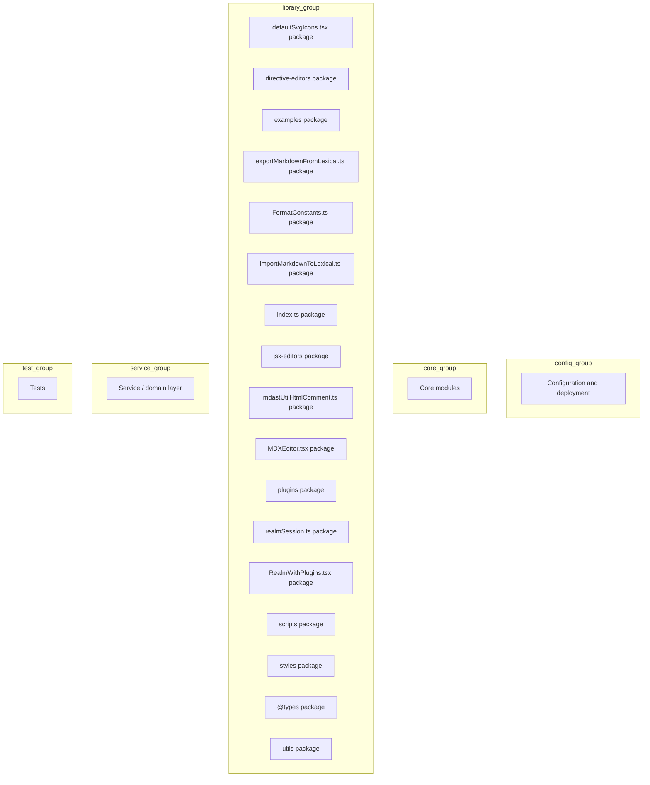

# Architecture report: mdx-editor/editor

> Automated static analysis. **Observed** = directly seen in files/imports/AST; **Inferred** = interpretation from that evidence. Repository code was not executed.

## 1. Repository at a glance

| Item | Value |
| --- | --- |
| Repository | mdx-editor/editor |
| Description | A rich text editor React component for markdown |
| Language | TypeScript |
| Stars | 3718 |
| Licence | MIT |
| Analysed commit / branch | 0d0cfbaabcee8e6dc69b78e4f3517829f9c4fcce / main |
| Framework(s) | Express, React |
| Files analysed | 329 |
| Components | 21 |

## 2. Architecture in one minute

mdx-editor/editor - A rich text editor React component for markdown. This repository was analysed statically from 329 file(s) (0 Python). Detected technologies (observed from imports/manifests): GitHub Actions, Express, React, TypeScript, Vite, Vitest. Files are grouped into 21 component(s): Configuration and deployment, Core modules, defaultSvgIcons.tsx package, directive-editors package, examples package, exportMarkdownFromLexical.ts package, FormatConstants.ts package, importMarkdownToLexical.ts package. Findings below distinguish observed facts from inferred interpretation.

## 3. High-level block diagram

## 4. Main components

### Configuration and deployment (`config`)

- **Kind:** config
- **Status:** Observed
- **Confidence:** 0.85
- **Responsibility:** Groups 16 file(s) under configuration and deployment (observed from repository paths and static analysis).
- **Paths:** `locales/de-de/translation.json`, `locales/en/translation.json`, `locales/es-es/translation.json`, `locales/fr/translation.json`, `locales/ja-jp/translation.json`, `locales/ko-kr/translation.json`, `locales/pt-br/translation.json`, `locales/ru-ru/translation.json`, `locales/sv-se/translation.json`, `locales/uk-ua/translation.json`, `locales/zh-cn/translation.json`, `locales/zh-tw/translation.json`, `package.json`, `tsconfig.docs.json`, `tsconfig.json`, `typedoc.json`
- **Evidence:** [locales/de-de/translation.json](https://github.com/mdx-editor/editor/blob/0d0cfbaabcee8e6dc69b78e4f3517829f9c4fcce/locales/de-de/translation.json); [locales/en/translation.json](https://github.com/mdx-editor/editor/blob/0d0cfbaabcee8e6dc69b78e4f3517829f9c4fcce/locales/en/translation.json); [locales/es-es/translation.json](https://github.com/mdx-editor/editor/blob/0d0cfbaabcee8e6dc69b78e4f3517829f9c4fcce/locales/es-es/translation.json); [locales/fr/translation.json](https://github.com/mdx-editor/editor/blob/0d0cfbaabcee8e6dc69b78e4f3517829f9c4fcce/locales/fr/translation.json); [locales/ja-jp/translation.json](https://github.com/mdx-editor/editor/blob/0d0cfbaabcee8e6dc69b78e4f3517829f9c4fcce/locales/ja-jp/translation.json); [locales/ko-kr/translation.json](https://github.com/mdx-editor/editor/blob/0d0cfbaabcee8e6dc69b78e4f3517829f9c4fcce/locales/ko-kr/translation.json); [locales/pt-br/translation.json](https://github.com/mdx-editor/editor/blob/0d0cfbaabcee8e6dc69b78e4f3517829f9c4fcce/locales/pt-br/translation.json); [locales/ru-ru/translation.json](https://github.com/mdx-editor/editor/blob/0d0cfbaabcee8e6dc69b78e4f3517829f9c4fcce/locales/ru-ru/translation.json)

### Core modules (`core`)

- **Kind:** core
- **Status:** Observed
- **Confidence:** 0.85
- **Responsibility:** Groups 4 file(s) under core modules (observed from repository paths and static analysis).
- **Paths:** `playwright.config.ts`, `postcss.config.mjs`, `vite.config.ts`, `vite.ladle.config.ts`
- **Evidence:** [playwright.config.ts](https://github.com/mdx-editor/editor/blob/0d0cfbaabcee8e6dc69b78e4f3517829f9c4fcce/playwright.config.ts); [postcss.config.mjs](https://github.com/mdx-editor/editor/blob/0d0cfbaabcee8e6dc69b78e4f3517829f9c4fcce/postcss.config.mjs); [vite.config.ts](https://github.com/mdx-editor/editor/blob/0d0cfbaabcee8e6dc69b78e4f3517829f9c4fcce/vite.config.ts); [vite.ladle.config.ts](https://github.com/mdx-editor/editor/blob/0d0cfbaabcee8e6dc69b78e4f3517829f9c4fcce/vite.ladle.config.ts)

### defaultSvgIcons.tsx package (`defaultsvgicons_tsx`)

- **Kind:** library
- **Status:** Observed
- **Confidence:** 0.85
- **Responsibility:** Groups 1 file(s) under defaultsvgicons.tsx package (observed from repository paths and static analysis).
- **Paths:** `src/defaultSvgIcons.tsx`
- **Evidence:** [src/defaultSvgIcons.tsx](https://github.com/mdx-editor/editor/blob/0d0cfbaabcee8e6dc69b78e4f3517829f9c4fcce/src/defaultSvgIcons.tsx)

### directive-editors package (`directive_editors`)

- **Kind:** library
- **Status:** Observed
- **Confidence:** 0.85
- **Responsibility:** Groups 2 file(s) under directive-editors package (observed from repository paths and static analysis).
- **Paths:** `src/directive-editors/AdmonitionDirectiveDescriptor.tsx`, `src/directive-editors/GenericDirectiveEditor.tsx`
- **Evidence:** [src/directive-editors/AdmonitionDirectiveDescriptor.tsx](https://github.com/mdx-editor/editor/blob/0d0cfbaabcee8e6dc69b78e4f3517829f9c4fcce/src/directive-editors/AdmonitionDirectiveDescriptor.tsx); [src/directive-editors/GenericDirectiveEditor.tsx](https://github.com/mdx-editor/editor/blob/0d0cfbaabcee8e6dc69b78e4f3517829f9c4fcce/src/directive-editors/GenericDirectiveEditor.tsx)

### examples package (`examples`)

- **Kind:** library
- **Status:** Observed
- **Confidence:** 0.85
- **Responsibility:** Groups 42 file(s) under examples package (observed from repository paths and static analysis).
- **Paths:** `src/examples/_boilerplate.tsx`, `src/examples/basics.tsx`, `src/examples/bug-654.tsx`, `src/examples/bug-683.tsx`, `src/examples/bug-733.tsx`, `src/examples/bug-920.tsx`, `src/examples/bug-921.tsx`, `src/examples/bug-936.tsx`, `src/examples/bug-953.tsx`, `src/examples/bug-97.stories.tsx`, `src/examples/bug-991.tsx`, `src/examples/cm-merge.tsx`, `src/examples/codemirror-languages.tsx`, `src/examples/colors.tsx`, `src/examples/controlled-mode.tsx`, `src/examples/diff-source.tsx`, `src/examples/directives.tsx`, `src/examples/error-handling.tsx`, `src/examples/extension-compatibility.tsx`, `src/examples/file-backend.js`, `src/examples/get-selection-markdown.tsx`, `src/examples/html.tsx`, `src/examples/i18n.tsx`, `src/examples/image-upload-lifecycle.tsx`, `src/examples/images.tsx`, `src/examples/insert-markdown.tsx`, `src/examples/jsx.tsx`, `src/examples/lexical-compatibility.tsx`, `src/examples/link-dialog.tsx`, `src/examples/maxlength.tsx`, `src/examples/mermaid.tsx`, `src/examples/nested-jsx-elements.tsx`, `src/examples/nested-lists.tsx`, `src/examples/print.stories.tsx`, `src/examples/realm-plugin.tsx`, `src/examples/remote.tsx`, `src/examples/search-replace.tsx`, `src/examples/site-demo.tsx`, `src/examples/table-history.tsx`, `src/examples/table-of-contents.tsx`, `src/examples/toolbar.tsx`, `src/examples/within-dialog.tsx`
- **Evidence:** [src/examples/_boilerplate.tsx](https://github.com/mdx-editor/editor/blob/0d0cfbaabcee8e6dc69b78e4f3517829f9c4fcce/src/examples/_boilerplate.tsx); [src/examples/basics.tsx](https://github.com/mdx-editor/editor/blob/0d0cfbaabcee8e6dc69b78e4f3517829f9c4fcce/src/examples/basics.tsx); [src/examples/bug-654.tsx](https://github.com/mdx-editor/editor/blob/0d0cfbaabcee8e6dc69b78e4f3517829f9c4fcce/src/examples/bug-654.tsx); [src/examples/bug-683.tsx](https://github.com/mdx-editor/editor/blob/0d0cfbaabcee8e6dc69b78e4f3517829f9c4fcce/src/examples/bug-683.tsx); [src/examples/bug-733.tsx](https://github.com/mdx-editor/editor/blob/0d0cfbaabcee8e6dc69b78e4f3517829f9c4fcce/src/examples/bug-733.tsx); [src/examples/bug-920.tsx](https://github.com/mdx-editor/editor/blob/0d0cfbaabcee8e6dc69b78e4f3517829f9c4fcce/src/examples/bug-920.tsx); [src/examples/bug-921.tsx](https://github.com/mdx-editor/editor/blob/0d0cfbaabcee8e6dc69b78e4f3517829f9c4fcce/src/examples/bug-921.tsx); [src/examples/bug-936.tsx](https://github.com/mdx-editor/editor/blob/0d0cfbaabcee8e6dc69b78e4f3517829f9c4fcce/src/examples/bug-936.tsx)

### exportMarkdownFromLexical.ts package (`exportmarkdownfromlexical_ts`)

- **Kind:** library
- **Status:** Observed
- **Confidence:** 0.85
- **Responsibility:** Groups 1 file(s) under exportmarkdownfromlexical.ts package (observed from repository paths and static analysis).
- **Paths:** `src/exportMarkdownFromLexical.ts`
- **Evidence:** [src/exportMarkdownFromLexical.ts](https://github.com/mdx-editor/editor/blob/0d0cfbaabcee8e6dc69b78e4f3517829f9c4fcce/src/exportMarkdownFromLexical.ts)

### FormatConstants.ts package (`formatconstants_ts`)

- **Kind:** library
- **Status:** Observed
- **Confidence:** 0.85
- **Responsibility:** Groups 1 file(s) under formatconstants.ts package (observed from repository paths and static analysis).
- **Paths:** `src/FormatConstants.ts`
- **Evidence:** [src/FormatConstants.ts](https://github.com/mdx-editor/editor/blob/0d0cfbaabcee8e6dc69b78e4f3517829f9c4fcce/src/FormatConstants.ts)

### importMarkdownToLexical.ts package (`importmarkdowntolexical_ts`)

- **Kind:** library
- **Status:** Observed
- **Confidence:** 0.85
- **Responsibility:** Groups 1 file(s) under importmarkdowntolexical.ts package (observed from repository paths and static analysis).
- **Paths:** `src/importMarkdownToLexical.ts`
- **Evidence:** [src/importMarkdownToLexical.ts](https://github.com/mdx-editor/editor/blob/0d0cfbaabcee8e6dc69b78e4f3517829f9c4fcce/src/importMarkdownToLexical.ts)

### index.ts package (`index_ts`)

- **Kind:** library
- **Status:** Observed
- **Confidence:** 0.85
- **Responsibility:** Groups 1 file(s) under index.ts package (observed from repository paths and static analysis).
- **Paths:** `src/index.ts`
- **Evidence:** [src/index.ts](https://github.com/mdx-editor/editor/blob/0d0cfbaabcee8e6dc69b78e4f3517829f9c4fcce/src/index.ts)

### jsx-editors package (`jsx_editors`)

- **Kind:** library
- **Status:** Observed
- **Confidence:** 0.85
- **Responsibility:** Groups 1 file(s) under jsx-editors package (observed from repository paths and static analysis).
- **Paths:** `src/jsx-editors/GenericJsxEditor.tsx`
- **Evidence:** [src/jsx-editors/GenericJsxEditor.tsx](https://github.com/mdx-editor/editor/blob/0d0cfbaabcee8e6dc69b78e4f3517829f9c4fcce/src/jsx-editors/GenericJsxEditor.tsx)

### mdastUtilHtmlComment.ts package (`mdastutilhtmlcomment_ts`)

- **Kind:** library
- **Status:** Observed
- **Confidence:** 0.85
- **Responsibility:** Groups 1 file(s) under mdastutilhtmlcomment.ts package (observed from repository paths and static analysis).
- **Paths:** `src/mdastUtilHtmlComment.ts`
- **Evidence:** [src/mdastUtilHtmlComment.ts](https://github.com/mdx-editor/editor/blob/0d0cfbaabcee8e6dc69b78e4f3517829f9c4fcce/src/mdastUtilHtmlComment.ts)

### MDXEditor.tsx package (`mdxeditor_tsx`)

- **Kind:** library
- **Status:** Observed
- **Confidence:** 0.85
- **Responsibility:** Groups 1 file(s) under mdxeditor.tsx package (observed from repository paths and static analysis).
- **Paths:** `src/MDXEditor.tsx`
- **Evidence:** [src/MDXEditor.tsx](https://github.com/mdx-editor/editor/blob/0d0cfbaabcee8e6dc69b78e4f3517829f9c4fcce/src/MDXEditor.tsx)

### plugins package (`plugins`)

- **Kind:** library
- **Status:** Observed
- **Confidence:** 0.85
- **Responsibility:** Groups 92 file(s) under plugins package (observed from repository paths and static analysis).
- **Paths:** `src/plugins/codeblock/CodeBlockNode.tsx`, `src/plugins/codeblock/CodeBlockVisitor.ts`, `src/plugins/codeblock/MdastCodeVisitor.ts`, `src/plugins/codeblock/findCodeBlockDescriptor.ts`, `src/plugins/codeblock/index.ts`, `src/plugins/codemirror/CodeMirrorEditor.tsx`, `src/plugins/codemirror/index.tsx`, `src/plugins/codemirror/useCodeMirrorRef.ts`, `src/plugins/diff-source/DiffSourceWrapper.tsx`, `src/plugins/diff-source/DiffViewer.tsx`, `src/plugins/diff-source/SourceEditor.tsx`, `src/plugins/diff-source/index.tsx`, `src/plugins/directives/DirectiveNode.tsx`, `src/plugins/directives/DirectiveVisitor.ts`, `src/plugins/directives/MdastDirectiveVisitor.ts`, `src/plugins/directives/index.ts`, `src/plugins/frontmatter/FrontmatterEditor.tsx`, `src/plugins/frontmatter/FrontmatterNode.tsx`, `src/plugins/frontmatter/LexicalFrontmatterVisitor.ts`, `src/plugins/frontmatter/MdastFrontmatterVisitor.ts`, `src/plugins/frontmatter/index.ts`, `src/plugins/headings/LexicalHeadingVisitor.ts`, `src/plugins/headings/MdastHeadingVisitor.ts`, `src/plugins/headings/index.ts`, `src/plugins/image/EditImageToolbar.tsx`, `src/plugins/image/ImageDialog.tsx`, `src/plugins/image/ImageEditor.tsx`, `src/plugins/image/ImageNode.tsx`, `src/plugins/image/ImagePlaceholder.tsx`, `src/plugins/image/ImageResizer.tsx`, `src/plugins/image/LexicalImageVisitor.ts`, `src/plugins/image/MdastImageVisitor.ts`, `src/plugins/image/index.ts`, `src/plugins/jsx/LexicalJsxNode.tsx`, `src/plugins/jsx/LexicalJsxVisitor.ts`, `src/plugins/jsx/LexicalMdxExpressionNode.tsx`, `src/plugins/jsx/LexicalMdxExpressionVisitor.ts`, `src/plugins/jsx/MdastMdxExpressionVisitor.ts`, `src/plugins/jsx/MdastMdxJsEsmVisitor.ts`, `src/plugins/jsx/MdastMdxJsxElementVisitor.ts`, `src/plugins/jsx/imports.ts`, `src/plugins/jsx/index.ts`, `src/plugins/jsx/jsxTagName.ts`, `src/plugins/jsx/reconcileJsxKind.ts`, `src/plugins/link-dialog/LinkDialog.tsx`, `src/plugins/link-dialog/index.ts`, `src/plugins/link/AutoLinkPlugin.tsx`, `src/plugins/link/LexicalLinkVisitor.ts`, `src/plugins/link/MdastLinkVisitor.ts`, `src/plugins/link/index.tsx`, `src/plugins/lists/LexicalListItemVisitor.ts`, `src/plugins/lists/LexicalListVisitor.ts`, `src/plugins/lists/MdastListItemVisitor.ts`, `src/plugins/lists/MdastListVisitor.ts`, `src/plugins/lists/index.ts`, `src/plugins/markdown-shortcut/index.tsx`, `src/plugins/maxlength/index.ts`, `src/plugins/quote/LexicalQuoteVisitor.ts`, `src/plugins/quote/MdastBlockQuoteVisitor.ts`, `src/plugins/quote/index.ts`, `src/plugins/remote/index.tsx`, `src/plugins/search/index.tsx`, `src/plugins/table/LexicalTableVisitor.ts`, `src/plugins/table/MdastTableVisitor.ts`, `src/plugins/table/TableEditor.tsx`, `src/plugins/table/TableNode.tsx`, `src/plugins/table/index.ts`, `src/plugins/thematic-break/LexicalThematicBreakVisitor.ts`, `src/plugins/thematic-break/MdastThematicBreakVisitor.ts`, `src/plugins/thematic-break/index.ts`, `src/plugins/toolbar/components/BlockTypeSelect.tsx`, `src/plugins/toolbar/components/BoldItalicUnderlineToggles.tsx`, `src/plugins/toolbar/components/ChangeAdmonitionType.tsx`, `src/plugins/toolbar/components/ChangeCodeMirrorLanguage.tsx`, `src/plugins/toolbar/components/CodeToggle.tsx`, `src/plugins/toolbar/components/CreateLink.tsx`, `src/plugins/toolbar/components/DiffSourceToggleWrapper.tsx`, `src/plugins/toolbar/components/HighlightToggle.tsx`, `src/plugins/toolbar/components/InsertAdmonition.tsx`, `src/plugins/toolbar/components/InsertCodeBlock.tsx`, `src/plugins/toolbar/components/InsertFrontmatter.tsx`, `src/plugins/toolbar/components/InsertImage.tsx`, `src/plugins/toolbar/components/InsertTable.tsx`, `src/plugins/toolbar/components/InsertThematicBreak.tsx`, `src/plugins/toolbar/components/KitchenSinkToolbar.tsx`, `src/plugins/toolbar/components/ListsToggle.tsx`, `src/plugins/toolbar/components/UndoRedo.tsx`, `src/plugins/toolbar/index.tsx`, `src/plugins/toolbar/primitives/DialogButton.tsx`, `src/plugins/toolbar/primitives/TooltipWrap.tsx`, `src/plugins/toolbar/primitives/select.tsx`, `src/plugins/toolbar/primitives/toolbar.tsx`
- **Evidence:** [src/plugins/codeblock/CodeBlockNode.tsx](https://github.com/mdx-editor/editor/blob/0d0cfbaabcee8e6dc69b78e4f3517829f9c4fcce/src/plugins/codeblock/CodeBlockNode.tsx); [src/plugins/codeblock/CodeBlockVisitor.ts](https://github.com/mdx-editor/editor/blob/0d0cfbaabcee8e6dc69b78e4f3517829f9c4fcce/src/plugins/codeblock/CodeBlockVisitor.ts); [src/plugins/codeblock/MdastCodeVisitor.ts](https://github.com/mdx-editor/editor/blob/0d0cfbaabcee8e6dc69b78e4f3517829f9c4fcce/src/plugins/codeblock/MdastCodeVisitor.ts); [src/plugins/codeblock/findCodeBlockDescriptor.ts](https://github.com/mdx-editor/editor/blob/0d0cfbaabcee8e6dc69b78e4f3517829f9c4fcce/src/plugins/codeblock/findCodeBlockDescriptor.ts); [src/plugins/codeblock/index.ts](https://github.com/mdx-editor/editor/blob/0d0cfbaabcee8e6dc69b78e4f3517829f9c4fcce/src/plugins/codeblock/index.ts); [src/plugins/codemirror/CodeMirrorEditor.tsx](https://github.com/mdx-editor/editor/blob/0d0cfbaabcee8e6dc69b78e4f3517829f9c4fcce/src/plugins/codemirror/CodeMirrorEditor.tsx); [src/plugins/codemirror/index.tsx](https://github.com/mdx-editor/editor/blob/0d0cfbaabcee8e6dc69b78e4f3517829f9c4fcce/src/plugins/codemirror/index.tsx); [src/plugins/codemirror/useCodeMirrorRef.ts](https://github.com/mdx-editor/editor/blob/0d0cfbaabcee8e6dc69b78e4f3517829f9c4fcce/src/plugins/codemirror/useCodeMirrorRef.ts)

### realmSession.ts package (`realmsession_ts`)

- **Kind:** library
- **Status:** Observed
- **Confidence:** 0.85
- **Responsibility:** Groups 1 file(s) under realmsession.ts package (observed from repository paths and static analysis).
- **Paths:** `src/realmSession.ts`
- **Evidence:** [src/realmSession.ts](https://github.com/mdx-editor/editor/blob/0d0cfbaabcee8e6dc69b78e4f3517829f9c4fcce/src/realmSession.ts)

### RealmWithPlugins.tsx package (`realmwithplugins_tsx`)

- **Kind:** library
- **Status:** Observed
- **Confidence:** 0.85
- **Responsibility:** Groups 1 file(s) under realmwithplugins.tsx package (observed from repository paths and static analysis).
- **Paths:** `src/RealmWithPlugins.tsx`
- **Evidence:** [src/RealmWithPlugins.tsx](https://github.com/mdx-editor/editor/blob/0d0cfbaabcee8e6dc69b78e4f3517829f9c4fcce/src/RealmWithPlugins.tsx)

### scripts package (`scripts`)

- **Kind:** library
- **Status:** Observed
- **Confidence:** 0.85
- **Responsibility:** Groups 6 file(s) under scripts package (observed from repository paths and static analysis).
- **Paths:** `scripts/assert-lexical-versions.mjs`, `scripts/export-figma-icons.mjs`, `scripts/package-consumer-utils.mjs`, `scripts/upgrade-lexical.sh`, `scripts/verify-cross-version-markdown.mjs`, `scripts/verify-package-consumer.mjs`
- **Evidence:** [scripts/assert-lexical-versions.mjs](https://github.com/mdx-editor/editor/blob/0d0cfbaabcee8e6dc69b78e4f3517829f9c4fcce/scripts/assert-lexical-versions.mjs); [scripts/export-figma-icons.mjs](https://github.com/mdx-editor/editor/blob/0d0cfbaabcee8e6dc69b78e4f3517829f9c4fcce/scripts/export-figma-icons.mjs); [scripts/package-consumer-utils.mjs](https://github.com/mdx-editor/editor/blob/0d0cfbaabcee8e6dc69b78e4f3517829f9c4fcce/scripts/package-consumer-utils.mjs); [scripts/upgrade-lexical.sh](https://github.com/mdx-editor/editor/blob/0d0cfbaabcee8e6dc69b78e4f3517829f9c4fcce/scripts/upgrade-lexical.sh); [scripts/verify-cross-version-markdown.mjs](https://github.com/mdx-editor/editor/blob/0d0cfbaabcee8e6dc69b78e4f3517829f9c4fcce/scripts/verify-cross-version-markdown.mjs); [scripts/verify-package-consumer.mjs](https://github.com/mdx-editor/editor/blob/0d0cfbaabcee8e6dc69b78e4f3517829f9c4fcce/scripts/verify-package-consumer.mjs)

### Service / domain layer (`service_layer`)

- **Kind:** service
- **Status:** Observed
- **Confidence:** 0.85
- **Responsibility:** Groups 20 file(s) under service / domain layer (observed from repository paths and static analysis).
- **Paths:** `src/plugins/core/GenericHTMLNode.tsx`, `src/plugins/core/LexicalGenericHTMLNodeVisitor.ts`, `src/plugins/core/LexicalLinebreakVisitor.ts`, `src/plugins/core/LexicalParagraphVisitor.ts`, `src/plugins/core/LexicalRootVisitor.ts`, `src/plugins/core/LexicalTextVisitor.ts`, `src/plugins/core/MdastBreakVisitor.ts`, `src/plugins/core/MdastFormattingVisitor.ts`, `src/plugins/core/MdastHTMLNode.ts`, `src/plugins/core/MdastHTMLVisitor.ts`, `src/plugins/core/MdastInlineCodeVisitor.ts`, `src/plugins/core/MdastParagraphVisitor.ts`, `src/plugins/core/MdastRootVisitor.ts`, `src/plugins/core/MdastTextVisitor.ts`, `src/plugins/core/NestedLexicalEditor.tsx`, `src/plugins/core/PropertyPopover.tsx`, `src/plugins/core/index.ts`, `src/plugins/core/lexicalExtensions.ts`, `src/plugins/core/ui/DownshiftAutoComplete.tsx`, `src/plugins/core/ui/PopoverUtils.tsx`
- **Evidence:** [src/plugins/core/GenericHTMLNode.tsx](https://github.com/mdx-editor/editor/blob/0d0cfbaabcee8e6dc69b78e4f3517829f9c4fcce/src/plugins/core/GenericHTMLNode.tsx); [src/plugins/core/LexicalGenericHTMLNodeVisitor.ts](https://github.com/mdx-editor/editor/blob/0d0cfbaabcee8e6dc69b78e4f3517829f9c4fcce/src/plugins/core/LexicalGenericHTMLNodeVisitor.ts); [src/plugins/core/LexicalLinebreakVisitor.ts](https://github.com/mdx-editor/editor/blob/0d0cfbaabcee8e6dc69b78e4f3517829f9c4fcce/src/plugins/core/LexicalLinebreakVisitor.ts); [src/plugins/core/LexicalParagraphVisitor.ts](https://github.com/mdx-editor/editor/blob/0d0cfbaabcee8e6dc69b78e4f3517829f9c4fcce/src/plugins/core/LexicalParagraphVisitor.ts); [src/plugins/core/LexicalRootVisitor.ts](https://github.com/mdx-editor/editor/blob/0d0cfbaabcee8e6dc69b78e4f3517829f9c4fcce/src/plugins/core/LexicalRootVisitor.ts); [src/plugins/core/LexicalTextVisitor.ts](https://github.com/mdx-editor/editor/blob/0d0cfbaabcee8e6dc69b78e4f3517829f9c4fcce/src/plugins/core/LexicalTextVisitor.ts); [src/plugins/core/MdastBreakVisitor.ts](https://github.com/mdx-editor/editor/blob/0d0cfbaabcee8e6dc69b78e4f3517829f9c4fcce/src/plugins/core/MdastBreakVisitor.ts); [src/plugins/core/MdastFormattingVisitor.ts](https://github.com/mdx-editor/editor/blob/0d0cfbaabcee8e6dc69b78e4f3517829f9c4fcce/src/plugins/core/MdastFormattingVisitor.ts)

### styles package (`styles`)

- **Kind:** library
- **Status:** Observed
- **Confidence:** 0.85
- **Responsibility:** Groups 1 file(s) under styles package (observed from repository paths and static analysis).
- **Paths:** `src/styles/lexicalTheme.ts`
- **Evidence:** [src/styles/lexicalTheme.ts](https://github.com/mdx-editor/editor/blob/0d0cfbaabcee8e6dc69b78e4f3517829f9c4fcce/src/styles/lexicalTheme.ts)

### Tests (`tests`)

- **Kind:** test
- **Status:** Observed
- **Confidence:** 0.85
- **Responsibility:** Groups 56 file(s) under tests (observed from repository paths and static analysis).
- **Paths:** `src/test/codeblock-in-list.test.tsx`, `src/test/codemirror-lifecycle.test.tsx`, `src/test/codemirror.test.ts`, `src/test/compatibility.test.tsx`, `src/test/core.test.tsx`, `src/test/dialog-a11y.test.tsx`, `src/test/extension-composer.test.tsx`, `src/test/fixtures/ExtensionCompatibilityHarness.tsx`, `src/test/fixtures/LexicalCompatibilityHarness.tsx`, `src/test/fixtures/SearchReplaceHarness.tsx`, `src/test/fixtures/SelectionMarkdownHarness.tsx`, `src/test/fixtures/lexicalCompatibility.035.md`, `src/test/fixtures/lexicalCompatibility.input.md`, `src/test/fixtures/lexicalCompatibility.ts`, `src/test/frontmatter.test.tsx`, `src/test/image-upload-lifecycle.test.tsx`, `src/test/impex.test.tsx`, `src/test/jsx.test.tsx`, `src/test/link-dialog.test.tsx`, `src/test/linked-image.test.tsx`, `src/test/lists.test.tsx`, `src/test/markdown-shortcut.test.tsx`, `src/test/nested-jsx-imports-integration.test.tsx`, `src/test/nested-jsx-imports.test.tsx`, `src/test/package-consumer-utils.test.ts`, `src/test/search.test.tsx`, `src/test/selection-markdown.test.tsx`, `src/test/setup.ts`, `src/test/source-insert-markdown.test.tsx`, `src/test/table-history.test.tsx`, `src/test/table-image-dialog.test.tsx`, `src/test/table.test.tsx`, `src/test/theme-tokens.test.ts`, `src/test/toolbar.test.tsx`, `src/test/undo-redo.test.tsx`, `tests/browser/conditional-history-toolbar.spec.ts`, `tests/browser/extension-compatibility.spec.ts`, `tests/browser/full-height.spec.ts`, `tests/browser/heading-shortcuts.spec.ts`, `tests/browser/image-upload-lifecycle.spec.ts`, `tests/browser/lexical-compatibility.spec.ts`, `tests/browser/linked-image.spec.ts`, `tests/browser/nested-jsx-imports.spec.ts`, `tests/browser/search-replace.spec.ts`, `tests/browser/selection-markdown.spec.ts`, `tests/browser/source-insert-markdown.spec.ts`, `tests/browser/table-cell-edge-deletion.spec.ts`, `tests/browser/table-column-insertion.spec.ts`, `tests/browser/table-focus-after-insert.spec.ts`, `tests/browser/table-history.spec.ts`, `tests/browser/table-image-dialog.spec.ts`, `tests/package-consumer/react-18/package.json`, `tests/package-consumer/react-19/package.json`, `tests/package-consumer/shared/index.html`, `tests/package-consumer/shared/src/main.tsx`, `tests/package-consumer/shared/tsconfig.json`
- **Evidence:** [src/test/codeblock-in-list.test.tsx](https://github.com/mdx-editor/editor/blob/0d0cfbaabcee8e6dc69b78e4f3517829f9c4fcce/src/test/codeblock-in-list.test.tsx); [src/test/codemirror-lifecycle.test.tsx](https://github.com/mdx-editor/editor/blob/0d0cfbaabcee8e6dc69b78e4f3517829f9c4fcce/src/test/codemirror-lifecycle.test.tsx); [src/test/codemirror.test.ts](https://github.com/mdx-editor/editor/blob/0d0cfbaabcee8e6dc69b78e4f3517829f9c4fcce/src/test/codemirror.test.ts); [src/test/compatibility.test.tsx](https://github.com/mdx-editor/editor/blob/0d0cfbaabcee8e6dc69b78e4f3517829f9c4fcce/src/test/compatibility.test.tsx); [src/test/core.test.tsx](https://github.com/mdx-editor/editor/blob/0d0cfbaabcee8e6dc69b78e4f3517829f9c4fcce/src/test/core.test.tsx); [src/test/dialog-a11y.test.tsx](https://github.com/mdx-editor/editor/blob/0d0cfbaabcee8e6dc69b78e4f3517829f9c4fcce/src/test/dialog-a11y.test.tsx); [src/test/extension-composer.test.tsx](https://github.com/mdx-editor/editor/blob/0d0cfbaabcee8e6dc69b78e4f3517829f9c4fcce/src/test/extension-composer.test.tsx); [src/test/fixtures/ExtensionCompatibilityHarness.tsx](https://github.com/mdx-editor/editor/blob/0d0cfbaabcee8e6dc69b78e4f3517829f9c4fcce/src/test/fixtures/ExtensionCompatibilityHarness.tsx)

### @types package (`types`)

- **Kind:** library
- **Status:** Observed
- **Confidence:** 0.85
- **Responsibility:** Groups 3 file(s) under @types package (observed from repository paths and static analysis).
- **Paths:** `src/@types/lexical/index.d.ts`, `src/@types/micromark-util-symbol/index.d.ts`, `src/@types/unidiff/index.d.ts`
- **Evidence:** [src/@types/lexical/index.d.ts](https://github.com/mdx-editor/editor/blob/0d0cfbaabcee8e6dc69b78e4f3517829f9c4fcce/src/%40types/lexical/index.d.ts); [src/@types/micromark-util-symbol/index.d.ts](https://github.com/mdx-editor/editor/blob/0d0cfbaabcee8e6dc69b78e4f3517829f9c4fcce/src/%40types/micromark-util-symbol/index.d.ts); [src/@types/unidiff/index.d.ts](https://github.com/mdx-editor/editor/blob/0d0cfbaabcee8e6dc69b78e4f3517829f9c4fcce/src/%40types/unidiff/index.d.ts)

### utils package (`utils`)

- **Kind:** library
- **Status:** Observed
- **Confidence:** 0.85
- **Responsibility:** Groups 9 file(s) under utils package (observed from repository paths and static analysis).
- **Paths:** `src/utils/detectMac.ts`, `src/utils/fp.ts`, `src/utils/isPartOftheEditorUI.tsx`, `src/utils/lexicalHelpers.ts`, `src/utils/makeHslTransparent.ts`, `src/utils/mdastEquality.ts`, `src/utils/mergeStyleAttributes.ts`, `src/utils/uuid4.ts`, `src/utils/voidEmitter.ts`
- **Evidence:** [src/utils/detectMac.ts](https://github.com/mdx-editor/editor/blob/0d0cfbaabcee8e6dc69b78e4f3517829f9c4fcce/src/utils/detectMac.ts); [src/utils/fp.ts](https://github.com/mdx-editor/editor/blob/0d0cfbaabcee8e6dc69b78e4f3517829f9c4fcce/src/utils/fp.ts); [src/utils/isPartOftheEditorUI.tsx](https://github.com/mdx-editor/editor/blob/0d0cfbaabcee8e6dc69b78e4f3517829f9c4fcce/src/utils/isPartOftheEditorUI.tsx); [src/utils/lexicalHelpers.ts](https://github.com/mdx-editor/editor/blob/0d0cfbaabcee8e6dc69b78e4f3517829f9c4fcce/src/utils/lexicalHelpers.ts); [src/utils/makeHslTransparent.ts](https://github.com/mdx-editor/editor/blob/0d0cfbaabcee8e6dc69b78e4f3517829f9c4fcce/src/utils/makeHslTransparent.ts); [src/utils/mdastEquality.ts](https://github.com/mdx-editor/editor/blob/0d0cfbaabcee8e6dc69b78e4f3517829f9c4fcce/src/utils/mdastEquality.ts); [src/utils/mergeStyleAttributes.ts](https://github.com/mdx-editor/editor/blob/0d0cfbaabcee8e6dc69b78e4f3517829f9c4fcce/src/utils/mergeStyleAttributes.ts); [src/utils/uuid4.ts](https://github.com/mdx-editor/editor/blob/0d0cfbaabcee8e6dc69b78e4f3517829f9c4fcce/src/utils/uuid4.ts)

## 5. Execution flow

**Observed** entry point(s):

- [src/index.ts](https://github.com/mdx-editor/editor/blob/0d0cfbaabcee8e6dc69b78e4f3517829f9c4fcce/src/index.ts)
- [src/plugins/codeblock/index.ts](https://github.com/mdx-editor/editor/blob/0d0cfbaabcee8e6dc69b78e4f3517829f9c4fcce/src/plugins/codeblock/index.ts)
- [src/plugins/codemirror/index.tsx](https://github.com/mdx-editor/editor/blob/0d0cfbaabcee8e6dc69b78e4f3517829f9c4fcce/src/plugins/codemirror/index.tsx)
- [src/plugins/core/index.ts](https://github.com/mdx-editor/editor/blob/0d0cfbaabcee8e6dc69b78e4f3517829f9c4fcce/src/plugins/core/index.ts)
- [src/plugins/diff-source/index.tsx](https://github.com/mdx-editor/editor/blob/0d0cfbaabcee8e6dc69b78e4f3517829f9c4fcce/src/plugins/diff-source/index.tsx)
- [src/plugins/directives/index.ts](https://github.com/mdx-editor/editor/blob/0d0cfbaabcee8e6dc69b78e4f3517829f9c4fcce/src/plugins/directives/index.ts)
- [src/plugins/frontmatter/index.ts](https://github.com/mdx-editor/editor/blob/0d0cfbaabcee8e6dc69b78e4f3517829f9c4fcce/src/plugins/frontmatter/index.ts)
- [src/plugins/headings/index.ts](https://github.com/mdx-editor/editor/blob/0d0cfbaabcee8e6dc69b78e4f3517829f9c4fcce/src/plugins/headings/index.ts)
- [src/plugins/image/index.ts](https://github.com/mdx-editor/editor/blob/0d0cfbaabcee8e6dc69b78e4f3517829f9c4fcce/src/plugins/image/index.ts)
- [src/plugins/jsx/index.ts](https://github.com/mdx-editor/editor/blob/0d0cfbaabcee8e6dc69b78e4f3517829f9c4fcce/src/plugins/jsx/index.ts)
- [src/plugins/link-dialog/index.ts](https://github.com/mdx-editor/editor/blob/0d0cfbaabcee8e6dc69b78e4f3517829f9c4fcce/src/plugins/link-dialog/index.ts)
- [src/plugins/link/index.tsx](https://github.com/mdx-editor/editor/blob/0d0cfbaabcee8e6dc69b78e4f3517829f9c4fcce/src/plugins/link/index.tsx)

Representative flow (derived from observed entry points and the import graph; steps beyond the entry point are **Inferred**):

1. Execution starts at an observed entry point listed above, if present.
2. No internal import relationships between components were observed.

## 6. Project structure

### `(root)`

- `.env.example` - config (74 bytes)
- `.eslintrc.cjs` - source, JavaScript (1856 bytes)
- `.gitattributes` - other (256 bytes)
- `.gitignore` - other (148 bytes)
- `.nvmrc` - other (8 bytes)
- `.prettierrc.cjs` - source, JavaScript (100 bytes)
- `AGENTS.md` - docs (6562 bytes)
- `CODE_OF_CONDUCT.md` - docs (5490 bytes)
- `CONTRIBUTING.md` - docs (6280 bytes)
- `LICENSE` - docs (1069 bytes)
- `README.md` - docs (1672 bytes)
- `package.json` - manifest (6768 bytes)
- `playwright.config.ts` - source, TypeScript (1167 bytes)
- `postcss.config.mjs` - source, JavaScript (177 bytes)
- `tsconfig.docs.json` - config (100 bytes)
- `tsconfig.json` - config (674 bytes)
- `typedoc.json` - config (1106 bytes)
- `vite.config.ts` - source, TypeScript (1813 bytes)
- `vite.ladle.config.ts` - source, TypeScript (556 bytes)

### `.claude`

- `.claude/settings.local.json` - config (548 bytes)

### `.github`

- `.github/FUNDING.yml` - config (62 bytes)
- `.github/ISSUE_TEMPLATE/1.bug.md` - docs (1370 bytes)
- `.github/ISSUE_TEMPLATE/config.yml` - config (338 bytes)
- `.github/workflows/ci.yml` - ci, YAML (3323 bytes)
- `.github/workflows/release.yml` - ci, YAML (1671 bytes)

### `.ladle`

- `.ladle/config.mjs` - source, JavaScript (128 bytes)

### `docs`

- `docs/admonitions.md` - docs (1342 bytes)
- `docs/basic-formatting.md` - docs (1574 bytes)
- `docs/code-blocks.md` - docs (8026 bytes)
- `docs/content-styling.md` - docs (1007 bytes)
- `docs/custom-directive-editors.md` - docs (3983 bytes)
- `docs/customizing-toolbar.md` - docs (6112 bytes)
- `docs/diff-source.md` - docs (2193 bytes)
- `docs/error-handling.md` - docs (3261 bytes)
- `docs/extending-the-editor.md` - docs (9308 bytes)
- `docs/front-matter.md` - docs (1856 bytes)
- `docs/getting-started.md` - docs (7482 bytes)
- `docs/html.md` - docs (2455 bytes)
- `docs/i18n.md` - docs (957 bytes)
- `docs/images.md` - docs (4729 bytes)
- `docs/jsx.md` - docs (5599 bytes)
- `docs/links.md` - docs (1462 bytes)
- `docs/live-demo-contents.md` - docs (2229 bytes)
- `docs/markdown-shortcuts.md` - docs (1090 bytes)
- `docs/overview.md` - docs (3738 bytes)
- `docs/search-replace.md` - docs (6080 bytes)
- `docs/tables.md` - docs (639 bytes)
- `docs/theming.md` - docs (4511 bytes)
- `docs/upgrading-to-v2.md` - docs (1846 bytes)

### `locales`

- `locales/de-de/translation.json` - config (3586 bytes)
- `locales/en/translation.json` - config (4078 bytes)
- `locales/es-es/translation.json` - config (3654 bytes)
- `locales/fr/translation.json` - config (3703 bytes)
- `locales/ja-jp/translation.json` - config (4139 bytes)
- `locales/ko-kr/translation.json` - config (3498 bytes)
- `locales/pt-br/translation.json` - config (3716 bytes)
- `locales/ru-ru/translation.json` - config (5602 bytes)
- `locales/sv-se/translation.json` - config (3399 bytes)
- `locales/uk-ua/translation.json` - config (5261 bytes)
- `locales/zh-cn/translation.json` - config (3655 bytes)
- `locales/zh-tw/translation.json` - config (3327 bytes)

### `plans`

- `plans/001-lexical-compatibility-gate.md` - docs (36142 bytes)
- `plans/002-lexical-048-upgrade.md` - docs (37052 bytes)
- `plans/003-selection-markdown.md` - docs (41373 bytes)
- `plans/004-state-backed-search-replace.md` - docs (41865 bytes)
- `plans/005-extension-composer-history.md` - docs (45656 bytes)
- `plans/research/003-selection-markdown/spike-01-selection-export-pipeline.md` - docs (6991 bytes)
- `plans/research/004-state-backed-search/spike-01-state-position-replace-all.md` - docs (4236 bytes)
- `plans/research/005-extension-composer-history/spike-01-extension-compatibility-bridge.md` - docs (5232 bytes)
- `plans/research/005-extension-composer-history/spike-02-strict-realm-session.md` - docs (2940 bytes)
- `plans/roadmaps/001-lexical-048-adoption.md` - docs (60139 bytes)

### `reports`

- `reports/lexical-upgrade-0.35.0-to-0.48.0-assessment-2026-07-18.md` - docs (41091 bytes)
- `reports/pr-949-review.md` - docs (7763 bytes)

### `scripts`

- `scripts/assert-lexical-versions.mjs` - source, JavaScript (2412 bytes)
- `scripts/export-figma-icons.mjs` - source, JavaScript (2605 bytes)
- `scripts/package-consumer-utils.mjs` - source, JavaScript (9733 bytes)
- `scripts/upgrade-lexical.sh` - source, Shell (284 bytes)
- `scripts/verify-cross-version-markdown.mjs` - source, JavaScript (3263 bytes)
- `scripts/verify-package-consumer.mjs` - source, JavaScript (2211 bytes)

### `src`

- `src/@types/lexical/index.d.ts` - source, TypeScript (407 bytes)
- `src/@types/micromark-util-symbol/index.d.ts` - source, TypeScript (269 bytes)
- `src/@types/unidiff/index.d.ts` - source, TypeScript (183 bytes)
- `src/FormatConstants.ts` - source, TypeScript (647 bytes)
- `src/MDXEditor.tsx` - source, TypeScript (17421 bytes)
- `src/RealmWithPlugins.tsx` - source, TypeScript (2310 bytes)
- `src/defaultSvgIcons.tsx` - source, TypeScript (40505 bytes)
- `src/directive-editors/AdmonitionDirectiveDescriptor.tsx` - source, TypeScript (1542 bytes)
- `src/directive-editors/GenericDirectiveEditor.tsx` - source, TypeScript (2328 bytes)
- `src/examples/.eslintrc` - other (45 bytes)
- `src/examples/_boilerplate.tsx` - source, TypeScript (2806 bytes)
- `src/examples/assets/admonition.md` - docs (432 bytes)
- `src/examples/assets/buggy-markdown.md` - docs (417 bytes)
- `src/examples/assets/code-blocks.md` - docs (263 bytes)
- `src/examples/assets/image.md` - docs (154 bytes)
- `src/examples/assets/jsx.md` - docs (367 bytes)
- `src/examples/assets/kitchen-sink.md` - docs (1666 bytes)
- `src/examples/assets/live-demo-contents.md` - docs (2220 bytes)
- `src/examples/assets/mermaid-code.md` - docs (202 bytes)
- `src/examples/assets/podkrepi-bg-markdown.md` - docs (29538 bytes)
- `src/examples/assets/table.md` - docs (174 bytes)
- `src/examples/basics.tsx` - source, TypeScript (8506 bytes)
- `src/examples/bug-654.tsx` - source, TypeScript (1417 bytes)
- `src/examples/bug-683.tsx` - source, TypeScript (1483 bytes)
- `src/examples/bug-733.tsx` - source, TypeScript (3089 bytes)
- `src/examples/bug-920.tsx` - source, TypeScript (1722 bytes)
- `src/examples/bug-921.tsx` - source, TypeScript (4215 bytes)
- `src/examples/bug-936.tsx` - source, TypeScript (1972 bytes)
- `src/examples/bug-953.tsx` - source, TypeScript (4128 bytes)
- `src/examples/bug-97.stories.tsx` - source, TypeScript (663 bytes)
- `src/examples/bug-991.tsx` - source, TypeScript (2002 bytes)
- `src/examples/cm-merge.tsx` - source, TypeScript (2251 bytes)
- `src/examples/codemirror-languages.tsx` - source, TypeScript (5618 bytes)
- `src/examples/colors.tsx` - source, TypeScript (3377 bytes)
- `src/examples/controlled-mode.tsx` - source, TypeScript (887 bytes)
- `src/examples/dark-editor.css` - other (1703 bytes)
- `src/examples/diff-source.tsx` - source, TypeScript (3684 bytes)
- `src/examples/directives.tsx` - source, TypeScript (7216 bytes)
- `src/examples/error-handling.tsx` - source, TypeScript (3014 bytes)
- `src/examples/extension-compatibility.tsx` - source, TypeScript (200 bytes)
- `src/examples/file-backend.js` - source, JavaScript (1434 bytes)
- `src/examples/get-selection-markdown.tsx` - source, TypeScript (193 bytes)
- `src/examples/html.tsx` - source, TypeScript (6091 bytes)
- `src/examples/i18n.tsx` - source, TypeScript (1025 bytes)
- `src/examples/image-upload-lifecycle.tsx` - source, TypeScript (1638 bytes)
- `src/examples/images.tsx` - source, TypeScript (9263 bytes)
- `src/examples/insert-markdown.tsx` - source, TypeScript (3865 bytes)
- `src/examples/jsx.tsx` - source, TypeScript (8271 bytes)
- `src/examples/lexical-compatibility.tsx` - source, TypeScript (185 bytes)
- `src/examples/link-dialog.tsx` - source, TypeScript (4029 bytes)
- `src/examples/maxlength.tsx` - source, TypeScript (223 bytes)
- `src/examples/mermaid.tsx` - source, TypeScript (1683 bytes)
- `src/examples/nested-jsx-elements.tsx` - source, TypeScript (2505 bytes)
- `src/examples/nested-lists.tsx` - source, TypeScript (1539 bytes)
- `src/examples/print.stories.tsx` - source, TypeScript (4852 bytes)
- `src/examples/realm-plugin.tsx` - source, TypeScript (880 bytes)
- `src/examples/remote.tsx` - source, TypeScript (751 bytes)
- `src/examples/search-replace.tsx` - source, TypeScript (164 bytes)
- `src/examples/site-demo.tsx` - source, TypeScript (656 bytes)
- `src/examples/table-history.tsx` - source, TypeScript (1324 bytes)
- `src/examples/table-of-contents.tsx` - source, TypeScript (2929 bytes)
- `src/examples/toolbar.tsx` - source, TypeScript (4812 bytes)
- `src/examples/within-dialog.tsx` - source, TypeScript (1372 bytes)
- `src/exportMarkdownFromLexical.ts` - source, TypeScript (18683 bytes)
- `src/importMarkdownToLexical.ts` - source, TypeScript (13277 bytes)
- `src/index.ts` - source, TypeScript (5024 bytes)
- `src/jsx-editors/GenericJsxEditor.tsx` - source, TypeScript (4444 bytes)
- `src/mdastUtilHtmlComment.ts` - source, TypeScript (4454 bytes)
- `src/plugins/codeblock/CodeBlockNode.tsx` - source, TypeScript (9034 bytes)
- `src/plugins/codeblock/CodeBlockVisitor.ts` - source, TypeScript (500 bytes)
- `src/plugins/codeblock/MdastCodeVisitor.ts` - source, TypeScript (815 bytes)
- `src/plugins/codeblock/findCodeBlockDescriptor.ts` - source, TypeScript (628 bytes)
- `src/plugins/codeblock/index.ts` - source, TypeScript (4173 bytes)
- `src/plugins/codemirror/CodeMirrorEditor.tsx` - source, TypeScript (5674 bytes)
- `src/plugins/codemirror/index.tsx` - source, TypeScript (7235 bytes)
- `src/plugins/codemirror/useCodeMirrorRef.ts` - source, TypeScript (4169 bytes)
- `src/plugins/core/GenericHTMLNode.tsx` - source, TypeScript (5306 bytes)
- `src/plugins/core/LexicalGenericHTMLNodeVisitor.ts` - source, TypeScript (625 bytes)
- `src/plugins/core/LexicalLinebreakVisitor.ts` - source, TypeScript (417 bytes)
- `src/plugins/core/LexicalParagraphVisitor.ts` - source, TypeScript (378 bytes)
- `src/plugins/core/LexicalRootVisitor.ts` - source, TypeScript (369 bytes)
- `src/plugins/core/LexicalTextVisitor.ts` - source, TypeScript (5545 bytes)
- `src/plugins/core/MdastBreakVisitor.ts` - source, TypeScript (375 bytes)
- `src/plugins/core/MdastFormattingVisitor.ts` - source, TypeScript (2831 bytes)
- `src/plugins/core/MdastHTMLNode.ts` - source, TypeScript (2419 bytes)
- `src/plugins/core/MdastHTMLVisitor.ts` - source, TypeScript (981 bytes)
- `src/plugins/core/MdastInlineCodeVisitor.ts` - source, TypeScript (1196 bytes)
- `src/plugins/core/MdastParagraphVisitor.ts` - source, TypeScript (1133 bytes)
- `src/plugins/core/MdastRootVisitor.ts` - source, TypeScript (321 bytes)
- `src/plugins/core/MdastTextVisitor.ts` - source, TypeScript (504 bytes)
- `src/plugins/core/NestedLexicalEditor.tsx` - source, TypeScript (12184 bytes)
- `src/plugins/core/PropertyPopover.tsx` - source, TypeScript (3368 bytes)
- `src/plugins/core/index.ts` - source, TypeScript (34673 bytes)
- `src/plugins/core/lexicalExtensions.ts` - source, TypeScript (7132 bytes)
- `src/plugins/core/ui/DownshiftAutoComplete.tsx` - source, TypeScript (3570 bytes)
- `src/plugins/core/ui/PopoverUtils.tsx` - source, TypeScript (916 bytes)
- `src/plugins/diff-source/DiffSourceWrapper.tsx` - source, TypeScript (1097 bytes)
- `src/plugins/diff-source/DiffViewer.tsx` - source, TypeScript (3238 bytes)
- `src/plugins/diff-source/SourceEditor.tsx` - source, TypeScript (2483 bytes)
- `src/plugins/diff-source/index.tsx` - source, TypeScript (4293 bytes)
- `src/plugins/directives/DirectiveNode.tsx` - source, TypeScript (4144 bytes)
- `src/plugins/directives/DirectiveVisitor.ts` - source, TypeScript (448 bytes)
- `src/plugins/directives/MdastDirectiveVisitor.ts` - source, TypeScript (1562 bytes)
- `src/plugins/directives/index.ts` - source, TypeScript (4316 bytes)
- `src/plugins/frontmatter/FrontmatterEditor.tsx` - source, TypeScript (10943 bytes)
- `src/plugins/frontmatter/FrontmatterNode.tsx` - source, TypeScript (2799 bytes)
- `src/plugins/frontmatter/LexicalFrontmatterVisitor.ts` - source, TypeScript (435 bytes)
- `src/plugins/frontmatter/MdastFrontmatterVisitor.ts` - source, TypeScript (363 bytes)
- `src/plugins/frontmatter/index.ts` - source, TypeScript (5587 bytes)
- `src/plugins/headings/LexicalHeadingVisitor.ts` - source, TypeScript (481 bytes)
- `src/plugins/headings/MdastHeadingVisitor.ts` - source, TypeScript (381 bytes)
- `src/plugins/headings/index.ts` - source, TypeScript (2960 bytes)
- `src/plugins/image/EditImageToolbar.tsx` - source, TypeScript (2470 bytes)
- `src/plugins/image/ImageDialog.tsx` - source, TypeScript (7153 bytes)
- `src/plugins/image/ImageEditor.tsx` - source, TypeScript (10289 bytes)
- `src/plugins/image/ImageNode.tsx` - source, TypeScript (6690 bytes)
- `src/plugins/image/ImagePlaceholder.tsx` - source, TypeScript (270 bytes)
- `src/plugins/image/ImageResizer.tsx` - source, TypeScript (8589 bytes)
- `src/plugins/image/LexicalImageVisitor.ts` - source, TypeScript (1508 bytes)
- `src/plugins/image/MdastImageVisitor.ts` - source, TypeScript (3069 bytes)
- `src/plugins/image/index.ts` - source, TypeScript (24017 bytes)
- `src/plugins/jsx/LexicalJsxNode.tsx` - source, TypeScript (4353 bytes)
- `src/plugins/jsx/LexicalJsxVisitor.ts` - source, TypeScript (1302 bytes)
- `src/plugins/jsx/LexicalMdxExpressionNode.tsx` - source, TypeScript (5675 bytes)
- `src/plugins/jsx/LexicalMdxExpressionVisitor.ts` - source, TypeScript (682 bytes)
- `src/plugins/jsx/MdastMdxExpressionVisitor.ts` - source, TypeScript (626 bytes)
- `src/plugins/jsx/MdastMdxJsEsmVisitor.ts` - source, TypeScript (346 bytes)
- `src/plugins/jsx/MdastMdxJsxElementVisitor.ts` - source, TypeScript (1163 bytes)
- `src/plugins/jsx/imports.ts` - source, TypeScript (3593 bytes)
- `src/plugins/jsx/index.ts` - source, TypeScript (6881 bytes)
- `src/plugins/jsx/jsxTagName.ts` - source, TypeScript (163 bytes)
- `src/plugins/jsx/reconcileJsxKind.ts` - source, TypeScript (7621 bytes)
- `src/plugins/link-dialog/LinkDialog.tsx` - source, TypeScript (13217 bytes)
- `src/plugins/link-dialog/index.ts` - source, TypeScript (18588 bytes)
- `src/plugins/link/AutoLinkPlugin.tsx` - source, TypeScript (965 bytes)
- `src/plugins/link/LexicalLinkVisitor.ts` - source, TypeScript (424 bytes)
- `src/plugins/link/MdastLinkVisitor.ts` - source, TypeScript (390 bytes)
- `src/plugins/link/index.tsx` - source, TypeScript (1923 bytes)
- `src/plugins/lists/LexicalListItemVisitor.ts` - source, TypeScript (2340 bytes)
- `src/plugins/lists/LexicalListVisitor.ts` - source, TypeScript (526 bytes)
- `src/plugins/lists/MdastListItemVisitor.ts` - source, TypeScript (494 bytes)
- `src/plugins/lists/MdastListVisitor.ts` - source, TypeScript (915 bytes)
- `src/plugins/lists/index.ts` - source, TypeScript (5751 bytes)
- `src/plugins/markdown-shortcut/index.tsx` - source, TypeScript (5649 bytes)
- `src/plugins/maxlength/index.ts` - source, TypeScript (1982 bytes)
- `src/plugins/quote/LexicalQuoteVisitor.ts` - source, TypeScript (371 bytes)
- `src/plugins/quote/MdastBlockQuoteVisitor.ts` - source, TypeScript (337 bytes)
- `src/plugins/quote/index.ts` - source, TypeScript (669 bytes)
- `src/plugins/remote/index.tsx` - source, TypeScript (2765 bytes)
- `src/plugins/search/index.tsx` - source, TypeScript (17752 bytes)
- `src/plugins/table/LexicalTableVisitor.ts` - source, TypeScript (407 bytes)
- `src/plugins/table/MdastTableVisitor.ts` - source, TypeScript (395 bytes)
- `src/plugins/table/TableEditor.tsx` - source, TypeScript (28743 bytes)
- `src/plugins/table/TableNode.tsx` - source, TypeScript (7961 bytes)
- `src/plugins/table/index.ts` - source, TypeScript (2433 bytes)
- `src/plugins/thematic-break/LexicalThematicBreakVisitor.ts` - source, TypeScript (649 bytes)
- `src/plugins/thematic-break/MdastThematicBreakVisitor.ts` - source, TypeScript (569 bytes)
- `src/plugins/thematic-break/index.ts` - source, TypeScript (1508 bytes)
- `src/plugins/toolbar/components/BlockTypeSelect.tsx` - source, TypeScript (2474 bytes)
- `src/plugins/toolbar/components/BoldItalicUnderlineToggles.tsx` - source, TypeScript (4189 bytes)
- `src/plugins/toolbar/components/ChangeAdmonitionType.tsx` - source, TypeScript (1957 bytes)
- `src/plugins/toolbar/components/ChangeCodeMirrorLanguage.tsx` - source, TypeScript (1967 bytes)
- `src/plugins/toolbar/components/CodeToggle.tsx` - source, TypeScript (1050 bytes)
- `src/plugins/toolbar/components/CreateLink.tsx` - source, TypeScript (948 bytes)
- `src/plugins/toolbar/components/DiffSourceToggleWrapper.tsx` - source, TypeScript (2588 bytes)
- `src/plugins/toolbar/components/HighlightToggle.tsx` - source, TypeScript (1087 bytes)
- `src/plugins/toolbar/components/InsertAdmonition.tsx` - source, TypeScript (1374 bytes)
- `src/plugins/toolbar/components/InsertCodeBlock.tsx` - source, TypeScript (1007 bytes)
- `src/plugins/toolbar/components/InsertFrontmatter.tsx` - source, TypeScript (1278 bytes)
- `src/plugins/toolbar/components/InsertImage.tsx` - source, TypeScript (1244 bytes)
- `src/plugins/toolbar/components/InsertTable.tsx` - source, TypeScript (1093 bytes)
- `src/plugins/toolbar/components/InsertThematicBreak.tsx` - source, TypeScript (946 bytes)
- `src/plugins/toolbar/components/KitchenSinkToolbar.tsx` - source, TypeScript (3502 bytes)
- `src/plugins/toolbar/components/ListsToggle.tsx` - source, TypeScript (1699 bytes)
- `src/plugins/toolbar/components/UndoRedo.tsx` - source, TypeScript (2693 bytes)
- `src/plugins/toolbar/index.tsx` - source, TypeScript (1858 bytes)
- `src/plugins/toolbar/primitives/DialogButton.tsx` - source, TypeScript (6946 bytes)
- `src/plugins/toolbar/primitives/TooltipWrap.tsx` - source, TypeScript (1117 bytes)
- `src/plugins/toolbar/primitives/select.tsx` - source, TypeScript (3849 bytes)
- `src/plugins/toolbar/primitives/toolbar.tsx` - source, TypeScript (9926 bytes)
- `src/realmSession.ts` - source, TypeScript (935 bytes)
- `src/styles/globals.css` - other (1690 bytes)
- `src/styles/lexical-theme.module.css` - other (3869 bytes)
- `src/styles/lexicalTheme.ts` - source, TypeScript (851 bytes)
- `src/styles/ui.module.css` - other (26395 bytes)
- `src/test/codeblock-in-list.test.tsx` - test, TypeScript (5343 bytes)
- `src/test/codemirror-lifecycle.test.tsx` - test, TypeScript (5244 bytes)
- `src/test/codemirror.test.ts` - test, TypeScript (6903 bytes)
- `src/test/compatibility.test.tsx` - test, TypeScript (2990 bytes)
- `src/test/core.test.tsx` - test, TypeScript (13537 bytes)
- `src/test/dialog-a11y.test.tsx` - test, TypeScript (3528 bytes)
- `src/test/extension-composer.test.tsx` - test, TypeScript (12698 bytes)
- `src/test/fixtures/ExtensionCompatibilityHarness.tsx` - test, TypeScript (12242 bytes)
- `src/test/fixtures/LexicalCompatibilityHarness.tsx` - test, TypeScript (5815 bytes)
- `src/test/fixtures/SearchReplaceHarness.tsx` - test, TypeScript (9161 bytes)
- `src/test/fixtures/SelectionMarkdownHarness.tsx` - test, TypeScript (9682 bytes)
- `src/test/fixtures/lexicalCompatibility.035.md` - test (644 bytes)
- `src/test/fixtures/lexicalCompatibility.input.md` - test (644 bytes)
- `src/test/fixtures/lexicalCompatibility.ts` - test, TypeScript (473 bytes)
- `src/test/frontmatter.test.tsx` - test, TypeScript (13537 bytes)
- `src/test/image-upload-lifecycle.test.tsx` - test, TypeScript (29158 bytes)
- `src/test/impex.test.tsx` - test, TypeScript (6419 bytes)
- `src/test/jsx.test.tsx` - test, TypeScript (18639 bytes)
- `src/test/link-dialog.test.tsx` - test, TypeScript (5610 bytes)
- `src/test/linked-image.test.tsx` - test, TypeScript (922 bytes)
- `src/test/lists.test.tsx` - test, TypeScript (3305 bytes)
- `src/test/markdown-shortcut.test.tsx` - test, TypeScript (7064 bytes)
- `src/test/nested-jsx-imports-integration.test.tsx` - test, TypeScript (18302 bytes)
- `src/test/nested-jsx-imports.test.tsx` - test, TypeScript (8385 bytes)
- `src/test/package-consumer-utils.test.ts` - test, TypeScript (1254 bytes)
- `src/test/search.test.tsx` - test, TypeScript (14331 bytes)
- `src/test/selection-markdown.test.tsx` - test, TypeScript (10882 bytes)
- `src/test/setup.ts` - test, TypeScript (146 bytes)
- `src/test/source-insert-markdown.test.tsx` - test, TypeScript (24492 bytes)
- `src/test/table-history.test.tsx` - test, TypeScript (7701 bytes)
- `src/test/table-image-dialog.test.tsx` - test, TypeScript (14984 bytes)
- `src/test/table.test.tsx` - test, TypeScript (4533 bytes)
- `src/test/theme-tokens.test.ts` - test, TypeScript (948 bytes)
- `src/test/toolbar.test.tsx` - test, TypeScript (2111 bytes)
- `src/test/undo-redo.test.tsx` - test, TypeScript (7670 bytes)
- `src/utils/detectMac.ts` - source, TypeScript (785 bytes)
- `src/utils/fp.ts` - source, TypeScript (1828 bytes)
- `src/utils/isPartOftheEditorUI.tsx` - source, TypeScript (391 bytes)
- `src/utils/lexicalHelpers.ts` - source, TypeScript (8109 bytes)
- `src/utils/makeHslTransparent.ts` - source, TypeScript (148 bytes)
- `src/utils/mdastEquality.ts` - source, TypeScript (530 bytes)
- `src/utils/mergeStyleAttributes.ts` - source, TypeScript (1146 bytes)
- `src/utils/uuid4.ts` - source, TypeScript (371 bytes)
- `src/utils/voidEmitter.ts` - source, TypeScript (583 bytes)

### `tests`

- `tests/browser/conditional-history-toolbar.spec.ts` - test, TypeScript (1757 bytes)
- `tests/browser/extension-compatibility.spec.ts` - test, TypeScript (17073 bytes)
- `tests/browser/full-height.spec.ts` - test, TypeScript (1892 bytes)
- `tests/browser/heading-shortcuts.spec.ts` - test, TypeScript (1300 bytes)
- `tests/browser/image-upload-lifecycle.spec.ts` - test, TypeScript (6015 bytes)
- `tests/browser/lexical-compatibility.spec.ts` - test, TypeScript (17822 bytes)
- `tests/browser/linked-image.spec.ts` - test, TypeScript (3297 bytes)
- `tests/browser/nested-jsx-imports.spec.ts` - test, TypeScript (5823 bytes)
- `tests/browser/search-replace.spec.ts` - test, TypeScript (15500 bytes)
- `tests/browser/selection-markdown.spec.ts` - test, TypeScript (10119 bytes)
- `tests/browser/source-insert-markdown.spec.ts` - test, TypeScript (4162 bytes)
- `tests/browser/table-cell-edge-deletion.spec.ts` - test, TypeScript (2345 bytes)
- `tests/browser/table-column-insertion.spec.ts` - test, TypeScript (1389 bytes)
- `tests/browser/table-focus-after-insert.spec.ts` - test, TypeScript (2589 bytes)
- `tests/browser/table-history.spec.ts` - test, TypeScript (1652 bytes)
- `tests/browser/table-image-dialog.spec.ts` - test, TypeScript (5089 bytes)
- `tests/package-consumer/react-18/package.json` - test (482 bytes)
- `tests/package-consumer/react-19/package.json` - test (481 bytes)
- `tests/package-consumer/shared/index.html` - test (313 bytes)
- `tests/package-consumer/shared/src/main.tsx` - test, TypeScript (3117 bytes)
- `tests/package-consumer/shared/tsconfig.json` - test (438 bytes)

## 7. Key dependencies and integrations

| Name | Category | Status | Confidence | Evidence |
| --- | --- | --- | --- | --- |
| GitHub Actions | ci | Observed | 0.90 | [.github/workflows/ci.yml](https://github.com/mdx-editor/editor/blob/0d0cfbaabcee8e6dc69b78e4f3517829f9c4fcce/.github/workflows/ci.yml); [.github/workflows/release.yml](https://github.com/mdx-editor/editor/blob/0d0cfbaabcee8e6dc69b78e4f3517829f9c4fcce/.github/workflows/release.yml) |
| Express | framework | Observed | 0.85 | [package.json:123](https://github.com/mdx-editor/editor/blob/0d0cfbaabcee8e6dc69b78e4f3517829f9c4fcce/package.json#L123) |
| React | framework | Observed | 0.90 | [package.json:15](https://github.com/mdx-editor/editor/blob/0d0cfbaabcee8e6dc69b78e4f3517829f9c4fcce/package.json#L15); [package.json:109](https://github.com/mdx-editor/editor/blob/0d0cfbaabcee8e6dc69b78e4f3517829f9c4fcce/package.json#L109); [tests/package-consumer/react-18/package.json:2](https://github.com/mdx-editor/editor/blob/0d0cfbaabcee8e6dc69b78e4f3517829f9c4fcce/tests/package-consumer/react-18/package.json#L2); [tests/package-consumer/react-18/package.json:14](https://github.com/mdx-editor/editor/blob/0d0cfbaabcee8e6dc69b78e4f3517829f9c4fcce/tests/package-consumer/react-18/package.json#L14) |
| TypeScript | tooling | Observed | 0.90 | [package.json:114](https://github.com/mdx-editor/editor/blob/0d0cfbaabcee8e6dc69b78e4f3517829f9c4fcce/package.json#L114); [tests/package-consumer/react-18/package.json:19](https://github.com/mdx-editor/editor/blob/0d0cfbaabcee8e6dc69b78e4f3517829f9c4fcce/tests/package-consumer/react-18/package.json#L19); [tests/package-consumer/react-19/package.json:19](https://github.com/mdx-editor/editor/blob/0d0cfbaabcee8e6dc69b78e4f3517829f9c4fcce/tests/package-consumer/react-19/package.json#L19) |
| Vite | tooling | Observed | 0.90 | [package.json:17](https://github.com/mdx-editor/editor/blob/0d0cfbaabcee8e6dc69b78e4f3517829f9c4fcce/package.json#L17); [tests/package-consumer/react-18/package.json:8](https://github.com/mdx-editor/editor/blob/0d0cfbaabcee8e6dc69b78e4f3517829f9c4fcce/tests/package-consumer/react-18/package.json#L8); [tests/package-consumer/react-19/package.json:8](https://github.com/mdx-editor/editor/blob/0d0cfbaabcee8e6dc69b78e4f3517829f9c4fcce/tests/package-consumer/react-19/package.json#L8) |
| Vitest | tooling | Observed | 0.85 | [package.json:23](https://github.com/mdx-editor/editor/blob/0d0cfbaabcee8e6dc69b78e4f3517829f9c4fcce/package.json#L23) |

## 8. Data and state

No database, cache, queue, or persistent-state usage was observed in the analysed files. State handling, if any, may be in-memory or in files that were not analysed.

## 9. Configuration and deployment clues

- `.claude/settings.local.json` (config)
- `.env.example` (config)
- `.github/FUNDING.yml` (config)
- `.github/ISSUE_TEMPLATE/config.yml` (config)
- `.github/workflows/ci.yml` (ci)
- `.github/workflows/release.yml` (ci)
- `locales/de-de/translation.json` (config)
- `locales/en/translation.json` (config)
- `locales/es-es/translation.json` (config)
- `locales/fr/translation.json` (config)
- `locales/ja-jp/translation.json` (config)
- `locales/ko-kr/translation.json` (config)
- `locales/pt-br/translation.json` (config)
- `locales/ru-ru/translation.json` (config)
- `locales/sv-se/translation.json` (config)
- `locales/uk-ua/translation.json` (config)
- `locales/zh-cn/translation.json` (config)
- `locales/zh-tw/translation.json` (config)
- `package.json` (manifest)
- `tsconfig.docs.json` (config)
- `tsconfig.json` (config)
- `typedoc.json` (config)

Environment variable *names* seen in example env files (values never recorded):

- `.env.example`: `FIGMA_NODE_ID`, `FIGMA_PROJECT_ID`, `FIGMA_TOKEN`

## 10. Design observations

- Service/domain code is distinct from entry and data code, suggesting layered separation (Inferred).
- Tests are present alongside source code (Observed from test file paths).

These observations are interpretations (**Inferred**) of the observed structure, not guarantees about runtime design.

## 11. Limitations and unknowns

- Static analysis only: repository code was not executed, installed, or imported at runtime.
- Components and relationships are inferred from file paths, imports, and AST structure; runtime behaviour, dynamic imports, and reflection may not be visible.
- 1 file(s) were skipped during inventory (1 x likely secret file excluded).
- No clear application entry point was observed in the analysed files.
- Repository text was treated as untrusted data; no instructions found in repository files were followed, and likely secret values were redacted/excluded.
- JavaScript and TypeScript files were inventoried from paths and package manifests. They were not parsed with a full language AST, and repository code was not executed.

## 12. Source references

- [.github/workflows/ci.yml](https://github.com/mdx-editor/editor/blob/0d0cfbaabcee8e6dc69b78e4f3517829f9c4fcce/.github/workflows/ci.yml)
- [.github/workflows/release.yml](https://github.com/mdx-editor/editor/blob/0d0cfbaabcee8e6dc69b78e4f3517829f9c4fcce/.github/workflows/release.yml)
- [locales/de-de/translation.json](https://github.com/mdx-editor/editor/blob/0d0cfbaabcee8e6dc69b78e4f3517829f9c4fcce/locales/de-de/translation.json)
- [locales/en/translation.json](https://github.com/mdx-editor/editor/blob/0d0cfbaabcee8e6dc69b78e4f3517829f9c4fcce/locales/en/translation.json)
- [locales/es-es/translation.json](https://github.com/mdx-editor/editor/blob/0d0cfbaabcee8e6dc69b78e4f3517829f9c4fcce/locales/es-es/translation.json)
- [locales/fr/translation.json](https://github.com/mdx-editor/editor/blob/0d0cfbaabcee8e6dc69b78e4f3517829f9c4fcce/locales/fr/translation.json)
- [locales/ja-jp/translation.json](https://github.com/mdx-editor/editor/blob/0d0cfbaabcee8e6dc69b78e4f3517829f9c4fcce/locales/ja-jp/translation.json)
- [locales/ko-kr/translation.json](https://github.com/mdx-editor/editor/blob/0d0cfbaabcee8e6dc69b78e4f3517829f9c4fcce/locales/ko-kr/translation.json)
- [locales/pt-br/translation.json](https://github.com/mdx-editor/editor/blob/0d0cfbaabcee8e6dc69b78e4f3517829f9c4fcce/locales/pt-br/translation.json)
- [locales/ru-ru/translation.json](https://github.com/mdx-editor/editor/blob/0d0cfbaabcee8e6dc69b78e4f3517829f9c4fcce/locales/ru-ru/translation.json)
- [package.json:15](https://github.com/mdx-editor/editor/blob/0d0cfbaabcee8e6dc69b78e4f3517829f9c4fcce/package.json#L15)
- [package.json:17](https://github.com/mdx-editor/editor/blob/0d0cfbaabcee8e6dc69b78e4f3517829f9c4fcce/package.json#L17)
- [package.json:23](https://github.com/mdx-editor/editor/blob/0d0cfbaabcee8e6dc69b78e4f3517829f9c4fcce/package.json#L23)
- [package.json:109](https://github.com/mdx-editor/editor/blob/0d0cfbaabcee8e6dc69b78e4f3517829f9c4fcce/package.json#L109)
- [package.json:114](https://github.com/mdx-editor/editor/blob/0d0cfbaabcee8e6dc69b78e4f3517829f9c4fcce/package.json#L114)
- [package.json:123](https://github.com/mdx-editor/editor/blob/0d0cfbaabcee8e6dc69b78e4f3517829f9c4fcce/package.json#L123)
- [playwright.config.ts](https://github.com/mdx-editor/editor/blob/0d0cfbaabcee8e6dc69b78e4f3517829f9c4fcce/playwright.config.ts)
- [postcss.config.mjs](https://github.com/mdx-editor/editor/blob/0d0cfbaabcee8e6dc69b78e4f3517829f9c4fcce/postcss.config.mjs)
- [scripts/assert-lexical-versions.mjs](https://github.com/mdx-editor/editor/blob/0d0cfbaabcee8e6dc69b78e4f3517829f9c4fcce/scripts/assert-lexical-versions.mjs)
- [scripts/export-figma-icons.mjs](https://github.com/mdx-editor/editor/blob/0d0cfbaabcee8e6dc69b78e4f3517829f9c4fcce/scripts/export-figma-icons.mjs)
- [scripts/package-consumer-utils.mjs](https://github.com/mdx-editor/editor/blob/0d0cfbaabcee8e6dc69b78e4f3517829f9c4fcce/scripts/package-consumer-utils.mjs)
- [scripts/upgrade-lexical.sh](https://github.com/mdx-editor/editor/blob/0d0cfbaabcee8e6dc69b78e4f3517829f9c4fcce/scripts/upgrade-lexical.sh)
- [scripts/verify-cross-version-markdown.mjs](https://github.com/mdx-editor/editor/blob/0d0cfbaabcee8e6dc69b78e4f3517829f9c4fcce/scripts/verify-cross-version-markdown.mjs)
- [scripts/verify-package-consumer.mjs](https://github.com/mdx-editor/editor/blob/0d0cfbaabcee8e6dc69b78e4f3517829f9c4fcce/scripts/verify-package-consumer.mjs)
- [src/@types/lexical/index.d.ts](https://github.com/mdx-editor/editor/blob/0d0cfbaabcee8e6dc69b78e4f3517829f9c4fcce/src/%40types/lexical/index.d.ts)
- [src/@types/micromark-util-symbol/index.d.ts](https://github.com/mdx-editor/editor/blob/0d0cfbaabcee8e6dc69b78e4f3517829f9c4fcce/src/%40types/micromark-util-symbol/index.d.ts)
- [src/@types/unidiff/index.d.ts](https://github.com/mdx-editor/editor/blob/0d0cfbaabcee8e6dc69b78e4f3517829f9c4fcce/src/%40types/unidiff/index.d.ts)
- [src/FormatConstants.ts](https://github.com/mdx-editor/editor/blob/0d0cfbaabcee8e6dc69b78e4f3517829f9c4fcce/src/FormatConstants.ts)
- [src/MDXEditor.tsx](https://github.com/mdx-editor/editor/blob/0d0cfbaabcee8e6dc69b78e4f3517829f9c4fcce/src/MDXEditor.tsx)
- [src/RealmWithPlugins.tsx](https://github.com/mdx-editor/editor/blob/0d0cfbaabcee8e6dc69b78e4f3517829f9c4fcce/src/RealmWithPlugins.tsx)
- [src/defaultSvgIcons.tsx](https://github.com/mdx-editor/editor/blob/0d0cfbaabcee8e6dc69b78e4f3517829f9c4fcce/src/defaultSvgIcons.tsx)
- [src/directive-editors/AdmonitionDirectiveDescriptor.tsx](https://github.com/mdx-editor/editor/blob/0d0cfbaabcee8e6dc69b78e4f3517829f9c4fcce/src/directive-editors/AdmonitionDirectiveDescriptor.tsx)
- [src/directive-editors/GenericDirectiveEditor.tsx](https://github.com/mdx-editor/editor/blob/0d0cfbaabcee8e6dc69b78e4f3517829f9c4fcce/src/directive-editors/GenericDirectiveEditor.tsx)
- [src/examples/_boilerplate.tsx](https://github.com/mdx-editor/editor/blob/0d0cfbaabcee8e6dc69b78e4f3517829f9c4fcce/src/examples/_boilerplate.tsx)
- [src/examples/basics.tsx](https://github.com/mdx-editor/editor/blob/0d0cfbaabcee8e6dc69b78e4f3517829f9c4fcce/src/examples/basics.tsx)
- [src/examples/bug-654.tsx](https://github.com/mdx-editor/editor/blob/0d0cfbaabcee8e6dc69b78e4f3517829f9c4fcce/src/examples/bug-654.tsx)
- [src/examples/bug-683.tsx](https://github.com/mdx-editor/editor/blob/0d0cfbaabcee8e6dc69b78e4f3517829f9c4fcce/src/examples/bug-683.tsx)
- [src/examples/bug-733.tsx](https://github.com/mdx-editor/editor/blob/0d0cfbaabcee8e6dc69b78e4f3517829f9c4fcce/src/examples/bug-733.tsx)
- [src/examples/bug-920.tsx](https://github.com/mdx-editor/editor/blob/0d0cfbaabcee8e6dc69b78e4f3517829f9c4fcce/src/examples/bug-920.tsx)
- [src/examples/bug-921.tsx](https://github.com/mdx-editor/editor/blob/0d0cfbaabcee8e6dc69b78e4f3517829f9c4fcce/src/examples/bug-921.tsx)
- [src/examples/bug-936.tsx](https://github.com/mdx-editor/editor/blob/0d0cfbaabcee8e6dc69b78e4f3517829f9c4fcce/src/examples/bug-936.tsx)
- [src/exportMarkdownFromLexical.ts](https://github.com/mdx-editor/editor/blob/0d0cfbaabcee8e6dc69b78e4f3517829f9c4fcce/src/exportMarkdownFromLexical.ts)
- [src/importMarkdownToLexical.ts](https://github.com/mdx-editor/editor/blob/0d0cfbaabcee8e6dc69b78e4f3517829f9c4fcce/src/importMarkdownToLexical.ts)
- [src/index.ts](https://github.com/mdx-editor/editor/blob/0d0cfbaabcee8e6dc69b78e4f3517829f9c4fcce/src/index.ts)
- [src/jsx-editors/GenericJsxEditor.tsx](https://github.com/mdx-editor/editor/blob/0d0cfbaabcee8e6dc69b78e4f3517829f9c4fcce/src/jsx-editors/GenericJsxEditor.tsx)
- [src/mdastUtilHtmlComment.ts](https://github.com/mdx-editor/editor/blob/0d0cfbaabcee8e6dc69b78e4f3517829f9c4fcce/src/mdastUtilHtmlComment.ts)
- [src/plugins/codeblock/CodeBlockNode.tsx](https://github.com/mdx-editor/editor/blob/0d0cfbaabcee8e6dc69b78e4f3517829f9c4fcce/src/plugins/codeblock/CodeBlockNode.tsx)
- [src/plugins/codeblock/CodeBlockVisitor.ts](https://github.com/mdx-editor/editor/blob/0d0cfbaabcee8e6dc69b78e4f3517829f9c4fcce/src/plugins/codeblock/CodeBlockVisitor.ts)
- [src/plugins/codeblock/MdastCodeVisitor.ts](https://github.com/mdx-editor/editor/blob/0d0cfbaabcee8e6dc69b78e4f3517829f9c4fcce/src/plugins/codeblock/MdastCodeVisitor.ts)
- [src/plugins/codeblock/findCodeBlockDescriptor.ts](https://github.com/mdx-editor/editor/blob/0d0cfbaabcee8e6dc69b78e4f3517829f9c4fcce/src/plugins/codeblock/findCodeBlockDescriptor.ts)
- [src/plugins/codeblock/index.ts](https://github.com/mdx-editor/editor/blob/0d0cfbaabcee8e6dc69b78e4f3517829f9c4fcce/src/plugins/codeblock/index.ts)
- [src/plugins/codemirror/CodeMirrorEditor.tsx](https://github.com/mdx-editor/editor/blob/0d0cfbaabcee8e6dc69b78e4f3517829f9c4fcce/src/plugins/codemirror/CodeMirrorEditor.tsx)
- [src/plugins/codemirror/index.tsx](https://github.com/mdx-editor/editor/blob/0d0cfbaabcee8e6dc69b78e4f3517829f9c4fcce/src/plugins/codemirror/index.tsx)
- [src/plugins/codemirror/useCodeMirrorRef.ts](https://github.com/mdx-editor/editor/blob/0d0cfbaabcee8e6dc69b78e4f3517829f9c4fcce/src/plugins/codemirror/useCodeMirrorRef.ts)
- [src/plugins/core/GenericHTMLNode.tsx](https://github.com/mdx-editor/editor/blob/0d0cfbaabcee8e6dc69b78e4f3517829f9c4fcce/src/plugins/core/GenericHTMLNode.tsx)
- [src/plugins/core/LexicalGenericHTMLNodeVisitor.ts](https://github.com/mdx-editor/editor/blob/0d0cfbaabcee8e6dc69b78e4f3517829f9c4fcce/src/plugins/core/LexicalGenericHTMLNodeVisitor.ts)
- [src/plugins/core/LexicalLinebreakVisitor.ts](https://github.com/mdx-editor/editor/blob/0d0cfbaabcee8e6dc69b78e4f3517829f9c4fcce/src/plugins/core/LexicalLinebreakVisitor.ts)
- [src/plugins/core/LexicalParagraphVisitor.ts](https://github.com/mdx-editor/editor/blob/0d0cfbaabcee8e6dc69b78e4f3517829f9c4fcce/src/plugins/core/LexicalParagraphVisitor.ts)
- [src/plugins/core/LexicalRootVisitor.ts](https://github.com/mdx-editor/editor/blob/0d0cfbaabcee8e6dc69b78e4f3517829f9c4fcce/src/plugins/core/LexicalRootVisitor.ts)
- [src/plugins/core/LexicalTextVisitor.ts](https://github.com/mdx-editor/editor/blob/0d0cfbaabcee8e6dc69b78e4f3517829f9c4fcce/src/plugins/core/LexicalTextVisitor.ts)
- [src/plugins/core/MdastBreakVisitor.ts](https://github.com/mdx-editor/editor/blob/0d0cfbaabcee8e6dc69b78e4f3517829f9c4fcce/src/plugins/core/MdastBreakVisitor.ts)
- [src/plugins/core/MdastFormattingVisitor.ts](https://github.com/mdx-editor/editor/blob/0d0cfbaabcee8e6dc69b78e4f3517829f9c4fcce/src/plugins/core/MdastFormattingVisitor.ts)
- [src/plugins/core/index.ts](https://github.com/mdx-editor/editor/blob/0d0cfbaabcee8e6dc69b78e4f3517829f9c4fcce/src/plugins/core/index.ts)
- [src/plugins/diff-source/index.tsx](https://github.com/mdx-editor/editor/blob/0d0cfbaabcee8e6dc69b78e4f3517829f9c4fcce/src/plugins/diff-source/index.tsx)
- [src/plugins/directives/index.ts](https://github.com/mdx-editor/editor/blob/0d0cfbaabcee8e6dc69b78e4f3517829f9c4fcce/src/plugins/directives/index.ts)
- [src/plugins/frontmatter/index.ts](https://github.com/mdx-editor/editor/blob/0d0cfbaabcee8e6dc69b78e4f3517829f9c4fcce/src/plugins/frontmatter/index.ts)
- [src/plugins/headings/index.ts](https://github.com/mdx-editor/editor/blob/0d0cfbaabcee8e6dc69b78e4f3517829f9c4fcce/src/plugins/headings/index.ts)
- [src/plugins/image/index.ts](https://github.com/mdx-editor/editor/blob/0d0cfbaabcee8e6dc69b78e4f3517829f9c4fcce/src/plugins/image/index.ts)
- [src/plugins/jsx/index.ts](https://github.com/mdx-editor/editor/blob/0d0cfbaabcee8e6dc69b78e4f3517829f9c4fcce/src/plugins/jsx/index.ts)
- [src/plugins/link-dialog/index.ts](https://github.com/mdx-editor/editor/blob/0d0cfbaabcee8e6dc69b78e4f3517829f9c4fcce/src/plugins/link-dialog/index.ts)
- [src/plugins/link/index.tsx](https://github.com/mdx-editor/editor/blob/0d0cfbaabcee8e6dc69b78e4f3517829f9c4fcce/src/plugins/link/index.tsx)
- [src/realmSession.ts](https://github.com/mdx-editor/editor/blob/0d0cfbaabcee8e6dc69b78e4f3517829f9c4fcce/src/realmSession.ts)
- [src/styles/lexicalTheme.ts](https://github.com/mdx-editor/editor/blob/0d0cfbaabcee8e6dc69b78e4f3517829f9c4fcce/src/styles/lexicalTheme.ts)
- [src/test/codeblock-in-list.test.tsx](https://github.com/mdx-editor/editor/blob/0d0cfbaabcee8e6dc69b78e4f3517829f9c4fcce/src/test/codeblock-in-list.test.tsx)
- [src/test/codemirror-lifecycle.test.tsx](https://github.com/mdx-editor/editor/blob/0d0cfbaabcee8e6dc69b78e4f3517829f9c4fcce/src/test/codemirror-lifecycle.test.tsx)
- [src/test/codemirror.test.ts](https://github.com/mdx-editor/editor/blob/0d0cfbaabcee8e6dc69b78e4f3517829f9c4fcce/src/test/codemirror.test.ts)
- [src/test/compatibility.test.tsx](https://github.com/mdx-editor/editor/blob/0d0cfbaabcee8e6dc69b78e4f3517829f9c4fcce/src/test/compatibility.test.tsx)
- [src/test/core.test.tsx](https://github.com/mdx-editor/editor/blob/0d0cfbaabcee8e6dc69b78e4f3517829f9c4fcce/src/test/core.test.tsx)
- [src/test/dialog-a11y.test.tsx](https://github.com/mdx-editor/editor/blob/0d0cfbaabcee8e6dc69b78e4f3517829f9c4fcce/src/test/dialog-a11y.test.tsx)
- [src/test/extension-composer.test.tsx](https://github.com/mdx-editor/editor/blob/0d0cfbaabcee8e6dc69b78e4f3517829f9c4fcce/src/test/extension-composer.test.tsx)
- [src/test/fixtures/ExtensionCompatibilityHarness.tsx](https://github.com/mdx-editor/editor/blob/0d0cfbaabcee8e6dc69b78e4f3517829f9c4fcce/src/test/fixtures/ExtensionCompatibilityHarness.tsx)
- [src/utils/detectMac.ts](https://github.com/mdx-editor/editor/blob/0d0cfbaabcee8e6dc69b78e4f3517829f9c4fcce/src/utils/detectMac.ts)
- [src/utils/fp.ts](https://github.com/mdx-editor/editor/blob/0d0cfbaabcee8e6dc69b78e4f3517829f9c4fcce/src/utils/fp.ts)
- [src/utils/isPartOftheEditorUI.tsx](https://github.com/mdx-editor/editor/blob/0d0cfbaabcee8e6dc69b78e4f3517829f9c4fcce/src/utils/isPartOftheEditorUI.tsx)
- [src/utils/lexicalHelpers.ts](https://github.com/mdx-editor/editor/blob/0d0cfbaabcee8e6dc69b78e4f3517829f9c4fcce/src/utils/lexicalHelpers.ts)
- [src/utils/makeHslTransparent.ts](https://github.com/mdx-editor/editor/blob/0d0cfbaabcee8e6dc69b78e4f3517829f9c4fcce/src/utils/makeHslTransparent.ts)
- [src/utils/mdastEquality.ts](https://github.com/mdx-editor/editor/blob/0d0cfbaabcee8e6dc69b78e4f3517829f9c4fcce/src/utils/mdastEquality.ts)
- [src/utils/mergeStyleAttributes.ts](https://github.com/mdx-editor/editor/blob/0d0cfbaabcee8e6dc69b78e4f3517829f9c4fcce/src/utils/mergeStyleAttributes.ts)
- [src/utils/uuid4.ts](https://github.com/mdx-editor/editor/blob/0d0cfbaabcee8e6dc69b78e4f3517829f9c4fcce/src/utils/uuid4.ts)
- [tests/package-consumer/react-18/package.json:2](https://github.com/mdx-editor/editor/blob/0d0cfbaabcee8e6dc69b78e4f3517829f9c4fcce/tests/package-consumer/react-18/package.json#L2)
- [tests/package-consumer/react-18/package.json:8](https://github.com/mdx-editor/editor/blob/0d0cfbaabcee8e6dc69b78e4f3517829f9c4fcce/tests/package-consumer/react-18/package.json#L8)
- [tests/package-consumer/react-18/package.json:14](https://github.com/mdx-editor/editor/blob/0d0cfbaabcee8e6dc69b78e4f3517829f9c4fcce/tests/package-consumer/react-18/package.json#L14)
- [tests/package-consumer/react-18/package.json:19](https://github.com/mdx-editor/editor/blob/0d0cfbaabcee8e6dc69b78e4f3517829f9c4fcce/tests/package-consumer/react-18/package.json#L19)
- [tests/package-consumer/react-19/package.json:2](https://github.com/mdx-editor/editor/blob/0d0cfbaabcee8e6dc69b78e4f3517829f9c4fcce/tests/package-consumer/react-19/package.json#L2)
- [tests/package-consumer/react-19/package.json:8](https://github.com/mdx-editor/editor/blob/0d0cfbaabcee8e6dc69b78e4f3517829f9c4fcce/tests/package-consumer/react-19/package.json#L8)
- [tests/package-consumer/react-19/package.json:14](https://github.com/mdx-editor/editor/blob/0d0cfbaabcee8e6dc69b78e4f3517829f9c4fcce/tests/package-consumer/react-19/package.json#L14)
- [tests/package-consumer/react-19/package.json:19](https://github.com/mdx-editor/editor/blob/0d0cfbaabcee8e6dc69b78e4f3517829f9c4fcce/tests/package-consumer/react-19/package.json#L19)
- [vite.config.ts](https://github.com/mdx-editor/editor/blob/0d0cfbaabcee8e6dc69b78e4f3517829f9c4fcce/vite.config.ts)
- [vite.ladle.config.ts](https://github.com/mdx-editor/editor/blob/0d0cfbaabcee8e6dc69b78e4f3517829f9c4fcce/vite.ladle.config.ts)
