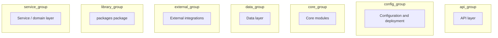

# Architecture report: meetalva/alva

> Automated static analysis. **Observed** = directly seen in files/imports/AST; **Inferred** = interpretation from that evidence. Repository code was not executed.

## 1. Repository at a glance

| Item | Value |
| --- | --- |
| Repository | meetalva/alva |
| Description | Create living prototypes with code components. |
| Language | TypeScript |
| Stars | 3689 |
| Licence | MIT |
| Analysed commit / branch | bfdb6aef4a55b5d99ed154a1dcced1acf9aca894 / master |
| Framework(s) | Electron, Express, React |
| Files analysed | 641 |
| Components | 7 |

## 2. Architecture in one minute

meetalva/alva - Create living prototypes with code components.. This repository was analysed statically from 641 file(s) (0 Python). Detected technologies (observed from imports/manifests): Electron, Express, React, Jest, TypeScript, webpack. Files are grouped into 7 component(s): API layer, Configuration and deployment, Core modules, Data layer, External integrations, packages package, Service / domain layer. Findings below distinguish observed facts from inferred interpretation.

## 3. High-level block diagram

## 4. Main components

### API layer (`api_layer`)

- **Kind:** api
- **Status:** Observed
- **Confidence:** 0.85
- **Responsibility:** Groups 9 file(s) under api layer (observed from repository paths and static analysis).
- **Paths:** `packages/core/src/server/routes/context.ts`, `packages/core/src/server/routes/export.ts`, `packages/core/src/server/routes/index.ts`, `packages/core/src/server/routes/library.ts`, `packages/core/src/server/routes/main.tsx`, `packages/core/src/server/routes/preview.ts`, `packages/core/src/server/routes/project-store.ts`, `packages/core/src/server/routes/project.ts`, `packages/core/src/server/routes/scripts.ts`
- **Evidence:** [packages/core/src/server/routes/context.ts](https://github.com/meetalva/alva/blob/bfdb6aef4a55b5d99ed154a1dcced1acf9aca894/packages/core/src/server/routes/context.ts); [packages/core/src/server/routes/export.ts](https://github.com/meetalva/alva/blob/bfdb6aef4a55b5d99ed154a1dcced1acf9aca894/packages/core/src/server/routes/export.ts); [packages/core/src/server/routes/index.ts](https://github.com/meetalva/alva/blob/bfdb6aef4a55b5d99ed154a1dcced1acf9aca894/packages/core/src/server/routes/index.ts); [packages/core/src/server/routes/library.ts](https://github.com/meetalva/alva/blob/bfdb6aef4a55b5d99ed154a1dcced1acf9aca894/packages/core/src/server/routes/library.ts); [packages/core/src/server/routes/main.tsx](https://github.com/meetalva/alva/blob/bfdb6aef4a55b5d99ed154a1dcced1acf9aca894/packages/core/src/server/routes/main.tsx); [packages/core/src/server/routes/preview.ts](https://github.com/meetalva/alva/blob/bfdb6aef4a55b5d99ed154a1dcced1acf9aca894/packages/core/src/server/routes/preview.ts); [packages/core/src/server/routes/project-store.ts](https://github.com/meetalva/alva/blob/bfdb6aef4a55b5d99ed154a1dcced1acf9aca894/packages/core/src/server/routes/project-store.ts); [packages/core/src/server/routes/project.ts](https://github.com/meetalva/alva/blob/bfdb6aef4a55b5d99ed154a1dcced1acf9aca894/packages/core/src/server/routes/project.ts)

### Configuration and deployment (`config`)

- **Kind:** config
- **Status:** Observed
- **Confidence:** 0.85
- **Responsibility:** Groups 72 file(s) under configuration and deployment (observed from repository paths and static analysis).
- **Paths:** `lerna.json`, `package.json`, `packages/analyzer-cli/package.json`, `packages/analyzer-cli/tsconfig.json`, `packages/analyzer/package.json`, `packages/analyzer/tsconfig.json`, `packages/components/package.json`, `packages/components/src/add-button/pattern.json`, `packages/components/src/badge-icon/pattern.json`, `packages/components/src/button/pattern.json`, `packages/components/src/chrome-button/pattern.json`, `packages/components/src/chrome/pattern.json`, `packages/components/src/colors/pattern.json`, `packages/components/src/copy/pattern.json`, `packages/components/src/drag-area/pattern.json`, `packages/components/src/editable-title/pattern.json`, `packages/components/src/element-slot/pattern.json`, `packages/components/src/element/pattern.json`, `packages/components/src/empty-state/pattern.json`, `packages/components/src/fonts/pattern.json`, `packages/components/src/headline/pattern.json`, `packages/components/src/icons/pattern.json`, `packages/components/src/image/pattern.json`, `packages/components/src/layout-switch/pattern.json`, `packages/components/src/layout/pattern.json`, `packages/components/src/library-box/pattern.json`, `packages/components/src/link-icon/pattern.json`, `packages/components/src/link/pattern.json`, `packages/components/src/list/pattern.json`, `packages/components/src/page-tile/pattern.json`, `packages/components/src/pattern-list/pattern.json`, `packages/components/src/property-box/pattern.json`, `packages/components/src/property-details/pattern.json`, `packages/components/src/property-item-asset/pattern.json`, `packages/components/src/property-item-boolean/pattern.json`, `packages/components/src/property-item-buttongroup/pattern.json`, `packages/components/src/property-item-color/pattern.json`, `packages/components/src/property-item-number/pattern.json`, `packages/components/src/property-item-select/pattern.json`, `packages/components/src/property-item-string/pattern.json`, `packages/components/src/search/pattern.json`, `packages/components/src/select/pattern.json`, `packages/components/src/space/pattern.json`, `packages/components/src/splash-screen/pattern.json`, `packages/components/src/tab/pattern.json`, `packages/components/src/teaser/pattern.json`, `packages/components/src/view-switch/pattern.json`, `packages/components/tsconfig.json`, `packages/core/dev-app-update.yml`, `packages/core/package.json`, `packages/core/package.ncc.json`, `packages/core/tsconfig.json`, `packages/core/tslint.json`, `packages/essentials/package.json`, `packages/essentials/tsconfig.json`, `packages/message/package.json`, `packages/message/tsconfig.json`, `packages/model-tree/package.json`, `packages/model-tree/tsconfig.json`, `packages/model/package.json`, `packages/model/tsconfig.json`, `packages/site/package.json`, `packages/site/tsconfig.json`, `packages/tools/package.json`, `packages/tools/tsconfig.json`, `packages/types/package.json`, `packages/types/tsconfig.json`, `packages/util/package.json`, `packages/util/tsconfig.json`, `renovate.json`, `tsconfig.json`, `tslint.json`
- **Evidence:** [lerna.json](https://github.com/meetalva/alva/blob/bfdb6aef4a55b5d99ed154a1dcced1acf9aca894/lerna.json); [package.json](https://github.com/meetalva/alva/blob/bfdb6aef4a55b5d99ed154a1dcced1acf9aca894/package.json); [packages/analyzer-cli/package.json](https://github.com/meetalva/alva/blob/bfdb6aef4a55b5d99ed154a1dcced1acf9aca894/packages/analyzer-cli/package.json); [packages/analyzer-cli/tsconfig.json](https://github.com/meetalva/alva/blob/bfdb6aef4a55b5d99ed154a1dcced1acf9aca894/packages/analyzer-cli/tsconfig.json); [packages/analyzer/package.json](https://github.com/meetalva/alva/blob/bfdb6aef4a55b5d99ed154a1dcced1acf9aca894/packages/analyzer/package.json); [packages/analyzer/tsconfig.json](https://github.com/meetalva/alva/blob/bfdb6aef4a55b5d99ed154a1dcced1acf9aca894/packages/analyzer/tsconfig.json); [packages/components/package.json](https://github.com/meetalva/alva/blob/bfdb6aef4a55b5d99ed154a1dcced1acf9aca894/packages/components/package.json); [packages/components/src/add-button/pattern.json](https://github.com/meetalva/alva/blob/bfdb6aef4a55b5d99ed154a1dcced1acf9aca894/packages/components/src/add-button/pattern.json)

### Core modules (`core`)

- **Kind:** core
- **Status:** Observed
- **Confidence:** 0.85
- **Responsibility:** Groups 4 file(s) under core modules (observed from repository paths and static analysis).
- **Paths:** `commitlint.config.js`, `jest.config.js`, `patternplate.config.js`, `webpack.config.js`
- **Evidence:** [commitlint.config.js](https://github.com/meetalva/alva/blob/bfdb6aef4a55b5d99ed154a1dcced1acf9aca894/commitlint.config.js); [jest.config.js](https://github.com/meetalva/alva/blob/bfdb6aef4a55b5d99ed154a1dcced1acf9aca894/jest.config.js); [patternplate.config.js](https://github.com/meetalva/alva/blob/bfdb6aef4a55b5d99ed154a1dcced1acf9aca894/patternplate.config.js); [webpack.config.js](https://github.com/meetalva/alva/blob/bfdb6aef4a55b5d99ed154a1dcced1acf9aca894/webpack.config.js)

### Data layer (`data_layer`)

- **Kind:** data
- **Status:** Observed
- **Confidence:** 0.85
- **Responsibility:** Groups 2 file(s) under data layer (observed from repository paths and static analysis).
- **Paths:** `packages/core/src/persistence/index.ts`, `packages/core/src/persistence/persistence.ts`
- **Evidence:** [packages/core/src/persistence/index.ts](https://github.com/meetalva/alva/blob/bfdb6aef4a55b5d99ed154a1dcced1acf9aca894/packages/core/src/persistence/index.ts); [packages/core/src/persistence/persistence.ts](https://github.com/meetalva/alva/blob/bfdb6aef4a55b5d99ed154a1dcced1acf9aca894/packages/core/src/persistence/persistence.ts)

### External integrations (`external_integrations`)

- **Kind:** external
- **Status:** Observed
- **Confidence:** 0.85
- **Responsibility:** Groups 7 file(s) under external integrations (observed from repository paths and static analysis).
- **Paths:** `packages/core/src/adapters/browser-adapter.ts`, `packages/core/src/adapters/electron-adapter/electron-adapter.test.ts`, `packages/core/src/adapters/electron-adapter/electron-adapter.ts`, `packages/core/src/adapters/electron-adapter/electron-main-menu.ts`, `packages/core/src/adapters/electron-adapter/electron-updater.ts`, `packages/core/src/adapters/electron-adapter/index.ts`, `packages/core/src/adapters/node-adapter.ts`
- **Evidence:** [packages/core/src/adapters/browser-adapter.ts](https://github.com/meetalva/alva/blob/bfdb6aef4a55b5d99ed154a1dcced1acf9aca894/packages/core/src/adapters/browser-adapter.ts); [packages/core/src/adapters/electron-adapter/electron-adapter.test.ts](https://github.com/meetalva/alva/blob/bfdb6aef4a55b5d99ed154a1dcced1acf9aca894/packages/core/src/adapters/electron-adapter/electron-adapter.test.ts); [packages/core/src/adapters/electron-adapter/electron-adapter.ts](https://github.com/meetalva/alva/blob/bfdb6aef4a55b5d99ed154a1dcced1acf9aca894/packages/core/src/adapters/electron-adapter/electron-adapter.ts); [packages/core/src/adapters/electron-adapter/electron-main-menu.ts](https://github.com/meetalva/alva/blob/bfdb6aef4a55b5d99ed154a1dcced1acf9aca894/packages/core/src/adapters/electron-adapter/electron-main-menu.ts); [packages/core/src/adapters/electron-adapter/electron-updater.ts](https://github.com/meetalva/alva/blob/bfdb6aef4a55b5d99ed154a1dcced1acf9aca894/packages/core/src/adapters/electron-adapter/electron-updater.ts); [packages/core/src/adapters/electron-adapter/index.ts](https://github.com/meetalva/alva/blob/bfdb6aef4a55b5d99ed154a1dcced1acf9aca894/packages/core/src/adapters/electron-adapter/index.ts); [packages/core/src/adapters/node-adapter.ts](https://github.com/meetalva/alva/blob/bfdb6aef4a55b5d99ed154a1dcced1acf9aca894/packages/core/src/adapters/node-adapter.ts)

### packages package (`packages`)

- **Kind:** library
- **Status:** Observed
- **Confidence:** 0.85
- **Responsibility:** Groups 307 file(s) under packages package (observed from repository paths and static analysis).
- **Paths:** `packages/analyzer-cli/bin/analyze.js`, `packages/analyzer-cli/src/bin/analyze.ts`, `packages/analyzer/index.d.ts`, `packages/analyzer/index.js`, `packages/analyzer/src/compiler/compiler-safe-name.ts`, `packages/analyzer/src/compiler/create-compiler.ts`, `packages/analyzer/src/compiler/index.ts`, `packages/analyzer/src/fixtures/children.tsx`, `packages/analyzer/src/fixtures/enum-member-name.ts`, `packages/analyzer/src/fixtures/enum.ts`, `packages/analyzer/src/fixtures/export-infos-class-metadata.tsx`, `packages/analyzer/src/fixtures/export-infos-class.tsx`, `packages/analyzer/src/fixtures/export-infos-default-metadata.tsx`, `packages/analyzer/src/fixtures/export-infos-default.tsx`, `packages/analyzer/src/fixtures/export-infos-export-declaration-metadata.d.ts`, `packages/analyzer/src/fixtures/export-infos-export-declaration-metadata.js`, `packages/analyzer/src/fixtures/export-infos-export-declaration.d.ts`, `packages/analyzer/src/fixtures/export-infos-export-declaration.js`, `packages/analyzer/src/fixtures/export-infos-variable-metadata.tsx`, `packages/analyzer/src/fixtures/export-infos-variable.tsx`, `packages/analyzer/src/fixtures/prop-any.ts`, `packages/analyzer/src/fixtures/prop-event-function.ts`, `packages/analyzer/src/fixtures/prop-event-handler.ts`, `packages/analyzer/src/fixtures/prop-event-method.ts`, `packages/analyzer/src/fixtures/prop-generic-event-handler.ts`, `packages/analyzer/src/fixtures/prop-slots.tsx`, `packages/analyzer/src/fixtures/shared-properties-ab.ts`, `packages/analyzer/src/fixtures/shared-properties-c.ts`, `packages/analyzer/src/fixtures/string-enum.ts`, `packages/analyzer/src/get-package.ts`, `packages/analyzer/src/id-hasher.ts`, `packages/analyzer/src/index.ts`, `packages/analyzer/src/react-utils/find-react-component-type.ts`, `packages/analyzer/src/react-utils/get-event-type.test.ts`, `packages/analyzer/src/react-utils/get-event-type.ts`, `packages/analyzer/src/react-utils/get-react-slot-type.ts`, `packages/analyzer/src/react-utils/has-react-typings.ts`, `packages/analyzer/src/react-utils/index.ts`, `packages/analyzer/src/react-utils/is-react-component-type.ts`, `packages/analyzer/src/react-utils/is-react-event-handler-type.test.ts`, `packages/analyzer/src/react-utils/is-react-event-handler-type.ts`, `packages/analyzer/src/react-utils/is-react-slot-type.test.ts`, `packages/analyzer/src/react-utils/is-react-slot-type.ts`, `packages/analyzer/src/react-utils/uses-children.test.ts`, `packages/analyzer/src/react-utils/uses-children.ts`, `packages/analyzer/src/test-utils.ts`, `packages/analyzer/src/typescript-react-analyzer/fixtures/props-comments.ts`, `packages/analyzer/src/typescript-react-analyzer/fixtures/props-slot-defaults.tsx`, `packages/analyzer/src/typescript-react-analyzer/index.ts`, `packages/analyzer/src/typescript-react-analyzer/property-analyzer/create-enum-property.test.ts`, `packages/analyzer/src/typescript-react-analyzer/property-analyzer/create-enum-property.ts`, `packages/analyzer/src/typescript-react-analyzer/property-analyzer/index.ts`, `packages/analyzer/src/typescript-react-analyzer/property-analyzer/property-analyzer.ts`, `packages/analyzer/src/typescript-react-analyzer/property-analyzer/property-creators.ts`, `packages/analyzer/src/typescript-react-analyzer/property-analyzer/types.ts`, `packages/analyzer/src/typescript-react-analyzer/slot-analyzer.test.ts`, `packages/analyzer/src/typescript-react-analyzer/slot-analyzer.ts`, `packages/analyzer/src/typescript-react-analyzer/slot-default-analyzer.test.ts`, `packages/analyzer/src/typescript-react-analyzer/slot-default-analyzer.ts`, `packages/analyzer/src/typescript-react-analyzer/typescript-react-analyzer.test.ts`, `packages/analyzer/src/typescript-react-analyzer/typescript-react-analyzer.ts`, `packages/analyzer/src/typescript-utils/find-declaration.ts`, `packages/analyzer/src/typescript-utils/find-type-declaration.ts`, `packages/analyzer/src/typescript-utils/get-export-infos.test.ts`, `packages/analyzer/src/typescript-utils/get-export-infos.ts`, `packages/analyzer/src/typescript-utils/get-exported-node.test.ts`, `packages/analyzer/src/typescript-utils/get-exported-node.ts`, `packages/analyzer/src/typescript-utils/get-exports.ts`, `packages/analyzer/src/typescript-utils/get-tsa-export.ts`, `packages/analyzer/src/typescript-utils/index.ts`, `packages/analyzer/src/typescript-utils/is-export.ts`, `packages/analyzer/src/typescript-utils/is-type-reference.ts`, `packages/analyzer/src/typescript-utils/is-union-type.ts`, `packages/analyzer/src/typescript-utils/jsdoc.ts`, `packages/analyzer/src/typescript-utils/set-extname.ts`, `packages/analyzer/src/typescript-utils/typescript-export.ts`, `packages/analyzer/src/typescript-utils/typescript-type.ts`, `packages/components/index.d.ts`, `packages/components/index.js`, `packages/components/src/add-button/demo.tsx`, `packages/components/src/add-button/index.tsx`, `packages/components/src/badge-icon/demo.tsx`, `packages/components/src/badge-icon/index.tsx`, `packages/components/src/button-group/index.tsx`, `packages/components/src/button/demo.tsx`, `packages/components/src/button/index.tsx`, `packages/components/src/chrome-button/demo.tsx`, `packages/components/src/chrome-button/index.tsx`, `packages/components/src/chrome/demo.tsx`, `packages/components/src/chrome/index.tsx`, `packages/components/src/colors/index.tsx`, `packages/components/src/copy/demo.tsx`, `packages/components/src/copy/index.tsx`, `packages/components/src/create-select/create-select.tsx`, `packages/components/src/create-select/index.tsx`, `packages/components/src/demo-container.tsx`, `packages/components/src/drag-area/demo.tsx`, `packages/components/src/drag-area/drag-area.tsx`, `packages/components/src/drag-area/index.tsx`, `packages/components/src/drag-area/target-signal.tsx`, `packages/components/src/editable-title/demo.tsx`, `packages/components/src/editable-title/index.tsx`, `packages/components/src/element-slot/demo.tsx`, `packages/components/src/element-slot/element-slot.tsx`, `packages/components/src/element-slot/index.tsx`, `packages/components/src/element/demo.tsx`, `packages/components/src/element/element.tsx`, `packages/components/src/element/index.tsx`, `packages/components/src/empty-state/demo.tsx`, `packages/components/src/empty-state/index.tsx`, `packages/components/src/flex.tsx`, `packages/components/src/fonts/index.tsx`, `packages/components/src/global-styles.tsx`, `packages/components/src/headline/demo.tsx`, `packages/components/src/headline/index.tsx`, `packages/components/src/icons/demo.tsx`, `packages/components/src/icons/index.tsx`, `packages/components/src/image/demo.tsx`, `packages/components/src/image/index.tsx`, `packages/components/src/index.ts`, `packages/components/src/input-button/index.tsx`, `packages/components/src/item/index.ts`, `packages/components/src/item/item.styles.ts`, `packages/components/src/item/item.tsx`, `packages/components/src/layout-switch/index.tsx`, `packages/components/src/layout-switch/layout-switch.tsx`, `packages/components/src/layout/demo.tsx`, `packages/components/src/layout/index.tsx`, `packages/components/src/library-box/demo.tsx`, `packages/components/src/library-box/index.tsx`, `packages/components/src/library-box/library-box.tsx`, `packages/components/src/library-box/library-image.tsx`, `packages/components/src/link-icon/demo.tsx`, `packages/components/src/link-icon/index.tsx`, `packages/components/src/link/demo.tsx`, `packages/components/src/link/index.tsx`, `packages/components/src/list/demo.tsx`, `packages/components/src/list/index.tsx`, `packages/components/src/page-tile/demo.tsx`, `packages/components/src/page-tile/index.tsx`, `packages/components/src/panes/element-pane/index.tsx`, `packages/components/src/panes/index.ts`, `packages/components/src/panes/patterns-pane/index.tsx`, `packages/components/src/panes/preview-pane/index.tsx`, `packages/components/src/panes/project-pane/index.tsx`, `packages/components/src/panes/property-pane/index.tsx`, `packages/components/src/pattern-list/demo.tsx`, `packages/components/src/pattern-list/index.tsx`, `packages/components/src/property-box/index.tsx`, `packages/components/src/property-details/demo.tsx`, `packages/components/src/property-details/index.tsx`, `packages/components/src/property-input/index.tsx`, `packages/components/src/property-item-asset/demo.tsx`, `packages/components/src/property-item-asset/index.tsx`, `packages/components/src/property-item-boolean/demo.tsx`, `packages/components/src/property-item-boolean/index.tsx`, `packages/components/src/property-item-buttongroup/demo.tsx`, `packages/components/src/property-item-buttongroup/index.tsx`, `packages/components/src/property-item-color/index.tsx`, `packages/components/src/property-item-color/property-item-color.tsx`, `packages/components/src/property-item-number/demo.tsx`, `packages/components/src/property-item-number/index.tsx`, `packages/components/src/property-item-number/property-item-number.test.tsx`, `packages/components/src/property-item-number/property-item-number.tsx`, `packages/components/src/property-item-select/demo.tsx`, `packages/components/src/property-item-select/index.tsx`, `packages/components/src/property-item-string/demo.tsx`, `packages/components/src/property-item-string/index.tsx`, `packages/components/src/property-item/index.tsx`, `packages/components/src/property-item/property-description.tsx`, `packages/components/src/property-item/property-item.tsx`, `packages/components/src/property-item/property-label.tsx`, `packages/components/src/property-reference/index.tsx`, `packages/components/src/search/demo.tsx`, `packages/components/src/search/index.tsx`, `packages/components/src/select/demo.tsx`, `packages/components/src/select/index.tsx`, `packages/components/src/space/demo.tsx`, `packages/components/src/space/index.tsx`, `packages/components/src/spinner/index.tsx`, `packages/components/src/splash-screen/index.tsx`, `packages/components/src/splash-screen/splash-screen.styles.ts`, `packages/components/src/splash-screen/splash-screen.tsx`, `packages/components/src/tab-switch.tsx`, `packages/components/src/tab/demo.tsx`, `packages/components/src/tab/index.tsx`, `packages/components/src/teaser/demo.tsx`, `packages/components/src/teaser/index.tsx`, `packages/components/src/teaser/teaser.tsx`, `packages/components/src/update-badge/index.ts`, `packages/components/src/update-badge/update-badge.styles.tsx`, `packages/components/src/update-badge/update-badge.tsx`, `packages/components/src/view-switch/demo.tsx`, `packages/components/src/view-switch/index.tsx`, `packages/essentials/src/box.tsx`, `packages/essentials/src/conditional.tsx`, `packages/essentials/src/image.tsx`, `packages/essentials/src/index.ts`, `packages/essentials/src/link.tsx`, `packages/essentials/src/page.tsx`, `packages/essentials/src/text.tsx`, `packages/message/index.d.ts`, `packages/message/index.js`, `packages/message/src/envelope.ts`, `packages/message/src/index.ts`, `packages/message/src/message.ts`, `packages/message/src/request-response.ts`, `packages/model-tree/index.d.ts`, `packages/model-tree/index.js`, `packages/model-tree/src/index.ts`, `packages/model-tree/src/model-tree.ts`, `packages/model/index.d.ts`, `packages/model/index.js`, `packages/model/src/alva-app.ts`, `packages/model/src/any-model.ts`, `packages/model/src/design-time-user-store.ts`, `packages/model/src/edit-history/edit-history-commit.ts`, `packages/model/src/edit-history/edit-history-stage.ts`, `packages/model/src/edit-history/edit-history.test.ts`, `packages/model/src/edit-history/edit-history.ts`, `packages/model/src/edit-history/index.ts`, `packages/model/src/edit-history/revert.ts`, `packages/model/src/element-action.ts`, `packages/model/src/element/element-content.ts`, `packages/model/src/element/element-property/element-property.ts`, `packages/model/src/element/element-property/index.ts`, `packages/model/src/element/element.test.ts`, `packages/model/src/element/element.ts`, `packages/model/src/element/index.ts`, `packages/model/src/index.ts`, `packages/model/src/library-data.ts`, `packages/model/src/library-store-item.ts`, `packages/model/src/library-store.ts`, `packages/model/src/page/index.ts`, `packages/model/src/page/page.ts`, `packages/model/src/pattern-library-file.ts`, `packages/model/src/pattern-library/builtin-pattern-library.ts`, `packages/model/src/pattern-library/index.ts`, `packages/model/src/pattern-library/pattern-library.ts`, `packages/model/src/pattern-property/asset-property.ts`, `packages/model/src/pattern-property/boolean-property.ts`, `packages/model/src/pattern-property/enum-property.test.ts`, `packages/model/src/pattern-property/enum-property.ts`, `packages/model/src/pattern-property/event-handler-property.ts`, `packages/model/src/pattern-property/href-property.ts`, `packages/model/src/pattern-property/index.ts`, `packages/model/src/pattern-property/number-property.test.ts`, `packages/model/src/pattern-property/number-property.ts`, `packages/model/src/pattern-property/property-base.ts`, `packages/model/src/pattern-property/property.ts`, `packages/model/src/pattern-property/string-property.test.ts`, `packages/model/src/pattern-property/string-property.ts`, `packages/model/src/pattern-property/unknown-property.test.ts`, `packages/model/src/pattern-property/unknown-property.ts`, `packages/model/src/pattern-search.ts`, `packages/model/src/pattern/index.ts`, `packages/model/src/pattern/pattern-slot.ts`, `packages/model/src/pattern/pattern.ts`, `packages/model/src/project.test.ts`, `packages/model/src/project.ts`, `packages/model/src/user-store-action/index.ts`, `packages/model/src/user-store-action/user-store-action.ts`, `packages/model/src/user-store-enhancer.ts`, `packages/model/src/user-store-property/index.ts`, `packages/model/src/user-store-property/user-store-property.ts`, `packages/model/src/user-store-reference.ts`, `packages/model/src/user-store.ts`, `packages/site/src/cookie-notice.tsx`, `packages/site/src/global-css.ts`, `packages/site/src/graphik-web.ts`, `packages/site/src/releases.tsx`, `packages/site/src/render.ts`, `packages/site/src/site.tsx`, `packages/tools/alva-dependencies.js`, `packages/tools/alva-deploy.js`, `packages/tools/alva-release.js`, `packages/tools/alva-trigger.js`, `packages/tools/alva-version.js`, `packages/tools/src/check-dependencies.ts`, `packages/types/index.d.ts`, `packages/types/index.js`, `packages/types/src/export.ts`, `packages/types/src/hosts.ts`, `packages/types/src/index.ts`, `packages/types/src/menu.ts`, `packages/types/src/mobx.ts`, `packages/types/src/pattern-property.ts`, `packages/types/src/persistence.ts`, `packages/types/src/sender.ts`, `packages/types/src/serialized-model.ts`, `packages/types/src/server.ts`, `packages/types/src/types.ts`, `packages/types/src/updater.ts`, `packages/types/src/user-store.ts`, `packages/util/index.d.ts`, `packages/util/index.js`, `packages/util/src/compute-difference.ts`, `packages/util/src/drag-and-drop.ts`, `packages/util/src/ensure-array.ts`, `packages/util/src/index.ts`, `packages/util/src/mkdirp.ts`, `packages/util/src/new-issue-url.ts`, `packages/util/src/noop.ts`, `packages/util/src/parse-json.ts`, `packages/util/src/set-search.ts`, `packages/util/src/target.ts`, `packages/util/src/to-json.ts`
- **Evidence:** [packages/analyzer-cli/bin/analyze.js](https://github.com/meetalva/alva/blob/bfdb6aef4a55b5d99ed154a1dcced1acf9aca894/packages/analyzer-cli/bin/analyze.js); [packages/analyzer-cli/src/bin/analyze.ts](https://github.com/meetalva/alva/blob/bfdb6aef4a55b5d99ed154a1dcced1acf9aca894/packages/analyzer-cli/src/bin/analyze.ts); [packages/analyzer/index.d.ts](https://github.com/meetalva/alva/blob/bfdb6aef4a55b5d99ed154a1dcced1acf9aca894/packages/analyzer/index.d.ts); [packages/analyzer/index.js](https://github.com/meetalva/alva/blob/bfdb6aef4a55b5d99ed154a1dcced1acf9aca894/packages/analyzer/index.js); [packages/analyzer/src/compiler/compiler-safe-name.ts](https://github.com/meetalva/alva/blob/bfdb6aef4a55b5d99ed154a1dcced1acf9aca894/packages/analyzer/src/compiler/compiler-safe-name.ts); [packages/analyzer/src/compiler/create-compiler.ts](https://github.com/meetalva/alva/blob/bfdb6aef4a55b5d99ed154a1dcced1acf9aca894/packages/analyzer/src/compiler/create-compiler.ts); [packages/analyzer/src/compiler/index.ts](https://github.com/meetalva/alva/blob/bfdb6aef4a55b5d99ed154a1dcced1acf9aca894/packages/analyzer/src/compiler/index.ts); [packages/analyzer/src/fixtures/children.tsx](https://github.com/meetalva/alva/blob/bfdb6aef4a55b5d99ed154a1dcced1acf9aca894/packages/analyzer/src/fixtures/children.tsx)

### Service / domain layer (`service_layer`)

- **Kind:** service
- **Status:** Observed
- **Confidence:** 0.85
- **Responsibility:** Groups 184 file(s) under service / domain layer (observed from repository paths and static analysis).
- **Paths:** `packages/core/bin/alva.js`, `packages/core/src/bin/alva.ts`, `packages/core/src/bin/analyze.ts`, `packages/core/src/bin/electron.ts`, `packages/core/src/bin/node.ts`, `packages/core/src/bin/static/build.ts`, `packages/core/src/bin/static/index.ts`, `packages/core/src/bin/static/static.ts`, `packages/core/src/container/app-pane.tsx`, `packages/core/src/container/app-view.tsx`, `packages/core/src/container/app.tsx`, `packages/core/src/container/chrome/chrome-container.tsx`, `packages/core/src/container/chrome/chrome-switch.tsx`, `packages/core/src/container/connect-pane-container.tsx`, `packages/core/src/container/dragged-element-image.tsx`, `packages/core/src/container/editable-title/editable-title-container.tsx`, `packages/core/src/container/element-drag-image.tsx`, `packages/core/src/container/element-list/element-container.tsx`, `packages/core/src/container/element-list/element-content-container.tsx`, `packages/core/src/container/element-list/element-list.test.tsx`, `packages/core/src/container/element-list/element-list.tsx`, `packages/core/src/container/element-list/element-slot-container.tsx`, `packages/core/src/container/element-list/index.tsx`, `packages/core/src/container/file-input.tsx`, `packages/core/src/container/library-store-container.tsx`, `packages/core/src/container/library-store-item-container.tsx`, `packages/core/src/container/match.tsx`, `packages/core/src/container/menu/accelerator.tsx`, `packages/core/src/container/menu/context-menu.tsx`, `packages/core/src/container/menu/index.ts`, `packages/core/src/container/menu/menu.tsx`, `packages/core/src/container/page-list/page-list-container.tsx`, `packages/core/src/container/page-list/page-tile-container.tsx`, `packages/core/src/container/pane-development-editor.tsx`, `packages/core/src/container/pattern-list/index.tsx`, `packages/core/src/container/pattern-list/pattern-item-container.tsx`, `packages/core/src/container/pattern-list/pattern-list-container.tsx`, `packages/core/src/container/preview-pane-wrapper.tsx`, `packages/core/src/container/property-list/action-payload-input.tsx`, `packages/core/src/container/property-list/action-payload-select.tsx`, `packages/core/src/container/property-list/index.tsx`, `packages/core/src/container/property-list/property-item-asset.tsx`, `packages/core/src/container/property-list/property-item-boolean.tsx`, `packages/core/src/container/property-list/property-item-button-group.tsx`, `packages/core/src/container/property-list/property-item-color.tsx`, `packages/core/src/container/property-list/property-item-enum.tsx`, `packages/core/src/container/property-list/property-item-event.tsx`, `packages/core/src/container/property-list/property-item-number.tsx`, `packages/core/src/container/property-list/property-item-string.tsx`, `packages/core/src/container/property-list/property-list-item.tsx`, `packages/core/src/container/property-list/property-list-virtual.tsx`, `packages/core/src/container/property-list/property-list.test.tsx`, `packages/core/src/container/property-list/property-list.tsx`, `packages/core/src/container/property-list/property-row.tsx`, `packages/core/src/container/property-list/property-unknown-editor-skeleton.tsx`, `packages/core/src/container/property-list/property-unknown-editor.tsx`, `packages/core/src/container/property-list/reference-select.tsx`, `packages/core/src/container/property-list/reference.tsx`, `packages/core/src/container/recent-files-list.tsx`, `packages/core/src/container/splash-screen-container.tsx`, `packages/core/src/container/splash-screen-view.tsx`, `packages/core/src/container/user-store-property-select.tsx`, `packages/core/src/container/view-details.tsx`, `packages/core/src/container/when.tsx`, `packages/core/src/context-menu/element-menu.ts`, `packages/core/src/context-menu/index.ts`, `packages/core/src/export/export-html-project.ts`, `packages/core/src/export/index.ts`, `packages/core/src/hosts/browser-data-host.ts`, `packages/core/src/hosts/browser-host.tsx`, `packages/core/src/hosts/electron-host/create-window-preload.ts`, `packages/core/src/hosts/electron-host/create-window.ts`, `packages/core/src/hosts/electron-host/electron-host.ts`, `packages/core/src/hosts/electron-host/index.ts`, `packages/core/src/hosts/index.ts`, `packages/core/src/hosts/local-data-host.ts`, `packages/core/src/hosts/node-host/index.ts`, `packages/core/src/hosts/restart-listener.ts`, `packages/core/src/matchers/add-app.ts`, `packages/core/src/matchers/browser.ts`, `packages/core/src/matchers/connect-npm-pattern-library-request.ts`, `packages/core/src/matchers/connect-pattern-library-request.ts`, `packages/core/src/matchers/context.ts`, `packages/core/src/matchers/copy.ts`, `packages/core/src/matchers/create-new-file-request.ts`, `packages/core/src/matchers/cut.ts`, `packages/core/src/matchers/export-html-project.ts`, `packages/core/src/matchers/index.ts`, `packages/core/src/matchers/open-asset.ts`, `packages/core/src/matchers/open-external-url.ts`, `packages/core/src/matchers/open-file-request.ts`, `packages/core/src/matchers/open-remote-file-request.ts`, `packages/core/src/matchers/open-window.ts`, `packages/core/src/matchers/paste.ts`, `packages/core/src/matchers/save-as.ts`, `packages/core/src/matchers/save.ts`, `packages/core/src/matchers/show-context-menu.ts`, `packages/core/src/matchers/show-error.ts`, `packages/core/src/matchers/show-message.test.ts`, `packages/core/src/matchers/show-message.ts`, `packages/core/src/matchers/show-update-details.ts`, `packages/core/src/matchers/update-npm-pattern-library-request.ts`, `packages/core/src/matchers/update-pattern-library-request.ts`, `packages/core/src/matchers/use-file-request.ts`, `packages/core/src/matchers/use-file-response.ts`, `packages/core/src/menu/app-menu.ts`, `packages/core/src/menu/context.ts`, `packages/core/src/menu/edit-menu.ts`, `packages/core/src/menu/file-menu.tsx`, `packages/core/src/menu/help-menu.ts`, `packages/core/src/menu/index.ts`, `packages/core/src/menu/view-menu.ts`, `packages/core/src/menu/window-menu.ts`, `packages/core/src/migrator/abstract-migration.ts`, `packages/core/src/migrator/index.ts`, `packages/core/src/migrator/migration-v0-v1.test.ts`, `packages/core/src/migrator/migration-v0-v1.ts`, `packages/core/src/migrator/migration-v1-v2.test.ts`, `packages/core/src/migrator/migration-v1-v2.ts`, `packages/core/src/migrator/migration-v2-v3.test.ts`, `packages/core/src/migrator/migration-v2-v3.ts`, `packages/core/src/migrator/migrator.ts`, `packages/core/src/preview-document/index.ts`, `packages/core/src/preview-document/preview-document.ts`, `packages/core/src/preview-document/sketch-document.ts`, `packages/core/src/preview-document/static-document.ts`, `packages/core/src/preview-renderer/index.ts`, `packages/core/src/preview-renderer/preview-application.tsx`, `packages/core/src/preview-renderer/preview-component-error.tsx`, `packages/core/src/preview-renderer/preview-component.tsx`, `packages/core/src/preview-renderer/preview-renderer.tsx`, `packages/core/src/preview/element-area.ts`, `packages/core/src/preview/get-components.ts`, `packages/core/src/preview/get-initial-data.ts`, `packages/core/src/preview/preview-store.test.ts`, `packages/core/src/preview/preview-store.ts`, `packages/core/src/preview/preview.ts`, `packages/core/src/preview/test.ts`, `packages/core/src/renderer/create-handlers.ts`, `packages/core/src/renderer/create-listeners.ts`, `packages/core/src/renderer/create-notifiers.ts`, `packages/core/src/renderer/edit-handlers/cut.ts`, `packages/core/src/renderer/edit-handlers/delete-selected.ts`, `packages/core/src/renderer/edit-handlers/duplicate-element.ts`, `packages/core/src/renderer/edit-handlers/duplicate-selected.ts`, `packages/core/src/renderer/edit-handlers/index.ts`, `packages/core/src/renderer/edit-handlers/paste-element.ts`, `packages/core/src/renderer/edit-handlers/paste-page.ts`, `packages/core/src/renderer/edit-handlers/redo.ts`, `packages/core/src/renderer/edit-handlers/remove-element.ts`, `packages/core/src/renderer/edit-handlers/undo.ts`, `packages/core/src/renderer/index.tsx`, `packages/core/src/renderer/message-handlers/activate-page.ts`, `packages/core/src/renderer/message-handlers/app-request.ts`, `packages/core/src/renderer/message-handlers/change-user-store.ts`, `packages/core/src/renderer/message-handlers/check-pattern-library.ts`, `packages/core/src/renderer/message-handlers/connect-pattern-library.ts`, `packages/core/src/renderer/message-handlers/create-new-page.ts`, `packages/core/src/renderer/message-handlers/highlight-element.ts`, `packages/core/src/renderer/message-handlers/index.ts`, `packages/core/src/renderer/message-handlers/keyboard-change.ts`, `packages/core/src/renderer/message-handlers/log.ts`, `packages/core/src/renderer/message-handlers/project-records-changed.ts`, `packages/core/src/renderer/message-handlers/project-request.ts`, `packages/core/src/renderer/message-handlers/save.ts`, `packages/core/src/renderer/message-handlers/select-element.ts`, `packages/core/src/renderer/message-handlers/set-pane.ts`, `packages/core/src/renderer/message-handlers/start-app.ts`, `packages/core/src/renderer/message-handlers/update-downloaded.ts`, `packages/core/src/renderer/message-handlers/update-pattern-library-request.ts`, `packages/core/src/renderer/message-handlers/update-pattern-library.ts`, `packages/core/src/renderer/message-handlers/updating-pattern-library.ts`, `packages/core/src/renderer/renderer-document.ts`, `packages/core/src/renderer/renderer.tsx`, `packages/core/src/sender/index.ts`, `packages/core/src/sender/is-message-type.ts`, `packages/core/src/sender/is-message.ts`, `packages/core/src/sender/sender.ts`, `packages/core/src/sender/serde.ts`, `packages/core/src/server/index.ts`, `packages/core/src/server/server.ts`, `packages/core/src/store/index.ts`, `packages/core/src/store/menu-store.ts`, `packages/core/src/store/view-store.ts`
- **Evidence:** [packages/core/bin/alva.js](https://github.com/meetalva/alva/blob/bfdb6aef4a55b5d99ed154a1dcced1acf9aca894/packages/core/bin/alva.js); [packages/core/src/bin/alva.ts](https://github.com/meetalva/alva/blob/bfdb6aef4a55b5d99ed154a1dcced1acf9aca894/packages/core/src/bin/alva.ts); [packages/core/src/bin/analyze.ts](https://github.com/meetalva/alva/blob/bfdb6aef4a55b5d99ed154a1dcced1acf9aca894/packages/core/src/bin/analyze.ts); [packages/core/src/bin/electron.ts](https://github.com/meetalva/alva/blob/bfdb6aef4a55b5d99ed154a1dcced1acf9aca894/packages/core/src/bin/electron.ts); [packages/core/src/bin/node.ts](https://github.com/meetalva/alva/blob/bfdb6aef4a55b5d99ed154a1dcced1acf9aca894/packages/core/src/bin/node.ts); [packages/core/src/bin/static/build.ts](https://github.com/meetalva/alva/blob/bfdb6aef4a55b5d99ed154a1dcced1acf9aca894/packages/core/src/bin/static/build.ts); [packages/core/src/bin/static/index.ts](https://github.com/meetalva/alva/blob/bfdb6aef4a55b5d99ed154a1dcced1acf9aca894/packages/core/src/bin/static/index.ts); [packages/core/src/bin/static/static.ts](https://github.com/meetalva/alva/blob/bfdb6aef4a55b5d99ed154a1dcced1acf9aca894/packages/core/src/bin/static/static.ts)

## 5. Execution flow

**Observed** entry point(s):

- [packages/analyzer/index.js](https://github.com/meetalva/alva/blob/bfdb6aef4a55b5d99ed154a1dcced1acf9aca894/packages/analyzer/index.js)
- [packages/analyzer/src/index.ts](https://github.com/meetalva/alva/blob/bfdb6aef4a55b5d99ed154a1dcced1acf9aca894/packages/analyzer/src/index.ts)
- [packages/components/index.js](https://github.com/meetalva/alva/blob/bfdb6aef4a55b5d99ed154a1dcced1acf9aca894/packages/components/index.js)
- [packages/components/src/index.ts](https://github.com/meetalva/alva/blob/bfdb6aef4a55b5d99ed154a1dcced1acf9aca894/packages/components/src/index.ts)
- [packages/core/bin/alva.js](https://github.com/meetalva/alva/blob/bfdb6aef4a55b5d99ed154a1dcced1acf9aca894/packages/core/bin/alva.js)
- [packages/essentials/src/index.ts](https://github.com/meetalva/alva/blob/bfdb6aef4a55b5d99ed154a1dcced1acf9aca894/packages/essentials/src/index.ts)
- [packages/essentials/src/page.tsx](https://github.com/meetalva/alva/blob/bfdb6aef4a55b5d99ed154a1dcced1acf9aca894/packages/essentials/src/page.tsx)
- [packages/tools/alva-dependencies.js](https://github.com/meetalva/alva/blob/bfdb6aef4a55b5d99ed154a1dcced1acf9aca894/packages/tools/alva-dependencies.js)
- [packages/tools/alva-deploy.js](https://github.com/meetalva/alva/blob/bfdb6aef4a55b5d99ed154a1dcced1acf9aca894/packages/tools/alva-deploy.js)
- [packages/tools/alva-release.js](https://github.com/meetalva/alva/blob/bfdb6aef4a55b5d99ed154a1dcced1acf9aca894/packages/tools/alva-release.js)
- [packages/tools/alva-trigger.js](https://github.com/meetalva/alva/blob/bfdb6aef4a55b5d99ed154a1dcced1acf9aca894/packages/tools/alva-trigger.js)
- [packages/tools/alva-version.js](https://github.com/meetalva/alva/blob/bfdb6aef4a55b5d99ed154a1dcced1acf9aca894/packages/tools/alva-version.js)

Representative flow (derived from observed entry points and the import graph; steps beyond the entry point are **Inferred**):

1. Execution starts at an observed entry point listed above, if present.
2. No internal import relationships between components were observed.

## 6. Project structure

### `(root)`

- `.editorconfig` - config (379 bytes)
- `.gitattributes` - other (23 bytes)
- `.gitignore` - other (117 bytes)
- `.prettierignore` - other (25 bytes)
- `.yarnclean` - other (59 bytes)
- `.yarnrc` - other (30 bytes)
- `CHANGELOG.md` - docs (78563 bytes)
- `CODE_OF_CONDUCT.md` - docs (3301 bytes)
- `CONTRIBUTING.md` - docs (6986 bytes)
- `LICENSE` - docs (1096 bytes)
- `README.md` - docs (1640 bytes)
- `commitlint.config.js` - source, JavaScript (123 bytes)
- `jest.config.js` - source, JavaScript (565 bytes)
- `lerna.json` - config (71 bytes)
- `package.json` - manifest (2169 bytes)
- `patternplate.config.js` - source, JavaScript (1990 bytes)
- `renovate.json` - config (139 bytes)
- `tsconfig.json` - config (503 bytes)
- `tslint.json` - config (517 bytes)
- `webpack.config.js` - source, JavaScript (1392 bytes)

### `.circleci`

- `.circleci/config.yml` - ci, YAML (8983 bytes)

### `.github`

- `.github/ISSUE_TEMPLATE/bug_report.md` - docs (627 bytes)
- `.github/ISSUE_TEMPLATE/feature_request.md` - docs (423 bytes)
- `.github/pull_request_template.md` - docs (150 bytes)

### `.vscode`

- `.vscode/extensions.json` - config (527 bytes)
- `.vscode/launch.json` - config (2388 bytes)
- `.vscode/settings.json` - config (149 bytes)

### `docs`

- `docs/about-us.md` - docs (2412 bytes)
- `docs/contributors/RELEASE.md` - docs (909 bytes)
- `docs/contributors/architecture-diagram.md` - docs (3610 bytes)
- `docs/contributors/architecture-diagram.svg` - docs (20286 bytes)
- `docs/contributors/contributing.md` - docs (130 bytes)
- `docs/contributors/develop-alva.md` - docs (1021 bytes)
- `docs/contributors/test-autoupdater.md` - docs (2478 bytes)
- `docs/github.md` - docs (104 bytes)
- `docs/gitter.md` - docs (97 bytes)
- `docs/guides-design.md` - docs (117 bytes)
- `docs/guides-design/design-drafts.md` - docs (860 bytes)
- `docs/guides-design/getting-started.md` - docs (2818 bytes)
- `docs/guides-design/interaction.md` - docs (1505 bytes)
- `docs/guides-design/variables.md` - docs (1333 bytes)
- `docs/guides-dev.md` - docs (104 bytes)
- `docs/guides-dev/create-library.md` - docs (12789 bytes)
- `docs/guides-dev/create-pattern.md` - docs (3101 bytes)
- `docs/guides-dev/create-properties.md` - docs (4503 bytes)
- `docs/guides-dev/install-local-library.md` - docs (4608 bytes)
- `docs/howtos.md` - docs (73 bytes)
- `docs/legalnotice.md` - docs (480 bytes)
- `docs/privacypolicy.md` - docs (19998 bytes)
- `docs/references/glossary.md` - docs (881 bytes)
- `docs/references/library-requirements.md` - docs (1921 bytes)
- `docs/references/properties.md` - docs (3730 bytes)
- `docs/references/reference.md` - docs (75 bytes)
- `docs/start.md` - docs (1947 bytes)

### `packages`

- `packages/analyzer-cli/bin/analyze.js` - source, JavaScript (51 bytes)
- `packages/analyzer-cli/package.json` - manifest (844 bytes)
- `packages/analyzer-cli/src/bin/analyze.ts` - source, TypeScript (2022 bytes)
- `packages/analyzer-cli/tsconfig.json` - config (463 bytes)
- `packages/analyzer/index.d.ts` - source, TypeScript (23 bytes)
- `packages/analyzer/index.js` - source, JavaScript (35 bytes)
- `packages/analyzer/package.json` - manifest (1411 bytes)
- `packages/analyzer/src/compiler/compiler-safe-name.ts` - source, TypeScript (141 bytes)
- `packages/analyzer/src/compiler/create-compiler.ts` - source, TypeScript (1482 bytes)
- `packages/analyzer/src/compiler/index.ts` - source, TypeScript (35 bytes)
- `packages/analyzer/src/fixtures/children.tsx` - source, TypeScript (1489 bytes)
- `packages/analyzer/src/fixtures/enum-member-name.ts` - source, TypeScript (209 bytes)
- `packages/analyzer/src/fixtures/enum.ts` - source, TypeScript (176 bytes)
- `packages/analyzer/src/fixtures/export-infos-class-metadata.tsx` - source, TypeScript (188 bytes)
- `packages/analyzer/src/fixtures/export-infos-class.tsx` - source, TypeScript (162 bytes)
- `packages/analyzer/src/fixtures/export-infos-default-metadata.tsx` - source, TypeScript (168 bytes)
- `packages/analyzer/src/fixtures/export-infos-default.tsx` - source, TypeScript (142 bytes)
- `packages/analyzer/src/fixtures/export-infos-export-declaration-metadata.d.ts` - source, TypeScript (138 bytes)
- `packages/analyzer/src/fixtures/export-infos-export-declaration-metadata.js` - source, JavaScript (106 bytes)
- `packages/analyzer/src/fixtures/export-infos-export-declaration.d.ts` - source, TypeScript (112 bytes)
- `packages/analyzer/src/fixtures/export-infos-export-declaration.js` - source, JavaScript (107 bytes)
- `packages/analyzer/src/fixtures/export-infos-variable-metadata.tsx` - source, TypeScript (143 bytes)
- `packages/analyzer/src/fixtures/export-infos-variable.tsx` - source, TypeScript (117 bytes)
- `packages/analyzer/src/fixtures/prop-any.ts` - source, TypeScript (185 bytes)
- `packages/analyzer/src/fixtures/prop-event-function.ts` - source, TypeScript (242 bytes)
- `packages/analyzer/src/fixtures/prop-event-handler.ts` - source, TypeScript (205 bytes)
- `packages/analyzer/src/fixtures/prop-event-method.ts` - source, TypeScript (205 bytes)
- `packages/analyzer/src/fixtures/prop-generic-event-handler.ts` - source, TypeScript (218 bytes)
- `packages/analyzer/src/fixtures/prop-slots.tsx` - source, TypeScript (674 bytes)
- `packages/analyzer/src/fixtures/shared-properties-ab.ts` - source, TypeScript (169 bytes)
- `packages/analyzer/src/fixtures/shared-properties-c.ts` - source, TypeScript (177 bytes)
- `packages/analyzer/src/fixtures/string-enum.ts` - source, TypeScript (58 bytes)
- `packages/analyzer/src/get-package.ts` - source, TypeScript (3639 bytes)
- `packages/analyzer/src/id-hasher.ts` - source, TypeScript (837 bytes)
- `packages/analyzer/src/index.ts` - source, TypeScript (138 bytes)
- `packages/analyzer/src/react-utils/find-react-component-type.ts` - source, TypeScript (1007 bytes)
- `packages/analyzer/src/react-utils/get-event-type.test.ts` - source, TypeScript (1603 bytes)
- `packages/analyzer/src/react-utils/get-event-type.ts` - source, TypeScript (3071 bytes)
- `packages/analyzer/src/react-utils/get-react-slot-type.ts` - source, TypeScript (973 bytes)
- `packages/analyzer/src/react-utils/has-react-typings.ts` - source, TypeScript (259 bytes)
- `packages/analyzer/src/react-utils/index.ts` - source, TypeScript (203 bytes)
- `packages/analyzer/src/react-utils/is-react-component-type.ts` - source, TypeScript (656 bytes)
- `packages/analyzer/src/react-utils/is-react-event-handler-type.test.ts` - source, TypeScript (1447 bytes)
- `packages/analyzer/src/react-utils/is-react-event-handler-type.ts` - source, TypeScript (2476 bytes)
- `packages/analyzer/src/react-utils/is-react-slot-type.test.ts` - source, TypeScript (2556 bytes)
- `packages/analyzer/src/react-utils/is-react-slot-type.ts` - source, TypeScript (1308 bytes)
- `packages/analyzer/src/react-utils/uses-children.test.ts` - source, TypeScript (2659 bytes)
- `packages/analyzer/src/react-utils/uses-children.ts` - source, TypeScript (1384 bytes)
- `packages/analyzer/src/test-utils.ts` - source, TypeScript (2887 bytes)
- `packages/analyzer/src/typescript-react-analyzer/fixtures/props-comments.ts` - source, TypeScript (422 bytes)
- `packages/analyzer/src/typescript-react-analyzer/fixtures/props-slot-defaults.tsx` - source, TypeScript (546 bytes)
- `packages/analyzer/src/typescript-react-analyzer/fixtures/slot-analyzer-fenced-tick.md` - docs (65 bytes)
- `packages/analyzer/src/typescript-react-analyzer/fixtures/slot-analyzer-fenced-tilde.md` - docs (65 bytes)
- `packages/analyzer/src/typescript-react-analyzer/fixtures/slot-analyzer-fenced-whitespace.md` - docs (60 bytes)
- `packages/analyzer/src/typescript-react-analyzer/fixtures/slot-analyzer-last.md` - docs (71 bytes)
- `packages/analyzer/src/typescript-react-analyzer/fixtures/slot-analyzer-other-tags.md` - docs (64 bytes)
- `packages/analyzer/src/typescript-react-analyzer/index.ts` - source, TypeScript (45 bytes)
- `packages/analyzer/src/typescript-react-analyzer/property-analyzer/create-enum-property.test.ts` - source, TypeScript (1600 bytes)
- `packages/analyzer/src/typescript-react-analyzer/property-analyzer/create-enum-property.ts` - source, TypeScript (2116 bytes)
- `packages/analyzer/src/typescript-react-analyzer/property-analyzer/index.ts` - source, TypeScript (37 bytes)
- `packages/analyzer/src/typescript-react-analyzer/property-analyzer/property-analyzer.ts` - source, TypeScript (8383 bytes)
- `packages/analyzer/src/typescript-react-analyzer/property-analyzer/property-creators.ts` - source, TypeScript (40 bytes)
- `packages/analyzer/src/typescript-react-analyzer/property-analyzer/types.ts` - source, TypeScript (306 bytes)
- `packages/analyzer/src/typescript-react-analyzer/slot-analyzer.test.ts` - source, TypeScript (3221 bytes)
- `packages/analyzer/src/typescript-react-analyzer/slot-analyzer.ts` - source, TypeScript (4320 bytes)
- `packages/analyzer/src/typescript-react-analyzer/slot-default-analyzer.test.ts` - source, TypeScript (6751 bytes)
- `packages/analyzer/src/typescript-react-analyzer/slot-default-analyzer.ts` - source, TypeScript (8417 bytes)
- `packages/analyzer/src/typescript-react-analyzer/typescript-react-analyzer.test.ts` - source, TypeScript (1382 bytes)
- `packages/analyzer/src/typescript-react-analyzer/typescript-react-analyzer.ts` - source, TypeScript (10866 bytes)
- `packages/analyzer/src/typescript-utils/find-declaration.ts` - source, TypeScript (570 bytes)
- `packages/analyzer/src/typescript-utils/find-type-declaration.ts` - source, TypeScript (551 bytes)
- `packages/analyzer/src/typescript-utils/get-export-infos.test.ts` - source, TypeScript (5184 bytes)
- `packages/analyzer/src/typescript-utils/get-export-infos.ts` - source, TypeScript (4260 bytes)
- `packages/analyzer/src/typescript-utils/get-exported-node.test.ts` - source, TypeScript (686 bytes)
- `packages/analyzer/src/typescript-utils/get-exported-node.ts` - source, TypeScript (470 bytes)
- `packages/analyzer/src/typescript-utils/get-exports.ts` - source, TypeScript (487 bytes)
- `packages/analyzer/src/typescript-utils/get-tsa-export.ts` - source, TypeScript (998 bytes)
- `packages/analyzer/src/typescript-utils/index.ts` - source, TypeScript (198 bytes)
- `packages/analyzer/src/typescript-utils/is-export.ts` - source, TypeScript (557 bytes)
- `packages/analyzer/src/typescript-utils/is-type-reference.ts` - source, TypeScript (508 bytes)
- `packages/analyzer/src/typescript-utils/is-union-type.ts` - source, TypeScript (241 bytes)
- `packages/analyzer/src/typescript-utils/jsdoc.ts` - source, TypeScript (738 bytes)
- `packages/analyzer/src/typescript-utils/set-extname.ts` - source, TypeScript (347 bytes)
- `packages/analyzer/src/typescript-utils/typescript-export.ts` - source, TypeScript (1001 bytes)
- `packages/analyzer/src/typescript-utils/typescript-type.ts` - source, TypeScript (2941 bytes)
- `packages/analyzer/tsconfig.json` - config (459 bytes)
- `packages/components/index.d.ts` - source, TypeScript (23 bytes)
- `packages/components/index.js` - source, JavaScript (35 bytes)
- `packages/components/package.json` - manifest (1289 bytes)
- `packages/components/src/add-button/demo.tsx` - source, TypeScript (307 bytes)
- `packages/components/src/add-button/index.tsx` - source, TypeScript (1431 bytes)
- `packages/components/src/add-button/pattern.json` - config (175 bytes)
- `packages/components/src/badge-icon/demo.tsx` - source, TypeScript (288 bytes)
- `packages/components/src/badge-icon/index.tsx` - source, TypeScript (604 bytes)
- `packages/components/src/badge-icon/pattern.json` - config (160 bytes)
- `packages/components/src/button-group/index.tsx` - source, TypeScript (1648 bytes)
- `packages/components/src/button/demo.tsx` - source, TypeScript (996 bytes)
- `packages/components/src/button/index.tsx` - source, TypeScript (6540 bytes)
- `packages/components/src/button/pattern.json` - config (156 bytes)
- `packages/components/src/chrome-button/demo.tsx` - source, TypeScript (227 bytes)
- `packages/components/src/chrome-button/index.tsx` - source, TypeScript (1476 bytes)
- `packages/components/src/chrome-button/pattern.json` - config (169 bytes)
- `packages/components/src/chrome/demo.tsx` - source, TypeScript (724 bytes)
- `packages/components/src/chrome/index.tsx` - source, TypeScript (1216 bytes)
- `packages/components/src/chrome/pattern.json` - config (123 bytes)
- `packages/components/src/colors/index.tsx` - source, TypeScript (828 bytes)
- `packages/components/src/colors/pattern.json` - config (114 bytes)
- `packages/components/src/copy/demo.tsx` - source, TypeScript (823 bytes)
- `packages/components/src/copy/index.tsx` - source, TypeScript (1077 bytes)
- `packages/components/src/copy/pattern.json` - config (146 bytes)
- `packages/components/src/create-select/create-select.tsx` - source, TypeScript (3013 bytes)
- `packages/components/src/create-select/index.tsx` - source, TypeScript (33 bytes)
- `packages/components/src/demo-container.tsx` - source, TypeScript (803 bytes)
- `packages/components/src/drag-area/demo.tsx` - source, TypeScript (551 bytes)
- `packages/components/src/drag-area/drag-area.tsx` - source, TypeScript (1259 bytes)
- `packages/components/src/drag-area/index.tsx` - source, TypeScript (62 bytes)
- `packages/components/src/drag-area/pattern.json` - config (115 bytes)
- `packages/components/src/drag-area/target-signal.tsx` - source, TypeScript (1390 bytes)
- `packages/components/src/editable-title/demo.tsx` - source, TypeScript (780 bytes)
- `packages/components/src/editable-title/index.tsx` - source, TypeScript (2875 bytes)
- `packages/components/src/editable-title/pattern.json` - config (121 bytes)
- `packages/components/src/element-slot/demo.tsx` - source, TypeScript (925 bytes)
- `packages/components/src/element-slot/element-slot.tsx` - source, TypeScript (3169 bytes)
- `packages/components/src/element-slot/index.tsx` - source, TypeScript (32 bytes)
- `packages/components/src/element-slot/pattern.json` - config (185 bytes)
- `packages/components/src/element/demo.tsx` - source, TypeScript (5070 bytes)
- `packages/components/src/element/element.tsx` - source, TypeScript (6326 bytes)
- `packages/components/src/element/index.tsx` - source, TypeScript (27 bytes)
- `packages/components/src/element/pattern.json` - config (142 bytes)
- `packages/components/src/empty-state/demo.tsx` - source, TypeScript (240 bytes)
- `packages/components/src/empty-state/index.tsx` - source, TypeScript (1121 bytes)
- `packages/components/src/empty-state/pattern.json` - config (189 bytes)
- `packages/components/src/flex.tsx` - source, TypeScript (1199 bytes)
- `packages/components/src/fonts/index.tsx` - source, TypeScript (281 bytes)
- `packages/components/src/fonts/pattern.json` - config (169 bytes)
- `packages/components/src/global-styles.tsx` - source, TypeScript (497 bytes)
- `packages/components/src/headline/demo.tsx` - source, TypeScript (665 bytes)
- `packages/components/src/headline/index.tsx` - source, TypeScript (1616 bytes)
- `packages/components/src/headline/pattern.json` - config (170 bytes)
- `packages/components/src/icons/demo.tsx` - source, TypeScript (326 bytes)
- `packages/components/src/icons/index.tsx` - source, TypeScript (4353 bytes)
- `packages/components/src/icons/pattern.json` - config (157 bytes)
- `packages/components/src/image/demo.tsx` - source, TypeScript (396 bytes)
- `packages/components/src/image/index.tsx` - source, TypeScript (358 bytes)
- `packages/components/src/image/pattern.json` - config (154 bytes)
- `packages/components/src/index.ts` - source, TypeScript (1618 bytes)
- `packages/components/src/input-button/index.tsx` - source, TypeScript (1360 bytes)
- `packages/components/src/item/index.ts` - source, TypeScript (24 bytes)
- `packages/components/src/item/item.styles.ts` - source, TypeScript (858 bytes)
- `packages/components/src/item/item.tsx` - source, TypeScript (437 bytes)
- `packages/components/src/layout-switch/index.tsx` - source, TypeScript (33 bytes)
- `packages/components/src/layout-switch/layout-switch.tsx` - source, TypeScript (2145 bytes)
- `packages/components/src/layout-switch/pattern.json` - config (172 bytes)
- `packages/components/src/layout/demo.tsx` - source, TypeScript (1130 bytes)
- `packages/components/src/layout/index.tsx` - source, TypeScript (2723 bytes)
- `packages/components/src/layout/pattern.json` - config (165 bytes)
- `packages/components/src/library-box/demo.tsx` - source, TypeScript (852 bytes)
- `packages/components/src/library-box/index.tsx` - source, TypeScript (31 bytes)
- `packages/components/src/library-box/library-box.tsx` - source, TypeScript (4027 bytes)
- `packages/components/src/library-box/library-image.tsx` - source, TypeScript (4830 bytes)
- `packages/components/src/library-box/pattern.json` - config (156 bytes)
- `packages/components/src/link-icon/demo.tsx` - source, TypeScript (435 bytes)
- `packages/components/src/link-icon/index.tsx` - source, TypeScript (1265 bytes)
- `packages/components/src/link-icon/pattern.json` - config (131 bytes)
- `packages/components/src/link/demo.tsx` - source, TypeScript (505 bytes)
- `packages/components/src/link/index.tsx` - source, TypeScript (1162 bytes)
- `packages/components/src/link/pattern.json` - config (163 bytes)
- `packages/components/src/list/demo.tsx` - source, TypeScript (359 bytes)
- `packages/components/src/list/index.tsx` - source, TypeScript (2531 bytes)
- `packages/components/src/list/pattern.json` - config (132 bytes)
- `packages/components/src/page-tile/demo.tsx` - source, TypeScript (1418 bytes)
- `packages/components/src/page-tile/index.tsx` - source, TypeScript (2056 bytes)
- `packages/components/src/page-tile/pattern.json` - config (149 bytes)
- `packages/components/src/panes/element-pane/index.tsx` - source, TypeScript (512 bytes)
- `packages/components/src/panes/index.ts` - source, TypeScript (162 bytes)
- `packages/components/src/panes/patterns-pane/index.tsx` - source, TypeScript (663 bytes)
- `packages/components/src/panes/preview-pane/index.tsx` - source, TypeScript (1230 bytes)
- `packages/components/src/panes/project-pane/index.tsx` - source, TypeScript (374 bytes)
- `packages/components/src/panes/property-pane/index.tsx` - source, TypeScript (448 bytes)
- `packages/components/src/pattern-list/demo.tsx` - source, TypeScript (685 bytes)
- `packages/components/src/pattern-list/index.tsx` - source, TypeScript (3647 bytes)
- `packages/components/src/pattern-list/pattern.json` - config (154 bytes)
- `packages/components/src/property-box/index.tsx` - source, TypeScript (1279 bytes)
- `packages/components/src/property-box/pattern.json` - config (147 bytes)
- `packages/components/src/property-details/demo.tsx` - source, TypeScript (643 bytes)
- `packages/components/src/property-details/index.tsx` - source, TypeScript (1596 bytes)
- `packages/components/src/property-details/pattern.json` - config (151 bytes)
- `packages/components/src/property-input/index.tsx` - source, TypeScript (3477 bytes)
- `packages/components/src/property-item-asset/demo.tsx` - source, TypeScript (1105 bytes)
- `packages/components/src/property-item-asset/index.tsx` - source, TypeScript (3069 bytes)
- `packages/components/src/property-item-asset/pattern.json` - config (172 bytes)
- `packages/components/src/property-item-boolean/demo.tsx` - source, TypeScript (841 bytes)
- `packages/components/src/property-item-boolean/index.tsx` - source, TypeScript (3031 bytes)
- `packages/components/src/property-item-boolean/pattern.json` - config (178 bytes)
- `packages/components/src/property-item-buttongroup/demo.tsx` - source, TypeScript (1007 bytes)
- `packages/components/src/property-item-buttongroup/index.tsx` - source, TypeScript (2800 bytes)
- `packages/components/src/property-item-buttongroup/pattern.json` - config (205 bytes)
- `packages/components/src/property-item-color/index.tsx` - source, TypeScript (39 bytes)
- `packages/components/src/property-item-color/pattern.json` - config (170 bytes)
- `packages/components/src/property-item-color/property-item-color.tsx` - source, TypeScript (2203 bytes)
- `packages/components/src/property-item-number/demo.tsx` - source, TypeScript (529 bytes)
- `packages/components/src/property-item-number/index.tsx` - source, TypeScript (40 bytes)
- `packages/components/src/property-item-number/pattern.json` - config (170 bytes)
- `packages/components/src/property-item-number/property-item-number.test.tsx` - source, TypeScript (1099 bytes)
- `packages/components/src/property-item-number/property-item-number.tsx` - source, TypeScript (1012 bytes)
- `packages/components/src/property-item-select/demo.tsx` - source, TypeScript (974 bytes)
- `packages/components/src/property-item-select/index.tsx` - source, TypeScript (996 bytes)
- `packages/components/src/property-item-select/pattern.json` - config (188 bytes)
- `packages/components/src/property-item-string/demo.tsx` - source, TypeScript (577 bytes)
- `packages/components/src/property-item-string/index.tsx` - source, TypeScript (1602 bytes)
- `packages/components/src/property-item-string/pattern.json` - config (145 bytes)
- `packages/components/src/property-item/index.tsx` - source, TypeScript (107 bytes)
- `packages/components/src/property-item/property-description.tsx` - source, TypeScript (740 bytes)
- `packages/components/src/property-item/property-item.tsx` - source, TypeScript (971 bytes)
- `packages/components/src/property-item/property-label.tsx` - source, TypeScript (820 bytes)
- `packages/components/src/property-reference/index.tsx` - source, TypeScript (2188 bytes)
- `packages/components/src/search/demo.tsx` - source, TypeScript (302 bytes)
- `packages/components/src/search/index.tsx` - source, TypeScript (2126 bytes)
- `packages/components/src/search/pattern.json` - config (162 bytes)
- `packages/components/src/select/demo.tsx` - source, TypeScript (348 bytes)
- `packages/components/src/select/index.tsx` - source, TypeScript (3980 bytes)
- `packages/components/src/select/pattern.json` - config (73 bytes)
- `packages/components/src/space/demo.tsx` - source, TypeScript (4750 bytes)
- `packages/components/src/space/index.tsx` - source, TypeScript (2832 bytes)
- `packages/components/src/space/pattern.json` - config (148 bytes)
- `packages/components/src/spinner/index.tsx` - source, TypeScript (1141 bytes)
- `packages/components/src/splash-screen/index.tsx` - source, TypeScript (33 bytes)
- `packages/components/src/splash-screen/pattern.json` - config (165 bytes)
- `packages/components/src/splash-screen/splash-screen.styles.ts` - source, TypeScript (756 bytes)
- `packages/components/src/splash-screen/splash-screen.tsx` - source, TypeScript (1138 bytes)
- `packages/components/src/tab-switch.tsx` - source, TypeScript (1263 bytes)
- `packages/components/src/tab/demo.tsx` - source, TypeScript (235 bytes)
- `packages/components/src/tab/index.tsx` - source, TypeScript (916 bytes)
- `packages/components/src/tab/pattern.json` - config (101 bytes)
- `packages/components/src/teaser/demo.tsx` - source, TypeScript (407 bytes)
- `packages/components/src/teaser/index.tsx` - source, TypeScript (26 bytes)
- `packages/components/src/teaser/pattern.json` - config (184 bytes)
- `packages/components/src/teaser/teaser.tsx` - source, TypeScript (1885 bytes)
- `packages/components/src/update-badge/index.ts` - source, TypeScript (32 bytes)
- `packages/components/src/update-badge/update-badge.styles.tsx` - source, TypeScript (577 bytes)
- `packages/components/src/update-badge/update-badge.tsx` - source, TypeScript (436 bytes)
- `packages/components/src/view-switch/demo.tsx` - source, TypeScript (423 bytes)
- `packages/components/src/view-switch/index.tsx` - source, TypeScript (4554 bytes)
- `packages/components/src/view-switch/pattern.json` - config (136 bytes)
- `packages/components/tsconfig.json` - config (354 bytes)
- `packages/core/.prettierignore` - other (25 bytes)
- `packages/core/bin/alva.js` - source, JavaScript (51 bytes)
- `packages/core/dev-app-update.yml` - config (70 bytes)
- `packages/core/package.json` - manifest (4193 bytes)
- `packages/core/package.ncc.json` - config (1976 bytes)
- `packages/core/src/adapters/browser-adapter.ts` - source, TypeScript (3767 bytes)
- `packages/core/src/adapters/electron-adapter/electron-adapter.test.ts` - source, TypeScript (3094 bytes)
- `packages/core/src/adapters/electron-adapter/electron-adapter.ts` - source, TypeScript (11568 bytes)
- `packages/core/src/adapters/electron-adapter/electron-main-menu.ts` - source, TypeScript (3638 bytes)
- `packages/core/src/adapters/electron-adapter/electron-updater.ts` - source, TypeScript (3866 bytes)
- `packages/core/src/adapters/electron-adapter/index.ts` - source, TypeScript (36 bytes)
- `packages/core/src/adapters/node-adapter.ts` - source, TypeScript (3106 bytes)
- `packages/core/src/bin/alva.ts` - source, TypeScript (2077 bytes)
- `packages/core/src/bin/analyze.ts` - source, TypeScript (116 bytes)
- `packages/core/src/bin/electron.ts` - source, TypeScript (1908 bytes)
- `packages/core/src/bin/node.ts` - source, TypeScript (1584 bytes)
- `packages/core/src/bin/static/build.ts` - source, TypeScript (1086 bytes)
- `packages/core/src/bin/static/index.ts` - source, TypeScript (19 bytes)
- `packages/core/src/bin/static/static.ts` - source, TypeScript (2984 bytes)
- `packages/core/src/container/app-pane.tsx` - source, TypeScript (1686 bytes)
- `packages/core/src/container/app-view.tsx` - source, TypeScript (539 bytes)
- `packages/core/src/container/app.tsx` - source, TypeScript (2155 bytes)
- `packages/core/src/container/chrome/chrome-container.tsx` - source, TypeScript (4767 bytes)
- `packages/core/src/container/chrome/chrome-switch.tsx` - source, TypeScript (4748 bytes)
- `packages/core/src/container/connect-pane-container.tsx` - source, TypeScript (508 bytes)
- `packages/core/src/container/dragged-element-image.tsx` - source, TypeScript (710 bytes)
- `packages/core/src/container/editable-title/editable-title-container.tsx` - source, TypeScript (3076 bytes)
- `packages/core/src/container/element-drag-image.tsx` - source, TypeScript (715 bytes)
- `packages/core/src/container/element-list/element-container.tsx` - source, TypeScript (3730 bytes)
- `packages/core/src/container/element-list/element-content-container.tsx` - source, TypeScript (625 bytes)
- `packages/core/src/container/element-list/element-list.test.tsx` - source, TypeScript (2593 bytes)
- `packages/core/src/container/element-list/element-list.tsx` - source, TypeScript (11409 bytes)
- `packages/core/src/container/element-list/element-slot-container.tsx` - source, TypeScript (1501 bytes)
- `packages/core/src/container/element-list/index.tsx` - source, TypeScript (46 bytes)
- `packages/core/src/container/file-input.tsx` - source, TypeScript (968 bytes)
- `packages/core/src/container/library-store-container.tsx` - source, TypeScript (14586 bytes)
- `packages/core/src/container/library-store-item-container.tsx` - source, TypeScript (6038 bytes)
- `packages/core/src/container/match.tsx` - source, TypeScript (848 bytes)
- `packages/core/src/container/menu/accelerator.tsx` - source, TypeScript (3242 bytes)
- `packages/core/src/container/menu/context-menu.tsx` - source, TypeScript (1517 bytes)
- `packages/core/src/container/menu/index.ts` - source, TypeScript (56 bytes)
- `packages/core/src/container/menu/menu.tsx` - source, TypeScript (10415 bytes)
- `packages/core/src/container/page-list/page-list-container.tsx` - source, TypeScript (4273 bytes)
- `packages/core/src/container/page-list/page-tile-container.tsx` - source, TypeScript (1772 bytes)
- `packages/core/src/container/pane-development-editor.tsx` - source, TypeScript (3491 bytes)
- `packages/core/src/container/pattern-list/index.tsx` - source, TypeScript (65 bytes)
- `packages/core/src/container/pattern-list/pattern-item-container.tsx` - source, TypeScript (2085 bytes)
- `packages/core/src/container/pattern-list/pattern-list-container.tsx` - source, TypeScript (4350 bytes)
- `packages/core/src/container/preview-pane-wrapper.tsx` - source, TypeScript (2440 bytes)
- `packages/core/src/container/property-list/action-payload-input.tsx` - source, TypeScript (5872 bytes)
- `packages/core/src/container/property-list/action-payload-select.tsx` - source, TypeScript (2405 bytes)
- `packages/core/src/container/property-list/index.tsx` - source, TypeScript (33 bytes)
- `packages/core/src/container/property-list/property-item-asset.tsx` - source, TypeScript (2428 bytes)
- `packages/core/src/container/property-list/property-item-boolean.tsx` - source, TypeScript (1389 bytes)
- `packages/core/src/container/property-list/property-item-button-group.tsx` - source, TypeScript (1804 bytes)
- `packages/core/src/container/property-list/property-item-color.tsx` - source, TypeScript (2193 bytes)
- `packages/core/src/container/property-list/property-item-enum.tsx` - source, TypeScript (1793 bytes)
- `packages/core/src/container/property-list/property-item-event.tsx` - source, TypeScript (7328 bytes)
- `packages/core/src/container/property-list/property-item-number.tsx` - source, TypeScript (2075 bytes)
- `packages/core/src/container/property-list/property-item-string.tsx` - source, TypeScript (1189 bytes)
- `packages/core/src/container/property-list/property-list-item.tsx` - source, TypeScript (3610 bytes)
- `packages/core/src/container/property-list/property-list-virtual.tsx` - source, TypeScript (3994 bytes)
- `packages/core/src/container/property-list/property-list.test.tsx` - source, TypeScript (2588 bytes)
- `packages/core/src/container/property-list/property-list.tsx` - source, TypeScript (924 bytes)
- `packages/core/src/container/property-list/property-row.tsx` - source, TypeScript (3278 bytes)
- `packages/core/src/container/property-list/property-unknown-editor-skeleton.tsx` - source, TypeScript (1878 bytes)
- `packages/core/src/container/property-list/property-unknown-editor.tsx` - source, TypeScript (3665 bytes)
- `packages/core/src/container/property-list/reference-select.tsx` - source, TypeScript (5412 bytes)
- `packages/core/src/container/property-list/reference.tsx` - source, TypeScript (1126 bytes)
- `packages/core/src/container/recent-files-list.tsx` - source, TypeScript (3171 bytes)
- `packages/core/src/container/splash-screen-container.tsx` - source, TypeScript (2711 bytes)
- `packages/core/src/container/splash-screen-view.tsx` - source, TypeScript (3226 bytes)
- `packages/core/src/container/user-store-property-select.tsx` - source, TypeScript (1456 bytes)
- `packages/core/src/container/view-details.tsx` - source, TypeScript (3773 bytes)
- `packages/core/src/container/when.tsx` - source, TypeScript (1187 bytes)
- `packages/core/src/context-menu/element-menu.ts` - source, TypeScript (2484 bytes)
- `packages/core/src/context-menu/index.ts` - source, TypeScript (32 bytes)
- `packages/core/src/export/export-html-project.ts` - source, TypeScript (1082 bytes)
- `packages/core/src/export/index.ts` - source, TypeScript (39 bytes)
- `packages/core/src/hosts/browser-data-host.ts` - source, TypeScript (4111 bytes)
- `packages/core/src/hosts/browser-host.tsx` - source, TypeScript (6033 bytes)
- `packages/core/src/hosts/electron-host/create-window-preload.ts` - source, TypeScript (237 bytes)
- `packages/core/src/hosts/electron-host/create-window.ts` - source, TypeScript (1922 bytes)
- `packages/core/src/hosts/electron-host/electron-host.ts` - source, TypeScript (6603 bytes)
- `packages/core/src/hosts/electron-host/index.ts` - source, TypeScript (33 bytes)
- `packages/core/src/hosts/index.ts` - source, TypeScript (165 bytes)
- `packages/core/src/hosts/local-data-host.ts` - source, TypeScript (5007 bytes)
- `packages/core/src/hosts/node-host/index.ts` - source, TypeScript (3986 bytes)
- `packages/core/src/hosts/restart-listener.ts` - source, TypeScript (961 bytes)
- `packages/core/src/matchers/add-app.ts` - source, TypeScript (320 bytes)
- `packages/core/src/matchers/browser.ts` - source, TypeScript (553 bytes)
- `packages/core/src/matchers/connect-npm-pattern-library-request.ts` - source, TypeScript (4167 bytes)
- `packages/core/src/matchers/connect-pattern-library-request.ts` - source, TypeScript (3932 bytes)
- `packages/core/src/matchers/context.ts` - source, TypeScript (408 bytes)
- `packages/core/src/matchers/copy.ts` - source, TypeScript (788 bytes)
- `packages/core/src/matchers/create-new-file-request.ts` - source, TypeScript (2123 bytes)
- `packages/core/src/matchers/cut.ts` - source, TypeScript (579 bytes)
- `packages/core/src/matchers/export-html-project.ts` - source, TypeScript (3575 bytes)
- `packages/core/src/matchers/index.ts` - source, TypeScript (832 bytes)
- `packages/core/src/matchers/open-asset.ts` - source, TypeScript (1173 bytes)
- `packages/core/src/matchers/open-external-url.ts` - source, TypeScript (223 bytes)
- `packages/core/src/matchers/open-file-request.ts` - source, TypeScript (2324 bytes)
- `packages/core/src/matchers/open-remote-file-request.ts` - source, TypeScript (948 bytes)
- `packages/core/src/matchers/open-window.ts` - source, TypeScript (633 bytes)
- `packages/core/src/matchers/paste.ts` - source, TypeScript (1778 bytes)
- `packages/core/src/matchers/save-as.ts` - source, TypeScript (2964 bytes)
- `packages/core/src/matchers/save.ts` - source, TypeScript (2987 bytes)
- `packages/core/src/matchers/show-context-menu.ts` - source, TypeScript (883 bytes)
- `packages/core/src/matchers/show-error.ts` - source, TypeScript (1383 bytes)
- `packages/core/src/matchers/show-message.test.ts` - source, TypeScript (2388 bytes)
- `packages/core/src/matchers/show-message.ts` - source, TypeScript (597 bytes)
- `packages/core/src/matchers/show-update-details.ts` - source, TypeScript (833 bytes)
- `packages/core/src/matchers/update-npm-pattern-library-request.ts` - source, TypeScript (3619 bytes)
- `packages/core/src/matchers/update-pattern-library-request.ts` - source, TypeScript (3055 bytes)
- `packages/core/src/matchers/use-file-request.ts` - source, TypeScript (3251 bytes)
- `packages/core/src/matchers/use-file-response.ts` - source, TypeScript (1033 bytes)
- `packages/core/src/menu/app-menu.ts` - source, TypeScript (1889 bytes)
- `packages/core/src/menu/context.ts` - source, TypeScript (290 bytes)
- `packages/core/src/menu/edit-menu.ts` - source, TypeScript (4537 bytes)
- `packages/core/src/menu/file-menu.tsx` - source, TypeScript (4372 bytes)
- `packages/core/src/menu/help-menu.ts` - source, TypeScript (1732 bytes)
- `packages/core/src/menu/index.ts` - source, TypeScript (175 bytes)
- `packages/core/src/menu/view-menu.ts` - source, TypeScript (4617 bytes)
- `packages/core/src/menu/window-menu.ts` - source, TypeScript (679 bytes)
- `packages/core/src/migrator/abstract-migration.ts` - source, TypeScript (630 bytes)
- `packages/core/src/migrator/fixtures/v0-conditional.alva` - other (20267 bytes)
- `packages/core/src/migrator/fixtures/v0-user-property.alva` - other (19365 bytes)
- `packages/core/src/migrator/fixtures/v0.alva` - other (20065 bytes)
- `packages/core/src/migrator/fixtures/v2-content.alva` - other (197134 bytes)
- `packages/core/src/migrator/fixtures/v2-user-property.alva` - other (195126 bytes)
- `packages/core/src/migrator/index.ts` - source, TypeScript (28 bytes)
- `packages/core/src/migrator/migration-v0-v1.test.ts` - source, TypeScript (5743 bytes)
- `packages/core/src/migrator/migration-v0-v1.ts` - source, TypeScript (2786 bytes)
- `packages/core/src/migrator/migration-v1-v2.test.ts` - source, TypeScript (2471 bytes)
- `packages/core/src/migrator/migration-v1-v2.ts` - source, TypeScript (1363 bytes)
- `packages/core/src/migrator/migration-v2-v3.test.ts` - source, TypeScript (7190 bytes)
- `packages/core/src/migrator/migration-v2-v3.ts` - source, TypeScript (2396 bytes)
- `packages/core/src/migrator/migrator.ts` - source, TypeScript (781 bytes)
- `packages/core/src/persistence/index.ts` - source, TypeScript (31 bytes)
- `packages/core/src/persistence/persistence.ts` - source, TypeScript (994 bytes)
- `packages/core/src/preview-document/index.ts` - source, TypeScript (106 bytes)
- `packages/core/src/preview-document/preview-document.ts` - source, TypeScript (1707 bytes)
- `packages/core/src/preview-document/sketch-document.ts` - source, TypeScript (1417 bytes)
- `packages/core/src/preview-document/static-document.ts` - source, TypeScript (1703 bytes)
- `packages/core/src/preview-renderer/index.ts` - source, TypeScript (36 bytes)
- `packages/core/src/preview-renderer/preview-application.tsx` - source, TypeScript (573 bytes)
- `packages/core/src/preview-renderer/preview-component-error.tsx` - source, TypeScript (1230 bytes)
- `packages/core/src/preview-renderer/preview-component.tsx` - source, TypeScript (3538 bytes)
- `packages/core/src/preview-renderer/preview-renderer.tsx` - source, TypeScript (527 bytes)
- `packages/core/src/preview/element-area.ts` - source, TypeScript (1009 bytes)
- `packages/core/src/preview/get-components.ts` - source, TypeScript (534 bytes)
- `packages/core/src/preview/get-initial-data.ts` - source, TypeScript (451 bytes)
- `packages/core/src/preview/preview-store.test.ts` - source, TypeScript (1703 bytes)
- `packages/core/src/preview/preview-store.ts` - source, TypeScript (10356 bytes)
- `packages/core/src/preview/preview.ts` - source, TypeScript (6827 bytes)
- `packages/core/src/preview/test.ts` - source, TypeScript (1631 bytes)
- `packages/core/src/renderer/create-handlers.ts` - source, TypeScript (3268 bytes)
- `packages/core/src/renderer/create-listeners.ts` - source, TypeScript (1816 bytes)
- `packages/core/src/renderer/create-notifiers.ts` - source, TypeScript (3167 bytes)
- `packages/core/src/renderer/edit-handlers/cut.ts` - source, TypeScript (572 bytes)
- `packages/core/src/renderer/edit-handlers/delete-selected.ts` - source, TypeScript (596 bytes)
- `packages/core/src/renderer/edit-handlers/duplicate-element.ts` - source, TypeScript (536 bytes)
- `packages/core/src/renderer/edit-handlers/duplicate-selected.ts` - source, TypeScript (606 bytes)
- `packages/core/src/renderer/edit-handlers/index.ts` - source, TypeScript (311 bytes)
- `packages/core/src/renderer/edit-handlers/paste-element.ts` - source, TypeScript (2176 bytes)
- `packages/core/src/renderer/edit-handlers/paste-page.ts` - source, TypeScript (1703 bytes)
- `packages/core/src/renderer/edit-handlers/redo.ts` - source, TypeScript (290 bytes)
- `packages/core/src/renderer/edit-handlers/remove-element.ts` - source, TypeScript (347 bytes)
- `packages/core/src/renderer/edit-handlers/undo.ts` - source, TypeScript (291 bytes)
- `packages/core/src/renderer/index.tsx` - source, TypeScript (131 bytes)
- `packages/core/src/renderer/message-handlers/activate-page.ts` - source, TypeScript (414 bytes)
- `packages/core/src/renderer/message-handlers/app-request.ts` - source, TypeScript (369 bytes)
- `packages/core/src/renderer/message-handlers/change-user-store.ts` - source, TypeScript (417 bytes)
- `packages/core/src/renderer/message-handlers/check-pattern-library.ts` - source, TypeScript (705 bytes)
- `packages/core/src/renderer/message-handlers/connect-pattern-library.ts` - source, TypeScript (1283 bytes)
- `packages/core/src/renderer/message-handlers/create-new-page.ts` - source, TypeScript (524 bytes)
- `packages/core/src/renderer/message-handlers/highlight-element.ts` - source, TypeScript (798 bytes)
- `packages/core/src/renderer/message-handlers/index.ts` - source, TypeScript (681 bytes)
- `packages/core/src/renderer/message-handlers/keyboard-change.ts` - source, TypeScript (280 bytes)
- `packages/core/src/renderer/message-handlers/log.ts` - source, TypeScript (315 bytes)
- `packages/core/src/renderer/message-handlers/project-records-changed.ts` - source, TypeScript (295 bytes)
- `packages/core/src/renderer/message-handlers/project-request.ts` - source, TypeScript (718 bytes)
- `packages/core/src/renderer/message-handlers/save.ts` - source, TypeScript (613 bytes)
- `packages/core/src/renderer/message-handlers/select-element.ts` - source, TypeScript (596 bytes)
- `packages/core/src/renderer/message-handlers/set-pane.ts` - source, TypeScript (265 bytes)
- `packages/core/src/renderer/message-handlers/start-app.ts` - source, TypeScript (696 bytes)
- `packages/core/src/renderer/message-handlers/update-downloaded.ts` - source, TypeScript (283 bytes)
- `packages/core/src/renderer/message-handlers/update-pattern-library-request.ts` - source, TypeScript (532 bytes)
- `packages/core/src/renderer/message-handlers/update-pattern-library.ts` - source, TypeScript (1260 bytes)
- `packages/core/src/renderer/message-handlers/updating-pattern-library.ts` - source, TypeScript (526 bytes)
- `packages/core/src/renderer/renderer-document.ts` - source, TypeScript (960 bytes)
- `packages/core/src/renderer/renderer.tsx` - source, TypeScript (5548 bytes)
- `packages/core/src/sender/index.ts` - source, TypeScript (116 bytes)
- `packages/core/src/sender/is-message-type.ts` - source, TypeScript (186 bytes)
- `packages/core/src/sender/is-message.ts` - source, TypeScript (421 bytes)
- `packages/core/src/sender/sender.ts` - source, TypeScript (6706 bytes)
- `packages/core/src/sender/serde.ts` - source, TypeScript (3031 bytes)
- `packages/core/src/server/index.ts` - source, TypeScript (26 bytes)
- `packages/core/src/server/routes/context.ts` - source, TypeScript (223 bytes)
- `packages/core/src/server/routes/export.ts` - source, TypeScript (1108 bytes)
- `packages/core/src/server/routes/index.ts` - source, TypeScript (191 bytes)
- `packages/core/src/server/routes/library.ts` - source, TypeScript (717 bytes)
- `packages/core/src/server/routes/main.tsx` - source, TypeScript (1717 bytes)
- `packages/core/src/server/routes/preview.ts` - source, TypeScript (1264 bytes)
- `packages/core/src/server/routes/project-store.ts` - source, TypeScript (895 bytes)
- `packages/core/src/server/routes/project.ts` - source, TypeScript (874 bytes)
- `packages/core/src/server/routes/scripts.ts` - source, TypeScript (1111 bytes)
- `packages/core/src/server/server.ts` - source, TypeScript (4725 bytes)
- `packages/core/src/store/index.ts` - source, TypeScript (60 bytes)
- `packages/core/src/store/menu-store.ts` - source, TypeScript (2253 bytes)
- `packages/core/src/store/view-store.ts` - source, TypeScript (21069 bytes)
- `packages/core/tsconfig.json` - config (653 bytes)
- `packages/core/tslint.json` - config (571 bytes)
- `packages/essentials/package.json` - manifest (565 bytes)
- `packages/essentials/src/box.tsx` - source, TypeScript (2452 bytes)
- `packages/essentials/src/conditional.tsx` - source, TypeScript (1367 bytes)
- `packages/essentials/src/image.tsx` - source, TypeScript (935 bytes)
- `packages/essentials/src/index.ts` - source, TypeScript (240 bytes)
- `packages/essentials/src/link.tsx` - source, TypeScript (623 bytes)
- `packages/essentials/src/page.tsx` - source, TypeScript (524 bytes)
- `packages/essentials/src/text.tsx` - source, TypeScript (385 bytes)
- `packages/essentials/tsconfig.json` - config (206 bytes)
- `packages/message/index.d.ts` - source, TypeScript (23 bytes)
- `packages/message/index.js` - source, JavaScript (35 bytes)
- `packages/message/package.json` - manifest (572 bytes)
- `packages/message/src/envelope.ts` - source, TypeScript (188 bytes)
- `packages/message/src/index.ts` - source, TypeScript (63 bytes)
- `packages/message/src/message.ts` - source, TypeScript (17377 bytes)
- `packages/message/src/request-response.ts` - source, TypeScript (509 bytes)
- `packages/message/tsconfig.json` - config (404 bytes)
- `packages/model-tree/index.d.ts` - source, TypeScript (23 bytes)
- `packages/model-tree/index.js` - source, JavaScript (35 bytes)
- `packages/model-tree/package.json` - manifest (665 bytes)
- `packages/model-tree/src/index.ts` - source, TypeScript (30 bytes)
- `packages/model-tree/src/model-tree.ts` - source, TypeScript (1259 bytes)
- `packages/model-tree/tsconfig.json` - config (436 bytes)
- `packages/model/index.d.ts` - source, TypeScript (23 bytes)
- `packages/model/index.js` - source, JavaScript (35 bytes)
- `packages/model/package.json` - manifest (1067 bytes)
- `packages/model/src/alva-app.ts` - source, TypeScript (8712 bytes)
- `packages/model/src/any-model.ts` - source, TypeScript (966 bytes)
- `packages/model/src/design-time-user-store.ts` - source, TypeScript (5649 bytes)
- `packages/model/src/edit-history/edit-history-commit.ts` - source, TypeScript (825 bytes)
- `packages/model/src/edit-history/edit-history-stage.ts` - source, TypeScript (786 bytes)
- `packages/model/src/edit-history/edit-history.test.ts` - source, TypeScript (1455 bytes)
- `packages/model/src/edit-history/edit-history.ts` - source, TypeScript (1238 bytes)
- `packages/model/src/edit-history/index.ts` - source, TypeScript (32 bytes)
- `packages/model/src/edit-history/revert.ts` - source, TypeScript (1244 bytes)
- `packages/model/src/element-action.ts` - source, TypeScript (6350 bytes)
- `packages/model/src/element/element-content.ts` - source, TypeScript (6956 bytes)
- `packages/model/src/element/element-property/element-property.ts` - source, TypeScript (6213 bytes)
- `packages/model/src/element/element-property/index.ts` - source, TypeScript (36 bytes)
- `packages/model/src/element/element.test.ts` - source, TypeScript (3825 bytes)
- `packages/model/src/element/element.ts` - source, TypeScript (20704 bytes)
- `packages/model/src/element/index.ts` - source, TypeScript (98 bytes)
- `packages/model/src/index.ts` - source, TypeScript (555 bytes)
- `packages/model/src/library-data.ts` - source, TypeScript (683 bytes)
- `packages/model/src/library-store-item.ts` - source, TypeScript (9868 bytes)
- `packages/model/src/library-store.ts` - source, TypeScript (3747 bytes)
- `packages/model/src/page/index.ts` - source, TypeScript (24 bytes)
- `packages/model/src/page/page.ts` - source, TypeScript (7492 bytes)
- `packages/model/src/pattern-library-file.ts` - source, TypeScript (1090 bytes)
- `packages/model/src/pattern-library/builtin-pattern-library.ts` - source, TypeScript (719 bytes)
- `packages/model/src/pattern-library/index.ts` - source, TypeScript (78 bytes)
- `packages/model/src/pattern-library/pattern-library.ts` - source, TypeScript (14972 bytes)
- `packages/model/src/pattern-property/asset-property.ts` - source, TypeScript (1757 bytes)
- `packages/model/src/pattern-property/boolean-property.ts` - source, TypeScript (2072 bytes)
- `packages/model/src/pattern-property/enum-property.test.ts` - source, TypeScript (2325 bytes)
- `packages/model/src/pattern-property/enum-property.ts` - source, TypeScript (6850 bytes)
- `packages/model/src/pattern-property/event-handler-property.ts` - source, TypeScript (4206 bytes)
- `packages/model/src/pattern-property/href-property.ts` - source, TypeScript (1832 bytes)
- `packages/model/src/pattern-property/index.ts` - source, TypeScript (345 bytes)
- `packages/model/src/pattern-property/number-property.test.ts` - source, TypeScript (1394 bytes)
- `packages/model/src/pattern-property/number-property.ts` - source, TypeScript (2285 bytes)
- `packages/model/src/pattern-property/property-base.ts` - source, TypeScript (3447 bytes)
- `packages/model/src/pattern-property/property.ts` - source, TypeScript (1748 bytes)
- `packages/model/src/pattern-property/string-property.test.ts` - source, TypeScript (1460 bytes)
- `packages/model/src/pattern-property/string-property.ts` - source, TypeScript (3133 bytes)
- `packages/model/src/pattern-property/unknown-property.test.ts` - source, TypeScript (1455 bytes)
- `packages/model/src/pattern-property/unknown-property.ts` - source, TypeScript (2972 bytes)
- `packages/model/src/pattern-search.ts` - source, TypeScript (695 bytes)
- `packages/model/src/pattern/index.ts` - source, TypeScript (59 bytes)
- `packages/model/src/pattern/pattern-slot.ts` - source, TypeScript (4108 bytes)
- `packages/model/src/pattern/pattern.ts` - source, TypeScript (7363 bytes)
- `packages/model/src/project.test.ts` - source, TypeScript (685 bytes)
- `packages/model/src/project.ts` - source, TypeScript (25853 bytes)
- `packages/model/src/user-store-action/index.ts` - source, TypeScript (37 bytes)
- `packages/model/src/user-store-action/user-store-action.ts` - source, TypeScript (3832 bytes)
- `packages/model/src/user-store-enhancer.ts` - source, TypeScript (4660 bytes)
- `packages/model/src/user-store-property/index.ts` - source, TypeScript (39 bytes)
- `packages/model/src/user-store-property/user-store-property.ts` - source, TypeScript (4432 bytes)
- `packages/model/src/user-store-reference.ts` - source, TypeScript (2456 bytes)
- `packages/model/src/user-store.ts` - source, TypeScript (9550 bytes)
- `packages/model/tsconfig.json` - config (474 bytes)
- `packages/site/package.json` - manifest (809 bytes)
- `packages/site/src/cookie-notice.tsx` - source, TypeScript (675 bytes)
- `packages/site/src/global-css.ts` - source, TypeScript (705 bytes)
- `packages/site/src/graphik-web.ts` - source, TypeScript (119816 bytes)
- `packages/site/src/releases.tsx` - source, TypeScript (4179 bytes)
- `packages/site/src/render.ts` - source, TypeScript (522 bytes)
- `packages/site/src/site.tsx` - source, TypeScript (12981 bytes)
- `packages/site/tsconfig.json` - config (209 bytes)
- `packages/tools/alva-dependencies.js` - source, JavaScript (57 bytes)
- `packages/tools/alva-deploy.js` - source, JavaScript (2182 bytes)
- `packages/tools/alva-release.js` - source, JavaScript (2129 bytes)
- `packages/tools/alva-trigger.js` - source, JavaScript (6390 bytes)
- `packages/tools/alva-version.js` - source, JavaScript (527 bytes)
- `packages/tools/package.json` - manifest (1016 bytes)
- `packages/tools/src/check-dependencies.ts` - source, TypeScript (1462 bytes)
- `packages/tools/tsconfig.json` - config (347 bytes)
- `packages/types/index.d.ts` - source, TypeScript (23 bytes)
- `packages/types/index.js` - source, JavaScript (35 bytes)
- `packages/types/package.json` - manifest (480 bytes)
- `packages/types/src/export.ts` - source, TypeScript (360 bytes)
- `packages/types/src/hosts.ts` - source, TypeScript (6233 bytes)
- `packages/types/src/index.ts` - source, TypeScript (336 bytes)
- `packages/types/src/menu.ts` - source, TypeScript (1854 bytes)
- `packages/types/src/mobx.ts` - source, TypeScript (2598 bytes)
- `packages/types/src/pattern-property.ts` - source, TypeScript (3778 bytes)
- `packages/types/src/persistence.ts` - source, TypeScript (750 bytes)
- `packages/types/src/sender.ts` - source, TypeScript (547 bytes)
- `packages/types/src/serialized-model.ts` - source, TypeScript (6801 bytes)
- `packages/types/src/server.ts` - source, TypeScript (385 bytes)
- `packages/types/src/types.ts` - source, TypeScript (7756 bytes)
- `packages/types/src/updater.ts` - source, TypeScript (1251 bytes)
- `packages/types/src/user-store.ts` - source, TypeScript (1733 bytes)
- `packages/types/tsconfig.json` - config (347 bytes)
- `packages/util/index.d.ts` - source, TypeScript (23 bytes)
- `packages/util/index.js` - source, JavaScript (35 bytes)
- `packages/util/package.json` - manifest (706 bytes)
- `packages/util/src/compute-difference.ts` - source, TypeScript (1667 bytes)
- `packages/util/src/drag-and-drop.ts` - source, TypeScript (904 bytes)
- `packages/util/src/ensure-array.ts` - source, TypeScript (125 bytes)
- `packages/util/src/index.ts` - source, TypeScript (299 bytes)
- `packages/util/src/mkdirp.ts` - source, TypeScript (688 bytes)
- `packages/util/src/new-issue-url.ts` - source, TypeScript (1437 bytes)
- `packages/util/src/noop.ts` - source, TypeScript (67 bytes)
- `packages/util/src/parse-json.ts` - source, TypeScript (1208 bytes)
- `packages/util/src/set-search.ts` - source, TypeScript (533 bytes)
- `packages/util/src/target.ts` - source, TypeScript (2009 bytes)
- `packages/util/src/to-json.ts` - source, TypeScript (275 bytes)
- `packages/util/tsconfig.json` - config (410 bytes)

## 7. Key dependencies and integrations

| Name | Category | Status | Confidence | Evidence |
| --- | --- | --- | --- | --- |
| Electron | framework | Observed | 0.85 | [packages/core/package.json:10](https://github.com/meetalva/alva/blob/bfdb6aef4a55b5d99ed154a1dcced1acf9aca894/packages/core/package.json#L10) |
| Express | framework | Observed | 0.85 | [packages/core/package.json:62](https://github.com/meetalva/alva/blob/bfdb6aef4a55b5d99ed154a1dcced1acf9aca894/packages/core/package.json#L62) |
| React | framework | Observed | 0.90 | [packages/components/package.json:24](https://github.com/meetalva/alva/blob/bfdb6aef4a55b5d99ed154a1dcced1acf9aca894/packages/components/package.json#L24); [packages/components/package.json:33](https://github.com/meetalva/alva/blob/bfdb6aef4a55b5d99ed154a1dcced1acf9aca894/packages/components/package.json#L33); [packages/core/package.json:46](https://github.com/meetalva/alva/blob/bfdb6aef4a55b5d99ed154a1dcced1acf9aca894/packages/core/package.json#L46); [packages/core/package.json:75](https://github.com/meetalva/alva/blob/bfdb6aef4a55b5d99ed154a1dcced1acf9aca894/packages/core/package.json#L75) |
| Jest | tooling | Observed | 0.85 | [package.json:49](https://github.com/meetalva/alva/blob/bfdb6aef4a55b5d99ed154a1dcced1acf9aca894/package.json#L49) |
| TypeScript | tooling | Observed | 0.90 | [package.json:66](https://github.com/meetalva/alva/blob/bfdb6aef4a55b5d99ed154a1dcced1acf9aca894/package.json#L66); [packages/analyzer/package.json:6](https://github.com/meetalva/alva/blob/bfdb6aef4a55b5d99ed154a1dcced1acf9aca894/packages/analyzer/package.json#L6) |
| webpack | tooling | Observed | 0.85 | [packages/analyzer/package.json:31](https://github.com/meetalva/alva/blob/bfdb6aef4a55b5d99ed154a1dcced1acf9aca894/packages/analyzer/package.json#L31) |

## 8. Data and state

- Data component `data_layer` (Observed): Groups 2 file(s) under data layer (observed from repository paths and static analysis).

## 9. Configuration and deployment clues

- `.circleci/config.yml` (ci)
- `.editorconfig` (config)
- `.vscode/extensions.json` (config)
- `.vscode/launch.json` (config)
- `.vscode/settings.json` (config)
- `lerna.json` (config)
- `package.json` (manifest)
- `packages/analyzer-cli/package.json` (manifest)
- `packages/analyzer-cli/tsconfig.json` (config)
- `packages/analyzer/package.json` (manifest)
- `packages/analyzer/tsconfig.json` (config)
- `packages/components/package.json` (manifest)
- `packages/components/src/add-button/pattern.json` (config)
- `packages/components/src/badge-icon/pattern.json` (config)
- `packages/components/src/button/pattern.json` (config)
- `packages/components/src/chrome-button/pattern.json` (config)
- `packages/components/src/chrome/pattern.json` (config)
- `packages/components/src/colors/pattern.json` (config)
- `packages/components/src/copy/pattern.json` (config)
- `packages/components/src/drag-area/pattern.json` (config)
- `packages/components/src/editable-title/pattern.json` (config)
- `packages/components/src/element-slot/pattern.json` (config)
- `packages/components/src/element/pattern.json` (config)
- `packages/components/src/empty-state/pattern.json` (config)
- `packages/components/src/fonts/pattern.json` (config)
- `packages/components/src/headline/pattern.json` (config)
- `packages/components/src/icons/pattern.json` (config)
- `packages/components/src/image/pattern.json` (config)
- `packages/components/src/layout-switch/pattern.json` (config)
- `packages/components/src/layout/pattern.json` (config)
- `packages/components/src/library-box/pattern.json` (config)
- `packages/components/src/link-icon/pattern.json` (config)
- `packages/components/src/link/pattern.json` (config)
- `packages/components/src/list/pattern.json` (config)
- `packages/components/src/page-tile/pattern.json` (config)
- `packages/components/src/pattern-list/pattern.json` (config)
- `packages/components/src/property-box/pattern.json` (config)
- `packages/components/src/property-details/pattern.json` (config)
- `packages/components/src/property-item-asset/pattern.json` (config)
- `packages/components/src/property-item-boolean/pattern.json` (config)
- `packages/components/src/property-item-buttongroup/pattern.json` (config)
- `packages/components/src/property-item-color/pattern.json` (config)
- `packages/components/src/property-item-number/pattern.json` (config)
- `packages/components/src/property-item-select/pattern.json` (config)
- `packages/components/src/property-item-string/pattern.json` (config)
- `packages/components/src/search/pattern.json` (config)
- `packages/components/src/select/pattern.json` (config)
- `packages/components/src/space/pattern.json` (config)
- `packages/components/src/splash-screen/pattern.json` (config)
- `packages/components/src/tab/pattern.json` (config)
- `packages/components/src/teaser/pattern.json` (config)
- `packages/components/src/view-switch/pattern.json` (config)
- `packages/components/tsconfig.json` (config)
- `packages/core/dev-app-update.yml` (config)
- `packages/core/package.json` (manifest)
- `packages/core/package.ncc.json` (config)
- `packages/core/tsconfig.json` (config)
- `packages/core/tslint.json` (config)
- `packages/essentials/package.json` (manifest)
- `packages/essentials/tsconfig.json` (config)
- `packages/message/package.json` (manifest)
- `packages/message/tsconfig.json` (config)
- `packages/model-tree/package.json` (manifest)
- `packages/model-tree/tsconfig.json` (config)
- `packages/model/package.json` (manifest)
- `packages/model/tsconfig.json` (config)
- `packages/site/package.json` (manifest)
- `packages/site/tsconfig.json` (config)
- `packages/tools/package.json` (manifest)
- `packages/tools/tsconfig.json` (config)
- `packages/types/package.json` (manifest)
- `packages/types/tsconfig.json` (config)
- `packages/util/package.json` (manifest)
- `packages/util/tsconfig.json` (config)
- `renovate.json` (config)
- `tsconfig.json` (config)
- `tslint.json` (config)

## 10. Design observations

- An entry/API layer is separated from other code (Inferred from paths and decorators).
- Data-related code is grouped separately, suggesting a data-layer boundary (Inferred).
- Service/domain code is distinct from entry and data code, suggesting layered separation (Inferred).
- External integrations appear isolated behind a boundary component (Inferred from imports/paths).

These observations are interpretations (**Inferred**) of the observed structure, not guarantees about runtime design.

## 11. Limitations and unknowns

- Static analysis only: repository code was not executed, installed, or imported at runtime.
- Components and relationships are inferred from file paths, imports, and AST structure; runtime behaviour, dynamic imports, and reflection may not be visible.
- 1 file(s) were skipped during inventory (1 x lockfile excluded).
- No clear application entry point was observed in the analysed files.
- Repository text was treated as untrusted data; no instructions found in repository files were followed, and likely secret values were redacted/excluded.
- JavaScript and TypeScript files were inventoried from paths and package manifests. They were not parsed with a full language AST, and repository code was not executed.
- The GitHub repository was marked archived at selection time.

## 12. Source references

- [commitlint.config.js](https://github.com/meetalva/alva/blob/bfdb6aef4a55b5d99ed154a1dcced1acf9aca894/commitlint.config.js)
- [jest.config.js](https://github.com/meetalva/alva/blob/bfdb6aef4a55b5d99ed154a1dcced1acf9aca894/jest.config.js)
- [lerna.json](https://github.com/meetalva/alva/blob/bfdb6aef4a55b5d99ed154a1dcced1acf9aca894/lerna.json)
- [package.json](https://github.com/meetalva/alva/blob/bfdb6aef4a55b5d99ed154a1dcced1acf9aca894/package.json)
- [package.json:49](https://github.com/meetalva/alva/blob/bfdb6aef4a55b5d99ed154a1dcced1acf9aca894/package.json#L49)
- [package.json:66](https://github.com/meetalva/alva/blob/bfdb6aef4a55b5d99ed154a1dcced1acf9aca894/package.json#L66)
- [packages/analyzer-cli/bin/analyze.js](https://github.com/meetalva/alva/blob/bfdb6aef4a55b5d99ed154a1dcced1acf9aca894/packages/analyzer-cli/bin/analyze.js)
- [packages/analyzer-cli/package.json](https://github.com/meetalva/alva/blob/bfdb6aef4a55b5d99ed154a1dcced1acf9aca894/packages/analyzer-cli/package.json)
- [packages/analyzer-cli/src/bin/analyze.ts](https://github.com/meetalva/alva/blob/bfdb6aef4a55b5d99ed154a1dcced1acf9aca894/packages/analyzer-cli/src/bin/analyze.ts)
- [packages/analyzer-cli/tsconfig.json](https://github.com/meetalva/alva/blob/bfdb6aef4a55b5d99ed154a1dcced1acf9aca894/packages/analyzer-cli/tsconfig.json)
- [packages/analyzer/index.d.ts](https://github.com/meetalva/alva/blob/bfdb6aef4a55b5d99ed154a1dcced1acf9aca894/packages/analyzer/index.d.ts)
- [packages/analyzer/index.js](https://github.com/meetalva/alva/blob/bfdb6aef4a55b5d99ed154a1dcced1acf9aca894/packages/analyzer/index.js)
- [packages/analyzer/package.json](https://github.com/meetalva/alva/blob/bfdb6aef4a55b5d99ed154a1dcced1acf9aca894/packages/analyzer/package.json)
- [packages/analyzer/package.json:6](https://github.com/meetalva/alva/blob/bfdb6aef4a55b5d99ed154a1dcced1acf9aca894/packages/analyzer/package.json#L6)
- [packages/analyzer/package.json:31](https://github.com/meetalva/alva/blob/bfdb6aef4a55b5d99ed154a1dcced1acf9aca894/packages/analyzer/package.json#L31)
- [packages/analyzer/src/compiler/compiler-safe-name.ts](https://github.com/meetalva/alva/blob/bfdb6aef4a55b5d99ed154a1dcced1acf9aca894/packages/analyzer/src/compiler/compiler-safe-name.ts)
- [packages/analyzer/src/compiler/create-compiler.ts](https://github.com/meetalva/alva/blob/bfdb6aef4a55b5d99ed154a1dcced1acf9aca894/packages/analyzer/src/compiler/create-compiler.ts)
- [packages/analyzer/src/compiler/index.ts](https://github.com/meetalva/alva/blob/bfdb6aef4a55b5d99ed154a1dcced1acf9aca894/packages/analyzer/src/compiler/index.ts)
- [packages/analyzer/src/fixtures/children.tsx](https://github.com/meetalva/alva/blob/bfdb6aef4a55b5d99ed154a1dcced1acf9aca894/packages/analyzer/src/fixtures/children.tsx)
- [packages/analyzer/src/index.ts](https://github.com/meetalva/alva/blob/bfdb6aef4a55b5d99ed154a1dcced1acf9aca894/packages/analyzer/src/index.ts)
- [packages/analyzer/tsconfig.json](https://github.com/meetalva/alva/blob/bfdb6aef4a55b5d99ed154a1dcced1acf9aca894/packages/analyzer/tsconfig.json)
- [packages/components/index.js](https://github.com/meetalva/alva/blob/bfdb6aef4a55b5d99ed154a1dcced1acf9aca894/packages/components/index.js)
- [packages/components/package.json](https://github.com/meetalva/alva/blob/bfdb6aef4a55b5d99ed154a1dcced1acf9aca894/packages/components/package.json)
- [packages/components/package.json:24](https://github.com/meetalva/alva/blob/bfdb6aef4a55b5d99ed154a1dcced1acf9aca894/packages/components/package.json#L24)
- [packages/components/package.json:33](https://github.com/meetalva/alva/blob/bfdb6aef4a55b5d99ed154a1dcced1acf9aca894/packages/components/package.json#L33)
- [packages/components/src/add-button/pattern.json](https://github.com/meetalva/alva/blob/bfdb6aef4a55b5d99ed154a1dcced1acf9aca894/packages/components/src/add-button/pattern.json)
- [packages/components/src/index.ts](https://github.com/meetalva/alva/blob/bfdb6aef4a55b5d99ed154a1dcced1acf9aca894/packages/components/src/index.ts)
- [packages/core/bin/alva.js](https://github.com/meetalva/alva/blob/bfdb6aef4a55b5d99ed154a1dcced1acf9aca894/packages/core/bin/alva.js)
- [packages/core/package.json:10](https://github.com/meetalva/alva/blob/bfdb6aef4a55b5d99ed154a1dcced1acf9aca894/packages/core/package.json#L10)
- [packages/core/package.json:46](https://github.com/meetalva/alva/blob/bfdb6aef4a55b5d99ed154a1dcced1acf9aca894/packages/core/package.json#L46)
- [packages/core/package.json:62](https://github.com/meetalva/alva/blob/bfdb6aef4a55b5d99ed154a1dcced1acf9aca894/packages/core/package.json#L62)
- [packages/core/package.json:75](https://github.com/meetalva/alva/blob/bfdb6aef4a55b5d99ed154a1dcced1acf9aca894/packages/core/package.json#L75)
- [packages/core/src/adapters/browser-adapter.ts](https://github.com/meetalva/alva/blob/bfdb6aef4a55b5d99ed154a1dcced1acf9aca894/packages/core/src/adapters/browser-adapter.ts)
- [packages/core/src/adapters/electron-adapter/electron-adapter.test.ts](https://github.com/meetalva/alva/blob/bfdb6aef4a55b5d99ed154a1dcced1acf9aca894/packages/core/src/adapters/electron-adapter/electron-adapter.test.ts)
- [packages/core/src/adapters/electron-adapter/electron-adapter.ts](https://github.com/meetalva/alva/blob/bfdb6aef4a55b5d99ed154a1dcced1acf9aca894/packages/core/src/adapters/electron-adapter/electron-adapter.ts)
- [packages/core/src/adapters/electron-adapter/electron-main-menu.ts](https://github.com/meetalva/alva/blob/bfdb6aef4a55b5d99ed154a1dcced1acf9aca894/packages/core/src/adapters/electron-adapter/electron-main-menu.ts)
- [packages/core/src/adapters/electron-adapter/electron-updater.ts](https://github.com/meetalva/alva/blob/bfdb6aef4a55b5d99ed154a1dcced1acf9aca894/packages/core/src/adapters/electron-adapter/electron-updater.ts)
- [packages/core/src/adapters/electron-adapter/index.ts](https://github.com/meetalva/alva/blob/bfdb6aef4a55b5d99ed154a1dcced1acf9aca894/packages/core/src/adapters/electron-adapter/index.ts)
- [packages/core/src/adapters/node-adapter.ts](https://github.com/meetalva/alva/blob/bfdb6aef4a55b5d99ed154a1dcced1acf9aca894/packages/core/src/adapters/node-adapter.ts)
- [packages/core/src/bin/alva.ts](https://github.com/meetalva/alva/blob/bfdb6aef4a55b5d99ed154a1dcced1acf9aca894/packages/core/src/bin/alva.ts)
- [packages/core/src/bin/analyze.ts](https://github.com/meetalva/alva/blob/bfdb6aef4a55b5d99ed154a1dcced1acf9aca894/packages/core/src/bin/analyze.ts)
- [packages/core/src/bin/electron.ts](https://github.com/meetalva/alva/blob/bfdb6aef4a55b5d99ed154a1dcced1acf9aca894/packages/core/src/bin/electron.ts)
- [packages/core/src/bin/node.ts](https://github.com/meetalva/alva/blob/bfdb6aef4a55b5d99ed154a1dcced1acf9aca894/packages/core/src/bin/node.ts)
- [packages/core/src/bin/static/build.ts](https://github.com/meetalva/alva/blob/bfdb6aef4a55b5d99ed154a1dcced1acf9aca894/packages/core/src/bin/static/build.ts)
- [packages/core/src/bin/static/index.ts](https://github.com/meetalva/alva/blob/bfdb6aef4a55b5d99ed154a1dcced1acf9aca894/packages/core/src/bin/static/index.ts)
- [packages/core/src/bin/static/static.ts](https://github.com/meetalva/alva/blob/bfdb6aef4a55b5d99ed154a1dcced1acf9aca894/packages/core/src/bin/static/static.ts)
- [packages/core/src/persistence/index.ts](https://github.com/meetalva/alva/blob/bfdb6aef4a55b5d99ed154a1dcced1acf9aca894/packages/core/src/persistence/index.ts)
- [packages/core/src/persistence/persistence.ts](https://github.com/meetalva/alva/blob/bfdb6aef4a55b5d99ed154a1dcced1acf9aca894/packages/core/src/persistence/persistence.ts)
- [packages/core/src/server/routes/context.ts](https://github.com/meetalva/alva/blob/bfdb6aef4a55b5d99ed154a1dcced1acf9aca894/packages/core/src/server/routes/context.ts)
- [packages/core/src/server/routes/export.ts](https://github.com/meetalva/alva/blob/bfdb6aef4a55b5d99ed154a1dcced1acf9aca894/packages/core/src/server/routes/export.ts)
- [packages/core/src/server/routes/index.ts](https://github.com/meetalva/alva/blob/bfdb6aef4a55b5d99ed154a1dcced1acf9aca894/packages/core/src/server/routes/index.ts)
- [packages/core/src/server/routes/library.ts](https://github.com/meetalva/alva/blob/bfdb6aef4a55b5d99ed154a1dcced1acf9aca894/packages/core/src/server/routes/library.ts)
- [packages/core/src/server/routes/main.tsx](https://github.com/meetalva/alva/blob/bfdb6aef4a55b5d99ed154a1dcced1acf9aca894/packages/core/src/server/routes/main.tsx)
- [packages/core/src/server/routes/preview.ts](https://github.com/meetalva/alva/blob/bfdb6aef4a55b5d99ed154a1dcced1acf9aca894/packages/core/src/server/routes/preview.ts)
- [packages/core/src/server/routes/project-store.ts](https://github.com/meetalva/alva/blob/bfdb6aef4a55b5d99ed154a1dcced1acf9aca894/packages/core/src/server/routes/project-store.ts)
- [packages/core/src/server/routes/project.ts](https://github.com/meetalva/alva/blob/bfdb6aef4a55b5d99ed154a1dcced1acf9aca894/packages/core/src/server/routes/project.ts)
- [packages/essentials/package.json:19](https://github.com/meetalva/alva/blob/bfdb6aef4a55b5d99ed154a1dcced1acf9aca894/packages/essentials/package.json#L19)
- [packages/essentials/src/index.ts](https://github.com/meetalva/alva/blob/bfdb6aef4a55b5d99ed154a1dcced1acf9aca894/packages/essentials/src/index.ts)
- [packages/essentials/src/page.tsx](https://github.com/meetalva/alva/blob/bfdb6aef4a55b5d99ed154a1dcced1acf9aca894/packages/essentials/src/page.tsx)
- [packages/site/package.json:25](https://github.com/meetalva/alva/blob/bfdb6aef4a55b5d99ed154a1dcced1acf9aca894/packages/site/package.json#L25)
- [packages/site/package.json:28](https://github.com/meetalva/alva/blob/bfdb6aef4a55b5d99ed154a1dcced1acf9aca894/packages/site/package.json#L28)
- [packages/tools/alva-dependencies.js](https://github.com/meetalva/alva/blob/bfdb6aef4a55b5d99ed154a1dcced1acf9aca894/packages/tools/alva-dependencies.js)
- [packages/tools/alva-deploy.js](https://github.com/meetalva/alva/blob/bfdb6aef4a55b5d99ed154a1dcced1acf9aca894/packages/tools/alva-deploy.js)
- [packages/tools/alva-release.js](https://github.com/meetalva/alva/blob/bfdb6aef4a55b5d99ed154a1dcced1acf9aca894/packages/tools/alva-release.js)
- [packages/tools/alva-trigger.js](https://github.com/meetalva/alva/blob/bfdb6aef4a55b5d99ed154a1dcced1acf9aca894/packages/tools/alva-trigger.js)
- [packages/tools/alva-version.js](https://github.com/meetalva/alva/blob/bfdb6aef4a55b5d99ed154a1dcced1acf9aca894/packages/tools/alva-version.js)
- [patternplate.config.js](https://github.com/meetalva/alva/blob/bfdb6aef4a55b5d99ed154a1dcced1acf9aca894/patternplate.config.js)
- [webpack.config.js](https://github.com/meetalva/alva/blob/bfdb6aef4a55b5d99ed154a1dcced1acf9aca894/webpack.config.js)
