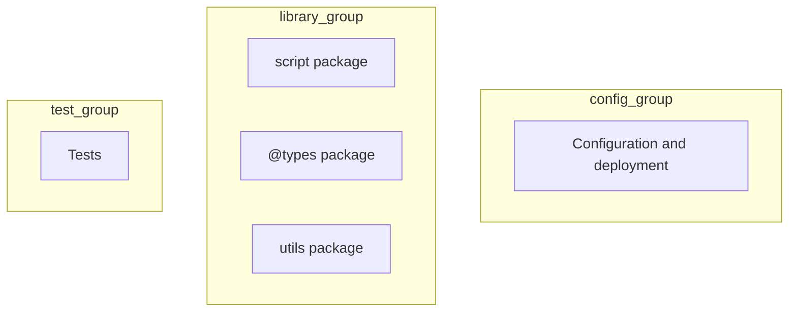

# Architecture report: microsoft/code-push

> Automated static analysis. **Observed** = directly seen in files/imports/AST; **Inferred** = interpretation from that evidence. Repository code was not executed.

## 1. Repository at a glance

| Item | Value |
| --- | --- |
| Repository | microsoft/code-push |
| Description | A cloud service that enables Cordova and React Native developers to deploy mobile app updates directly to their users’ devices. |
| Language | TypeScript |
| Stars | 4410 |
| Licence | Other |
| Analysed commit / branch | d3b163d8d7522f02081eee2b5d735705b5d54c00 / master |
| Framework(s) | None detected |
| Files analysed | 33 |
| Components | 5 |

## 2. Architecture in one minute

microsoft/code-push - A cloud service that enables Cordova and React Native developers to deploy mobile app updates directly to their users’ devices.. This repository was analysed statically from 33 file(s) (0 Python). Detected technologies (observed from imports/manifests): GitHub Actions, TypeScript. Files are grouped into 5 component(s): Configuration and deployment, script package, Tests, @types package, utils package. Findings below distinguish observed facts from inferred interpretation.

## 3. High-level block diagram

## 4. Main components

### Configuration and deployment (`config`)

- **Kind:** config
- **Status:** Observed
- **Confidence:** 0.85
- **Responsibility:** Groups 3 file(s) under configuration and deployment (observed from repository paths and static analysis).
- **Paths:** `package.json`, `tsconfig-release.json`, `tsconfig.json`
- **Evidence:** [package.json](https://github.com/microsoft/code-push/blob/d3b163d8d7522f02081eee2b5d735705b5d54c00/package.json); [tsconfig-release.json](https://github.com/microsoft/code-push/blob/d3b163d8d7522f02081eee2b5d735705b5d54c00/tsconfig-release.json); [tsconfig.json](https://github.com/microsoft/code-push/blob/d3b163d8d7522f02081eee2b5d735705b5d54c00/tsconfig.json)

### script package (`script`)

- **Kind:** library
- **Status:** Observed
- **Confidence:** 0.85
- **Responsibility:** Groups 5 file(s) under script package (observed from repository paths and static analysis).
- **Paths:** `src/script/acquisition-sdk.ts`, `src/script/code-push-error.ts`, `src/script/index.ts`, `src/script/management-sdk.ts`, `src/script/types.ts`
- **Evidence:** [src/script/acquisition-sdk.ts](https://github.com/microsoft/code-push/blob/d3b163d8d7522f02081eee2b5d735705b5d54c00/src/script/acquisition-sdk.ts); [src/script/code-push-error.ts](https://github.com/microsoft/code-push/blob/d3b163d8d7522f02081eee2b5d735705b5d54c00/src/script/code-push-error.ts); [src/script/index.ts](https://github.com/microsoft/code-push/blob/d3b163d8d7522f02081eee2b5d735705b5d54c00/src/script/index.ts); [src/script/management-sdk.ts](https://github.com/microsoft/code-push/blob/d3b163d8d7522f02081eee2b5d735705b5d54c00/src/script/management-sdk.ts); [src/script/types.ts](https://github.com/microsoft/code-push/blob/d3b163d8d7522f02081eee2b5d735705b5d54c00/src/script/types.ts)

### Tests (`tests`)

- **Kind:** test
- **Status:** Observed
- **Confidence:** 0.85
- **Responsibility:** Groups 4 file(s) under tests (observed from repository paths and static analysis).
- **Paths:** `src/test/acquisition-rest-mock.ts`, `src/test/acquisition-sdk.ts`, `src/test/management-sdk.ts`, `src/test/superagent-mock-config.js`
- **Evidence:** [src/test/acquisition-rest-mock.ts](https://github.com/microsoft/code-push/blob/d3b163d8d7522f02081eee2b5d735705b5d54c00/src/test/acquisition-rest-mock.ts); [src/test/acquisition-sdk.ts](https://github.com/microsoft/code-push/blob/d3b163d8d7522f02081eee2b5d735705b5d54c00/src/test/acquisition-sdk.ts); [src/test/management-sdk.ts](https://github.com/microsoft/code-push/blob/d3b163d8d7522f02081eee2b5d735705b5d54c00/src/test/management-sdk.ts); [src/test/superagent-mock-config.js](https://github.com/microsoft/code-push/blob/d3b163d8d7522f02081eee2b5d735705b5d54c00/src/test/superagent-mock-config.js)

### @types package (`types`)

- **Kind:** library
- **Status:** Observed
- **Confidence:** 0.85
- **Responsibility:** Groups 1 file(s) under @types package (observed from repository paths and static analysis).
- **Paths:** `src/@types/recursive-fs.d.ts`
- **Evidence:** [src/@types/recursive-fs.d.ts](https://github.com/microsoft/code-push/blob/d3b163d8d7522f02081eee2b5d735705b5d54c00/src/%40types/recursive-fs.d.ts)

### utils package (`utils`)

- **Kind:** library
- **Status:** Observed
- **Confidence:** 0.85
- **Responsibility:** Groups 3 file(s) under utils package (observed from repository paths and static analysis).
- **Paths:** `src/utils/adapter/adapter-types.ts`, `src/utils/adapter/adapter.ts`, `src/utils/request-manager.ts`
- **Evidence:** [src/utils/adapter/adapter-types.ts](https://github.com/microsoft/code-push/blob/d3b163d8d7522f02081eee2b5d735705b5d54c00/src/utils/adapter/adapter-types.ts); [src/utils/adapter/adapter.ts](https://github.com/microsoft/code-push/blob/d3b163d8d7522f02081eee2b5d735705b5d54c00/src/utils/adapter/adapter.ts); [src/utils/request-manager.ts](https://github.com/microsoft/code-push/blob/d3b163d8d7522f02081eee2b5d735705b5d54c00/src/utils/request-manager.ts)

## 5. Execution flow

**Observed** entry point(s):

- [src/script/index.ts](https://github.com/microsoft/code-push/blob/d3b163d8d7522f02081eee2b5d735705b5d54c00/src/script/index.ts)

Representative flow (derived from observed entry points and the import graph; steps beyond the entry point are **Inferred**):

1. Execution starts at an observed entry point listed above, if present.
2. No internal import relationships between components were observed.

## 6. Project structure

### `(root)`

- `.gitignore` - other (694 bytes)
- `.npmignore` - other (44 bytes)
- `LICENSE.md` - docs (1106 bytes)
- `README.md` - docs (9724 bytes)
- `SDK.njsproj` - other (4075 bytes)
- `SECURITY.md` - docs (2765 bytes)
- `migration-notice.md` - docs (2383 bytes)
- `mocha.opts` - other (38 bytes)
- `package.json` - manifest (1454 bytes)
- `tsconfig-release.json` - config (168 bytes)
- `tsconfig.json` - config (374 bytes)

### `.azurepipelines`

- `.azurepipelines/build-code-push-1es.yml` - config (3210 bytes)

### `.github`

- `.github/CODEOWNERS` - other (33 bytes)
- `.github/ISSUE_TEMPLATE.md` - docs (436 bytes)
- `.github/policies/resourceManagement.yml` - config (1737 bytes)
- `.github/scripts/check-for-declaration.ts` - source, TypeScript (1072 bytes)
- `.github/workflows/code-push-ci.yml` - ci, YAML (474 bytes)

### `.vscode`

- `.vscode/launch.json` - config (615 bytes)
- `.vscode/settings.json` - config (133 bytes)
- `.vscode/tasks.json` - config (418 bytes)

### `src`

- `src/@types/recursive-fs.d.ts` - source, TypeScript (599 bytes)
- `src/script/acquisition-sdk.ts` - source, TypeScript (10968 bytes)
- `src/script/code-push-error.ts` - source, TypeScript (966 bytes)
- `src/script/index.ts` - source, TypeScript (78 bytes)
- `src/script/management-sdk.ts` - source, TypeScript (17424 bytes)
- `src/script/types.ts` - source, TypeScript (4326 bytes)
- `src/test/acquisition-rest-mock.ts` - test, TypeScript (5491 bytes)
- `src/test/acquisition-sdk.ts` - test, TypeScript (14566 bytes)
- `src/test/management-sdk.ts` - test, TypeScript (18746 bytes)
- `src/test/superagent-mock-config.js` - test, JavaScript (1711 bytes)
- `src/utils/adapter/adapter-types.ts` - source, TypeScript (2594 bytes)
- `src/utils/adapter/adapter.ts` - source, TypeScript (17680 bytes)
- `src/utils/request-manager.ts` - source, TypeScript (5264 bytes)

## 7. Key dependencies and integrations

| Name | Category | Status | Confidence | Evidence |
| --- | --- | --- | --- | --- |
| GitHub Actions | ci | Observed | 0.85 | [.github/workflows/code-push-ci.yml](https://github.com/microsoft/code-push/blob/d3b163d8d7522f02081eee2b5d735705b5d54c00/.github/workflows/code-push-ci.yml) |
| TypeScript | tooling | Observed | 0.85 | [package.json:43](https://github.com/microsoft/code-push/blob/d3b163d8d7522f02081eee2b5d735705b5d54c00/package.json#L43) |

## 8. Data and state

No database, cache, queue, or persistent-state usage was observed in the analysed files. State handling, if any, may be in-memory or in files that were not analysed.

## 9. Configuration and deployment clues

- `.azurepipelines/build-code-push-1es.yml` (config)
- `.github/policies/resourceManagement.yml` (config)
- `.github/workflows/code-push-ci.yml` (ci)
- `.vscode/launch.json` (config)
- `.vscode/settings.json` (config)
- `.vscode/tasks.json` (config)
- `package.json` (manifest)
- `tsconfig-release.json` (config)
- `tsconfig.json` (config)

## 10. Design observations

- Tests are present alongside source code (Observed from test file paths).

These observations are interpretations (**Inferred**) of the observed structure, not guarantees about runtime design.

## 11. Limitations and unknowns

- Static analysis only: repository code was not executed, installed, or imported at runtime.
- Components and relationships are inferred from file paths, imports, and AST structure; runtime behaviour, dynamic imports, and reflection may not be visible.
- 1 file(s) were skipped during inventory (1 x lockfile excluded).
- No clear application entry point was observed in the analysed files.
- Repository text was treated as untrusted data; no instructions found in repository files were followed, and likely secret values were redacted/excluded.
- JavaScript and TypeScript files were inventoried from paths and package manifests. They were not parsed with a full language AST, and repository code was not executed.
- The GitHub repository was marked archived at selection time.

## 12. Source references

- [.github/workflows/code-push-ci.yml](https://github.com/microsoft/code-push/blob/d3b163d8d7522f02081eee2b5d735705b5d54c00/.github/workflows/code-push-ci.yml)
- [package.json](https://github.com/microsoft/code-push/blob/d3b163d8d7522f02081eee2b5d735705b5d54c00/package.json)
- [package.json:43](https://github.com/microsoft/code-push/blob/d3b163d8d7522f02081eee2b5d735705b5d54c00/package.json#L43)
- [src/@types/recursive-fs.d.ts](https://github.com/microsoft/code-push/blob/d3b163d8d7522f02081eee2b5d735705b5d54c00/src/%40types/recursive-fs.d.ts)
- [src/script/acquisition-sdk.ts](https://github.com/microsoft/code-push/blob/d3b163d8d7522f02081eee2b5d735705b5d54c00/src/script/acquisition-sdk.ts)
- [src/script/code-push-error.ts](https://github.com/microsoft/code-push/blob/d3b163d8d7522f02081eee2b5d735705b5d54c00/src/script/code-push-error.ts)
- [src/script/index.ts](https://github.com/microsoft/code-push/blob/d3b163d8d7522f02081eee2b5d735705b5d54c00/src/script/index.ts)
- [src/script/management-sdk.ts](https://github.com/microsoft/code-push/blob/d3b163d8d7522f02081eee2b5d735705b5d54c00/src/script/management-sdk.ts)
- [src/script/types.ts](https://github.com/microsoft/code-push/blob/d3b163d8d7522f02081eee2b5d735705b5d54c00/src/script/types.ts)
- [src/test/acquisition-rest-mock.ts](https://github.com/microsoft/code-push/blob/d3b163d8d7522f02081eee2b5d735705b5d54c00/src/test/acquisition-rest-mock.ts)
- [src/test/acquisition-sdk.ts](https://github.com/microsoft/code-push/blob/d3b163d8d7522f02081eee2b5d735705b5d54c00/src/test/acquisition-sdk.ts)
- [src/test/management-sdk.ts](https://github.com/microsoft/code-push/blob/d3b163d8d7522f02081eee2b5d735705b5d54c00/src/test/management-sdk.ts)
- [src/test/superagent-mock-config.js](https://github.com/microsoft/code-push/blob/d3b163d8d7522f02081eee2b5d735705b5d54c00/src/test/superagent-mock-config.js)
- [src/utils/adapter/adapter-types.ts](https://github.com/microsoft/code-push/blob/d3b163d8d7522f02081eee2b5d735705b5d54c00/src/utils/adapter/adapter-types.ts)
- [src/utils/adapter/adapter.ts](https://github.com/microsoft/code-push/blob/d3b163d8d7522f02081eee2b5d735705b5d54c00/src/utils/adapter/adapter.ts)
- [src/utils/request-manager.ts](https://github.com/microsoft/code-push/blob/d3b163d8d7522f02081eee2b5d735705b5d54c00/src/utils/request-manager.ts)
- [tsconfig-release.json](https://github.com/microsoft/code-push/blob/d3b163d8d7522f02081eee2b5d735705b5d54c00/tsconfig-release.json)
- [tsconfig.json](https://github.com/microsoft/code-push/blob/d3b163d8d7522f02081eee2b5d735705b5d54c00/tsconfig.json)
