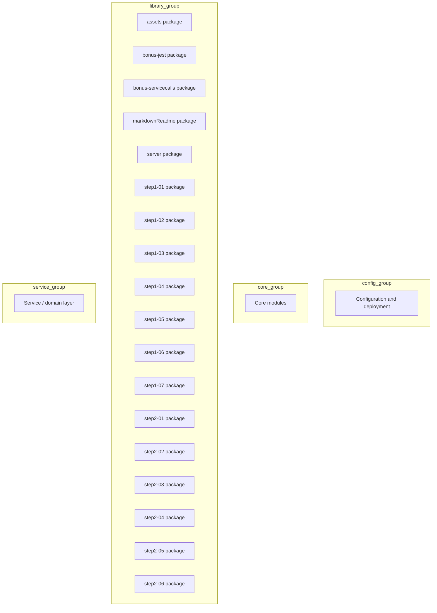

# Architecture report: microsoft/frontend-bootcamp

> Automated static analysis. **Observed** = directly seen in files/imports/AST; **Inferred** = interpretation from that evidence. Repository code was not executed.

## 1. Repository at a glance

| Item | Value |
| --- | --- |
| Repository | microsoft/frontend-bootcamp |
| Description | Frontend Workshop from HTML/CSS/JS to TypeScript/React/Redux |
| Language | TypeScript |
| Stars | 10770 |
| Licence | CC-BY-4.0 |
| Analysed commit / branch | 7cea32428e16b33a2ae4e54d2a87274a8171559b / master |
| Framework(s) | Express, React |
| Files analysed | 253 |
| Components | 21 |

## 2. Architecture in one minute

microsoft/frontend-bootcamp - Frontend Workshop from HTML/CSS/JS to TypeScript/React/Redux. This repository was analysed statically from 253 file(s) (0 Python). Detected technologies (observed from imports/manifests): Express, React, Redux, Jest, TypeScript, webpack. Files are grouped into 21 component(s): assets package, bonus-jest package, bonus-servicecalls package, Configuration and deployment, Core modules, markdownReadme package, server package, Service / domain layer. Findings below distinguish observed facts from inferred interpretation.

## 3. High-level block diagram

## 4. Main components

### assets package (`assets`)

- **Kind:** library
- **Status:** Observed
- **Confidence:** 0.85
- **Responsibility:** Groups 1 file(s) under assets package (observed from repository paths and static analysis).
- **Paths:** `assets/scripts.js`
- **Evidence:** [assets/scripts.js](https://github.com/microsoft/frontend-bootcamp/blob/7cea32428e16b33a2ae4e54d2a87274a8171559b/assets/scripts.js)

### bonus-jest package (`bonus_jest`)

- **Kind:** library
- **Status:** Observed
- **Confidence:** 0.85
- **Responsibility:** Groups 10 file(s) under bonus-jest package (observed from repository paths and static analysis).
- **Paths:** `bonus-jest/demo/src/TestMe.spec.tsx`, `bonus-jest/demo/src/TestMe.tsx`, `bonus-jest/demo/src/index.spec.tsx`, `bonus-jest/demo/src/index.ts`, `bonus-jest/demo/src/multiply.ts`, `bonus-jest/exercise/src/TestMe.spec.tsx`, `bonus-jest/exercise/src/TestMe.tsx`, `bonus-jest/exercise/src/index.ts`, `bonus-jest/exercise/src/stack.spec.ts`, `bonus-jest/exercise/src/stack.ts`
- **Evidence:** [bonus-jest/demo/src/TestMe.spec.tsx](https://github.com/microsoft/frontend-bootcamp/blob/7cea32428e16b33a2ae4e54d2a87274a8171559b/bonus-jest/demo/src/TestMe.spec.tsx); [bonus-jest/demo/src/TestMe.tsx](https://github.com/microsoft/frontend-bootcamp/blob/7cea32428e16b33a2ae4e54d2a87274a8171559b/bonus-jest/demo/src/TestMe.tsx); [bonus-jest/demo/src/index.spec.tsx](https://github.com/microsoft/frontend-bootcamp/blob/7cea32428e16b33a2ae4e54d2a87274a8171559b/bonus-jest/demo/src/index.spec.tsx); [bonus-jest/demo/src/index.ts](https://github.com/microsoft/frontend-bootcamp/blob/7cea32428e16b33a2ae4e54d2a87274a8171559b/bonus-jest/demo/src/index.ts); [bonus-jest/demo/src/multiply.ts](https://github.com/microsoft/frontend-bootcamp/blob/7cea32428e16b33a2ae4e54d2a87274a8171559b/bonus-jest/demo/src/multiply.ts); [bonus-jest/exercise/src/TestMe.spec.tsx](https://github.com/microsoft/frontend-bootcamp/blob/7cea32428e16b33a2ae4e54d2a87274a8171559b/bonus-jest/exercise/src/TestMe.spec.tsx); [bonus-jest/exercise/src/TestMe.tsx](https://github.com/microsoft/frontend-bootcamp/blob/7cea32428e16b33a2ae4e54d2a87274a8171559b/bonus-jest/exercise/src/TestMe.tsx); [bonus-jest/exercise/src/index.ts](https://github.com/microsoft/frontend-bootcamp/blob/7cea32428e16b33a2ae4e54d2a87274a8171559b/bonus-jest/exercise/src/index.ts)

### bonus-servicecalls package (`bonus_servicecalls`)

- **Kind:** library
- **Status:** Observed
- **Confidence:** 0.85
- **Responsibility:** Groups 9 file(s) under bonus-servicecalls package (observed from repository paths and static analysis).
- **Paths:** `bonus-servicecalls/demo/src/actions/index.ts`, `bonus-servicecalls/demo/src/components/TodoApp.tsx`, `bonus-servicecalls/demo/src/components/TodoFooter.tsx`, `bonus-servicecalls/demo/src/components/TodoHeader.tsx`, `bonus-servicecalls/demo/src/components/TodoList.tsx`, `bonus-servicecalls/demo/src/components/TodoListItem.tsx`, `bonus-servicecalls/demo/src/index.tsx`, `bonus-servicecalls/demo/src/reducers/index.ts`, `bonus-servicecalls/demo/src/store/index.ts`
- **Evidence:** [bonus-servicecalls/demo/src/actions/index.ts](https://github.com/microsoft/frontend-bootcamp/blob/7cea32428e16b33a2ae4e54d2a87274a8171559b/bonus-servicecalls/demo/src/actions/index.ts); [bonus-servicecalls/demo/src/components/TodoApp.tsx](https://github.com/microsoft/frontend-bootcamp/blob/7cea32428e16b33a2ae4e54d2a87274a8171559b/bonus-servicecalls/demo/src/components/TodoApp.tsx); [bonus-servicecalls/demo/src/components/TodoFooter.tsx](https://github.com/microsoft/frontend-bootcamp/blob/7cea32428e16b33a2ae4e54d2a87274a8171559b/bonus-servicecalls/demo/src/components/TodoFooter.tsx); [bonus-servicecalls/demo/src/components/TodoHeader.tsx](https://github.com/microsoft/frontend-bootcamp/blob/7cea32428e16b33a2ae4e54d2a87274a8171559b/bonus-servicecalls/demo/src/components/TodoHeader.tsx); [bonus-servicecalls/demo/src/components/TodoList.tsx](https://github.com/microsoft/frontend-bootcamp/blob/7cea32428e16b33a2ae4e54d2a87274a8171559b/bonus-servicecalls/demo/src/components/TodoList.tsx); [bonus-servicecalls/demo/src/components/TodoListItem.tsx](https://github.com/microsoft/frontend-bootcamp/blob/7cea32428e16b33a2ae4e54d2a87274a8171559b/bonus-servicecalls/demo/src/components/TodoListItem.tsx); [bonus-servicecalls/demo/src/index.tsx](https://github.com/microsoft/frontend-bootcamp/blob/7cea32428e16b33a2ae4e54d2a87274a8171559b/bonus-servicecalls/demo/src/index.tsx); [bonus-servicecalls/demo/src/reducers/index.ts](https://github.com/microsoft/frontend-bootcamp/blob/7cea32428e16b33a2ae4e54d2a87274a8171559b/bonus-servicecalls/demo/src/reducers/index.ts)

### Configuration and deployment (`config`)

- **Kind:** config
- **Status:** Observed
- **Confidence:** 0.85
- **Responsibility:** Groups 5 file(s) under configuration and deployment (observed from repository paths and static analysis).
- **Paths:** `azure-pipelines.pr.yml`, `azure-pipelines.yml`, `package.json`, `server/now.json`, `tsconfig.json`
- **Evidence:** [azure-pipelines.pr.yml](https://github.com/microsoft/frontend-bootcamp/blob/7cea32428e16b33a2ae4e54d2a87274a8171559b/azure-pipelines.pr.yml); [azure-pipelines.yml](https://github.com/microsoft/frontend-bootcamp/blob/7cea32428e16b33a2ae4e54d2a87274a8171559b/azure-pipelines.yml); [package.json](https://github.com/microsoft/frontend-bootcamp/blob/7cea32428e16b33a2ae4e54d2a87274a8171559b/package.json); [server/now.json](https://github.com/microsoft/frontend-bootcamp/blob/7cea32428e16b33a2ae4e54d2a87274a8171559b/server/now.json); [tsconfig.json](https://github.com/microsoft/frontend-bootcamp/blob/7cea32428e16b33a2ae4e54d2a87274a8171559b/tsconfig.json)

### Core modules (`core`)

- **Kind:** core
- **Status:** Observed
- **Confidence:** 0.85
- **Responsibility:** Groups 4 file(s) under core modules (observed from repository paths and static analysis).
- **Paths:** `jest.config.js`, `jest.setup.js`, `prettier.config.js`, `webpack.config.js`
- **Evidence:** [jest.config.js](https://github.com/microsoft/frontend-bootcamp/blob/7cea32428e16b33a2ae4e54d2a87274a8171559b/jest.config.js); [jest.setup.js](https://github.com/microsoft/frontend-bootcamp/blob/7cea32428e16b33a2ae4e54d2a87274a8171559b/jest.setup.js); [prettier.config.js](https://github.com/microsoft/frontend-bootcamp/blob/7cea32428e16b33a2ae4e54d2a87274a8171559b/prettier.config.js); [webpack.config.js](https://github.com/microsoft/frontend-bootcamp/blob/7cea32428e16b33a2ae4e54d2a87274a8171559b/webpack.config.js)

### markdownReadme package (`markdownreadme`)

- **Kind:** library
- **Status:** Observed
- **Confidence:** 0.85
- **Responsibility:** Groups 1 file(s) under markdownreadme package (observed from repository paths and static analysis).
- **Paths:** `markdownReadme/src/index.ts`
- **Evidence:** [markdownReadme/src/index.ts](https://github.com/microsoft/frontend-bootcamp/blob/7cea32428e16b33a2ae4e54d2a87274a8171559b/markdownReadme/src/index.ts)

### server package (`server`)

- **Kind:** library
- **Status:** Observed
- **Confidence:** 0.85
- **Responsibility:** Groups 1 file(s) under server package (observed from repository paths and static analysis).
- **Paths:** `server/index.js`
- **Evidence:** [server/index.js](https://github.com/microsoft/frontend-bootcamp/blob/7cea32428e16b33a2ae4e54d2a87274a8171559b/server/index.js)

### Service / domain layer (`service_layer`)

- **Kind:** service
- **Status:** Observed
- **Confidence:** 0.85
- **Responsibility:** Groups 1 file(s) under service / domain layer (observed from repository paths and static analysis).
- **Paths:** `bonus-servicecalls/demo/src/service/index.ts`
- **Evidence:** [bonus-servicecalls/demo/src/service/index.ts](https://github.com/microsoft/frontend-bootcamp/blob/7cea32428e16b33a2ae4e54d2a87274a8171559b/bonus-servicecalls/demo/src/service/index.ts)

### step1-01 package (`step1_01`)

- **Kind:** library
- **Status:** Observed
- **Confidence:** 0.85
- **Responsibility:** Groups 1 file(s) under step1-01 package (observed from repository paths and static analysis).
- **Paths:** `step1-01/lesson/src/index.tsx`
- **Evidence:** [step1-01/lesson/src/index.tsx](https://github.com/microsoft/frontend-bootcamp/blob/7cea32428e16b33a2ae4e54d2a87274a8171559b/step1-01/lesson/src/index.tsx)

### step1-02 package (`step1_02`)

- **Kind:** library
- **Status:** Observed
- **Confidence:** 0.85
- **Responsibility:** Groups 1 file(s) under step1-02 package (observed from repository paths and static analysis).
- **Paths:** `step1-02/lesson/src/index.tsx`
- **Evidence:** [step1-02/lesson/src/index.tsx](https://github.com/microsoft/frontend-bootcamp/blob/7cea32428e16b33a2ae4e54d2a87274a8171559b/step1-02/lesson/src/index.tsx)

### step1-03 package (`step1_03`)

- **Kind:** library
- **Status:** Observed
- **Confidence:** 0.85
- **Responsibility:** Groups 2 file(s) under step1-03 package (observed from repository paths and static analysis).
- **Paths:** `step1-03/exercise/answer.js`, `step1-03/lesson/src/index.tsx`
- **Evidence:** [step1-03/exercise/answer.js](https://github.com/microsoft/frontend-bootcamp/blob/7cea32428e16b33a2ae4e54d2a87274a8171559b/step1-03/exercise/answer.js); [step1-03/lesson/src/index.tsx](https://github.com/microsoft/frontend-bootcamp/blob/7cea32428e16b33a2ae4e54d2a87274a8171559b/step1-03/lesson/src/index.tsx)

### step1-04 package (`step1_04`)

- **Kind:** library
- **Status:** Observed
- **Confidence:** 0.85
- **Responsibility:** Groups 5 file(s) under step1-04 package (observed from repository paths and static analysis).
- **Paths:** `step1-04/final/src/App.tsx`, `step1-04/final/src/components/Button.tsx`, `step1-04/final/src/components/Counter.tsx`, `step1-04/final/src/index.tsx`, `step1-04/lesson/src/index.tsx`
- **Evidence:** [step1-04/final/src/App.tsx](https://github.com/microsoft/frontend-bootcamp/blob/7cea32428e16b33a2ae4e54d2a87274a8171559b/step1-04/final/src/App.tsx); [step1-04/final/src/components/Button.tsx](https://github.com/microsoft/frontend-bootcamp/blob/7cea32428e16b33a2ae4e54d2a87274a8171559b/step1-04/final/src/components/Button.tsx); [step1-04/final/src/components/Counter.tsx](https://github.com/microsoft/frontend-bootcamp/blob/7cea32428e16b33a2ae4e54d2a87274a8171559b/step1-04/final/src/components/Counter.tsx); [step1-04/final/src/index.tsx](https://github.com/microsoft/frontend-bootcamp/blob/7cea32428e16b33a2ae4e54d2a87274a8171559b/step1-04/final/src/index.tsx); [step1-04/lesson/src/index.tsx](https://github.com/microsoft/frontend-bootcamp/blob/7cea32428e16b33a2ae4e54d2a87274a8171559b/step1-04/lesson/src/index.tsx)

### step1-05 package (`step1_05`)

- **Kind:** library
- **Status:** Observed
- **Confidence:** 0.85
- **Responsibility:** Groups 6 file(s) under step1-05 package (observed from repository paths and static analysis).
- **Paths:** `step1-05/demo/src/App.tsx`, `step1-05/demo/src/index.tsx`, `step1-05/exercise/src/App.tsx`, `step1-05/exercise/src/components/TodoHeader.tsx`, `step1-05/exercise/src/components/TodoListItem.tsx`, `step1-05/exercise/src/index.tsx`
- **Evidence:** [step1-05/demo/src/App.tsx](https://github.com/microsoft/frontend-bootcamp/blob/7cea32428e16b33a2ae4e54d2a87274a8171559b/step1-05/demo/src/App.tsx); [step1-05/demo/src/index.tsx](https://github.com/microsoft/frontend-bootcamp/blob/7cea32428e16b33a2ae4e54d2a87274a8171559b/step1-05/demo/src/index.tsx); [step1-05/exercise/src/App.tsx](https://github.com/microsoft/frontend-bootcamp/blob/7cea32428e16b33a2ae4e54d2a87274a8171559b/step1-05/exercise/src/App.tsx); [step1-05/exercise/src/components/TodoHeader.tsx](https://github.com/microsoft/frontend-bootcamp/blob/7cea32428e16b33a2ae4e54d2a87274a8171559b/step1-05/exercise/src/components/TodoHeader.tsx); [step1-05/exercise/src/components/TodoListItem.tsx](https://github.com/microsoft/frontend-bootcamp/blob/7cea32428e16b33a2ae4e54d2a87274a8171559b/step1-05/exercise/src/components/TodoListItem.tsx); [step1-05/exercise/src/index.tsx](https://github.com/microsoft/frontend-bootcamp/blob/7cea32428e16b33a2ae4e54d2a87274a8171559b/step1-05/exercise/src/index.tsx)

### step1-06 package (`step1_06`)

- **Kind:** library
- **Status:** Observed
- **Confidence:** 0.85
- **Responsibility:** Groups 12 file(s) under step1-06 package (observed from repository paths and static analysis).
- **Paths:** `step1-06/demo/src/TodoApp.tsx`, `step1-06/demo/src/components/TodoFooter.tsx`, `step1-06/demo/src/components/TodoHeader.tsx`, `step1-06/demo/src/components/TodoList.tsx`, `step1-06/demo/src/components/TodoListItem.tsx`, `step1-06/demo/src/index.tsx`, `step1-06/exercise/src/TodoApp.tsx`, `step1-06/exercise/src/components/TodoFooter.tsx`, `step1-06/exercise/src/components/TodoHeader.tsx`, `step1-06/exercise/src/components/TodoList.tsx`, `step1-06/exercise/src/components/TodoListItem.tsx`, `step1-06/exercise/src/index.tsx`
- **Evidence:** [step1-06/demo/src/TodoApp.tsx](https://github.com/microsoft/frontend-bootcamp/blob/7cea32428e16b33a2ae4e54d2a87274a8171559b/step1-06/demo/src/TodoApp.tsx); [step1-06/demo/src/components/TodoFooter.tsx](https://github.com/microsoft/frontend-bootcamp/blob/7cea32428e16b33a2ae4e54d2a87274a8171559b/step1-06/demo/src/components/TodoFooter.tsx); [step1-06/demo/src/components/TodoHeader.tsx](https://github.com/microsoft/frontend-bootcamp/blob/7cea32428e16b33a2ae4e54d2a87274a8171559b/step1-06/demo/src/components/TodoHeader.tsx); [step1-06/demo/src/components/TodoList.tsx](https://github.com/microsoft/frontend-bootcamp/blob/7cea32428e16b33a2ae4e54d2a87274a8171559b/step1-06/demo/src/components/TodoList.tsx); [step1-06/demo/src/components/TodoListItem.tsx](https://github.com/microsoft/frontend-bootcamp/blob/7cea32428e16b33a2ae4e54d2a87274a8171559b/step1-06/demo/src/components/TodoListItem.tsx); [step1-06/demo/src/index.tsx](https://github.com/microsoft/frontend-bootcamp/blob/7cea32428e16b33a2ae4e54d2a87274a8171559b/step1-06/demo/src/index.tsx); [step1-06/exercise/src/TodoApp.tsx](https://github.com/microsoft/frontend-bootcamp/blob/7cea32428e16b33a2ae4e54d2a87274a8171559b/step1-06/exercise/src/TodoApp.tsx); [step1-06/exercise/src/components/TodoFooter.tsx](https://github.com/microsoft/frontend-bootcamp/blob/7cea32428e16b33a2ae4e54d2a87274a8171559b/step1-06/exercise/src/components/TodoFooter.tsx)

### step1-07 package (`step1_07`)

- **Kind:** library
- **Status:** Observed
- **Confidence:** 0.85
- **Responsibility:** Groups 21 file(s) under step1-07 package (observed from repository paths and static analysis).
- **Paths:** `step1-07/demo/src/TodoApp.tsx`, `step1-07/demo/src/TodoApp.types.ts`, `step1-07/demo/src/components/TodoFooter.tsx`, `step1-07/demo/src/components/TodoHeader.tsx`, `step1-07/demo/src/components/TodoList.tsx`, `step1-07/demo/src/components/TodoListItem.tsx`, `step1-07/demo/src/index.tsx`, `step1-07/exercise/src/TodoApp.tsx`, `step1-07/exercise/src/TodoApp.types.ts`, `step1-07/exercise/src/components/TodoFooter.tsx`, `step1-07/exercise/src/components/TodoHeader.tsx`, `step1-07/exercise/src/components/TodoList.tsx`, `step1-07/exercise/src/components/TodoListItem.tsx`, `step1-07/exercise/src/index.tsx`, `step1-07/final/src/TodoApp.tsx`, `step1-07/final/src/TodoApp.types.ts`, `step1-07/final/src/components/TodoFooter.tsx`, `step1-07/final/src/components/TodoHeader.tsx`, `step1-07/final/src/components/TodoList.tsx`, `step1-07/final/src/components/TodoListItem.tsx`, `step1-07/final/src/index.tsx`
- **Evidence:** [step1-07/demo/src/TodoApp.tsx](https://github.com/microsoft/frontend-bootcamp/blob/7cea32428e16b33a2ae4e54d2a87274a8171559b/step1-07/demo/src/TodoApp.tsx); [step1-07/demo/src/TodoApp.types.ts](https://github.com/microsoft/frontend-bootcamp/blob/7cea32428e16b33a2ae4e54d2a87274a8171559b/step1-07/demo/src/TodoApp.types.ts); [step1-07/demo/src/components/TodoFooter.tsx](https://github.com/microsoft/frontend-bootcamp/blob/7cea32428e16b33a2ae4e54d2a87274a8171559b/step1-07/demo/src/components/TodoFooter.tsx); [step1-07/demo/src/components/TodoHeader.tsx](https://github.com/microsoft/frontend-bootcamp/blob/7cea32428e16b33a2ae4e54d2a87274a8171559b/step1-07/demo/src/components/TodoHeader.tsx); [step1-07/demo/src/components/TodoList.tsx](https://github.com/microsoft/frontend-bootcamp/blob/7cea32428e16b33a2ae4e54d2a87274a8171559b/step1-07/demo/src/components/TodoList.tsx); [step1-07/demo/src/components/TodoListItem.tsx](https://github.com/microsoft/frontend-bootcamp/blob/7cea32428e16b33a2ae4e54d2a87274a8171559b/step1-07/demo/src/components/TodoListItem.tsx); [step1-07/demo/src/index.tsx](https://github.com/microsoft/frontend-bootcamp/blob/7cea32428e16b33a2ae4e54d2a87274a8171559b/step1-07/demo/src/index.tsx); [step1-07/exercise/src/TodoApp.tsx](https://github.com/microsoft/frontend-bootcamp/blob/7cea32428e16b33a2ae4e54d2a87274a8171559b/step1-07/exercise/src/TodoApp.tsx)

### step2-01 package (`step2_01`)

- **Kind:** library
- **Status:** Observed
- **Confidence:** 0.85
- **Responsibility:** Groups 15 file(s) under step2-01 package (observed from repository paths and static analysis).
- **Paths:** `step2-01/demo/src/async/index.ts`, `step2-01/demo/src/generics/index.ts`, `step2-01/demo/src/index.tsx`, `step2-01/demo/src/interfaces/index.ts`, `step2-01/demo/src/modules/default.ts`, `step2-01/demo/src/modules/index.ts`, `step2-01/demo/src/modules/named.ts`, `step2-01/demo/src/spread/index.ts`, `step2-01/demo/src/types/index.ts`, `step2-01/exercise/src/fibonacci.ts`, `step2-01/exercise/src/index.ts`, `step2-01/exercise/src/stack.ts`, `step2-01/final/src/fibonacci.ts`, `step2-01/final/src/index.ts`, `step2-01/final/src/stack.ts`
- **Evidence:** [step2-01/demo/src/async/index.ts](https://github.com/microsoft/frontend-bootcamp/blob/7cea32428e16b33a2ae4e54d2a87274a8171559b/step2-01/demo/src/async/index.ts); [step2-01/demo/src/generics/index.ts](https://github.com/microsoft/frontend-bootcamp/blob/7cea32428e16b33a2ae4e54d2a87274a8171559b/step2-01/demo/src/generics/index.ts); [step2-01/demo/src/index.tsx](https://github.com/microsoft/frontend-bootcamp/blob/7cea32428e16b33a2ae4e54d2a87274a8171559b/step2-01/demo/src/index.tsx); [step2-01/demo/src/interfaces/index.ts](https://github.com/microsoft/frontend-bootcamp/blob/7cea32428e16b33a2ae4e54d2a87274a8171559b/step2-01/demo/src/interfaces/index.ts); [step2-01/demo/src/modules/default.ts](https://github.com/microsoft/frontend-bootcamp/blob/7cea32428e16b33a2ae4e54d2a87274a8171559b/step2-01/demo/src/modules/default.ts); [step2-01/demo/src/modules/index.ts](https://github.com/microsoft/frontend-bootcamp/blob/7cea32428e16b33a2ae4e54d2a87274a8171559b/step2-01/demo/src/modules/index.ts); [step2-01/demo/src/modules/named.ts](https://github.com/microsoft/frontend-bootcamp/blob/7cea32428e16b33a2ae4e54d2a87274a8171559b/step2-01/demo/src/modules/named.ts); [step2-01/demo/src/spread/index.ts](https://github.com/microsoft/frontend-bootcamp/blob/7cea32428e16b33a2ae4e54d2a87274a8171559b/step2-01/demo/src/spread/index.ts)

### step2-02 package (`step2_02`)

- **Kind:** library
- **Status:** Observed
- **Confidence:** 0.85
- **Responsibility:** Groups 14 file(s) under step2-02 package (observed from repository paths and static analysis).
- **Paths:** `step2-02/demo/src/components/TodoApp.tsx`, `step2-02/demo/src/components/TodoFooter.tsx`, `step2-02/demo/src/components/TodoHeader.tsx`, `step2-02/demo/src/components/TodoList.tsx`, `step2-02/demo/src/components/TodoListItem.tsx`, `step2-02/demo/src/index.tsx`, `step2-02/demo/src/store/index.ts`, `step2-02/exercise/src/components/TodoApp.tsx`, `step2-02/exercise/src/components/TodoFooter.tsx`, `step2-02/exercise/src/components/TodoHeader.tsx`, `step2-02/exercise/src/components/TodoList.tsx`, `step2-02/exercise/src/components/TodoListItem.tsx`, `step2-02/exercise/src/index.tsx`, `step2-02/exercise/src/store/index.ts`
- **Evidence:** [step2-02/demo/src/components/TodoApp.tsx](https://github.com/microsoft/frontend-bootcamp/blob/7cea32428e16b33a2ae4e54d2a87274a8171559b/step2-02/demo/src/components/TodoApp.tsx); [step2-02/demo/src/components/TodoFooter.tsx](https://github.com/microsoft/frontend-bootcamp/blob/7cea32428e16b33a2ae4e54d2a87274a8171559b/step2-02/demo/src/components/TodoFooter.tsx); [step2-02/demo/src/components/TodoHeader.tsx](https://github.com/microsoft/frontend-bootcamp/blob/7cea32428e16b33a2ae4e54d2a87274a8171559b/step2-02/demo/src/components/TodoHeader.tsx); [step2-02/demo/src/components/TodoList.tsx](https://github.com/microsoft/frontend-bootcamp/blob/7cea32428e16b33a2ae4e54d2a87274a8171559b/step2-02/demo/src/components/TodoList.tsx); [step2-02/demo/src/components/TodoListItem.tsx](https://github.com/microsoft/frontend-bootcamp/blob/7cea32428e16b33a2ae4e54d2a87274a8171559b/step2-02/demo/src/components/TodoListItem.tsx); [step2-02/demo/src/index.tsx](https://github.com/microsoft/frontend-bootcamp/blob/7cea32428e16b33a2ae4e54d2a87274a8171559b/step2-02/demo/src/index.tsx); [step2-02/demo/src/store/index.ts](https://github.com/microsoft/frontend-bootcamp/blob/7cea32428e16b33a2ae4e54d2a87274a8171559b/step2-02/demo/src/store/index.ts); [step2-02/exercise/src/components/TodoApp.tsx](https://github.com/microsoft/frontend-bootcamp/blob/7cea32428e16b33a2ae4e54d2a87274a8171559b/step2-02/exercise/src/components/TodoApp.tsx)

### step2-03 package (`step2_03`)

- **Kind:** library
- **Status:** Observed
- **Confidence:** 0.85
- **Responsibility:** Groups 14 file(s) under step2-03 package (observed from repository paths and static analysis).
- **Paths:** `step2-03/demo/src/components/TodoApp.tsx`, `step2-03/demo/src/components/TodoFooter.tsx`, `step2-03/demo/src/components/TodoHeader.tsx`, `step2-03/demo/src/components/TodoList.tsx`, `step2-03/demo/src/components/TodoListItem.tsx`, `step2-03/demo/src/index.tsx`, `step2-03/demo/src/store/index.ts`, `step2-03/exercise/src/components/TodoApp.tsx`, `step2-03/exercise/src/components/TodoFooter.tsx`, `step2-03/exercise/src/components/TodoHeader.tsx`, `step2-03/exercise/src/components/TodoList.tsx`, `step2-03/exercise/src/components/TodoListItem.tsx`, `step2-03/exercise/src/index.tsx`, `step2-03/exercise/src/store/index.ts`
- **Evidence:** [step2-03/demo/src/components/TodoApp.tsx](https://github.com/microsoft/frontend-bootcamp/blob/7cea32428e16b33a2ae4e54d2a87274a8171559b/step2-03/demo/src/components/TodoApp.tsx); [step2-03/demo/src/components/TodoFooter.tsx](https://github.com/microsoft/frontend-bootcamp/blob/7cea32428e16b33a2ae4e54d2a87274a8171559b/step2-03/demo/src/components/TodoFooter.tsx); [step2-03/demo/src/components/TodoHeader.tsx](https://github.com/microsoft/frontend-bootcamp/blob/7cea32428e16b33a2ae4e54d2a87274a8171559b/step2-03/demo/src/components/TodoHeader.tsx); [step2-03/demo/src/components/TodoList.tsx](https://github.com/microsoft/frontend-bootcamp/blob/7cea32428e16b33a2ae4e54d2a87274a8171559b/step2-03/demo/src/components/TodoList.tsx); [step2-03/demo/src/components/TodoListItem.tsx](https://github.com/microsoft/frontend-bootcamp/blob/7cea32428e16b33a2ae4e54d2a87274a8171559b/step2-03/demo/src/components/TodoListItem.tsx); [step2-03/demo/src/index.tsx](https://github.com/microsoft/frontend-bootcamp/blob/7cea32428e16b33a2ae4e54d2a87274a8171559b/step2-03/demo/src/index.tsx); [step2-03/demo/src/store/index.ts](https://github.com/microsoft/frontend-bootcamp/blob/7cea32428e16b33a2ae4e54d2a87274a8171559b/step2-03/demo/src/store/index.ts); [step2-03/exercise/src/components/TodoApp.tsx](https://github.com/microsoft/frontend-bootcamp/blob/7cea32428e16b33a2ae4e54d2a87274a8171559b/step2-03/exercise/src/components/TodoApp.tsx)

### step2-04 package (`step2_04`)

- **Kind:** library
- **Status:** Observed
- **Confidence:** 0.85
- **Responsibility:** Groups 16 file(s) under step2-04 package (observed from repository paths and static analysis).
- **Paths:** `step2-04/demo/src/TodoContext.ts`, `step2-04/demo/src/components/TodoApp.tsx`, `step2-04/demo/src/components/TodoFooter.tsx`, `step2-04/demo/src/components/TodoHeader.tsx`, `step2-04/demo/src/components/TodoList.tsx`, `step2-04/demo/src/components/TodoListItem.tsx`, `step2-04/demo/src/index.tsx`, `step2-04/demo/src/store/index.ts`, `step2-04/exercise/src/TodoContext.ts`, `step2-04/exercise/src/components/TodoApp.tsx`, `step2-04/exercise/src/components/TodoFooter.tsx`, `step2-04/exercise/src/components/TodoHeader.tsx`, `step2-04/exercise/src/components/TodoList.tsx`, `step2-04/exercise/src/components/TodoListItem.tsx`, `step2-04/exercise/src/index.tsx`, `step2-04/exercise/src/store/index.ts`
- **Evidence:** [step2-04/demo/src/TodoContext.ts](https://github.com/microsoft/frontend-bootcamp/blob/7cea32428e16b33a2ae4e54d2a87274a8171559b/step2-04/demo/src/TodoContext.ts); [step2-04/demo/src/components/TodoApp.tsx](https://github.com/microsoft/frontend-bootcamp/blob/7cea32428e16b33a2ae4e54d2a87274a8171559b/step2-04/demo/src/components/TodoApp.tsx); [step2-04/demo/src/components/TodoFooter.tsx](https://github.com/microsoft/frontend-bootcamp/blob/7cea32428e16b33a2ae4e54d2a87274a8171559b/step2-04/demo/src/components/TodoFooter.tsx); [step2-04/demo/src/components/TodoHeader.tsx](https://github.com/microsoft/frontend-bootcamp/blob/7cea32428e16b33a2ae4e54d2a87274a8171559b/step2-04/demo/src/components/TodoHeader.tsx); [step2-04/demo/src/components/TodoList.tsx](https://github.com/microsoft/frontend-bootcamp/blob/7cea32428e16b33a2ae4e54d2a87274a8171559b/step2-04/demo/src/components/TodoList.tsx); [step2-04/demo/src/components/TodoListItem.tsx](https://github.com/microsoft/frontend-bootcamp/blob/7cea32428e16b33a2ae4e54d2a87274a8171559b/step2-04/demo/src/components/TodoListItem.tsx); [step2-04/demo/src/index.tsx](https://github.com/microsoft/frontend-bootcamp/blob/7cea32428e16b33a2ae4e54d2a87274a8171559b/step2-04/demo/src/index.tsx); [step2-04/demo/src/store/index.ts](https://github.com/microsoft/frontend-bootcamp/blob/7cea32428e16b33a2ae4e54d2a87274a8171559b/step2-04/demo/src/store/index.ts)

### step2-05 package (`step2_05`)

- **Kind:** library
- **Status:** Observed
- **Confidence:** 0.85
- **Responsibility:** Groups 8 file(s) under step2-05 package (observed from repository paths and static analysis).
- **Paths:** `step2-05/demo/src/actions/index.ts`, `step2-05/demo/src/index.tsx`, `step2-05/demo/src/reducers/index.ts`, `step2-05/demo/src/store/index.ts`, `step2-05/exercise/src/actions/index.ts`, `step2-05/exercise/src/index.tsx`, `step2-05/exercise/src/reducers/index.ts`, `step2-05/exercise/src/store/index.ts`
- **Evidence:** [step2-05/demo/src/actions/index.ts](https://github.com/microsoft/frontend-bootcamp/blob/7cea32428e16b33a2ae4e54d2a87274a8171559b/step2-05/demo/src/actions/index.ts); [step2-05/demo/src/index.tsx](https://github.com/microsoft/frontend-bootcamp/blob/7cea32428e16b33a2ae4e54d2a87274a8171559b/step2-05/demo/src/index.tsx); [step2-05/demo/src/reducers/index.ts](https://github.com/microsoft/frontend-bootcamp/blob/7cea32428e16b33a2ae4e54d2a87274a8171559b/step2-05/demo/src/reducers/index.ts); [step2-05/demo/src/store/index.ts](https://github.com/microsoft/frontend-bootcamp/blob/7cea32428e16b33a2ae4e54d2a87274a8171559b/step2-05/demo/src/store/index.ts); [step2-05/exercise/src/actions/index.ts](https://github.com/microsoft/frontend-bootcamp/blob/7cea32428e16b33a2ae4e54d2a87274a8171559b/step2-05/exercise/src/actions/index.ts); [step2-05/exercise/src/index.tsx](https://github.com/microsoft/frontend-bootcamp/blob/7cea32428e16b33a2ae4e54d2a87274a8171559b/step2-05/exercise/src/index.tsx); [step2-05/exercise/src/reducers/index.ts](https://github.com/microsoft/frontend-bootcamp/blob/7cea32428e16b33a2ae4e54d2a87274a8171559b/step2-05/exercise/src/reducers/index.ts); [step2-05/exercise/src/store/index.ts](https://github.com/microsoft/frontend-bootcamp/blob/7cea32428e16b33a2ae4e54d2a87274a8171559b/step2-05/exercise/src/store/index.ts)

### step2-06 package (`step2_06`)

- **Kind:** library
- **Status:** Observed
- **Confidence:** 0.85
- **Responsibility:** Groups 18 file(s) under step2-06 package (observed from repository paths and static analysis).
- **Paths:** `step2-06/demo/src/actions/index.ts`, `step2-06/demo/src/components/TodoApp.tsx`, `step2-06/demo/src/components/TodoFooter.tsx`, `step2-06/demo/src/components/TodoHeader.tsx`, `step2-06/demo/src/components/TodoList.tsx`, `step2-06/demo/src/components/TodoListItem.tsx`, `step2-06/demo/src/index.tsx`, `step2-06/demo/src/reducers/index.ts`, `step2-06/demo/src/store/index.ts`, `step2-06/exercise/src/actions/index.ts`, `step2-06/exercise/src/components/TodoApp.tsx`, `step2-06/exercise/src/components/TodoFooter.tsx`, `step2-06/exercise/src/components/TodoHeader.tsx`, `step2-06/exercise/src/components/TodoList.tsx`, `step2-06/exercise/src/components/TodoListItem.tsx`, `step2-06/exercise/src/index.tsx`, `step2-06/exercise/src/reducers/index.ts`, `step2-06/exercise/src/store/index.ts`
- **Evidence:** [step2-06/demo/src/actions/index.ts](https://github.com/microsoft/frontend-bootcamp/blob/7cea32428e16b33a2ae4e54d2a87274a8171559b/step2-06/demo/src/actions/index.ts); [step2-06/demo/src/components/TodoApp.tsx](https://github.com/microsoft/frontend-bootcamp/blob/7cea32428e16b33a2ae4e54d2a87274a8171559b/step2-06/demo/src/components/TodoApp.tsx); [step2-06/demo/src/components/TodoFooter.tsx](https://github.com/microsoft/frontend-bootcamp/blob/7cea32428e16b33a2ae4e54d2a87274a8171559b/step2-06/demo/src/components/TodoFooter.tsx); [step2-06/demo/src/components/TodoHeader.tsx](https://github.com/microsoft/frontend-bootcamp/blob/7cea32428e16b33a2ae4e54d2a87274a8171559b/step2-06/demo/src/components/TodoHeader.tsx); [step2-06/demo/src/components/TodoList.tsx](https://github.com/microsoft/frontend-bootcamp/blob/7cea32428e16b33a2ae4e54d2a87274a8171559b/step2-06/demo/src/components/TodoList.tsx); [step2-06/demo/src/components/TodoListItem.tsx](https://github.com/microsoft/frontend-bootcamp/blob/7cea32428e16b33a2ae4e54d2a87274a8171559b/step2-06/demo/src/components/TodoListItem.tsx); [step2-06/demo/src/index.tsx](https://github.com/microsoft/frontend-bootcamp/blob/7cea32428e16b33a2ae4e54d2a87274a8171559b/step2-06/demo/src/index.tsx); [step2-06/demo/src/reducers/index.ts](https://github.com/microsoft/frontend-bootcamp/blob/7cea32428e16b33a2ae4e54d2a87274a8171559b/step2-06/demo/src/reducers/index.ts)

## 5. Execution flow

**Observed** entry point(s):

- [bonus-jest/demo/src/index.ts](https://github.com/microsoft/frontend-bootcamp/blob/7cea32428e16b33a2ae4e54d2a87274a8171559b/bonus-jest/demo/src/index.ts)
- [bonus-jest/exercise/src/index.ts](https://github.com/microsoft/frontend-bootcamp/blob/7cea32428e16b33a2ae4e54d2a87274a8171559b/bonus-jest/exercise/src/index.ts)
- [bonus-servicecalls/demo/src/index.tsx](https://github.com/microsoft/frontend-bootcamp/blob/7cea32428e16b33a2ae4e54d2a87274a8171559b/bonus-servicecalls/demo/src/index.tsx)
- [markdownReadme/src/index.ts](https://github.com/microsoft/frontend-bootcamp/blob/7cea32428e16b33a2ae4e54d2a87274a8171559b/markdownReadme/src/index.ts)
- [server/index.js](https://github.com/microsoft/frontend-bootcamp/blob/7cea32428e16b33a2ae4e54d2a87274a8171559b/server/index.js)
- [step1-01/lesson/src/index.tsx](https://github.com/microsoft/frontend-bootcamp/blob/7cea32428e16b33a2ae4e54d2a87274a8171559b/step1-01/lesson/src/index.tsx)
- [step1-02/lesson/src/index.tsx](https://github.com/microsoft/frontend-bootcamp/blob/7cea32428e16b33a2ae4e54d2a87274a8171559b/step1-02/lesson/src/index.tsx)
- [step1-03/lesson/src/index.tsx](https://github.com/microsoft/frontend-bootcamp/blob/7cea32428e16b33a2ae4e54d2a87274a8171559b/step1-03/lesson/src/index.tsx)
- [step1-04/final/src/App.tsx](https://github.com/microsoft/frontend-bootcamp/blob/7cea32428e16b33a2ae4e54d2a87274a8171559b/step1-04/final/src/App.tsx)
- [step1-04/final/src/index.tsx](https://github.com/microsoft/frontend-bootcamp/blob/7cea32428e16b33a2ae4e54d2a87274a8171559b/step1-04/final/src/index.tsx)
- [step1-04/lesson/src/index.tsx](https://github.com/microsoft/frontend-bootcamp/blob/7cea32428e16b33a2ae4e54d2a87274a8171559b/step1-04/lesson/src/index.tsx)
- [step1-05/demo/src/App.tsx](https://github.com/microsoft/frontend-bootcamp/blob/7cea32428e16b33a2ae4e54d2a87274a8171559b/step1-05/demo/src/App.tsx)

Representative flow (derived from observed entry points and the import graph; steps beyond the entry point are **Inferred**):

1. Execution starts at an observed entry point listed above, if present.
2. No internal import relationships between components were observed.

## 6. Project structure

### `(root)`

- `.gitignore` - other (47 bytes)
- `LICENSE` - docs (18650 bytes)
- `LICENSE-CODE` - other (1085 bytes)
- `README.md` - docs (6424 bytes)
- `azure-pipelines.pr.yml` - config (439 bytes)
- `azure-pipelines.yml` - ci, YAML (943 bytes)
- `index.html` - other (6690 bytes)
- `jest.config.js` - source, JavaScript (161 bytes)
- `jest.setup.js` - source, JavaScript (143 bytes)
- `package.json` - manifest (2182 bytes)
- `prettier.config.js` - source, JavaScript (76 bytes)
- `tsconfig.json` - config (358 bytes)
- `webpack.config.js` - source, JavaScript (3639 bytes)

### `.vscode`

- `.vscode/extensions.json` - config (256 bytes)
- `.vscode/settings.json` - config (145 bytes)

### `assets`

- `assets/scripts.js` - source, JavaScript (1270 bytes)
- `assets/shared.css` - other (2051 bytes)
- `assets/step.css` - other (2531 bytes)

### `bonus-jest`

- `bonus-jest/demo/README.md` - docs (5294 bytes)
- `bonus-jest/demo/index.html` - other (390 bytes)
- `bonus-jest/demo/src/TestMe.spec.tsx` - source, TypeScript (394 bytes)
- `bonus-jest/demo/src/TestMe.tsx` - source, TypeScript (655 bytes)
- `bonus-jest/demo/src/index.spec.tsx` - source, TypeScript (124 bytes)
- `bonus-jest/demo/src/index.ts` - source, TypeScript (277 bytes)
- `bonus-jest/demo/src/multiply.ts` - source, TypeScript (67 bytes)
- `bonus-jest/exercise/README.md` - docs (487 bytes)
- `bonus-jest/exercise/index.html` - other (407 bytes)
- `bonus-jest/exercise/src/TestMe.spec.tsx` - source, TypeScript (477 bytes)
- `bonus-jest/exercise/src/TestMe.tsx` - source, TypeScript (672 bytes)
- `bonus-jest/exercise/src/index.ts` - source, TypeScript (68 bytes)
- `bonus-jest/exercise/src/stack.spec.ts` - source, TypeScript (670 bytes)
- `bonus-jest/exercise/src/stack.ts` - source, TypeScript (581 bytes)

### `bonus-servicecalls`

- `bonus-servicecalls/demo/README.md` - docs (2268 bytes)
- `bonus-servicecalls/demo/index.html` - other (282 bytes)
- `bonus-servicecalls/demo/src/actions/index.ts` - source, TypeScript (1531 bytes)
- `bonus-servicecalls/demo/src/components/TodoApp.tsx` - source, TypeScript (429 bytes)
- `bonus-servicecalls/demo/src/components/TodoFooter.tsx` - source, TypeScript (947 bytes)
- `bonus-servicecalls/demo/src/components/TodoHeader.tsx` - source, TypeScript (2195 bytes)
- `bonus-servicecalls/demo/src/components/TodoList.tsx` - source, TypeScript (811 bytes)
- `bonus-servicecalls/demo/src/components/TodoListItem.tsx` - source, TypeScript (2574 bytes)
- `bonus-servicecalls/demo/src/index.tsx` - source, TypeScript (857 bytes)
- `bonus-servicecalls/demo/src/reducers/index.ts` - source, TypeScript (942 bytes)
- `bonus-servicecalls/demo/src/service/index.ts` - source, TypeScript (1159 bytes)
- `bonus-servicecalls/demo/src/store/index.ts` - source, TypeScript (224 bytes)

### `markdownReadme`

- `markdownReadme/src/index.ts` - source, TypeScript (1822 bytes)

### `playground`

- `playground/index.html` - other (430 bytes)

### `server`

- `server/index.js` - source, JavaScript (1258 bytes)
- `server/now.json` - config (149 bytes)

### `step1-01`

- `step1-01/demo/index.html` - other (9136 bytes)
- `step1-01/demo/style.css` - other (289 bytes)
- `step1-01/exercise/README.md` - docs (222 bytes)
- `step1-01/exercise/answers.html` - other (1796 bytes)
- `step1-01/exercise/index.html` - other (2408 bytes)
- `step1-01/lesson/README.md` - docs (3212 bytes)
- `step1-01/lesson/index.html` - other (258 bytes)
- `step1-01/lesson/src/index.tsx` - source, TypeScript (0 bytes)

### `step1-02`

- `step1-02/demo/index.html` - other (2879 bytes)
- `step1-02/exercise/README.md` - docs (221 bytes)
- `step1-02/exercise/answers.css` - other (494 bytes)
- `step1-02/exercise/index.html` - other (1339 bytes)
- `step1-02/lesson/README.md` - docs (1948 bytes)
- `step1-02/lesson/index.html` - other (258 bytes)
- `step1-02/lesson/src/index.tsx` - source, TypeScript (0 bytes)

### `step1-03`

- `step1-03/demo/index.html` - other (1275 bytes)
- `step1-03/exercise/README.md` - docs (228 bytes)
- `step1-03/exercise/answer.js` - source, JavaScript (386 bytes)
- `step1-03/exercise/index.html` - other (2210 bytes)
- `step1-03/lesson/README.md` - docs (8945 bytes)
- `step1-03/lesson/index.html` - other (258 bytes)
- `step1-03/lesson/src/index.tsx` - source, TypeScript (0 bytes)

### `step1-04`

- `step1-04/demo/index.html` - other (757 bytes)
- `step1-04/final/README.md` - docs (181 bytes)
- `step1-04/final/index.html` - other (75 bytes)
- `step1-04/final/src/App.tsx` - source, TypeScript (211 bytes)
- `step1-04/final/src/components/Button.css` - other (207 bytes)
- `step1-04/final/src/components/Button.tsx` - source, TypeScript (196 bytes)
- `step1-04/final/src/components/Counter.tsx` - source, TypeScript (336 bytes)
- `step1-04/final/src/index.tsx` - source, TypeScript (149 bytes)
- `step1-04/lesson/README.md` - docs (7617 bytes)
- `step1-04/lesson/index.html` - other (258 bytes)
- `step1-04/lesson/src/index.tsx` - source, TypeScript (0 bytes)

### `step1-05`

- `step1-05/TodoApp.html` - other (931 bytes)
- `step1-05/demo/README.md` - docs (1907 bytes)
- `step1-05/demo/index.html` - other (128 bytes)
- `step1-05/demo/src/App.tsx` - source, TypeScript (123 bytes)
- `step1-05/demo/src/index.tsx` - source, TypeScript (156 bytes)
- `step1-05/demo/src/style.css` - other (535 bytes)
- `step1-05/exercise/README.md` - docs (1326 bytes)
- `step1-05/exercise/index.html` - other (128 bytes)
- `step1-05/exercise/src/App.tsx` - source, TypeScript (173 bytes)
- `step1-05/exercise/src/components/TodoHeader.tsx` - source, TypeScript (474 bytes)
- `step1-05/exercise/src/components/TodoListItem.tsx` - source, TypeScript (188 bytes)
- `step1-05/exercise/src/index.tsx` - source, TypeScript (156 bytes)
- `step1-05/exercise/src/style.css` - other (566 bytes)

### `step1-06`

- `step1-06/demo/README.md` - docs (5203 bytes)
- `step1-06/demo/index.html` - other (128 bytes)
- `step1-06/demo/src/TodoApp.tsx` - source, TypeScript (317 bytes)
- `step1-06/demo/src/components/TodoFooter.tsx` - source, TypeScript (305 bytes)
- `step1-06/demo/src/components/TodoHeader.tsx` - source, TypeScript (630 bytes)
- `step1-06/demo/src/components/TodoList.tsx` - source, TypeScript (480 bytes)
- `step1-06/demo/src/components/TodoListItem.tsx` - source, TypeScript (190 bytes)
- `step1-06/demo/src/index.tsx` - source, TypeScript (160 bytes)
- `step1-06/demo/src/style.css` - other (566 bytes)
- `step1-06/exercise/README.md` - docs (950 bytes)
- `step1-06/exercise/index.html` - other (128 bytes)
- `step1-06/exercise/src/TodoApp.tsx` - source, TypeScript (782 bytes)
- `step1-06/exercise/src/components/TodoFooter.tsx` - source, TypeScript (286 bytes)
- `step1-06/exercise/src/components/TodoHeader.tsx` - source, TypeScript (804 bytes)
- `step1-06/exercise/src/components/TodoList.tsx` - source, TypeScript (557 bytes)
- `step1-06/exercise/src/components/TodoListItem.tsx` - source, TypeScript (195 bytes)
- `step1-06/exercise/src/index.tsx` - source, TypeScript (160 bytes)
- `step1-06/exercise/src/style.css` - other (566 bytes)
- `step1-06/index.html` - other (518 bytes)

### `step1-07`

- `step1-07/demo/README.md` - docs (7426 bytes)
- `step1-07/demo/index.html` - other (128 bytes)
- `step1-07/demo/src/TodoApp.tsx` - source, TypeScript (1841 bytes)
- `step1-07/demo/src/TodoApp.types.ts` - source, TypeScript (424 bytes)
- `step1-07/demo/src/components/TodoFooter.tsx` - source, TypeScript (395 bytes)
- `step1-07/demo/src/components/TodoHeader.tsx` - source, TypeScript (1014 bytes)
- `step1-07/demo/src/components/TodoList.tsx` - source, TypeScript (557 bytes)
- `step1-07/demo/src/components/TodoListItem.tsx` - source, TypeScript (268 bytes)
- `step1-07/demo/src/index.tsx` - source, TypeScript (160 bytes)
- `step1-07/demo/src/style.css` - other (566 bytes)
- `step1-07/exercise/README.md` - docs (1085 bytes)
- `step1-07/exercise/index.html` - other (128 bytes)
- `step1-07/exercise/src/TodoApp.tsx` - source, TypeScript (1827 bytes)
- `step1-07/exercise/src/TodoApp.types.ts` - source, TypeScript (424 bytes)
- `step1-07/exercise/src/components/TodoFooter.tsx` - source, TypeScript (395 bytes)
- `step1-07/exercise/src/components/TodoHeader.tsx` - source, TypeScript (1014 bytes)
- `step1-07/exercise/src/components/TodoList.tsx` - source, TypeScript (787 bytes)
- `step1-07/exercise/src/components/TodoListItem.tsx` - source, TypeScript (517 bytes)
- `step1-07/exercise/src/index.tsx` - source, TypeScript (160 bytes)
- `step1-07/exercise/src/style.css` - other (566 bytes)
- `step1-07/final/index.html` - other (128 bytes)
- `step1-07/final/src/TodoApp.tsx` - source, TypeScript (2058 bytes)
- `step1-07/final/src/TodoApp.types.ts` - source, TypeScript (474 bytes)
- `step1-07/final/src/components/TodoFooter.tsx` - source, TypeScript (540 bytes)
- `step1-07/final/src/components/TodoHeader.tsx` - source, TypeScript (1393 bytes)
- `step1-07/final/src/components/TodoList.tsx` - source, TypeScript (643 bytes)
- `step1-07/final/src/components/TodoListItem.tsx` - source, TypeScript (453 bytes)
- `step1-07/final/src/index.tsx` - source, TypeScript (160 bytes)
- `step1-07/final/src/style.css` - other (566 bytes)

### `step2-01`

- `step2-01/demo/README.md` - docs (5637 bytes)
- `step2-01/demo/index.html` - other (427 bytes)
- `step2-01/demo/src/async/index.ts` - source, TypeScript (310 bytes)
- `step2-01/demo/src/generics/index.ts` - source, TypeScript (446 bytes)
- `step2-01/demo/src/index.tsx` - source, TypeScript (240 bytes)
- `step2-01/demo/src/interfaces/index.ts` - source, TypeScript (612 bytes)
- `step2-01/demo/src/modules/default.ts` - source, TypeScript (57 bytes)
- `step2-01/demo/src/modules/index.ts` - source, TypeScript (1020 bytes)
- `step2-01/demo/src/modules/named.ts` - source, TypeScript (181 bytes)
- `step2-01/demo/src/spread/index.ts` - source, TypeScript (496 bytes)
- `step2-01/demo/src/types/index.ts` - source, TypeScript (1250 bytes)
- `step2-01/exercise/README.md` - docs (2615 bytes)
- `step2-01/exercise/index.html` - other (454 bytes)
- `step2-01/exercise/src/fibonacci.ts` - source, TypeScript (188 bytes)
- `step2-01/exercise/src/index.ts` - source, TypeScript (1335 bytes)
- `step2-01/exercise/src/stack.ts` - source, TypeScript (125 bytes)
- `step2-01/final/README.md` - docs (161 bytes)
- `step2-01/final/index.html` - other (454 bytes)
- `step2-01/final/src/fibonacci.ts` - source, TypeScript (136 bytes)
- `step2-01/final/src/index.ts` - source, TypeScript (1625 bytes)
- `step2-01/final/src/stack.ts` - source, TypeScript (199 bytes)

### `step2-02`

- `step2-02/demo/README.md` - docs (3294 bytes)
- `step2-02/demo/index.html` - other (282 bytes)
- `step2-02/demo/src/components/TodoApp.tsx` - source, TypeScript (2062 bytes)
- `step2-02/demo/src/components/TodoFooter.tsx` - source, TypeScript (614 bytes)
- `step2-02/demo/src/components/TodoHeader.tsx` - source, TypeScript (1618 bytes)
- `step2-02/demo/src/components/TodoList.tsx` - source, TypeScript (863 bytes)
- `step2-02/demo/src/components/TodoListItem.tsx` - source, TypeScript (2156 bytes)
- `step2-02/demo/src/index.tsx` - source, TypeScript (383 bytes)
- `step2-02/demo/src/store/index.ts` - source, TypeScript (224 bytes)
- `step2-02/exercise/README.md` - docs (1260 bytes)
- `step2-02/exercise/index.html` - other (299 bytes)
- `step2-02/exercise/src/components/TodoApp.tsx` - source, TypeScript (2061 bytes)
- `step2-02/exercise/src/components/TodoFooter.tsx` - source, TypeScript (768 bytes)
- `step2-02/exercise/src/components/TodoHeader.tsx` - source, TypeScript (1622 bytes)
- `step2-02/exercise/src/components/TodoList.tsx` - source, TypeScript (863 bytes)
- `step2-02/exercise/src/components/TodoListItem.tsx` - source, TypeScript (2156 bytes)
- `step2-02/exercise/src/index.tsx` - source, TypeScript (383 bytes)
- `step2-02/exercise/src/store/index.ts` - source, TypeScript (224 bytes)

### `step2-03`

- `step2-03/demo/README.md` - docs (5543 bytes)
- `step2-03/demo/index.html` - other (282 bytes)
- `step2-03/demo/src/components/TodoApp.tsx` - source, TypeScript (2982 bytes)
- `step2-03/demo/src/components/TodoFooter.tsx` - source, TypeScript (738 bytes)
- `step2-03/demo/src/components/TodoHeader.tsx` - source, TypeScript (1899 bytes)
- `step2-03/demo/src/components/TodoList.tsx` - source, TypeScript (863 bytes)
- `step2-03/demo/src/components/TodoListItem.tsx` - source, TypeScript (2117 bytes)
- `step2-03/demo/src/index.tsx` - source, TypeScript (383 bytes)
- `step2-03/demo/src/store/index.ts` - source, TypeScript (224 bytes)
- `step2-03/exercise/README.md` - docs (1937 bytes)
- `step2-03/exercise/index.html` - other (299 bytes)
- `step2-03/exercise/src/components/TodoApp.tsx` - source, TypeScript (2357 bytes)
- `step2-03/exercise/src/components/TodoFooter.tsx` - source, TypeScript (826 bytes)
- `step2-03/exercise/src/components/TodoHeader.tsx` - source, TypeScript (1645 bytes)
- `step2-03/exercise/src/components/TodoList.tsx` - source, TypeScript (863 bytes)
- `step2-03/exercise/src/components/TodoListItem.tsx` - source, TypeScript (2117 bytes)
- `step2-03/exercise/src/index.tsx` - source, TypeScript (383 bytes)
- `step2-03/exercise/src/store/index.ts` - source, TypeScript (224 bytes)

### `step2-04`

- `step2-04/demo/README.md` - docs (4083 bytes)
- `step2-04/demo/index.html` - other (282 bytes)
- `step2-04/demo/src/TodoContext.ts` - source, TypeScript (173 bytes)
- `step2-04/demo/src/components/TodoApp.tsx` - source, TypeScript (2089 bytes)
- `step2-04/demo/src/components/TodoFooter.tsx` - source, TypeScript (615 bytes)
- `step2-04/demo/src/components/TodoHeader.tsx` - source, TypeScript (1828 bytes)
- `step2-04/demo/src/components/TodoList.tsx` - source, TypeScript (676 bytes)
- `step2-04/demo/src/components/TodoListItem.tsx` - source, TypeScript (2095 bytes)
- `step2-04/demo/src/index.tsx` - source, TypeScript (383 bytes)
- `step2-04/demo/src/store/index.ts` - source, TypeScript (224 bytes)
- `step2-04/exercise/README.md` - docs (935 bytes)
- `step2-04/exercise/index.html` - other (299 bytes)
- `step2-04/exercise/src/TodoContext.ts` - source, TypeScript (173 bytes)
- `step2-04/exercise/src/components/TodoApp.tsx` - source, TypeScript (2174 bytes)
- `step2-04/exercise/src/components/TodoFooter.tsx` - source, TypeScript (704 bytes)
- `step2-04/exercise/src/components/TodoHeader.tsx` - source, TypeScript (1957 bytes)
- `step2-04/exercise/src/components/TodoList.tsx` - source, TypeScript (676 bytes)
- `step2-04/exercise/src/components/TodoListItem.tsx` - source, TypeScript (2095 bytes)
- `step2-04/exercise/src/index.tsx` - source, TypeScript (383 bytes)
- `step2-04/exercise/src/store/index.ts` - source, TypeScript (224 bytes)

### `step2-05`

- `step2-05/demo/README.md` - docs (4879 bytes)
- `step2-05/demo/index.html` - other (853 bytes)
- `step2-05/demo/src/actions/index.ts` - source, TypeScript (342 bytes)
- `step2-05/demo/src/index.tsx` - source, TypeScript (423 bytes)
- `step2-05/demo/src/reducers/index.ts` - source, TypeScript (942 bytes)
- `step2-05/demo/src/store/index.ts` - source, TypeScript (224 bytes)
- `step2-05/exercise/README.md` - docs (1047 bytes)
- `step2-05/exercise/index.html` - other (869 bytes)
- `step2-05/exercise/src/actions/index.ts` - source, TypeScript (342 bytes)
- `step2-05/exercise/src/index.tsx` - source, TypeScript (388 bytes)
- `step2-05/exercise/src/reducers/index.ts` - source, TypeScript (879 bytes)
- `step2-05/exercise/src/store/index.ts` - source, TypeScript (224 bytes)

### `step2-06`

- `step2-06/demo/README.md` - docs (3277 bytes)
- `step2-06/demo/index.html` - other (282 bytes)
- `step2-06/demo/src/actions/index.ts` - source, TypeScript (408 bytes)
- `step2-06/demo/src/components/TodoApp.tsx` - source, TypeScript (429 bytes)
- `step2-06/demo/src/components/TodoFooter.tsx` - source, TypeScript (941 bytes)
- `step2-06/demo/src/components/TodoHeader.tsx` - source, TypeScript (2202 bytes)
- `step2-06/demo/src/components/TodoList.tsx` - source, TypeScript (811 bytes)
- `step2-06/demo/src/components/TodoListItem.tsx` - source, TypeScript (2523 bytes)
- `step2-06/demo/src/index.tsx` - source, TypeScript (535 bytes)
- `step2-06/demo/src/reducers/index.ts` - source, TypeScript (942 bytes)
- `step2-06/demo/src/store/index.ts` - source, TypeScript (224 bytes)
- `step2-06/exercise/README.md` - docs (983 bytes)
- `step2-06/exercise/index.html` - other (407 bytes)
- `step2-06/exercise/src/actions/index.ts` - source, TypeScript (408 bytes)
- `step2-06/exercise/src/components/TodoApp.tsx` - source, TypeScript (429 bytes)
- `step2-06/exercise/src/components/TodoFooter.tsx` - source, TypeScript (1388 bytes)
- `step2-06/exercise/src/components/TodoHeader.tsx` - source, TypeScript (2614 bytes)
- `step2-06/exercise/src/components/TodoList.tsx` - source, TypeScript (811 bytes)
- `step2-06/exercise/src/components/TodoListItem.tsx` - source, TypeScript (2523 bytes)
- `step2-06/exercise/src/index.tsx` - source, TypeScript (575 bytes)
- `step2-06/exercise/src/reducers/index.ts` - source, TypeScript (942 bytes)
- `step2-06/exercise/src/store/index.ts` - source, TypeScript (224 bytes)

## 7. Key dependencies and integrations

| Name | Category | Status | Confidence | Evidence |
| --- | --- | --- | --- | --- |
| Express | framework | Observed | 0.85 | [package.json:25](https://github.com/microsoft/frontend-bootcamp/blob/7cea32428e16b33a2ae4e54d2a87274a8171559b/package.json#L25) |
| React | framework | Observed | 0.90 | [package.json:28](https://github.com/microsoft/frontend-bootcamp/blob/7cea32428e16b33a2ae4e54d2a87274a8171559b/package.json#L28); [package.json:29](https://github.com/microsoft/frontend-bootcamp/blob/7cea32428e16b33a2ae4e54d2a87274a8171559b/package.json#L29) |
| Redux | library | Observed | 0.85 | [package.json:30](https://github.com/microsoft/frontend-bootcamp/blob/7cea32428e16b33a2ae4e54d2a87274a8171559b/package.json#L30) |
| Jest | tooling | Observed | 0.85 | [package.json:12](https://github.com/microsoft/frontend-bootcamp/blob/7cea32428e16b33a2ae4e54d2a87274a8171559b/package.json#L12) |
| TypeScript | tooling | Observed | 0.85 | [package.json:48](https://github.com/microsoft/frontend-bootcamp/blob/7cea32428e16b33a2ae4e54d2a87274a8171559b/package.json#L48) |
| webpack | tooling | Observed | 0.85 | [package.json:11](https://github.com/microsoft/frontend-bootcamp/blob/7cea32428e16b33a2ae4e54d2a87274a8171559b/package.json#L11) |

## 8. Data and state

No database, cache, queue, or persistent-state usage was observed in the analysed files. State handling, if any, may be in-memory or in files that were not analysed.

## 9. Configuration and deployment clues

- `.vscode/extensions.json` (config)
- `.vscode/settings.json` (config)
- `azure-pipelines.pr.yml` (config)
- `azure-pipelines.yml` (ci)
- `package.json` (manifest)
- `server/now.json` (config)
- `tsconfig.json` (config)

## 10. Design observations

- Service/domain code is distinct from entry and data code, suggesting layered separation (Inferred).

These observations are interpretations (**Inferred**) of the observed structure, not guarantees about runtime design.

## 11. Limitations and unknowns

- Static analysis only: repository code was not executed, installed, or imported at runtime.
- Components and relationships are inferred from file paths, imports, and AST structure; runtime behaviour, dynamic imports, and reflection may not be visible.
- No clear application entry point was observed in the analysed files.
- Repository text was treated as untrusted data; no instructions found in repository files were followed, and likely secret values were redacted/excluded.
- JavaScript and TypeScript files were inventoried from paths and package manifests. They were not parsed with a full language AST, and repository code was not executed.
- The GitHub repository was marked archived at selection time.

## 12. Source references

- [assets/scripts.js](https://github.com/microsoft/frontend-bootcamp/blob/7cea32428e16b33a2ae4e54d2a87274a8171559b/assets/scripts.js)
- [azure-pipelines.pr.yml](https://github.com/microsoft/frontend-bootcamp/blob/7cea32428e16b33a2ae4e54d2a87274a8171559b/azure-pipelines.pr.yml)
- [azure-pipelines.yml](https://github.com/microsoft/frontend-bootcamp/blob/7cea32428e16b33a2ae4e54d2a87274a8171559b/azure-pipelines.yml)
- [bonus-jest/demo/src/TestMe.spec.tsx](https://github.com/microsoft/frontend-bootcamp/blob/7cea32428e16b33a2ae4e54d2a87274a8171559b/bonus-jest/demo/src/TestMe.spec.tsx)
- [bonus-jest/demo/src/TestMe.tsx](https://github.com/microsoft/frontend-bootcamp/blob/7cea32428e16b33a2ae4e54d2a87274a8171559b/bonus-jest/demo/src/TestMe.tsx)
- [bonus-jest/demo/src/index.spec.tsx](https://github.com/microsoft/frontend-bootcamp/blob/7cea32428e16b33a2ae4e54d2a87274a8171559b/bonus-jest/demo/src/index.spec.tsx)
- [bonus-jest/demo/src/index.ts](https://github.com/microsoft/frontend-bootcamp/blob/7cea32428e16b33a2ae4e54d2a87274a8171559b/bonus-jest/demo/src/index.ts)
- [bonus-jest/demo/src/multiply.ts](https://github.com/microsoft/frontend-bootcamp/blob/7cea32428e16b33a2ae4e54d2a87274a8171559b/bonus-jest/demo/src/multiply.ts)
- [bonus-jest/exercise/src/TestMe.spec.tsx](https://github.com/microsoft/frontend-bootcamp/blob/7cea32428e16b33a2ae4e54d2a87274a8171559b/bonus-jest/exercise/src/TestMe.spec.tsx)
- [bonus-jest/exercise/src/TestMe.tsx](https://github.com/microsoft/frontend-bootcamp/blob/7cea32428e16b33a2ae4e54d2a87274a8171559b/bonus-jest/exercise/src/TestMe.tsx)
- [bonus-jest/exercise/src/index.ts](https://github.com/microsoft/frontend-bootcamp/blob/7cea32428e16b33a2ae4e54d2a87274a8171559b/bonus-jest/exercise/src/index.ts)
- [bonus-servicecalls/demo/src/actions/index.ts](https://github.com/microsoft/frontend-bootcamp/blob/7cea32428e16b33a2ae4e54d2a87274a8171559b/bonus-servicecalls/demo/src/actions/index.ts)
- [bonus-servicecalls/demo/src/components/TodoApp.tsx](https://github.com/microsoft/frontend-bootcamp/blob/7cea32428e16b33a2ae4e54d2a87274a8171559b/bonus-servicecalls/demo/src/components/TodoApp.tsx)
- [bonus-servicecalls/demo/src/components/TodoFooter.tsx](https://github.com/microsoft/frontend-bootcamp/blob/7cea32428e16b33a2ae4e54d2a87274a8171559b/bonus-servicecalls/demo/src/components/TodoFooter.tsx)
- [bonus-servicecalls/demo/src/components/TodoHeader.tsx](https://github.com/microsoft/frontend-bootcamp/blob/7cea32428e16b33a2ae4e54d2a87274a8171559b/bonus-servicecalls/demo/src/components/TodoHeader.tsx)
- [bonus-servicecalls/demo/src/components/TodoList.tsx](https://github.com/microsoft/frontend-bootcamp/blob/7cea32428e16b33a2ae4e54d2a87274a8171559b/bonus-servicecalls/demo/src/components/TodoList.tsx)
- [bonus-servicecalls/demo/src/components/TodoListItem.tsx](https://github.com/microsoft/frontend-bootcamp/blob/7cea32428e16b33a2ae4e54d2a87274a8171559b/bonus-servicecalls/demo/src/components/TodoListItem.tsx)
- [bonus-servicecalls/demo/src/index.tsx](https://github.com/microsoft/frontend-bootcamp/blob/7cea32428e16b33a2ae4e54d2a87274a8171559b/bonus-servicecalls/demo/src/index.tsx)
- [bonus-servicecalls/demo/src/reducers/index.ts](https://github.com/microsoft/frontend-bootcamp/blob/7cea32428e16b33a2ae4e54d2a87274a8171559b/bonus-servicecalls/demo/src/reducers/index.ts)
- [bonus-servicecalls/demo/src/service/index.ts](https://github.com/microsoft/frontend-bootcamp/blob/7cea32428e16b33a2ae4e54d2a87274a8171559b/bonus-servicecalls/demo/src/service/index.ts)
- [jest.config.js](https://github.com/microsoft/frontend-bootcamp/blob/7cea32428e16b33a2ae4e54d2a87274a8171559b/jest.config.js)
- [jest.setup.js](https://github.com/microsoft/frontend-bootcamp/blob/7cea32428e16b33a2ae4e54d2a87274a8171559b/jest.setup.js)
- [markdownReadme/src/index.ts](https://github.com/microsoft/frontend-bootcamp/blob/7cea32428e16b33a2ae4e54d2a87274a8171559b/markdownReadme/src/index.ts)
- [package.json](https://github.com/microsoft/frontend-bootcamp/blob/7cea32428e16b33a2ae4e54d2a87274a8171559b/package.json)
- [package.json:11](https://github.com/microsoft/frontend-bootcamp/blob/7cea32428e16b33a2ae4e54d2a87274a8171559b/package.json#L11)
- [package.json:12](https://github.com/microsoft/frontend-bootcamp/blob/7cea32428e16b33a2ae4e54d2a87274a8171559b/package.json#L12)
- [package.json:25](https://github.com/microsoft/frontend-bootcamp/blob/7cea32428e16b33a2ae4e54d2a87274a8171559b/package.json#L25)
- [package.json:28](https://github.com/microsoft/frontend-bootcamp/blob/7cea32428e16b33a2ae4e54d2a87274a8171559b/package.json#L28)
- [package.json:29](https://github.com/microsoft/frontend-bootcamp/blob/7cea32428e16b33a2ae4e54d2a87274a8171559b/package.json#L29)
- [package.json:30](https://github.com/microsoft/frontend-bootcamp/blob/7cea32428e16b33a2ae4e54d2a87274a8171559b/package.json#L30)
- [package.json:48](https://github.com/microsoft/frontend-bootcamp/blob/7cea32428e16b33a2ae4e54d2a87274a8171559b/package.json#L48)
- [prettier.config.js](https://github.com/microsoft/frontend-bootcamp/blob/7cea32428e16b33a2ae4e54d2a87274a8171559b/prettier.config.js)
- [server/index.js](https://github.com/microsoft/frontend-bootcamp/blob/7cea32428e16b33a2ae4e54d2a87274a8171559b/server/index.js)
- [server/now.json](https://github.com/microsoft/frontend-bootcamp/blob/7cea32428e16b33a2ae4e54d2a87274a8171559b/server/now.json)
- [step1-01/lesson/src/index.tsx](https://github.com/microsoft/frontend-bootcamp/blob/7cea32428e16b33a2ae4e54d2a87274a8171559b/step1-01/lesson/src/index.tsx)
- [step1-02/lesson/src/index.tsx](https://github.com/microsoft/frontend-bootcamp/blob/7cea32428e16b33a2ae4e54d2a87274a8171559b/step1-02/lesson/src/index.tsx)
- [step1-03/exercise/answer.js](https://github.com/microsoft/frontend-bootcamp/blob/7cea32428e16b33a2ae4e54d2a87274a8171559b/step1-03/exercise/answer.js)
- [step1-03/lesson/src/index.tsx](https://github.com/microsoft/frontend-bootcamp/blob/7cea32428e16b33a2ae4e54d2a87274a8171559b/step1-03/lesson/src/index.tsx)
- [step1-04/final/src/App.tsx](https://github.com/microsoft/frontend-bootcamp/blob/7cea32428e16b33a2ae4e54d2a87274a8171559b/step1-04/final/src/App.tsx)
- [step1-04/final/src/components/Button.tsx](https://github.com/microsoft/frontend-bootcamp/blob/7cea32428e16b33a2ae4e54d2a87274a8171559b/step1-04/final/src/components/Button.tsx)
- [step1-04/final/src/components/Counter.tsx](https://github.com/microsoft/frontend-bootcamp/blob/7cea32428e16b33a2ae4e54d2a87274a8171559b/step1-04/final/src/components/Counter.tsx)
- [step1-04/final/src/index.tsx](https://github.com/microsoft/frontend-bootcamp/blob/7cea32428e16b33a2ae4e54d2a87274a8171559b/step1-04/final/src/index.tsx)
- [step1-04/lesson/src/index.tsx](https://github.com/microsoft/frontend-bootcamp/blob/7cea32428e16b33a2ae4e54d2a87274a8171559b/step1-04/lesson/src/index.tsx)
- [step1-05/demo/src/App.tsx](https://github.com/microsoft/frontend-bootcamp/blob/7cea32428e16b33a2ae4e54d2a87274a8171559b/step1-05/demo/src/App.tsx)
- [step1-05/demo/src/index.tsx](https://github.com/microsoft/frontend-bootcamp/blob/7cea32428e16b33a2ae4e54d2a87274a8171559b/step1-05/demo/src/index.tsx)
- [step1-05/exercise/src/App.tsx](https://github.com/microsoft/frontend-bootcamp/blob/7cea32428e16b33a2ae4e54d2a87274a8171559b/step1-05/exercise/src/App.tsx)
- [step1-05/exercise/src/components/TodoHeader.tsx](https://github.com/microsoft/frontend-bootcamp/blob/7cea32428e16b33a2ae4e54d2a87274a8171559b/step1-05/exercise/src/components/TodoHeader.tsx)
- [step1-05/exercise/src/components/TodoListItem.tsx](https://github.com/microsoft/frontend-bootcamp/blob/7cea32428e16b33a2ae4e54d2a87274a8171559b/step1-05/exercise/src/components/TodoListItem.tsx)
- [step1-05/exercise/src/index.tsx](https://github.com/microsoft/frontend-bootcamp/blob/7cea32428e16b33a2ae4e54d2a87274a8171559b/step1-05/exercise/src/index.tsx)
- [step1-06/demo/src/TodoApp.tsx](https://github.com/microsoft/frontend-bootcamp/blob/7cea32428e16b33a2ae4e54d2a87274a8171559b/step1-06/demo/src/TodoApp.tsx)
- [step1-06/demo/src/components/TodoFooter.tsx](https://github.com/microsoft/frontend-bootcamp/blob/7cea32428e16b33a2ae4e54d2a87274a8171559b/step1-06/demo/src/components/TodoFooter.tsx)
- [step1-06/demo/src/components/TodoHeader.tsx](https://github.com/microsoft/frontend-bootcamp/blob/7cea32428e16b33a2ae4e54d2a87274a8171559b/step1-06/demo/src/components/TodoHeader.tsx)
- [step1-06/demo/src/components/TodoList.tsx](https://github.com/microsoft/frontend-bootcamp/blob/7cea32428e16b33a2ae4e54d2a87274a8171559b/step1-06/demo/src/components/TodoList.tsx)
- [step1-06/demo/src/components/TodoListItem.tsx](https://github.com/microsoft/frontend-bootcamp/blob/7cea32428e16b33a2ae4e54d2a87274a8171559b/step1-06/demo/src/components/TodoListItem.tsx)
- [step1-06/demo/src/index.tsx](https://github.com/microsoft/frontend-bootcamp/blob/7cea32428e16b33a2ae4e54d2a87274a8171559b/step1-06/demo/src/index.tsx)
- [step1-06/exercise/src/TodoApp.tsx](https://github.com/microsoft/frontend-bootcamp/blob/7cea32428e16b33a2ae4e54d2a87274a8171559b/step1-06/exercise/src/TodoApp.tsx)
- [step1-06/exercise/src/components/TodoFooter.tsx](https://github.com/microsoft/frontend-bootcamp/blob/7cea32428e16b33a2ae4e54d2a87274a8171559b/step1-06/exercise/src/components/TodoFooter.tsx)
- [step1-07/demo/src/TodoApp.tsx](https://github.com/microsoft/frontend-bootcamp/blob/7cea32428e16b33a2ae4e54d2a87274a8171559b/step1-07/demo/src/TodoApp.tsx)
- [step1-07/demo/src/TodoApp.types.ts](https://github.com/microsoft/frontend-bootcamp/blob/7cea32428e16b33a2ae4e54d2a87274a8171559b/step1-07/demo/src/TodoApp.types.ts)
- [step1-07/demo/src/components/TodoFooter.tsx](https://github.com/microsoft/frontend-bootcamp/blob/7cea32428e16b33a2ae4e54d2a87274a8171559b/step1-07/demo/src/components/TodoFooter.tsx)
- [step1-07/demo/src/components/TodoHeader.tsx](https://github.com/microsoft/frontend-bootcamp/blob/7cea32428e16b33a2ae4e54d2a87274a8171559b/step1-07/demo/src/components/TodoHeader.tsx)
- [step1-07/demo/src/components/TodoList.tsx](https://github.com/microsoft/frontend-bootcamp/blob/7cea32428e16b33a2ae4e54d2a87274a8171559b/step1-07/demo/src/components/TodoList.tsx)
- [step1-07/demo/src/components/TodoListItem.tsx](https://github.com/microsoft/frontend-bootcamp/blob/7cea32428e16b33a2ae4e54d2a87274a8171559b/step1-07/demo/src/components/TodoListItem.tsx)
- [step1-07/demo/src/index.tsx](https://github.com/microsoft/frontend-bootcamp/blob/7cea32428e16b33a2ae4e54d2a87274a8171559b/step1-07/demo/src/index.tsx)
- [step1-07/exercise/src/TodoApp.tsx](https://github.com/microsoft/frontend-bootcamp/blob/7cea32428e16b33a2ae4e54d2a87274a8171559b/step1-07/exercise/src/TodoApp.tsx)
- [step2-01/demo/src/async/index.ts](https://github.com/microsoft/frontend-bootcamp/blob/7cea32428e16b33a2ae4e54d2a87274a8171559b/step2-01/demo/src/async/index.ts)
- [step2-01/demo/src/generics/index.ts](https://github.com/microsoft/frontend-bootcamp/blob/7cea32428e16b33a2ae4e54d2a87274a8171559b/step2-01/demo/src/generics/index.ts)
- [step2-01/demo/src/index.tsx](https://github.com/microsoft/frontend-bootcamp/blob/7cea32428e16b33a2ae4e54d2a87274a8171559b/step2-01/demo/src/index.tsx)
- [step2-01/demo/src/interfaces/index.ts](https://github.com/microsoft/frontend-bootcamp/blob/7cea32428e16b33a2ae4e54d2a87274a8171559b/step2-01/demo/src/interfaces/index.ts)
- [step2-01/demo/src/modules/default.ts](https://github.com/microsoft/frontend-bootcamp/blob/7cea32428e16b33a2ae4e54d2a87274a8171559b/step2-01/demo/src/modules/default.ts)
- [step2-01/demo/src/modules/index.ts](https://github.com/microsoft/frontend-bootcamp/blob/7cea32428e16b33a2ae4e54d2a87274a8171559b/step2-01/demo/src/modules/index.ts)
- [step2-01/demo/src/modules/named.ts](https://github.com/microsoft/frontend-bootcamp/blob/7cea32428e16b33a2ae4e54d2a87274a8171559b/step2-01/demo/src/modules/named.ts)
- [step2-01/demo/src/spread/index.ts](https://github.com/microsoft/frontend-bootcamp/blob/7cea32428e16b33a2ae4e54d2a87274a8171559b/step2-01/demo/src/spread/index.ts)
- [step2-02/demo/src/components/TodoApp.tsx](https://github.com/microsoft/frontend-bootcamp/blob/7cea32428e16b33a2ae4e54d2a87274a8171559b/step2-02/demo/src/components/TodoApp.tsx)
- [step2-02/demo/src/components/TodoFooter.tsx](https://github.com/microsoft/frontend-bootcamp/blob/7cea32428e16b33a2ae4e54d2a87274a8171559b/step2-02/demo/src/components/TodoFooter.tsx)
- [step2-02/demo/src/components/TodoHeader.tsx](https://github.com/microsoft/frontend-bootcamp/blob/7cea32428e16b33a2ae4e54d2a87274a8171559b/step2-02/demo/src/components/TodoHeader.tsx)
- [step2-02/demo/src/components/TodoList.tsx](https://github.com/microsoft/frontend-bootcamp/blob/7cea32428e16b33a2ae4e54d2a87274a8171559b/step2-02/demo/src/components/TodoList.tsx)
- [step2-02/demo/src/components/TodoListItem.tsx](https://github.com/microsoft/frontend-bootcamp/blob/7cea32428e16b33a2ae4e54d2a87274a8171559b/step2-02/demo/src/components/TodoListItem.tsx)
- [step2-02/demo/src/index.tsx](https://github.com/microsoft/frontend-bootcamp/blob/7cea32428e16b33a2ae4e54d2a87274a8171559b/step2-02/demo/src/index.tsx)
- [step2-02/demo/src/store/index.ts](https://github.com/microsoft/frontend-bootcamp/blob/7cea32428e16b33a2ae4e54d2a87274a8171559b/step2-02/demo/src/store/index.ts)
- [step2-02/exercise/src/components/TodoApp.tsx](https://github.com/microsoft/frontend-bootcamp/blob/7cea32428e16b33a2ae4e54d2a87274a8171559b/step2-02/exercise/src/components/TodoApp.tsx)
- [step2-03/demo/src/components/TodoApp.tsx](https://github.com/microsoft/frontend-bootcamp/blob/7cea32428e16b33a2ae4e54d2a87274a8171559b/step2-03/demo/src/components/TodoApp.tsx)
- [step2-03/demo/src/components/TodoFooter.tsx](https://github.com/microsoft/frontend-bootcamp/blob/7cea32428e16b33a2ae4e54d2a87274a8171559b/step2-03/demo/src/components/TodoFooter.tsx)
- [step2-03/demo/src/components/TodoHeader.tsx](https://github.com/microsoft/frontend-bootcamp/blob/7cea32428e16b33a2ae4e54d2a87274a8171559b/step2-03/demo/src/components/TodoHeader.tsx)
- [step2-03/demo/src/components/TodoList.tsx](https://github.com/microsoft/frontend-bootcamp/blob/7cea32428e16b33a2ae4e54d2a87274a8171559b/step2-03/demo/src/components/TodoList.tsx)
- [step2-03/demo/src/components/TodoListItem.tsx](https://github.com/microsoft/frontend-bootcamp/blob/7cea32428e16b33a2ae4e54d2a87274a8171559b/step2-03/demo/src/components/TodoListItem.tsx)
- [step2-03/demo/src/index.tsx](https://github.com/microsoft/frontend-bootcamp/blob/7cea32428e16b33a2ae4e54d2a87274a8171559b/step2-03/demo/src/index.tsx)
- [step2-03/demo/src/store/index.ts](https://github.com/microsoft/frontend-bootcamp/blob/7cea32428e16b33a2ae4e54d2a87274a8171559b/step2-03/demo/src/store/index.ts)
- [step2-03/exercise/src/components/TodoApp.tsx](https://github.com/microsoft/frontend-bootcamp/blob/7cea32428e16b33a2ae4e54d2a87274a8171559b/step2-03/exercise/src/components/TodoApp.tsx)
- [step2-04/demo/src/TodoContext.ts](https://github.com/microsoft/frontend-bootcamp/blob/7cea32428e16b33a2ae4e54d2a87274a8171559b/step2-04/demo/src/TodoContext.ts)
- [step2-04/demo/src/components/TodoApp.tsx](https://github.com/microsoft/frontend-bootcamp/blob/7cea32428e16b33a2ae4e54d2a87274a8171559b/step2-04/demo/src/components/TodoApp.tsx)
- [step2-04/demo/src/components/TodoFooter.tsx](https://github.com/microsoft/frontend-bootcamp/blob/7cea32428e16b33a2ae4e54d2a87274a8171559b/step2-04/demo/src/components/TodoFooter.tsx)
- [step2-04/demo/src/components/TodoHeader.tsx](https://github.com/microsoft/frontend-bootcamp/blob/7cea32428e16b33a2ae4e54d2a87274a8171559b/step2-04/demo/src/components/TodoHeader.tsx)
- [step2-04/demo/src/components/TodoList.tsx](https://github.com/microsoft/frontend-bootcamp/blob/7cea32428e16b33a2ae4e54d2a87274a8171559b/step2-04/demo/src/components/TodoList.tsx)
- [step2-04/demo/src/components/TodoListItem.tsx](https://github.com/microsoft/frontend-bootcamp/blob/7cea32428e16b33a2ae4e54d2a87274a8171559b/step2-04/demo/src/components/TodoListItem.tsx)
- [step2-04/demo/src/index.tsx](https://github.com/microsoft/frontend-bootcamp/blob/7cea32428e16b33a2ae4e54d2a87274a8171559b/step2-04/demo/src/index.tsx)
- [step2-04/demo/src/store/index.ts](https://github.com/microsoft/frontend-bootcamp/blob/7cea32428e16b33a2ae4e54d2a87274a8171559b/step2-04/demo/src/store/index.ts)
- [step2-05/demo/src/actions/index.ts](https://github.com/microsoft/frontend-bootcamp/blob/7cea32428e16b33a2ae4e54d2a87274a8171559b/step2-05/demo/src/actions/index.ts)
- [step2-05/demo/src/index.tsx](https://github.com/microsoft/frontend-bootcamp/blob/7cea32428e16b33a2ae4e54d2a87274a8171559b/step2-05/demo/src/index.tsx)
- [step2-05/demo/src/reducers/index.ts](https://github.com/microsoft/frontend-bootcamp/blob/7cea32428e16b33a2ae4e54d2a87274a8171559b/step2-05/demo/src/reducers/index.ts)
- [step2-05/demo/src/store/index.ts](https://github.com/microsoft/frontend-bootcamp/blob/7cea32428e16b33a2ae4e54d2a87274a8171559b/step2-05/demo/src/store/index.ts)
- [step2-05/exercise/src/actions/index.ts](https://github.com/microsoft/frontend-bootcamp/blob/7cea32428e16b33a2ae4e54d2a87274a8171559b/step2-05/exercise/src/actions/index.ts)
- [step2-05/exercise/src/index.tsx](https://github.com/microsoft/frontend-bootcamp/blob/7cea32428e16b33a2ae4e54d2a87274a8171559b/step2-05/exercise/src/index.tsx)
- [step2-05/exercise/src/reducers/index.ts](https://github.com/microsoft/frontend-bootcamp/blob/7cea32428e16b33a2ae4e54d2a87274a8171559b/step2-05/exercise/src/reducers/index.ts)
- [step2-05/exercise/src/store/index.ts](https://github.com/microsoft/frontend-bootcamp/blob/7cea32428e16b33a2ae4e54d2a87274a8171559b/step2-05/exercise/src/store/index.ts)
- [step2-06/demo/src/actions/index.ts](https://github.com/microsoft/frontend-bootcamp/blob/7cea32428e16b33a2ae4e54d2a87274a8171559b/step2-06/demo/src/actions/index.ts)
- [step2-06/demo/src/components/TodoApp.tsx](https://github.com/microsoft/frontend-bootcamp/blob/7cea32428e16b33a2ae4e54d2a87274a8171559b/step2-06/demo/src/components/TodoApp.tsx)
- [step2-06/demo/src/components/TodoFooter.tsx](https://github.com/microsoft/frontend-bootcamp/blob/7cea32428e16b33a2ae4e54d2a87274a8171559b/step2-06/demo/src/components/TodoFooter.tsx)
- [step2-06/demo/src/components/TodoHeader.tsx](https://github.com/microsoft/frontend-bootcamp/blob/7cea32428e16b33a2ae4e54d2a87274a8171559b/step2-06/demo/src/components/TodoHeader.tsx)
- [step2-06/demo/src/components/TodoList.tsx](https://github.com/microsoft/frontend-bootcamp/blob/7cea32428e16b33a2ae4e54d2a87274a8171559b/step2-06/demo/src/components/TodoList.tsx)
- [step2-06/demo/src/components/TodoListItem.tsx](https://github.com/microsoft/frontend-bootcamp/blob/7cea32428e16b33a2ae4e54d2a87274a8171559b/step2-06/demo/src/components/TodoListItem.tsx)
- [step2-06/demo/src/index.tsx](https://github.com/microsoft/frontend-bootcamp/blob/7cea32428e16b33a2ae4e54d2a87274a8171559b/step2-06/demo/src/index.tsx)
- [step2-06/demo/src/reducers/index.ts](https://github.com/microsoft/frontend-bootcamp/blob/7cea32428e16b33a2ae4e54d2a87274a8171559b/step2-06/demo/src/reducers/index.ts)
- [tsconfig.json](https://github.com/microsoft/frontend-bootcamp/blob/7cea32428e16b33a2ae4e54d2a87274a8171559b/tsconfig.json)
- [webpack.config.js](https://github.com/microsoft/frontend-bootcamp/blob/7cea32428e16b33a2ae4e54d2a87274a8171559b/webpack.config.js)
