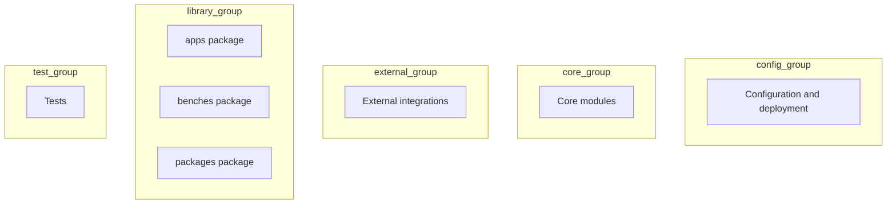

# Architecture report: middleapi/orpc

> Automated static analysis. **Observed** = directly seen in files/imports/AST; **Inferred** = interpretation from that evidence. Repository code was not executed.

## 1. Repository at a glance

| Item | Value |
| --- | --- |
| Repository | middleapi/orpc |
| Description | Typesafe APIs Made Simple 🪄 |
| Language | TypeScript |
| Stars | 5765 |
| Licence | MIT |
| Analysed commit / branch | ab64ed68ffadeb2b7da6a7a5ae008e1a05205ffc / main |
| Framework(s) | Express, Fastify, NestJS, Next.js, React, Vue |
| Files analysed | 800 |
| Components | 7 |

## 2. Architecture in one minute

middleapi/orpc - Typesafe APIs Made Simple 🪄. This repository was analysed statically from 800 file(s) (0 Python). Detected technologies (observed from imports/manifests): GitHub Actions, Redis, Express, Fastify, NestJS, Next.js. Files are grouped into 7 component(s): apps package, benches package, Configuration and deployment, Core modules, External integrations, packages package, Tests. Findings below distinguish observed facts from inferred interpretation.

## 3. High-level block diagram

## 4. Main components

### apps package (`apps`)

- **Kind:** library
- **Status:** Observed
- **Confidence:** 0.85
- **Responsibility:** Groups 19 file(s) under apps package (observed from repository paths and static analysis).
- **Paths:** `apps/content/blume.config.ts`, `apps/content/components.ts`, `apps/content/components/blume/twoslash-popups.ts`, `apps/content/dev/server-sourcemaps.ts`, `apps/content/experts/data.ts`, `apps/content/pages/_home/stats.ts`, `apps/content/pages/_sponsors/format.ts`, `apps/content/search/code-index.ts`, `apps/content/search/page-preview.ts`, `apps/content/shared/contract-first.ts`, `apps/content/shared/getting-started.ts`, `apps/content/shared/planet.ts`, `apps/content/sponsors/ads.ts`, `apps/content/sponsors/avatar-fallback.ts`, `apps/content/sponsors/client.ts`, `apps/content/sponsors/data.ts`, `apps/content/sponsors/inject.ts`, `apps/content/sponsors/slots.ts`, `apps/content/sponsors/sponsors.ts`
- **Evidence:** [apps/content/blume.config.ts](https://github.com/middleapi/orpc/blob/ab64ed68ffadeb2b7da6a7a5ae008e1a05205ffc/apps/content/blume.config.ts); [apps/content/components.ts](https://github.com/middleapi/orpc/blob/ab64ed68ffadeb2b7da6a7a5ae008e1a05205ffc/apps/content/components.ts); [apps/content/components/blume/twoslash-popups.ts](https://github.com/middleapi/orpc/blob/ab64ed68ffadeb2b7da6a7a5ae008e1a05205ffc/apps/content/components/blume/twoslash-popups.ts); [apps/content/dev/server-sourcemaps.ts](https://github.com/middleapi/orpc/blob/ab64ed68ffadeb2b7da6a7a5ae008e1a05205ffc/apps/content/dev/server-sourcemaps.ts); [apps/content/experts/data.ts](https://github.com/middleapi/orpc/blob/ab64ed68ffadeb2b7da6a7a5ae008e1a05205ffc/apps/content/experts/data.ts); [apps/content/pages/_home/stats.ts](https://github.com/middleapi/orpc/blob/ab64ed68ffadeb2b7da6a7a5ae008e1a05205ffc/apps/content/pages/_home/stats.ts); [apps/content/pages/_sponsors/format.ts](https://github.com/middleapi/orpc/blob/ab64ed68ffadeb2b7da6a7a5ae008e1a05205ffc/apps/content/pages/_sponsors/format.ts); [apps/content/search/code-index.ts](https://github.com/middleapi/orpc/blob/ab64ed68ffadeb2b7da6a7a5ae008e1a05205ffc/apps/content/search/code-index.ts)

### benches package (`benches`)

- **Kind:** library
- **Status:** Observed
- **Confidence:** 0.85
- **Responsibility:** Groups 9 file(s) under benches package (observed from repository paths and static analysis).
- **Paths:** `benches/__shared__/payloads.ts`, `benches/effect-middleware.bench.ts`, `benches/json-schema-coercer.bench.ts`, `benches/openapi-link-handler.bench.ts`, `benches/openapi-serializer.bench.ts`, `benches/procedure-call.bench.ts`, `benches/rpc-link-handler.bench.ts`, `benches/rpc-serializer.bench.ts`, `benches/static-file-handler.bench.ts`
- **Evidence:** [benches/__shared__/payloads.ts](https://github.com/middleapi/orpc/blob/ab64ed68ffadeb2b7da6a7a5ae008e1a05205ffc/benches/__shared__/payloads.ts); [benches/effect-middleware.bench.ts](https://github.com/middleapi/orpc/blob/ab64ed68ffadeb2b7da6a7a5ae008e1a05205ffc/benches/effect-middleware.bench.ts); [benches/json-schema-coercer.bench.ts](https://github.com/middleapi/orpc/blob/ab64ed68ffadeb2b7da6a7a5ae008e1a05205ffc/benches/json-schema-coercer.bench.ts); [benches/openapi-link-handler.bench.ts](https://github.com/middleapi/orpc/blob/ab64ed68ffadeb2b7da6a7a5ae008e1a05205ffc/benches/openapi-link-handler.bench.ts); [benches/openapi-serializer.bench.ts](https://github.com/middleapi/orpc/blob/ab64ed68ffadeb2b7da6a7a5ae008e1a05205ffc/benches/openapi-serializer.bench.ts); [benches/procedure-call.bench.ts](https://github.com/middleapi/orpc/blob/ab64ed68ffadeb2b7da6a7a5ae008e1a05205ffc/benches/procedure-call.bench.ts); [benches/rpc-link-handler.bench.ts](https://github.com/middleapi/orpc/blob/ab64ed68ffadeb2b7da6a7a5ae008e1a05205ffc/benches/rpc-link-handler.bench.ts); [benches/rpc-serializer.bench.ts](https://github.com/middleapi/orpc/blob/ab64ed68ffadeb2b7da6a7a5ae008e1a05205ffc/benches/rpc-serializer.bench.ts)

### Configuration and deployment (`config`)

- **Kind:** config
- **Status:** Observed
- **Confidence:** 0.85
- **Responsibility:** Groups 45 file(s) under configuration and deployment (observed from repository paths and static analysis).
- **Paths:** `apps/content/package.json`, `apps/content/tsconfig.json`, `package.json`, `packages/ai-sdk/package.json`, `packages/ai-sdk/tsconfig.json`, `packages/arktype/package.json`, `packages/arktype/tsconfig.json`, `packages/bun/bunfig.toml`, `packages/bun/package.json`, `packages/bun/tsconfig.json`, `packages/client/package.json`, `packages/client/tsconfig.json`, `packages/cloudflare/package.json`, `packages/cloudflare/tsconfig.json`, `packages/contract/package.json`, `packages/contract/tsconfig.json`, `packages/effect/package.json`, `packages/effect/tsconfig.json`, `packages/evlog/package.json`, `packages/evlog/tsconfig.json`, `packages/hibernation/package.json`, `packages/hibernation/tsconfig.json`, `packages/json-schema/package.json`, `packages/json-schema/tsconfig.json`, `packages/lock/package.json`, `packages/lock/tsconfig.json`, `packages/mcp/package.json`, `packages/mcp/tsconfig.json`, `packages/msw/package.json`, `packages/msw/tsconfig.json`, `packages/nest/package.json`, `packages/nest/tsconfig.json`, `packages/next/package.json`, `packages/next/tsconfig.json`, `packages/node/package.json`, `packages/node/tsconfig.json`, `packages/openapi/package.json`, `packages/openapi/tsconfig.json`, `packages/opentelemetry/package.json`, `packages/opentelemetry/tsconfig.json`, `packages/pinia-colada/package.json`, `packages/pinia-colada/tsconfig.json`, `packages/pino/package.json`, `packages/pino/tsconfig.json`, `packages/publisher/package.json`
- **Evidence:** [apps/content/package.json](https://github.com/middleapi/orpc/blob/ab64ed68ffadeb2b7da6a7a5ae008e1a05205ffc/apps/content/package.json); [apps/content/tsconfig.json](https://github.com/middleapi/orpc/blob/ab64ed68ffadeb2b7da6a7a5ae008e1a05205ffc/apps/content/tsconfig.json); [package.json](https://github.com/middleapi/orpc/blob/ab64ed68ffadeb2b7da6a7a5ae008e1a05205ffc/package.json); [packages/ai-sdk/package.json](https://github.com/middleapi/orpc/blob/ab64ed68ffadeb2b7da6a7a5ae008e1a05205ffc/packages/ai-sdk/package.json); [packages/ai-sdk/tsconfig.json](https://github.com/middleapi/orpc/blob/ab64ed68ffadeb2b7da6a7a5ae008e1a05205ffc/packages/ai-sdk/tsconfig.json); [packages/arktype/package.json](https://github.com/middleapi/orpc/blob/ab64ed68ffadeb2b7da6a7a5ae008e1a05205ffc/packages/arktype/package.json); [packages/arktype/tsconfig.json](https://github.com/middleapi/orpc/blob/ab64ed68ffadeb2b7da6a7a5ae008e1a05205ffc/packages/arktype/tsconfig.json); [packages/bun/bunfig.toml](https://github.com/middleapi/orpc/blob/ab64ed68ffadeb2b7da6a7a5ae008e1a05205ffc/packages/bun/bunfig.toml)

### Core modules (`core`)

- **Kind:** core
- **Status:** Observed
- **Confidence:** 0.85
- **Responsibility:** Groups 2 file(s) under core modules (observed from repository paths and static analysis).
- **Paths:** `oxfmt.config.ts`, `oxlint.config.ts`
- **Evidence:** [oxfmt.config.ts](https://github.com/middleapi/orpc/blob/ab64ed68ffadeb2b7da6a7a5ae008e1a05205ffc/oxfmt.config.ts); [oxlint.config.ts](https://github.com/middleapi/orpc/blob/ab64ed68ffadeb2b7da6a7a5ae008e1a05205ffc/oxlint.config.ts)

### External integrations (`external_integrations`)

- **Kind:** external
- **Status:** Observed
- **Confidence:** 0.85
- **Responsibility:** Groups 113 file(s) under external integrations (observed from repository paths and static analysis).
- **Paths:** `packages/client/src/adapters/fetch/index.test.ts`, `packages/client/src/adapters/fetch/index.ts`, `packages/client/src/adapters/fetch/rpc-link.test-d.ts`, `packages/client/src/adapters/fetch/rpc-link.test.ts`, `packages/client/src/adapters/fetch/rpc-link.ts`, `packages/client/src/adapters/fetch/transport.ts`, `packages/client/src/adapters/message-port/index.test.ts`, `packages/client/src/adapters/message-port/index.ts`, `packages/client/src/adapters/message-port/message-port.test.ts`, `packages/client/src/adapters/message-port/message-port.ts`, `packages/client/src/adapters/message-port/rpc-link.test.ts`, `packages/client/src/adapters/message-port/rpc-link.ts`, `packages/client/src/adapters/message-port/transport.ts`, `packages/client/src/adapters/standard/codec.ts`, `packages/client/src/adapters/standard/index.test.ts`, `packages/client/src/adapters/standard/index.ts`, `packages/client/src/adapters/standard/link.test.ts`, `packages/client/src/adapters/standard/link.ts`, `packages/client/src/adapters/standard/plugin.test.ts`, `packages/client/src/adapters/standard/plugin.ts`, `packages/client/src/adapters/standard/rpc-link-codec.test.ts`, `packages/client/src/adapters/standard/rpc-link-codec.ts`, `packages/client/src/adapters/standard/transport.ts`, `packages/client/src/adapters/websocket/index.test.ts`, `packages/client/src/adapters/websocket/index.ts`, `packages/client/src/adapters/websocket/rpc-link.test.ts`, `packages/client/src/adapters/websocket/rpc-link.ts`, `packages/client/src/adapters/websocket/transport.ts`, `packages/client/src/async-iterator-object.test.ts`, `packages/client/src/async-iterator-object.ts`, `packages/client/src/client-safe.test-d.ts`, `packages/client/src/client-safe.test.ts`, `packages/client/src/client-safe.ts`, `packages/client/src/client.test-d.ts`, `packages/client/src/client.test.ts`, `packages/client/src/client.ts`, `packages/client/src/consts.ts`, `packages/client/src/dynamic-link.test-d.ts`, `packages/client/src/dynamic-link.test.ts`, `packages/client/src/dynamic-link.ts`, `packages/client/src/error-utils.test-d.ts`, `packages/client/src/error-utils.test.ts`, `packages/client/src/error-utils.ts`, `packages/client/src/error.test-d.ts`, `packages/client/src/error.test.ts`, `packages/client/src/error.ts`, `packages/client/src/index.test.ts`, `packages/client/src/index.ts`, `packages/client/src/plugins/batch.test.ts`, `packages/client/src/plugins/batch.ts`, `packages/client/src/plugins/cookie-jar.test.ts`, `packages/client/src/plugins/cookie-jar.ts`, `packages/client/src/plugins/dedupe.test.ts`, `packages/client/src/plugins/dedupe.ts`, `packages/client/src/plugins/index.test.ts`, `packages/client/src/plugins/index.ts`, `packages/client/src/plugins/request-compression.test.ts`, `packages/client/src/plugins/request-compression.ts`, `packages/client/src/plugins/response-compression.test.ts`, `packages/client/src/plugins/response-compression.ts`, `packages/client/src/plugins/retry-after.test.ts`, `packages/client/src/plugins/retry-after.ts`, `packages/client/src/plugins/retry.test.ts`, `packages/client/src/plugins/retry.ts`, `packages/client/src/plugins/timeout.test.ts`, `packages/client/src/plugins/timeout.ts`, `packages/client/src/rpc-json-serializer.test.ts`, `packages/client/src/rpc-json-serializer.ts`, `packages/client/src/rpc-serializer.test.ts`, `packages/client/src/rpc-serializer.ts`, `packages/client/src/types.test-d.ts`, `packages/client/src/types.ts`, `packages/client/src/utils.test-d.ts`, `packages/client/src/utils.test.ts`, `packages/client/src/utils.ts`, `packages/evlog/src/adapters/node.test.ts`, `packages/evlog/src/adapters/node.ts`, `packages/lock/src/adapters/base-redis.ts`, `packages/lock/src/adapters/memory.test.ts`, `packages/lock/src/adapters/memory.ts`, `packages/lock/src/adapters/redis.test.ts`, `packages/lock/src/adapters/redis.ts`, `packages/lock/src/adapters/upstash.test.ts`, `packages/lock/src/adapters/upstash.ts`, `packages/openapi/src/adapters/aws-lambda/index.test.ts`, `packages/openapi/src/adapters/aws-lambda/index.ts`, `packages/openapi/src/adapters/aws-lambda/openapi-handler.test.ts`, `packages/openapi/src/adapters/aws-lambda/openapi-handler.ts`, `packages/openapi/src/adapters/fastify/index.test.ts`, `packages/openapi/src/adapters/fastify/index.ts`, `packages/openapi/src/adapters/fastify/openapi-handler.test.ts`, `packages/openapi/src/adapters/fastify/openapi-handler.ts`, `packages/openapi/src/adapters/fetch/index.test.ts`, `packages/openapi/src/adapters/fetch/index.ts`, `packages/openapi/src/adapters/fetch/openapi-handler.test.ts`, `packages/openapi/src/adapters/fetch/openapi-handler.ts`, `packages/openapi/src/adapters/fetch/openapi-link.test.ts`, `packages/openapi/src/adapters/fetch/openapi-link.ts`, `packages/openapi/src/adapters/node/index.test.ts`, `packages/openapi/src/adapters/node/index.ts`, `packages/openapi/src/adapters/node/openapi-handler.test.ts`, `packages/openapi/src/adapters/node/openapi-handler.ts`, `packages/openapi/src/adapters/standard/index.test.ts`, `packages/openapi/src/adapters/standard/index.ts`, `packages/openapi/src/adapters/standard/openapi-handler-codec.test.ts`, `packages/openapi/src/adapters/standard/openapi-handler-codec.ts`, `packages/openapi/src/adapters/standard/openapi-link-codec.test.ts`, `packages/openapi/src/adapters/standard/openapi-link-codec.ts`, `packages/openapi/src/adapters/standard/openapi-matcher.test.ts`, `packages/openapi/src/adapters/standard/openapi-matcher.ts`, `packages/openapi/src/adapters/standard/utils.test.ts`, `packages/openapi/src/adapters/standard/utils.ts`, `packages/publisher/src/adapters/base-redis.ts`
- **Evidence:** [packages/client/src/adapters/fetch/index.test.ts](https://github.com/middleapi/orpc/blob/ab64ed68ffadeb2b7da6a7a5ae008e1a05205ffc/packages/client/src/adapters/fetch/index.test.ts); [packages/client/src/adapters/fetch/index.ts](https://github.com/middleapi/orpc/blob/ab64ed68ffadeb2b7da6a7a5ae008e1a05205ffc/packages/client/src/adapters/fetch/index.ts); [packages/client/src/adapters/fetch/rpc-link.test-d.ts](https://github.com/middleapi/orpc/blob/ab64ed68ffadeb2b7da6a7a5ae008e1a05205ffc/packages/client/src/adapters/fetch/rpc-link.test-d.ts); [packages/client/src/adapters/fetch/rpc-link.test.ts](https://github.com/middleapi/orpc/blob/ab64ed68ffadeb2b7da6a7a5ae008e1a05205ffc/packages/client/src/adapters/fetch/rpc-link.test.ts); [packages/client/src/adapters/fetch/rpc-link.ts](https://github.com/middleapi/orpc/blob/ab64ed68ffadeb2b7da6a7a5ae008e1a05205ffc/packages/client/src/adapters/fetch/rpc-link.ts); [packages/client/src/adapters/fetch/transport.ts](https://github.com/middleapi/orpc/blob/ab64ed68ffadeb2b7da6a7a5ae008e1a05205ffc/packages/client/src/adapters/fetch/transport.ts); [packages/client/src/adapters/message-port/index.test.ts](https://github.com/middleapi/orpc/blob/ab64ed68ffadeb2b7da6a7a5ae008e1a05205ffc/packages/client/src/adapters/message-port/index.test.ts); [packages/client/src/adapters/message-port/index.ts](https://github.com/middleapi/orpc/blob/ab64ed68ffadeb2b7da6a7a5ae008e1a05205ffc/packages/client/src/adapters/message-port/index.ts)

### packages package (`packages`)

- **Kind:** library
- **Status:** Observed
- **Confidence:** 0.85
- **Responsibility:** Groups 293 file(s) under packages package (observed from repository paths and static analysis).
- **Paths:** `packages/ai-sdk/src/index.test.ts`, `packages/ai-sdk/src/index.ts`, `packages/ai-sdk/src/tool-meta.test-d.ts`, `packages/ai-sdk/src/tool-meta.test.ts`, `packages/ai-sdk/src/tool-meta.ts`, `packages/ai-sdk/src/tool.test-d.ts`, `packages/ai-sdk/src/tool.test.ts`, `packages/ai-sdk/src/tool.ts`, `packages/arktype/src/converter.test.ts`, `packages/arktype/src/converter.ts`, `packages/arktype/src/index.test.ts`, `packages/arktype/src/index.ts`, `packages/bun/src/index.test.ts`, `packages/bun/src/index.ts`, `packages/bun/src/redis-lock.test.ts`, `packages/bun/src/redis-lock.ts`, `packages/bun/src/redis-publisher.test.ts`, `packages/bun/src/redis-publisher.ts`, `packages/bun/src/redis-ratelimit.test.ts`, `packages/bun/src/redis-ratelimit.ts`, `packages/cloudflare/src/index.test.ts`, `packages/cloudflare/src/index.ts`, `packages/cloudflare/src/lock-object.test.ts`, `packages/cloudflare/src/lock-object.ts`, `packages/cloudflare/src/lock.test.ts`, `packages/cloudflare/src/lock.ts`, `packages/cloudflare/src/publisher-object.test.ts`, `packages/cloudflare/src/publisher-object.ts`, `packages/cloudflare/src/publisher.test.ts`, `packages/cloudflare/src/publisher.ts`, `packages/cloudflare/src/ratelimit.test.ts`, `packages/cloudflare/src/ratelimit.ts`, `packages/cloudflare/src/tracer.test.ts`, `packages/cloudflare/src/tracer.ts`, `packages/cloudflare/vitest.config.ts`, `packages/contract/src/builder-variants.test-d.ts`, `packages/contract/src/builder-variants.ts`, `packages/contract/src/builder.test-d.ts`, `packages/contract/src/builder.test.ts`, `packages/contract/src/builder.ts`, `packages/contract/src/client-factory.test-d.ts`, `packages/contract/src/client-factory.test.ts`, `packages/contract/src/client-factory.ts`, `packages/contract/src/error-factory.test-d.ts`, `packages/contract/src/error-factory.test.ts`, `packages/contract/src/error-factory.ts`, `packages/contract/src/error-utils.test-d.ts`, `packages/contract/src/error-utils.test.ts`, `packages/contract/src/error-utils.ts`, `packages/contract/src/error.test-d.ts`, `packages/contract/src/error.test.ts`, `packages/contract/src/error.ts`, `packages/contract/src/index.test.ts`, `packages/contract/src/index.ts`, `packages/contract/src/meta-built-in.test.ts`, `packages/contract/src/meta-built-in.ts`, `packages/contract/src/meta-utils.test.ts`, `packages/contract/src/meta-utils.ts`, `packages/contract/src/meta.test.ts`, `packages/contract/src/meta.ts`, `packages/contract/src/plugins/index.test.ts`, `packages/contract/src/plugins/index.ts`, `packages/contract/src/plugins/request-validation.test.ts`, `packages/contract/src/plugins/request-validation.ts`, `packages/contract/src/plugins/response-validation.test.ts`, `packages/contract/src/plugins/response-validation.ts`, `packages/contract/src/procedure-client.test-d.ts`, `packages/contract/src/procedure-client.ts`, `packages/contract/src/procedure.test.ts`, `packages/contract/src/procedure.ts`, `packages/contract/src/router-client.test-d.ts`, `packages/contract/src/router-client.ts`, `packages/contract/src/router-utils.test-d.ts`, `packages/contract/src/router-utils.test.ts`, `packages/contract/src/router-utils.ts`, `packages/contract/src/router.test-d.ts`, `packages/contract/src/router.ts`, `packages/contract/src/schema-built-in.test.ts`, `packages/contract/src/schema-built-in.ts`, `packages/contract/src/schema-utils.test.ts`, `packages/contract/src/schema-utils.ts`, `packages/contract/src/schema.test-d.ts`, `packages/contract/src/schema.ts`, `packages/effect/src/client.test-d.ts`, `packages/effect/src/client.test.ts`, `packages/effect/src/client.ts`, `packages/effect/src/context.test-d.ts`, `packages/effect/src/context.ts`, `packages/effect/src/converter.test.ts`, `packages/effect/src/converter.ts`, `packages/effect/src/error.test-d.ts`, `packages/effect/src/error.test.ts`, `packages/effect/src/error.ts`, `packages/effect/src/extensions/effect.test-d.ts`, `packages/effect/src/extensions/effect.test.ts`, `packages/effect/src/extensions/effect.ts`, `packages/effect/src/extensions/schema.test-d.ts`, `packages/effect/src/extensions/schema.test.ts`, `packages/effect/src/extensions/schema.ts`, `packages/effect/src/handler.test-d.ts`, `packages/effect/src/handler.test.ts`, `packages/effect/src/handler.ts`, `packages/effect/src/index.test.ts`, `packages/effect/src/index.ts`, `packages/effect/src/middleware.test-d.ts`, `packages/effect/src/middleware.test.ts`, `packages/effect/src/middleware.ts`, `packages/effect/src/runtime.test.ts`, `packages/effect/src/runtime.ts`, `packages/effect/src/schema.test.ts`, `packages/effect/src/schema.ts`, `packages/evlog/src/context.test.ts`, `packages/evlog/src/context.ts`, `packages/evlog/src/handler-plugin.test.ts`, `packages/evlog/src/handler-plugin.ts`, `packages/evlog/src/index.test.ts`, `packages/evlog/src/index.ts`, `packages/hibernation/src/encode-event.test.ts`, `packages/hibernation/src/encode-event.ts`, `packages/hibernation/src/handler-plugin.test.ts`, `packages/hibernation/src/handler-plugin.ts`, `packages/hibernation/src/index.test.ts`, `packages/hibernation/src/index.ts`, `packages/json-schema/src/coercer.test.ts`, `packages/json-schema/src/coercer.ts`, `packages/json-schema/src/composition-utils.test.ts`, `packages/json-schema/src/composition-utils.ts`, `packages/json-schema/src/constants.ts`, `packages/json-schema/src/convert.test.ts`, `packages/json-schema/src/convert.ts`, `packages/json-schema/src/index.test.ts`, `packages/json-schema/src/index.ts`, `packages/json-schema/src/ref-utils.test.ts`, `packages/json-schema/src/ref-utils.ts`, `packages/json-schema/src/smart-coercion-handler-plugin.test.ts`, `packages/json-schema/src/smart-coercion-handler-plugin.ts`, `packages/json-schema/src/smart-coercion-link-plugin.test.ts`, `packages/json-schema/src/smart-coercion-link-plugin.ts`, `packages/json-schema/src/standard-json-schema-converter.test.ts`, `packages/json-schema/src/standard-json-schema-converter.ts`, `packages/json-schema/src/types.ts`, `packages/json-schema/src/utils.test.ts`, `packages/json-schema/src/utils.ts`, `packages/lock/src/error.ts`, `packages/lock/src/index.test.ts`, `packages/lock/src/index.ts`, `packages/lock/src/middleware.test-d.ts`, `packages/lock/src/middleware.test.ts`, `packages/lock/src/middleware.ts`, `packages/lock/src/types.ts`, `packages/mcp/src/__tests__/utils.ts`, `packages/mcp/src/index.test.ts`, `packages/mcp/src/index.ts`, `packages/mcp/src/meta.test-d.ts`, `packages/mcp/src/meta.test.ts`, `packages/mcp/src/meta.ts`, `packages/mcp/src/registrar.test-d.ts`, `packages/mcp/src/registrar.test.ts`, `packages/mcp/src/registrar.ts`, `packages/mcp/src/utils.test.ts`, `packages/mcp/src/utils.ts`, `packages/msw/src/http-procedure-utils.openapi.test.ts`, `packages/msw/src/http-procedure-utils.test-d.ts`, `packages/msw/src/http-procedure-utils.test.ts`, `packages/msw/src/http-procedure-utils.ts`, `packages/msw/src/http-router-utils.test-d.ts`, `packages/msw/src/http-router-utils.test.ts`, `packages/msw/src/http-router-utils.ts`, `packages/msw/src/index.test.ts`, `packages/msw/src/index.ts`, `packages/nest/src/constants.ts`, `packages/nest/src/implement.test-d.ts`, `packages/nest/src/implement.test.ts`, `packages/nest/src/implement.ts`, `packages/nest/src/index.test.ts`, `packages/nest/src/index.ts`, `packages/nest/src/module.test.ts`, `packages/nest/src/module.ts`, `packages/next/src/deferred-interceptors.test.ts`, `packages/next/src/deferred-interceptors.ts`, `packages/next/src/extensions/actionable.test-d.ts`, `packages/next/src/extensions/actionable.test.ts`, `packages/next/src/extensions/actionable.ts`, `packages/next/src/hooks/index.test.ts`, `packages/next/src/hooks/index.ts`, `packages/next/src/hooks/optimistic-server-function.test-d.ts`, `packages/next/src/hooks/optimistic-server-function.test.tsx`, `packages/next/src/hooks/optimistic-server-function.ts`, `packages/next/src/hooks/server-function.test-d.ts`, `packages/next/src/hooks/server-function.test.tsx`, `packages/next/src/hooks/server-function.ts`, `packages/next/src/index.test.ts`, `packages/next/src/index.ts`, `packages/next/src/server-form-function.test.ts`, `packages/next/src/server-form-function.ts`, `packages/next/src/server-form-functionable.test-d.ts`, `packages/next/src/server-form-functionable.test.ts`, `packages/next/src/server-form-functionable.ts`, `packages/next/src/server-function.action-state.test.tsx`, `packages/next/src/server-function.test-d.ts`, `packages/next/src/server-function.test.ts`, `packages/next/src/server-function.ts`, `packages/next/src/server-functionable.test-d.ts`, `packages/next/src/server-functionable.test.ts`, `packages/next/src/server-functionable.ts`, `packages/node/src/batch-response-compression-handler-plugin.test.ts`, `packages/node/src/batch-response-compression-handler-plugin.ts`, `packages/node/src/index.ts`, `packages/node/src/multipart.test.ts`, `packages/node/src/multipart.ts`, `packages/node/src/static-file-handler-plugin.test.ts`, `packages/node/src/static-file-handler-plugin.ts`, `packages/node/src/tmp-file-upload-handler-plugin.test.ts`, `packages/node/src/tmp-file-upload-handler-plugin.ts`, `packages/openapi/src/bracket-notation.test.ts`, `packages/openapi/src/bracket-notation.ts`, `packages/openapi/src/client-factory.test-d.ts`, `packages/openapi/src/client-factory.test.ts`, `packages/openapi/src/client-factory.ts`, `packages/openapi/src/constants.test.ts`, `packages/openapi/src/constants.ts`, `packages/openapi/src/extensions/route.test.ts`, `packages/openapi/src/extensions/route.ts`, `packages/openapi/src/helpers/form-data.test.ts`, `packages/openapi/src/helpers/form-data.ts`, `packages/openapi/src/helpers/index.test.ts`, `packages/openapi/src/helpers/index.ts`, `packages/openapi/src/index.test.ts`, `packages/openapi/src/index.ts`, `packages/openapi/src/meta.test.ts`, `packages/openapi/src/meta.ts`, `packages/openapi/src/openapi-generator-components.test.ts`, `packages/openapi/src/openapi-generator-components.ts`, `packages/openapi/src/openapi-generator-operation.test.ts`, `packages/openapi/src/openapi-generator-operation.ts`, `packages/openapi/src/openapi-generator.test-d.ts`, `packages/openapi/src/openapi-generator.test.ts`, `packages/openapi/src/openapi-generator.ts`, `packages/openapi/src/openapi-json-serializer.test-d.ts`, `packages/openapi/src/openapi-json-serializer.test.ts`, `packages/openapi/src/openapi-json-serializer.ts`, `packages/openapi/src/openapi-serializer.test.ts`, `packages/openapi/src/openapi-serializer.ts`, `packages/openapi/src/plugins/index.test.ts`, `packages/openapi/src/plugins/index.ts`, `packages/openapi/src/plugins/openapi-reference.test.ts`, `packages/openapi/src/plugins/openapi-reference.ts`, `packages/openapi/src/router-utils.test.ts`, `packages/openapi/src/router-utils.ts`, `packages/openapi/src/types.test-d.ts`, `packages/openapi/src/types.ts`, `packages/openapi/src/utils.test.ts`, `packages/openapi/src/utils.ts`, `packages/opentelemetry/src/index.ts`, `packages/opentelemetry/src/instrumentation.test.ts`, `packages/opentelemetry/src/instrumentation.ts`, `packages/opentelemetry/src/tracer.no-context-manager.test.ts`, `packages/opentelemetry/src/tracer.test.ts`, `packages/opentelemetry/src/tracer.ts`, `packages/pinia-colada/src/contract-utils.test-d.ts`, `packages/pinia-colada/src/contract-utils.test.ts`, `packages/pinia-colada/src/contract-utils.ts`, `packages/pinia-colada/src/index.test.ts`, `packages/pinia-colada/src/index.ts`, `packages/pinia-colada/src/key.test.ts`, `packages/pinia-colada/src/key.ts`, `packages/pinia-colada/src/live-query.test.tsx`, `packages/pinia-colada/src/live-query.ts`, `packages/pinia-colada/src/meta.test-d.ts`, `packages/pinia-colada/src/meta.test.ts`, `packages/pinia-colada/src/meta.ts`, `packages/pinia-colada/src/plugin.test.ts`, `packages/pinia-colada/src/plugin.ts`, `packages/pinia-colada/src/procedure-utils.test-d.ts`, `packages/pinia-colada/src/procedure-utils.test.ts`, `packages/pinia-colada/src/procedure-utils.ts`, `packages/pinia-colada/src/router-utils.test-d.ts`, `packages/pinia-colada/src/router-utils.test.ts`, `packages/pinia-colada/src/router-utils.ts`, `packages/pinia-colada/src/shared-utils.test-d.ts`, `packages/pinia-colada/src/shared-utils.test.ts`, `packages/pinia-colada/src/shared-utils.ts`, `packages/pinia-colada/src/ssr.test.ts`, `packages/pinia-colada/src/ssr.ts`, `packages/pinia-colada/src/stream-query.test.tsx`, `packages/pinia-colada/src/stream-query.ts`, `packages/pinia-colada/src/types.ts`, `packages/pino/src/context.test.ts`, `packages/pino/src/context.ts`, `packages/pino/src/handler-plugin.test.ts`, `packages/pino/src/handler-plugin.ts`, `packages/pino/src/index.test.ts`, `packages/pino/src/index.ts`
- **Evidence:** [packages/ai-sdk/src/index.test.ts](https://github.com/middleapi/orpc/blob/ab64ed68ffadeb2b7da6a7a5ae008e1a05205ffc/packages/ai-sdk/src/index.test.ts); [packages/ai-sdk/src/index.ts](https://github.com/middleapi/orpc/blob/ab64ed68ffadeb2b7da6a7a5ae008e1a05205ffc/packages/ai-sdk/src/index.ts); [packages/ai-sdk/src/tool-meta.test-d.ts](https://github.com/middleapi/orpc/blob/ab64ed68ffadeb2b7da6a7a5ae008e1a05205ffc/packages/ai-sdk/src/tool-meta.test-d.ts); [packages/ai-sdk/src/tool-meta.test.ts](https://github.com/middleapi/orpc/blob/ab64ed68ffadeb2b7da6a7a5ae008e1a05205ffc/packages/ai-sdk/src/tool-meta.test.ts); [packages/ai-sdk/src/tool-meta.ts](https://github.com/middleapi/orpc/blob/ab64ed68ffadeb2b7da6a7a5ae008e1a05205ffc/packages/ai-sdk/src/tool-meta.ts); [packages/ai-sdk/src/tool.test-d.ts](https://github.com/middleapi/orpc/blob/ab64ed68ffadeb2b7da6a7a5ae008e1a05205ffc/packages/ai-sdk/src/tool.test-d.ts); [packages/ai-sdk/src/tool.test.ts](https://github.com/middleapi/orpc/blob/ab64ed68ffadeb2b7da6a7a5ae008e1a05205ffc/packages/ai-sdk/src/tool.test.ts); [packages/ai-sdk/src/tool.ts](https://github.com/middleapi/orpc/blob/ab64ed68ffadeb2b7da6a7a5ae008e1a05205ffc/packages/ai-sdk/src/tool.ts)

### Tests (`tests`)

- **Kind:** test
- **Status:** Observed
- **Confidence:** 0.85
- **Responsibility:** Groups 32 file(s) under tests (observed from repository paths and static analysis).
- **Paths:** `packages/bun/tests/__shared__/utils.ts`, `packages/bun/tests/capture-async-context.test.ts`, `packages/bun/tests/lock-redis-adapters-compatibility.test.ts`, `packages/bun/tests/publisher-redis-adapters-compatibility.test.ts`, `packages/bun/tests/ratelimit-redis-adapters-compatibility.test.ts`, `packages/bun/tests/rpc/__shared__/built-in-support-data-types.ts`, `packages/bun/tests/rpc/__shared__/client-server.bun-fetch.ts`, `packages/bun/tests/rpc/__shared__/client-server.bun-websocket.ts`, `packages/bun/tests/rpc/__shared__/client-server.compression-bun-fetch.ts`, `packages/bun/tests/rpc/__shared__/client-server.compression-bun-websocket.ts`, `packages/bun/tests/rpc/__shared__/client-server.ts`, `packages/bun/tests/rpc/cancel-and-abort.test.ts`, `packages/bun/tests/rpc/data-transfer.test.ts`, `packages/cloudflare/tests/__shared__/main.ts`, `packages/lock/tests/e2e.test.ts`, `packages/node/tests/serves-static-files.test.ts`, `packages/node/tests/uploads-large-files.test.ts`, `packages/node/tests/works-with-response-compression.test.ts`, `packages/openapi/tests/__shared__/schema.ts`, `packages/openapi/tests/openapi-generator/composed-schemas.test.ts`, `packages/openapi/tests/openapi-generator/crud.test.ts`, `packages/openapi/tests/openapi-generator/detailed-http.test.ts`, `packages/openapi/tests/openapi-generator/event-streaming.test.ts`, `packages/openapi/tests/openapi-generator/file-transfer.test.ts`, `packages/openapi/tests/openapi-generator/reusable-components.test.ts`, `packages/openapi/tests/openapi-generator/schema-libraries.test.ts`, `packages/openapi/tests/openapi-generator/typed-errors.test.ts`, `packages/pinia-colada/tests/__shared__/orpc.ts`, `packages/pinia-colada/tests/__shared__/utils.ts`, `packages/pinia-colada/tests/e2e.test-d.ts`, `packages/pinia-colada/tests/e2e.test.tsx`, `packages/pinia-colada/tests/ssr.test.tsx`
- **Evidence:** [packages/bun/tests/__shared__/utils.ts](https://github.com/middleapi/orpc/blob/ab64ed68ffadeb2b7da6a7a5ae008e1a05205ffc/packages/bun/tests/__shared__/utils.ts); [packages/bun/tests/capture-async-context.test.ts](https://github.com/middleapi/orpc/blob/ab64ed68ffadeb2b7da6a7a5ae008e1a05205ffc/packages/bun/tests/capture-async-context.test.ts); [packages/bun/tests/lock-redis-adapters-compatibility.test.ts](https://github.com/middleapi/orpc/blob/ab64ed68ffadeb2b7da6a7a5ae008e1a05205ffc/packages/bun/tests/lock-redis-adapters-compatibility.test.ts); [packages/bun/tests/publisher-redis-adapters-compatibility.test.ts](https://github.com/middleapi/orpc/blob/ab64ed68ffadeb2b7da6a7a5ae008e1a05205ffc/packages/bun/tests/publisher-redis-adapters-compatibility.test.ts); [packages/bun/tests/ratelimit-redis-adapters-compatibility.test.ts](https://github.com/middleapi/orpc/blob/ab64ed68ffadeb2b7da6a7a5ae008e1a05205ffc/packages/bun/tests/ratelimit-redis-adapters-compatibility.test.ts); [packages/bun/tests/rpc/__shared__/built-in-support-data-types.ts](https://github.com/middleapi/orpc/blob/ab64ed68ffadeb2b7da6a7a5ae008e1a05205ffc/packages/bun/tests/rpc/__shared__/built-in-support-data-types.ts); [packages/bun/tests/rpc/__shared__/client-server.bun-fetch.ts](https://github.com/middleapi/orpc/blob/ab64ed68ffadeb2b7da6a7a5ae008e1a05205ffc/packages/bun/tests/rpc/__shared__/client-server.bun-fetch.ts); [packages/bun/tests/rpc/__shared__/client-server.bun-websocket.ts](https://github.com/middleapi/orpc/blob/ab64ed68ffadeb2b7da6a7a5ae008e1a05205ffc/packages/bun/tests/rpc/__shared__/client-server.bun-websocket.ts)

## 5. Execution flow

**Observed** entry point(s):

- [packages/ai-sdk/src/index.ts](https://github.com/middleapi/orpc/blob/ab64ed68ffadeb2b7da6a7a5ae008e1a05205ffc/packages/ai-sdk/src/index.ts)
- [packages/arktype/src/index.ts](https://github.com/middleapi/orpc/blob/ab64ed68ffadeb2b7da6a7a5ae008e1a05205ffc/packages/arktype/src/index.ts)
- [packages/bun/src/index.ts](https://github.com/middleapi/orpc/blob/ab64ed68ffadeb2b7da6a7a5ae008e1a05205ffc/packages/bun/src/index.ts)
- [packages/client/src/index.ts](https://github.com/middleapi/orpc/blob/ab64ed68ffadeb2b7da6a7a5ae008e1a05205ffc/packages/client/src/index.ts)
- [packages/cloudflare/src/index.ts](https://github.com/middleapi/orpc/blob/ab64ed68ffadeb2b7da6a7a5ae008e1a05205ffc/packages/cloudflare/src/index.ts)
- [packages/contract/src/index.ts](https://github.com/middleapi/orpc/blob/ab64ed68ffadeb2b7da6a7a5ae008e1a05205ffc/packages/contract/src/index.ts)
- [packages/effect/src/index.ts](https://github.com/middleapi/orpc/blob/ab64ed68ffadeb2b7da6a7a5ae008e1a05205ffc/packages/effect/src/index.ts)
- [packages/evlog/src/index.ts](https://github.com/middleapi/orpc/blob/ab64ed68ffadeb2b7da6a7a5ae008e1a05205ffc/packages/evlog/src/index.ts)
- [packages/hibernation/src/index.ts](https://github.com/middleapi/orpc/blob/ab64ed68ffadeb2b7da6a7a5ae008e1a05205ffc/packages/hibernation/src/index.ts)
- [packages/json-schema/src/index.ts](https://github.com/middleapi/orpc/blob/ab64ed68ffadeb2b7da6a7a5ae008e1a05205ffc/packages/json-schema/src/index.ts)
- [packages/lock/src/index.ts](https://github.com/middleapi/orpc/blob/ab64ed68ffadeb2b7da6a7a5ae008e1a05205ffc/packages/lock/src/index.ts)
- [packages/mcp/src/index.ts](https://github.com/middleapi/orpc/blob/ab64ed68ffadeb2b7da6a7a5ae008e1a05205ffc/packages/mcp/src/index.ts)

Representative flow (derived from observed entry points and the import graph; steps beyond the entry point are **Inferred**):

1. Execution starts at an observed entry point listed above, if present.
2. No internal import relationships between components were observed.

## 6. Project structure

### `(root)`

- `.env.example` - config (280 bytes)
- `.gitignore` - other (416 bytes)
- `AGENTS.md` - docs (1368 bytes)
- `CODE_OF_CONDUCT.md` - docs (4949 bytes)
- `CONTRIBUTING.md` - docs (4028 bytes)
- `LICENSE` - docs (1060 bytes)
- `README.md` - docs (31712 bytes)
- `SECURITY.md` - docs (544 bytes)
- `oxfmt.config.ts` - source, TypeScript (218 bytes)
- `oxlint.config.ts` - source, TypeScript (3417 bytes)
- `package.json` - manifest (2618 bytes)

### `.agents`

- `.agents/skills/blume-migrate/SKILL.md` - docs (70594 bytes)
- `.agents/skills/blume-migrate/assets/oxfmt@0.71.0.patch` - other (3300 bytes)
- `.agents/skills/blume-migrate/references/docsify.md` - docs (22703 bytes)
- `.agents/skills/blume-migrate/references/docus.md` - docs (26928 bytes)
- `.agents/skills/blume-migrate/references/docusaurus.md` - docs (14907 bytes)
- `.agents/skills/blume-migrate/references/fern.md` - docs (36462 bytes)
- `.agents/skills/blume-migrate/references/fumadocs.md` - docs (15685 bytes)
- `.agents/skills/blume-migrate/references/gitbook.md` - docs (32305 bytes)
- `.agents/skills/blume-migrate/references/github-wiki.md` - docs (35469 bytes)
- `.agents/skills/blume-migrate/references/jekyll.md` - docs (32775 bytes)
- `.agents/skills/blume-migrate/references/mdbook.md` - docs (34165 bytes)
- `.agents/skills/blume-migrate/references/mintlify.md` - docs (31205 bytes)
- `.agents/skills/blume-migrate/references/mkdocs.md` - docs (33161 bytes)
- `.agents/skills/blume-migrate/references/monorepo.md` - docs (17352 bytes)
- `.agents/skills/blume-migrate/references/nextra.md` - docs (12135 bytes)
- `.agents/skills/blume-migrate/references/readme.md` - docs (34171 bytes)
- `.agents/skills/blume-migrate/references/redocly.md` - docs (36557 bytes)
- `.agents/skills/blume-migrate/references/starlight.md` - docs (13733 bytes)
- `.agents/skills/blume-migrate/references/vitepress.md` - docs (29912 bytes)
- `.agents/skills/blume-migrate/references/vuepress.md` - docs (39248 bytes)
- `.agents/skills/blume-migrate/scripts/docsify-codemod.mjs` - source, JavaScript (80688 bytes)
- `.agents/skills/blume-migrate/scripts/docus-codemod.mjs` - source, JavaScript (75321 bytes)
- `.agents/skills/blume-migrate/scripts/fern-codemod.mjs` - source, JavaScript (86387 bytes)
- `.agents/skills/blume-migrate/scripts/github-wiki-codemod.mjs` - source, JavaScript (92069 bytes)
- `.agents/skills/blume-migrate/scripts/include-excerpts.mjs` - source, JavaScript (22570 bytes)
- `.agents/skills/blume-migrate/scripts/jekyll-codemod.mjs` - source, JavaScript (115915 bytes)
- `.agents/skills/blume-migrate/scripts/mintlify-codemod.mjs` - source, JavaScript (17480 bytes)
- `.agents/skills/blume-migrate/scripts/mkdocs-codemod.mjs` - source, JavaScript (79096 bytes)
- `.agents/skills/blume-migrate/scripts/operation-routes.mjs` - source, JavaScript (17449 bytes)
- `.agents/skills/blume-migrate/scripts/pin-heading-ids.mjs` - source, JavaScript (36664 bytes)
- `.agents/skills/blume-migrate/scripts/readme-codemod.mjs` - source, JavaScript (128652 bytes)
- `.agents/skills/blume-migrate/scripts/vitepress-codemod.mjs` - source, JavaScript (48041 bytes)
- `.agents/skills/blume-update-docs/SKILL.md` - docs (4958 bytes)
- `.agents/skills/blume-update-docs/references/audit-checklist.md` - docs (3016 bytes)
- `.agents/skills/blume/SKILL.md` - docs (7931 bytes)

### `.claude`

- `.claude/launch.json` - config (809 bytes)

### `.github`

- `.github/FUNDING.yml` - config (900 bytes)
- `.github/ISSUE_TEMPLATE/1-bug-report.yml` - config (1526 bytes)
- `.github/ISSUE_TEMPLATE/2-feature-request.yml` - config (937 bytes)
- `.github/ISSUE_TEMPLATE/3-documentation.yml` - config (1082 bytes)
- `.github/ISSUE_TEMPLATE/config.yml` - config (346 bytes)
- `.github/dependabot.yml` - config (541 bytes)
- `.github/workflows/ci.yaml` - ci, YAML (1633 bytes)
- `.github/workflows/codspeed.yaml` - ci, YAML (608 bytes)
- `.github/workflows/pullfrog.yml` - ci, YAML (1981 bytes)
- `.github/workflows/release.yaml` - ci, YAML (2637 bytes)
- `.github/workflows/sponsors-sync.yaml` - ci, YAML (580 bytes)

### `.vscode`

- `.vscode/extensions.json` - config (44 bytes)
- `.vscode/settings.json` - config (154 bytes)

### `.zed`

- `.zed/settings.json` - config (130 bytes)

### `apps`

- `apps/content/.gitignore` - other (365 bytes)
- `apps/content/blog/nextjs-ssr-orpc-tanstack-query.mdx` - other (17916 bytes)
- `apps/content/blog/stop-fetching-from-yourself.mdx` - other (7352 bytes)
- `apps/content/blog/uploads-bigger-than-your-ram.mdx` - other (10921 bytes)
- `apps/content/blog/v1-announcement.mdx` - other (8169 bytes)
- `apps/content/blog/you-might-not-need-a-form-library.mdx` - other (5078 bytes)
- `apps/content/blume.config.ts` - source, TypeScript (13193 bytes)
- `apps/content/components.ts` - source, TypeScript (453 bytes)
- `apps/content/components/blume/Header.astro` - other (15766 bytes)
- `apps/content/components/blume/MobileNav.astro` - other (972 bytes)
- `apps/content/components/blume/NavTree.astro` - other (19087 bytes)
- `apps/content/components/blume/Pagination.astro` - other (2347 bytes)
- `apps/content/components/blume/SectionsNav.astro` - other (2551 bytes)
- `apps/content/components/blume/TableOfContents.astro` - other (2999 bytes)
- `apps/content/components/blume/twoslash-popups.ts` - source, TypeScript (6986 bytes)
- `apps/content/dev/server-sourcemaps.ts` - source, TypeScript (1977 bytes)
- `apps/content/docs/adapters/astro.mdx` - docs (2958 bytes)
- `apps/content/docs/adapters/aws-lambda.mdx` - docs (4441 bytes)
- `apps/content/docs/adapters/browser.mdx` - docs (5196 bytes)
- `apps/content/docs/adapters/cloudflare-workers.mdx` - docs (2779 bytes)
- `apps/content/docs/adapters/electron.mdx` - docs (2347 bytes)
- `apps/content/docs/adapters/elysia.mdx` - docs (1462 bytes)
- `apps/content/docs/adapters/expo.mdx` - docs (10479 bytes)
- `apps/content/docs/adapters/express.mdx` - docs (1767 bytes)
- `apps/content/docs/adapters/fastify.mdx` - docs (4420 bytes)
- `apps/content/docs/adapters/fetch-api.mdx` - docs (5546 bytes)
- `apps/content/docs/adapters/h3.mdx` - docs (1139 bytes)
- `apps/content/docs/adapters/hono.mdx` - docs (2359 bytes)
- `apps/content/docs/adapters/index.mdx` - docs (2034 bytes)
- `apps/content/docs/adapters/message-port.mdx` - docs (2889 bytes)
- `apps/content/docs/adapters/meta.ts` - docs (485 bytes)
- `apps/content/docs/adapters/next.mdx` - docs (5779 bytes)
- `apps/content/docs/adapters/node-http.mdx` - docs (3849 bytes)
- `apps/content/docs/adapters/nuxt.mdx` - docs (3517 bytes)
- `apps/content/docs/adapters/react-router.mdx` - docs (1984 bytes)
- `apps/content/docs/adapters/solid-start.mdx` - docs (4431 bytes)
- `apps/content/docs/adapters/svelte-kit.mdx` - docs (2568 bytes)
- `apps/content/docs/adapters/tanstack-start.mdx` - docs (3792 bytes)
- `apps/content/docs/adapters/web-workers.mdx` - docs (2172 bytes)
- `apps/content/docs/adapters/websocket.mdx` - docs (9994 bytes)
- `apps/content/docs/adapters/worker-threads.mdx` - docs (1881 bytes)
- `apps/content/docs/api-reference.mdx` - docs (10440 bytes)
- `apps/content/docs/async-iterator-object.mdx` - docs (5038 bytes)
- `apps/content/docs/binary-data.mdx` - docs (2811 bytes)
- `apps/content/docs/client/async-iterator-object.mdx` - docs (2906 bytes)
- `apps/content/docs/client/client-side.mdx` - docs (5951 bytes)
- `apps/content/docs/client/dynamic-link.mdx` - docs (1040 bytes)
- `apps/content/docs/client/error-handling.mdx` - docs (1973 bytes)
- `apps/content/docs/client/index.mdx` - docs (1105 bytes)
- `apps/content/docs/client/meta.ts` - docs (167 bytes)
- `apps/content/docs/client/server-side.mdx` - docs (4469 bytes)
- `apps/content/docs/comparison.mdx` - docs (12647 bytes)
- `apps/content/docs/context.mdx` - docs (3011 bytes)
- `apps/content/docs/contract-first.mdx` - docs (8170 bytes)
- `apps/content/docs/contract/client-factory.mdx` - docs (6612 bytes)
- `apps/content/docs/contract/generate-from-openapi.mdx` - docs (2706 bytes)
- `apps/content/docs/contract/implementation.mdx` - docs (4122 bytes)
- `apps/content/docs/contract/index.mdx` - docs (1072 bytes)
- `apps/content/docs/contract/meta.ts` - docs (162 bytes)
- `apps/content/docs/contract/procedure.mdx` - docs (3200 bytes)
- `apps/content/docs/contract/router.mdx` - docs (5240 bytes)
- `apps/content/docs/ecosystem.mdx` - docs (645 bytes)
- `apps/content/docs/error-handling.mdx` - docs (5922 bytes)
- `apps/content/docs/getting-started.mdx` - docs (7278 bytes)
- `apps/content/docs/helpers/base64url.mdx` - docs (993 bytes)
- `apps/content/docs/helpers/cookie.mdx` - docs (1313 bytes)
- `apps/content/docs/helpers/encryption.mdx` - docs (1114 bytes)
- `apps/content/docs/helpers/form-data.mdx` - docs (2597 bytes)
- `apps/content/docs/helpers/index.mdx` - docs (1258 bytes)
- `apps/content/docs/helpers/lock.mdx` - docs (10105 bytes)
- `apps/content/docs/helpers/publisher.mdx` - docs (12766 bytes)
- `apps/content/docs/helpers/ratelimit.mdx` - docs (9294 bytes)
- `apps/content/docs/helpers/signing.mdx` - docs (983 bytes)
- `apps/content/docs/integrations/ai-sdk.mdx` - docs (7538 bytes)
- `apps/content/docs/integrations/arktype.mdx` - docs (2193 bytes)
- `apps/content/docs/integrations/better-auth.mdx` - docs (4273 bytes)
- `apps/content/docs/integrations/cloudflare-traces.mdx` - docs (3148 bytes)
- `apps/content/docs/integrations/effect.mdx` - docs (14131 bytes)
- `apps/content/docs/integrations/evlog.mdx` - docs (3582 bytes)
- `apps/content/docs/integrations/hibernation.mdx` - docs (6810 bytes)
- `apps/content/docs/integrations/index.mdx` - docs (2394 bytes)
- `apps/content/docs/integrations/mcp.mdx` - docs (9865 bytes)
- `apps/content/docs/integrations/msw.mdx` - docs (6058 bytes)
- `apps/content/docs/integrations/nest.mdx` - docs (11568 bytes)
- `apps/content/docs/integrations/next.mdx` - docs (9528 bytes)
- `apps/content/docs/integrations/opentelemetry.mdx` - docs (4034 bytes)
- `apps/content/docs/integrations/pinia-colada.mdx` - docs (16313 bytes)
- `apps/content/docs/integrations/pino.mdx` - docs (3708 bytes)
- `apps/content/docs/integrations/standard-schema.mdx` - docs (2482 bytes)
- `apps/content/docs/integrations/swr.mdx` - docs (4688 bytes)
- `apps/content/docs/integrations/tanstack-ai.mdx` - docs (3791 bytes)
- `apps/content/docs/integrations/tanstack-query.mdx` - docs (21394 bytes)
- `apps/content/docs/integrations/trpc.mdx` - docs (2612 bytes)
- `apps/content/docs/integrations/valibot.mdx` - docs (2521 bytes)
- `apps/content/docs/integrations/zod.mdx` - docs (3074 bytes)
- `apps/content/docs/meta.ts` - docs (528 bytes)
- `apps/content/docs/metadata.mdx` - docs (3463 bytes)
- `apps/content/docs/middleware.mdx` - docs (5629 bytes)
- `apps/content/docs/migrations/from-trpc.mdx` - docs (11009 bytes)
- `apps/content/docs/migrations/from-v1.mdx` - docs (48863 bytes)
- `apps/content/docs/migrations/index.mdx` - docs (567 bytes)
- `apps/content/docs/migrations/meta.ts` - docs (102 bytes)
- `apps/content/docs/openapi/adapters.mdx` - docs (1469 bytes)
- `apps/content/docs/openapi/bracket-notation.mdx` - docs (3443 bytes)
- `apps/content/docs/openapi/expanding-type-support-for-link.mdx` - docs (3351 bytes)
- `apps/content/docs/openapi/handler.mdx` - docs (10223 bytes)
- `apps/content/docs/openapi/index.mdx` - docs (1870 bytes)
- `apps/content/docs/openapi/input-and-output-mapping.mdx` - docs (12067 bytes)
- `apps/content/docs/openapi/link-without-runtime-imports.mdx` - docs (3596 bytes)
- `apps/content/docs/openapi/link.mdx` - docs (11484 bytes)
- `apps/content/docs/openapi/meta.ts` - docs (345 bytes)
- `apps/content/docs/openapi/routing.mdx` - docs (5361 bytes)
- `apps/content/docs/openapi/scalar.mdx` - docs (2782 bytes)
- `apps/content/docs/openapi/serializer.mdx` - docs (8495 bytes)
- `apps/content/docs/openapi/specification.mdx` - docs (8591 bytes)
- `apps/content/docs/playgrounds.mdx` - docs (2760 bytes)
- `apps/content/docs/plugins/batch-response-compression.mdx` - docs (3678 bytes)
- `apps/content/docs/plugins/batch.mdx` - docs (8279 bytes)
- `apps/content/docs/plugins/cookie-jar.mdx` - docs (2494 bytes)
- `apps/content/docs/plugins/cors.mdx` - docs (2396 bytes)
- `apps/content/docs/plugins/dedupe.mdx` - docs (4296 bytes)
- `apps/content/docs/plugins/get-method-csrf-protection.mdx` - docs (5928 bytes)
- `apps/content/docs/plugins/head-method.mdx` - docs (2161 bytes)
- `apps/content/docs/plugins/index.mdx` - docs (3058 bytes)
- `apps/content/docs/plugins/method-override.mdx` - docs (1894 bytes)
- `apps/content/docs/plugins/openapi-reference.mdx` - docs (3382 bytes)
- `apps/content/docs/plugins/request-compression.mdx` - docs (3091 bytes)
- `apps/content/docs/plugins/request-headers.mdx` - docs (1563 bytes)
- `apps/content/docs/plugins/request-limit.mdx` - docs (2502 bytes)
- `apps/content/docs/plugins/request-validation.mdx` - docs (3040 bytes)
- `apps/content/docs/plugins/response-compression.mdx` - docs (4148 bytes)
- `apps/content/docs/plugins/response-headers.mdx` - docs (1845 bytes)
- `apps/content/docs/plugins/response-validation.mdx` - docs (2553 bytes)
- `apps/content/docs/plugins/rethrow.mdx` - docs (828 bytes)
- `apps/content/docs/plugins/retry-after.mdx` - docs (1456 bytes)
- `apps/content/docs/plugins/retry.mdx` - docs (4651 bytes)
- `apps/content/docs/plugins/signal-sync.mdx` - docs (1975 bytes)
- `apps/content/docs/plugins/smart-coercion.mdx` - docs (5796 bytes)
- `apps/content/docs/plugins/static-file.mdx` - docs (4449 bytes)
- `apps/content/docs/plugins/timeout.mdx` - docs (3225 bytes)
- `apps/content/docs/plugins/tmp-file-upload.mdx` - docs (6877 bytes)
- `apps/content/docs/procedure.mdx` - docs (6687 bytes)
- `apps/content/docs/recipes/dedupe-middleware.mdx` - docs (2571 bytes)
- `apps/content/docs/recipes/exceeds-the-maximum-length-problem.mdx` - docs (2241 bytes)
- `apps/content/docs/recipes/index.mdx` - docs (1139 bytes)
- `apps/content/docs/recipes/meta.ts` - docs (306 bytes)
- `apps/content/docs/recipes/monorepo-setup.mdx` - docs (3265 bytes)
- `apps/content/docs/recipes/no-throw-literal.mdx` - docs (1543 bytes)
- `apps/content/docs/recipes/optimizing-ssr.mdx` - docs (5767 bytes)
- `apps/content/docs/recipes/publish-client-to-npm.mdx` - docs (3274 bytes)
- `apps/content/docs/recipes/testing-and-mocking.mdx` - docs (2233 bytes)
- `apps/content/docs/recipes/validation-customization.mdx` - docs (4670 bytes)
- `apps/content/docs/requirements.mdx` - docs (24746 bytes)
- `apps/content/docs/router.mdx` - docs (4610 bytes)
- `apps/content/docs/rpc/adapters.mdx` - docs (2362 bytes)
- `apps/content/docs/rpc/handler.mdx` - docs (12918 bytes)
- `apps/content/docs/rpc/index.mdx` - docs (884 bytes)
- `apps/content/docs/rpc/link.mdx` - docs (10413 bytes)
- `apps/content/docs/rpc/meta.ts` - docs (151 bytes)
- `apps/content/docs/rpc/protocol.mdx` - docs (4254 bytes)
- `apps/content/docs/rpc/serializer.mdx` - docs (9968 bytes)
- `apps/content/experts/data.ts` - source, TypeScript (2262 bytes)
- `apps/content/logo.svg` - other (800 bytes)
- `apps/content/package.json` - manifest (1247 bytes)
- `apps/content/pages/_experts/AddCard.astro` - other (2974 bytes)
- `apps/content/pages/_experts/Directory.astro` - other (1877 bytes)
- `apps/content/pages/_experts/ExpertCard.astro` - other (2906 bytes)
- `apps/content/pages/_home/CallToAction.astro` - other (1802 bytes)
- `apps/content/pages/_home/CodePane.astro` - other (899 bytes)
- `apps/content/pages/_home/Comparison.astro` - other (5522 bytes)
- `apps/content/pages/_home/Features.astro` - other (3260 bytes)
- `apps/content/pages/_home/Footer.astro` - other (4299 bytes)
- `apps/content/pages/_home/Hero.astro` - other (5292 bytes)
- `apps/content/pages/_home/InnerPage.astro` - other (1917 bytes)
- `apps/content/pages/_home/Packages.astro` - other (8927 bytes)
- `apps/content/pages/_home/Runtimes.astro` - other (2770 bytes)
- `apps/content/pages/_home/Showcase.astro` - other (16052 bytes)
- `apps/content/pages/_home/Sponsors.astro` - other (6730 bytes)
- `apps/content/pages/_home/Stats.astro` - other (891 bytes)
- `apps/content/pages/_home/stats.ts` - source, TypeScript (4304 bytes)
- `apps/content/pages/_sponsors/PastSponsors.astro` - other (1594 bytes)
- `apps/content/pages/_sponsors/SponsorTable.astro` - other (9121 bytes)
- `apps/content/pages/_sponsors/Stats.astro` - other (1652 bytes)
- `apps/content/pages/_sponsors/format.ts` - source, TypeScript (1112 bytes)
- `apps/content/pages/blog/[...slug].astro` - other (8605 bytes)
- `apps/content/pages/blog/index.astro` - other (8617 bytes)
- `apps/content/pages/experts.astro` - other (813 bytes)
- `apps/content/pages/index.astro` - other (1642 bytes)
- `apps/content/pages/sponsors.astro` - other (1431 bytes)
- `apps/content/public/icon.svg` - other (904 bytes)
- `apps/content/public/images/optimized-ssr-diagram.svg` - other (19449 bytes)
- `apps/content/public/images/standard-ssr-diagram.svg` - other (20367 bytes)
- `apps/content/search/code-index.ts` - source, TypeScript (5879 bytes)
- `apps/content/search/page-preview.ts` - source, TypeScript (23024 bytes)
- `apps/content/shared/contract-first.ts` - source, TypeScript (1312 bytes)
- `apps/content/shared/getting-started.ts` - source, TypeScript (730 bytes)
- `apps/content/shared/planet.ts` - source, TypeScript (1417 bytes)
- `apps/content/sponsors/AdCard.astro` - other (1125 bytes)
- `apps/content/sponsors/AdvertiseCard.astro` - other (1117 bytes)
- `apps/content/sponsors/Avatar.astro` - other (738 bytes)
- `apps/content/sponsors/CoffeeCard.astro` - other (2930 bytes)
- `apps/content/sponsors/SponsorSlot.astro` - other (1530 bytes)
- `apps/content/sponsors/ads.ts` - source, TypeScript (5279 bytes)
- `apps/content/sponsors/avatar-fallback.ts` - source, TypeScript (1356 bytes)
- `apps/content/sponsors/client.ts` - source, TypeScript (2675 bytes)
- `apps/content/sponsors/data.ts` - source, TypeScript (2566 bytes)
- `apps/content/sponsors/inject.ts` - source, TypeScript (3723 bytes)
- `apps/content/sponsors/slots.ts` - source, TypeScript (1271 bytes)
- `apps/content/sponsors/sponsors.ts` - source, TypeScript (34024 bytes)
- `apps/content/theme.css` - other (30488 bytes)
- `apps/content/tsconfig.json` - config (291 bytes)
- `apps/content/wrangler.jsonc` - other (85 bytes)

### `benches`

- `benches/__shared__/payloads.ts` - source, TypeScript (2955 bytes)
- `benches/effect-middleware.bench.ts` - source, TypeScript (1168 bytes)
- `benches/json-schema-coercer.bench.ts` - source, TypeScript (4700 bytes)
- `benches/openapi-link-handler.bench.ts` - source, TypeScript (1568 bytes)
- `benches/openapi-serializer.bench.ts` - source, TypeScript (727 bytes)
- `benches/procedure-call.bench.ts` - source, TypeScript (1549 bytes)
- `benches/rpc-link-handler.bench.ts` - source, TypeScript (1461 bytes)
- `benches/rpc-serializer.bench.ts` - source, TypeScript (714 bytes)
- `benches/static-file-handler.bench.ts` - source, TypeScript (2229 bytes)

### `packages`

- `packages/ai-sdk/.gitignore` - other (318 bytes)
- `packages/ai-sdk/README.md` - docs (31712 bytes)
- `packages/ai-sdk/package.json` - manifest (1375 bytes)
- `packages/ai-sdk/src/index.test.ts` - source, TypeScript (127 bytes)
- `packages/ai-sdk/src/index.ts` - source, TypeScript (51 bytes)
- `packages/ai-sdk/src/tool-meta.test-d.ts` - source, TypeScript (1508 bytes)
- `packages/ai-sdk/src/tool-meta.test.ts` - source, TypeScript (1033 bytes)
- `packages/ai-sdk/src/tool-meta.ts` - source, TypeScript (3301 bytes)
- `packages/ai-sdk/src/tool.test-d.ts` - source, TypeScript (5412 bytes)
- `packages/ai-sdk/src/tool.test.ts` - source, TypeScript (22499 bytes)
- `packages/ai-sdk/src/tool.ts` - source, TypeScript (13107 bytes)
- `packages/ai-sdk/tsconfig.json` - config (43 bytes)
- `packages/arktype/.gitignore` - other (318 bytes)
- `packages/arktype/README.md` - docs (31714 bytes)
- `packages/arktype/package.json` - manifest (1267 bytes)
- `packages/arktype/src/converter.test.ts` - source, TypeScript (7097 bytes)
- `packages/arktype/src/converter.ts` - source, TypeScript (4399 bytes)
- `packages/arktype/src/index.test.ts` - source, TypeScript (180 bytes)
- `packages/arktype/src/index.ts` - source, TypeScript (81 bytes)
- `packages/arktype/tsconfig.json` - config (43 bytes)
- `packages/bun/.gitignore` - other (318 bytes)
- `packages/bun/README.md` - docs (31530 bytes)
- `packages/bun/bunfig.toml` - config (204 bytes)
- `packages/bun/package.json` - manifest (1501 bytes)
- `packages/bun/src/index.test.ts` - source, TypeScript (349 bytes)
- `packages/bun/src/index.ts` - source, TypeScript (97 bytes)
- `packages/bun/src/redis-lock.test.ts` - source, TypeScript (7190 bytes)
- `packages/bun/src/redis-lock.ts` - source, TypeScript (1457 bytes)
- `packages/bun/src/redis-publisher.test.ts` - source, TypeScript (17867 bytes)
- `packages/bun/src/redis-publisher.ts` - source, TypeScript (4548 bytes)
- `packages/bun/src/redis-ratelimit.test.ts` - source, TypeScript (7205 bytes)
- `packages/bun/src/redis-ratelimit.ts` - source, TypeScript (1312 bytes)
- `packages/bun/tests/__shared__/utils.ts` - test, TypeScript (406 bytes)
- `packages/bun/tests/capture-async-context.test.ts` - test, TypeScript (1083 bytes)
- `packages/bun/tests/lock-redis-adapters-compatibility.test.ts` - test, TypeScript (2651 bytes)
- `packages/bun/tests/publisher-redis-adapters-compatibility.test.ts` - test, TypeScript (3588 bytes)
- `packages/bun/tests/ratelimit-redis-adapters-compatibility.test.ts` - test, TypeScript (2219 bytes)
- `packages/bun/tests/rpc/__shared__/built-in-support-data-types.ts` - test, TypeScript (2623 bytes)
- `packages/bun/tests/rpc/__shared__/client-server.bun-fetch.ts` - test, TypeScript (1036 bytes)
- `packages/bun/tests/rpc/__shared__/client-server.bun-websocket.ts` - test, TypeScript (1375 bytes)
- `packages/bun/tests/rpc/__shared__/client-server.compression-bun-fetch.ts` - test, TypeScript (1712 bytes)
- `packages/bun/tests/rpc/__shared__/client-server.compression-bun-websocket.ts` - test, TypeScript (2020 bytes)
- `packages/bun/tests/rpc/__shared__/client-server.ts` - test, TypeScript (815 bytes)
- `packages/bun/tests/rpc/cancel-and-abort.test.ts` - test, TypeScript (3786 bytes)
- `packages/bun/tests/rpc/data-transfer.test.ts` - test, TypeScript (5500 bytes)
- `packages/bun/tsconfig.json` - config (182 bytes)
- `packages/client/.gitignore` - other (318 bytes)
- `packages/client/README.md` - docs (31712 bytes)
- `packages/client/package.json` - manifest (2545 bytes)
- `packages/client/src/adapters/fetch/index.test.ts` - source, TypeScript (108 bytes)
- `packages/client/src/adapters/fetch/index.ts` - source, TypeScript (55 bytes)
- `packages/client/src/adapters/fetch/rpc-link.test-d.ts` - source, TypeScript (610 bytes)
- `packages/client/src/adapters/fetch/rpc-link.test.ts` - source, TypeScript (9915 bytes)
- `packages/client/src/adapters/fetch/rpc-link.ts` - source, TypeScript (878 bytes)
- `packages/client/src/adapters/fetch/transport.ts` - source, TypeScript (4233 bytes)
- `packages/client/src/adapters/message-port/index.test.ts` - source, TypeScript (108 bytes)
- `packages/client/src/adapters/message-port/index.ts` - source, TypeScript (86 bytes)
- `packages/client/src/adapters/message-port/message-port.test.ts` - source, TypeScript (3892 bytes)
- `packages/client/src/adapters/message-port/message-port.ts` - source, TypeScript (2561 bytes)
- `packages/client/src/adapters/message-port/rpc-link.test.ts` - source, TypeScript (5710 bytes)
- `packages/client/src/adapters/message-port/rpc-link.ts` - source, TypeScript (959 bytes)
- `packages/client/src/adapters/message-port/transport.ts` - source, TypeScript (4401 bytes)
- `packages/client/src/adapters/standard/codec.ts` - source, TypeScript (659 bytes)
- `packages/client/src/adapters/standard/index.test.ts` - source, TypeScript (202 bytes)
- `packages/client/src/adapters/standard/index.ts` - source, TypeScript (159 bytes)
- `packages/client/src/adapters/standard/link.test.ts` - source, TypeScript (10389 bytes)
- `packages/client/src/adapters/standard/link.ts` - source, TypeScript (6132 bytes)
- `packages/client/src/adapters/standard/plugin.test.ts` - source, TypeScript (1418 bytes)
- `packages/client/src/adapters/standard/plugin.ts` - source, TypeScript (1448 bytes)
- `packages/client/src/adapters/standard/rpc-link-codec.test.ts` - source, TypeScript (14517 bytes)
- `packages/client/src/adapters/standard/rpc-link-codec.ts` - source, TypeScript (6530 bytes)
- `packages/client/src/adapters/standard/transport.ts` - source, TypeScript (650 bytes)
- `packages/client/src/adapters/websocket/index.test.ts` - source, TypeScript (108 bytes)
- `packages/client/src/adapters/websocket/index.ts` - source, TypeScript (55 bytes)
- `packages/client/src/adapters/websocket/rpc-link.test.ts` - source, TypeScript (24959 bytes)
- `packages/client/src/adapters/websocket/rpc-link.ts` - source, TypeScript (897 bytes)
- `packages/client/src/adapters/websocket/transport.ts` - source, TypeScript (10250 bytes)
- `packages/client/src/async-iterator-object.test.ts` - source, TypeScript (3883 bytes)
- `packages/client/src/async-iterator-object.ts` - source, TypeScript (1401 bytes)
- `packages/client/src/client-safe.test-d.ts` - source, TypeScript (1202 bytes)
- `packages/client/src/client-safe.test.ts` - source, TypeScript (2476 bytes)
- `packages/client/src/client-safe.ts` - source, TypeScript (1824 bytes)
- `packages/client/src/client.test-d.ts` - source, TypeScript (4139 bytes)
- `packages/client/src/client.test.ts` - source, TypeScript (7853 bytes)
- `packages/client/src/client.ts` - source, TypeScript (3791 bytes)
- `packages/client/src/consts.ts` - source, TypeScript (1246 bytes)
- `packages/client/src/dynamic-link.test-d.ts` - source, TypeScript (786 bytes)
- `packages/client/src/dynamic-link.test.ts` - source, TypeScript (778 bytes)
- `packages/client/src/dynamic-link.ts` - source, TypeScript (938 bytes)
- `packages/client/src/error-utils.test-d.ts` - source, TypeScript (1226 bytes)
- `packages/client/src/error-utils.test.ts` - source, TypeScript (7565 bytes)
- `packages/client/src/error-utils.ts` - source, TypeScript (2425 bytes)
- `packages/client/src/error.test-d.ts` - source, TypeScript (989 bytes)
- `packages/client/src/error.test.ts` - source, TypeScript (7898 bytes)
- `packages/client/src/error.ts` - source, TypeScript (8487 bytes)
- `packages/client/src/index.test.ts` - source, TypeScript (416 bytes)
- `packages/client/src/index.ts` - source, TypeScript (2335 bytes)
- `packages/client/src/plugins/batch.test.ts` - source, TypeScript (65184 bytes)
- `packages/client/src/plugins/batch.ts` - source, TypeScript (23287 bytes)
- `packages/client/src/plugins/cookie-jar.test.ts` - source, TypeScript (19171 bytes)
- `packages/client/src/plugins/cookie-jar.ts` - source, TypeScript (12531 bytes)
- `packages/client/src/plugins/dedupe.test.ts` - source, TypeScript (36864 bytes)
- `packages/client/src/plugins/dedupe.ts` - source, TypeScript (11426 bytes)
- `packages/client/src/plugins/index.test.ts` - source, TypeScript (587 bytes)
- `packages/client/src/plugins/index.ts` - source, TypeScript (786 bytes)
- `packages/client/src/plugins/request-compression.test.ts` - source, TypeScript (34146 bytes)
- `packages/client/src/plugins/request-compression.ts` - source, TypeScript (8376 bytes)
- `packages/client/src/plugins/response-compression.test.ts` - source, TypeScript (8034 bytes)
- `packages/client/src/plugins/response-compression.ts` - source, TypeScript (3818 bytes)
- `packages/client/src/plugins/retry-after.test.ts` - source, TypeScript (12171 bytes)
- `packages/client/src/plugins/retry-after.ts` - source, TypeScript (4853 bytes)
- `packages/client/src/plugins/retry.test.ts` - source, TypeScript (18882 bytes)
- `packages/client/src/plugins/retry.ts` - source, TypeScript (8315 bytes)
- `packages/client/src/plugins/timeout.test.ts` - source, TypeScript (5668 bytes)
- `packages/client/src/plugins/timeout.ts` - source, TypeScript (2044 bytes)
- `packages/client/src/rpc-json-serializer.test.ts` - source, TypeScript (34538 bytes)
- `packages/client/src/rpc-json-serializer.ts` - source, TypeScript (16760 bytes)
- `packages/client/src/rpc-serializer.test.ts` - source, TypeScript (16476 bytes)
- `packages/client/src/rpc-serializer.ts` - source, TypeScript (5540 bytes)
- `packages/client/src/types.test-d.ts` - source, TypeScript (5036 bytes)
- `packages/client/src/types.ts` - source, TypeScript (4992 bytes)
- `packages/client/src/utils.test-d.ts` - source, TypeScript (2846 bytes)
- `packages/client/src/utils.test.ts` - source, TypeScript (2309 bytes)
- `packages/client/src/utils.ts` - source, TypeScript (3332 bytes)
- `packages/client/tsconfig.json` - config (43 bytes)
- `packages/cloudflare/.gitignore` - other (345 bytes)
- `packages/cloudflare/README.md` - docs (31720 bytes)
- `packages/cloudflare/package.json` - manifest (1651 bytes)
- `packages/cloudflare/src/index.test.ts` - source, TypeScript (599 bytes)
- `packages/cloudflare/src/index.ts` - source, TypeScript (318 bytes)
- `packages/cloudflare/src/lock-object.test.ts` - source, TypeScript (4029 bytes)
- `packages/cloudflare/src/lock-object.ts` - source, TypeScript (1453 bytes)
- `packages/cloudflare/src/lock.test.ts` - source, TypeScript (10440 bytes)
- `packages/cloudflare/src/lock.ts` - source, TypeScript (4385 bytes)
- `packages/cloudflare/src/publisher-object.test.ts` - source, TypeScript (21292 bytes)
- `packages/cloudflare/src/publisher-object.ts` - source, TypeScript (11550 bytes)
- `packages/cloudflare/src/publisher.test.ts` - source, TypeScript (14442 bytes)
- `packages/cloudflare/src/publisher.ts` - source, TypeScript (5968 bytes)
- `packages/cloudflare/src/ratelimit.test.ts` - source, TypeScript (3661 bytes)
- `packages/cloudflare/src/ratelimit.ts` - source, TypeScript (1812 bytes)
- `packages/cloudflare/src/tracer.test.ts` - source, TypeScript (8545 bytes)
- `packages/cloudflare/src/tracer.ts` - source, TypeScript (4120 bytes)
- `packages/cloudflare/tests/__shared__/main.ts` - test, TypeScript (534 bytes)
- `packages/cloudflare/tsconfig.json` - config (221 bytes)
- `packages/cloudflare/vitest.config.ts` - source, TypeScript (436 bytes)
- `packages/cloudflare/wrangler.jsonc` - other (802 bytes)
- `packages/contract/.gitignore` - other (318 bytes)
- `packages/contract/README.md` - docs (31716 bytes)
- `packages/contract/package.json` - manifest (1504 bytes)
- `packages/contract/src/builder-variants.test-d.ts` - source, TypeScript (5164 bytes)
- `packages/contract/src/builder-variants.ts` - source, TypeScript (5837 bytes)
- `packages/contract/src/builder.test-d.ts` - source, TypeScript (2754 bytes)
- `packages/contract/src/builder.test.ts` - source, TypeScript (6390 bytes)
- `packages/contract/src/builder.ts` - source, TypeScript (5318 bytes)
- `packages/contract/src/client-factory.test-d.ts` - source, TypeScript (3344 bytes)
- `packages/contract/src/client-factory.test.ts` - source, TypeScript (5912 bytes)
- `packages/contract/src/client-factory.ts` - source, TypeScript (2615 bytes)
- `packages/contract/src/error-factory.test-d.ts` - source, TypeScript (4647 bytes)
- `packages/contract/src/error-factory.test.ts` - source, TypeScript (8061 bytes)
- `packages/contract/src/error-factory.ts` - source, TypeScript (5447 bytes)
- `packages/contract/src/error-utils.test-d.ts` - source, TypeScript (689 bytes)
- `packages/contract/src/error-utils.test.ts` - source, TypeScript (6419 bytes)
- `packages/contract/src/error-utils.ts` - source, TypeScript (1730 bytes)
- `packages/contract/src/error.test-d.ts` - source, TypeScript (638 bytes)
- `packages/contract/src/error.test.ts` - source, TypeScript (473 bytes)
- `packages/contract/src/error.ts` - source, TypeScript (1815 bytes)
- `packages/contract/src/index.test.ts` - source, TypeScript (126 bytes)
- `packages/contract/src/index.ts` - source, TypeScript (2243 bytes)
- `packages/contract/src/meta-built-in.test.ts` - source, TypeScript (3114 bytes)
- `packages/contract/src/meta-built-in.ts` - source, TypeScript (2466 bytes)
- `packages/contract/src/meta-utils.test.ts` - source, TypeScript (2805 bytes)
- `packages/contract/src/meta-utils.ts` - source, TypeScript (3092 bytes)
- `packages/contract/src/meta.test.ts` - source, TypeScript (846 bytes)
- `packages/contract/src/meta.ts` - source, TypeScript (2370 bytes)
- `packages/contract/src/plugins/index.test.ts` - source, TypeScript (264 bytes)
- `packages/contract/src/plugins/index.ts` - source, TypeScript (417 bytes)
- `packages/contract/src/plugins/request-validation.test.ts` - source, TypeScript (6537 bytes)
- `packages/contract/src/plugins/request-validation.ts` - source, TypeScript (3035 bytes)
- `packages/contract/src/plugins/response-validation.test.ts` - source, TypeScript (8670 bytes)
- `packages/contract/src/plugins/response-validation.ts` - source, TypeScript (3155 bytes)
- `packages/contract/src/procedure-client.test-d.ts` - source, TypeScript (977 bytes)
- `packages/contract/src/procedure-client.ts` - source, TypeScript (583 bytes)
- `packages/contract/src/procedure.test.ts` - source, TypeScript (1620 bytes)
- `packages/contract/src/procedure.ts` - source, TypeScript (1954 bytes)
- `packages/contract/src/router-client.test-d.ts` - source, TypeScript (1537 bytes)
- `packages/contract/src/router-client.ts` - source, TypeScript (905 bytes)
- `packages/contract/src/router-utils.test-d.ts` - source, TypeScript (2002 bytes)
- `packages/contract/src/router-utils.test.ts` - source, TypeScript (10496 bytes)
- `packages/contract/src/router-utils.ts` - source, TypeScript (3710 bytes)
- `packages/contract/src/router.test-d.ts` - source, TypeScript (2601 bytes)
- `packages/contract/src/router.ts` - source, TypeScript (3071 bytes)
- `packages/contract/src/schema-built-in.test.ts` - source, TypeScript (5501 bytes)
- `packages/contract/src/schema-built-in.ts` - source, TypeScript (3658 bytes)
- `packages/contract/src/schema-utils.test.ts` - source, TypeScript (1632 bytes)
- `packages/contract/src/schema-utils.ts` - source, TypeScript (1610 bytes)
- `packages/contract/src/schema.test-d.ts` - source, TypeScript (6168 bytes)
- `packages/contract/src/schema.ts` - source, TypeScript (1378 bytes)
- `packages/contract/tsconfig.json` - config (43 bytes)
- `packages/effect/.gitignore` - other (354 bytes)
- `packages/effect/README.md` - docs (31712 bytes)
- `packages/effect/package.json` - manifest (1843 bytes)
- `packages/effect/src/client.test-d.ts` - source, TypeScript (3014 bytes)
- `packages/effect/src/client.test.ts` - source, TypeScript (4550 bytes)
- `packages/effect/src/client.ts` - source, TypeScript (2351 bytes)
- `packages/effect/src/context.test-d.ts` - source, TypeScript (4573 bytes)
- `packages/effect/src/context.ts` - source, TypeScript (4194 bytes)
- `packages/effect/src/converter.test.ts` - source, TypeScript (6524 bytes)
- `packages/effect/src/converter.ts` - source, TypeScript (3054 bytes)
- `packages/effect/src/error.test-d.ts` - source, TypeScript (19267 bytes)
- `packages/effect/src/error.test.ts` - source, TypeScript (7936 bytes)
- `packages/effect/src/error.ts` - source, TypeScript (7106 bytes)
- `packages/effect/src/extensions/effect.test-d.ts` - source, TypeScript (4668 bytes)
- `packages/effect/src/extensions/effect.test.ts` - source, TypeScript (1956 bytes)
- `packages/effect/src/extensions/effect.ts` - source, TypeScript (4914 bytes)
- `packages/effect/src/extensions/schema.test-d.ts` - source, TypeScript (10264 bytes)
- `packages/effect/src/extensions/schema.test.ts` - source, TypeScript (5643 bytes)
- `packages/effect/src/extensions/schema.ts` - source, TypeScript (11531 bytes)
- `packages/effect/src/handler.test-d.ts` - source, TypeScript (4266 bytes)
- `packages/effect/src/handler.test.ts` - source, TypeScript (7919 bytes)
- `packages/effect/src/handler.ts` - source, TypeScript (2088 bytes)
- `packages/effect/src/index.test.ts` - source, TypeScript (416 bytes)
- `packages/effect/src/index.ts` - source, TypeScript (211 bytes)
- `packages/effect/src/middleware.test-d.ts` - source, TypeScript (6227 bytes)
- `packages/effect/src/middleware.test.ts` - source, TypeScript (27104 bytes)
- `packages/effect/src/middleware.ts` - source, TypeScript (5767 bytes)
- `packages/effect/src/runtime.test.ts` - source, TypeScript (3883 bytes)
- `packages/effect/src/runtime.ts` - source, TypeScript (1079 bytes)
- `packages/effect/src/schema.test.ts` - source, TypeScript (643 bytes)
- `packages/effect/src/schema.ts` - source, TypeScript (512 bytes)
- `packages/effect/tsconfig.json` - config (43 bytes)
- `packages/evlog/.gitignore` - other (354 bytes)
- `packages/evlog/README.md` - docs (31710 bytes)
- `packages/evlog/package.json` - manifest (1456 bytes)
- `packages/evlog/src/adapters/node.test.ts` - source, TypeScript (512 bytes)
- `packages/evlog/src/adapters/node.ts` - source, TypeScript (858 bytes)
- `packages/evlog/src/context.test.ts` - source, TypeScript (354 bytes)
- `packages/evlog/src/context.ts` - source, TypeScript (817 bytes)
- `packages/evlog/src/handler-plugin.test.ts` - source, TypeScript (18877 bytes)
- `packages/evlog/src/handler-plugin.ts` - source, TypeScript (11004 bytes)
- `packages/evlog/src/index.test.ts` - source, TypeScript (129 bytes)
- `packages/evlog/src/index.ts` - source, TypeScript (59 bytes)
- `packages/evlog/tsconfig.json` - config (43 bytes)
- `packages/hibernation/README.md` - docs (31722 bytes)
- `packages/hibernation/package.json` - manifest (1239 bytes)
- `packages/hibernation/src/encode-event.test.ts` - source, TypeScript (3814 bytes)
- `packages/hibernation/src/encode-event.ts` - source, TypeScript (1842 bytes)
- `packages/hibernation/src/handler-plugin.test.ts` - source, TypeScript (5824 bytes)
- `packages/hibernation/src/handler-plugin.ts` - source, TypeScript (2644 bytes)
- `packages/hibernation/src/index.test.ts` - source, TypeScript (252 bytes)
- `packages/hibernation/src/index.ts` - source, TypeScript (870 bytes)
- `packages/hibernation/tsconfig.json` - config (43 bytes)
- `packages/json-schema/.gitignore` - other (318 bytes)
- `packages/json-schema/README.md` - docs (31722 bytes)
- `packages/json-schema/package.json` - manifest (1288 bytes)
- `packages/json-schema/src/coercer.test.ts` - source, TypeScript (46707 bytes)
- `packages/json-schema/src/coercer.ts` - source, TypeScript (19209 bytes)
- `packages/json-schema/src/composition-utils.test.ts` - source, TypeScript (67475 bytes)
- `packages/json-schema/src/composition-utils.ts` - source, TypeScript (15935 bytes)
- `packages/json-schema/src/constants.ts` - source, TypeScript (1479 bytes)
- `packages/json-schema/src/convert.test.ts` - source, TypeScript (1838 bytes)
- `packages/json-schema/src/convert.ts` - source, TypeScript (1565 bytes)
- `packages/json-schema/src/index.test.ts` - source, TypeScript (652 bytes)
- `packages/json-schema/src/index.ts` - source, TypeScript (363 bytes)
- `packages/json-schema/src/ref-utils.test.ts` - source, TypeScript (18509 bytes)
- `packages/json-schema/src/ref-utils.ts` - source, TypeScript (9262 bytes)
- `packages/json-schema/src/smart-coercion-handler-plugin.test.ts` - source, TypeScript (3125 bytes)
- `packages/json-schema/src/smart-coercion-handler-plugin.ts` - source, TypeScript (2469 bytes)
- `packages/json-schema/src/smart-coercion-link-plugin.test.ts` - source, TypeScript (5673 bytes)
- `packages/json-schema/src/smart-coercion-link-plugin.ts` - source, TypeScript (3361 bytes)
- `packages/json-schema/src/standard-json-schema-converter.test.ts` - source, TypeScript (5620 bytes)
- `packages/json-schema/src/standard-json-schema-converter.ts` - source, TypeScript (2305 bytes)
- `packages/json-schema/src/types.ts` - source, TypeScript (1510 bytes)
- `packages/json-schema/src/utils.test.ts` - source, TypeScript (5889 bytes)
- `packages/json-schema/src/utils.ts` - source, TypeScript (4035 bytes)
- `packages/json-schema/tsconfig.json` - config (43 bytes)
- `packages/lock/README.md` - docs (31734 bytes)
- `packages/lock/package.json` - manifest (2303 bytes)
- `packages/lock/src/adapters/base-redis.ts` - source, TypeScript (3484 bytes)
- `packages/lock/src/adapters/memory.test.ts` - source, TypeScript (9586 bytes)
- `packages/lock/src/adapters/memory.ts` - source, TypeScript (3441 bytes)
- `packages/lock/src/adapters/redis.test.ts` - source, TypeScript (7353 bytes)
- `packages/lock/src/adapters/redis.ts` - source, TypeScript (1606 bytes)
- `packages/lock/src/adapters/upstash.test.ts` - source, TypeScript (7121 bytes)
- `packages/lock/src/adapters/upstash.ts` - source, TypeScript (1342 bytes)
- `packages/lock/src/error.ts` - source, TypeScript (449 bytes)
- `packages/lock/src/index.test.ts` - source, TypeScript (200 bytes)
- `packages/lock/src/index.ts` - source, TypeScript (77 bytes)
- `packages/lock/src/middleware.test-d.ts` - source, TypeScript (1808 bytes)
- `packages/lock/src/middleware.test.ts` - source, TypeScript (7213 bytes)
- `packages/lock/src/middleware.ts` - source, TypeScript (4470 bytes)
- `packages/lock/src/types.ts` - source, TypeScript (1462 bytes)
- `packages/lock/tests/e2e.test.ts` - test, TypeScript (2008 bytes)
- `packages/lock/tsconfig.json` - config (43 bytes)
- `packages/mcp/README.md` - docs (31706 bytes)
- `packages/mcp/package.json` - manifest (1562 bytes)
- `packages/mcp/src/__tests__/utils.ts` - source, TypeScript (1924 bytes)
- `packages/mcp/src/index.test.ts` - source, TypeScript (183 bytes)
- `packages/mcp/src/index.ts` - source, TypeScript (51 bytes)
- `packages/mcp/src/meta.test-d.ts` - source, TypeScript (1042 bytes)
- `packages/mcp/src/meta.test.ts` - source, TypeScript (2210 bytes)
- `packages/mcp/src/meta.ts` - source, TypeScript (4335 bytes)
- `packages/mcp/src/registrar.test-d.ts` - source, TypeScript (5206 bytes)
- `packages/mcp/src/registrar.test.ts` - source, TypeScript (47726 bytes)
- `packages/mcp/src/registrar.ts` - source, TypeScript (18514 bytes)
- `packages/mcp/src/utils.test.ts` - source, TypeScript (9878 bytes)
- `packages/mcp/src/utils.ts` - source, TypeScript (6466 bytes)
- `packages/mcp/tsconfig.json` - config (43 bytes)
- `packages/msw/README.md` - docs (31706 bytes)
- `packages/msw/package.json` - manifest (1313 bytes)
- `packages/msw/src/http-procedure-utils.openapi.test.ts` - source, TypeScript (4513 bytes)
- `packages/msw/src/http-procedure-utils.test-d.ts` - source, TypeScript (4166 bytes)
- `packages/msw/src/http-procedure-utils.test.ts` - source, TypeScript (13185 bytes)
- `packages/msw/src/http-procedure-utils.ts` - source, TypeScript (8329 bytes)
- `packages/msw/src/http-router-utils.test-d.ts` - source, TypeScript (1630 bytes)
- `packages/msw/src/http-router-utils.test.ts` - source, TypeScript (2155 bytes)
- `packages/msw/src/http-router-utils.ts` - source, TypeScript (1846 bytes)
- `packages/msw/src/index.test.ts` - source, TypeScript (154 bytes)
- `packages/msw/src/index.ts` - source, TypeScript (168 bytes)
- `packages/msw/tsconfig.json` - config (43 bytes)
- `packages/nest/.gitignore` - other (318 bytes)
- `packages/nest/README.md` - docs (31708 bytes)
- `packages/nest/package.json` - manifest (2126 bytes)
- `packages/nest/src/constants.ts` - source, TypeScript (112 bytes)
- `packages/nest/src/implement.test-d.ts` - source, TypeScript (3693 bytes)
- `packages/nest/src/implement.test.ts` - source, TypeScript (63803 bytes)
- `packages/nest/src/implement.ts` - source, TypeScript (16396 bytes)
- `packages/nest/src/index.test.ts` - source, TypeScript (272 bytes)
- `packages/nest/src/index.ts` - source, TypeScript (166 bytes)
- `packages/nest/src/module.test.ts` - source, TypeScript (4093 bytes)
- `packages/nest/src/module.ts` - source, TypeScript (3511 bytes)
- `packages/nest/tsconfig.json` - config (231 bytes)
- `packages/next/.gitignore` - other (354 bytes)
- `packages/next/README.md` - docs (31708 bytes)
- `packages/next/package.json` - manifest (1865 bytes)
- `packages/next/src/deferred-interceptors.test.ts` - source, TypeScript (2251 bytes)
- `packages/next/src/deferred-interceptors.ts` - source, TypeScript (1585 bytes)
- `packages/next/src/extensions/actionable.test-d.ts` - source, TypeScript (1078 bytes)
- `packages/next/src/extensions/actionable.test.ts` - source, TypeScript (872 bytes)
- `packages/next/src/extensions/actionable.ts` - source, TypeScript (1092 bytes)
- `packages/next/src/hooks/index.test.ts` - source, TypeScript (245 bytes)
- `packages/next/src/hooks/index.ts` - source, TypeScript (396 bytes)
- `packages/next/src/hooks/optimistic-server-function.test-d.ts` - source, TypeScript (965 bytes)
- `packages/next/src/hooks/optimistic-server-function.test.tsx` - source, TypeScript (1695 bytes)
- `packages/next/src/hooks/optimistic-server-function.ts` - source, TypeScript (1910 bytes)
- `packages/next/src/hooks/server-function.test-d.ts` - source, TypeScript (3764 bytes)
- `packages/next/src/hooks/server-function.test.tsx` - source, TypeScript (11954 bytes)
- `packages/next/src/hooks/server-function.ts` - source, TypeScript (6374 bytes)
- `packages/next/src/index.test.ts` - source, TypeScript (639 bytes)
- `packages/next/src/index.ts` - source, TypeScript (424 bytes)
- `packages/next/src/server-form-function.test.ts` - source, TypeScript (2267 bytes)
- `packages/next/src/server-form-function.ts` - source, TypeScript (1133 bytes)
- `packages/next/src/server-form-functionable.test-d.ts` - source, TypeScript (1353 bytes)
- `packages/next/src/server-form-functionable.test.ts` - source, TypeScript (1177 bytes)
- `packages/next/src/server-form-functionable.ts` - source, TypeScript (2027 bytes)
- `packages/next/src/server-function.action-state.test.tsx` - source, TypeScript (939 bytes)
- `packages/next/src/server-function.test-d.ts` - source, TypeScript (2549 bytes)
- `packages/next/src/server-function.test.ts` - source, TypeScript (3119 bytes)
- `packages/next/src/server-function.ts` - source, TypeScript (3897 bytes)
- `packages/next/src/server-functionable.test-d.ts` - source, TypeScript (1390 bytes)
- `packages/next/src/server-functionable.test.ts` - source, TypeScript (1139 bytes)
- `packages/next/src/server-functionable.ts` - source, TypeScript (2098 bytes)
- `packages/next/tsconfig.json` - config (43 bytes)
- `packages/node/README.md` - docs (31708 bytes)
- `packages/node/package.json` - manifest (1357 bytes)
- `packages/node/src/batch-response-compression-handler-plugin.test.ts` - source, TypeScript (18316 bytes)
- `packages/node/src/batch-response-compression-handler-plugin.ts` - source, TypeScript (7231 bytes)
- `packages/node/src/index.ts` - source, TypeScript (154 bytes)
- `packages/node/src/multipart.test.ts` - source, TypeScript (18788 bytes)
- `packages/node/src/multipart.ts` - source, TypeScript (9946 bytes)
- `packages/node/src/static-file-handler-plugin.test.ts` - source, TypeScript (41071 bytes)
- `packages/node/src/static-file-handler-plugin.ts` - source, TypeScript (11620 bytes)
- `packages/node/src/tmp-file-upload-handler-plugin.test.ts` - source, TypeScript (58894 bytes)
- `packages/node/src/tmp-file-upload-handler-plugin.ts` - source, TypeScript (22205 bytes)
- `packages/node/tests/serves-static-files.test.ts` - test, TypeScript (2253 bytes)
- `packages/node/tests/uploads-large-files.test.ts` - test, TypeScript (13555 bytes)
- `packages/node/tests/works-with-response-compression.test.ts` - test, TypeScript (5336 bytes)
- `packages/node/tsconfig.json` - config (116 bytes)
- `packages/openapi/.gitignore` - other (318 bytes)
- `packages/openapi/README.md` - docs (31714 bytes)
- `packages/openapi/package.json` - manifest (3940 bytes)
- `packages/openapi/src/adapters/aws-lambda/index.test.ts` - source, TypeScript (152 bytes)
- `packages/openapi/src/adapters/aws-lambda/index.ts` - source, TypeScript (663 bytes)
- `packages/openapi/src/adapters/aws-lambda/openapi-handler.test.ts` - source, TypeScript (3544 bytes)
- `packages/openapi/src/adapters/aws-lambda/openapi-handler.ts` - source, TypeScript (1236 bytes)
- `packages/openapi/src/adapters/fastify/index.test.ts` - source, TypeScript (152 bytes)
- `packages/openapi/src/adapters/fastify/index.ts` - source, TypeScript (34 bytes)
- `packages/openapi/src/adapters/fastify/openapi-handler.test.ts` - source, TypeScript (2310 bytes)
- `packages/openapi/src/adapters/fastify/openapi-handler.ts` - source, TypeScript (1060 bytes)
- `packages/openapi/src/adapters/fetch/index.test.ts` - source, TypeScript (207 bytes)
- `packages/openapi/src/adapters/fetch/index.ts` - source, TypeScript (65 bytes)
- `packages/openapi/src/adapters/fetch/openapi-handler.test.ts` - source, TypeScript (3451 bytes)
- `packages/openapi/src/adapters/fetch/openapi-handler.ts` - source, TypeScript (1065 bytes)
- `packages/openapi/src/adapters/fetch/openapi-link.test.ts` - source, TypeScript (7015 bytes)
- `packages/openapi/src/adapters/fetch/openapi-link.ts` - source, TypeScript (1395 bytes)
- `packages/openapi/src/adapters/node/index.test.ts` - source, TypeScript (152 bytes)
- `packages/openapi/src/adapters/node/index.ts` - source, TypeScript (34 bytes)
- `packages/openapi/src/adapters/node/openapi-handler.test.ts` - source, TypeScript (2360 bytes)
- `packages/openapi/src/adapters/node/openapi-handler.ts` - source, TypeScript (1079 bytes)
- `packages/openapi/src/adapters/standard/index.test.ts` - source, TypeScript (282 bytes)
- `packages/openapi/src/adapters/standard/index.ts` - source, TypeScript (111 bytes)
- `packages/openapi/src/adapters/standard/openapi-handler-codec.test.ts` - source, TypeScript (37392 bytes)
- `packages/openapi/src/adapters/standard/openapi-handler-codec.ts` - source, TypeScript (10744 bytes)
- `packages/openapi/src/adapters/standard/openapi-link-codec.test.ts` - source, TypeScript (44143 bytes)
- `packages/openapi/src/adapters/standard/openapi-link-codec.ts` - source, TypeScript (20606 bytes)
- `packages/openapi/src/adapters/standard/openapi-matcher.test.ts` - source, TypeScript (31332 bytes)
- `packages/openapi/src/adapters/standard/openapi-matcher.ts` - source, TypeScript (4954 bytes)
- `packages/openapi/src/adapters/standard/utils.test.ts` - source, TypeScript (3675 bytes)
- `packages/openapi/src/adapters/standard/utils.ts` - source, TypeScript (1931 bytes)
- `packages/openapi/src/bracket-notation.test.ts` - source, TypeScript (17109 bytes)
- `packages/openapi/src/bracket-notation.ts` - source, TypeScript (8055 bytes)
- `packages/openapi/src/client-factory.test-d.ts` - source, TypeScript (3381 bytes)
- `packages/openapi/src/client-factory.test.ts` - source, TypeScript (1013 bytes)
- `packages/openapi/src/client-factory.ts` - source, TypeScript (1713 bytes)
- `packages/openapi/src/constants.test.ts` - source, TypeScript (323 bytes)
- `packages/openapi/src/constants.ts` - source, TypeScript (216 bytes)
- `packages/openapi/src/extensions/route.test.ts` - source, TypeScript (1040 bytes)
- `packages/openapi/src/extensions/route.ts` - source, TypeScript (3264 bytes)
- `packages/openapi/src/helpers/form-data.test.ts` - source, TypeScript (3094 bytes)
- `packages/openapi/src/helpers/form-data.ts` - source, TypeScript (3177 bytes)
- `packages/openapi/src/helpers/index.test.ts` - source, TypeScript (144 bytes)
- `packages/openapi/src/helpers/index.ts` - source, TypeScript (28 bytes)
- `packages/openapi/src/index.test.ts` - source, TypeScript (421 bytes)
- `packages/openapi/src/index.ts` - source, TypeScript (533 bytes)
- `packages/openapi/src/meta.test.ts` - source, TypeScript (10934 bytes)
- `packages/openapi/src/meta.ts` - source, TypeScript (17006 bytes)
- `packages/openapi/src/openapi-generator-components.test.ts` - source, TypeScript (41719 bytes)
- `packages/openapi/src/openapi-generator-components.ts` - source, TypeScript (14193 bytes)
- `packages/openapi/src/openapi-generator-operation.test.ts` - source, TypeScript (44227 bytes)
- `packages/openapi/src/openapi-generator-operation.ts` - source, TypeScript (23022 bytes)
- `packages/openapi/src/openapi-generator.test-d.ts` - source, TypeScript (2104 bytes)
- `packages/openapi/src/openapi-generator.test.ts` - source, TypeScript (28027 bytes)
- `packages/openapi/src/openapi-generator.ts` - source, TypeScript (11702 bytes)
- `packages/openapi/src/openapi-json-serializer.test-d.ts` - source, TypeScript (784 bytes)
- `packages/openapi/src/openapi-json-serializer.test.ts` - source, TypeScript (14935 bytes)
- `packages/openapi/src/openapi-json-serializer.ts` - source, TypeScript (10112 bytes)
- `packages/openapi/src/openapi-serializer.test.ts` - source, TypeScript (15269 bytes)
- `packages/openapi/src/openapi-serializer.ts` - source, TypeScript (5179 bytes)
- `packages/openapi/src/plugins/index.test.ts` - source, TypeScript (182 bytes)
- `packages/openapi/src/plugins/index.ts` - source, TypeScript (36 bytes)
- `packages/openapi/src/plugins/openapi-reference.test.ts` - source, TypeScript (14042 bytes)
- `packages/openapi/src/plugins/openapi-reference.ts` - source, TypeScript (12888 bytes)
- `packages/openapi/src/router-utils.test.ts` - source, TypeScript (1971 bytes)
- `packages/openapi/src/router-utils.ts` - source, TypeScript (2041 bytes)
- `packages/openapi/src/types.test-d.ts` - source, TypeScript (5634 bytes)
- `packages/openapi/src/types.ts` - source, TypeScript (3482 bytes)
- `packages/openapi/src/utils.test.ts` - source, TypeScript (5041 bytes)
- `packages/openapi/src/utils.ts` - source, TypeScript (1694 bytes)
- `packages/openapi/tests/__shared__/schema.ts` - test, TypeScript (1923 bytes)
- `packages/openapi/tests/openapi-generator/composed-schemas.test.ts` - test, TypeScript (6208 bytes)
- `packages/openapi/tests/openapi-generator/crud.test.ts` - test, TypeScript (9442 bytes)
- `packages/openapi/tests/openapi-generator/detailed-http.test.ts` - test, TypeScript (4296 bytes)
- `packages/openapi/tests/openapi-generator/event-streaming.test.ts` - test, TypeScript (3720 bytes)
- `packages/openapi/tests/openapi-generator/file-transfer.test.ts` - test, TypeScript (3710 bytes)
- `packages/openapi/tests/openapi-generator/reusable-components.test.ts` - test, TypeScript (10723 bytes)
- `packages/openapi/tests/openapi-generator/schema-libraries.test.ts` - test, TypeScript (4160 bytes)
- `packages/openapi/tests/openapi-generator/typed-errors.test.ts` - test, TypeScript (7683 bytes)
- `packages/openapi/tsconfig.json` - config (43 bytes)
- `packages/opentelemetry/.gitignore` - other (318 bytes)
- `packages/opentelemetry/README.md` - docs (31726 bytes)
- `packages/opentelemetry/package.json` - manifest (1343 bytes)
- `packages/opentelemetry/src/index.ts` - source, TypeScript (98 bytes)
- `packages/opentelemetry/src/instrumentation.test.ts` - source, TypeScript (3318 bytes)
- `packages/opentelemetry/src/instrumentation.ts` - source, TypeScript (1559 bytes)
- `packages/opentelemetry/src/tracer.no-context-manager.test.ts` - source, TypeScript (1652 bytes)
- `packages/opentelemetry/src/tracer.test.ts` - source, TypeScript (13350 bytes)
- `packages/opentelemetry/src/tracer.ts` - source, TypeScript (5368 bytes)
- `packages/opentelemetry/tsconfig.json` - config (43 bytes)
- `packages/pinia-colada/.gitignore` - other (318 bytes)
- `packages/pinia-colada/README.md` - docs (31724 bytes)
- `packages/pinia-colada/package.json` - manifest (1431 bytes)
- `packages/pinia-colada/src/contract-utils.test-d.ts` - source, TypeScript (6050 bytes)
- `packages/pinia-colada/src/contract-utils.test.ts` - source, TypeScript (5074 bytes)
- `packages/pinia-colada/src/contract-utils.ts` - source, TypeScript (3413 bytes)
- `packages/pinia-colada/src/index.test.ts` - source, TypeScript (395 bytes)
- `packages/pinia-colada/src/index.ts` - source, TypeScript (1480 bytes)
- `packages/pinia-colada/src/key.test.ts` - source, TypeScript (6823 bytes)
- `packages/pinia-colada/src/key.ts` - source, TypeScript (3759 bytes)
- `packages/pinia-colada/src/live-query.test.tsx` - source, TypeScript (6249 bytes)
- `packages/pinia-colada/src/live-query.ts` - source, TypeScript (1592 bytes)
- `packages/pinia-colada/src/meta.test-d.ts` - source, TypeScript (1557 bytes)
- `packages/pinia-colada/src/meta.test.ts` - source, TypeScript (6672 bytes)
- `packages/pinia-colada/src/meta.ts` - source, TypeScript (3942 bytes)
- `packages/pinia-colada/src/plugin.test.ts` - source, TypeScript (3965 bytes)
- `packages/pinia-colada/src/plugin.ts` - source, TypeScript (2747 bytes)
- `packages/pinia-colada/src/procedure-utils.test-d.ts` - source, TypeScript (24447 bytes)
- `packages/pinia-colada/src/procedure-utils.test.ts` - source, TypeScript (45366 bytes)
- `packages/pinia-colada/src/procedure-utils.ts` - source, TypeScript (27265 bytes)
- `packages/pinia-colada/src/router-utils.test-d.ts` - source, TypeScript (3552 bytes)
- `packages/pinia-colada/src/router-utils.test.ts` - source, TypeScript (13657 bytes)
- `packages/pinia-colada/src/router-utils.ts` - source, TypeScript (6526 bytes)
- `packages/pinia-colada/src/shared-utils.test-d.ts` - source, TypeScript (1182 bytes)
- `packages/pinia-colada/src/shared-utils.test.ts` - source, TypeScript (1206 bytes)
- `packages/pinia-colada/src/shared-utils.ts` - source, TypeScript (909 bytes)
- `packages/pinia-colada/src/ssr.test.ts` - source, TypeScript (2301 bytes)
- `packages/pinia-colada/src/ssr.ts` - source, TypeScript (1927 bytes)
- `packages/pinia-colada/src/stream-query.test.tsx` - source, TypeScript (17361 bytes)
- `packages/pinia-colada/src/stream-query.ts` - source, TypeScript (3781 bytes)
- `packages/pinia-colada/src/types.ts` - source, TypeScript (5214 bytes)
- `packages/pinia-colada/tests/__shared__/orpc.ts` - test, TypeScript (2437 bytes)
- `packages/pinia-colada/tests/__shared__/utils.ts` - test, TypeScript (1710 bytes)
- `packages/pinia-colada/tests/e2e.test-d.ts` - test, TypeScript (3944 bytes)
- `packages/pinia-colada/tests/e2e.test.tsx` - test, TypeScript (12530 bytes)
- `packages/pinia-colada/tests/ssr.test.tsx` - test, TypeScript (4097 bytes)
- `packages/pinia-colada/tsconfig.json` - config (43 bytes)
- `packages/pino/.gitignore` - other (354 bytes)
- `packages/pino/README.md` - docs (31708 bytes)
- `packages/pino/package.json` - manifest (1242 bytes)
- `packages/pino/src/context.test.ts` - source, TypeScript (319 bytes)
- `packages/pino/src/context.ts` - source, TypeScript (1101 bytes)
- `packages/pino/src/handler-plugin.test.ts` - source, TypeScript (16152 bytes)
- `packages/pino/src/handler-plugin.ts` - source, TypeScript (8884 bytes)
- `packages/pino/src/index.test.ts` - source, TypeScript (127 bytes)
- `packages/pino/src/index.ts` - source, TypeScript (59 bytes)
- `packages/pino/tsconfig.json` - config (43 bytes)
- `packages/publisher/.gitignore` - other (318 bytes)
- `packages/publisher/README.md` - docs (31718 bytes)
- `packages/publisher/package.json` - manifest (2371 bytes)
- `packages/publisher/src/adapters/base-redis.ts` - source, TypeScript (8563 bytes)

## 7. Key dependencies and integrations

| Name | Category | Status | Confidence | Evidence |
| --- | --- | --- | --- | --- |
| GitHub Actions | ci | Observed | 0.90 | [.github/workflows/ci.yaml](https://github.com/middleapi/orpc/blob/ab64ed68ffadeb2b7da6a7a5ae008e1a05205ffc/.github/workflows/ci.yaml); [.github/workflows/codspeed.yaml](https://github.com/middleapi/orpc/blob/ab64ed68ffadeb2b7da6a7a5ae008e1a05205ffc/.github/workflows/codspeed.yaml); [.github/workflows/pullfrog.yml](https://github.com/middleapi/orpc/blob/ab64ed68ffadeb2b7da6a7a5ae008e1a05205ffc/.github/workflows/pullfrog.yml); [.github/workflows/release.yaml](https://github.com/middleapi/orpc/blob/ab64ed68ffadeb2b7da6a7a5ae008e1a05205ffc/.github/workflows/release.yaml) |
| Redis | database | Observed | 0.90 | [.env.example:6](https://github.com/middleapi/orpc/blob/ab64ed68ffadeb2b7da6a7a5ae008e1a05205ffc/.env.example#L6); [.env.example:7](https://github.com/middleapi/orpc/blob/ab64ed68ffadeb2b7da6a7a5ae008e1a05205ffc/.env.example#L7); [.env.example:8](https://github.com/middleapi/orpc/blob/ab64ed68ffadeb2b7da6a7a5ae008e1a05205ffc/.env.example#L8); [packages/bun/package.json:4](https://github.com/middleapi/orpc/blob/ab64ed68ffadeb2b7da6a7a5ae008e1a05205ffc/packages/bun/package.json#L4) |
| Express | framework | Observed | 0.90 | [packages/nest/package.json:62](https://github.com/middleapi/orpc/blob/ab64ed68ffadeb2b7da6a7a5ae008e1a05205ffc/packages/nest/package.json#L62) |
| Fastify | framework | Observed | 0.90 | [packages/nest/package.json:59](https://github.com/middleapi/orpc/blob/ab64ed68ffadeb2b7da6a7a5ae008e1a05205ffc/packages/nest/package.json#L59); [packages/openapi/package.json:44](https://github.com/middleapi/orpc/blob/ab64ed68ffadeb2b7da6a7a5ae008e1a05205ffc/packages/openapi/package.json#L44) |
| NestJS | framework | Observed | 0.90 | [packages/nest/package.json:61](https://github.com/middleapi/orpc/blob/ab64ed68ffadeb2b7da6a7a5ae008e1a05205ffc/packages/nest/package.json#L61) |
| Next.js | framework | Observed | 0.90 | [packages/next/package.json:2](https://github.com/middleapi/orpc/blob/ab64ed68ffadeb2b7da6a7a5ae008e1a05205ffc/packages/next/package.json#L2) |
| React | framework | Observed | 0.90 | [package.json:50](https://github.com/middleapi/orpc/blob/ab64ed68ffadeb2b7da6a7a5ae008e1a05205ffc/package.json#L50); [packages/next/package.json:9](https://github.com/middleapi/orpc/blob/ab64ed68ffadeb2b7da6a7a5ae008e1a05205ffc/packages/next/package.json#L9) |
| Vue | framework | Observed | 0.90 | [packages/pinia-colada/package.json:4](https://github.com/middleapi/orpc/blob/ab64ed68ffadeb2b7da6a7a5ae008e1a05205ffc/packages/pinia-colada/package.json#L4) |
| TypeScript | tooling | Observed | 0.85 | [package.json:10](https://github.com/middleapi/orpc/blob/ab64ed68ffadeb2b7da6a7a5ae008e1a05205ffc/package.json#L10) |
| Vite | tooling | Observed | 0.85 | [package.json:11](https://github.com/middleapi/orpc/blob/ab64ed68ffadeb2b7da6a7a5ae008e1a05205ffc/package.json#L11) |
| Vitest | tooling | Observed | 0.90 | [package.json:11](https://github.com/middleapi/orpc/blob/ab64ed68ffadeb2b7da6a7a5ae008e1a05205ffc/package.json#L11); [packages/cloudflare/package.json:50](https://github.com/middleapi/orpc/blob/ab64ed68ffadeb2b7da6a7a5ae008e1a05205ffc/packages/cloudflare/package.json#L50) |

## 8. Data and state

- **Redis** (Observed, confidence 0.90) - evidence: [.env.example:6](https://github.com/middleapi/orpc/blob/ab64ed68ffadeb2b7da6a7a5ae008e1a05205ffc/.env.example#L6); [.env.example:7](https://github.com/middleapi/orpc/blob/ab64ed68ffadeb2b7da6a7a5ae008e1a05205ffc/.env.example#L7); [.env.example:8](https://github.com/middleapi/orpc/blob/ab64ed68ffadeb2b7da6a7a5ae008e1a05205ffc/.env.example#L8); [packages/bun/package.json:4](https://github.com/middleapi/orpc/blob/ab64ed68ffadeb2b7da6a7a5ae008e1a05205ffc/packages/bun/package.json#L4)

## 9. Configuration and deployment clues

- `.claude/launch.json` (config)
- `.env.example` (config)
- `.github/FUNDING.yml` (config)
- `.github/ISSUE_TEMPLATE/1-bug-report.yml` (config)
- `.github/ISSUE_TEMPLATE/2-feature-request.yml` (config)
- `.github/ISSUE_TEMPLATE/3-documentation.yml` (config)
- `.github/ISSUE_TEMPLATE/config.yml` (config)
- `.github/dependabot.yml` (config)
- `.github/workflows/ci.yaml` (ci)
- `.github/workflows/codspeed.yaml` (ci)
- `.github/workflows/pullfrog.yml` (ci)
- `.github/workflows/release.yaml` (ci)
- `.github/workflows/sponsors-sync.yaml` (ci)
- `.vscode/extensions.json` (config)
- `.vscode/settings.json` (config)
- `.zed/settings.json` (config)
- `apps/content/package.json` (manifest)
- `apps/content/tsconfig.json` (config)
- `package.json` (manifest)
- `packages/ai-sdk/package.json` (manifest)
- `packages/ai-sdk/tsconfig.json` (config)
- `packages/arktype/package.json` (manifest)
- `packages/arktype/tsconfig.json` (config)
- `packages/bun/bunfig.toml` (config)
- `packages/bun/package.json` (manifest)
- `packages/bun/tsconfig.json` (config)
- `packages/client/package.json` (manifest)
- `packages/client/tsconfig.json` (config)
- `packages/cloudflare/package.json` (manifest)
- `packages/cloudflare/tsconfig.json` (config)
- `packages/contract/package.json` (manifest)
- `packages/contract/tsconfig.json` (config)
- `packages/effect/package.json` (manifest)
- `packages/effect/tsconfig.json` (config)
- `packages/evlog/package.json` (manifest)
- `packages/evlog/tsconfig.json` (config)
- `packages/hibernation/package.json` (manifest)
- `packages/hibernation/tsconfig.json` (config)
- `packages/json-schema/package.json` (manifest)
- `packages/json-schema/tsconfig.json` (config)
- `packages/lock/package.json` (manifest)
- `packages/lock/tsconfig.json` (config)
- `packages/mcp/package.json` (manifest)
- `packages/mcp/tsconfig.json` (config)
- `packages/msw/package.json` (manifest)
- `packages/msw/tsconfig.json` (config)
- `packages/nest/package.json` (manifest)
- `packages/nest/tsconfig.json` (config)
- `packages/next/package.json` (manifest)
- `packages/next/tsconfig.json` (config)
- `packages/node/package.json` (manifest)
- `packages/node/tsconfig.json` (config)
- `packages/openapi/package.json` (manifest)
- `packages/openapi/tsconfig.json` (config)
- `packages/opentelemetry/package.json` (manifest)
- `packages/opentelemetry/tsconfig.json` (config)
- `packages/pinia-colada/package.json` (manifest)
- `packages/pinia-colada/tsconfig.json` (config)
- `packages/pino/package.json` (manifest)
- `packages/pino/tsconfig.json` (config)
- `packages/publisher/package.json` (manifest)

Environment variable *names* seen in example env files (values never recorded):

- `.env.example`: `REDIS_URL`, `UPSTASH_REDIS_REST_TOKEN`, `UPSTASH_REDIS_REST_URL`

## 10. Design observations

- Tests are present alongside source code (Observed from test file paths).
- External integrations appear isolated behind a boundary component (Inferred from imports/paths).

These observations are interpretations (**Inferred**) of the observed structure, not guarantees about runtime design.

## 11. Limitations and unknowns

- Static analysis only: repository code was not executed, installed, or imported at runtime.
- Components and relationships are inferred from file paths, imports, and AST structure; runtime behaviour, dynamic imports, and reflection may not be visible.
- No clear application entry point was observed in the analysed files.
- Repository text was treated as untrusted data; no instructions found in repository files were followed, and likely secret values were redacted/excluded.
- JavaScript and TypeScript files were inventoried from paths and package manifests. They were not parsed with a full language AST, and repository code was not executed.

## 12. Source references

- [.env.example:6](https://github.com/middleapi/orpc/blob/ab64ed68ffadeb2b7da6a7a5ae008e1a05205ffc/.env.example#L6)
- [.env.example:7](https://github.com/middleapi/orpc/blob/ab64ed68ffadeb2b7da6a7a5ae008e1a05205ffc/.env.example#L7)
- [.env.example:8](https://github.com/middleapi/orpc/blob/ab64ed68ffadeb2b7da6a7a5ae008e1a05205ffc/.env.example#L8)
- [.github/workflows/ci.yaml](https://github.com/middleapi/orpc/blob/ab64ed68ffadeb2b7da6a7a5ae008e1a05205ffc/.github/workflows/ci.yaml)
- [.github/workflows/codspeed.yaml](https://github.com/middleapi/orpc/blob/ab64ed68ffadeb2b7da6a7a5ae008e1a05205ffc/.github/workflows/codspeed.yaml)
- [.github/workflows/pullfrog.yml](https://github.com/middleapi/orpc/blob/ab64ed68ffadeb2b7da6a7a5ae008e1a05205ffc/.github/workflows/pullfrog.yml)
- [.github/workflows/release.yaml](https://github.com/middleapi/orpc/blob/ab64ed68ffadeb2b7da6a7a5ae008e1a05205ffc/.github/workflows/release.yaml)
- [.github/workflows/sponsors-sync.yaml](https://github.com/middleapi/orpc/blob/ab64ed68ffadeb2b7da6a7a5ae008e1a05205ffc/.github/workflows/sponsors-sync.yaml)
- [apps/content/blume.config.ts](https://github.com/middleapi/orpc/blob/ab64ed68ffadeb2b7da6a7a5ae008e1a05205ffc/apps/content/blume.config.ts)
- [apps/content/components.ts](https://github.com/middleapi/orpc/blob/ab64ed68ffadeb2b7da6a7a5ae008e1a05205ffc/apps/content/components.ts)
- [apps/content/components/blume/twoslash-popups.ts](https://github.com/middleapi/orpc/blob/ab64ed68ffadeb2b7da6a7a5ae008e1a05205ffc/apps/content/components/blume/twoslash-popups.ts)
- [apps/content/dev/server-sourcemaps.ts](https://github.com/middleapi/orpc/blob/ab64ed68ffadeb2b7da6a7a5ae008e1a05205ffc/apps/content/dev/server-sourcemaps.ts)
- [apps/content/experts/data.ts](https://github.com/middleapi/orpc/blob/ab64ed68ffadeb2b7da6a7a5ae008e1a05205ffc/apps/content/experts/data.ts)
- [apps/content/package.json](https://github.com/middleapi/orpc/blob/ab64ed68ffadeb2b7da6a7a5ae008e1a05205ffc/apps/content/package.json)
- [apps/content/pages/_home/stats.ts](https://github.com/middleapi/orpc/blob/ab64ed68ffadeb2b7da6a7a5ae008e1a05205ffc/apps/content/pages/_home/stats.ts)
- [apps/content/pages/_sponsors/format.ts](https://github.com/middleapi/orpc/blob/ab64ed68ffadeb2b7da6a7a5ae008e1a05205ffc/apps/content/pages/_sponsors/format.ts)
- [apps/content/search/code-index.ts](https://github.com/middleapi/orpc/blob/ab64ed68ffadeb2b7da6a7a5ae008e1a05205ffc/apps/content/search/code-index.ts)
- [apps/content/tsconfig.json](https://github.com/middleapi/orpc/blob/ab64ed68ffadeb2b7da6a7a5ae008e1a05205ffc/apps/content/tsconfig.json)
- [benches/__shared__/payloads.ts](https://github.com/middleapi/orpc/blob/ab64ed68ffadeb2b7da6a7a5ae008e1a05205ffc/benches/__shared__/payloads.ts)
- [benches/effect-middleware.bench.ts](https://github.com/middleapi/orpc/blob/ab64ed68ffadeb2b7da6a7a5ae008e1a05205ffc/benches/effect-middleware.bench.ts)
- [benches/json-schema-coercer.bench.ts](https://github.com/middleapi/orpc/blob/ab64ed68ffadeb2b7da6a7a5ae008e1a05205ffc/benches/json-schema-coercer.bench.ts)
- [benches/openapi-link-handler.bench.ts](https://github.com/middleapi/orpc/blob/ab64ed68ffadeb2b7da6a7a5ae008e1a05205ffc/benches/openapi-link-handler.bench.ts)
- [benches/openapi-serializer.bench.ts](https://github.com/middleapi/orpc/blob/ab64ed68ffadeb2b7da6a7a5ae008e1a05205ffc/benches/openapi-serializer.bench.ts)
- [benches/procedure-call.bench.ts](https://github.com/middleapi/orpc/blob/ab64ed68ffadeb2b7da6a7a5ae008e1a05205ffc/benches/procedure-call.bench.ts)
- [benches/rpc-link-handler.bench.ts](https://github.com/middleapi/orpc/blob/ab64ed68ffadeb2b7da6a7a5ae008e1a05205ffc/benches/rpc-link-handler.bench.ts)
- [benches/rpc-serializer.bench.ts](https://github.com/middleapi/orpc/blob/ab64ed68ffadeb2b7da6a7a5ae008e1a05205ffc/benches/rpc-serializer.bench.ts)
- [oxfmt.config.ts](https://github.com/middleapi/orpc/blob/ab64ed68ffadeb2b7da6a7a5ae008e1a05205ffc/oxfmt.config.ts)
- [oxlint.config.ts](https://github.com/middleapi/orpc/blob/ab64ed68ffadeb2b7da6a7a5ae008e1a05205ffc/oxlint.config.ts)
- [package.json](https://github.com/middleapi/orpc/blob/ab64ed68ffadeb2b7da6a7a5ae008e1a05205ffc/package.json)
- [package.json:10](https://github.com/middleapi/orpc/blob/ab64ed68ffadeb2b7da6a7a5ae008e1a05205ffc/package.json#L10)
- [package.json:11](https://github.com/middleapi/orpc/blob/ab64ed68ffadeb2b7da6a7a5ae008e1a05205ffc/package.json#L11)
- [package.json:50](https://github.com/middleapi/orpc/blob/ab64ed68ffadeb2b7da6a7a5ae008e1a05205ffc/package.json#L50)
- [packages/ai-sdk/package.json](https://github.com/middleapi/orpc/blob/ab64ed68ffadeb2b7da6a7a5ae008e1a05205ffc/packages/ai-sdk/package.json)
- [packages/ai-sdk/src/index.test.ts](https://github.com/middleapi/orpc/blob/ab64ed68ffadeb2b7da6a7a5ae008e1a05205ffc/packages/ai-sdk/src/index.test.ts)
- [packages/ai-sdk/src/index.ts](https://github.com/middleapi/orpc/blob/ab64ed68ffadeb2b7da6a7a5ae008e1a05205ffc/packages/ai-sdk/src/index.ts)
- [packages/ai-sdk/src/tool-meta.test-d.ts](https://github.com/middleapi/orpc/blob/ab64ed68ffadeb2b7da6a7a5ae008e1a05205ffc/packages/ai-sdk/src/tool-meta.test-d.ts)
- [packages/ai-sdk/src/tool-meta.test.ts](https://github.com/middleapi/orpc/blob/ab64ed68ffadeb2b7da6a7a5ae008e1a05205ffc/packages/ai-sdk/src/tool-meta.test.ts)
- [packages/ai-sdk/src/tool-meta.ts](https://github.com/middleapi/orpc/blob/ab64ed68ffadeb2b7da6a7a5ae008e1a05205ffc/packages/ai-sdk/src/tool-meta.ts)
- [packages/ai-sdk/src/tool.test-d.ts](https://github.com/middleapi/orpc/blob/ab64ed68ffadeb2b7da6a7a5ae008e1a05205ffc/packages/ai-sdk/src/tool.test-d.ts)
- [packages/ai-sdk/src/tool.test.ts](https://github.com/middleapi/orpc/blob/ab64ed68ffadeb2b7da6a7a5ae008e1a05205ffc/packages/ai-sdk/src/tool.test.ts)
- [packages/ai-sdk/src/tool.ts](https://github.com/middleapi/orpc/blob/ab64ed68ffadeb2b7da6a7a5ae008e1a05205ffc/packages/ai-sdk/src/tool.ts)
- [packages/ai-sdk/tsconfig.json](https://github.com/middleapi/orpc/blob/ab64ed68ffadeb2b7da6a7a5ae008e1a05205ffc/packages/ai-sdk/tsconfig.json)
- [packages/arktype/package.json](https://github.com/middleapi/orpc/blob/ab64ed68ffadeb2b7da6a7a5ae008e1a05205ffc/packages/arktype/package.json)
- [packages/arktype/src/index.ts](https://github.com/middleapi/orpc/blob/ab64ed68ffadeb2b7da6a7a5ae008e1a05205ffc/packages/arktype/src/index.ts)
- [packages/arktype/tsconfig.json](https://github.com/middleapi/orpc/blob/ab64ed68ffadeb2b7da6a7a5ae008e1a05205ffc/packages/arktype/tsconfig.json)
- [packages/bun/bunfig.toml](https://github.com/middleapi/orpc/blob/ab64ed68ffadeb2b7da6a7a5ae008e1a05205ffc/packages/bun/bunfig.toml)
- [packages/bun/package.json:4](https://github.com/middleapi/orpc/blob/ab64ed68ffadeb2b7da6a7a5ae008e1a05205ffc/packages/bun/package.json#L4)
- [packages/bun/src/index.ts](https://github.com/middleapi/orpc/blob/ab64ed68ffadeb2b7da6a7a5ae008e1a05205ffc/packages/bun/src/index.ts)
- [packages/bun/tests/__shared__/utils.ts](https://github.com/middleapi/orpc/blob/ab64ed68ffadeb2b7da6a7a5ae008e1a05205ffc/packages/bun/tests/__shared__/utils.ts)
- [packages/bun/tests/capture-async-context.test.ts](https://github.com/middleapi/orpc/blob/ab64ed68ffadeb2b7da6a7a5ae008e1a05205ffc/packages/bun/tests/capture-async-context.test.ts)
- [packages/bun/tests/lock-redis-adapters-compatibility.test.ts](https://github.com/middleapi/orpc/blob/ab64ed68ffadeb2b7da6a7a5ae008e1a05205ffc/packages/bun/tests/lock-redis-adapters-compatibility.test.ts)
- [packages/bun/tests/publisher-redis-adapters-compatibility.test.ts](https://github.com/middleapi/orpc/blob/ab64ed68ffadeb2b7da6a7a5ae008e1a05205ffc/packages/bun/tests/publisher-redis-adapters-compatibility.test.ts)
- [packages/bun/tests/ratelimit-redis-adapters-compatibility.test.ts](https://github.com/middleapi/orpc/blob/ab64ed68ffadeb2b7da6a7a5ae008e1a05205ffc/packages/bun/tests/ratelimit-redis-adapters-compatibility.test.ts)
- [packages/bun/tests/rpc/__shared__/built-in-support-data-types.ts](https://github.com/middleapi/orpc/blob/ab64ed68ffadeb2b7da6a7a5ae008e1a05205ffc/packages/bun/tests/rpc/__shared__/built-in-support-data-types.ts)
- [packages/bun/tests/rpc/__shared__/client-server.bun-fetch.ts](https://github.com/middleapi/orpc/blob/ab64ed68ffadeb2b7da6a7a5ae008e1a05205ffc/packages/bun/tests/rpc/__shared__/client-server.bun-fetch.ts)
- [packages/bun/tests/rpc/__shared__/client-server.bun-websocket.ts](https://github.com/middleapi/orpc/blob/ab64ed68ffadeb2b7da6a7a5ae008e1a05205ffc/packages/bun/tests/rpc/__shared__/client-server.bun-websocket.ts)
- [packages/client/src/adapters/fetch/index.test.ts](https://github.com/middleapi/orpc/blob/ab64ed68ffadeb2b7da6a7a5ae008e1a05205ffc/packages/client/src/adapters/fetch/index.test.ts)
- [packages/client/src/adapters/fetch/index.ts](https://github.com/middleapi/orpc/blob/ab64ed68ffadeb2b7da6a7a5ae008e1a05205ffc/packages/client/src/adapters/fetch/index.ts)
- [packages/client/src/adapters/fetch/rpc-link.test-d.ts](https://github.com/middleapi/orpc/blob/ab64ed68ffadeb2b7da6a7a5ae008e1a05205ffc/packages/client/src/adapters/fetch/rpc-link.test-d.ts)
- [packages/client/src/adapters/fetch/rpc-link.test.ts](https://github.com/middleapi/orpc/blob/ab64ed68ffadeb2b7da6a7a5ae008e1a05205ffc/packages/client/src/adapters/fetch/rpc-link.test.ts)
- [packages/client/src/adapters/fetch/rpc-link.ts](https://github.com/middleapi/orpc/blob/ab64ed68ffadeb2b7da6a7a5ae008e1a05205ffc/packages/client/src/adapters/fetch/rpc-link.ts)
- [packages/client/src/adapters/fetch/transport.ts](https://github.com/middleapi/orpc/blob/ab64ed68ffadeb2b7da6a7a5ae008e1a05205ffc/packages/client/src/adapters/fetch/transport.ts)
- [packages/client/src/adapters/message-port/index.test.ts](https://github.com/middleapi/orpc/blob/ab64ed68ffadeb2b7da6a7a5ae008e1a05205ffc/packages/client/src/adapters/message-port/index.test.ts)
- [packages/client/src/adapters/message-port/index.ts](https://github.com/middleapi/orpc/blob/ab64ed68ffadeb2b7da6a7a5ae008e1a05205ffc/packages/client/src/adapters/message-port/index.ts)
- [packages/client/src/index.ts](https://github.com/middleapi/orpc/blob/ab64ed68ffadeb2b7da6a7a5ae008e1a05205ffc/packages/client/src/index.ts)
- [packages/cloudflare/package.json:50](https://github.com/middleapi/orpc/blob/ab64ed68ffadeb2b7da6a7a5ae008e1a05205ffc/packages/cloudflare/package.json#L50)
- [packages/cloudflare/src/index.ts](https://github.com/middleapi/orpc/blob/ab64ed68ffadeb2b7da6a7a5ae008e1a05205ffc/packages/cloudflare/src/index.ts)
- [packages/contract/src/index.ts](https://github.com/middleapi/orpc/blob/ab64ed68ffadeb2b7da6a7a5ae008e1a05205ffc/packages/contract/src/index.ts)
- [packages/effect/src/index.ts](https://github.com/middleapi/orpc/blob/ab64ed68ffadeb2b7da6a7a5ae008e1a05205ffc/packages/effect/src/index.ts)
- [packages/evlog/src/index.ts](https://github.com/middleapi/orpc/blob/ab64ed68ffadeb2b7da6a7a5ae008e1a05205ffc/packages/evlog/src/index.ts)
- [packages/hibernation/src/index.ts](https://github.com/middleapi/orpc/blob/ab64ed68ffadeb2b7da6a7a5ae008e1a05205ffc/packages/hibernation/src/index.ts)
- [packages/json-schema/src/index.ts](https://github.com/middleapi/orpc/blob/ab64ed68ffadeb2b7da6a7a5ae008e1a05205ffc/packages/json-schema/src/index.ts)
- [packages/lock/package.json:4](https://github.com/middleapi/orpc/blob/ab64ed68ffadeb2b7da6a7a5ae008e1a05205ffc/packages/lock/package.json#L4)
- [packages/lock/src/index.ts](https://github.com/middleapi/orpc/blob/ab64ed68ffadeb2b7da6a7a5ae008e1a05205ffc/packages/lock/src/index.ts)
- [packages/mcp/src/index.ts](https://github.com/middleapi/orpc/blob/ab64ed68ffadeb2b7da6a7a5ae008e1a05205ffc/packages/mcp/src/index.ts)
- [packages/nest/package.json:59](https://github.com/middleapi/orpc/blob/ab64ed68ffadeb2b7da6a7a5ae008e1a05205ffc/packages/nest/package.json#L59)
- [packages/nest/package.json:61](https://github.com/middleapi/orpc/blob/ab64ed68ffadeb2b7da6a7a5ae008e1a05205ffc/packages/nest/package.json#L61)
- [packages/nest/package.json:62](https://github.com/middleapi/orpc/blob/ab64ed68ffadeb2b7da6a7a5ae008e1a05205ffc/packages/nest/package.json#L62)
- [packages/next/package.json:2](https://github.com/middleapi/orpc/blob/ab64ed68ffadeb2b7da6a7a5ae008e1a05205ffc/packages/next/package.json#L2)
- [packages/next/package.json:9](https://github.com/middleapi/orpc/blob/ab64ed68ffadeb2b7da6a7a5ae008e1a05205ffc/packages/next/package.json#L9)
- [packages/openapi/package.json:44](https://github.com/middleapi/orpc/blob/ab64ed68ffadeb2b7da6a7a5ae008e1a05205ffc/packages/openapi/package.json#L44)
- [packages/pinia-colada/package.json:4](https://github.com/middleapi/orpc/blob/ab64ed68ffadeb2b7da6a7a5ae008e1a05205ffc/packages/pinia-colada/package.json#L4)
- [packages/publisher/package.json:4](https://github.com/middleapi/orpc/blob/ab64ed68ffadeb2b7da6a7a5ae008e1a05205ffc/packages/publisher/package.json#L4)
