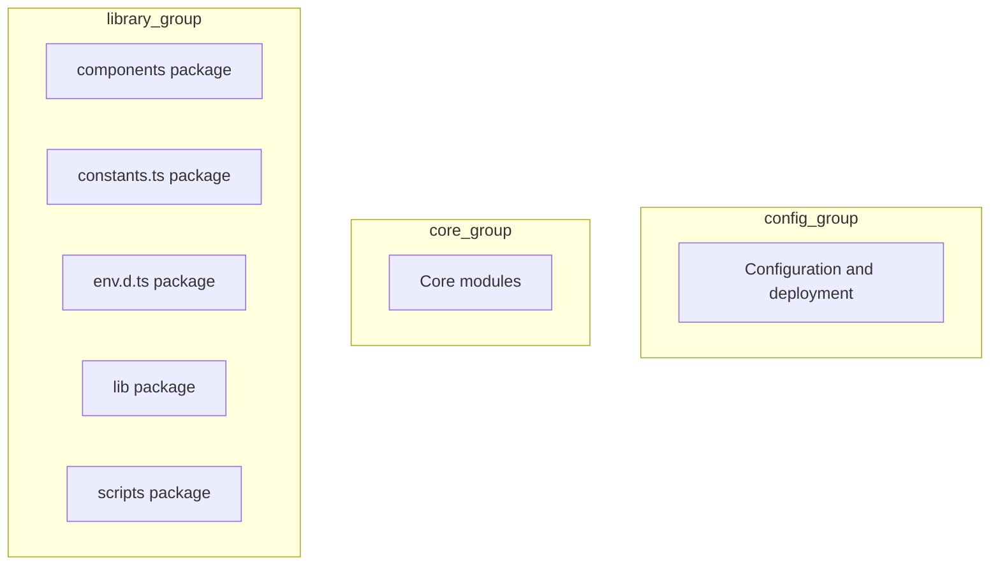

# Architecture report: midudev/preguntas-entrevista-react

> Automated static analysis. **Observed** = directly seen in files/imports/AST; **Inferred** = interpretation from that evidence. Repository code was not executed.

## 1. Repository at a glance

| Item | Value |
| --- | --- |
| Repository | midudev/preguntas-entrevista-react |
| Description | Preguntas típicas sobre React para entrevistas de trabajo ⚛️ |
| Language | Astro |
| Stars | 7834 |
| Licence | MIT |
| Analysed commit / branch | 99d805f10ac5d3e0ad436a0458bc33f3596c9375 / main |
| Framework(s) | React |
| Files analysed | 609 |
| Components | 7 |

## 2. Architecture in one minute

midudev/preguntas-entrevista-react - Preguntas típicas sobre React para entrevistas de trabajo ⚛️. This repository was analysed statically from 609 file(s) (0 Python). Detected technologies (observed from imports/manifests): React, Tailwind CSS, TypeScript. Files are grouped into 7 component(s): components package, Configuration and deployment, constants.ts package, Core modules, env.d.ts package, lib package, scripts package. Findings below distinguish observed facts from inferred interpretation.

## 3. High-level block diagram

## 4. Main components

### components package (`components`)

- **Kind:** library
- **Status:** Observed
- **Confidence:** 0.85
- **Responsibility:** Groups 1 file(s) under components package (observed from repository paths and static analysis).
- **Paths:** `src/components/Quiz.tsx`
- **Evidence:** [src/components/Quiz.tsx](https://github.com/midudev/preguntas-entrevista-react/blob/99d805f10ac5d3e0ad436a0458bc33f3596c9375/src/components/Quiz.tsx)

### Configuration and deployment (`config`)

- **Kind:** config
- **Status:** Observed
- **Confidence:** 0.85
- **Responsibility:** Groups 415 file(s) under configuration and deployment (observed from repository paths and static analysis).
- **Paths:** `package.json`, `pnpm-workspace.yaml`, `public/can-t-perform-a-react-state-update-on-an-unmounted-component.json`, `public/cant-perform-a-react-state-update-on-an-unmounted-component.json`, `public/como-anadir-un-evento-a-un-componente-en-react.json`, `public/como-crear-un-componente-en-react.json`, `public/como-crear-un-hook-personalizado-custom-hook.json`, `public/como-funciona-el-hook-use-form-status-y-que-aporta-junto-a-las-server-actions.json`, `public/como-funciona-el-hook-use-ref.json`, `public/como-funciona-react-memo-y-cuando-es-util.json`, `public/como-mantener-los-componentes-puros-y-que-ventajas-tiene.json`, `public/como-podemos-ejecutar-codigo-cuando-el-componente-se-desmonta-del-arbol.json`, `public/como-podemos-ejecutar-codigo-cuando-el-componente-se-monta.json`, `public/como-puedes-abortar-una-peticion-fetch-con-use-effect-en-react.json`, `public/como-puedes-acceder-al-evento-nativo-del-navegador-en-react.json`, `public/como-puedes-aplicar-clases-css-a-un-componente-en-react-y-por-que-no-se-puede-usar-class.json`, `public/como-puedes-aplicar-estilos-en-linea-a-un-componente-en-react.json`, `public/como-puedes-cancelar-una-peticion-a-una-api-en-use-effect-correctamente.json`, `public/como-puedes-crear-un-server-side-rendering-con-react-desde-cero.json`, `public/como-puedes-escribir-comentarios-en-react.json`, `public/como-puedes-exportar-multiples-componentes-de-un-mismo-archivo.json`, `public/como-puedes-inicializar-un-proyecto-de-react-desde-cero.json`, `public/como-puedes-mejorar-el-rendimiento-del-server-side-rendering-en-react-para-evitar-que-bloquee-el-hilo-principal.json`, `public/como-puedes-prevenir-el-comportamiento-por-defecto-de-un-evento-en-react.json`, `public/como-puedes-registrar-un-evento-en-la-fase-de-captura-en-react.json`, `public/como-puedo-aplicar-estilos-de-forma-condicional-a-un-componente-en-react.json`, `public/como-puedo-importar-de-forma-dinamica-un-componente-en-react.json`, `public/como-puedo-inyectar-html-directamente-en-un-componente-de-react.json`, `public/como-puedo-pasar-un-parametro-a-una-funcion-que-maneja-un-evento-en-react.json`, `public/como-puedo-validar-el-tipo-de-mis-props.json`, `public/como-puedo-validar-las-propiedades-de-un-array-con-prop-types.json`, `public/como-puedo-validar-las-propiedades-de-un-objeto-con-prop-types.json`, `public/como-se-complementan-use-memo-use-callback-use-transition-y-use-deferred-value-para-optimizar-el-rendimiento.json`, `public/como-se-transforma-el-jsx.json`, `public/como-suscribirse-a-un-evento-en-use-effect.json`, `public/content/cant-perform-a-react-state-update-on-an-unmounted-component.json`, `public/content/como-anadir-un-evento-a-un-componente-en-react.json`, `public/content/como-crear-un-componente-en-react.json`, `public/content/como-crear-un-hook-personalizado-custom-hook.json`, `public/content/como-funciona-el-hook-use-form-status-y-que-aporta-junto-a-las-server-actions.json`, `public/content/como-funciona-el-hook-use-ref.json`, `public/content/como-funciona-react-memo-y-cuando-es-util.json`, `public/content/como-mantener-los-componentes-puros-y-que-ventajas-tiene.json`, `public/content/como-podemos-ejecutar-codigo-cuando-el-componente-se-desmonta-del-arbol.json`, `public/content/como-podemos-ejecutar-codigo-cuando-el-componente-se-monta.json`, `public/content/como-puedes-abortar-una-peticion-fetch-con-use-effect-en-react.json`, `public/content/como-puedes-acceder-al-evento-nativo-del-navegador-en-react.json`, `public/content/como-puedes-aplicar-clases-css-a-un-componente-en-react-y-por-que-no-se-puede-usar-class.json`, `public/content/como-puedes-aplicar-estilos-en-linea-a-un-componente-en-react.json`, `public/content/como-puedes-cancelar-una-peticion-a-una-api-en-use-effect-correctamente.json`, `public/content/como-puedes-crear-un-server-side-rendering-con-react-desde-cero.json`, `public/content/como-puedes-escribir-comentarios-en-react.json`, `public/content/como-puedes-evitar-re-renders-innecesarios-al-usar-context.json`, `public/content/como-puedes-exportar-multiples-componentes-de-un-mismo-archivo.json`, `public/content/como-puedes-inicializar-un-proyecto-de-react-desde-cero.json`, `public/content/como-puedes-mejorar-el-rendimiento-del-server-side-rendering-en-react-para-evitar-que-bloquee-el-hilo-principal.json`, `public/content/como-puedes-prevenir-el-comportamiento-por-defecto-de-un-evento-en-react.json`, `public/content/como-puedes-registrar-un-evento-en-la-fase-de-captura-en-react.json`, `public/content/como-puedo-aplicar-estilos-de-forma-condicional-a-un-componente-en-react.json`, `public/content/como-puedo-hacer-testing-de-un-componente.json`, `public/content/como-puedo-hacer-testing-de-un-hook.json`, `public/content/como-puedo-importar-de-forma-dinamica-un-componente-en-react.json`, `public/content/como-puedo-inyectar-html-directamente-en-un-componente-de-react.json`, `public/content/como-puedo-pasar-un-parametro-a-una-funcion-que-maneja-un-evento-en-react.json`, `public/content/como-puedo-validar-el-tipo-de-mis-props.json`, `public/content/como-puedo-validar-las-propiedades-de-un-array-con-prop-types.json`, `public/content/como-puedo-validar-las-propiedades-de-un-objeto-con-prop-types.json`, `public/content/como-se-complementan-use-memo-use-callback-use-transition-y-use-deferred-value-para-optimizar-el-rendimiento.json`, `public/content/como-se-puede-renderizar-un-context-desde-un-server-component.json`, `public/content/como-se-transforma-el-jsx.json`, `public/content/como-suscribirse-a-un-evento-en-use-effect.json`, `public/content/counter.json`, `public/content/cual-es-el-proposito-del-atributo-key-en-react-y-por-que-es-importante-usarlo-correctamente-al-renderizar-listas-de-elementos.json`, `public/content/cual-es-la-diferencia-entre-componente-y-elemento-en-react.json`, `public/content/cual-es-la-diferencia-entre-la-prop-action-y-el-atributo-form-action-en-react-next-js.json`, `public/content/cual-es-la-diferencia-entre-use-callback-y-use-memo.json`, `public/content/cuales-son-las-caracteristicas-principales-de-react.json`, `public/content/cuales-son-las-reglas-de-los-hooks-en-react.json`, `public/content/cuando-y-por-que-es-recomendable-importar-componentes-de-forma-dinamica.json`, `public/content/cuantos-use-effect-puede-tener-un-componente.json`, `public/content/en-react-19-se-necesita-todavia-forward-ref.json`, `public/content/es-buena-idea-usar-siempre-use-callback-para-optimizar-nuestros-componentes.json`, `public/content/es-buena-idea-usar-siempre-use-memo-para-optimizar-nuestros-componentes.json`, `public/content/es-react-una-biblioteca-o-un-framework-por-que.json`, `public/content/explica-casos-de-uso-del-hook-use-effect.json`, `public/content/index.json`, `public/content/para-que-sirve-add-transition-type.json`, `public/content/para-que-sirve-el-hook-use-action-state.json`, `public/content/para-que-sirve-el-hook-use-callback.json`, `public/content/para-que-sirve-el-hook-use-deferred-value.json`, `public/content/para-que-sirve-el-hook-use-imperative-handle.json`, `public/content/para-que-sirve-el-hook-use-insertion-effect.json`, `public/content/para-que-sirve-el-hook-use-memo.json`, `public/content/para-que-sirve-el-hook-use-sync-external-store.json`, `public/content/para-que-sirve-el-hook-use-transition-y-cuando-deberias-usarlo.json`, `public/content/para-que-sirve-el-metodo-clone-element-de-react.json`, `public/content/para-que-sirve-el-metodo-render-to-readable-stream.json`, `public/content/por-que-debemos-utilizar-una-funcion-para-actualizar-el-estado-de-react.json`, `public/content/por-que-es-recomendable-exportar-los-componentes-de-react-de-forma-nombrada.json`, `public/content/por-que-es-recomendable-usar-fragment-en-vez-de-un-div.json`, `public/content/por-que-no-podemos-usar-un-if-en-el-renderizado-de-un-componente.json`, `public/content/por-que-no-se-debe-mutar-el-estado-directamente-en-react.json`, `public/content/por-que-puede-ser-mala-idea-pasar-siempre-todas-las-props-de-un-objeto-a-un-componente.json`, `public/content/por-que-puede-ser-mala-practica-usar-el-index-como-key-en-un-listado-de-react.json`, `public/content/por-que-strict-mode-renderiza-dos-veces-la-aplicacion.json`, `public/content/puedes-poner-un-ejemplo-de-efectos-colaterales-en-react.json`, `public/content/que-cambia-en-las-transitions-independientes-de-react-19-3.json`, `public/content/que-diferencia-existe-entre-shadow-dom-y-virtual-dom.json`, `public/content/que-diferencia-hay-entre-componentes-controlados-y-no-controlados-que-ventajas-y-desventajas-tienen.json`, `public/content/que-diferencia-hay-entre-componentes-de-servidor-y-componentes-de-cliente-en-react-next-js.json`, `public/content/que-diferencia-hay-entre-props-y-state.json`, `public/content/que-diferencia-hay-entre-react-dom-render-create-root-y-hydrate-root.json`, `public/content/que-diferencia-hay-entre-render-to-static-node-stream-y-render-to-pipeable-stream.json`, `public/content/que-diferencia-hay-entre-use-effect-y-use-layout-effect.json`, `public/content/que-es-concurrent-react-y-que-problemas-resuelve.json`, `public/content/que-es-el-batching-de-actualizaciones-de-estado-en-react.json`, `public/content/que-es-el-binding.json`, `public/content/que-es-el-ciclo-de-vida-de-un-componente-en-react.json`, `public/content/que-es-el-componente-view-transition-en-react.json`, `public/content/que-es-el-compound-components-pattern.json`, `public/content/que-es-el-contexto-en-react-como-puedo-crearlo-y-consumirlo.json`, `public/content/que-es-el-estado-derivado-y-por-que-conviene-calcularlo-en-el-render.json`, `public/content/que-es-el-estado-en-react.json`, `public/content/que-es-el-hook-use-debug-value.json`, `public/content/que-es-el-hook-use-form-state-y-cuando-conviene-usarlo.json`, `public/content/que-es-el-profiler-en-react.json`, `public/content/que-es-el-react-compiler-y-que-ventajas-aporta.json`, `public/content/que-es-el-renderizado-condicional-en-react.json`, `public/content/que-es-el-renderizado-de-listas-en-react.json`, `public/content/que-es-el-server-side-rendering-y-que-ventajas-tiene.json`, `public/content/que-es-el-strict-mode-en-react.json`, `public/content/que-es-el-synthetic-event-en-react.json`, `public/content/que-es-el-virtual-dom.json`, `public/content/que-es-flush-sync-en-react.json`, `public/content/que-es-flux.json`, `public/content/que-es-jsx.json`, `public/content/que-es-la-composicion-de-componentes-y-por-que-react-la-prefiere-a-la-herencia.json`, `public/content/que-es-la-funcion-use-en-react-y-para-que-se-utiliza.json`, `public/content/que-es-la-hidratacion-hydration-en-react.json`, `public/content/que-es-la-reconciliacion-reconciliation-en-react.json`, `public/content/que-es-react-dom.json`, `public/content/que-es-react-fiber.json`, `public/content/que-es-react-lazy-y-como-se-combina-con-suspense.json`, `public/content/que-es-react.json`, `public/content/que-es-start-transition-y-en-que-se-diferencia-de-actualizar-el-estado-de-forma-normal.json`, `public/content/que-es-suspense-en-react-y-para-que-se-usa.json`, `public/content/que-es-un-componente.json`, `public/content/que-es-una-stale-closure-y-como-afecta-a-los-hooks.json`, `public/content/que-es-y-para-que-sirve-la-prop-children-en-react.json`, `public/content/que-hace-el-hook-use-effect.json`, `public/content/que-hace-el-hook-use-id.json`, `public/content/que-hace-el-hook-use-layout-effect.json`, `public/content/que-hace-el-hook-use-reducer.json`, `public/content/que-hace-el-hook-use-state.json`, `public/content/que-hace-la-api-browser-de-react-dom.json`, `public/content/que-java-script-necesito-para-aprender-react.json`, `public/content/que-problema-resuelve-el-hook-use-optimistic.json`, `public/content/que-problemas-crees-que-pueden-aparecer-en-una-aplicacion-al-querer-visualizar-listas-de-miles-millones-de-datos.json`, `public/content/que-provoca-un-re-render-en-un-componente-de-react.json`, `public/content/que-quiere-decir-warning-each-child-in-a-list-should-have-a-unique-key-prop.json`, `public/content/que-significa-exactamente-que-sea-declarativo.json`, `public/content/que-significa-la-expresion-subir-el-estado.json`, `public/content/que-solucion-es-implementarias-para-evitar-problemas-de-rendimiento-al-trabajar-con-listas-de-miles-millones-de-datos.json`, `public/content/que-son-las-forward-refs.json`, `public/content/que-son-las-fragment-refs-y-que-problemas-resuelven.json`, `public/content/que-son-las-props-en-react.json`, `public/content/que-son-las-refs-en-react.json`, `public/content/que-son-las-render-props.json`, `public/content/que-son-las-server-actions-y-como-se-usan-con-formularios-en-react.json`, `public/content/que-son-los-componentes-stateless.json`, `public/content/que-son-los-error-boundaries-en-react.json`, `public/content/que-son-los-fragments-en-react.json`, `public/content/que-son-los-high-order-components-hoc.json`, `public/content/que-son-los-hooks.json`, `public/content/que-son-los-portales-en-react.json`, `public/content/que-son-mejores-los-componentes-de-clase-o-los-componentes-funcionales.json`, `public/content/que-son-trusted-types-y-como-los-soporta-react-19-3.json`, `public/content/react-hook-use-xxx-is-called-conditionally-react-hooks-must-be-called-in-the-exact-same-order-in-every-component-render.json`, `public/content/se-puede-inicializar-un-estado-con-el-valor-de-una-prop-que-pasa-si-lo-haces-y-que-hay-que-tener-en-cuenta.json`, `public/content/solo-se-pueden-cargar-componentes-de-forma-dinamica-si-se-exportan-por-defecto.json`, `public/content/too-many-re-renders-react-limits-the-number-of-renders-to-prevent-an-infinite-loop.json`, `public/cual-es-el-proposito-del-atributo-key-en-react-y-por-que-es-importante-usarlo-correctamente-al-renderizar-listas-de-elementos.json`, `public/cual-es-la-diferencia-entre-componente-y-elemento-en-react.json`, `public/cual-es-la-diferencia-entre-la-prop-action-y-el-atributo-form-action-en-react-next-js.json`, `public/cual-es-la-diferencia-entre-use-callback-y-use-memo.json`, `public/cuales-son-las-caracteristicas-principales-de-react.json`, `public/cuales-son-las-reglas-de-los-hooks-en-react.json`, `public/cuando-y-por-que-es-recomendable-importar-componentes-de-forma-dinamica.json`, `public/cuantos-use-effect-puede-tener-un-componente.json`, `public/es-buena-idea-usar-siempre-use-callback-para-optimizar-nuestros-componentes.json`, `public/es-buena-idea-usar-siempre-use-memo-para-optimizar-nuestros-componentes.json`, `public/es-react-una-biblioteca-o-un-framework-por-que.json`, `public/explica-casos-de-uso-del-hook-use-effect.json`, `public/para-que-sirve-el-hook-use-action-state.json`, `public/para-que-sirve-el-hook-use-callback.json`, `public/para-que-sirve-el-hook-use-deferred-value.json`, `public/para-que-sirve-el-hook-use-imperative-handle.json`, `public/para-que-sirve-el-hook-use-insertion-effect.json`, `public/para-que-sirve-el-hook-use-memo.json`, `public/para-que-sirve-el-hook-use-sync-external-store.json`, `public/para-que-sirve-el-hook-use-transition-y-cuando-deberias-usarlo.json`, `public/para-que-sirve-el-metodo-clone-element-de-react.json`, `public/para-que-sirve-el-metodo-render-to-readable-stream.json`, `public/por-que-debemos-utilizar-una-funcion-para-actualizar-el-estado-de-react.json`, `public/por-que-es-recomendable-exportar-los-componentes-de-react-de-forma-nombrada.json`, `public/por-que-es-recomendable-usar-fragment-en-vez-de-un-div.json`, `public/por-que-no-podemos-usar-un-if-en-el-renderizado-de-un-componente.json`, `public/por-que-puede-ser-mala-idea-pasar-siempre-todas-las-props-de-un-objeto-a-un-componente.json`, `public/por-que-puede-ser-mala-practica-usar-el-index-como-key-en-un-listado-de-react.json`, `public/por-que-strict-mode-renderiza-dos-veces-la-aplicacion.json`, `public/puedes-poner-un-ejemplo-de-efectos-colaterales-en-react.json`, `public/que-diferencia-existe-entre-shadow-dom-y-virtual-dom.json`, `public/que-diferencia-hay-entre-componentes-controlados-y-no-controlados-que-ventajas-y-desventajas-tienen.json`, `public/que-diferencia-hay-entre-componentes-de-servidor-y-componentes-de-cliente-en-react-next-js.json`, `public/que-diferencia-hay-entre-props-y-state.json`, `public/que-diferencia-hay-entre-react-dom-render-create-root-y-hydrate-root.json`, `public/que-diferencia-hay-entre-render-to-static-node-stream-y-render-to-pipeable-stream.json`, `public/que-diferencia-hay-entre-use-effect-y-use-layout-effect.json`, `public/que-es-el-binding.json`, `public/que-es-el-ciclo-de-vida-de-un-componente-en-react.json`, `public/que-es-el-compound-components-pattern.json`, `public/que-es-el-contexto-en-react-como-puedo-crearlo-y-consumirlo.json`, `public/que-es-el-estado-en-react.json`, `public/que-es-el-hook-use-debug-value.json`, `public/que-es-el-hook-use-form-state-y-cuando-conviene-usarlo.json`, `public/que-es-el-profiler-en-react.json`, `public/que-es-el-renderizado-condicional-en-react.json`, `public/que-es-el-renderizado-de-listas-en-react.json`, `public/que-es-el-server-side-rendering-y-que-ventajas-tiene.json`, `public/que-es-el-strict-mode-en-react.json`, `public/que-es-el-synthetic-event-en-react.json`, `public/que-es-flush-sync-en-react.json`, `public/que-es-flux.json`, `public/que-es-jsx.json`, `public/que-es-la-funcion-use-en-react-y-para-que-se-utiliza.json`, `public/que-es-la-hidratacion-hydration-en-react.json`, `public/que-es-react-dom.json`, `public/que-es-react.json`, `public/que-es-un-componente.json`, `public/que-es-y-para-que-sirve-la-prop-children-en-react.json`, `public/que-hace-el-hook-use-effect.json`, `public/que-hace-el-hook-use-id.json`, `public/que-hace-el-hook-use-layout-effect.json`, `public/que-hace-el-hook-use-state.json`, `public/que-java-script-necesito-para-aprender-react.json`, `public/que-problema-resuelve-el-hook-use-optimistic.json`, `public/que-problemas-crees-que-pueden-aparecer-en-una-aplicacion-al-querer-visualizar-listas-de-miles-millones-de-datos.json`, `public/que-quiere-decir-warning-each-child-in-a-list-should-have-a-unique-key-prop.json`, `public/que-significa-exactamente-que-sea-declarativo.json`, `public/que-significa-la-expresion-subir-el-estado.json`, `public/que-solucion-es-implementarias-para-evitar-problemas-de-rendimiento-al-trabajar-con-listas-de-miles-millones-de-datos.json`, `public/que-son-las-forward-refs.json`, `public/que-son-las-props-en-react.json`, `public/que-son-las-refs-en-react.json`, `public/que-son-las-render-props.json`, `public/que-son-las-server-actions-y-como-se-usan-con-formularios-en-react.json`, `public/que-son-los-componentes-stateless.json`, `public/que-son-los-error-boundaries-en-react.json`, `public/que-son-los-fragments-en-react.json`, `public/que-son-los-high-order-components-hoc.json`, `public/que-son-los-hooks.json`, `public/que-son-los-portales-en-react.json`, `public/que-son-mejores-los-componentes-de-clase-o-los-componentes-funcionales.json`, `public/quiz/qa/can-t-perform-a-react-state-update-on-an-unmounted-component.json`, `public/quiz/qa/cant-perform-a-react-state-update-on-an-unmounted-component.json`, `public/quiz/qa/como-anadir-un-evento-a-un-componente-en-react.json`, `public/quiz/qa/como-crear-un-componente-en-react.json`, `public/quiz/qa/como-crear-un-hook-personalizado-custom-hook.json`, `public/quiz/qa/como-funciona-el-hook-use-form-status-y-que-aporta-junto-a-las-server-actions.json`, `public/quiz/qa/como-funciona-el-hook-use-ref.json`, `public/quiz/qa/como-funciona-react-memo-y-cuando-es-util.json`, `public/quiz/qa/como-mantener-los-componentes-puros-y-que-ventajas-tiene.json`, `public/quiz/qa/como-podemos-ejecutar-codigo-cuando-el-componente-se-desmonta-del-arbol.json`, `public/quiz/qa/como-podemos-ejecutar-codigo-cuando-el-componente-se-monta.json`, `public/quiz/qa/como-puedes-abortar-una-peticion-fetch-con-use-effect-en-react.json`, `public/quiz/qa/como-puedes-acceder-al-evento-nativo-del-navegador-en-react.json`, `public/quiz/qa/como-puedes-aplicar-clases-css-a-un-componente-en-react-y-por-que-no-se-puede-usar-class.json`, `public/quiz/qa/como-puedes-aplicar-estilos-en-linea-a-un-componente-en-react.json`, `public/quiz/qa/como-puedes-cancelar-una-peticion-a-una-api-en-use-effect-correctamente.json`, `public/quiz/qa/como-puedes-crear-un-server-side-rendering-con-react-desde-cero.json`, `public/quiz/qa/como-puedes-escribir-comentarios-en-react.json`, `public/quiz/qa/como-puedes-evitar-re-renders-innecesarios-al-usar-context.json`, `public/quiz/qa/como-puedes-exportar-multiples-componentes-de-un-mismo-archivo.json`, `public/quiz/qa/como-puedes-inicializar-un-proyecto-de-react-desde-cero.json`, `public/quiz/qa/como-puedes-mejorar-el-rendimiento-del-server-side-rendering-en-react-para-evitar-que-bloquee-el-hilo-principal.json`, `public/quiz/qa/como-puedes-prevenir-el-comportamiento-por-defecto-de-un-evento-en-react.json`, `public/quiz/qa/como-puedes-registrar-un-evento-en-la-fase-de-captura-en-react.json`, `public/quiz/qa/como-puedo-aplicar-estilos-de-forma-condicional-a-un-componente-en-react.json`, `public/quiz/qa/como-puedo-hacer-testing-de-un-componente.json`, `public/quiz/qa/como-puedo-hacer-testing-de-un-hook.json`, `public/quiz/qa/como-puedo-importar-de-forma-dinamica-un-componente-en-react.json`, `public/quiz/qa/como-puedo-inyectar-html-directamente-en-un-componente-de-react.json`, `public/quiz/qa/como-puedo-pasar-un-parametro-a-una-funcion-que-maneja-un-evento-en-react.json`, `public/quiz/qa/como-puedo-validar-el-tipo-de-mis-props.json`, `public/quiz/qa/como-puedo-validar-las-propiedades-de-un-array-con-prop-types.json`, `public/quiz/qa/como-puedo-validar-las-propiedades-de-un-objeto-con-prop-types.json`, `public/quiz/qa/como-se-complementan-use-memo-use-callback-use-transition-y-use-deferred-value-para-optimizar-el-rendimiento.json`, `public/quiz/qa/como-se-puede-renderizar-un-context-desde-un-server-component.json`, `public/quiz/qa/como-se-transforma-el-jsx.json`, `public/quiz/qa/como-suscribirse-a-un-evento-en-use-effect.json`, `public/quiz/qa/cual-es-el-proposito-del-atributo-key-en-react-y-por-que-es-importante-usarlo-correctamente-al-renderizar-listas-de-elementos.json`, `public/quiz/qa/cual-es-la-diferencia-entre-componente-y-elemento-en-react.json`, `public/quiz/qa/cual-es-la-diferencia-entre-la-prop-action-y-el-atributo-form-action-en-react-next-js.json`, `public/quiz/qa/cual-es-la-diferencia-entre-use-callback-y-use-memo.json`, `public/quiz/qa/cuales-son-las-caracteristicas-principales-de-react.json`, `public/quiz/qa/cuales-son-las-reglas-de-los-hooks-en-react.json`, `public/quiz/qa/cuando-y-por-que-es-recomendable-importar-componentes-de-forma-dinamica.json`, `public/quiz/qa/cuantos-use-effect-puede-tener-un-componente.json`, `public/quiz/qa/en-react-19-se-necesita-todavia-forward-ref.json`, `public/quiz/qa/es-buena-idea-usar-siempre-use-callback-para-optimizar-nuestros-componentes.json`, `public/quiz/qa/es-buena-idea-usar-siempre-use-memo-para-optimizar-nuestros-componentes.json`, `public/quiz/qa/es-react-una-biblioteca-o-un-framework-por-que.json`, `public/quiz/qa/explica-casos-de-uso-del-hook-use-effect.json`, `public/quiz/qa/para-que-sirve-add-transition-type.json`, `public/quiz/qa/para-que-sirve-el-hook-use-action-state.json`, `public/quiz/qa/para-que-sirve-el-hook-use-callback.json`, `public/quiz/qa/para-que-sirve-el-hook-use-deferred-value.json`, `public/quiz/qa/para-que-sirve-el-hook-use-imperative-handle.json`, `public/quiz/qa/para-que-sirve-el-hook-use-insertion-effect.json`, `public/quiz/qa/para-que-sirve-el-hook-use-memo.json`, `public/quiz/qa/para-que-sirve-el-hook-use-sync-external-store.json`, `public/quiz/qa/para-que-sirve-el-hook-use-transition-y-cuando-deberias-usarlo.json`, `public/quiz/qa/para-que-sirve-el-metodo-clone-element-de-react.json`, `public/quiz/qa/para-que-sirve-el-metodo-render-to-readable-stream.json`, `public/quiz/qa/por-que-debemos-utilizar-una-funcion-para-actualizar-el-estado-de-react.json`, `public/quiz/qa/por-que-es-recomendable-exportar-los-componentes-de-react-de-forma-nombrada.json`, `public/quiz/qa/por-que-es-recomendable-usar-fragment-en-vez-de-un-div.json`, `public/quiz/qa/por-que-no-podemos-usar-un-if-en-el-renderizado-de-un-componente.json`, `public/quiz/qa/por-que-no-se-debe-mutar-el-estado-directamente-en-react.json`, `public/quiz/qa/por-que-puede-ser-mala-idea-pasar-siempre-todas-las-props-de-un-objeto-a-un-componente.json`, `public/quiz/qa/por-que-puede-ser-mala-practica-usar-el-index-como-key-en-un-listado-de-react.json`, `public/quiz/qa/por-que-strict-mode-renderiza-dos-veces-la-aplicacion.json`, `public/quiz/qa/puedes-poner-un-ejemplo-de-efectos-colaterales-en-react.json`, `public/quiz/qa/que-cambia-en-las-transitions-independientes-de-react-19-3.json`, `public/quiz/qa/que-diferencia-existe-entre-shadow-dom-y-virtual-dom.json`, `public/quiz/qa/que-diferencia-hay-entre-componentes-controlados-y-no-controlados-que-ventajas-y-desventajas-tienen.json`, `public/quiz/qa/que-diferencia-hay-entre-componentes-de-servidor-y-componentes-de-cliente-en-react-next-js.json`, `public/quiz/qa/que-diferencia-hay-entre-props-y-state.json`, `public/quiz/qa/que-diferencia-hay-entre-react-dom-render-create-root-y-hydrate-root.json`, `public/quiz/qa/que-diferencia-hay-entre-render-to-static-node-stream-y-render-to-pipeable-stream.json`, `public/quiz/qa/que-diferencia-hay-entre-use-effect-y-use-layout-effect.json`, `public/quiz/qa/que-es-concurrent-react-y-que-problemas-resuelve.json`, `public/quiz/qa/que-es-el-batching-de-actualizaciones-de-estado-en-react.json`, `public/quiz/qa/que-es-el-binding.json`, `public/quiz/qa/que-es-el-ciclo-de-vida-de-un-componente-en-react.json`, `public/quiz/qa/que-es-el-componente-view-transition-en-react.json`, `public/quiz/qa/que-es-el-compound-components-pattern.json`, `public/quiz/qa/que-es-el-contexto-en-react-como-puedo-crearlo-y-consumirlo.json`, `public/quiz/qa/que-es-el-estado-derivado-y-por-que-conviene-calcularlo-en-el-render.json`, `public/quiz/qa/que-es-el-estado-en-react.json`, `public/quiz/qa/que-es-el-hook-use-debug-value.json`, `public/quiz/qa/que-es-el-hook-use-form-state-y-cuando-conviene-usarlo.json`, `public/quiz/qa/que-es-el-profiler-en-react.json`, `public/quiz/qa/que-es-el-react-compiler-y-que-ventajas-aporta.json`, `public/quiz/qa/que-es-el-renderizado-condicional-en-react.json`, `public/quiz/qa/que-es-el-renderizado-de-listas-en-react.json`, `public/quiz/qa/que-es-el-server-side-rendering-y-que-ventajas-tiene.json`, `public/quiz/qa/que-es-el-strict-mode-en-react.json`, `public/quiz/qa/que-es-el-synthetic-event-en-react.json`, `public/quiz/qa/que-es-el-virtual-dom.json`, `public/quiz/qa/que-es-flush-sync-en-react.json`, `public/quiz/qa/que-es-flux.json`, `public/quiz/qa/que-es-jsx.json`, `public/quiz/qa/que-es-la-composicion-de-componentes-y-por-que-react-la-prefiere-a-la-herencia.json`, `public/quiz/qa/que-es-la-funcion-use-en-react-y-para-que-se-utiliza.json`, `public/quiz/qa/que-es-la-hidratacion-hydration-en-react.json`, `public/quiz/qa/que-es-la-reconciliacion-reconciliation-en-react.json`, `public/quiz/qa/que-es-react-dom.json`, `public/quiz/qa/que-es-react-fiber.json`, `public/quiz/qa/que-es-react-lazy-y-como-se-combina-con-suspense.json`, `public/quiz/qa/que-es-react.json`, `public/quiz/qa/que-es-start-transition-y-en-que-se-diferencia-de-actualizar-el-estado-de-forma-normal.json`, `public/quiz/qa/que-es-suspense-en-react-y-para-que-se-usa.json`, `public/quiz/qa/que-es-un-componente.json`, `public/quiz/qa/que-es-una-stale-closure-y-como-afecta-a-los-hooks.json`, `public/quiz/qa/que-es-y-para-que-sirve-la-prop-children-en-react.json`, `public/quiz/qa/que-hace-el-hook-use-effect.json`, `public/quiz/qa/que-hace-el-hook-use-id.json`, `public/quiz/qa/que-hace-el-hook-use-layout-effect.json`, `public/quiz/qa/que-hace-el-hook-use-reducer.json`, `public/quiz/qa/que-hace-el-hook-use-state.json`, `public/quiz/qa/que-hace-la-api-browser-de-react-dom.json`, `public/quiz/qa/que-java-script-necesito-para-aprender-react.json`, `public/quiz/qa/que-problema-resuelve-el-hook-use-optimistic.json`, `public/quiz/qa/que-problemas-crees-que-pueden-aparecer-en-una-aplicacion-al-querer-visualizar-listas-de-miles-millones-de-datos.json`, `public/quiz/qa/que-provoca-un-re-render-en-un-componente-de-react.json`, `public/quiz/qa/que-quiere-decir-warning-each-child-in-a-list-should-have-a-unique-key-prop.json`, `public/quiz/qa/que-significa-exactamente-que-sea-declarativo.json`, `public/quiz/qa/que-significa-la-expresion-subir-el-estado.json`, `public/quiz/qa/que-solucion-es-implementarias-para-evitar-problemas-de-rendimiento-al-trabajar-con-listas-de-miles-millones-de-datos.json`, `public/quiz/qa/que-son-las-forward-refs.json`, `public/quiz/qa/que-son-las-fragment-refs-y-que-problemas-resuelven.json`, `public/quiz/qa/que-son-las-props-en-react.json`, `public/quiz/qa/que-son-las-refs-en-react.json`, `public/quiz/qa/que-son-las-render-props.json`, `public/quiz/qa/que-son-las-server-actions-y-como-se-usan-con-formularios-en-react.json`, `public/quiz/qa/que-son-los-componentes-stateless.json`, `public/quiz/qa/que-son-los-error-boundaries-en-react.json`, `public/quiz/qa/que-son-los-fragments-en-react.json`, `public/quiz/qa/que-son-los-high-order-components-hoc.json`, `public/quiz/qa/que-son-los-hooks.json`, `public/quiz/qa/que-son-los-portales-en-react.json`, `public/quiz/qa/que-son-mejores-los-componentes-de-clase-o-los-componentes-funcionales.json`, `public/quiz/qa/que-son-trusted-types-y-como-los-soporta-react-19-3.json`, `public/quiz/qa/react-hook-use-xxx-is-called-conditionally-react-hooks-must-be-called-in-the-exact-same-order-in-every-component-render.json`, `public/quiz/qa/se-puede-inicializar-un-estado-con-el-valor-de-una-prop-que-pasa-si-lo-haces-y-que-hay-que-tener-en-cuenta.json`, `public/quiz/qa/solo-se-pueden-cargar-componentes-de-forma-dinamica-si-se-exportan-por-defecto.json`, `public/quiz/qa/too-many-re-renders-react-limits-the-number-of-renders-to-prevent-an-infinite-loop.json`, `public/react-hook-use-xxx-is-called-conditionally-react-hooks-must-be-called-in-the-exact-same-order-in-every-component-render.json`, `public/se-puede-inicializar-un-estado-con-el-valor-de-una-prop-que-pasa-si-lo-haces-y-que-hay-que-tener-en-cuenta.json`, `public/solo-se-pueden-cargar-componentes-de-forma-dinamica-si-se-exportan-por-defecto.json`, `public/too-many-re-renders-react-limits-the-number-of-renders-to-prevent-an-infinite-loop.json`, `skills-lock.json`, `tsconfig.json`, `vercel.json`
- **Evidence:** [package.json](https://github.com/midudev/preguntas-entrevista-react/blob/99d805f10ac5d3e0ad436a0458bc33f3596c9375/package.json); [pnpm-workspace.yaml](https://github.com/midudev/preguntas-entrevista-react/blob/99d805f10ac5d3e0ad436a0458bc33f3596c9375/pnpm-workspace.yaml); [public/can-t-perform-a-react-state-update-on-an-unmounted-component.json](https://github.com/midudev/preguntas-entrevista-react/blob/99d805f10ac5d3e0ad436a0458bc33f3596c9375/public/can-t-perform-a-react-state-update-on-an-unmounted-component.json); [public/cant-perform-a-react-state-update-on-an-unmounted-component.json](https://github.com/midudev/preguntas-entrevista-react/blob/99d805f10ac5d3e0ad436a0458bc33f3596c9375/public/cant-perform-a-react-state-update-on-an-unmounted-component.json); [public/como-anadir-un-evento-a-un-componente-en-react.json](https://github.com/midudev/preguntas-entrevista-react/blob/99d805f10ac5d3e0ad436a0458bc33f3596c9375/public/como-anadir-un-evento-a-un-componente-en-react.json); [public/como-crear-un-componente-en-react.json](https://github.com/midudev/preguntas-entrevista-react/blob/99d805f10ac5d3e0ad436a0458bc33f3596c9375/public/como-crear-un-componente-en-react.json); [public/como-crear-un-hook-personalizado-custom-hook.json](https://github.com/midudev/preguntas-entrevista-react/blob/99d805f10ac5d3e0ad436a0458bc33f3596c9375/public/como-crear-un-hook-personalizado-custom-hook.json); [public/como-funciona-el-hook-use-form-status-y-que-aporta-junto-a-las-server-actions.json](https://github.com/midudev/preguntas-entrevista-react/blob/99d805f10ac5d3e0ad436a0458bc33f3596c9375/public/como-funciona-el-hook-use-form-status-y-que-aporta-junto-a-las-server-actions.json)

### constants.ts package (`constants_ts`)

- **Kind:** library
- **Status:** Observed
- **Confidence:** 0.85
- **Responsibility:** Groups 1 file(s) under constants.ts package (observed from repository paths and static analysis).
- **Paths:** `src/constants.ts`
- **Evidence:** [src/constants.ts](https://github.com/midudev/preguntas-entrevista-react/blob/99d805f10ac5d3e0ad436a0458bc33f3596c9375/src/constants.ts)

### Core modules (`core`)

- **Kind:** core
- **Status:** Observed
- **Confidence:** 0.85
- **Responsibility:** Groups 1 file(s) under core modules (observed from repository paths and static analysis).
- **Paths:** `astro.config.mjs`
- **Evidence:** [astro.config.mjs](https://github.com/midudev/preguntas-entrevista-react/blob/99d805f10ac5d3e0ad436a0458bc33f3596c9375/astro.config.mjs)

### env.d.ts package (`env_d_ts`)

- **Kind:** library
- **Status:** Observed
- **Confidence:** 0.85
- **Responsibility:** Groups 1 file(s) under env.d.ts package (observed from repository paths and static analysis).
- **Paths:** `src/env.d.ts`
- **Evidence:** [src/env.d.ts](https://github.com/midudev/preguntas-entrevista-react/blob/99d805f10ac5d3e0ad436a0458bc33f3596c9375/src/env.d.ts)

### lib package (`lib`)

- **Kind:** library
- **Status:** Observed
- **Confidence:** 0.85
- **Responsibility:** Groups 4 file(s) under lib package (observed from repository paths and static analysis).
- **Paths:** `src/lib/code-blocks.ts`, `src/lib/github-stars.ts`, `src/lib/markdown.ts`, `src/lib/posts.ts`
- **Evidence:** [src/lib/code-blocks.ts](https://github.com/midudev/preguntas-entrevista-react/blob/99d805f10ac5d3e0ad436a0458bc33f3596c9375/src/lib/code-blocks.ts); [src/lib/github-stars.ts](https://github.com/midudev/preguntas-entrevista-react/blob/99d805f10ac5d3e0ad436a0458bc33f3596c9375/src/lib/github-stars.ts); [src/lib/markdown.ts](https://github.com/midudev/preguntas-entrevista-react/blob/99d805f10ac5d3e0ad436a0458bc33f3596c9375/src/lib/markdown.ts); [src/lib/posts.ts](https://github.com/midudev/preguntas-entrevista-react/blob/99d805f10ac5d3e0ad436a0458bc33f3596c9375/src/lib/posts.ts)

### scripts package (`scripts`)

- **Kind:** library
- **Status:** Observed
- **Confidence:** 0.85
- **Responsibility:** Groups 3 file(s) under scripts package (observed from repository paths and static analysis).
- **Paths:** `scripts/exportBook.mjs`, `scripts/lint.mjs`, `scripts/markdownToJson.mjs`
- **Evidence:** [scripts/exportBook.mjs](https://github.com/midudev/preguntas-entrevista-react/blob/99d805f10ac5d3e0ad436a0458bc33f3596c9375/scripts/exportBook.mjs); [scripts/lint.mjs](https://github.com/midudev/preguntas-entrevista-react/blob/99d805f10ac5d3e0ad436a0458bc33f3596c9375/scripts/lint.mjs); [scripts/markdownToJson.mjs](https://github.com/midudev/preguntas-entrevista-react/blob/99d805f10ac5d3e0ad436a0458bc33f3596c9375/scripts/markdownToJson.mjs)

## 5. Execution flow

No entry point was observed; the startup flow below is therefore limited.

Representative flow (derived from observed entry points and the import graph; steps beyond the entry point are **Inferred**):

1. Execution starts at an observed entry point listed above, if present.
2. No internal import relationships between components were observed.

## 6. Project structure

### `(root)`

- `.gitignore` - other (434 bytes)
- `.markdownlint.json` - config (99 bytes)
- `.nvmrc` - other (2 bytes)
- `.oxlintrc.json` - config (5925 bytes)
- `.prettierrc` - other (205 bytes)
- `CLAUDE.md` - docs (27444 bytes)
- `CONTRIBUTING.md` - docs (742 bytes)
- `LICENSE` - docs (1077 bytes)
- `astro.config.mjs` - source, JavaScript (1782 bytes)
- `package.json` - manifest (1656 bytes)
- `pnpm-workspace.yaml` - config (60 bytes)
- `pull_request_template.md` - docs (330 bytes)
- `skills-lock.json` - config (627 bytes)
- `tsconfig.json` - config (350 bytes)
- `vercel.json` - config (925 bytes)

### `.agents`

- `.agents/skills/accessibility/SKILL.md` - docs (12388 bytes)
- `.agents/skills/accessibility/references/WCAG.md` - docs (7324 bytes)
- `.agents/skills/best-practices/SKILL.md` - docs (12138 bytes)
- `.agents/skills/core-web-vitals/SKILL.md` - docs (11669 bytes)
- `.agents/skills/core-web-vitals/references/LCP.md` - docs (4431 bytes)
- `.agents/skills/frontend-design/LICENSE.txt` - docs (10174 bytes)
- `.agents/skills/frontend-design/SKILL.md` - docs (4440 bytes)
- `.agents/skills/migrate-oxlint/SKILL.md` - docs (9911 bytes)
- `.agents/skills/next-best-practices/SKILL.md` - docs (4004 bytes)
- `.agents/skills/next-best-practices/async-patterns.md` - docs (1664 bytes)
- `.agents/skills/next-best-practices/bundling.md` - docs (4456 bytes)
- `.agents/skills/next-best-practices/data-patterns.md` - docs (6687 bytes)
- `.agents/skills/next-best-practices/debug-tricks.md` - docs (2953 bytes)
- `.agents/skills/next-best-practices/directives.md` - docs (1476 bytes)
- `.agents/skills/next-best-practices/error-handling.md` - docs (4736 bytes)
- `.agents/skills/next-best-practices/file-conventions.md` - docs (3464 bytes)
- `.agents/skills/next-best-practices/font.md` - docs (5196 bytes)
- `.agents/skills/next-best-practices/functions.md` - docs (4388 bytes)
- `.agents/skills/next-best-practices/hydration-error.md` - docs (1801 bytes)
- `.agents/skills/next-best-practices/image.md` - docs (3882 bytes)
- `.agents/skills/next-best-practices/metadata.md` - docs (7140 bytes)
- `.agents/skills/next-best-practices/parallel-routes.md` - docs (7171 bytes)
- `.agents/skills/next-best-practices/route-handlers.md` - docs (3244 bytes)
- `.agents/skills/next-best-practices/rsc-boundaries.md` - docs (4309 bytes)
- `.agents/skills/next-best-practices/runtime-selection.md` - docs (985 bytes)
- `.agents/skills/next-best-practices/scripts.md` - docs (3326 bytes)
- `.agents/skills/next-best-practices/self-hosting.md` - docs (8334 bytes)
- `.agents/skills/next-best-practices/suspense-boundaries.md` - docs (1366 bytes)
- `.agents/skills/next-cache-components/SKILL.md` - docs (9362 bytes)
- `.agents/skills/next-upgrade/SKILL.md` - docs (2009 bytes)
- `.agents/skills/nodejs-backend-patterns/SKILL.md` - docs (16802 bytes)
- `.agents/skills/nodejs-backend-patterns/references/advanced-patterns.md` - docs (9405 bytes)
- `.agents/skills/nodejs-best-practices/SKILL.md` - docs (8454 bytes)
- `.agents/skills/performance/SKILL.md` - docs (9229 bytes)
- `.agents/skills/seo/SKILL.md` - docs (11251 bytes)
- `.agents/skills/tailwind-css-patterns/SKILL.md` - docs (6342 bytes)
- `.agents/skills/tailwind-css-patterns/references/accessibility.md` - docs (4046 bytes)
- `.agents/skills/tailwind-css-patterns/references/animations.md` - docs (3281 bytes)
- `.agents/skills/tailwind-css-patterns/references/component-patterns.md` - docs (4812 bytes)
- `.agents/skills/tailwind-css-patterns/references/configuration.md` - docs (3284 bytes)
- `.agents/skills/tailwind-css-patterns/references/layout-patterns.md` - docs (3830 bytes)
- `.agents/skills/tailwind-css-patterns/references/performance.md` - docs (2585 bytes)
- `.agents/skills/tailwind-css-patterns/references/reference.md` - docs (9988 bytes)
- `.agents/skills/tailwind-css-patterns/references/responsive-design.md` - docs (3940 bytes)
- `.agents/skills/typescript-advanced-types/SKILL.md` - docs (16806 bytes)
- `.agents/skills/vercel-composition-patterns/AGENTS.md` - docs (22627 bytes)
- `.agents/skills/vercel-composition-patterns/README.md` - docs (2140 bytes)
- `.agents/skills/vercel-composition-patterns/SKILL.md` - docs (2886 bytes)
- `.agents/skills/vercel-composition-patterns/metadata.json` - config (530 bytes)
- `.agents/skills/vercel-composition-patterns/rules/_sections.md` - docs (829 bytes)
- `.agents/skills/vercel-composition-patterns/rules/_template.md` - docs (329 bytes)
- `.agents/skills/vercel-composition-patterns/rules/architecture-avoid-boolean-props.md` - docs (2267 bytes)
- `.agents/skills/vercel-composition-patterns/rules/architecture-compound-components.md` - docs (2600 bytes)
- `.agents/skills/vercel-composition-patterns/rules/patterns-children-over-render-props.md` - docs (1886 bytes)
- `.agents/skills/vercel-composition-patterns/rules/patterns-explicit-variants.md` - docs (2395 bytes)
- `.agents/skills/vercel-composition-patterns/rules/react19-no-forwardref.md` - docs (953 bytes)
- `.agents/skills/vercel-composition-patterns/rules/state-context-interface.md` - docs (4974 bytes)
- `.agents/skills/vercel-composition-patterns/rules/state-decouple-implementation.md` - docs (2699 bytes)
- `.agents/skills/vercel-composition-patterns/rules/state-lift-state.md` - docs (3224 bytes)
- `.agents/skills/vercel-react-best-practices/AGENTS.md` - docs (105774 bytes)
- `.agents/skills/vercel-react-best-practices/README.md` - docs (3360 bytes)
- `.agents/skills/vercel-react-best-practices/SKILL.md` - docs (7129 bytes)
- `.agents/skills/vercel-react-best-practices/metadata.json` - config (921 bytes)
- `.agents/skills/vercel-react-best-practices/rules/_sections.md` - docs (1554 bytes)
- `.agents/skills/vercel-react-best-practices/rules/_template.md` - docs (631 bytes)
- `.agents/skills/vercel-react-best-practices/rules/advanced-effect-event-deps.md` - docs (1802 bytes)
- `.agents/skills/vercel-react-best-practices/rules/advanced-event-handler-refs.md` - docs (1483 bytes)
- `.agents/skills/vercel-react-best-practices/rules/advanced-init-once.md` - docs (958 bytes)
- `.agents/skills/vercel-react-best-practices/rules/advanced-use-latest.md` - docs (1072 bytes)
- `.agents/skills/vercel-react-best-practices/rules/async-api-routes.md` - docs (1125 bytes)
- `.agents/skills/vercel-react-best-practices/rules/async-cheap-condition-before-await.md` - docs (1220 bytes)
- `.agents/skills/vercel-react-best-practices/rules/async-defer-await.md` - docs (2208 bytes)
- `.agents/skills/vercel-react-best-practices/rules/async-dependencies.md` - docs (1293 bytes)
- `.agents/skills/vercel-react-best-practices/rules/async-parallel.md` - docs (654 bytes)
- `.agents/skills/vercel-react-best-practices/rules/async-suspense-boundaries.md` - docs (2510 bytes)
- `.agents/skills/vercel-react-best-practices/rules/bundle-barrel-imports.md` - docs (2795 bytes)
- `.agents/skills/vercel-react-best-practices/rules/bundle-conditional.md` - docs (949 bytes)
- `.agents/skills/vercel-react-best-practices/rules/bundle-defer-third-party.md` - docs (920 bytes)
- `.agents/skills/vercel-react-best-practices/rules/bundle-dynamic-imports.md` - docs (791 bytes)
- `.agents/skills/vercel-react-best-practices/rules/bundle-preload.md` - docs (1149 bytes)
- `.agents/skills/vercel-react-best-practices/rules/client-event-listeners.md` - docs (1969 bytes)
- `.agents/skills/vercel-react-best-practices/rules/client-localstorage-schema.md` - docs (1950 bytes)
- `.agents/skills/vercel-react-best-practices/rules/client-passive-event-listeners.md` - docs (1644 bytes)
- `.agents/skills/vercel-react-best-practices/rules/client-swr-dedup.md` - docs (1159 bytes)
- `.agents/skills/vercel-react-best-practices/rules/js-batch-dom-css.md` - docs (3266 bytes)
- `.agents/skills/vercel-react-best-practices/rules/js-cache-function-results.md` - docs (1949 bytes)
- `.agents/skills/vercel-react-best-practices/rules/js-cache-property-access.md` - docs (532 bytes)
- `.agents/skills/vercel-react-best-practices/rules/js-cache-storage.md` - docs (1651 bytes)
- `.agents/skills/vercel-react-best-practices/rules/js-combine-iterations.md` - docs (753 bytes)
- `.agents/skills/vercel-react-best-practices/rules/js-early-exit.md` - docs (1133 bytes)
- `.agents/skills/vercel-react-best-practices/rules/js-flatmap-filter.md` - docs (1411 bytes)
- `.agents/skills/vercel-react-best-practices/rules/js-hoist-regexp.md` - docs (1028 bytes)
- `.agents/skills/vercel-react-best-practices/rules/js-index-maps.md` - docs (837 bytes)
- `.agents/skills/vercel-react-best-practices/rules/js-length-check-first.md` - docs (1747 bytes)
- `.agents/skills/vercel-react-best-practices/rules/js-min-max-loop.md` - docs (2290 bytes)
- `.agents/skills/vercel-react-best-practices/rules/js-request-idle-callback.md` - docs (2647 bytes)
- `.agents/skills/vercel-react-best-practices/rules/js-set-map-lookups.md` - docs (532 bytes)
- `.agents/skills/vercel-react-best-practices/rules/js-tosorted-immutable.md` - docs (1782 bytes)
- `.agents/skills/vercel-react-best-practices/rules/rendering-activity.md` - docs (564 bytes)
- `.agents/skills/vercel-react-best-practices/rules/rendering-animate-svg-wrapper.md` - docs (1185 bytes)
- `.agents/skills/vercel-react-best-practices/rules/rendering-conditional-render.md` - docs (980 bytes)
- `.agents/skills/vercel-react-best-practices/rules/rendering-content-visibility.md` - docs (815 bytes)
- `.agents/skills/vercel-react-best-practices/rules/rendering-hoist-jsx.md` - docs (1039 bytes)
- `.agents/skills/vercel-react-best-practices/rules/rendering-hydration-no-flicker.md` - docs (2308 bytes)
- `.agents/skills/vercel-react-best-practices/rules/rendering-hydration-suppress-warning.md` - docs (872 bytes)
- `.agents/skills/vercel-react-best-practices/rules/rendering-resource-hints.md` - docs (2549 bytes)
- `.agents/skills/vercel-react-best-practices/rules/rendering-script-defer-async.md` - docs (1868 bytes)
- `.agents/skills/vercel-react-best-practices/rules/rendering-svg-precision.md` - docs (588 bytes)
- `.agents/skills/vercel-react-best-practices/rules/rendering-usetransition-loading.md` - docs (2074 bytes)
- `.agents/skills/vercel-react-best-practices/rules/rerender-defer-reads.md` - docs (973 bytes)
- `.agents/skills/vercel-react-best-practices/rules/rerender-dependencies.md` - docs (824 bytes)
- `.agents/skills/vercel-react-best-practices/rules/rerender-derived-state-no-effect.md` - docs (1201 bytes)
- `.agents/skills/vercel-react-best-practices/rules/rerender-derived-state.md` - docs (728 bytes)
- `.agents/skills/vercel-react-best-practices/rules/rerender-functional-setstate.md` - docs (2968 bytes)
- `.agents/skills/vercel-react-best-practices/rules/rerender-lazy-state-init.md` - docs (2016 bytes)
- `.agents/skills/vercel-react-best-practices/rules/rerender-memo-with-default-value.md` - docs (1173 bytes)
- `.agents/skills/vercel-react-best-practices/rules/rerender-memo.md` - docs (1148 bytes)
- `.agents/skills/vercel-react-best-practices/rules/rerender-move-effect-to-event.md` - docs (1268 bytes)
- `.agents/skills/vercel-react-best-practices/rules/rerender-no-inline-components.md` - docs (2135 bytes)
- `.agents/skills/vercel-react-best-practices/rules/rerender-simple-expression-in-memo.md` - docs (1018 bytes)
- `.agents/skills/vercel-react-best-practices/rules/rerender-split-combined-hooks.md` - docs (1844 bytes)
- `.agents/skills/vercel-react-best-practices/rules/rerender-transitions.md` - docs (1055 bytes)
- `.agents/skills/vercel-react-best-practices/rules/rerender-use-deferred-value.md` - docs (1846 bytes)
- `.agents/skills/vercel-react-best-practices/rules/rerender-use-ref-transient-values.md` - docs (1742 bytes)
- `.agents/skills/vercel-react-best-practices/rules/server-after-nonblocking.md` - docs (2012 bytes)
- `.agents/skills/vercel-react-best-practices/rules/server-auth-actions.md` - docs (2649 bytes)
- `.agents/skills/vercel-react-best-practices/rules/server-cache-lru.md` - docs (1353 bytes)
- `.agents/skills/vercel-react-best-practices/rules/server-cache-react.md` - docs (2228 bytes)
- `.agents/skills/vercel-react-best-practices/rules/server-dedup-props.md` - docs (2060 bytes)
- `.agents/skills/vercel-react-best-practices/rules/server-hoist-static-io.md` - docs (4423 bytes)
- `.agents/skills/vercel-react-best-practices/rules/server-no-shared-module-state.md` - docs (1766 bytes)
- `.agents/skills/vercel-react-best-practices/rules/server-parallel-fetching.md` - docs (1554 bytes)
- `.agents/skills/vercel-react-best-practices/rules/server-parallel-nested-fetching.md` - docs (992 bytes)
- `.agents/skills/vercel-react-best-practices/rules/server-serialization.md` - docs (996 bytes)
- `.agents/skills/web-design-guidelines/SKILL.md` - docs (1231 bytes)
- `.agents/skills/web-quality-audit/SKILL.md` - docs (6628 bytes)
- `.agents/skills/web-quality-audit/scripts/analyze.sh` - source, Shell (2013 bytes)

### `.vscode`

- `.vscode/extensions.json` - config (60 bytes)
- `.vscode/settings.json` - config (384 bytes)

### `book`

- `book/after.md` - docs (2932 bytes)
- `book/before.md` - docs (3800 bytes)

### `manuscript`

- `manuscript/00-antes-de-empezar.md` - docs (3800 bytes)
- `manuscript/01-principiante.md` - docs (106937 bytes)
- `manuscript/02-intermedio.md` - docs (162910 bytes)
- `manuscript/03-experto.md` - docs (62586 bytes)
- `manuscript/04-errores-tipicos.md` - docs (24670 bytes)
- `manuscript/05-hasta-aqui.md` - docs (2932 bytes)
- `manuscript/Book.txt` - docs (149 bytes)
- `manuscript/README.md` - docs (691 bytes)

### `public`

- `public/can-t-perform-a-react-state-update-on-an-unmounted-component.json` - config (15147 bytes)
- `public/cant-perform-a-react-state-update-on-an-unmounted-component.json` - config (15134 bytes)
- `public/como-anadir-un-evento-a-un-componente-en-react.json` - config (1703 bytes)
- `public/como-crear-un-componente-en-react.json` - config (2429 bytes)
- `public/como-crear-un-hook-personalizado-custom-hook.json` - config (4944 bytes)
- `public/como-funciona-el-hook-use-form-status-y-que-aporta-junto-a-las-server-actions.json` - config (4455 bytes)
- `public/como-funciona-el-hook-use-ref.json` - config (4054 bytes)
- `public/como-funciona-react-memo-y-cuando-es-util.json` - config (5543 bytes)
- `public/como-mantener-los-componentes-puros-y-que-ventajas-tiene.json` - config (1667 bytes)
- `public/como-podemos-ejecutar-codigo-cuando-el-componente-se-desmonta-del-arbol.json` - config (2917 bytes)
- `public/como-podemos-ejecutar-codigo-cuando-el-componente-se-monta.json` - config (2113 bytes)
- `public/como-puedes-abortar-una-peticion-fetch-con-use-effect-en-react.json` - config (6745 bytes)
- `public/como-puedes-acceder-al-evento-nativo-del-navegador-en-react.json` - config (1826 bytes)
- `public/como-puedes-aplicar-clases-css-a-un-componente-en-react-y-por-que-no-se-puede-usar-class.json` - config (1759 bytes)
- `public/como-puedes-aplicar-estilos-en-linea-a-un-componente-en-react.json` - config (2203 bytes)
- `public/como-puedes-cancelar-una-peticion-a-una-api-en-use-effect-correctamente.json` - config (8261 bytes)
- `public/como-puedes-crear-un-server-side-rendering-con-react-desde-cero.json` - config (3267 bytes)
- `public/como-puedes-escribir-comentarios-en-react.json` - config (2794 bytes)
- `public/como-puedes-exportar-multiples-componentes-de-un-mismo-archivo.json` - config (2426 bytes)
- `public/como-puedes-inicializar-un-proyecto-de-react-desde-cero.json` - config (1872 bytes)
- `public/como-puedes-mejorar-el-rendimiento-del-server-side-rendering-en-react-para-evitar-que-bloquee-el-hilo-principal.json` - config (4954 bytes)
- `public/como-puedes-prevenir-el-comportamiento-por-defecto-de-un-evento-en-react.json` - config (3261 bytes)
- `public/como-puedes-registrar-un-evento-en-la-fase-de-captura-en-react.json` - config (1486 bytes)
- `public/como-puedo-aplicar-estilos-de-forma-condicional-a-un-componente-en-react.json` - config (5482 bytes)
- `public/como-puedo-importar-de-forma-dinamica-un-componente-en-react.json` - config (5038 bytes)
- `public/como-puedo-inyectar-html-directamente-en-un-componente-de-react.json` - config (4544 bytes)
- `public/como-puedo-pasar-un-parametro-a-una-funcion-que-maneja-un-evento-en-react.json` - config (3899 bytes)
- `public/como-puedo-validar-el-tipo-de-mis-props.json` - config (3807 bytes)
- `public/como-puedo-validar-las-propiedades-de-un-array-con-prop-types.json` - config (3950 bytes)
- `public/como-puedo-validar-las-propiedades-de-un-objeto-con-prop-types.json` - config (3030 bytes)
- `public/como-se-complementan-use-memo-use-callback-use-transition-y-use-deferred-value-para-optimizar-el-rendimiento.json` - config (19194 bytes)
- `public/como-se-transforma-el-jsx.json` - config (1220 bytes)
- `public/como-suscribirse-a-un-evento-en-use-effect.json` - config (3486 bytes)
- `public/content/cant-perform-a-react-state-update-on-an-unmounted-component.json` - config (15134 bytes)
- `public/content/como-anadir-un-evento-a-un-componente-en-react.json` - config (3932 bytes)
- `public/content/como-crear-un-componente-en-react.json` - config (2778 bytes)
- `public/content/como-crear-un-hook-personalizado-custom-hook.json` - config (4944 bytes)
- `public/content/como-funciona-el-hook-use-form-status-y-que-aporta-junto-a-las-server-actions.json` - config (4455 bytes)
- `public/content/como-funciona-el-hook-use-ref.json` - config (4054 bytes)
- `public/content/como-funciona-react-memo-y-cuando-es-util.json` - config (5543 bytes)
- `public/content/como-mantener-los-componentes-puros-y-que-ventajas-tiene.json` - config (3286 bytes)
- `public/content/como-podemos-ejecutar-codigo-cuando-el-componente-se-desmonta-del-arbol.json` - config (2917 bytes)
- `public/content/como-podemos-ejecutar-codigo-cuando-el-componente-se-monta.json` - config (2113 bytes)
- `public/content/como-puedes-abortar-una-peticion-fetch-con-use-effect-en-react.json` - config (6745 bytes)
- `public/content/como-puedes-acceder-al-evento-nativo-del-navegador-en-react.json` - config (2028 bytes)
- `public/content/como-puedes-aplicar-clases-css-a-un-componente-en-react-y-por-que-no-se-puede-usar-class.json` - config (1925 bytes)
- `public/content/como-puedes-aplicar-estilos-en-linea-a-un-componente-en-react.json` - config (2341 bytes)
- `public/content/como-puedes-cancelar-una-peticion-a-una-api-en-use-effect-correctamente.json` - config (8261 bytes)
- `public/content/como-puedes-crear-un-server-side-rendering-con-react-desde-cero.json` - config (3267 bytes)
- `public/content/como-puedes-escribir-comentarios-en-react.json` - config (2794 bytes)
- `public/content/como-puedes-evitar-re-renders-innecesarios-al-usar-context.json` - config (2749 bytes)
- `public/content/como-puedes-exportar-multiples-componentes-de-un-mismo-archivo.json` - config (3750 bytes)
- `public/content/como-puedes-inicializar-un-proyecto-de-react-desde-cero.json` - config (1872 bytes)
- `public/content/como-puedes-mejorar-el-rendimiento-del-server-side-rendering-en-react-para-evitar-que-bloquee-el-hilo-principal.json` - config (4954 bytes)
- `public/content/como-puedes-prevenir-el-comportamiento-por-defecto-de-un-evento-en-react.json` - config (3876 bytes)
- `public/content/como-puedes-registrar-un-evento-en-la-fase-de-captura-en-react.json` - config (2005 bytes)
- `public/content/como-puedo-aplicar-estilos-de-forma-condicional-a-un-componente-en-react.json` - config (5655 bytes)
- `public/content/como-puedo-hacer-testing-de-un-componente.json` - config (6689 bytes)
- `public/content/como-puedo-hacer-testing-de-un-hook.json` - config (4789 bytes)
- `public/content/como-puedo-importar-de-forma-dinamica-un-componente-en-react.json` - config (5075 bytes)
- `public/content/como-puedo-inyectar-html-directamente-en-un-componente-de-react.json` - config (4544 bytes)
- `public/content/como-puedo-pasar-un-parametro-a-una-funcion-que-maneja-un-evento-en-react.json` - config (3899 bytes)
- `public/content/como-puedo-validar-el-tipo-de-mis-props.json` - config (3807 bytes)
- `public/content/como-puedo-validar-las-propiedades-de-un-array-con-prop-types.json` - config (4288 bytes)
- `public/content/como-puedo-validar-las-propiedades-de-un-objeto-con-prop-types.json` - config (4498 bytes)
- `public/content/como-se-complementan-use-memo-use-callback-use-transition-y-use-deferred-value-para-optimizar-el-rendimiento.json` - config (9266 bytes)
- `public/content/como-se-puede-renderizar-un-context-desde-un-server-component.json` - config (7353 bytes)
- `public/content/como-se-transforma-el-jsx.json` - config (1304 bytes)
- `public/content/como-suscribirse-a-un-evento-en-use-effect.json` - config (3486 bytes)
- `public/content/counter.json` - config (14 bytes)
- `public/content/cual-es-el-proposito-del-atributo-key-en-react-y-por-que-es-importante-usarlo-correctamente-al-renderizar-listas-de-elementos.json` - config (3829 bytes)
- `public/content/cual-es-la-diferencia-entre-componente-y-elemento-en-react.json` - config (2769 bytes)
- `public/content/cual-es-la-diferencia-entre-la-prop-action-y-el-atributo-form-action-en-react-next-js.json` - config (4016 bytes)
- `public/content/cual-es-la-diferencia-entre-use-callback-y-use-memo.json` - config (2243 bytes)
- `public/content/cuales-son-las-caracteristicas-principales-de-react.json` - config (1581 bytes)
- `public/content/cuales-son-las-reglas-de-los-hooks-en-react.json` - config (4539 bytes)
- `public/content/cuando-y-por-que-es-recomendable-importar-componentes-de-forma-dinamica.json` - config (10293 bytes)
- `public/content/cuantos-use-effect-puede-tener-un-componente.json` - config (1021 bytes)
- `public/content/en-react-19-se-necesita-todavia-forward-ref.json` - config (3107 bytes)
- `public/content/es-buena-idea-usar-siempre-use-callback-para-optimizar-nuestros-componentes.json` - config (576 bytes)
- `public/content/es-buena-idea-usar-siempre-use-memo-para-optimizar-nuestros-componentes.json` - config (562 bytes)
- `public/content/es-react-una-biblioteca-o-un-framework-por-que.json` - config (1737 bytes)
- `public/content/explica-casos-de-uso-del-hook-use-effect.json` - config (927 bytes)
- `public/content/index.json` - config (20076 bytes)
- `public/content/para-que-sirve-add-transition-type.json` - config (9886 bytes)
- `public/content/para-que-sirve-el-hook-use-action-state.json` - config (7188 bytes)
- `public/content/para-que-sirve-el-hook-use-callback.json` - config (4285 bytes)
- `public/content/para-que-sirve-el-hook-use-deferred-value.json` - config (4012 bytes)
- `public/content/para-que-sirve-el-hook-use-imperative-handle.json` - config (3852 bytes)
- `public/content/para-que-sirve-el-hook-use-insertion-effect.json` - config (5017 bytes)
- `public/content/para-que-sirve-el-hook-use-memo.json` - config (3713 bytes)
- `public/content/para-que-sirve-el-hook-use-sync-external-store.json` - config (4323 bytes)
- `public/content/para-que-sirve-el-hook-use-transition-y-cuando-deberias-usarlo.json` - config (7999 bytes)
- `public/content/para-que-sirve-el-metodo-clone-element-de-react.json` - config (4992 bytes)
- `public/content/para-que-sirve-el-metodo-render-to-readable-stream.json` - config (5640 bytes)
- `public/content/por-que-debemos-utilizar-una-funcion-para-actualizar-el-estado-de-react.json` - config (1679 bytes)
- `public/content/por-que-es-recomendable-exportar-los-componentes-de-react-de-forma-nombrada.json` - config (6340 bytes)
- `public/content/por-que-es-recomendable-usar-fragment-en-vez-de-un-div.json` - config (1079 bytes)
- `public/content/por-que-no-podemos-usar-un-if-en-el-renderizado-de-un-componente.json` - config (3529 bytes)
- `public/content/por-que-no-se-debe-mutar-el-estado-directamente-en-react.json` - config (3271 bytes)
- `public/content/por-que-puede-ser-mala-idea-pasar-siempre-todas-las-props-de-un-objeto-a-un-componente.json` - config (2942 bytes)
- `public/content/por-que-puede-ser-mala-practica-usar-el-index-como-key-en-un-listado-de-react.json` - config (8524 bytes)
- `public/content/por-que-strict-mode-renderiza-dos-veces-la-aplicacion.json` - config (992 bytes)
- `public/content/puedes-poner-un-ejemplo-de-efectos-colaterales-en-react.json` - config (3447 bytes)
- `public/content/que-cambia-en-las-transitions-independientes-de-react-19-3.json` - config (8712 bytes)
- `public/content/que-diferencia-existe-entre-shadow-dom-y-virtual-dom.json` - config (812 bytes)
- `public/content/que-diferencia-hay-entre-componentes-controlados-y-no-controlados-que-ventajas-y-desventajas-tienen.json` - config (3640 bytes)
- `public/content/que-diferencia-hay-entre-componentes-de-servidor-y-componentes-de-cliente-en-react-next-js.json` - config (940 bytes)
- `public/content/que-diferencia-hay-entre-props-y-state.json` - config (863 bytes)
- `public/content/que-diferencia-hay-entre-react-dom-render-create-root-y-hydrate-root.json` - config (969 bytes)
- `public/content/que-diferencia-hay-entre-render-to-static-node-stream-y-render-to-pipeable-stream.json` - config (880 bytes)
- `public/content/que-diferencia-hay-entre-use-effect-y-use-layout-effect.json` - config (1051 bytes)
- `public/content/que-es-concurrent-react-y-que-problemas-resuelve.json` - config (994 bytes)
- `public/content/que-es-el-batching-de-actualizaciones-de-estado-en-react.json` - config (2702 bytes)
- `public/content/que-es-el-binding.json` - config (11450 bytes)
- `public/content/que-es-el-ciclo-de-vida-de-un-componente-en-react.json` - config (921 bytes)
- `public/content/que-es-el-componente-view-transition-en-react.json` - config (8941 bytes)
- `public/content/que-es-el-compound-components-pattern.json` - config (5352 bytes)
- `public/content/que-es-el-contexto-en-react-como-puedo-crearlo-y-consumirlo.json` - config (3546 bytes)
- `public/content/que-es-el-estado-derivado-y-por-que-conviene-calcularlo-en-el-render.json` - config (3107 bytes)
- `public/content/que-es-el-estado-en-react.json` - config (8698 bytes)
- `public/content/que-es-el-hook-use-debug-value.json` - config (2455 bytes)
- `public/content/que-es-el-hook-use-form-state-y-cuando-conviene-usarlo.json` - config (7140 bytes)
- `public/content/que-es-el-profiler-en-react.json` - config (3577 bytes)
- `public/content/que-es-el-react-compiler-y-que-ventajas-aporta.json` - config (1166 bytes)
- `public/content/que-es-el-renderizado-condicional-en-react.json` - config (2911 bytes)
- `public/content/que-es-el-renderizado-de-listas-en-react.json` - config (3177 bytes)
- `public/content/que-es-el-server-side-rendering-y-que-ventajas-tiene.json` - config (932 bytes)
- `public/content/que-es-el-strict-mode-en-react.json` - config (2342 bytes)
- `public/content/que-es-el-synthetic-event-en-react.json` - config (2418 bytes)
- `public/content/que-es-el-virtual-dom.json` - config (1019 bytes)
- `public/content/que-es-flush-sync-en-react.json` - config (3980 bytes)
- `public/content/que-es-flux.json` - config (591 bytes)
- `public/content/que-es-jsx.json` - config (2630 bytes)
- `public/content/que-es-la-composicion-de-componentes-y-por-que-react-la-prefiere-a-la-herencia.json` - config (4318 bytes)
- `public/content/que-es-la-funcion-use-en-react-y-para-que-se-utiliza.json` - config (5581 bytes)
- `public/content/que-es-la-hidratacion-hydration-en-react.json` - config (997 bytes)
- `public/content/que-es-la-reconciliacion-reconciliation-en-react.json` - config (1020 bytes)
- `public/content/que-es-react-dom.json` - config (695 bytes)
- `public/content/que-es-react-fiber.json` - config (857 bytes)
- `public/content/que-es-react-lazy-y-como-se-combina-con-suspense.json` - config (3209 bytes)
- `public/content/que-es-react.json` - config (1369 bytes)
- `public/content/que-es-start-transition-y-en-que-se-diferencia-de-actualizar-el-estado-de-forma-normal.json` - config (5766 bytes)
- `public/content/que-es-suspense-en-react-y-para-que-se-usa.json` - config (4174 bytes)
- `public/content/que-es-un-componente.json` - config (1278 bytes)
- `public/content/que-es-una-stale-closure-y-como-afecta-a-los-hooks.json` - config (4918 bytes)
- `public/content/que-es-y-para-que-sirve-la-prop-children-en-react.json` - config (4031 bytes)
- `public/content/que-hace-el-hook-use-effect.json` - config (4349 bytes)
- `public/content/que-hace-el-hook-use-id.json` - config (8724 bytes)
- `public/content/que-hace-el-hook-use-layout-effect.json` - config (2350 bytes)
- `public/content/que-hace-el-hook-use-reducer.json` - config (9247 bytes)
- `public/content/que-hace-el-hook-use-state.json` - config (4121 bytes)
- `public/content/que-hace-la-api-browser-de-react-dom.json` - config (6240 bytes)
- `public/content/que-java-script-necesito-para-aprender-react.json` - config (50714 bytes)
- `public/content/que-problema-resuelve-el-hook-use-optimistic.json` - config (9337 bytes)
- `public/content/que-problemas-crees-que-pueden-aparecer-en-una-aplicacion-al-querer-visualizar-listas-de-miles-millones-de-datos.json` - config (1716 bytes)
- `public/content/que-provoca-un-re-render-en-un-componente-de-react.json` - config (1224 bytes)
- `public/content/que-quiere-decir-warning-each-child-in-a-list-should-have-a-unique-key-prop.json` - config (1495 bytes)
- `public/content/que-significa-exactamente-que-sea-declarativo.json` - config (1699 bytes)
- `public/content/que-significa-la-expresion-subir-el-estado.json` - config (20300 bytes)
- `public/content/que-solucion-es-implementarias-para-evitar-problemas-de-rendimiento-al-trabajar-con-listas-de-miles-millones-de-datos.json` - config (2150 bytes)
- `public/content/que-son-las-forward-refs.json` - config (5406 bytes)
- `public/content/que-son-las-fragment-refs-y-que-problemas-resuelven.json` - config (6675 bytes)
- `public/content/que-son-las-props-en-react.json` - config (2873 bytes)
- `public/content/que-son-las-refs-en-react.json` - config (1061 bytes)
- `public/content/que-son-las-render-props.json` - config (4953 bytes)
- `public/content/que-son-las-server-actions-y-como-se-usan-con-formularios-en-react.json` - config (4294 bytes)
- `public/content/que-son-los-componentes-stateless.json` - config (1627 bytes)
- `public/content/que-son-los-error-boundaries-en-react.json` - config (6846 bytes)
- `public/content/que-son-los-fragments-en-react.json` - config (7055 bytes)
- `public/content/que-son-los-high-order-components-hoc.json` - config (2771 bytes)
- `public/content/que-son-los-hooks.json` - config (925 bytes)
- `public/content/que-son-los-portales-en-react.json` - config (2636 bytes)
- `public/content/que-son-mejores-los-componentes-de-clase-o-los-componentes-funcionales.json` - config (1304 bytes)
- `public/content/que-son-trusted-types-y-como-los-soporta-react-19-3.json` - config (1343 bytes)
- `public/content/react-hook-use-xxx-is-called-conditionally-react-hooks-must-be-called-in-the-exact-same-order-in-every-component-render.json` - config (8768 bytes)
- `public/content/se-puede-inicializar-un-estado-con-el-valor-de-una-prop-que-pasa-si-lo-haces-y-que-hay-que-tener-en-cuenta.json` - config (7709 bytes)
- `public/content/solo-se-pueden-cargar-componentes-de-forma-dinamica-si-se-exportan-por-defecto.json` - config (9971 bytes)
- `public/content/too-many-re-renders-react-limits-the-number-of-renders-to-prevent-an-infinite-loop.json` - config (14981 bytes)
- `public/cual-es-el-proposito-del-atributo-key-en-react-y-por-que-es-importante-usarlo-correctamente-al-renderizar-listas-de-elementos.json` - config (3829 bytes)
- `public/cual-es-la-diferencia-entre-componente-y-elemento-en-react.json` - config (2769 bytes)
- `public/cual-es-la-diferencia-entre-la-prop-action-y-el-atributo-form-action-en-react-next-js.json` - config (4016 bytes)
- `public/cual-es-la-diferencia-entre-use-callback-y-use-memo.json` - config (1672 bytes)
- `public/cuales-son-las-caracteristicas-principales-de-react.json` - config (1581 bytes)
- `public/cuales-son-las-reglas-de-los-hooks-en-react.json` - config (460 bytes)
- `public/cuando-y-por-que-es-recomendable-importar-componentes-de-forma-dinamica.json` - config (10293 bytes)
- `public/cuantos-use-effect-puede-tener-un-componente.json` - config (443 bytes)
- `public/es-buena-idea-usar-siempre-use-callback-para-optimizar-nuestros-componentes.json` - config (576 bytes)
- `public/es-buena-idea-usar-siempre-use-memo-para-optimizar-nuestros-componentes.json` - config (562 bytes)
- `public/es-react-una-biblioteca-o-un-framework-por-que.json` - config (1737 bytes)
- `public/explica-casos-de-uso-del-hook-use-effect.json` - config (927 bytes)
- `public/favicon.svg` - other (708 bytes)
- `public/para-que-sirve-el-hook-use-action-state.json` - config (7188 bytes)
- `public/para-que-sirve-el-hook-use-callback.json` - config (4285 bytes)
- `public/para-que-sirve-el-hook-use-deferred-value.json` - config (4012 bytes)
- `public/para-que-sirve-el-hook-use-imperative-handle.json` - config (3852 bytes)
- `public/para-que-sirve-el-hook-use-insertion-effect.json` - config (5017 bytes)
- `public/para-que-sirve-el-hook-use-memo.json` - config (3713 bytes)
- `public/para-que-sirve-el-hook-use-sync-external-store.json` - config (4323 bytes)
- `public/para-que-sirve-el-hook-use-transition-y-cuando-deberias-usarlo.json` - config (7999 bytes)
- `public/para-que-sirve-el-metodo-clone-element-de-react.json` - config (4992 bytes)
- `public/para-que-sirve-el-metodo-render-to-readable-stream.json` - config (5640 bytes)
- `public/por-que-debemos-utilizar-una-funcion-para-actualizar-el-estado-de-react.json` - config (1679 bytes)
- `public/por-que-es-recomendable-exportar-los-componentes-de-react-de-forma-nombrada.json` - config (6340 bytes)
- `public/por-que-es-recomendable-usar-fragment-en-vez-de-un-div.json` - config (1079 bytes)
- `public/por-que-no-podemos-usar-un-if-en-el-renderizado-de-un-componente.json` - config (3529 bytes)
- `public/por-que-puede-ser-mala-idea-pasar-siempre-todas-las-props-de-un-objeto-a-un-componente.json` - config (2942 bytes)
- `public/por-que-puede-ser-mala-practica-usar-el-index-como-key-en-un-listado-de-react.json` - config (8524 bytes)
- `public/por-que-strict-mode-renderiza-dos-veces-la-aplicacion.json` - config (404 bytes)
- `public/puedes-poner-un-ejemplo-de-efectos-colaterales-en-react.json` - config (3447 bytes)
- `public/que-diferencia-existe-entre-shadow-dom-y-virtual-dom.json` - config (812 bytes)
- `public/que-diferencia-hay-entre-componentes-controlados-y-no-controlados-que-ventajas-y-desventajas-tienen.json` - config (3640 bytes)
- `public/que-diferencia-hay-entre-componentes-de-servidor-y-componentes-de-cliente-en-react-next-js.json` - config (940 bytes)
- `public/que-diferencia-hay-entre-props-y-state.json` - config (714 bytes)
- `public/que-diferencia-hay-entre-react-dom-render-create-root-y-hydrate-root.json` - config (969 bytes)
- `public/que-diferencia-hay-entre-render-to-static-node-stream-y-render-to-pipeable-stream.json` - config (880 bytes)
- `public/que-diferencia-hay-entre-use-effect-y-use-layout-effect.json` - config (1051 bytes)
- `public/que-es-el-binding.json` - config (11439 bytes)
- `public/que-es-el-ciclo-de-vida-de-un-componente-en-react.json` - config (921 bytes)
- `public/que-es-el-compound-components-pattern.json` - config (5344 bytes)
- `public/que-es-el-contexto-en-react-como-puedo-crearlo-y-consumirlo.json` - config (3546 bytes)
- `public/que-es-el-estado-en-react.json` - config (8698 bytes)
- `public/que-es-el-hook-use-debug-value.json` - config (1360 bytes)
- `public/que-es-el-hook-use-form-state-y-cuando-conviene-usarlo.json` - config (7140 bytes)
- `public/que-es-el-profiler-en-react.json` - config (3232 bytes)
- `public/que-es-el-renderizado-condicional-en-react.json` - config (2911 bytes)
- `public/que-es-el-renderizado-de-listas-en-react.json` - config (3177 bytes)
- `public/que-es-el-server-side-rendering-y-que-ventajas-tiene.json` - config (503 bytes)
- `public/que-es-el-strict-mode-en-react.json` - config (1742 bytes)
- `public/que-es-el-synthetic-event-en-react.json` - config (1926 bytes)
- `public/que-es-flush-sync-en-react.json` - config (3980 bytes)
- `public/que-es-flux.json` - config (763 bytes)
- `public/que-es-jsx.json` - config (2630 bytes)
- `public/que-es-la-funcion-use-en-react-y-para-que-se-utiliza.json` - config (5581 bytes)
- `public/que-es-la-hidratacion-hydration-en-react.json` - config (997 bytes)
- `public/que-es-react-dom.json` - config (695 bytes)
- `public/que-es-react.json` - config (1333 bytes)
- `public/que-es-un-componente.json` - config (341 bytes)
- `public/que-es-y-para-que-sirve-la-prop-children-en-react.json` - config (4031 bytes)
- `public/que-hace-el-hook-use-effect.json` - config (4349 bytes)
- `public/que-hace-el-hook-use-id.json` - config (8724 bytes)
- `public/que-hace-el-hook-use-layout-effect.json` - config (2350 bytes)
- `public/que-hace-el-hook-use-state.json` - config (4121 bytes)
- `public/que-java-script-necesito-para-aprender-react.json` - config (50714 bytes)
- `public/que-problema-resuelve-el-hook-use-optimistic.json` - config (9337 bytes)
- `public/que-problemas-crees-que-pueden-aparecer-en-una-aplicacion-al-querer-visualizar-listas-de-miles-millones-de-datos.json` - config (1718 bytes)
- `public/que-quiere-decir-warning-each-child-in-a-list-should-have-a-unique-key-prop.json` - config (1495 bytes)
- `public/que-significa-exactamente-que-sea-declarativo.json` - config (1315 bytes)
- `public/que-significa-la-expresion-subir-el-estado.json` - config (20300 bytes)
- `public/que-solucion-es-implementarias-para-evitar-problemas-de-rendimiento-al-trabajar-con-listas-de-miles-millones-de-datos.json` - config (2150 bytes)
- `public/que-son-las-forward-refs.json` - config (5406 bytes)
- `public/que-son-las-props-en-react.json` - config (2873 bytes)
- `public/que-son-las-refs-en-react.json` - config (327 bytes)
- `public/que-son-las-render-props.json` - config (4953 bytes)
- `public/que-son-las-server-actions-y-como-se-usan-con-formularios-en-react.json` - config (4294 bytes)
- `public/que-son-los-componentes-stateless.json` - config (1438 bytes)
- `public/que-son-los-error-boundaries-en-react.json` - config (6846 bytes)
- `public/que-son-los-fragments-en-react.json` - config (3996 bytes)
- `public/que-son-los-high-order-components-hoc.json` - config (2771 bytes)
- `public/que-son-los-hooks.json` - config (554 bytes)
- `public/que-son-los-portales-en-react.json` - config (2636 bytes)
- `public/que-son-mejores-los-componentes-de-clase-o-los-componentes-funcionales.json` - config (1205 bytes)
- `public/quiz/qa/can-t-perform-a-react-state-update-on-an-unmounted-component.json` - config (3961 bytes)
- `public/quiz/qa/cant-perform-a-react-state-update-on-an-unmounted-component.json` - config (4118 bytes)
- `public/quiz/qa/como-anadir-un-evento-a-un-componente-en-react.json` - config (3764 bytes)
- `public/quiz/qa/como-crear-un-componente-en-react.json` - config (3497 bytes)
- `public/quiz/qa/como-crear-un-hook-personalizado-custom-hook.json` - config (4945 bytes)
- `public/quiz/qa/como-funciona-el-hook-use-form-status-y-que-aporta-junto-a-las-server-actions.json` - config (5723 bytes)
- `public/quiz/qa/como-funciona-el-hook-use-ref.json` - config (3319 bytes)
- `public/quiz/qa/como-funciona-react-memo-y-cuando-es-util.json` - config (4811 bytes)
- `public/quiz/qa/como-mantener-los-componentes-puros-y-que-ventajas-tiene.json` - config (3952 bytes)
- `public/quiz/qa/como-podemos-ejecutar-codigo-cuando-el-componente-se-desmonta-del-arbol.json` - config (4302 bytes)
- `public/quiz/qa/como-podemos-ejecutar-codigo-cuando-el-componente-se-monta.json` - config (2917 bytes)
- `public/quiz/qa/como-puedes-abortar-una-peticion-fetch-con-use-effect-en-react.json` - config (5177 bytes)
- `public/quiz/qa/como-puedes-acceder-al-evento-nativo-del-navegador-en-react.json` - config (3707 bytes)
- `public/quiz/qa/como-puedes-aplicar-clases-css-a-un-componente-en-react-y-por-que-no-se-puede-usar-class.json` - config (2609 bytes)
- `public/quiz/qa/como-puedes-aplicar-estilos-en-linea-a-un-componente-en-react.json` - config (4199 bytes)
- `public/quiz/qa/como-puedes-cancelar-una-peticion-a-una-api-en-use-effect-correctamente.json` - config (5517 bytes)
- `public/quiz/qa/como-puedes-crear-un-server-side-rendering-con-react-desde-cero.json` - config (3819 bytes)
- `public/quiz/qa/como-puedes-escribir-comentarios-en-react.json` - config (2575 bytes)
- `public/quiz/qa/como-puedes-evitar-re-renders-innecesarios-al-usar-context.json` - config (4274 bytes)
- `public/quiz/qa/como-puedes-exportar-multiples-componentes-de-un-mismo-archivo.json` - config (2651 bytes)
- `public/quiz/qa/como-puedes-inicializar-un-proyecto-de-react-desde-cero.json` - config (3761 bytes)
- `public/quiz/qa/como-puedes-mejorar-el-rendimiento-del-server-side-rendering-en-react-para-evitar-que-bloquee-el-hilo-principal.json` - config (5079 bytes)
- `public/quiz/qa/como-puedes-prevenir-el-comportamiento-por-defecto-de-un-evento-en-react.json` - config (2543 bytes)
- `public/quiz/qa/como-puedes-registrar-un-evento-en-la-fase-de-captura-en-react.json` - config (3962 bytes)
- `public/quiz/qa/como-puedo-aplicar-estilos-de-forma-condicional-a-un-componente-en-react.json` - config (3861 bytes)
- `public/quiz/qa/como-puedo-hacer-testing-de-un-componente.json` - config (3662 bytes)
- `public/quiz/qa/como-puedo-hacer-testing-de-un-hook.json` - config (3448 bytes)
- `public/quiz/qa/como-puedo-importar-de-forma-dinamica-un-componente-en-react.json` - config (4094 bytes)
- `public/quiz/qa/como-puedo-inyectar-html-directamente-en-un-componente-de-react.json` - config (4058 bytes)
- `public/quiz/qa/como-puedo-pasar-un-parametro-a-una-funcion-que-maneja-un-evento-en-react.json` - config (2998 bytes)
- `public/quiz/qa/como-puedo-validar-el-tipo-de-mis-props.json` - config (3424 bytes)
- `public/quiz/qa/como-puedo-validar-las-propiedades-de-un-array-con-prop-types.json` - config (2692 bytes)
- `public/quiz/qa/como-puedo-validar-las-propiedades-de-un-objeto-con-prop-types.json` - config (2667 bytes)
- `public/quiz/qa/como-se-complementan-use-memo-use-callback-use-transition-y-use-deferred-value-para-optimizar-el-rendimiento.json` - config (6914 bytes)
- `public/quiz/qa/como-se-puede-renderizar-un-context-desde-un-server-component.json` - config (5793 bytes)
- `public/quiz/qa/como-se-transforma-el-jsx.json` - config (3283 bytes)
- `public/quiz/qa/como-suscribirse-a-un-evento-en-use-effect.json` - config (3866 bytes)
- `public/quiz/qa/cual-es-el-proposito-del-atributo-key-en-react-y-por-que-es-importante-usarlo-correctamente-al-renderizar-listas-de-elementos.json` - config (5718 bytes)
- `public/quiz/qa/cual-es-la-diferencia-entre-componente-y-elemento-en-react.json` - config (4165 bytes)
- `public/quiz/qa/cual-es-la-diferencia-entre-la-prop-action-y-el-atributo-form-action-en-react-next-js.json` - config (4652 bytes)
- `public/quiz/qa/cual-es-la-diferencia-entre-use-callback-y-use-memo.json` - config (3982 bytes)
- `public/quiz/qa/cuales-son-las-caracteristicas-principales-de-react.json` - config (8381 bytes)
- `public/quiz/qa/cuales-son-las-reglas-de-los-hooks-en-react.json` - config (4966 bytes)
- `public/quiz/qa/cuando-y-por-que-es-recomendable-importar-componentes-de-forma-dinamica.json` - config (4429 bytes)
- `public/quiz/qa/cuantos-use-effect-puede-tener-un-componente.json` - config (2525 bytes)
- `public/quiz/qa/en-react-19-se-necesita-todavia-forward-ref.json` - config (3630 bytes)
- `public/quiz/qa/es-buena-idea-usar-siempre-use-callback-para-optimizar-nuestros-componentes.json` - config (2554 bytes)
- `public/quiz/qa/es-buena-idea-usar-siempre-use-memo-para-optimizar-nuestros-componentes.json` - config (2464 bytes)
- `public/quiz/qa/es-react-una-biblioteca-o-un-framework-por-que.json` - config (4795 bytes)
- `public/quiz/qa/explica-casos-de-uso-del-hook-use-effect.json` - config (3853 bytes)
- `public/quiz/qa/para-que-sirve-add-transition-type.json` - config (4753 bytes)
- `public/quiz/qa/para-que-sirve-el-hook-use-action-state.json` - config (4632 bytes)
- `public/quiz/qa/para-que-sirve-el-hook-use-callback.json` - config (3437 bytes)
- `public/quiz/qa/para-que-sirve-el-hook-use-deferred-value.json` - config (3523 bytes)
- `public/quiz/qa/para-que-sirve-el-hook-use-imperative-handle.json` - config (3634 bytes)
- `public/quiz/qa/para-que-sirve-el-hook-use-insertion-effect.json` - config (3598 bytes)
- `public/quiz/qa/para-que-sirve-el-hook-use-memo.json` - config (4491 bytes)
- `public/quiz/qa/para-que-sirve-el-hook-use-sync-external-store.json` - config (5049 bytes)
- `public/quiz/qa/para-que-sirve-el-hook-use-transition-y-cuando-deberias-usarlo.json` - config (5389 bytes)
- `public/quiz/qa/para-que-sirve-el-metodo-clone-element-de-react.json` - config (3698 bytes)
- `public/quiz/qa/para-que-sirve-el-metodo-render-to-readable-stream.json` - config (3595 bytes)
- `public/quiz/qa/por-que-debemos-utilizar-una-funcion-para-actualizar-el-estado-de-react.json` - config (4538 bytes)
- `public/quiz/qa/por-que-es-recomendable-exportar-los-componentes-de-react-de-forma-nombrada.json` - config (4269 bytes)
- `public/quiz/qa/por-que-es-recomendable-usar-fragment-en-vez-de-un-div.json` - config (4016 bytes)
- `public/quiz/qa/por-que-no-podemos-usar-un-if-en-el-renderizado-de-un-componente.json` - config (5724 bytes)
- `public/quiz/qa/por-que-no-se-debe-mutar-el-estado-directamente-en-react.json` - config (4236 bytes)
- `public/quiz/qa/por-que-puede-ser-mala-idea-pasar-siempre-todas-las-props-de-un-objeto-a-un-componente.json` - config (4747 bytes)
- `public/quiz/qa/por-que-puede-ser-mala-practica-usar-el-index-como-key-en-un-listado-de-react.json` - config (5335 bytes)
- `public/quiz/qa/por-que-strict-mode-renderiza-dos-veces-la-aplicacion.json` - config (3812 bytes)
- `public/quiz/qa/puedes-poner-un-ejemplo-de-efectos-colaterales-en-react.json` - config (4076 bytes)
- `public/quiz/qa/que-cambia-en-las-transitions-independientes-de-react-19-3.json` - config (5617 bytes)
- `public/quiz/qa/que-diferencia-existe-entre-shadow-dom-y-virtual-dom.json` - config (5623 bytes)
- `public/quiz/qa/que-diferencia-hay-entre-componentes-controlados-y-no-controlados-que-ventajas-y-desventajas-tienen.json` - config (5745 bytes)
- `public/quiz/qa/que-diferencia-hay-entre-componentes-de-servidor-y-componentes-de-cliente-en-react-next-js.json` - config (6275 bytes)
- `public/quiz/qa/que-diferencia-hay-entre-props-y-state.json` - config (3632 bytes)
- `public/quiz/qa/que-diferencia-hay-entre-react-dom-render-create-root-y-hydrate-root.json` - config (5589 bytes)
- `public/quiz/qa/que-diferencia-hay-entre-render-to-static-node-stream-y-render-to-pipeable-stream.json` - config (4509 bytes)
- `public/quiz/qa/que-diferencia-hay-entre-use-effect-y-use-layout-effect.json` - config (5497 bytes)
- `public/quiz/qa/que-es-concurrent-react-y-que-problemas-resuelve.json` - config (3726 bytes)
- `public/quiz/qa/que-es-el-batching-de-actualizaciones-de-estado-en-react.json` - config (3989 bytes)
- `public/quiz/qa/que-es-el-binding.json` - config (4507 bytes)
- `public/quiz/qa/que-es-el-ciclo-de-vida-de-un-componente-en-react.json` - config (4902 bytes)
- `public/quiz/qa/que-es-el-componente-view-transition-en-react.json` - config (5060 bytes)
- `public/quiz/qa/que-es-el-compound-components-pattern.json` - config (2562 bytes)
- `public/quiz/qa/que-es-el-contexto-en-react-como-puedo-crearlo-y-consumirlo.json` - config (4236 bytes)
- `public/quiz/qa/que-es-el-estado-derivado-y-por-que-conviene-calcularlo-en-el-render.json` - config (4406 bytes)
- `public/quiz/qa/que-es-el-estado-en-react.json` - config (3218 bytes)
- `public/quiz/qa/que-es-el-hook-use-debug-value.json` - config (3243 bytes)
- `public/quiz/qa/que-es-el-hook-use-form-state-y-cuando-conviene-usarlo.json` - config (4984 bytes)
- `public/quiz/qa/que-es-el-profiler-en-react.json` - config (3221 bytes)
- `public/quiz/qa/que-es-el-react-compiler-y-que-ventajas-aporta.json` - config (3773 bytes)
- `public/quiz/qa/que-es-el-renderizado-condicional-en-react.json` - config (3799 bytes)
- `public/quiz/qa/que-es-el-renderizado-de-listas-en-react.json` - config (3664 bytes)
- `public/quiz/qa/que-es-el-server-side-rendering-y-que-ventajas-tiene.json` - config (3957 bytes)
- `public/quiz/qa/que-es-el-strict-mode-en-react.json` - config (3406 bytes)
- `public/quiz/qa/que-es-el-synthetic-event-en-react.json` - config (3452 bytes)
- `public/quiz/qa/que-es-el-virtual-dom.json` - config (3429 bytes)
- `public/quiz/qa/que-es-flush-sync-en-react.json` - config (3193 bytes)
- `public/quiz/qa/que-es-flux.json` - config (2666 bytes)
- `public/quiz/qa/que-es-jsx.json` - config (3133 bytes)
- `public/quiz/qa/que-es-la-composicion-de-componentes-y-por-que-react-la-prefiere-a-la-herencia.json` - config (4727 bytes)
- `public/quiz/qa/que-es-la-funcion-use-en-react-y-para-que-se-utiliza.json` - config (3782 bytes)
- `public/quiz/qa/que-es-la-hidratacion-hydration-en-react.json` - config (3825 bytes)
- `public/quiz/qa/que-es-la-reconciliacion-reconciliation-en-react.json` - config (3879 bytes)
- `public/quiz/qa/que-es-react-dom.json` - config (3111 bytes)
- `public/quiz/qa/que-es-react-fiber.json` - config (3115 bytes)
- `public/quiz/qa/que-es-react-lazy-y-como-se-combina-con-suspense.json` - config (3769 bytes)
- `public/quiz/qa/que-es-react.json` - config (3317 bytes)
- `public/quiz/qa/que-es-start-transition-y-en-que-se-diferencia-de-actualizar-el-estado-de-forma-normal.json` - config (4840 bytes)
- `public/quiz/qa/que-es-suspense-en-react-y-para-que-se-usa.json` - config (3464 bytes)
- `public/quiz/qa/que-es-un-componente.json` - config (3283 bytes)
- `public/quiz/qa/que-es-una-stale-closure-y-como-afecta-a-los-hooks.json` - config (3883 bytes)
- `public/quiz/qa/que-es-y-para-que-sirve-la-prop-children-en-react.json` - config (3909 bytes)
- `public/quiz/qa/que-hace-el-hook-use-effect.json` - config (3391 bytes)
- `public/quiz/qa/que-hace-el-hook-use-id.json` - config (3411 bytes)
- `public/quiz/qa/que-hace-el-hook-use-layout-effect.json` - config (4720 bytes)
- `public/quiz/qa/que-hace-el-hook-use-reducer.json` - config (3463 bytes)
- `public/quiz/qa/que-hace-el-hook-use-state.json` - config (3341 bytes)
- `public/quiz/qa/que-hace-la-api-browser-de-react-dom.json` - config (4762 bytes)
- `public/quiz/qa/que-java-script-necesito-para-aprender-react.json` - config (7985 bytes)
- `public/quiz/qa/que-problema-resuelve-el-hook-use-optimistic.json` - config (4919 bytes)
- `public/quiz/qa/que-problemas-crees-que-pueden-aparecer-en-una-aplicacion-al-querer-visualizar-listas-de-miles-millones-de-datos.json` - config (5338 bytes)
- `public/quiz/qa/que-provoca-un-re-render-en-un-componente-de-react.json` - config (3982 bytes)
- `public/quiz/qa/que-quiere-decir-warning-each-child-in-a-list-should-have-a-unique-key-prop.json` - config (4419 bytes)
- `public/quiz/qa/que-significa-exactamente-que-sea-declarativo.json` - config (3124 bytes)
- `public/quiz/qa/que-significa-la-expresion-subir-el-estado.json` - config (3862 bytes)
- `public/quiz/qa/que-solucion-es-implementarias-para-evitar-problemas-de-rendimiento-al-trabajar-con-listas-de-miles-millones-de-datos.json` - config (7112 bytes)
- `public/quiz/qa/que-son-las-forward-refs.json` - config (3053 bytes)
- `public/quiz/qa/que-son-las-fragment-refs-y-que-problemas-resuelven.json` - config (5079 bytes)
- `public/quiz/qa/que-son-las-props-en-react.json` - config (3325 bytes)
- `public/quiz/qa/que-son-las-refs-en-react.json` - config (3200 bytes)
- `public/quiz/qa/que-son-las-render-props.json` - config (4223 bytes)
- `public/quiz/qa/que-son-las-server-actions-y-como-se-usan-con-formularios-en-react.json` - config (5519 bytes)
- `public/quiz/qa/que-son-los-componentes-stateless.json` - config (3462 bytes)
- `public/quiz/qa/que-son-los-error-boundaries-en-react.json` - config (4574 bytes)
- `public/quiz/qa/que-son-los-fragments-en-react.json` - config (3385 bytes)
- `public/quiz/qa/que-son-los-high-order-components-hoc.json` - config (3626 bytes)
- `public/quiz/qa/que-son-los-hooks.json` - config (3283 bytes)
- `public/quiz/qa/que-son-los-portales-en-react.json` - config (4259 bytes)
- `public/quiz/qa/que-son-mejores-los-componentes-de-clase-o-los-componentes-funcionales.json` - config (5857 bytes)
- `public/quiz/qa/que-son-trusted-types-y-como-los-soporta-react-19-3.json` - config (5179 bytes)
- `public/quiz/qa/react-hook-use-xxx-is-called-conditionally-react-hooks-must-be-called-in-the-exact-same-order-in-every-component-render.json` - config (5464 bytes)
- `public/quiz/qa/se-puede-inicializar-un-estado-con-el-valor-de-una-prop-que-pasa-si-lo-haces-y-que-hay-que-tener-en-cuenta.json` - config (4462 bytes)
- `public/quiz/qa/solo-se-pueden-cargar-componentes-de-forma-dinamica-si-se-exportan-por-defecto.json` - config (3049 bytes)
- `public/quiz/qa/too-many-re-renders-react-limits-the-number-of-renders-to-prevent-an-infinite-loop.json` - config (6104 bytes)
- `public/react-hook-use-xxx-is-called-conditionally-react-hooks-must-be-called-in-the-exact-same-order-in-every-component-render.json` - config (8773 bytes)
- `public/react.svg` - other (2076 bytes)
- `public/robots.txt` - docs (92 bytes)
- `public/se-puede-inicializar-un-estado-con-el-valor-de-una-prop-que-pasa-si-lo-haces-y-que-hay-que-tener-en-cuenta.json` - config (7709 bytes)
- `public/site.webmanifest` - other (903 bytes)
- `public/solo-se-pueden-cargar-componentes-de-forma-dinamica-si-se-exportan-por-defecto.json` - config (9971 bytes)
- `public/too-many-re-renders-react-limits-the-number-of-renders-to-prevent-an-infinite-loop.json` - config (14981 bytes)

### `scripts`

- `scripts/exportBook.mjs` - source, JavaScript (12105 bytes)
- `scripts/lint.mjs` - source, JavaScript (286 bytes)
- `scripts/markdownToJson.mjs` - source, JavaScript (3383 bytes)

### `src`

- `src/components/BookCover.astro` - other (2944 bytes)
- `src/components/ButtonRead.astro` - other (4710 bytes)
- `src/components/BuyBook.astro` - other (2316 bytes)
- `src/components/Card.astro` - other (1170 bytes)
- `src/components/Footer.astro` - other (3035 bytes)
- `src/components/Header.astro` - other (25584 bytes)
- `src/components/ListOfQuestions.astro` - other (4995 bytes)
- `src/components/Pill.astro` - other (1205 bytes)
- `src/components/Quiz.tsx` - source, TypeScript (18666 bytes)
- `src/components/ReactLogo.astro` - other (2998 bytes)
- `src/components/Seo.astro` - other (3762 bytes)
- `src/components/Stars.astro` - other (3646 bytes)
- `src/components/ThemeToggle.astro` - other (2951 bytes)
- `src/components/Title.astro` - other (624 bytes)
- `src/constants.ts` - source, TypeScript (1371 bytes)
- `src/env.d.ts` - source, TypeScript (39 bytes)
- `src/layouts/BaseLayout.astro` - other (4678 bytes)
- `src/lib/code-blocks.ts` - source, TypeScript (3213 bytes)
- `src/lib/github-stars.ts` - source, TypeScript (2490 bytes)
- `src/lib/markdown.ts` - source, TypeScript (843 bytes)
- `src/lib/posts.ts` - source, TypeScript (1861 bytes)
- `src/pages/404.astro` - other (1341 bytes)
- `src/pages/[post].astro` - other (6798 bytes)
- `src/pages/index.astro` - other (8296 bytes)
- `src/pages/questions.astro` - other (3178 bytes)
- `src/styles/article.css` - other (5536 bytes)
- `src/styles/global.css` - other (21451 bytes)
- `src/styles/highlight.css` - other (8594 bytes)

## 7. Key dependencies and integrations

| Name | Category | Status | Confidence | Evidence |
| --- | --- | --- | --- | --- |
| React | framework | Observed | 0.90 | [package.json:2](https://github.com/midudev/preguntas-entrevista-react/blob/99d805f10ac5d3e0ad436a0458bc33f3596c9375/package.json#L2); [package.json:31](https://github.com/midudev/preguntas-entrevista-react/blob/99d805f10ac5d3e0ad436a0458bc33f3596c9375/package.json#L31) |
| Tailwind CSS | library | Observed | 0.85 | [package.json:44](https://github.com/midudev/preguntas-entrevista-react/blob/99d805f10ac5d3e0ad436a0458bc33f3596c9375/package.json#L44) |
| TypeScript | tooling | Observed | 0.85 | [package.json:35](https://github.com/midudev/preguntas-entrevista-react/blob/99d805f10ac5d3e0ad436a0458bc33f3596c9375/package.json#L35) |

## 8. Data and state

No database, cache, queue, or persistent-state usage was observed in the analysed files. State handling, if any, may be in-memory or in files that were not analysed.

## 9. Configuration and deployment clues

- `.agents/skills/vercel-composition-patterns/metadata.json` (config)
- `.agents/skills/vercel-react-best-practices/metadata.json` (config)
- `.markdownlint.json` (config)
- `.oxlintrc.json` (config)
- `.vscode/extensions.json` (config)
- `.vscode/settings.json` (config)
- `package.json` (manifest)
- `pnpm-workspace.yaml` (config)
- `public/can-t-perform-a-react-state-update-on-an-unmounted-component.json` (config)
- `public/cant-perform-a-react-state-update-on-an-unmounted-component.json` (config)
- `public/como-anadir-un-evento-a-un-componente-en-react.json` (config)
- `public/como-crear-un-componente-en-react.json` (config)
- `public/como-crear-un-hook-personalizado-custom-hook.json` (config)
- `public/como-funciona-el-hook-use-form-status-y-que-aporta-junto-a-las-server-actions.json` (config)
- `public/como-funciona-el-hook-use-ref.json` (config)
- `public/como-funciona-react-memo-y-cuando-es-util.json` (config)
- `public/como-mantener-los-componentes-puros-y-que-ventajas-tiene.json` (config)
- `public/como-podemos-ejecutar-codigo-cuando-el-componente-se-desmonta-del-arbol.json` (config)
- `public/como-podemos-ejecutar-codigo-cuando-el-componente-se-monta.json` (config)
- `public/como-puedes-abortar-una-peticion-fetch-con-use-effect-en-react.json` (config)
- `public/como-puedes-acceder-al-evento-nativo-del-navegador-en-react.json` (config)
- `public/como-puedes-aplicar-clases-css-a-un-componente-en-react-y-por-que-no-se-puede-usar-class.json` (config)
- `public/como-puedes-aplicar-estilos-en-linea-a-un-componente-en-react.json` (config)
- `public/como-puedes-cancelar-una-peticion-a-una-api-en-use-effect-correctamente.json` (config)
- `public/como-puedes-crear-un-server-side-rendering-con-react-desde-cero.json` (config)
- `public/como-puedes-escribir-comentarios-en-react.json` (config)
- `public/como-puedes-exportar-multiples-componentes-de-un-mismo-archivo.json` (config)
- `public/como-puedes-inicializar-un-proyecto-de-react-desde-cero.json` (config)
- `public/como-puedes-mejorar-el-rendimiento-del-server-side-rendering-en-react-para-evitar-que-bloquee-el-hilo-principal.json` (config)
- `public/como-puedes-prevenir-el-comportamiento-por-defecto-de-un-evento-en-react.json` (config)
- `public/como-puedes-registrar-un-evento-en-la-fase-de-captura-en-react.json` (config)
- `public/como-puedo-aplicar-estilos-de-forma-condicional-a-un-componente-en-react.json` (config)
- `public/como-puedo-importar-de-forma-dinamica-un-componente-en-react.json` (config)
- `public/como-puedo-inyectar-html-directamente-en-un-componente-de-react.json` (config)
- `public/como-puedo-pasar-un-parametro-a-una-funcion-que-maneja-un-evento-en-react.json` (config)
- `public/como-puedo-validar-el-tipo-de-mis-props.json` (config)
- `public/como-puedo-validar-las-propiedades-de-un-array-con-prop-types.json` (config)
- `public/como-puedo-validar-las-propiedades-de-un-objeto-con-prop-types.json` (config)
- `public/como-se-complementan-use-memo-use-callback-use-transition-y-use-deferred-value-para-optimizar-el-rendimiento.json` (config)
- `public/como-se-transforma-el-jsx.json` (config)
- `public/como-suscribirse-a-un-evento-en-use-effect.json` (config)
- `public/content/cant-perform-a-react-state-update-on-an-unmounted-component.json` (config)
- `public/content/como-anadir-un-evento-a-un-componente-en-react.json` (config)
- `public/content/como-crear-un-componente-en-react.json` (config)
- `public/content/como-crear-un-hook-personalizado-custom-hook.json` (config)
- `public/content/como-funciona-el-hook-use-form-status-y-que-aporta-junto-a-las-server-actions.json` (config)
- `public/content/como-funciona-el-hook-use-ref.json` (config)
- `public/content/como-funciona-react-memo-y-cuando-es-util.json` (config)
- `public/content/como-mantener-los-componentes-puros-y-que-ventajas-tiene.json` (config)
- `public/content/como-podemos-ejecutar-codigo-cuando-el-componente-se-desmonta-del-arbol.json` (config)
- `public/content/como-podemos-ejecutar-codigo-cuando-el-componente-se-monta.json` (config)
- `public/content/como-puedes-abortar-una-peticion-fetch-con-use-effect-en-react.json` (config)
- `public/content/como-puedes-acceder-al-evento-nativo-del-navegador-en-react.json` (config)
- `public/content/como-puedes-aplicar-clases-css-a-un-componente-en-react-y-por-que-no-se-puede-usar-class.json` (config)
- `public/content/como-puedes-aplicar-estilos-en-linea-a-un-componente-en-react.json` (config)
- `public/content/como-puedes-cancelar-una-peticion-a-una-api-en-use-effect-correctamente.json` (config)
- `public/content/como-puedes-crear-un-server-side-rendering-con-react-desde-cero.json` (config)
- `public/content/como-puedes-escribir-comentarios-en-react.json` (config)
- `public/content/como-puedes-evitar-re-renders-innecesarios-al-usar-context.json` (config)
- `public/content/como-puedes-exportar-multiples-componentes-de-un-mismo-archivo.json` (config)
- `public/content/como-puedes-inicializar-un-proyecto-de-react-desde-cero.json` (config)
- `public/content/como-puedes-mejorar-el-rendimiento-del-server-side-rendering-en-react-para-evitar-que-bloquee-el-hilo-principal.json` (config)
- `public/content/como-puedes-prevenir-el-comportamiento-por-defecto-de-un-evento-en-react.json` (config)
- `public/content/como-puedes-registrar-un-evento-en-la-fase-de-captura-en-react.json` (config)
- `public/content/como-puedo-aplicar-estilos-de-forma-condicional-a-un-componente-en-react.json` (config)
- `public/content/como-puedo-hacer-testing-de-un-componente.json` (config)
- `public/content/como-puedo-hacer-testing-de-un-hook.json` (config)
- `public/content/como-puedo-importar-de-forma-dinamica-un-componente-en-react.json` (config)
- `public/content/como-puedo-inyectar-html-directamente-en-un-componente-de-react.json` (config)
- `public/content/como-puedo-pasar-un-parametro-a-una-funcion-que-maneja-un-evento-en-react.json` (config)
- `public/content/como-puedo-validar-el-tipo-de-mis-props.json` (config)
- `public/content/como-puedo-validar-las-propiedades-de-un-array-con-prop-types.json` (config)
- `public/content/como-puedo-validar-las-propiedades-de-un-objeto-con-prop-types.json` (config)
- `public/content/como-se-complementan-use-memo-use-callback-use-transition-y-use-deferred-value-para-optimizar-el-rendimiento.json` (config)
- `public/content/como-se-puede-renderizar-un-context-desde-un-server-component.json` (config)
- `public/content/como-se-transforma-el-jsx.json` (config)
- `public/content/como-suscribirse-a-un-evento-en-use-effect.json` (config)
- `public/content/counter.json` (config)
- `public/content/cual-es-el-proposito-del-atributo-key-en-react-y-por-que-es-importante-usarlo-correctamente-al-renderizar-listas-de-elementos.json` (config)
- `public/content/cual-es-la-diferencia-entre-componente-y-elemento-en-react.json` (config)
- `public/content/cual-es-la-diferencia-entre-la-prop-action-y-el-atributo-form-action-en-react-next-js.json` (config)
- `public/content/cual-es-la-diferencia-entre-use-callback-y-use-memo.json` (config)
- `public/content/cuales-son-las-caracteristicas-principales-de-react.json` (config)
- `public/content/cuales-son-las-reglas-de-los-hooks-en-react.json` (config)
- `public/content/cuando-y-por-que-es-recomendable-importar-componentes-de-forma-dinamica.json` (config)
- `public/content/cuantos-use-effect-puede-tener-un-componente.json` (config)
- `public/content/en-react-19-se-necesita-todavia-forward-ref.json` (config)
- `public/content/es-buena-idea-usar-siempre-use-callback-para-optimizar-nuestros-componentes.json` (config)
- `public/content/es-buena-idea-usar-siempre-use-memo-para-optimizar-nuestros-componentes.json` (config)
- `public/content/es-react-una-biblioteca-o-un-framework-por-que.json` (config)
- `public/content/explica-casos-de-uso-del-hook-use-effect.json` (config)
- `public/content/index.json` (config)
- `public/content/para-que-sirve-add-transition-type.json` (config)
- `public/content/para-que-sirve-el-hook-use-action-state.json` (config)
- `public/content/para-que-sirve-el-hook-use-callback.json` (config)
- `public/content/para-que-sirve-el-hook-use-deferred-value.json` (config)
- `public/content/para-que-sirve-el-hook-use-imperative-handle.json` (config)
- `public/content/para-que-sirve-el-hook-use-insertion-effect.json` (config)
- `public/content/para-que-sirve-el-hook-use-memo.json` (config)
- `public/content/para-que-sirve-el-hook-use-sync-external-store.json` (config)
- `public/content/para-que-sirve-el-hook-use-transition-y-cuando-deberias-usarlo.json` (config)
- `public/content/para-que-sirve-el-metodo-clone-element-de-react.json` (config)
- `public/content/para-que-sirve-el-metodo-render-to-readable-stream.json` (config)
- `public/content/por-que-debemos-utilizar-una-funcion-para-actualizar-el-estado-de-react.json` (config)
- `public/content/por-que-es-recomendable-exportar-los-componentes-de-react-de-forma-nombrada.json` (config)
- `public/content/por-que-es-recomendable-usar-fragment-en-vez-de-un-div.json` (config)
- `public/content/por-que-no-podemos-usar-un-if-en-el-renderizado-de-un-componente.json` (config)
- `public/content/por-que-no-se-debe-mutar-el-estado-directamente-en-react.json` (config)
- `public/content/por-que-puede-ser-mala-idea-pasar-siempre-todas-las-props-de-un-objeto-a-un-componente.json` (config)
- `public/content/por-que-puede-ser-mala-practica-usar-el-index-como-key-en-un-listado-de-react.json` (config)
- `public/content/por-que-strict-mode-renderiza-dos-veces-la-aplicacion.json` (config)
- `public/content/puedes-poner-un-ejemplo-de-efectos-colaterales-en-react.json` (config)
- `public/content/que-cambia-en-las-transitions-independientes-de-react-19-3.json` (config)
- `public/content/que-diferencia-existe-entre-shadow-dom-y-virtual-dom.json` (config)
- `public/content/que-diferencia-hay-entre-componentes-controlados-y-no-controlados-que-ventajas-y-desventajas-tienen.json` (config)
- `public/content/que-diferencia-hay-entre-componentes-de-servidor-y-componentes-de-cliente-en-react-next-js.json` (config)
- `public/content/que-diferencia-hay-entre-props-y-state.json` (config)
- `public/content/que-diferencia-hay-entre-react-dom-render-create-root-y-hydrate-root.json` (config)
- `public/content/que-diferencia-hay-entre-render-to-static-node-stream-y-render-to-pipeable-stream.json` (config)
- `public/content/que-diferencia-hay-entre-use-effect-y-use-layout-effect.json` (config)
- `public/content/que-es-concurrent-react-y-que-problemas-resuelve.json` (config)
- `public/content/que-es-el-batching-de-actualizaciones-de-estado-en-react.json` (config)
- `public/content/que-es-el-binding.json` (config)
- `public/content/que-es-el-ciclo-de-vida-de-un-componente-en-react.json` (config)
- `public/content/que-es-el-componente-view-transition-en-react.json` (config)
- `public/content/que-es-el-compound-components-pattern.json` (config)
- `public/content/que-es-el-contexto-en-react-como-puedo-crearlo-y-consumirlo.json` (config)
- `public/content/que-es-el-estado-derivado-y-por-que-conviene-calcularlo-en-el-render.json` (config)
- `public/content/que-es-el-estado-en-react.json` (config)
- `public/content/que-es-el-hook-use-debug-value.json` (config)
- `public/content/que-es-el-hook-use-form-state-y-cuando-conviene-usarlo.json` (config)
- `public/content/que-es-el-profiler-en-react.json` (config)
- `public/content/que-es-el-react-compiler-y-que-ventajas-aporta.json` (config)
- `public/content/que-es-el-renderizado-condicional-en-react.json` (config)
- `public/content/que-es-el-renderizado-de-listas-en-react.json` (config)
- `public/content/que-es-el-server-side-rendering-y-que-ventajas-tiene.json` (config)
- `public/content/que-es-el-strict-mode-en-react.json` (config)
- `public/content/que-es-el-synthetic-event-en-react.json` (config)
- `public/content/que-es-el-virtual-dom.json` (config)
- `public/content/que-es-flush-sync-en-react.json` (config)
- `public/content/que-es-flux.json` (config)
- `public/content/que-es-jsx.json` (config)
- `public/content/que-es-la-composicion-de-componentes-y-por-que-react-la-prefiere-a-la-herencia.json` (config)
- `public/content/que-es-la-funcion-use-en-react-y-para-que-se-utiliza.json` (config)
- `public/content/que-es-la-hidratacion-hydration-en-react.json` (config)
- `public/content/que-es-la-reconciliacion-reconciliation-en-react.json` (config)
- `public/content/que-es-react-dom.json` (config)
- `public/content/que-es-react-fiber.json` (config)
- `public/content/que-es-react-lazy-y-como-se-combina-con-suspense.json` (config)
- `public/content/que-es-react.json` (config)
- `public/content/que-es-start-transition-y-en-que-se-diferencia-de-actualizar-el-estado-de-forma-normal.json` (config)
- `public/content/que-es-suspense-en-react-y-para-que-se-usa.json` (config)
- `public/content/que-es-un-componente.json` (config)
- `public/content/que-es-una-stale-closure-y-como-afecta-a-los-hooks.json` (config)
- `public/content/que-es-y-para-que-sirve-la-prop-children-en-react.json` (config)
- `public/content/que-hace-el-hook-use-effect.json` (config)
- `public/content/que-hace-el-hook-use-id.json` (config)
- `public/content/que-hace-el-hook-use-layout-effect.json` (config)
- `public/content/que-hace-el-hook-use-reducer.json` (config)
- `public/content/que-hace-el-hook-use-state.json` (config)
- `public/content/que-hace-la-api-browser-de-react-dom.json` (config)
- `public/content/que-java-script-necesito-para-aprender-react.json` (config)
- `public/content/que-problema-resuelve-el-hook-use-optimistic.json` (config)
- `public/content/que-problemas-crees-que-pueden-aparecer-en-una-aplicacion-al-querer-visualizar-listas-de-miles-millones-de-datos.json` (config)
- `public/content/que-provoca-un-re-render-en-un-componente-de-react.json` (config)
- `public/content/que-quiere-decir-warning-each-child-in-a-list-should-have-a-unique-key-prop.json` (config)
- `public/content/que-significa-exactamente-que-sea-declarativo.json` (config)
- `public/content/que-significa-la-expresion-subir-el-estado.json` (config)
- `public/content/que-solucion-es-implementarias-para-evitar-problemas-de-rendimiento-al-trabajar-con-listas-de-miles-millones-de-datos.json` (config)
- `public/content/que-son-las-forward-refs.json` (config)
- `public/content/que-son-las-fragment-refs-y-que-problemas-resuelven.json` (config)
- `public/content/que-son-las-props-en-react.json` (config)
- `public/content/que-son-las-refs-en-react.json` (config)
- `public/content/que-son-las-render-props.json` (config)
- `public/content/que-son-las-server-actions-y-como-se-usan-con-formularios-en-react.json` (config)
- `public/content/que-son-los-componentes-stateless.json` (config)
- `public/content/que-son-los-error-boundaries-en-react.json` (config)
- `public/content/que-son-los-fragments-en-react.json` (config)
- `public/content/que-son-los-high-order-components-hoc.json` (config)
- `public/content/que-son-los-hooks.json` (config)
- `public/content/que-son-los-portales-en-react.json` (config)
- `public/content/que-son-mejores-los-componentes-de-clase-o-los-componentes-funcionales.json` (config)
- `public/content/que-son-trusted-types-y-como-los-soporta-react-19-3.json` (config)
- `public/content/react-hook-use-xxx-is-called-conditionally-react-hooks-must-be-called-in-the-exact-same-order-in-every-component-render.json` (config)
- `public/content/se-puede-inicializar-un-estado-con-el-valor-de-una-prop-que-pasa-si-lo-haces-y-que-hay-que-tener-en-cuenta.json` (config)
- `public/content/solo-se-pueden-cargar-componentes-de-forma-dinamica-si-se-exportan-por-defecto.json` (config)
- `public/content/too-many-re-renders-react-limits-the-number-of-renders-to-prevent-an-infinite-loop.json` (config)
- `public/cual-es-el-proposito-del-atributo-key-en-react-y-por-que-es-importante-usarlo-correctamente-al-renderizar-listas-de-elementos.json` (config)
- `public/cual-es-la-diferencia-entre-componente-y-elemento-en-react.json` (config)
- `public/cual-es-la-diferencia-entre-la-prop-action-y-el-atributo-form-action-en-react-next-js.json` (config)
- `public/cual-es-la-diferencia-entre-use-callback-y-use-memo.json` (config)
- `public/cuales-son-las-caracteristicas-principales-de-react.json` (config)
- `public/cuales-son-las-reglas-de-los-hooks-en-react.json` (config)
- `public/cuando-y-por-que-es-recomendable-importar-componentes-de-forma-dinamica.json` (config)
- `public/cuantos-use-effect-puede-tener-un-componente.json` (config)
- `public/es-buena-idea-usar-siempre-use-callback-para-optimizar-nuestros-componentes.json` (config)
- `public/es-buena-idea-usar-siempre-use-memo-para-optimizar-nuestros-componentes.json` (config)
- `public/es-react-una-biblioteca-o-un-framework-por-que.json` (config)
- `public/explica-casos-de-uso-del-hook-use-effect.json` (config)
- `public/para-que-sirve-el-hook-use-action-state.json` (config)
- `public/para-que-sirve-el-hook-use-callback.json` (config)
- `public/para-que-sirve-el-hook-use-deferred-value.json` (config)
- `public/para-que-sirve-el-hook-use-imperative-handle.json` (config)
- `public/para-que-sirve-el-hook-use-insertion-effect.json` (config)
- `public/para-que-sirve-el-hook-use-memo.json` (config)
- `public/para-que-sirve-el-hook-use-sync-external-store.json` (config)
- `public/para-que-sirve-el-hook-use-transition-y-cuando-deberias-usarlo.json` (config)
- `public/para-que-sirve-el-metodo-clone-element-de-react.json` (config)
- `public/para-que-sirve-el-metodo-render-to-readable-stream.json` (config)
- `public/por-que-debemos-utilizar-una-funcion-para-actualizar-el-estado-de-react.json` (config)
- `public/por-que-es-recomendable-exportar-los-componentes-de-react-de-forma-nombrada.json` (config)
- `public/por-que-es-recomendable-usar-fragment-en-vez-de-un-div.json` (config)
- `public/por-que-no-podemos-usar-un-if-en-el-renderizado-de-un-componente.json` (config)
- `public/por-que-puede-ser-mala-idea-pasar-siempre-todas-las-props-de-un-objeto-a-un-componente.json` (config)
- `public/por-que-puede-ser-mala-practica-usar-el-index-como-key-en-un-listado-de-react.json` (config)
- `public/por-que-strict-mode-renderiza-dos-veces-la-aplicacion.json` (config)
- `public/puedes-poner-un-ejemplo-de-efectos-colaterales-en-react.json` (config)
- `public/que-diferencia-existe-entre-shadow-dom-y-virtual-dom.json` (config)
- `public/que-diferencia-hay-entre-componentes-controlados-y-no-controlados-que-ventajas-y-desventajas-tienen.json` (config)
- `public/que-diferencia-hay-entre-componentes-de-servidor-y-componentes-de-cliente-en-react-next-js.json` (config)
- `public/que-diferencia-hay-entre-props-y-state.json` (config)
- `public/que-diferencia-hay-entre-react-dom-render-create-root-y-hydrate-root.json` (config)
- `public/que-diferencia-hay-entre-render-to-static-node-stream-y-render-to-pipeable-stream.json` (config)
- `public/que-diferencia-hay-entre-use-effect-y-use-layout-effect.json` (config)
- `public/que-es-el-binding.json` (config)
- `public/que-es-el-ciclo-de-vida-de-un-componente-en-react.json` (config)
- `public/que-es-el-compound-components-pattern.json` (config)
- `public/que-es-el-contexto-en-react-como-puedo-crearlo-y-consumirlo.json` (config)
- `public/que-es-el-estado-en-react.json` (config)
- `public/que-es-el-hook-use-debug-value.json` (config)
- `public/que-es-el-hook-use-form-state-y-cuando-conviene-usarlo.json` (config)
- `public/que-es-el-profiler-en-react.json` (config)
- `public/que-es-el-renderizado-condicional-en-react.json` (config)
- `public/que-es-el-renderizado-de-listas-en-react.json` (config)
- `public/que-es-el-server-side-rendering-y-que-ventajas-tiene.json` (config)
- `public/que-es-el-strict-mode-en-react.json` (config)
- `public/que-es-el-synthetic-event-en-react.json` (config)
- `public/que-es-flush-sync-en-react.json` (config)
- `public/que-es-flux.json` (config)
- `public/que-es-jsx.json` (config)
- `public/que-es-la-funcion-use-en-react-y-para-que-se-utiliza.json` (config)
- `public/que-es-la-hidratacion-hydration-en-react.json` (config)
- `public/que-es-react-dom.json` (config)
- `public/que-es-react.json` (config)
- `public/que-es-un-componente.json` (config)
- `public/que-es-y-para-que-sirve-la-prop-children-en-react.json` (config)
- `public/que-hace-el-hook-use-effect.json` (config)
- `public/que-hace-el-hook-use-id.json` (config)
- `public/que-hace-el-hook-use-layout-effect.json` (config)
- `public/que-hace-el-hook-use-state.json` (config)
- `public/que-java-script-necesito-para-aprender-react.json` (config)
- `public/que-problema-resuelve-el-hook-use-optimistic.json` (config)
- `public/que-problemas-crees-que-pueden-aparecer-en-una-aplicacion-al-querer-visualizar-listas-de-miles-millones-de-datos.json` (config)
- `public/que-quiere-decir-warning-each-child-in-a-list-should-have-a-unique-key-prop.json` (config)
- `public/que-significa-exactamente-que-sea-declarativo.json` (config)
- `public/que-significa-la-expresion-subir-el-estado.json` (config)
- `public/que-solucion-es-implementarias-para-evitar-problemas-de-rendimiento-al-trabajar-con-listas-de-miles-millones-de-datos.json` (config)
- `public/que-son-las-forward-refs.json` (config)
- `public/que-son-las-props-en-react.json` (config)
- `public/que-son-las-refs-en-react.json` (config)
- `public/que-son-las-render-props.json` (config)
- `public/que-son-las-server-actions-y-como-se-usan-con-formularios-en-react.json` (config)
- `public/que-son-los-componentes-stateless.json` (config)
- `public/que-son-los-error-boundaries-en-react.json` (config)
- `public/que-son-los-fragments-en-react.json` (config)
- `public/que-son-los-high-order-components-hoc.json` (config)
- `public/que-son-los-hooks.json` (config)
- `public/que-son-los-portales-en-react.json` (config)
- `public/que-son-mejores-los-componentes-de-clase-o-los-componentes-funcionales.json` (config)
- `public/quiz/qa/can-t-perform-a-react-state-update-on-an-unmounted-component.json` (config)
- `public/quiz/qa/cant-perform-a-react-state-update-on-an-unmounted-component.json` (config)
- `public/quiz/qa/como-anadir-un-evento-a-un-componente-en-react.json` (config)
- `public/quiz/qa/como-crear-un-componente-en-react.json` (config)
- `public/quiz/qa/como-crear-un-hook-personalizado-custom-hook.json` (config)
- `public/quiz/qa/como-funciona-el-hook-use-form-status-y-que-aporta-junto-a-las-server-actions.json` (config)
- `public/quiz/qa/como-funciona-el-hook-use-ref.json` (config)
- `public/quiz/qa/como-funciona-react-memo-y-cuando-es-util.json` (config)
- `public/quiz/qa/como-mantener-los-componentes-puros-y-que-ventajas-tiene.json` (config)
- `public/quiz/qa/como-podemos-ejecutar-codigo-cuando-el-componente-se-desmonta-del-arbol.json` (config)
- `public/quiz/qa/como-podemos-ejecutar-codigo-cuando-el-componente-se-monta.json` (config)
- `public/quiz/qa/como-puedes-abortar-una-peticion-fetch-con-use-effect-en-react.json` (config)
- `public/quiz/qa/como-puedes-acceder-al-evento-nativo-del-navegador-en-react.json` (config)
- `public/quiz/qa/como-puedes-aplicar-clases-css-a-un-componente-en-react-y-por-que-no-se-puede-usar-class.json` (config)
- `public/quiz/qa/como-puedes-aplicar-estilos-en-linea-a-un-componente-en-react.json` (config)
- `public/quiz/qa/como-puedes-cancelar-una-peticion-a-una-api-en-use-effect-correctamente.json` (config)
- `public/quiz/qa/como-puedes-crear-un-server-side-rendering-con-react-desde-cero.json` (config)
- `public/quiz/qa/como-puedes-escribir-comentarios-en-react.json` (config)
- `public/quiz/qa/como-puedes-evitar-re-renders-innecesarios-al-usar-context.json` (config)
- `public/quiz/qa/como-puedes-exportar-multiples-componentes-de-un-mismo-archivo.json` (config)
- `public/quiz/qa/como-puedes-inicializar-un-proyecto-de-react-desde-cero.json` (config)
- `public/quiz/qa/como-puedes-mejorar-el-rendimiento-del-server-side-rendering-en-react-para-evitar-que-bloquee-el-hilo-principal.json` (config)
- `public/quiz/qa/como-puedes-prevenir-el-comportamiento-por-defecto-de-un-evento-en-react.json` (config)
- `public/quiz/qa/como-puedes-registrar-un-evento-en-la-fase-de-captura-en-react.json` (config)
- `public/quiz/qa/como-puedo-aplicar-estilos-de-forma-condicional-a-un-componente-en-react.json` (config)
- `public/quiz/qa/como-puedo-hacer-testing-de-un-componente.json` (config)
- `public/quiz/qa/como-puedo-hacer-testing-de-un-hook.json` (config)
- `public/quiz/qa/como-puedo-importar-de-forma-dinamica-un-componente-en-react.json` (config)
- `public/quiz/qa/como-puedo-inyectar-html-directamente-en-un-componente-de-react.json` (config)
- `public/quiz/qa/como-puedo-pasar-un-parametro-a-una-funcion-que-maneja-un-evento-en-react.json` (config)
- `public/quiz/qa/como-puedo-validar-el-tipo-de-mis-props.json` (config)
- `public/quiz/qa/como-puedo-validar-las-propiedades-de-un-array-con-prop-types.json` (config)
- `public/quiz/qa/como-puedo-validar-las-propiedades-de-un-objeto-con-prop-types.json` (config)
- `public/quiz/qa/como-se-complementan-use-memo-use-callback-use-transition-y-use-deferred-value-para-optimizar-el-rendimiento.json` (config)
- `public/quiz/qa/como-se-puede-renderizar-un-context-desde-un-server-component.json` (config)
- `public/quiz/qa/como-se-transforma-el-jsx.json` (config)
- `public/quiz/qa/como-suscribirse-a-un-evento-en-use-effect.json` (config)
- `public/quiz/qa/cual-es-el-proposito-del-atributo-key-en-react-y-por-que-es-importante-usarlo-correctamente-al-renderizar-listas-de-elementos.json` (config)
- `public/quiz/qa/cual-es-la-diferencia-entre-componente-y-elemento-en-react.json` (config)
- `public/quiz/qa/cual-es-la-diferencia-entre-la-prop-action-y-el-atributo-form-action-en-react-next-js.json` (config)
- `public/quiz/qa/cual-es-la-diferencia-entre-use-callback-y-use-memo.json` (config)
- `public/quiz/qa/cuales-son-las-caracteristicas-principales-de-react.json` (config)
- `public/quiz/qa/cuales-son-las-reglas-de-los-hooks-en-react.json` (config)
- `public/quiz/qa/cuando-y-por-que-es-recomendable-importar-componentes-de-forma-dinamica.json` (config)
- `public/quiz/qa/cuantos-use-effect-puede-tener-un-componente.json` (config)
- `public/quiz/qa/en-react-19-se-necesita-todavia-forward-ref.json` (config)
- `public/quiz/qa/es-buena-idea-usar-siempre-use-callback-para-optimizar-nuestros-componentes.json` (config)
- `public/quiz/qa/es-buena-idea-usar-siempre-use-memo-para-optimizar-nuestros-componentes.json` (config)
- `public/quiz/qa/es-react-una-biblioteca-o-un-framework-por-que.json` (config)
- `public/quiz/qa/explica-casos-de-uso-del-hook-use-effect.json` (config)
- `public/quiz/qa/para-que-sirve-add-transition-type.json` (config)
- `public/quiz/qa/para-que-sirve-el-hook-use-action-state.json` (config)
- `public/quiz/qa/para-que-sirve-el-hook-use-callback.json` (config)
- `public/quiz/qa/para-que-sirve-el-hook-use-deferred-value.json` (config)
- `public/quiz/qa/para-que-sirve-el-hook-use-imperative-handle.json` (config)
- `public/quiz/qa/para-que-sirve-el-hook-use-insertion-effect.json` (config)
- `public/quiz/qa/para-que-sirve-el-hook-use-memo.json` (config)
- `public/quiz/qa/para-que-sirve-el-hook-use-sync-external-store.json` (config)
- `public/quiz/qa/para-que-sirve-el-hook-use-transition-y-cuando-deberias-usarlo.json` (config)
- `public/quiz/qa/para-que-sirve-el-metodo-clone-element-de-react.json` (config)
- `public/quiz/qa/para-que-sirve-el-metodo-render-to-readable-stream.json` (config)
- `public/quiz/qa/por-que-debemos-utilizar-una-funcion-para-actualizar-el-estado-de-react.json` (config)
- `public/quiz/qa/por-que-es-recomendable-exportar-los-componentes-de-react-de-forma-nombrada.json` (config)
- `public/quiz/qa/por-que-es-recomendable-usar-fragment-en-vez-de-un-div.json` (config)
- `public/quiz/qa/por-que-no-podemos-usar-un-if-en-el-renderizado-de-un-componente.json` (config)
- `public/quiz/qa/por-que-no-se-debe-mutar-el-estado-directamente-en-react.json` (config)
- `public/quiz/qa/por-que-puede-ser-mala-idea-pasar-siempre-todas-las-props-de-un-objeto-a-un-componente.json` (config)
- `public/quiz/qa/por-que-puede-ser-mala-practica-usar-el-index-como-key-en-un-listado-de-react.json` (config)
- `public/quiz/qa/por-que-strict-mode-renderiza-dos-veces-la-aplicacion.json` (config)
- `public/quiz/qa/puedes-poner-un-ejemplo-de-efectos-colaterales-en-react.json` (config)
- `public/quiz/qa/que-cambia-en-las-transitions-independientes-de-react-19-3.json` (config)
- `public/quiz/qa/que-diferencia-existe-entre-shadow-dom-y-virtual-dom.json` (config)
- `public/quiz/qa/que-diferencia-hay-entre-componentes-controlados-y-no-controlados-que-ventajas-y-desventajas-tienen.json` (config)
- `public/quiz/qa/que-diferencia-hay-entre-componentes-de-servidor-y-componentes-de-cliente-en-react-next-js.json` (config)
- `public/quiz/qa/que-diferencia-hay-entre-props-y-state.json` (config)
- `public/quiz/qa/que-diferencia-hay-entre-react-dom-render-create-root-y-hydrate-root.json` (config)
- `public/quiz/qa/que-diferencia-hay-entre-render-to-static-node-stream-y-render-to-pipeable-stream.json` (config)
- `public/quiz/qa/que-diferencia-hay-entre-use-effect-y-use-layout-effect.json` (config)
- `public/quiz/qa/que-es-concurrent-react-y-que-problemas-resuelve.json` (config)
- `public/quiz/qa/que-es-el-batching-de-actualizaciones-de-estado-en-react.json` (config)
- `public/quiz/qa/que-es-el-binding.json` (config)
- `public/quiz/qa/que-es-el-ciclo-de-vida-de-un-componente-en-react.json` (config)
- `public/quiz/qa/que-es-el-componente-view-transition-en-react.json` (config)
- `public/quiz/qa/que-es-el-compound-components-pattern.json` (config)
- `public/quiz/qa/que-es-el-contexto-en-react-como-puedo-crearlo-y-consumirlo.json` (config)
- `public/quiz/qa/que-es-el-estado-derivado-y-por-que-conviene-calcularlo-en-el-render.json` (config)
- `public/quiz/qa/que-es-el-estado-en-react.json` (config)
- `public/quiz/qa/que-es-el-hook-use-debug-value.json` (config)
- `public/quiz/qa/que-es-el-hook-use-form-state-y-cuando-conviene-usarlo.json` (config)
- `public/quiz/qa/que-es-el-profiler-en-react.json` (config)
- `public/quiz/qa/que-es-el-react-compiler-y-que-ventajas-aporta.json` (config)
- `public/quiz/qa/que-es-el-renderizado-condicional-en-react.json` (config)
- `public/quiz/qa/que-es-el-renderizado-de-listas-en-react.json` (config)
- `public/quiz/qa/que-es-el-server-side-rendering-y-que-ventajas-tiene.json` (config)
- `public/quiz/qa/que-es-el-strict-mode-en-react.json` (config)
- `public/quiz/qa/que-es-el-synthetic-event-en-react.json` (config)
- `public/quiz/qa/que-es-el-virtual-dom.json` (config)
- `public/quiz/qa/que-es-flush-sync-en-react.json` (config)
- `public/quiz/qa/que-es-flux.json` (config)
- `public/quiz/qa/que-es-jsx.json` (config)
- `public/quiz/qa/que-es-la-composicion-de-componentes-y-por-que-react-la-prefiere-a-la-herencia.json` (config)
- `public/quiz/qa/que-es-la-funcion-use-en-react-y-para-que-se-utiliza.json` (config)
- `public/quiz/qa/que-es-la-hidratacion-hydration-en-react.json` (config)
- `public/quiz/qa/que-es-la-reconciliacion-reconciliation-en-react.json` (config)
- `public/quiz/qa/que-es-react-dom.json` (config)
- `public/quiz/qa/que-es-react-fiber.json` (config)
- `public/quiz/qa/que-es-react-lazy-y-como-se-combina-con-suspense.json` (config)
- `public/quiz/qa/que-es-react.json` (config)
- `public/quiz/qa/que-es-start-transition-y-en-que-se-diferencia-de-actualizar-el-estado-de-forma-normal.json` (config)
- `public/quiz/qa/que-es-suspense-en-react-y-para-que-se-usa.json` (config)
- `public/quiz/qa/que-es-un-componente.json` (config)
- `public/quiz/qa/que-es-una-stale-closure-y-como-afecta-a-los-hooks.json` (config)
- `public/quiz/qa/que-es-y-para-que-sirve-la-prop-children-en-react.json` (config)
- `public/quiz/qa/que-hace-el-hook-use-effect.json` (config)
- `public/quiz/qa/que-hace-el-hook-use-id.json` (config)
- `public/quiz/qa/que-hace-el-hook-use-layout-effect.json` (config)
- `public/quiz/qa/que-hace-el-hook-use-reducer.json` (config)
- `public/quiz/qa/que-hace-el-hook-use-state.json` (config)
- `public/quiz/qa/que-hace-la-api-browser-de-react-dom.json` (config)
- `public/quiz/qa/que-java-script-necesito-para-aprender-react.json` (config)
- `public/quiz/qa/que-problema-resuelve-el-hook-use-optimistic.json` (config)
- `public/quiz/qa/que-problemas-crees-que-pueden-aparecer-en-una-aplicacion-al-querer-visualizar-listas-de-miles-millones-de-datos.json` (config)
- `public/quiz/qa/que-provoca-un-re-render-en-un-componente-de-react.json` (config)
- `public/quiz/qa/que-quiere-decir-warning-each-child-in-a-list-should-have-a-unique-key-prop.json` (config)
- `public/quiz/qa/que-significa-exactamente-que-sea-declarativo.json` (config)
- `public/quiz/qa/que-significa-la-expresion-subir-el-estado.json` (config)
- `public/quiz/qa/que-solucion-es-implementarias-para-evitar-problemas-de-rendimiento-al-trabajar-con-listas-de-miles-millones-de-datos.json` (config)
- `public/quiz/qa/que-son-las-forward-refs.json` (config)
- `public/quiz/qa/que-son-las-fragment-refs-y-que-problemas-resuelven.json` (config)
- `public/quiz/qa/que-son-las-props-en-react.json` (config)
- `public/quiz/qa/que-son-las-refs-en-react.json` (config)
- `public/quiz/qa/que-son-las-render-props.json` (config)
- `public/quiz/qa/que-son-las-server-actions-y-como-se-usan-con-formularios-en-react.json` (config)
- `public/quiz/qa/que-son-los-componentes-stateless.json` (config)
- `public/quiz/qa/que-son-los-error-boundaries-en-react.json` (config)
- `public/quiz/qa/que-son-los-fragments-en-react.json` (config)
- `public/quiz/qa/que-son-los-high-order-components-hoc.json` (config)
- `public/quiz/qa/que-son-los-hooks.json` (config)
- `public/quiz/qa/que-son-los-portales-en-react.json` (config)
- `public/quiz/qa/que-son-mejores-los-componentes-de-clase-o-los-componentes-funcionales.json` (config)
- `public/quiz/qa/que-son-trusted-types-y-como-los-soporta-react-19-3.json` (config)
- `public/quiz/qa/react-hook-use-xxx-is-called-conditionally-react-hooks-must-be-called-in-the-exact-same-order-in-every-component-render.json` (config)
- `public/quiz/qa/se-puede-inicializar-un-estado-con-el-valor-de-una-prop-que-pasa-si-lo-haces-y-que-hay-que-tener-en-cuenta.json` (config)
- `public/quiz/qa/solo-se-pueden-cargar-componentes-de-forma-dinamica-si-se-exportan-por-defecto.json` (config)
- `public/quiz/qa/too-many-re-renders-react-limits-the-number-of-renders-to-prevent-an-infinite-loop.json` (config)
- `public/react-hook-use-xxx-is-called-conditionally-react-hooks-must-be-called-in-the-exact-same-order-in-every-component-render.json` (config)
- `public/se-puede-inicializar-un-estado-con-el-valor-de-una-prop-que-pasa-si-lo-haces-y-que-hay-que-tener-en-cuenta.json` (config)
- `public/solo-se-pueden-cargar-componentes-de-forma-dinamica-si-se-exportan-por-defecto.json` (config)
- `public/too-many-re-renders-react-limits-the-number-of-renders-to-prevent-an-infinite-loop.json` (config)
- `skills-lock.json` (config)
- `tsconfig.json` (config)
- `vercel.json` (config)

## 10. Design observations

- No strong design patterns could be established from the available evidence.

These observations are interpretations (**Inferred**) of the observed structure, not guarantees about runtime design.

## 11. Limitations and unknowns

- Static analysis only: repository code was not executed, installed, or imported at runtime.
- Components and relationships are inferred from file paths, imports, and AST structure; runtime behaviour, dynamic imports, and reflection may not be visible.
- 1 file(s) were skipped during inventory (1 x lockfile excluded).
- No clear application entry point was observed in the analysed files.
- Repository text was treated as untrusted data; no instructions found in repository files were followed, and likely secret values were redacted/excluded.
- JavaScript and TypeScript files were inventoried from paths and package manifests. They were not parsed with a full language AST, and repository code was not executed.

## 12. Source references

- [astro.config.mjs](https://github.com/midudev/preguntas-entrevista-react/blob/99d805f10ac5d3e0ad436a0458bc33f3596c9375/astro.config.mjs)
- [package.json](https://github.com/midudev/preguntas-entrevista-react/blob/99d805f10ac5d3e0ad436a0458bc33f3596c9375/package.json)
- [package.json:2](https://github.com/midudev/preguntas-entrevista-react/blob/99d805f10ac5d3e0ad436a0458bc33f3596c9375/package.json#L2)
- [package.json:31](https://github.com/midudev/preguntas-entrevista-react/blob/99d805f10ac5d3e0ad436a0458bc33f3596c9375/package.json#L31)
- [package.json:35](https://github.com/midudev/preguntas-entrevista-react/blob/99d805f10ac5d3e0ad436a0458bc33f3596c9375/package.json#L35)
- [package.json:44](https://github.com/midudev/preguntas-entrevista-react/blob/99d805f10ac5d3e0ad436a0458bc33f3596c9375/package.json#L44)
- [pnpm-workspace.yaml](https://github.com/midudev/preguntas-entrevista-react/blob/99d805f10ac5d3e0ad436a0458bc33f3596c9375/pnpm-workspace.yaml)
- [public/can-t-perform-a-react-state-update-on-an-unmounted-component.json](https://github.com/midudev/preguntas-entrevista-react/blob/99d805f10ac5d3e0ad436a0458bc33f3596c9375/public/can-t-perform-a-react-state-update-on-an-unmounted-component.json)
- [public/cant-perform-a-react-state-update-on-an-unmounted-component.json](https://github.com/midudev/preguntas-entrevista-react/blob/99d805f10ac5d3e0ad436a0458bc33f3596c9375/public/cant-perform-a-react-state-update-on-an-unmounted-component.json)
- [public/como-anadir-un-evento-a-un-componente-en-react.json](https://github.com/midudev/preguntas-entrevista-react/blob/99d805f10ac5d3e0ad436a0458bc33f3596c9375/public/como-anadir-un-evento-a-un-componente-en-react.json)
- [public/como-crear-un-componente-en-react.json](https://github.com/midudev/preguntas-entrevista-react/blob/99d805f10ac5d3e0ad436a0458bc33f3596c9375/public/como-crear-un-componente-en-react.json)
- [public/como-crear-un-hook-personalizado-custom-hook.json](https://github.com/midudev/preguntas-entrevista-react/blob/99d805f10ac5d3e0ad436a0458bc33f3596c9375/public/como-crear-un-hook-personalizado-custom-hook.json)
- [public/como-funciona-el-hook-use-form-status-y-que-aporta-junto-a-las-server-actions.json](https://github.com/midudev/preguntas-entrevista-react/blob/99d805f10ac5d3e0ad436a0458bc33f3596c9375/public/como-funciona-el-hook-use-form-status-y-que-aporta-junto-a-las-server-actions.json)
- [scripts/exportBook.mjs](https://github.com/midudev/preguntas-entrevista-react/blob/99d805f10ac5d3e0ad436a0458bc33f3596c9375/scripts/exportBook.mjs)
- [scripts/lint.mjs](https://github.com/midudev/preguntas-entrevista-react/blob/99d805f10ac5d3e0ad436a0458bc33f3596c9375/scripts/lint.mjs)
- [scripts/markdownToJson.mjs](https://github.com/midudev/preguntas-entrevista-react/blob/99d805f10ac5d3e0ad436a0458bc33f3596c9375/scripts/markdownToJson.mjs)
- [src/components/Quiz.tsx](https://github.com/midudev/preguntas-entrevista-react/blob/99d805f10ac5d3e0ad436a0458bc33f3596c9375/src/components/Quiz.tsx)
- [src/constants.ts](https://github.com/midudev/preguntas-entrevista-react/blob/99d805f10ac5d3e0ad436a0458bc33f3596c9375/src/constants.ts)
- [src/env.d.ts](https://github.com/midudev/preguntas-entrevista-react/blob/99d805f10ac5d3e0ad436a0458bc33f3596c9375/src/env.d.ts)
- [src/lib/code-blocks.ts](https://github.com/midudev/preguntas-entrevista-react/blob/99d805f10ac5d3e0ad436a0458bc33f3596c9375/src/lib/code-blocks.ts)
- [src/lib/github-stars.ts](https://github.com/midudev/preguntas-entrevista-react/blob/99d805f10ac5d3e0ad436a0458bc33f3596c9375/src/lib/github-stars.ts)
- [src/lib/markdown.ts](https://github.com/midudev/preguntas-entrevista-react/blob/99d805f10ac5d3e0ad436a0458bc33f3596c9375/src/lib/markdown.ts)
- [src/lib/posts.ts](https://github.com/midudev/preguntas-entrevista-react/blob/99d805f10ac5d3e0ad436a0458bc33f3596c9375/src/lib/posts.ts)
