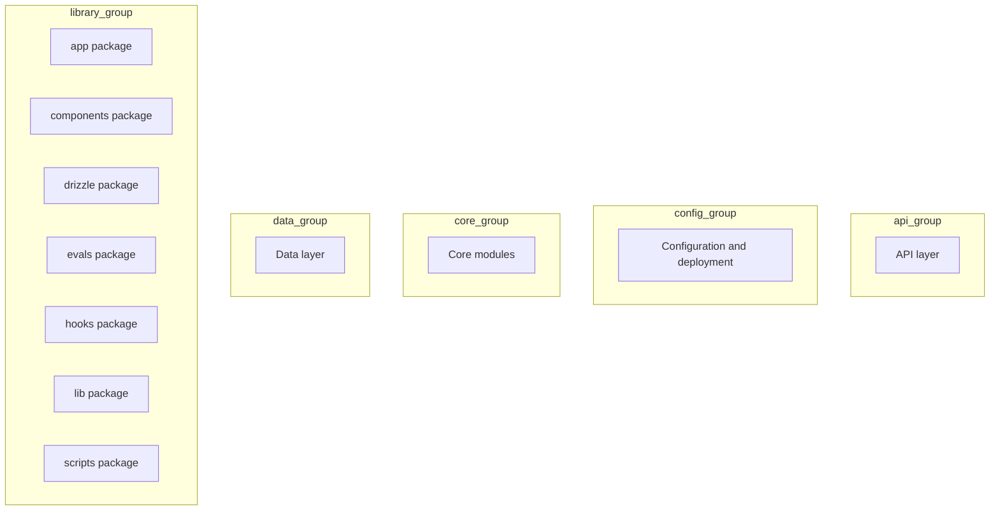

# Architecture report: miurla/morphic

> Automated static analysis. **Observed** = directly seen in files/imports/AST; **Inferred** = interpretation from that evidence. Repository code was not executed.

## 1. Repository at a glance

| Item | Value |
| --- | --- |
| Repository | miurla/morphic |
| Description | An AI-powered search engine with a generative UI |
| Language | TypeScript |
| Stars | 9329 |
| Licence | Apache-2.0 |
| Analysed commit / branch | 244ea609ab0d604f6c7020fee214ac087f0129c9 / main |
| Framework(s) | Next.js, React |
| Files analysed | 659 |
| Components | 11 |

## 2. Architecture in one minute

miurla/morphic - An AI-powered search engine with a generative UI. This repository was analysed statically from 659 file(s) (0 Python). Detected technologies (observed from imports/manifests): GitHub Actions, PostgreSQL, Redis, Next.js, React, Tailwind CSS. Files are grouped into 11 component(s): API layer, app package, components package, Configuration and deployment, Core modules, Data layer, drizzle package, evals package. Findings below distinguish observed facts from inferred interpretation.

## 3. High-level block diagram

## 4. Main components

### API layer (`api_layer`)

- **Kind:** api
- **Status:** Observed
- **Confidence:** 0.85
- **Responsibility:** Groups 18 file(s) under api layer (observed from repository paths and static analysis).
- **Paths:** `app/api/advanced-search/route.ts`, `app/api/auth/[...all]/__tests__/route.test.ts`, `app/api/auth/[...all]/route.ts`, `app/api/chat/__tests__/route.test.ts`, `app/api/chat/route.ts`, `app/api/chats/[id]/__tests__/route.test.ts`, `app/api/chats/[id]/route.ts`, `app/api/chats/route.ts`, `app/api/favicon/__tests__/route.test.ts`, `app/api/favicon/route.ts`, `app/api/feedback/__tests__/route.test.ts`, `app/api/feedback/route.ts`, `app/api/search/__tests__/route.test.ts`, `app/api/search/route.ts`, `app/api/upload/__tests__/route.test.ts`, `app/api/upload/route.ts`, `app/api/usage/interest/route.ts`, `app/api/usage/route.ts`
- **Evidence:** [app/api/advanced-search/route.ts](https://github.com/miurla/morphic/blob/244ea609ab0d604f6c7020fee214ac087f0129c9/app/api/advanced-search/route.ts); [app/api/auth/[...all]/__tests__/route.test.ts](https://github.com/miurla/morphic/blob/244ea609ab0d604f6c7020fee214ac087f0129c9/app/api/auth/%5B...all%5D/__tests__/route.test.ts); [app/api/auth/[...all]/route.ts](https://github.com/miurla/morphic/blob/244ea609ab0d604f6c7020fee214ac087f0129c9/app/api/auth/%5B...all%5D/route.ts); [app/api/chat/__tests__/route.test.ts](https://github.com/miurla/morphic/blob/244ea609ab0d604f6c7020fee214ac087f0129c9/app/api/chat/__tests__/route.test.ts); [app/api/chat/route.ts](https://github.com/miurla/morphic/blob/244ea609ab0d604f6c7020fee214ac087f0129c9/app/api/chat/route.ts); [app/api/chats/[id]/__tests__/route.test.ts](https://github.com/miurla/morphic/blob/244ea609ab0d604f6c7020fee214ac087f0129c9/app/api/chats/%5Bid%5D/__tests__/route.test.ts); [app/api/chats/[id]/route.ts](https://github.com/miurla/morphic/blob/244ea609ab0d604f6c7020fee214ac087f0129c9/app/api/chats/%5Bid%5D/route.ts); [app/api/chats/route.ts](https://github.com/miurla/morphic/blob/244ea609ab0d604f6c7020fee214ac087f0129c9/app/api/chats/route.ts)

### app package (`app`)

- **Kind:** library
- **Status:** Observed
- **Confidence:** 0.85
- **Responsibility:** Groups 18 file(s) under app package (observed from repository paths and static analysis).
- **Paths:** `app/auth/__tests__/sign-up-page.test.ts`, `app/auth/admin/page.tsx`, `app/auth/confirm/route.ts`, `app/auth/error/page.tsx`, `app/auth/forgot-password/page.tsx`, `app/auth/login/page.tsx`, `app/auth/oauth/route.ts`, `app/auth/sign-up-success/page.tsx`, `app/auth/sign-up/page.tsx`, `app/auth/update-password/page.tsx`, `app/layout.tsx`, `app/page.tsx`, `app/relay/[...path]/route.test.ts`, `app/relay/[...path]/route.ts`, `app/search/[id]/__tests__/page.test.tsx`, `app/search/[id]/page.tsx`, `app/search/loading.tsx`, `app/search/page.tsx`
- **Evidence:** [app/auth/__tests__/sign-up-page.test.ts](https://github.com/miurla/morphic/blob/244ea609ab0d604f6c7020fee214ac087f0129c9/app/auth/__tests__/sign-up-page.test.ts); [app/auth/admin/page.tsx](https://github.com/miurla/morphic/blob/244ea609ab0d604f6c7020fee214ac087f0129c9/app/auth/admin/page.tsx); [app/auth/confirm/route.ts](https://github.com/miurla/morphic/blob/244ea609ab0d604f6c7020fee214ac087f0129c9/app/auth/confirm/route.ts); [app/auth/error/page.tsx](https://github.com/miurla/morphic/blob/244ea609ab0d604f6c7020fee214ac087f0129c9/app/auth/error/page.tsx); [app/auth/forgot-password/page.tsx](https://github.com/miurla/morphic/blob/244ea609ab0d604f6c7020fee214ac087f0129c9/app/auth/forgot-password/page.tsx); [app/auth/login/page.tsx](https://github.com/miurla/morphic/blob/244ea609ab0d604f6c7020fee214ac087f0129c9/app/auth/login/page.tsx); [app/auth/oauth/route.ts](https://github.com/miurla/morphic/blob/244ea609ab0d604f6c7020fee214ac087f0129c9/app/auth/oauth/route.ts); [app/auth/sign-up-success/page.tsx](https://github.com/miurla/morphic/blob/244ea609ab0d604f6c7020fee214ac087f0129c9/app/auth/sign-up-success/page.tsx)

### components package (`components`)

- **Kind:** library
- **Status:** Observed
- **Confidence:** 0.85
- **Responsibility:** Groups 164 file(s) under components package (observed from repository paths and static analysis).
- **Paths:** `components/__tests__/account-settings-dialog.test.tsx`, `components/__tests__/app-sidebar.test.tsx`, `components/__tests__/chat-cache-invalidation.test.tsx`, `components/__tests__/chat-cache.test.tsx`, `components/__tests__/chat-messages.test.tsx`, `components/__tests__/chat-panel.test.tsx`, `components/__tests__/draft-panel.test.tsx`, `components/__tests__/invitations-manager.test.tsx`, `components/__tests__/login-form.test.tsx`, `components/__tests__/member-role-manager.test.tsx`, `components/__tests__/message-actions.test.tsx`, `components/__tests__/render-message.test.tsx`, `components/__tests__/research-process-section.test.tsx`, `components/__tests__/reset-member-password-form.test.tsx`, `components/__tests__/search-mode-selector.test.tsx`, `components/__tests__/sign-up-form.test.tsx`, `components/__tests__/spec-block.test.tsx`, `components/__tests__/update-password-form.test.tsx`, `components/__tests__/usage-budget.test.tsx`, `components/__tests__/user-menu.test.tsx`, `components/account-settings-dialog.tsx`, `components/action-buttons.tsx`, `components/admin/invitations-manager.tsx`, `components/admin/member-role-manager.tsx`, `components/admin/reset-member-password-form.tsx`, `components/answer-section.tsx`, `components/app-sidebar.tsx`, `components/artifact/artifact-content.tsx`, `components/artifact/artifact-context.tsx`, `components/artifact/artifact-root.tsx`, `components/artifact/chat-artifact-container.tsx`, `components/artifact/reasoning-content.tsx`, `components/artifact/search-artifact-content.tsx`, `components/artifact/todo-invocation-content.tsx`, `components/artifact/tool-invocation-content.tsx`, `components/attachment-preview.tsx`, `components/auth-modal.tsx`, `components/chat-error.tsx`, `components/chat-footer-message.tsx`, `components/chat-messages.tsx`, `components/chat-panel.tsx`, `components/chat-share.tsx`, `components/chat.tsx`, `components/citation-context.tsx`, `components/citation-link.tsx`, `components/collapsible-message.tsx`, `components/current-user-avatar.tsx`, `components/custom-link.tsx`, `components/default-skeleton.tsx`, `components/draft/draft-card.tsx`, `components/draft/draft-panel.tsx`, `components/draft/draft-store.ts`, `components/drag-overlay.tsx`, `components/dynamic-tool-display.tsx`, `components/error-modal.tsx`, `components/external-link-items.tsx`, `components/feedback-modal.tsx`, `components/fetch-section.tsx`, `components/file-upload-button.tsx`, `components/forgot-password-form.tsx`, `components/guest-menu.tsx`, `components/header.tsx`, `components/image-credit-overlay.tsx`, `components/inspector/inspector-drawer.tsx`, `components/inspector/inspector-panel.tsx`, `components/invite-required.tsx`, `components/keyboard-shortcut-dialog.tsx`, `components/keyboard-shortcut-handler.tsx`, `components/library/__tests__/library-context.test.tsx`, `components/library/library-context.tsx`, `components/library/library-panel.tsx`, `components/library/library-picker-dialog.tsx`, `components/library/save-note-auth-dialog.tsx`, `components/login-form.tsx`, `components/message-actions.tsx`, `components/message-navigation-dots.tsx`, `components/message.tsx`, `components/model-selector-client.tsx`, `components/pasted-parts.tsx`, `components/posthog-provider.tsx`, `components/process-header.tsx`, `components/process-rail.tsx`, `components/question-confirmation.tsx`, `components/reasoning-section.tsx`, `components/render-message.tsx`, `components/research-process-section.tsx`, `components/retry-button.tsx`, `components/search-mode-selector.tsx`, `components/search-results-image.tsx`, `components/search-results.tsx`, `components/search-section.tsx`, `components/section.tsx`, `components/sidebar/__tests__/chat-history-client.test.tsx`, `components/sidebar/__tests__/chat-history-search.test.tsx`, `components/sidebar/__tests__/library-menu-item.test.tsx`, `components/sidebar/__tests__/version-footer.test.tsx`, `components/sidebar/chat-history-client.tsx`, `components/sidebar/chat-history-search.tsx`, `components/sidebar/chat-history-section.tsx`, `components/sidebar/chat-history-skeleton.tsx`, `components/sidebar/chat-menu-item.tsx`, `components/sidebar/clear-history-action.tsx`, `components/sidebar/home-link.test.tsx`, `components/sidebar/home-link.tsx`, `components/sidebar/library-menu-item.tsx`, `components/sidebar/new-chat-menu-item.tsx`, `components/sidebar/version-footer-skeleton.tsx`, `components/sidebar/version-footer.tsx`, `components/sign-up-form.tsx`, `components/source-favicons.tsx`, `components/spec-block.tsx`, `components/spec-fence-block.tsx`, `components/theme-menu-items.tsx`, `components/theme-provider.tsx`, `components/todo-list-content.tsx`, `components/tool-badge.tsx`, `components/tool-section.tsx`, `components/tool-todo-display.tsx`, `components/ui/__tests__/sidebar.test.tsx`, `components/ui/alert-dialog.tsx`, `components/ui/animated-logo.tsx`, `components/ui/avatar.tsx`, `components/ui/badge.tsx`, `components/ui/button.tsx`, `components/ui/card.tsx`, `components/ui/carousel.tsx`, `components/ui/checkbox.tsx`, `components/ui/collapsible.tsx`, `components/ui/command.tsx`, `components/ui/dialog.tsx`, `components/ui/drawer.tsx`, `components/ui/dropdown-menu.tsx`, `components/ui/hover-card.tsx`, `components/ui/icons.tsx`, `components/ui/index.ts`, `components/ui/input.tsx`, `components/ui/label.tsx`, `components/ui/password-input.tsx`, `components/ui/popover.tsx`, `components/ui/select.tsx`, `components/ui/separator.tsx`, `components/ui/sheet.tsx`, `components/ui/sidebar.tsx`, `components/ui/skeleton.tsx`, `components/ui/slider.tsx`, `components/ui/sonner.tsx`, `components/ui/spinner.tsx`, `components/ui/status-indicator.tsx`, `components/ui/switch.tsx`, `components/ui/textarea.tsx`, `components/ui/toggle.tsx`, `components/ui/tooltip-button.tsx`, `components/ui/tooltip.tsx`, `components/update-password-form.tsx`, `components/uploaded-file-list.tsx`, `components/usage-budget-provider.tsx`, `components/usage-dialog.tsx`, `components/usage-limit-dialog.tsx`, `components/user-file-section.tsx`, `components/user-menu.tsx`, `components/user-text-section.tsx`, `components/video-carousel-dialog.tsx`, `components/video-result-grid.tsx`, `components/video-search-results.tsx`
- **Evidence:** [components/__tests__/account-settings-dialog.test.tsx](https://github.com/miurla/morphic/blob/244ea609ab0d604f6c7020fee214ac087f0129c9/components/__tests__/account-settings-dialog.test.tsx); [components/__tests__/app-sidebar.test.tsx](https://github.com/miurla/morphic/blob/244ea609ab0d604f6c7020fee214ac087f0129c9/components/__tests__/app-sidebar.test.tsx); [components/__tests__/chat-cache-invalidation.test.tsx](https://github.com/miurla/morphic/blob/244ea609ab0d604f6c7020fee214ac087f0129c9/components/__tests__/chat-cache-invalidation.test.tsx); [components/__tests__/chat-cache.test.tsx](https://github.com/miurla/morphic/blob/244ea609ab0d604f6c7020fee214ac087f0129c9/components/__tests__/chat-cache.test.tsx); [components/__tests__/chat-messages.test.tsx](https://github.com/miurla/morphic/blob/244ea609ab0d604f6c7020fee214ac087f0129c9/components/__tests__/chat-messages.test.tsx); [components/__tests__/chat-panel.test.tsx](https://github.com/miurla/morphic/blob/244ea609ab0d604f6c7020fee214ac087f0129c9/components/__tests__/chat-panel.test.tsx); [components/__tests__/draft-panel.test.tsx](https://github.com/miurla/morphic/blob/244ea609ab0d604f6c7020fee214ac087f0129c9/components/__tests__/draft-panel.test.tsx); [components/__tests__/invitations-manager.test.tsx](https://github.com/miurla/morphic/blob/244ea609ab0d604f6c7020fee214ac087f0129c9/components/__tests__/invitations-manager.test.tsx)

### Configuration and deployment (`config`)

- **Kind:** config
- **Status:** Observed
- **Confidence:** 0.85
- **Responsibility:** Groups 37 file(s) under configuration and deployment (observed from repository paths and static analysis).
- **Paths:** `Dockerfile`, `components.json`, `config/models/cloud.json`, `docker-compose.yaml`, `drizzle/meta/0000_snapshot.json`, `drizzle/meta/0001_snapshot.json`, `drizzle/meta/0002_snapshot.json`, `drizzle/meta/0003_snapshot.json`, `drizzle/meta/0004_snapshot.json`, `drizzle/meta/0005_snapshot.json`, `drizzle/meta/0006_snapshot.json`, `drizzle/meta/0007_snapshot.json`, `drizzle/meta/0008_snapshot.json`, `drizzle/meta/0009_snapshot.json`, `drizzle/meta/0010_snapshot.json`, `drizzle/meta/0011_snapshot.json`, `drizzle/meta/0016_snapshot.json`, `drizzle/meta/0018_snapshot.json`, `drizzle/meta/0019_snapshot.json`, `drizzle/meta/0020_snapshot.json`, `drizzle/meta/0021_snapshot.json`, `drizzle/meta/_journal.json`, `evals/datasets/draft-edits.json`, `evals/datasets/related-questions.json`, `evals/datasets/source-cards.json`, `evals/thresholds.json`, `lib/config/default-model.ts`, `lib/config/load-models-config.ts`, `lib/config/model-metadata.json`, `lib/config/model-selection-cookie.ts`, `lib/config/model-types.ts`, `lib/config/ollama-validator.ts`, `lib/config/search-modes.ts`, `package.json`, `searxng-limiter.toml`, `searxng-settings.yml`, `tsconfig.json`
- **Evidence:** [Dockerfile](https://github.com/miurla/morphic/blob/244ea609ab0d604f6c7020fee214ac087f0129c9/Dockerfile); [components.json](https://github.com/miurla/morphic/blob/244ea609ab0d604f6c7020fee214ac087f0129c9/components.json); [config/models/cloud.json](https://github.com/miurla/morphic/blob/244ea609ab0d604f6c7020fee214ac087f0129c9/config/models/cloud.json); [docker-compose.yaml](https://github.com/miurla/morphic/blob/244ea609ab0d604f6c7020fee214ac087f0129c9/docker-compose.yaml); [drizzle/meta/0000_snapshot.json](https://github.com/miurla/morphic/blob/244ea609ab0d604f6c7020fee214ac087f0129c9/drizzle/meta/0000_snapshot.json); [drizzle/meta/0001_snapshot.json](https://github.com/miurla/morphic/blob/244ea609ab0d604f6c7020fee214ac087f0129c9/drizzle/meta/0001_snapshot.json); [drizzle/meta/0002_snapshot.json](https://github.com/miurla/morphic/blob/244ea609ab0d604f6c7020fee214ac087f0129c9/drizzle/meta/0002_snapshot.json); [drizzle/meta/0003_snapshot.json](https://github.com/miurla/morphic/blob/244ea609ab0d604f6c7020fee214ac087f0129c9/drizzle/meta/0003_snapshot.json)

### Core modules (`core`)

- **Kind:** core
- **Status:** Observed
- **Confidence:** 0.85
- **Responsibility:** Groups 12 file(s) under core modules (observed from repository paths and static analysis).
- **Paths:** `docker-entrypoint.sh`, `drizzle.config.ts`, `eslint.config.mjs`, `instrumentation-client.ts`, `instrumentation.test.ts`, `instrumentation.ts`, `next.config.mjs`, `postcss.config.mjs`, `prettier.config.js`, `proxy.test.ts`, `proxy.ts`, `vitest.setup.ts`
- **Evidence:** [docker-entrypoint.sh](https://github.com/miurla/morphic/blob/244ea609ab0d604f6c7020fee214ac087f0129c9/docker-entrypoint.sh); [drizzle.config.ts](https://github.com/miurla/morphic/blob/244ea609ab0d604f6c7020fee214ac087f0129c9/drizzle.config.ts); [eslint.config.mjs](https://github.com/miurla/morphic/blob/244ea609ab0d604f6c7020fee214ac087f0129c9/eslint.config.mjs); [instrumentation-client.ts](https://github.com/miurla/morphic/blob/244ea609ab0d604f6c7020fee214ac087f0129c9/instrumentation-client.ts); [instrumentation.test.ts](https://github.com/miurla/morphic/blob/244ea609ab0d604f6c7020fee214ac087f0129c9/instrumentation.test.ts); [instrumentation.ts](https://github.com/miurla/morphic/blob/244ea609ab0d604f6c7020fee214ac087f0129c9/instrumentation.ts); [next.config.mjs](https://github.com/miurla/morphic/blob/244ea609ab0d604f6c7020fee214ac087f0129c9/next.config.mjs); [postcss.config.mjs](https://github.com/miurla/morphic/blob/244ea609ab0d604f6c7020fee214ac087f0129c9/postcss.config.mjs)

### Data layer (`data_layer`)

- **Kind:** data
- **Status:** Observed
- **Confidence:** 0.85
- **Responsibility:** Groups 18 file(s) under data layer (observed from repository paths and static analysis).
- **Paths:** `lib/db/__tests__/attachment-sizes.test.ts`, `lib/db/__tests__/chat-search.test.ts`, `lib/db/__tests__/index.test.ts`, `lib/db/__tests__/rls-policies.integration.test.ts`, `lib/db/__tests__/user-message-ids.test.ts`, `lib/db/__tests__/with-rls.test.ts`, `lib/db/actions.ts`, `lib/db/index.ts`, `lib/db/migrate.ts`, `lib/db/relations.ts`, `lib/db/schema.ts`, `lib/db/with-rls.ts`, `lib/models/__tests__/fetch-models.test.ts`, `lib/models/fetch-models.ts`, `lib/storage/__tests__/file-signature.test.ts`, `lib/storage/__tests__/r2-client.test.ts`, `lib/storage/file-signature.ts`, `lib/storage/r2-client.ts`
- **Evidence:** [lib/db/__tests__/attachment-sizes.test.ts](https://github.com/miurla/morphic/blob/244ea609ab0d604f6c7020fee214ac087f0129c9/lib/db/__tests__/attachment-sizes.test.ts); [lib/db/__tests__/chat-search.test.ts](https://github.com/miurla/morphic/blob/244ea609ab0d604f6c7020fee214ac087f0129c9/lib/db/__tests__/chat-search.test.ts); [lib/db/__tests__/index.test.ts](https://github.com/miurla/morphic/blob/244ea609ab0d604f6c7020fee214ac087f0129c9/lib/db/__tests__/index.test.ts); [lib/db/__tests__/rls-policies.integration.test.ts](https://github.com/miurla/morphic/blob/244ea609ab0d604f6c7020fee214ac087f0129c9/lib/db/__tests__/rls-policies.integration.test.ts); [lib/db/__tests__/user-message-ids.test.ts](https://github.com/miurla/morphic/blob/244ea609ab0d604f6c7020fee214ac087f0129c9/lib/db/__tests__/user-message-ids.test.ts); [lib/db/__tests__/with-rls.test.ts](https://github.com/miurla/morphic/blob/244ea609ab0d604f6c7020fee214ac087f0129c9/lib/db/__tests__/with-rls.test.ts); [lib/db/actions.ts](https://github.com/miurla/morphic/blob/244ea609ab0d604f6c7020fee214ac087f0129c9/lib/db/actions.ts); [lib/db/index.ts](https://github.com/miurla/morphic/blob/244ea609ab0d604f6c7020fee214ac087f0129c9/lib/db/index.ts)

### drizzle package (`drizzle`)

- **Kind:** library
- **Status:** Observed
- **Confidence:** 0.85
- **Responsibility:** Groups 2 file(s) under drizzle package (observed from repository paths and static analysis).
- **Paths:** `drizzle/relations.ts`, `drizzle/schema.ts`
- **Evidence:** [drizzle/relations.ts](https://github.com/miurla/morphic/blob/244ea609ab0d604f6c7020fee214ac087f0129c9/drizzle/relations.ts); [drizzle/schema.ts](https://github.com/miurla/morphic/blob/244ea609ab0d604f6c7020fee214ac087f0129c9/drizzle/schema.ts)

### evals package (`evals`)

- **Kind:** library
- **Status:** Observed
- **Confidence:** 0.85
- **Responsibility:** Groups 25 file(s) under evals package (observed from repository paths and static analysis).
- **Paths:** `evals/evaluators/__tests__/related-questions.test.ts`, `evals/evaluators/draft-edits.ts`, `evals/evaluators/related-questions.ts`, `evals/evaluators/source-cards.ts`, `evals/lib/__tests__/draft-edits.test.ts`, `evals/lib/__tests__/gate.test.ts`, `evals/lib/__tests__/related-questions.test.ts`, `evals/lib/__tests__/source-cards.test.ts`, `evals/lib/__tests__/space-instructions.test.ts`, `evals/lib/dataset.ts`, `evals/lib/draft-edits.ts`, `evals/lib/gate.ts`, `evals/lib/otel.ts`, `evals/lib/related-questions.ts`, `evals/lib/source-cards.ts`, `evals/lib/space-instructions.ts`, `evals/run-draft-edits.ts`, `evals/run-related-questions.ts`, `evals/run-source-cards.ts`, `evals/run-space-instructions.ts`, `evals/tasks/adaptive-answer.ts`, `evals/tasks/draft-turn.ts`, `evals/tasks/fixture-tools.ts`, `evals/tasks/quick-answer.ts`, `evals/tasks/run-answer-task.ts`
- **Evidence:** [evals/evaluators/__tests__/related-questions.test.ts](https://github.com/miurla/morphic/blob/244ea609ab0d604f6c7020fee214ac087f0129c9/evals/evaluators/__tests__/related-questions.test.ts); [evals/evaluators/draft-edits.ts](https://github.com/miurla/morphic/blob/244ea609ab0d604f6c7020fee214ac087f0129c9/evals/evaluators/draft-edits.ts); [evals/evaluators/related-questions.ts](https://github.com/miurla/morphic/blob/244ea609ab0d604f6c7020fee214ac087f0129c9/evals/evaluators/related-questions.ts); [evals/evaluators/source-cards.ts](https://github.com/miurla/morphic/blob/244ea609ab0d604f6c7020fee214ac087f0129c9/evals/evaluators/source-cards.ts); [evals/lib/__tests__/draft-edits.test.ts](https://github.com/miurla/morphic/blob/244ea609ab0d604f6c7020fee214ac087f0129c9/evals/lib/__tests__/draft-edits.test.ts); [evals/lib/__tests__/gate.test.ts](https://github.com/miurla/morphic/blob/244ea609ab0d604f6c7020fee214ac087f0129c9/evals/lib/__tests__/gate.test.ts); [evals/lib/__tests__/related-questions.test.ts](https://github.com/miurla/morphic/blob/244ea609ab0d604f6c7020fee214ac087f0129c9/evals/lib/__tests__/related-questions.test.ts); [evals/lib/__tests__/source-cards.test.ts](https://github.com/miurla/morphic/blob/244ea609ab0d604f6c7020fee214ac087f0129c9/evals/lib/__tests__/source-cards.test.ts)

### hooks package (`hooks`)

- **Kind:** library
- **Status:** Observed
- **Confidence:** 0.85
- **Responsibility:** Groups 8 file(s) under hooks package (observed from repository paths and static analysis).
- **Paths:** `hooks/__tests__/user-hooks.test.tsx`, `hooks/use-auth-check.tsx`, `hooks/use-current-user-image.ts`, `hooks/use-current-user-name.ts`, `hooks/use-file-dropzone.ts`, `hooks/use-keyboard-shortcut.ts`, `hooks/use-mobile.tsx`, `hooks/use-typewriter-cycle.ts`
- **Evidence:** [hooks/__tests__/user-hooks.test.tsx](https://github.com/miurla/morphic/blob/244ea609ab0d604f6c7020fee214ac087f0129c9/hooks/__tests__/user-hooks.test.tsx); [hooks/use-auth-check.tsx](https://github.com/miurla/morphic/blob/244ea609ab0d604f6c7020fee214ac087f0129c9/hooks/use-auth-check.tsx); [hooks/use-current-user-image.ts](https://github.com/miurla/morphic/blob/244ea609ab0d604f6c7020fee214ac087f0129c9/hooks/use-current-user-image.ts); [hooks/use-current-user-name.ts](https://github.com/miurla/morphic/blob/244ea609ab0d604f6c7020fee214ac087f0129c9/hooks/use-current-user-name.ts); [hooks/use-file-dropzone.ts](https://github.com/miurla/morphic/blob/244ea609ab0d604f6c7020fee214ac087f0129c9/hooks/use-file-dropzone.ts); [hooks/use-keyboard-shortcut.ts](https://github.com/miurla/morphic/blob/244ea609ab0d604f6c7020fee214ac087f0129c9/hooks/use-keyboard-shortcut.ts); [hooks/use-mobile.tsx](https://github.com/miurla/morphic/blob/244ea609ab0d604f6c7020fee214ac087f0129c9/hooks/use-mobile.tsx); [hooks/use-typewriter-cycle.ts](https://github.com/miurla/morphic/blob/244ea609ab0d604f6c7020fee214ac087f0129c9/hooks/use-typewriter-cycle.ts)

### lib package (`lib`)

- **Kind:** library
- **Status:** Observed
- **Confidence:** 0.85
- **Responsibility:** Groups 298 file(s) under lib package (observed from repository paths and static analysis).
- **Paths:** `lib/__tests__/bot-protection.test.ts`, `lib/__tests__/maintenance.test.ts`, `lib/__tests__/search-mode-availability.test.ts`, `lib/actions/__tests__/account-better-auth.test.ts`, `lib/actions/__tests__/account.test.ts`, `lib/actions/__tests__/admin.test.ts`, `lib/actions/__tests__/chat.test.ts`, `lib/actions/__tests__/feedback.test.ts`, `lib/actions/__tests__/files.test.ts`, `lib/actions/__tests__/notes.test.ts`, `lib/actions/__tests__/spaces.test.ts`, `lib/actions/account.ts`, `lib/actions/admin-views.ts`, `lib/actions/admin.ts`, `lib/actions/auth.ts`, `lib/actions/chat.ts`, `lib/actions/feedback.ts`, `lib/actions/files.ts`, `lib/actions/notes.ts`, `lib/actions/site-feedback.ts`, `lib/actions/spaces.ts`, `lib/agents/__tests__/researcher.test.ts`, `lib/agents/__tests__/title-generator.test.ts`, `lib/agents/__tests__/tool-loop-agent-on-error.test.ts`, `lib/agents/prompts/__tests__/space-instructions.test.ts`, `lib/agents/prompts/search-mode-prompts.ts`, `lib/agents/prompts/space-instructions.ts`, `lib/agents/researcher.ts`, `lib/agents/title-generator.ts`, `lib/analytics/__tests__/dispatch.test.ts`, `lib/analytics/__tests__/genui-summary.test.ts`, `lib/analytics/__tests__/sanitize.test.ts`, `lib/analytics/__tests__/track-account-event.test.ts`, `lib/analytics/__tests__/utils.test.ts`, `lib/analytics/dispatch.ts`, `lib/analytics/genui-summary.ts`, `lib/analytics/index.ts`, `lib/analytics/posthog-client.ts`, `lib/analytics/providers/posthog-server.ts`, `lib/analytics/relay-target.ts`, `lib/analytics/sanitize.ts`, `lib/analytics/track-account-event.ts`, `lib/analytics/track-adaptive-limit-event.ts`, `lib/analytics/track-chat-event.ts`, `lib/analytics/track-chat-limit-event.ts`, `lib/analytics/types.ts`, `lib/analytics/utils.ts`, `lib/auth/__tests__/better-auth-provider.test.ts`, `lib/auth/__tests__/none-provider.test.ts`, `lib/auth/__tests__/oauth-config.test.ts`, `lib/auth/__tests__/oidc-implicit-sign-up.test.ts`, `lib/auth/__tests__/provider.test.ts`, `lib/auth/__tests__/rate-limit.test.ts`, `lib/auth/__tests__/redirect-target.test.ts`, `lib/auth/__tests__/supabase-provider.test.ts`, `lib/auth/better-auth/__tests__/config.test.ts`, `lib/auth/better-auth/__tests__/invitations.test.ts`, `lib/auth/better-auth/config.ts`, `lib/auth/better-auth/invitations.ts`, `lib/auth/better-auth/mailer.ts`, `lib/auth/better-auth/members.ts`, `lib/auth/better-auth/schema.ts`, `lib/auth/get-current-user.ts`, `lib/auth/oauth-config.ts`, `lib/auth/provider.ts`, `lib/auth/providers/better-auth.ts`, `lib/auth/providers/none.ts`, `lib/auth/providers/supabase.ts`, `lib/auth/rate-limit.ts`, `lib/auth/redirect-target.ts`, `lib/auth/request.ts`, `lib/auth/types.ts`, `lib/bot-protection.ts`, `lib/chat-store/index.test.ts`, `lib/chat-store/index.ts`, `lib/constants/index.ts`, `lib/contexts/app-user-context.tsx`, `lib/contexts/chat-context.tsx`, `lib/contexts/user-context.tsx`, `lib/draft/__tests__/draft.test.ts`, `lib/draft/__tests__/revise.test.ts`, `lib/draft/draft.ts`, `lib/draft/prompt.ts`, `lib/draft/revise.ts`, `lib/errors/__tests__/public-error.test.ts`, `lib/errors/__tests__/tool-error.test.ts`, `lib/errors/deterministic-preparation-error.ts`, `lib/errors/public-error.ts`, `lib/errors/tool-error.ts`, `lib/firecrawl/client.ts`, `lib/firecrawl/index.ts`, `lib/firecrawl/types.ts`, `lib/footer-tips.ts`, `lib/hooks/use-copy-to-clipboard.ts`, `lib/hooks/use-media-query.ts`, `lib/keyboard-shortcuts.ts`, `lib/maintenance.ts`, `lib/model-selector/get-model-selector-data.ts`, `lib/ollama/client.ts`, `lib/ollama/types.ts`, `lib/rate-limit/__tests__/adaptive-limit.test.ts`, `lib/rate-limit/__tests__/guest-limit.test.ts`, `lib/rate-limit/adaptive-limit.ts`, `lib/rate-limit/chat-limits.ts`, `lib/rate-limit/guest-limit.ts`, `lib/render/__tests__/image.test.tsx`, `lib/render/__tests__/linked-cards-markdown.test.ts`, `lib/render/__tests__/llm-image-output.e2e.test.ts`, `lib/render/__tests__/llm-related-questions.e2e.test.ts`, `lib/render/__tests__/migrations.test.ts`, `lib/render/__tests__/parse-spec-block.test.ts`, `lib/render/__tests__/prompt.test.ts`, `lib/render/__tests__/revise-suggestions.test.ts`, `lib/render/__tests__/spec-fence.test.ts`, `lib/render/__tests__/strip-source-context-blocks.test.ts`, `lib/render/__tests__/strip-spec-blocks.test.ts`, `lib/render/catalog.ts`, `lib/render/components/badge.tsx`, `lib/render/components/button.tsx`, `lib/render/components/card.tsx`, `lib/render/components/grid.tsx`, `lib/render/components/heading.tsx`, `lib/render/components/image.tsx`, `lib/render/components/shared.ts`, `lib/render/components/stack.tsx`, `lib/render/components/text.tsx`, `lib/render/highlight-markers.ts`, `lib/render/linked-cards-markdown.ts`, `lib/render/migrations.ts`, `lib/render/parse-spec-block.ts`, `lib/render/prompt.ts`, `lib/render/registry.tsx`, `lib/render/revise-suggestions.ts`, `lib/render/schema.ts`, `lib/render/spec-fence.ts`, `lib/render/streamdown-spec.tsx`, `lib/render/strip-source-context-blocks.ts`, `lib/render/strip-spec-blocks.ts`, `lib/schema/fetch.tsx`, `lib/schema/question.ts`, `lib/schema/search.tsx`, `lib/search-mode-availability.ts`, `lib/spaces/space.ts`, `lib/streaming/__tests__/compact-historical-messages.test.ts`, `lib/streaming/__tests__/create-chat-stream-response.test.ts`, `lib/streaming/__tests__/create-ephemeral-chat-stream-response.test.ts`, `lib/streaming/create-chat-stream-response.ts`, `lib/streaming/create-ephemeral-chat-stream-response.ts`, `lib/streaming/helpers/__tests__/attachment-sizes.test.ts`, `lib/streaming/helpers/__tests__/attachment-token-estimates.test.ts`, `lib/streaming/helpers/__tests__/cap-historical-answer-text.test.ts`, `lib/streaming/helpers/__tests__/cap-historical-attachments.test.ts`, `lib/streaming/helpers/__tests__/cap-historical-pasted-content.test.ts`, `lib/streaming/helpers/__tests__/compact-historical-messages.test.ts`, `lib/streaming/helpers/__tests__/data-part-nonce.test.ts`, `lib/streaming/helpers/__tests__/dedupe-attachments.test.ts`, `lib/streaming/helpers/__tests__/describe-stream-error.test.ts`, `lib/streaming/helpers/__tests__/describe-turn-input.test.ts`, `lib/streaming/helpers/__tests__/draft-context.test.ts`, `lib/streaming/helpers/__tests__/has-answer-after-tool-failure.test.ts`, `lib/streaming/helpers/__tests__/has-response-content.test.ts`, `lib/streaming/helpers/__tests__/is-empty-response.test.ts`, `lib/streaming/helpers/__tests__/log-api-call-error.test.ts`, `lib/streaming/helpers/__tests__/persist-stream-results.test.ts`, `lib/streaming/helpers/__tests__/prepare-messages.test.ts`, `lib/streaming/helpers/__tests__/resolve-chat-space.test.ts`, `lib/streaming/helpers/__tests__/stream-error-diagnostics.test.ts`, `lib/streaming/helpers/__tests__/strip-spec-from-messages.test.ts`, `lib/streaming/helpers/__tests__/summarize-carried-context.test.ts`, `lib/streaming/helpers/__tests__/trim-cold-start-history.test.ts`, `lib/streaming/helpers/attachment-parts.ts`, `lib/streaming/helpers/attachment-sizes.ts`, `lib/streaming/helpers/attachment-token-estimates.ts`, `lib/streaming/helpers/cap-historical-answer-text.ts`, `lib/streaming/helpers/cap-historical-attachments.ts`, `lib/streaming/helpers/cap-historical-pasted-content.ts`, `lib/streaming/helpers/compact-historical-messages.ts`, `lib/streaming/helpers/convert-data-part.ts`, `lib/streaming/helpers/data-part-nonce.ts`, `lib/streaming/helpers/dedupe-attachments.ts`, `lib/streaming/helpers/describe-stream-error.ts`, `lib/streaming/helpers/describe-turn-input.ts`, `lib/streaming/helpers/draft-context.ts`, `lib/streaming/helpers/has-answer-after-tool-failure.ts`, `lib/streaming/helpers/has-response-content.ts`, `lib/streaming/helpers/is-empty-response.ts`, `lib/streaming/helpers/log-api-call-error.ts`, `lib/streaming/helpers/persist-stream-results.ts`, `lib/streaming/helpers/prepare-messages.ts`, `lib/streaming/helpers/resolve-chat-space.ts`, `lib/streaming/helpers/slice-without-splitting-surrogate-pair.ts`, `lib/streaming/helpers/stream-error-diagnostics.ts`, `lib/streaming/helpers/strip-spec-from-messages.ts`, `lib/streaming/helpers/summarize-carried-context.ts`, `lib/streaming/helpers/trim-cold-start-history.ts`, `lib/streaming/helpers/types.ts`, `lib/streaming/types.ts`, `lib/supabase/__tests__/middleware.test.ts`, `lib/supabase/__tests__/server.test.ts`, `lib/supabase/admin.ts`, `lib/supabase/client.ts`, `lib/supabase/keys.ts`, `lib/supabase/middleware.ts`, `lib/supabase/server.ts`, `lib/tools/__tests__/fetch-error.test.ts`, `lib/tools/__tests__/fetch-ssrf.test.ts`, `lib/tools/__tests__/fetch.test.ts`, `lib/tools/__tests__/search-fallback.test.ts`, `lib/tools/__tests__/search-to-model-output.test.ts`, `lib/tools/draft.ts`, `lib/tools/dynamic.ts`, `lib/tools/fetch.ts`, `lib/tools/question.ts`, `lib/tools/search.ts`, `lib/tools/search/providers/__tests__/brave.test.ts`, `lib/tools/search/providers/__tests__/http-error.test.ts`, `lib/tools/search/providers/__tests__/recoverable-error.test.ts`, `lib/tools/search/providers/__tests__/tavily-domains.test.ts`, `lib/tools/search/providers/__tests__/tavily-projection.test.ts`, `lib/tools/search/providers/base.ts`, `lib/tools/search/providers/brave.ts`, `lib/tools/search/providers/exa.ts`, `lib/tools/search/providers/firecrawl.ts`, `lib/tools/search/providers/index.ts`, `lib/tools/search/providers/recoverable-error.ts`, `lib/tools/search/providers/searxng.ts`, `lib/tools/search/providers/tavily.ts`, `lib/tools/todo.ts`, `lib/types/agent.ts`, `lib/types/ai.ts`, `lib/types/dynamic-tools.ts`, `lib/types/index.ts`, `lib/types/message-persistence.ts`, `lib/types/model-selector.ts`, `lib/types/models.ts`, `lib/types/search.ts`, `lib/usage-budget/__tests__/attempt-id.test.ts`, `lib/usage-budget/__tests__/config.test.ts`, `lib/usage-budget/__tests__/gate.test.ts`, `lib/usage-budget/__tests__/grants.test.ts`, `lib/usage-budget/__tests__/refund-handler.test.ts`, `lib/usage-budget/__tests__/response.test.ts`, `lib/usage-budget/__tests__/time.test.ts`, `lib/usage-budget/analytics.ts`, `lib/usage-budget/attempt-id.ts`, `lib/usage-budget/config.ts`, `lib/usage-budget/events.ts`, `lib/usage-budget/gate.ts`, `lib/usage-budget/grants.ts`, `lib/usage-budget/index.ts`, `lib/usage-budget/refund-handler.ts`, `lib/usage-budget/response.ts`, `lib/usage-budget/time.ts`, `lib/usage-budget/types.ts`, `lib/utils/__tests__/attachment-limits.test.ts`, `lib/utils/__tests__/attachment-tokens.test.ts`, `lib/utils/__tests__/citation.test.ts`, `lib/utils/__tests__/context-window.test.ts`, `lib/utils/__tests__/cookies.test.ts`, `lib/utils/__tests__/domain.test.ts`, `lib/utils/__tests__/favicon.test.ts`, `lib/utils/__tests__/message-mapping.test.ts`, `lib/utils/__tests__/model-selection.test.ts`, `lib/utils/__tests__/safe-fetch-lookup.test.ts`, `lib/utils/__tests__/safe-fetch.test.ts`, `lib/utils/__tests__/search-query.test.ts`, `lib/utils/attachment-limits.ts`, `lib/utils/attachment-tokens.ts`, `lib/utils/citation.ts`, `lib/utils/context-window.ts`, `lib/utils/cookies.ts`, `lib/utils/domain.ts`, `lib/utils/favicon.ts`, `lib/utils/index.ts`, `lib/utils/markdown.ts`, `lib/utils/message-mapping.ts`, `lib/utils/message-utils.ts`, `lib/utils/model-selection.ts`, `lib/utils/perf-logging.ts`, `lib/utils/perf-tracking.ts`, `lib/utils/registry.ts`, `lib/utils/retry.ts`, `lib/utils/safe-fetch.ts`, `lib/utils/search-config.ts`, `lib/utils/search-query.ts`, `lib/utils/telemetry.ts`, `lib/utils/url.ts`, `lib/utils/usage-logging.ts`, `lib/version/__tests__/admins.test.ts`, `lib/version/__tests__/config.test.ts`, `lib/version/__tests__/install-method.test.ts`, `lib/version/__tests__/semver.test.ts`, `lib/version/__tests__/update-check.test.ts`, `lib/version/admins.ts`, `lib/version/config.ts`, `lib/version/install-method.ts`, `lib/version/semver.ts`, `lib/version/update-check.ts`
- **Evidence:** [lib/__tests__/bot-protection.test.ts](https://github.com/miurla/morphic/blob/244ea609ab0d604f6c7020fee214ac087f0129c9/lib/__tests__/bot-protection.test.ts); [lib/__tests__/maintenance.test.ts](https://github.com/miurla/morphic/blob/244ea609ab0d604f6c7020fee214ac087f0129c9/lib/__tests__/maintenance.test.ts); [lib/__tests__/search-mode-availability.test.ts](https://github.com/miurla/morphic/blob/244ea609ab0d604f6c7020fee214ac087f0129c9/lib/__tests__/search-mode-availability.test.ts); [lib/actions/__tests__/account-better-auth.test.ts](https://github.com/miurla/morphic/blob/244ea609ab0d604f6c7020fee214ac087f0129c9/lib/actions/__tests__/account-better-auth.test.ts); [lib/actions/__tests__/account.test.ts](https://github.com/miurla/morphic/blob/244ea609ab0d604f6c7020fee214ac087f0129c9/lib/actions/__tests__/account.test.ts); [lib/actions/__tests__/admin.test.ts](https://github.com/miurla/morphic/blob/244ea609ab0d604f6c7020fee214ac087f0129c9/lib/actions/__tests__/admin.test.ts); [lib/actions/__tests__/chat.test.ts](https://github.com/miurla/morphic/blob/244ea609ab0d604f6c7020fee214ac087f0129c9/lib/actions/__tests__/chat.test.ts); [lib/actions/__tests__/feedback.test.ts](https://github.com/miurla/morphic/blob/244ea609ab0d604f6c7020fee214ac087f0129c9/lib/actions/__tests__/feedback.test.ts)

### scripts package (`scripts`)

- **Kind:** library
- **Status:** Observed
- **Confidence:** 0.85
- **Responsibility:** Groups 4 file(s) under scripts package (observed from repository paths and static analysis).
- **Paths:** `scripts/backfill-file-object-keys.ts`, `scripts/chat-cli.ts`, `scripts/generate-model-metadata.ts`, `scripts/test-cache-performance.ts`
- **Evidence:** [scripts/backfill-file-object-keys.ts](https://github.com/miurla/morphic/blob/244ea609ab0d604f6c7020fee214ac087f0129c9/scripts/backfill-file-object-keys.ts); [scripts/chat-cli.ts](https://github.com/miurla/morphic/blob/244ea609ab0d604f6c7020fee214ac087f0129c9/scripts/chat-cli.ts); [scripts/generate-model-metadata.ts](https://github.com/miurla/morphic/blob/244ea609ab0d604f6c7020fee214ac087f0129c9/scripts/generate-model-metadata.ts); [scripts/test-cache-performance.ts](https://github.com/miurla/morphic/blob/244ea609ab0d604f6c7020fee214ac087f0129c9/scripts/test-cache-performance.ts)

## 5. Execution flow

**Observed** entry point(s):

- [app/auth/admin/page.tsx](https://github.com/miurla/morphic/blob/244ea609ab0d604f6c7020fee214ac087f0129c9/app/auth/admin/page.tsx)
- [app/auth/error/page.tsx](https://github.com/miurla/morphic/blob/244ea609ab0d604f6c7020fee214ac087f0129c9/app/auth/error/page.tsx)
- [app/auth/forgot-password/page.tsx](https://github.com/miurla/morphic/blob/244ea609ab0d604f6c7020fee214ac087f0129c9/app/auth/forgot-password/page.tsx)
- [app/auth/login/page.tsx](https://github.com/miurla/morphic/blob/244ea609ab0d604f6c7020fee214ac087f0129c9/app/auth/login/page.tsx)
- [app/auth/sign-up-success/page.tsx](https://github.com/miurla/morphic/blob/244ea609ab0d604f6c7020fee214ac087f0129c9/app/auth/sign-up-success/page.tsx)
- [app/auth/sign-up/page.tsx](https://github.com/miurla/morphic/blob/244ea609ab0d604f6c7020fee214ac087f0129c9/app/auth/sign-up/page.tsx)
- [app/auth/update-password/page.tsx](https://github.com/miurla/morphic/blob/244ea609ab0d604f6c7020fee214ac087f0129c9/app/auth/update-password/page.tsx)
- [app/page.tsx](https://github.com/miurla/morphic/blob/244ea609ab0d604f6c7020fee214ac087f0129c9/app/page.tsx)
- [app/search/[id]/page.tsx](https://github.com/miurla/morphic/blob/244ea609ab0d604f6c7020fee214ac087f0129c9/app/search/%5Bid%5D/page.tsx)
- [app/search/page.tsx](https://github.com/miurla/morphic/blob/244ea609ab0d604f6c7020fee214ac087f0129c9/app/search/page.tsx)
- [components/ui/index.ts](https://github.com/miurla/morphic/blob/244ea609ab0d604f6c7020fee214ac087f0129c9/components/ui/index.ts)
- [lib/analytics/index.ts](https://github.com/miurla/morphic/blob/244ea609ab0d604f6c7020fee214ac087f0129c9/lib/analytics/index.ts)

Representative flow (derived from observed entry points and the import graph; steps beyond the entry point are **Inferred**):

1. Execution starts at an observed entry point listed above, if present.
2. No internal import relationships between components were observed.

## 6. Project structure

### `(root)`

- `.dockerignore` - container (705 bytes)
- `.gitignore` - other (541 bytes)
- `.mcp.json` - config (162 bytes)
- `.prettierignore` - other (322 bytes)
- `AGENTS.md` - docs (8742 bytes)
- `CODE_OF_CONDUCT.md` - docs (2445 bytes)
- `CONTRIBUTING.md` - docs (1710 bytes)
- `Dockerfile` - container (1419 bytes)
- `LICENSE` - docs (10933 bytes)
- `README.md` - docs (4999 bytes)
- `components.json` - config (444 bytes)
- `docker-compose.yaml` - container (3600 bytes)
- `docker-entrypoint.sh` - source, Shell (280 bytes)
- `drizzle.config.ts` - source, TypeScript (396 bytes)
- `eslint.config.mjs` - source, JavaScript (911 bytes)
- `instrumentation-client.ts` - source, TypeScript (217 bytes)
- `instrumentation.test.ts` - source, TypeScript (2606 bytes)
- `instrumentation.ts` - source, TypeScript (1355 bytes)
- `next.config.mjs` - source, JavaScript (1675 bytes)
- `package.json` - manifest (4332 bytes)
- `postcss.config.mjs` - source, JavaScript (142 bytes)
- `prettier.config.js` - source, JavaScript (198 bytes)
- `proxy.test.ts` - source, TypeScript (5222 bytes)
- `proxy.ts` - source, TypeScript (2835 bytes)
- `searxng-limiter.toml` - config (50 bytes)
- `searxng-settings.yml` - config (1216 bytes)
- `tsconfig.json` - config (690 bytes)
- `vitest.config.mts` - other (552 bytes)
- `vitest.setup.ts` - source, TypeScript (210 bytes)

### `.github`

- `.github/FUNDING.yml` - config (62 bytes)
- `.github/ISSUE_TEMPLATE/bug_report.yml` - config (1960 bytes)
- `.github/ISSUE_TEMPLATE/feature_request.yml` - config (1009 bytes)
- `.github/dependabot.yml` - config (424 bytes)
- `.github/workflows/ci.yml` - ci, YAML (2197 bytes)
- `.github/workflows/close-search-provider-prs.yml` - ci, YAML (1374 bytes)
- `.github/workflows/docker-build.yml` - ci, YAML (999 bytes)
- `.github/workflows/eval.yml` - ci, YAML (3454 bytes)
- `.github/workflows/release.yml` - ci, YAML (3448 bytes)

### `.vscode`

- `.vscode/settings.json` - config (205 bytes)

### `app`

- `app/api/advanced-search/route.ts` - source, TypeScript (19214 bytes)
- `app/api/auth/[...all]/__tests__/route.test.ts` - source, TypeScript (2763 bytes)
- `app/api/auth/[...all]/route.ts` - source, TypeScript (2379 bytes)
- `app/api/chat/__tests__/route.test.ts` - source, TypeScript (7530 bytes)
- `app/api/chat/route.ts` - source, TypeScript (16708 bytes)
- `app/api/chats/[id]/__tests__/route.test.ts` - source, TypeScript (2854 bytes)
- `app/api/chats/[id]/route.ts` - source, TypeScript (1013 bytes)
- `app/api/chats/route.ts` - source, TypeScript (780 bytes)
- `app/api/favicon/__tests__/route.test.ts` - source, TypeScript (5568 bytes)
- `app/api/favicon/route.ts` - source, TypeScript (5548 bytes)
- `app/api/feedback/__tests__/route.test.ts` - source, TypeScript (9439 bytes)
- `app/api/feedback/route.ts` - source, TypeScript (1980 bytes)
- `app/api/search/__tests__/route.test.ts` - source, TypeScript (5299 bytes)
- `app/api/search/route.ts` - source, TypeScript (3024 bytes)
- `app/api/upload/__tests__/route.test.ts` - source, TypeScript (8245 bytes)
- `app/api/upload/route.ts` - source, TypeScript (7381 bytes)
- `app/api/usage/interest/route.ts` - source, TypeScript (849 bytes)
- `app/api/usage/route.ts` - source, TypeScript (951 bytes)
- `app/auth/__tests__/sign-up-page.test.ts` - source, TypeScript (4592 bytes)
- `app/auth/admin/page.tsx` - source, TypeScript (2790 bytes)
- `app/auth/confirm/route.ts` - source, TypeScript (993 bytes)
- `app/auth/error/page.tsx` - source, TypeScript (1037 bytes)
- `app/auth/forgot-password/page.tsx` - source, TypeScript (706 bytes)
- `app/auth/login/page.tsx` - source, TypeScript (648 bytes)
- `app/auth/oauth/route.ts` - source, TypeScript (1585 bytes)
- `app/auth/sign-up-success/page.tsx` - source, TypeScript (913 bytes)
- `app/auth/sign-up/page.tsx` - source, TypeScript (2148 bytes)
- `app/auth/update-password/page.tsx` - source, TypeScript (442 bytes)
- `app/globals.css` - other (12072 bytes)
- `app/layout.tsx` - source, TypeScript (4785 bytes)
- `app/page.tsx` - source, TypeScript (693 bytes)
- `app/relay/[...path]/route.test.ts` - source, TypeScript (5381 bytes)
- `app/relay/[...path]/route.ts` - source, TypeScript (3930 bytes)
- `app/search/[id]/__tests__/page.test.tsx` - source, TypeScript (3685 bytes)
- `app/search/[id]/page.tsx` - source, TypeScript (2075 bytes)
- `app/search/loading.tsx` - source, TypeScript (304 bytes)
- `app/search/page.tsx` - source, TypeScript (1000 bytes)

### `components`

- `components/__tests__/account-settings-dialog.test.tsx` - source, TypeScript (3218 bytes)
- `components/__tests__/app-sidebar.test.tsx` - source, TypeScript (2110 bytes)
- `components/__tests__/chat-cache-invalidation.test.tsx` - source, TypeScript (3052 bytes)
- `components/__tests__/chat-cache.test.tsx` - source, TypeScript (24928 bytes)
- `components/__tests__/chat-messages.test.tsx` - source, TypeScript (2489 bytes)
- `components/__tests__/chat-panel.test.tsx` - source, TypeScript (14746 bytes)
- `components/__tests__/draft-panel.test.tsx` - source, TypeScript (2402 bytes)
- `components/__tests__/invitations-manager.test.tsx` - source, TypeScript (4349 bytes)
- `components/__tests__/login-form.test.tsx` - source, TypeScript (10815 bytes)
- `components/__tests__/member-role-manager.test.tsx` - source, TypeScript (2107 bytes)
- `components/__tests__/message-actions.test.tsx` - source, TypeScript (6256 bytes)
- `components/__tests__/render-message.test.tsx` - source, TypeScript (2440 bytes)
- `components/__tests__/research-process-section.test.tsx` - source, TypeScript (11692 bytes)
- `components/__tests__/reset-member-password-form.test.tsx` - source, TypeScript (2326 bytes)
- `components/__tests__/search-mode-selector.test.tsx` - source, TypeScript (1579 bytes)
- `components/__tests__/sign-up-form.test.tsx` - source, TypeScript (5397 bytes)
- `components/__tests__/spec-block.test.tsx` - source, TypeScript (10191 bytes)
- `components/__tests__/update-password-form.test.tsx` - source, TypeScript (1706 bytes)
- `components/__tests__/usage-budget.test.tsx` - source, TypeScript (7912 bytes)
- `components/__tests__/user-menu.test.tsx` - source, TypeScript (3450 bytes)
- `components/account-settings-dialog.tsx` - source, TypeScript (6986 bytes)
- `components/action-buttons.tsx` - source, TypeScript (7590 bytes)
- `components/admin/invitations-manager.tsx` - source, TypeScript (5520 bytes)
- `components/admin/member-role-manager.tsx` - source, TypeScript (2172 bytes)
- `components/admin/reset-member-password-form.tsx` - source, TypeScript (2634 bytes)
- `components/answer-section.tsx` - source, TypeScript (11937 bytes)
- `components/app-sidebar.tsx` - source, TypeScript (2199 bytes)
- `components/artifact/artifact-content.tsx` - source, TypeScript (1077 bytes)
- `components/artifact/artifact-context.tsx` - source, TypeScript (2656 bytes)
- `components/artifact/artifact-root.tsx` - source, TypeScript (376 bytes)
- `components/artifact/chat-artifact-container.tsx` - source, TypeScript (6300 bytes)
- `components/artifact/reasoning-content.tsx` - source, TypeScript (352 bytes)
- `components/artifact/search-artifact-content.tsx` - source, TypeScript (2175 bytes)
- `components/artifact/todo-invocation-content.tsx` - source, TypeScript (925 bytes)
- `components/artifact/tool-invocation-content.tsx` - source, TypeScript (438 bytes)
- `components/attachment-preview.tsx` - source, TypeScript (1837 bytes)
- `components/auth-modal.tsx` - source, TypeScript (1435 bytes)
- `components/chat-error.tsx` - source, TypeScript (684 bytes)
- `components/chat-footer-message.tsx` - source, TypeScript (1735 bytes)
- `components/chat-messages.tsx` - source, TypeScript (9817 bytes)
- `components/chat-panel.tsx` - source, TypeScript (36781 bytes)
- `components/chat-share.tsx` - source, TypeScript (2814 bytes)
- `components/chat.tsx` - source, TypeScript (27378 bytes)
- `components/citation-context.tsx` - source, TypeScript (730 bytes)
- `components/citation-link.tsx` - source, TypeScript (3889 bytes)
- `components/collapsible-message.tsx` - source, TypeScript (5914 bytes)
- `components/current-user-avatar.tsx` - source, TypeScript (834 bytes)
- `components/custom-link.tsx` - source, TypeScript (1496 bytes)
- `components/default-skeleton.tsx` - source, TypeScript (2804 bytes)
- `components/draft/draft-card.tsx` - source, TypeScript (3454 bytes)
- `components/draft/draft-panel.tsx` - source, TypeScript (10703 bytes)
- `components/draft/draft-store.ts` - source, TypeScript (2754 bytes)
- `components/drag-overlay.tsx` - source, TypeScript (629 bytes)
- `components/dynamic-tool-display.tsx` - source, TypeScript (4260 bytes)
- `components/error-modal.tsx` - source, TypeScript (4375 bytes)
- `components/external-link-items.tsx` - source, TypeScript (931 bytes)
- `components/feedback-modal.tsx` - source, TypeScript (4190 bytes)
- `components/fetch-section.tsx` - source, TypeScript (5029 bytes)
- `components/file-upload-button.tsx` - source, TypeScript (2142 bytes)
- `components/forgot-password-form.tsx` - source, TypeScript (3265 bytes)
- `components/guest-menu.tsx` - source, TypeScript (1825 bytes)
- `components/header.tsx` - source, TypeScript (1870 bytes)
- `components/image-credit-overlay.tsx` - source, TypeScript (2254 bytes)
- `components/inspector/inspector-drawer.tsx` - source, TypeScript (1931 bytes)
- `components/inspector/inspector-panel.tsx` - source, TypeScript (2939 bytes)
- `components/invite-required.tsx` - source, TypeScript (1295 bytes)
- `components/keyboard-shortcut-dialog.tsx` - source, TypeScript (2513 bytes)
- `components/keyboard-shortcut-handler.tsx` - source, TypeScript (1731 bytes)
- `components/library/__tests__/library-context.test.tsx` - source, TypeScript (3210 bytes)
- `components/library/library-context.tsx` - source, TypeScript (6930 bytes)
- `components/library/library-panel.tsx` - source, TypeScript (29602 bytes)
- `components/library/library-picker-dialog.tsx` - source, TypeScript (10514 bytes)
- `components/library/save-note-auth-dialog.tsx` - source, TypeScript (2127 bytes)
- `components/login-form.tsx` - source, TypeScript (7475 bytes)
- `components/message-actions.tsx` - source, TypeScript (8840 bytes)
- `components/message-navigation-dots.tsx` - source, TypeScript (1954 bytes)
- `components/message.tsx` - source, TypeScript (1848 bytes)
- `components/model-selector-client.tsx` - source, TypeScript (5796 bytes)
- `components/pasted-parts.tsx` - source, TypeScript (2085 bytes)
- `components/posthog-provider.tsx` - source, TypeScript (793 bytes)
- `components/process-header.tsx` - source, TypeScript (1025 bytes)
- `components/process-rail.tsx` - source, TypeScript (1077 bytes)
- `components/question-confirmation.tsx` - source, TypeScript (6621 bytes)
- `components/reasoning-section.tsx` - source, TypeScript (4745 bytes)
- `components/render-message.tsx` - source, TypeScript (6964 bytes)
- `components/research-process-section.tsx` - source, TypeScript (12310 bytes)
- `components/retry-button.tsx` - source, TypeScript (629 bytes)
- `components/search-mode-selector.tsx` - source, TypeScript (8116 bytes)
- `components/search-results-image.tsx` - source, TypeScript (11146 bytes)
- `components/search-results.tsx` - source, TypeScript (4938 bytes)
- `components/search-section.tsx` - source, TypeScript (6277 bytes)
- `components/section.tsx` - source, TypeScript (3183 bytes)
- `components/sidebar/__tests__/chat-history-client.test.tsx` - source, TypeScript (28102 bytes)
- `components/sidebar/__tests__/chat-history-search.test.tsx` - source, TypeScript (13251 bytes)
- `components/sidebar/__tests__/library-menu-item.test.tsx` - source, TypeScript (1776 bytes)
- `components/sidebar/__tests__/version-footer.test.tsx` - source, TypeScript (4860 bytes)
- `components/sidebar/chat-history-client.tsx` - source, TypeScript (14724 bytes)
- `components/sidebar/chat-history-search.tsx` - source, TypeScript (13238 bytes)
- `components/sidebar/chat-history-section.tsx` - source, TypeScript (137 bytes)
- `components/sidebar/chat-history-skeleton.tsx` - source, TypeScript (368 bytes)
- `components/sidebar/chat-menu-item.tsx` - source, TypeScript (5658 bytes)
- `components/sidebar/clear-history-action.tsx` - source, TypeScript (3800 bytes)
- `components/sidebar/home-link.test.tsx` - source, TypeScript (2396 bytes)
- `components/sidebar/home-link.tsx` - source, TypeScript (889 bytes)
- `components/sidebar/library-menu-item.tsx` - source, TypeScript (731 bytes)
- `components/sidebar/new-chat-menu-item.tsx` - source, TypeScript (487 bytes)
- `components/sidebar/version-footer-skeleton.tsx` - source, TypeScript (546 bytes)
- `components/sidebar/version-footer.tsx` - source, TypeScript (2583 bytes)
- `components/sign-up-form.tsx` - source, TypeScript (5354 bytes)
- `components/source-favicons.tsx` - source, TypeScript (1523 bytes)
- `components/spec-block.tsx` - source, TypeScript (4657 bytes)
- `components/spec-fence-block.tsx` - source, TypeScript (430 bytes)
- `components/theme-menu-items.tsx` - source, TypeScript (789 bytes)
- `components/theme-provider.tsx` - source, TypeScript (12613 bytes)
- `components/todo-list-content.tsx` - source, TypeScript (3162 bytes)
- `components/tool-badge.tsx` - source, TypeScript (839 bytes)
- `components/tool-section.tsx` - source, TypeScript (3013 bytes)
- `components/tool-todo-display.tsx` - source, TypeScript (5010 bytes)
- `components/ui/__tests__/sidebar.test.tsx` - source, TypeScript (2982 bytes)
- `components/ui/alert-dialog.tsx` - source, TypeScript (4411 bytes)
- `components/ui/animated-logo.tsx` - source, TypeScript (1892 bytes)
- `components/ui/avatar.tsx` - source, TypeScript (1424 bytes)
- `components/ui/badge.tsx` - source, TypeScript (1127 bytes)
- `components/ui/button.tsx` - source, TypeScript (1956 bytes)
- `components/ui/card.tsx` - source, TypeScript (1883 bytes)
- `components/ui/carousel.tsx` - source, TypeScript (6263 bytes)
- `components/ui/checkbox.tsx` - source, TypeScript (1093 bytes)
- `components/ui/collapsible.tsx` - source, TypeScript (329 bytes)
- `components/ui/command.tsx` - source, TypeScript (5058 bytes)
- `components/ui/dialog.tsx` - source, TypeScript (3867 bytes)
- `components/ui/drawer.tsx` - source, TypeScript (3027 bytes)
- `components/ui/dropdown-menu.tsx` - source, TypeScript (8669 bytes)
- `components/ui/hover-card.tsx` - source, TypeScript (1586 bytes)
- `components/ui/icons.tsx` - source, TypeScript (4635 bytes)
- `components/ui/index.ts` - source, TypeScript (84 bytes)
- `components/ui/input.tsx` - source, TypeScript (832 bytes)
- `components/ui/label.tsx` - source, TypeScript (731 bytes)
- `components/ui/password-input.tsx` - source, TypeScript (1137 bytes)
- `components/ui/popover.tsx` - source, TypeScript (1369 bytes)
- `components/ui/select.tsx` - source, TypeScript (5805 bytes)
- `components/ui/separator.tsx` - source, TypeScript (771 bytes)
- `components/ui/sheet.tsx` - source, TypeScript (4457 bytes)
- `components/ui/sidebar.tsx` - source, TypeScript (25369 bytes)
- `components/ui/skeleton.tsx` - source, TypeScript (267 bytes)
- `components/ui/slider.tsx` - source, TypeScript (1094 bytes)
- `components/ui/sonner.tsx` - source, TypeScript (909 bytes)
- `components/ui/spinner.tsx` - source, TypeScript (882 bytes)
- `components/ui/status-indicator.tsx` - source, TypeScript (497 bytes)
- `components/ui/switch.tsx` - source, TypeScript (1156 bytes)
- `components/ui/textarea.tsx` - source, TypeScript (774 bytes)
- `components/ui/toggle.tsx` - source, TypeScript (1599 bytes)
- `components/ui/tooltip-button.tsx` - source, TypeScript (1197 bytes)
- `components/ui/tooltip.tsx` - source, TypeScript (1269 bytes)
- `components/update-password-form.tsx` - source, TypeScript (2641 bytes)
- `components/uploaded-file-list.tsx` - source, TypeScript (3077 bytes)
- `components/usage-budget-provider.tsx` - source, TypeScript (6367 bytes)
- `components/usage-dialog.tsx` - source, TypeScript (3057 bytes)
- `components/usage-limit-dialog.tsx` - source, TypeScript (2339 bytes)
- `components/user-file-section.tsx` - source, TypeScript (325 bytes)
- `components/user-menu.tsx` - source, TypeScript (5719 bytes)
- `components/user-text-section.tsx` - source, TypeScript (9766 bytes)
- `components/video-carousel-dialog.tsx` - source, TypeScript (4182 bytes)
- `components/video-result-grid.tsx` - source, TypeScript (4116 bytes)
- `components/video-search-results.tsx` - source, TypeScript (1253 bytes)

### `config`

- `config/models/cloud.json` - config (547 bytes)

### `docs`

- `docs/CONFIGURATION.md` - docs (28728 bytes)
- `docs/DOCKER.md` - docs (3912 bytes)
- `docs/PRIVACY.md` - docs (15532 bytes)
- `docs/REVISE_ANALYTICS.md` - docs (6664 bytes)

### `drizzle`

- `drizzle/0000_black_lifeguard.sql` - data, SQL (3146 bytes)
- `drizzle/0001_thin_supreme_intelligence.sql` - data, SQL (132 bytes)
- `drizzle/0002_material_crystal.sql` - data, SQL (67 bytes)
- `drizzle/0003_heavy_whirlwind.sql` - data, SQL (455 bytes)
- `drizzle/0004_natural_wallow.sql` - data, SQL (316 bytes)
- `drizzle/0005_awesome_riptide.sql` - data, SQL (400 bytes)
- `drizzle/0006_brainy_wrecking_crew.sql` - data, SQL (1250 bytes)
- `drizzle/0007_illegal_mephistopheles.sql` - data, SQL (683 bytes)
- `drizzle/0008_glamorous_riptide.sql` - data, SQL (49 bytes)
- `drizzle/0009_thankful_may_parker.sql` - data, SQL (76 bytes)
- `drizzle/0010_lonely_kang.sql` - data, SQL (294 bytes)
- `drizzle/0011_feedback_anonymization.sql` - data, SQL (415 bytes)
- `drizzle/0012_knowledge_library_notes.sql` - data, SQL (1340 bytes)
- `drizzle/0013_library_files.sql` - data, SQL (1345 bytes)
- `drizzle/0014_private_file_object_keys.sql` - data, SQL (523 bytes)
- `drizzle/0015_library_file_object_keys_only.sql` - data, SQL (1129 bytes)
- `drizzle/0016_wrap_rls_current_setting.sql` - data, SQL (1453 bytes)
- `drizzle/0017_usage_budget.sql` - data, SQL (4545 bytes)
- `drizzle/0018_reconcile_usage_budget_snapshot.sql` - data, SQL (429 bytes)
- `drizzle/0019_rainy_jack_flag.sql` - data, SQL (2800 bytes)
- `drizzle/0020_add_parts_search_fts.sql` - data, SQL (520 bytes)
- `drizzle/0021_add_spaces.sql` - data, SQL (1338 bytes)
- `drizzle/meta/0000_snapshot.json` - config (12821 bytes)
- `drizzle/meta/0001_snapshot.json` - config (13124 bytes)
- `drizzle/meta/0002_snapshot.json` - config (13125 bytes)
- `drizzle/meta/0003_snapshot.json` - config (15304 bytes)
- `drizzle/meta/0004_snapshot.json` - config (16678 bytes)
- `drizzle/meta/0005_snapshot.json` - config (16895 bytes)
- `drizzle/meta/0006_snapshot.json` - config (18523 bytes)
- `drizzle/meta/0007_snapshot.json` - config (19502 bytes)
- `drizzle/meta/0008_snapshot.json` - config (19501 bytes)
- `drizzle/meta/0009_snapshot.json` - config (20054 bytes)
- `drizzle/meta/0010_snapshot.json` - config (20256 bytes)
- `drizzle/meta/0011_snapshot.json` - config (20562 bytes)
- `drizzle/meta/0016_snapshot.json` - config (20562 bytes)
- `drizzle/meta/0018_snapshot.json` - config (37620 bytes)
- `drizzle/meta/0019_snapshot.json` - config (47406 bytes)
- `drizzle/meta/0020_snapshot.json` - config (48823 bytes)
- `drizzle/meta/0021_snapshot.json` - config (52204 bytes)
- `drizzle/meta/_journal.json` - config (3307 bytes)
- `drizzle/relations.ts` - source, TypeScript (900 bytes)
- `drizzle/schema.ts` - source, TypeScript (11186 bytes)

### `evals`

- `evals/README.md` - docs (12322 bytes)
- `evals/datasets/draft-edits.json` - config (4893 bytes)
- `evals/datasets/related-questions.json` - config (9796 bytes)
- `evals/datasets/source-cards.json` - config (25410 bytes)
- `evals/evaluators/__tests__/related-questions.test.ts` - source, TypeScript (3961 bytes)
- `evals/evaluators/draft-edits.ts` - source, TypeScript (5840 bytes)
- `evals/evaluators/related-questions.ts` - source, TypeScript (5434 bytes)
- `evals/evaluators/source-cards.ts` - source, TypeScript (6558 bytes)
- `evals/lib/__tests__/draft-edits.test.ts` - source, TypeScript (2798 bytes)
- `evals/lib/__tests__/gate.test.ts` - source, TypeScript (1324 bytes)
- `evals/lib/__tests__/related-questions.test.ts` - source, TypeScript (8984 bytes)
- `evals/lib/__tests__/source-cards.test.ts` - source, TypeScript (4095 bytes)
- `evals/lib/__tests__/space-instructions.test.ts` - source, TypeScript (3594 bytes)
- `evals/lib/dataset.ts` - source, TypeScript (2433 bytes)
- `evals/lib/draft-edits.ts` - source, TypeScript (6408 bytes)
- `evals/lib/gate.ts` - source, TypeScript (2988 bytes)
- `evals/lib/otel.ts` - source, TypeScript (1381 bytes)
- `evals/lib/related-questions.ts` - source, TypeScript (7661 bytes)
- `evals/lib/source-cards.ts` - source, TypeScript (6551 bytes)
- `evals/lib/space-instructions.ts` - source, TypeScript (2772 bytes)
- `evals/run-draft-edits.ts` - source, TypeScript (7863 bytes)
- `evals/run-related-questions.ts` - source, TypeScript (7040 bytes)
- `evals/run-source-cards.ts` - source, TypeScript (7011 bytes)
- `evals/run-space-instructions.ts` - source, TypeScript (11979 bytes)
- `evals/tasks/adaptive-answer.ts` - source, TypeScript (2049 bytes)
- `evals/tasks/draft-turn.ts` - source, TypeScript (5614 bytes)
- `evals/tasks/fixture-tools.ts` - source, TypeScript (2109 bytes)
- `evals/tasks/quick-answer.ts` - source, TypeScript (2014 bytes)
- `evals/tasks/run-answer-task.ts` - source, TypeScript (3794 bytes)
- `evals/thresholds.json` - config (1796 bytes)

### `hooks`

- `hooks/__tests__/user-hooks.test.tsx` - source, TypeScript (2480 bytes)
- `hooks/use-auth-check.tsx` - source, TypeScript (199 bytes)
- `hooks/use-current-user-image.ts` - source, TypeScript (165 bytes)
- `hooks/use-current-user-name.ts` - source, TypeScript (162 bytes)
- `hooks/use-file-dropzone.ts` - source, TypeScript (3304 bytes)
- `hooks/use-keyboard-shortcut.ts` - source, TypeScript (693 bytes)
- `hooks/use-mobile.tsx` - source, TypeScript (565 bytes)
- `hooks/use-typewriter-cycle.ts` - source, TypeScript (3385 bytes)

### `lib`

- `lib/__tests__/bot-protection.test.ts` - source, TypeScript (1397 bytes)
- `lib/__tests__/maintenance.test.ts` - source, TypeScript (1131 bytes)
- `lib/__tests__/search-mode-availability.test.ts` - source, TypeScript (1225 bytes)
- `lib/actions/__tests__/account-better-auth.test.ts` - source, TypeScript (6538 bytes)
- `lib/actions/__tests__/account.test.ts` - source, TypeScript (8818 bytes)
- `lib/actions/__tests__/admin.test.ts` - source, TypeScript (9243 bytes)
- `lib/actions/__tests__/chat.test.ts` - source, TypeScript (22543 bytes)
- `lib/actions/__tests__/feedback.test.ts` - source, TypeScript (5963 bytes)
- `lib/actions/__tests__/files.test.ts` - source, TypeScript (3365 bytes)
- `lib/actions/__tests__/notes.test.ts` - source, TypeScript (3810 bytes)
- `lib/actions/__tests__/spaces.test.ts` - source, TypeScript (4998 bytes)
- `lib/actions/account.ts` - source, TypeScript (7286 bytes)
- `lib/actions/admin-views.ts` - source, TypeScript (944 bytes)
- `lib/actions/admin.ts` - source, TypeScript (6188 bytes)
- `lib/actions/auth.ts` - source, TypeScript (2086 bytes)
- `lib/actions/chat.ts` - source, TypeScript (8500 bytes)
- `lib/actions/feedback.ts` - source, TypeScript (2171 bytes)
- `lib/actions/files.ts` - source, TypeScript (3106 bytes)
- `lib/actions/notes.ts` - source, TypeScript (4490 bytes)
- `lib/actions/site-feedback.ts` - source, TypeScript (3474 bytes)
- `lib/actions/spaces.ts` - source, TypeScript (2801 bytes)
- `lib/agents/__tests__/researcher.test.ts` - source, TypeScript (3982 bytes)
- `lib/agents/__tests__/title-generator.test.ts` - source, TypeScript (1672 bytes)
- `lib/agents/__tests__/tool-loop-agent-on-error.test.ts` - source, TypeScript (1592 bytes)
- `lib/agents/prompts/__tests__/space-instructions.test.ts` - source, TypeScript (2666 bytes)
- `lib/agents/prompts/search-mode-prompts.ts` - source, TypeScript (19746 bytes)
- `lib/agents/prompts/space-instructions.ts` - source, TypeScript (1987 bytes)
- `lib/agents/researcher.ts` - source, TypeScript (6323 bytes)
- `lib/agents/title-generator.ts` - source, TypeScript (2902 bytes)
- `lib/analytics/__tests__/dispatch.test.ts` - source, TypeScript (1952 bytes)
- `lib/analytics/__tests__/genui-summary.test.ts` - source, TypeScript (1780 bytes)
- `lib/analytics/__tests__/sanitize.test.ts` - source, TypeScript (4899 bytes)
- `lib/analytics/__tests__/track-account-event.test.ts` - source, TypeScript (972 bytes)
- `lib/analytics/__tests__/utils.test.ts` - source, TypeScript (2741 bytes)
- `lib/analytics/dispatch.ts` - source, TypeScript (699 bytes)
- `lib/analytics/genui-summary.ts` - source, TypeScript (1724 bytes)
- `lib/analytics/index.ts` - source, TypeScript (638 bytes)
- `lib/analytics/posthog-client.ts` - source, TypeScript (2879 bytes)
- `lib/analytics/providers/posthog-server.ts` - source, TypeScript (1564 bytes)
- `lib/analytics/relay-target.ts` - source, TypeScript (1513 bytes)
- `lib/analytics/sanitize.ts` - source, TypeScript (2661 bytes)
- `lib/analytics/track-account-event.ts` - source, TypeScript (573 bytes)
- `lib/analytics/track-adaptive-limit-event.ts` - source, TypeScript (1066 bytes)
- `lib/analytics/track-chat-event.ts` - source, TypeScript (499 bytes)
- `lib/analytics/track-chat-limit-event.ts` - source, TypeScript (1051 bytes)
- `lib/analytics/types.ts` - source, TypeScript (1553 bytes)
- `lib/analytics/utils.ts` - source, TypeScript (1800 bytes)
- `lib/auth/__tests__/better-auth-provider.test.ts` - source, TypeScript (40031 bytes)
- `lib/auth/__tests__/none-provider.test.ts` - source, TypeScript (2863 bytes)
- `lib/auth/__tests__/oauth-config.test.ts` - source, TypeScript (1111 bytes)
- `lib/auth/__tests__/oidc-implicit-sign-up.test.ts` - source, TypeScript (4116 bytes)
- `lib/auth/__tests__/provider.test.ts` - source, TypeScript (8557 bytes)
- `lib/auth/__tests__/rate-limit.test.ts` - source, TypeScript (2606 bytes)
- `lib/auth/__tests__/redirect-target.test.ts` - source, TypeScript (1262 bytes)
- `lib/auth/__tests__/supabase-provider.test.ts` - source, TypeScript (3630 bytes)
- `lib/auth/better-auth/__tests__/config.test.ts` - source, TypeScript (15914 bytes)
- `lib/auth/better-auth/__tests__/invitations.test.ts` - source, TypeScript (4707 bytes)
- `lib/auth/better-auth/config.ts` - source, TypeScript (18990 bytes)
- `lib/auth/better-auth/invitations.ts` - source, TypeScript (4826 bytes)
- `lib/auth/better-auth/mailer.ts` - source, TypeScript (1062 bytes)
- `lib/auth/better-auth/members.ts` - source, TypeScript (586 bytes)
- `lib/auth/better-auth/schema.ts` - source, TypeScript (3045 bytes)
- `lib/auth/get-current-user.ts` - source, TypeScript (649 bytes)
- `lib/auth/oauth-config.ts` - source, TypeScript (1802 bytes)
- `lib/auth/provider.ts` - source, TypeScript (4025 bytes)
- `lib/auth/providers/better-auth.ts` - source, TypeScript (24753 bytes)
- `lib/auth/providers/none.ts` - source, TypeScript (1508 bytes)
- `lib/auth/providers/supabase.ts` - source, TypeScript (5603 bytes)
- `lib/auth/rate-limit.ts` - source, TypeScript (1719 bytes)
- `lib/auth/redirect-target.ts` - source, TypeScript (867 bytes)
- `lib/auth/request.ts` - source, TypeScript (551 bytes)
- `lib/auth/types.ts` - source, TypeScript (4704 bytes)
- `lib/bot-protection.ts` - source, TypeScript (877 bytes)
- `lib/chat-store/index.test.ts` - source, TypeScript (15674 bytes)
- `lib/chat-store/index.ts` - source, TypeScript (8148 bytes)
- `lib/config/default-model.ts` - source, TypeScript (175 bytes)
- `lib/config/load-models-config.ts` - source, TypeScript (2423 bytes)
- `lib/config/model-metadata.json` - config (42977 bytes)
- `lib/config/model-selection-cookie.ts` - source, TypeScript (915 bytes)
- `lib/config/model-types.ts` - source, TypeScript (420 bytes)
- `lib/config/ollama-validator.ts` - source, TypeScript (6195 bytes)
- `lib/config/search-modes.ts` - source, TypeScript (993 bytes)
- `lib/constants/index.ts` - source, TypeScript (41 bytes)
- `lib/contexts/app-user-context.tsx` - source, TypeScript (1413 bytes)
- `lib/contexts/chat-context.tsx` - source, TypeScript (1410 bytes)
- `lib/contexts/user-context.tsx` - source, TypeScript (367 bytes)
- `lib/db/__tests__/attachment-sizes.test.ts` - source, TypeScript (1522 bytes)
- `lib/db/__tests__/chat-search.test.ts` - source, TypeScript (11283 bytes)
- `lib/db/__tests__/index.test.ts` - source, TypeScript (992 bytes)
- `lib/db/__tests__/rls-policies.integration.test.ts` - source, TypeScript (12310 bytes)
- `lib/db/__tests__/user-message-ids.test.ts` - source, TypeScript (4188 bytes)
- `lib/db/__tests__/with-rls.test.ts` - source, TypeScript (6575 bytes)
- `lib/db/actions.ts` - source, TypeScript (30980 bytes)
- `lib/db/index.ts` - source, TypeScript (3515 bytes)
- `lib/db/migrate.ts` - source, TypeScript (1331 bytes)
- `lib/db/relations.ts` - source, TypeScript (925 bytes)
- `lib/db/schema.ts` - source, TypeScript (19385 bytes)
- `lib/db/with-rls.ts` - source, TypeScript (2729 bytes)
- `lib/draft/__tests__/draft.test.ts` - source, TypeScript (13878 bytes)
- `lib/draft/__tests__/revise.test.ts` - source, TypeScript (4219 bytes)
- `lib/draft/draft.ts` - source, TypeScript (13406 bytes)
- `lib/draft/prompt.ts` - source, TypeScript (2658 bytes)
- `lib/draft/revise.ts` - source, TypeScript (1925 bytes)
- `lib/errors/__tests__/public-error.test.ts` - source, TypeScript (13752 bytes)
- `lib/errors/__tests__/tool-error.test.ts` - source, TypeScript (4541 bytes)
- `lib/errors/deterministic-preparation-error.ts` - source, TypeScript (328 bytes)
- `lib/errors/public-error.ts` - source, TypeScript (15683 bytes)
- `lib/errors/tool-error.ts` - source, TypeScript (6107 bytes)
- `lib/firecrawl/client.ts` - source, TypeScript (2407 bytes)
- `lib/firecrawl/index.ts` - source, TypeScript (49 bytes)
- `lib/firecrawl/types.ts` - source, TypeScript (1117 bytes)
- `lib/footer-tips.ts` - source, TypeScript (940 bytes)
- `lib/hooks/use-copy-to-clipboard.ts` - source, TypeScript (640 bytes)
- `lib/hooks/use-media-query.ts` - source, TypeScript (805 bytes)
- `lib/keyboard-shortcuts.ts` - source, TypeScript (2051 bytes)
- `lib/maintenance.ts` - source, TypeScript (1695 bytes)
- `lib/model-selector/get-model-selector-data.ts` - source, TypeScript (2309 bytes)
- `lib/models/__tests__/fetch-models.test.ts` - source, TypeScript (11377 bytes)
- `lib/models/fetch-models.ts` - source, TypeScript (12669 bytes)
- `lib/ollama/client.ts` - source, TypeScript (2256 bytes)
- `lib/ollama/types.ts` - source, TypeScript (628 bytes)
- `lib/rate-limit/__tests__/adaptive-limit.test.ts` - source, TypeScript (5218 bytes)
- `lib/rate-limit/__tests__/guest-limit.test.ts` - source, TypeScript (1961 bytes)
- `lib/rate-limit/adaptive-limit.ts` - source, TypeScript (4369 bytes)
- `lib/rate-limit/chat-limits.ts` - source, TypeScript (4534 bytes)
- `lib/rate-limit/guest-limit.ts` - source, TypeScript (2866 bytes)
- `lib/render/__tests__/image.test.tsx` - source, TypeScript (825 bytes)
- `lib/render/__tests__/linked-cards-markdown.test.ts` - source, TypeScript (5968 bytes)
- `lib/render/__tests__/llm-image-output.e2e.test.ts` - source, TypeScript (4475 bytes)
- `lib/render/__tests__/llm-related-questions.e2e.test.ts` - source, TypeScript (4970 bytes)
- `lib/render/__tests__/migrations.test.ts` - source, TypeScript (4570 bytes)
- `lib/render/__tests__/parse-spec-block.test.ts` - source, TypeScript (5441 bytes)
- `lib/render/__tests__/prompt.test.ts` - source, TypeScript (5165 bytes)
- `lib/render/__tests__/revise-suggestions.test.ts` - source, TypeScript (2529 bytes)
- `lib/render/__tests__/spec-fence.test.ts` - source, TypeScript (3191 bytes)
- `lib/render/__tests__/strip-source-context-blocks.test.ts` - source, TypeScript (2450 bytes)
- `lib/render/__tests__/strip-spec-blocks.test.ts` - source, TypeScript (2347 bytes)
- `lib/render/catalog.ts` - source, TypeScript (2690 bytes)
- `lib/render/components/badge.tsx` - source, TypeScript (329 bytes)
- `lib/render/components/button.tsx` - source, TypeScript (1173 bytes)
- `lib/render/components/card.tsx` - source, TypeScript (1767 bytes)
- `lib/render/components/grid.tsx` - source, TypeScript (842 bytes)
- `lib/render/components/heading.tsx` - source, TypeScript (427 bytes)
- `lib/render/components/image.tsx` - source, TypeScript (2496 bytes)
- `lib/render/components/shared.ts` - source, TypeScript (574 bytes)
- `lib/render/components/stack.tsx` - source, TypeScript (500 bytes)
- `lib/render/components/text.tsx` - source, TypeScript (563 bytes)
- `lib/render/highlight-markers.ts` - source, TypeScript (436 bytes)
- `lib/render/linked-cards-markdown.ts` - source, TypeScript (2980 bytes)
- `lib/render/migrations.ts` - source, TypeScript (3300 bytes)
- `lib/render/parse-spec-block.ts` - source, TypeScript (2877 bytes)
- `lib/render/prompt.ts` - source, TypeScript (16183 bytes)
- `lib/render/registry.tsx` - source, TypeScript (713 bytes)
- `lib/render/revise-suggestions.ts` - source, TypeScript (1739 bytes)
- `lib/render/schema.ts` - source, TypeScript (966 bytes)
- `lib/render/spec-fence.ts` - source, TypeScript (1145 bytes)
- `lib/render/streamdown-spec.tsx` - source, TypeScript (1257 bytes)
- `lib/render/strip-source-context-blocks.ts` - source, TypeScript (1889 bytes)
- `lib/render/strip-spec-blocks.ts` - source, TypeScript (597 bytes)
- `lib/schema/fetch.tsx` - source, TypeScript (807 bytes)
- `lib/schema/question.ts` - source, TypeScript (1834 bytes)
- `lib/schema/search.tsx` - source, TypeScript (3652 bytes)
- `lib/search-mode-availability.ts` - source, TypeScript (640 bytes)
- `lib/spaces/space.ts` - source, TypeScript (753 bytes)
- `lib/storage/__tests__/file-signature.test.ts` - source, TypeScript (1225 bytes)
- `lib/storage/__tests__/r2-client.test.ts` - source, TypeScript (16471 bytes)
- `lib/storage/file-signature.ts` - source, TypeScript (939 bytes)
- `lib/storage/r2-client.ts` - source, TypeScript (10618 bytes)
- `lib/streaming/__tests__/compact-historical-messages.test.ts` - source, TypeScript (18090 bytes)
- `lib/streaming/__tests__/create-chat-stream-response.test.ts` - source, TypeScript (24594 bytes)
- `lib/streaming/__tests__/create-ephemeral-chat-stream-response.test.ts` - source, TypeScript (16358 bytes)
- `lib/streaming/create-chat-stream-response.ts` - source, TypeScript (17776 bytes)
- `lib/streaming/create-ephemeral-chat-stream-response.ts` - source, TypeScript (10868 bytes)
- `lib/streaming/helpers/__tests__/attachment-sizes.test.ts` - source, TypeScript (2551 bytes)
- `lib/streaming/helpers/__tests__/attachment-token-estimates.test.ts` - source, TypeScript (2070 bytes)
- `lib/streaming/helpers/__tests__/cap-historical-answer-text.test.ts` - source, TypeScript (9566 bytes)
- `lib/streaming/helpers/__tests__/cap-historical-attachments.test.ts` - source, TypeScript (12631 bytes)
- `lib/streaming/helpers/__tests__/cap-historical-pasted-content.test.ts` - source, TypeScript (6354 bytes)
- `lib/streaming/helpers/__tests__/compact-historical-messages.test.ts` - source, TypeScript (3952 bytes)
- `lib/streaming/helpers/__tests__/data-part-nonce.test.ts` - source, TypeScript (5878 bytes)
- `lib/streaming/helpers/__tests__/dedupe-attachments.test.ts` - source, TypeScript (9868 bytes)
- `lib/streaming/helpers/__tests__/describe-stream-error.test.ts` - source, TypeScript (2289 bytes)
- `lib/streaming/helpers/__tests__/describe-turn-input.test.ts` - source, TypeScript (3681 bytes)
- `lib/streaming/helpers/__tests__/draft-context.test.ts` - source, TypeScript (3808 bytes)
- `lib/streaming/helpers/__tests__/has-answer-after-tool-failure.test.ts` - source, TypeScript (1618 bytes)
- `lib/streaming/helpers/__tests__/has-response-content.test.ts` - source, TypeScript (620 bytes)
- `lib/streaming/helpers/__tests__/is-empty-response.test.ts` - source, TypeScript (1380 bytes)
- `lib/streaming/helpers/__tests__/log-api-call-error.test.ts` - source, TypeScript (6757 bytes)
- `lib/streaming/helpers/__tests__/persist-stream-results.test.ts` - source, TypeScript (2295 bytes)
- `lib/streaming/helpers/__tests__/prepare-messages.test.ts` - source, TypeScript (15420 bytes)
- `lib/streaming/helpers/__tests__/resolve-chat-space.test.ts` - source, TypeScript (3478 bytes)
- `lib/streaming/helpers/__tests__/stream-error-diagnostics.test.ts` - source, TypeScript (4349 bytes)
- `lib/streaming/helpers/__tests__/strip-spec-from-messages.test.ts` - source, TypeScript (4269 bytes)
- `lib/streaming/helpers/__tests__/summarize-carried-context.test.ts` - source, TypeScript (2218 bytes)
- `lib/streaming/helpers/__tests__/trim-cold-start-history.test.ts` - source, TypeScript (11833 bytes)
- `lib/streaming/helpers/attachment-parts.ts` - source, TypeScript (930 bytes)
- `lib/streaming/helpers/attachment-sizes.ts` - source, TypeScript (1734 bytes)
- `lib/streaming/helpers/attachment-token-estimates.ts` - source, TypeScript (886 bytes)
- `lib/streaming/helpers/cap-historical-answer-text.ts` - source, TypeScript (2210 bytes)
- `lib/streaming/helpers/cap-historical-attachments.ts` - source, TypeScript (6585 bytes)
- `lib/streaming/helpers/cap-historical-pasted-content.ts` - source, TypeScript (3005 bytes)
- `lib/streaming/helpers/compact-historical-messages.ts` - source, TypeScript (8801 bytes)
- `lib/streaming/helpers/convert-data-part.ts` - source, TypeScript (2762 bytes)
- `lib/streaming/helpers/data-part-nonce.ts` - source, TypeScript (3047 bytes)
- `lib/streaming/helpers/dedupe-attachments.ts` - source, TypeScript (3910 bytes)
- `lib/streaming/helpers/describe-stream-error.ts` - source, TypeScript (451 bytes)
- `lib/streaming/helpers/describe-turn-input.ts` - source, TypeScript (2445 bytes)
- `lib/streaming/helpers/draft-context.ts` - source, TypeScript (2639 bytes)
- `lib/streaming/helpers/has-answer-after-tool-failure.ts` - source, TypeScript (1143 bytes)
- `lib/streaming/helpers/has-response-content.ts` - source, TypeScript (469 bytes)
- `lib/streaming/helpers/is-empty-response.ts` - source, TypeScript (317 bytes)
- `lib/streaming/helpers/log-api-call-error.ts` - source, TypeScript (4149 bytes)
- `lib/streaming/helpers/persist-stream-results.ts` - source, TypeScript (4375 bytes)
- `lib/streaming/helpers/prepare-messages.ts` - source, TypeScript (5693 bytes)
- `lib/streaming/helpers/resolve-chat-space.ts` - source, TypeScript (1655 bytes)
- `lib/streaming/helpers/slice-without-splitting-surrogate-pair.ts` - source, TypeScript (348 bytes)
- `lib/streaming/helpers/stream-error-diagnostics.ts` - source, TypeScript (4072 bytes)
- `lib/streaming/helpers/strip-spec-from-messages.ts` - source, TypeScript (2177 bytes)
- `lib/streaming/helpers/summarize-carried-context.ts` - source, TypeScript (2482 bytes)
- `lib/streaming/helpers/trim-cold-start-history.ts` - source, TypeScript (5984 bytes)
- `lib/streaming/helpers/types.ts` - source, TypeScript (524 bytes)
- `lib/streaming/types.ts` - source, TypeScript (470 bytes)
- `lib/supabase/__tests__/middleware.test.ts` - source, TypeScript (2500 bytes)
- `lib/supabase/__tests__/server.test.ts` - source, TypeScript (3562 bytes)
- `lib/supabase/admin.ts` - source, TypeScript (454 bytes)
- `lib/supabase/client.ts` - source, TypeScript (672 bytes)
- `lib/supabase/keys.ts` - source, TypeScript (247 bytes)
- `lib/supabase/middleware.ts` - source, TypeScript (3562 bytes)
- `lib/supabase/server.ts` - source, TypeScript (2334 bytes)
- `lib/tools/__tests__/fetch-error.test.ts` - source, TypeScript (3094 bytes)
- `lib/tools/__tests__/fetch-ssrf.test.ts` - source, TypeScript (4144 bytes)
- `lib/tools/__tests__/fetch.test.ts` - source, TypeScript (14845 bytes)
- `lib/tools/__tests__/search-fallback.test.ts` - source, TypeScript (8599 bytes)
- `lib/tools/__tests__/search-to-model-output.test.ts` - source, TypeScript (8925 bytes)
- `lib/tools/draft.ts` - source, TypeScript (3321 bytes)
- `lib/tools/dynamic.ts` - source, TypeScript (1315 bytes)
- `lib/tools/fetch.ts` - source, TypeScript (13633 bytes)
- `lib/tools/question.ts` - source, TypeScript (626 bytes)
- `lib/tools/search.ts` - source, TypeScript (12508 bytes)
- `lib/tools/search/providers/__tests__/brave.test.ts` - source, TypeScript (2645 bytes)
- `lib/tools/search/providers/__tests__/http-error.test.ts` - source, TypeScript (3665 bytes)
- `lib/tools/search/providers/__tests__/recoverable-error.test.ts` - source, TypeScript (1451 bytes)
- `lib/tools/search/providers/__tests__/tavily-domains.test.ts` - source, TypeScript (6470 bytes)
- `lib/tools/search/providers/__tests__/tavily-projection.test.ts` - source, TypeScript (1885 bytes)
- `lib/tools/search/providers/base.ts` - source, TypeScript (1589 bytes)
- `lib/tools/search/providers/brave.ts` - source, TypeScript (6233 bytes)
- `lib/tools/search/providers/exa.ts` - source, TypeScript (948 bytes)
- `lib/tools/search/providers/firecrawl.ts` - source, TypeScript (1879 bytes)
- `lib/tools/search/providers/index.ts` - source, TypeScript (1369 bytes)
- `lib/tools/search/providers/recoverable-error.ts` - source, TypeScript (2842 bytes)
- `lib/tools/search/providers/searxng.ts` - source, TypeScript (2854 bytes)
- `lib/tools/search/providers/tavily.ts` - source, TypeScript (6411 bytes)
- `lib/tools/todo.ts` - source, TypeScript (1918 bytes)
- `lib/types/agent.ts` - source, TypeScript (2681 bytes)
- `lib/types/ai.ts` - source, TypeScript (2078 bytes)
- `lib/types/dynamic-tools.ts` - source, TypeScript (2041 bytes)
- `lib/types/index.ts` - source, TypeScript (2244 bytes)
- `lib/types/message-persistence.ts` - source, TypeScript (1457 bytes)
- `lib/types/model-selector.ts` - source, TypeScript (203 bytes)
- `lib/types/models.ts` - source, TypeScript (135 bytes)
- `lib/types/search.ts` - source, TypeScript (77 bytes)
- `lib/usage-budget/__tests__/attempt-id.test.ts` - source, TypeScript (588 bytes)
- `lib/usage-budget/__tests__/config.test.ts` - source, TypeScript (1131 bytes)
- `lib/usage-budget/__tests__/gate.test.ts` - source, TypeScript (9013 bytes)
- `lib/usage-budget/__tests__/grants.test.ts` - source, TypeScript (4089 bytes)
- `lib/usage-budget/__tests__/refund-handler.test.ts` - source, TypeScript (2594 bytes)
- `lib/usage-budget/__tests__/response.test.ts` - source, TypeScript (1476 bytes)
- `lib/usage-budget/__tests__/time.test.ts` - source, TypeScript (2008 bytes)
- `lib/usage-budget/analytics.ts` - source, TypeScript (1292 bytes)
- `lib/usage-budget/attempt-id.ts` - source, TypeScript (210 bytes)
- `lib/usage-budget/config.ts` - source, TypeScript (1200 bytes)
- `lib/usage-budget/events.ts` - source, TypeScript (1725 bytes)
- `lib/usage-budget/gate.ts` - source, TypeScript (13970 bytes)
- `lib/usage-budget/grants.ts` - source, TypeScript (3237 bytes)
- `lib/usage-budget/index.ts` - source, TypeScript (689 bytes)
- `lib/usage-budget/refund-handler.ts` - source, TypeScript (1018 bytes)
- `lib/usage-budget/response.ts` - source, TypeScript (985 bytes)
- `lib/usage-budget/time.ts` - source, TypeScript (2442 bytes)
- `lib/usage-budget/types.ts` - source, TypeScript (653 bytes)
- `lib/utils/__tests__/attachment-limits.test.ts` - source, TypeScript (2874 bytes)
- `lib/utils/__tests__/attachment-tokens.test.ts` - source, TypeScript (1588 bytes)
- `lib/utils/__tests__/citation.test.ts` - source, TypeScript (19582 bytes)
- `lib/utils/__tests__/context-window.test.ts` - source, TypeScript (13135 bytes)
- `lib/utils/__tests__/cookies.test.ts` - source, TypeScript (454 bytes)
- `lib/utils/__tests__/domain.test.ts` - source, TypeScript (2935 bytes)
- `lib/utils/__tests__/favicon.test.ts` - source, TypeScript (2019 bytes)
- `lib/utils/__tests__/message-mapping.test.ts` - source, TypeScript (1612 bytes)
- `lib/utils/__tests__/model-selection.test.ts` - source, TypeScript (5561 bytes)
- `lib/utils/__tests__/safe-fetch-lookup.test.ts` - source, TypeScript (2348 bytes)
- `lib/utils/__tests__/safe-fetch.test.ts` - source, TypeScript (4664 bytes)
- `lib/utils/__tests__/search-query.test.ts` - source, TypeScript (5318 bytes)
- `lib/utils/attachment-limits.ts` - source, TypeScript (1225 bytes)
- `lib/utils/attachment-tokens.ts` - source, TypeScript (1411 bytes)
- `lib/utils/citation.ts` - source, TypeScript (8369 bytes)
- `lib/utils/context-window.ts` - source, TypeScript (12381 bytes)
- `lib/utils/cookies.ts` - source, TypeScript (1347 bytes)
- `lib/utils/domain.ts` - source, TypeScript (2159 bytes)
- `lib/utils/favicon.ts` - source, TypeScript (1809 bytes)
- `lib/utils/index.ts` - source, TypeScript (987 bytes)
- `lib/utils/markdown.ts` - source, TypeScript (664 bytes)
- `lib/utils/message-mapping.ts` - source, TypeScript (25088 bytes)
- `lib/utils/message-utils.ts` - source, TypeScript (4048 bytes)
- `lib/utils/model-selection.ts` - source, TypeScript (4297 bytes)
- `lib/utils/perf-logging.ts` - source, TypeScript (417 bytes)
- `lib/utils/perf-tracking.ts` - source, TypeScript (941 bytes)
- `lib/utils/registry.ts` - source, TypeScript (2974 bytes)
- `lib/utils/retry.ts` - source, TypeScript (1483 bytes)
- `lib/utils/safe-fetch.ts` - source, TypeScript (9718 bytes)
- `lib/utils/search-config.ts` - source, TypeScript (4792 bytes)
- `lib/utils/search-query.ts` - source, TypeScript (4051 bytes)
- `lib/utils/telemetry.ts` - source, TypeScript (170 bytes)
- `lib/utils/url.ts` - source, TypeScript (2123 bytes)
- `lib/utils/usage-logging.ts` - source, TypeScript (3318 bytes)
- `lib/version/__tests__/admins.test.ts` - source, TypeScript (1083 bytes)
- `lib/version/__tests__/config.test.ts` - source, TypeScript (3200 bytes)
- `lib/version/__tests__/install-method.test.ts` - source, TypeScript (925 bytes)
- `lib/version/__tests__/semver.test.ts` - source, TypeScript (1440 bytes)
- `lib/version/__tests__/update-check.test.ts` - source, TypeScript (9384 bytes)
- `lib/version/admins.ts` - source, TypeScript (631 bytes)
- `lib/version/config.ts` - source, TypeScript (1675 bytes)
- `lib/version/install-method.ts` - source, TypeScript (572 bytes)
- `lib/version/semver.ts` - source, TypeScript (1350 bytes)
- `lib/version/update-check.ts` - source, TypeScript (3601 bytes)

### `public`

- `public/providers/logos/anthropic.svg` - other (364 bytes)
- `public/providers/logos/gateway.svg` - other (165 bytes)
- `public/providers/logos/google.svg` - other (2986 bytes)
- `public/providers/logos/ollama.svg` - other (8715 bytes)
- `public/providers/logos/openai-compatible.svg` - other (153 bytes)
- `public/providers/logos/openai.svg` - other (2878 bytes)

### `scripts`

- `scripts/README.md` - docs (4522 bytes)
- `scripts/backfill-file-object-keys.ts` - source, TypeScript (2741 bytes)
- `scripts/chat-cli.ts` - source, TypeScript (12914 bytes)
- `scripts/generate-model-metadata.ts` - source, TypeScript (2655 bytes)
- `scripts/test-cache-performance.ts` - source, TypeScript (3958 bytes)

## 7. Key dependencies and integrations

| Name | Category | Status | Confidence | Evidence |
| --- | --- | --- | --- | --- |
| GitHub Actions | ci | Observed | 0.90 | [.github/workflows/ci.yml](https://github.com/miurla/morphic/blob/244ea609ab0d604f6c7020fee214ac087f0129c9/.github/workflows/ci.yml); [.github/workflows/close-search-provider-prs.yml](https://github.com/miurla/morphic/blob/244ea609ab0d604f6c7020fee214ac087f0129c9/.github/workflows/close-search-provider-prs.yml); [.github/workflows/docker-build.yml](https://github.com/miurla/morphic/blob/244ea609ab0d604f6c7020fee214ac087f0129c9/.github/workflows/docker-build.yml); [.github/workflows/eval.yml](https://github.com/miurla/morphic/blob/244ea609ab0d604f6c7020fee214ac087f0129c9/.github/workflows/eval.yml) |
| PostgreSQL | database | Observed | 0.80 | [docker-compose.yaml:17](https://github.com/miurla/morphic/blob/244ea609ab0d604f6c7020fee214ac087f0129c9/docker-compose.yaml#L17) |
| Redis | database | Observed | 0.85 | [docker-compose.yaml:32](https://github.com/miurla/morphic/blob/244ea609ab0d604f6c7020fee214ac087f0129c9/docker-compose.yaml#L32); [package.json:71](https://github.com/miurla/morphic/blob/244ea609ab0d604f6c7020fee214ac087f0129c9/package.json#L71) |
| Next.js | framework | Observed | 0.85 | [package.json:7](https://github.com/miurla/morphic/blob/244ea609ab0d604f6c7020fee214ac087f0129c9/package.json#L7) |
| React | framework | Observed | 0.90 | [package.json:30](https://github.com/miurla/morphic/blob/244ea609ab0d604f6c7020fee214ac087f0129c9/package.json#L30); [package.json:96](https://github.com/miurla/morphic/blob/244ea609ab0d604f6c7020fee214ac087f0129c9/package.json#L96) |
| Tailwind CSS | library | Observed | 0.85 | [package.json:70](https://github.com/miurla/morphic/blob/244ea609ab0d604f6c7020fee214ac087f0129c9/package.json#L70) |
| Docker | tooling | Observed | 0.90 | [.github/workflows/docker-build.yml:1](https://github.com/miurla/morphic/blob/244ea609ab0d604f6c7020fee214ac087f0129c9/.github/workflows/docker-build.yml#L1); [Dockerfile](https://github.com/miurla/morphic/blob/244ea609ab0d604f6c7020fee214ac087f0129c9/Dockerfile) |
| Docker Compose | tooling | Observed | 0.85 | [docker-compose.yaml](https://github.com/miurla/morphic/blob/244ea609ab0d604f6c7020fee214ac087f0129c9/docker-compose.yaml) |
| TypeScript | tooling | Observed | 0.85 | [package.json:122](https://github.com/miurla/morphic/blob/244ea609ab0d604f6c7020fee214ac087f0129c9/package.json#L122) |
| Vitest | tooling | Observed | 0.85 | [package.json:16](https://github.com/miurla/morphic/blob/244ea609ab0d604f6c7020fee214ac087f0129c9/package.json#L16) |

## 8. Data and state

- **PostgreSQL** (Observed, confidence 0.80) - evidence: [docker-compose.yaml:17](https://github.com/miurla/morphic/blob/244ea609ab0d604f6c7020fee214ac087f0129c9/docker-compose.yaml#L17)
- **Redis** (Observed, confidence 0.85) - evidence: [docker-compose.yaml:32](https://github.com/miurla/morphic/blob/244ea609ab0d604f6c7020fee214ac087f0129c9/docker-compose.yaml#L32); [package.json:71](https://github.com/miurla/morphic/blob/244ea609ab0d604f6c7020fee214ac087f0129c9/package.json#L71)
- Data component `data_layer` (Observed): Groups 18 file(s) under data layer (observed from repository paths and static analysis).

## 9. Configuration and deployment clues

- `.dockerignore` (container)
- `.github/FUNDING.yml` (config)
- `.github/ISSUE_TEMPLATE/bug_report.yml` (config)
- `.github/ISSUE_TEMPLATE/feature_request.yml` (config)
- `.github/dependabot.yml` (config)
- `.github/workflows/ci.yml` (ci)
- `.github/workflows/close-search-provider-prs.yml` (ci)
- `.github/workflows/docker-build.yml` (ci)
- `.github/workflows/eval.yml` (ci)
- `.github/workflows/release.yml` (ci)
- `.mcp.json` (config)
- `.vscode/settings.json` (config)
- `Dockerfile` (container)
- `components.json` (config)
- `config/models/cloud.json` (config)
- `docker-compose.yaml` (container)
- `drizzle/meta/0000_snapshot.json` (config)
- `drizzle/meta/0001_snapshot.json` (config)
- `drizzle/meta/0002_snapshot.json` (config)
- `drizzle/meta/0003_snapshot.json` (config)
- `drizzle/meta/0004_snapshot.json` (config)
- `drizzle/meta/0005_snapshot.json` (config)
- `drizzle/meta/0006_snapshot.json` (config)
- `drizzle/meta/0007_snapshot.json` (config)
- `drizzle/meta/0008_snapshot.json` (config)
- `drizzle/meta/0009_snapshot.json` (config)
- `drizzle/meta/0010_snapshot.json` (config)
- `drizzle/meta/0011_snapshot.json` (config)
- `drizzle/meta/0016_snapshot.json` (config)
- `drizzle/meta/0018_snapshot.json` (config)
- `drizzle/meta/0019_snapshot.json` (config)
- `drizzle/meta/0020_snapshot.json` (config)
- `drizzle/meta/0021_snapshot.json` (config)
- `drizzle/meta/_journal.json` (config)
- `evals/datasets/draft-edits.json` (config)
- `evals/datasets/related-questions.json` (config)
- `evals/datasets/source-cards.json` (config)
- `evals/thresholds.json` (config)
- `lib/config/model-metadata.json` (config)
- `package.json` (manifest)
- `searxng-limiter.toml` (config)
- `searxng-settings.yml` (config)
- `tsconfig.json` (config)

## 10. Design observations

- An entry/API layer is separated from other code (Inferred from paths and decorators).
- Data-related code is grouped separately, suggesting a data-layer boundary (Inferred).

These observations are interpretations (**Inferred**) of the observed structure, not guarantees about runtime design.

## 11. Limitations and unknowns

- Static analysis only: repository code was not executed, installed, or imported at runtime.
- Components and relationships are inferred from file paths, imports, and AST structure; runtime behaviour, dynamic imports, and reflection may not be visible.
- 1 file(s) were skipped during inventory (1 x likely secret file excluded).
- No clear application entry point was observed in the analysed files.
- Repository text was treated as untrusted data; no instructions found in repository files were followed, and likely secret values were redacted/excluded.
- JavaScript and TypeScript files were inventoried from paths and package manifests. They were not parsed with a full language AST, and repository code was not executed.

## 12. Source references

- [.github/workflows/ci.yml](https://github.com/miurla/morphic/blob/244ea609ab0d604f6c7020fee214ac087f0129c9/.github/workflows/ci.yml)
- [.github/workflows/close-search-provider-prs.yml](https://github.com/miurla/morphic/blob/244ea609ab0d604f6c7020fee214ac087f0129c9/.github/workflows/close-search-provider-prs.yml)
- [.github/workflows/docker-build.yml](https://github.com/miurla/morphic/blob/244ea609ab0d604f6c7020fee214ac087f0129c9/.github/workflows/docker-build.yml)
- [.github/workflows/docker-build.yml:1](https://github.com/miurla/morphic/blob/244ea609ab0d604f6c7020fee214ac087f0129c9/.github/workflows/docker-build.yml#L1)
- [.github/workflows/eval.yml](https://github.com/miurla/morphic/blob/244ea609ab0d604f6c7020fee214ac087f0129c9/.github/workflows/eval.yml)
- [.github/workflows/release.yml](https://github.com/miurla/morphic/blob/244ea609ab0d604f6c7020fee214ac087f0129c9/.github/workflows/release.yml)
- [Dockerfile](https://github.com/miurla/morphic/blob/244ea609ab0d604f6c7020fee214ac087f0129c9/Dockerfile)
- [app/api/advanced-search/route.ts](https://github.com/miurla/morphic/blob/244ea609ab0d604f6c7020fee214ac087f0129c9/app/api/advanced-search/route.ts)
- [app/api/auth/[...all]/__tests__/route.test.ts](https://github.com/miurla/morphic/blob/244ea609ab0d604f6c7020fee214ac087f0129c9/app/api/auth/%5B...all%5D/__tests__/route.test.ts)
- [app/api/auth/[...all]/route.ts](https://github.com/miurla/morphic/blob/244ea609ab0d604f6c7020fee214ac087f0129c9/app/api/auth/%5B...all%5D/route.ts)
- [app/api/chat/__tests__/route.test.ts](https://github.com/miurla/morphic/blob/244ea609ab0d604f6c7020fee214ac087f0129c9/app/api/chat/__tests__/route.test.ts)
- [app/api/chat/route.ts](https://github.com/miurla/morphic/blob/244ea609ab0d604f6c7020fee214ac087f0129c9/app/api/chat/route.ts)
- [app/api/chats/[id]/__tests__/route.test.ts](https://github.com/miurla/morphic/blob/244ea609ab0d604f6c7020fee214ac087f0129c9/app/api/chats/%5Bid%5D/__tests__/route.test.ts)
- [app/api/chats/[id]/route.ts](https://github.com/miurla/morphic/blob/244ea609ab0d604f6c7020fee214ac087f0129c9/app/api/chats/%5Bid%5D/route.ts)
- [app/api/chats/route.ts](https://github.com/miurla/morphic/blob/244ea609ab0d604f6c7020fee214ac087f0129c9/app/api/chats/route.ts)
- [app/auth/__tests__/sign-up-page.test.ts](https://github.com/miurla/morphic/blob/244ea609ab0d604f6c7020fee214ac087f0129c9/app/auth/__tests__/sign-up-page.test.ts)
- [app/auth/admin/page.tsx](https://github.com/miurla/morphic/blob/244ea609ab0d604f6c7020fee214ac087f0129c9/app/auth/admin/page.tsx)
- [app/auth/confirm/route.ts](https://github.com/miurla/morphic/blob/244ea609ab0d604f6c7020fee214ac087f0129c9/app/auth/confirm/route.ts)
- [app/auth/error/page.tsx](https://github.com/miurla/morphic/blob/244ea609ab0d604f6c7020fee214ac087f0129c9/app/auth/error/page.tsx)
- [app/auth/forgot-password/page.tsx](https://github.com/miurla/morphic/blob/244ea609ab0d604f6c7020fee214ac087f0129c9/app/auth/forgot-password/page.tsx)
- [app/auth/login/page.tsx](https://github.com/miurla/morphic/blob/244ea609ab0d604f6c7020fee214ac087f0129c9/app/auth/login/page.tsx)
- [app/auth/oauth/route.ts](https://github.com/miurla/morphic/blob/244ea609ab0d604f6c7020fee214ac087f0129c9/app/auth/oauth/route.ts)
- [app/auth/sign-up-success/page.tsx](https://github.com/miurla/morphic/blob/244ea609ab0d604f6c7020fee214ac087f0129c9/app/auth/sign-up-success/page.tsx)
- [app/auth/sign-up/page.tsx](https://github.com/miurla/morphic/blob/244ea609ab0d604f6c7020fee214ac087f0129c9/app/auth/sign-up/page.tsx)
- [app/auth/update-password/page.tsx](https://github.com/miurla/morphic/blob/244ea609ab0d604f6c7020fee214ac087f0129c9/app/auth/update-password/page.tsx)
- [app/page.tsx](https://github.com/miurla/morphic/blob/244ea609ab0d604f6c7020fee214ac087f0129c9/app/page.tsx)
- [app/search/[id]/page.tsx](https://github.com/miurla/morphic/blob/244ea609ab0d604f6c7020fee214ac087f0129c9/app/search/%5Bid%5D/page.tsx)
- [app/search/page.tsx](https://github.com/miurla/morphic/blob/244ea609ab0d604f6c7020fee214ac087f0129c9/app/search/page.tsx)
- [components.json](https://github.com/miurla/morphic/blob/244ea609ab0d604f6c7020fee214ac087f0129c9/components.json)
- [components/__tests__/account-settings-dialog.test.tsx](https://github.com/miurla/morphic/blob/244ea609ab0d604f6c7020fee214ac087f0129c9/components/__tests__/account-settings-dialog.test.tsx)
- [components/__tests__/app-sidebar.test.tsx](https://github.com/miurla/morphic/blob/244ea609ab0d604f6c7020fee214ac087f0129c9/components/__tests__/app-sidebar.test.tsx)
- [components/__tests__/chat-cache-invalidation.test.tsx](https://github.com/miurla/morphic/blob/244ea609ab0d604f6c7020fee214ac087f0129c9/components/__tests__/chat-cache-invalidation.test.tsx)
- [components/__tests__/chat-cache.test.tsx](https://github.com/miurla/morphic/blob/244ea609ab0d604f6c7020fee214ac087f0129c9/components/__tests__/chat-cache.test.tsx)
- [components/__tests__/chat-messages.test.tsx](https://github.com/miurla/morphic/blob/244ea609ab0d604f6c7020fee214ac087f0129c9/components/__tests__/chat-messages.test.tsx)
- [components/__tests__/chat-panel.test.tsx](https://github.com/miurla/morphic/blob/244ea609ab0d604f6c7020fee214ac087f0129c9/components/__tests__/chat-panel.test.tsx)
- [components/__tests__/draft-panel.test.tsx](https://github.com/miurla/morphic/blob/244ea609ab0d604f6c7020fee214ac087f0129c9/components/__tests__/draft-panel.test.tsx)
- [components/__tests__/invitations-manager.test.tsx](https://github.com/miurla/morphic/blob/244ea609ab0d604f6c7020fee214ac087f0129c9/components/__tests__/invitations-manager.test.tsx)
- [components/ui/index.ts](https://github.com/miurla/morphic/blob/244ea609ab0d604f6c7020fee214ac087f0129c9/components/ui/index.ts)
- [config/models/cloud.json](https://github.com/miurla/morphic/blob/244ea609ab0d604f6c7020fee214ac087f0129c9/config/models/cloud.json)
- [docker-compose.yaml](https://github.com/miurla/morphic/blob/244ea609ab0d604f6c7020fee214ac087f0129c9/docker-compose.yaml)
- [docker-compose.yaml:17](https://github.com/miurla/morphic/blob/244ea609ab0d604f6c7020fee214ac087f0129c9/docker-compose.yaml#L17)
- [docker-compose.yaml:32](https://github.com/miurla/morphic/blob/244ea609ab0d604f6c7020fee214ac087f0129c9/docker-compose.yaml#L32)
- [docker-entrypoint.sh](https://github.com/miurla/morphic/blob/244ea609ab0d604f6c7020fee214ac087f0129c9/docker-entrypoint.sh)
- [drizzle.config.ts](https://github.com/miurla/morphic/blob/244ea609ab0d604f6c7020fee214ac087f0129c9/drizzle.config.ts)
- [drizzle/meta/0000_snapshot.json](https://github.com/miurla/morphic/blob/244ea609ab0d604f6c7020fee214ac087f0129c9/drizzle/meta/0000_snapshot.json)
- [drizzle/meta/0001_snapshot.json](https://github.com/miurla/morphic/blob/244ea609ab0d604f6c7020fee214ac087f0129c9/drizzle/meta/0001_snapshot.json)
- [drizzle/meta/0002_snapshot.json](https://github.com/miurla/morphic/blob/244ea609ab0d604f6c7020fee214ac087f0129c9/drizzle/meta/0002_snapshot.json)
- [drizzle/meta/0003_snapshot.json](https://github.com/miurla/morphic/blob/244ea609ab0d604f6c7020fee214ac087f0129c9/drizzle/meta/0003_snapshot.json)
- [drizzle/relations.ts](https://github.com/miurla/morphic/blob/244ea609ab0d604f6c7020fee214ac087f0129c9/drizzle/relations.ts)
- [drizzle/schema.ts](https://github.com/miurla/morphic/blob/244ea609ab0d604f6c7020fee214ac087f0129c9/drizzle/schema.ts)
- [eslint.config.mjs](https://github.com/miurla/morphic/blob/244ea609ab0d604f6c7020fee214ac087f0129c9/eslint.config.mjs)
- [evals/evaluators/__tests__/related-questions.test.ts](https://github.com/miurla/morphic/blob/244ea609ab0d604f6c7020fee214ac087f0129c9/evals/evaluators/__tests__/related-questions.test.ts)
- [evals/evaluators/draft-edits.ts](https://github.com/miurla/morphic/blob/244ea609ab0d604f6c7020fee214ac087f0129c9/evals/evaluators/draft-edits.ts)
- [evals/evaluators/related-questions.ts](https://github.com/miurla/morphic/blob/244ea609ab0d604f6c7020fee214ac087f0129c9/evals/evaluators/related-questions.ts)
- [evals/evaluators/source-cards.ts](https://github.com/miurla/morphic/blob/244ea609ab0d604f6c7020fee214ac087f0129c9/evals/evaluators/source-cards.ts)
- [evals/lib/__tests__/draft-edits.test.ts](https://github.com/miurla/morphic/blob/244ea609ab0d604f6c7020fee214ac087f0129c9/evals/lib/__tests__/draft-edits.test.ts)
- [evals/lib/__tests__/gate.test.ts](https://github.com/miurla/morphic/blob/244ea609ab0d604f6c7020fee214ac087f0129c9/evals/lib/__tests__/gate.test.ts)
- [evals/lib/__tests__/related-questions.test.ts](https://github.com/miurla/morphic/blob/244ea609ab0d604f6c7020fee214ac087f0129c9/evals/lib/__tests__/related-questions.test.ts)
- [evals/lib/__tests__/source-cards.test.ts](https://github.com/miurla/morphic/blob/244ea609ab0d604f6c7020fee214ac087f0129c9/evals/lib/__tests__/source-cards.test.ts)
- [hooks/__tests__/user-hooks.test.tsx](https://github.com/miurla/morphic/blob/244ea609ab0d604f6c7020fee214ac087f0129c9/hooks/__tests__/user-hooks.test.tsx)
- [hooks/use-auth-check.tsx](https://github.com/miurla/morphic/blob/244ea609ab0d604f6c7020fee214ac087f0129c9/hooks/use-auth-check.tsx)
- [hooks/use-current-user-image.ts](https://github.com/miurla/morphic/blob/244ea609ab0d604f6c7020fee214ac087f0129c9/hooks/use-current-user-image.ts)
- [hooks/use-current-user-name.ts](https://github.com/miurla/morphic/blob/244ea609ab0d604f6c7020fee214ac087f0129c9/hooks/use-current-user-name.ts)
- [hooks/use-file-dropzone.ts](https://github.com/miurla/morphic/blob/244ea609ab0d604f6c7020fee214ac087f0129c9/hooks/use-file-dropzone.ts)
- [hooks/use-keyboard-shortcut.ts](https://github.com/miurla/morphic/blob/244ea609ab0d604f6c7020fee214ac087f0129c9/hooks/use-keyboard-shortcut.ts)
- [hooks/use-mobile.tsx](https://github.com/miurla/morphic/blob/244ea609ab0d604f6c7020fee214ac087f0129c9/hooks/use-mobile.tsx)
- [hooks/use-typewriter-cycle.ts](https://github.com/miurla/morphic/blob/244ea609ab0d604f6c7020fee214ac087f0129c9/hooks/use-typewriter-cycle.ts)
- [instrumentation-client.ts](https://github.com/miurla/morphic/blob/244ea609ab0d604f6c7020fee214ac087f0129c9/instrumentation-client.ts)
- [instrumentation.test.ts](https://github.com/miurla/morphic/blob/244ea609ab0d604f6c7020fee214ac087f0129c9/instrumentation.test.ts)
- [instrumentation.ts](https://github.com/miurla/morphic/blob/244ea609ab0d604f6c7020fee214ac087f0129c9/instrumentation.ts)
- [lib/__tests__/bot-protection.test.ts](https://github.com/miurla/morphic/blob/244ea609ab0d604f6c7020fee214ac087f0129c9/lib/__tests__/bot-protection.test.ts)
- [lib/__tests__/maintenance.test.ts](https://github.com/miurla/morphic/blob/244ea609ab0d604f6c7020fee214ac087f0129c9/lib/__tests__/maintenance.test.ts)
- [lib/__tests__/search-mode-availability.test.ts](https://github.com/miurla/morphic/blob/244ea609ab0d604f6c7020fee214ac087f0129c9/lib/__tests__/search-mode-availability.test.ts)
- [lib/actions/__tests__/account-better-auth.test.ts](https://github.com/miurla/morphic/blob/244ea609ab0d604f6c7020fee214ac087f0129c9/lib/actions/__tests__/account-better-auth.test.ts)
- [lib/actions/__tests__/account.test.ts](https://github.com/miurla/morphic/blob/244ea609ab0d604f6c7020fee214ac087f0129c9/lib/actions/__tests__/account.test.ts)
- [lib/actions/__tests__/admin.test.ts](https://github.com/miurla/morphic/blob/244ea609ab0d604f6c7020fee214ac087f0129c9/lib/actions/__tests__/admin.test.ts)
- [lib/actions/__tests__/chat.test.ts](https://github.com/miurla/morphic/blob/244ea609ab0d604f6c7020fee214ac087f0129c9/lib/actions/__tests__/chat.test.ts)
- [lib/actions/__tests__/feedback.test.ts](https://github.com/miurla/morphic/blob/244ea609ab0d604f6c7020fee214ac087f0129c9/lib/actions/__tests__/feedback.test.ts)
- [lib/analytics/index.ts](https://github.com/miurla/morphic/blob/244ea609ab0d604f6c7020fee214ac087f0129c9/lib/analytics/index.ts)
- [lib/db/__tests__/attachment-sizes.test.ts](https://github.com/miurla/morphic/blob/244ea609ab0d604f6c7020fee214ac087f0129c9/lib/db/__tests__/attachment-sizes.test.ts)
- [lib/db/__tests__/chat-search.test.ts](https://github.com/miurla/morphic/blob/244ea609ab0d604f6c7020fee214ac087f0129c9/lib/db/__tests__/chat-search.test.ts)
- [lib/db/__tests__/index.test.ts](https://github.com/miurla/morphic/blob/244ea609ab0d604f6c7020fee214ac087f0129c9/lib/db/__tests__/index.test.ts)
- [lib/db/__tests__/rls-policies.integration.test.ts](https://github.com/miurla/morphic/blob/244ea609ab0d604f6c7020fee214ac087f0129c9/lib/db/__tests__/rls-policies.integration.test.ts)
- [lib/db/__tests__/user-message-ids.test.ts](https://github.com/miurla/morphic/blob/244ea609ab0d604f6c7020fee214ac087f0129c9/lib/db/__tests__/user-message-ids.test.ts)
- [lib/db/__tests__/with-rls.test.ts](https://github.com/miurla/morphic/blob/244ea609ab0d604f6c7020fee214ac087f0129c9/lib/db/__tests__/with-rls.test.ts)
- [lib/db/actions.ts](https://github.com/miurla/morphic/blob/244ea609ab0d604f6c7020fee214ac087f0129c9/lib/db/actions.ts)
- [lib/db/index.ts](https://github.com/miurla/morphic/blob/244ea609ab0d604f6c7020fee214ac087f0129c9/lib/db/index.ts)
- [next.config.mjs](https://github.com/miurla/morphic/blob/244ea609ab0d604f6c7020fee214ac087f0129c9/next.config.mjs)
- [package.json:7](https://github.com/miurla/morphic/blob/244ea609ab0d604f6c7020fee214ac087f0129c9/package.json#L7)
- [package.json:16](https://github.com/miurla/morphic/blob/244ea609ab0d604f6c7020fee214ac087f0129c9/package.json#L16)
- [package.json:30](https://github.com/miurla/morphic/blob/244ea609ab0d604f6c7020fee214ac087f0129c9/package.json#L30)
- [package.json:70](https://github.com/miurla/morphic/blob/244ea609ab0d604f6c7020fee214ac087f0129c9/package.json#L70)
- [package.json:71](https://github.com/miurla/morphic/blob/244ea609ab0d604f6c7020fee214ac087f0129c9/package.json#L71)
- [package.json:96](https://github.com/miurla/morphic/blob/244ea609ab0d604f6c7020fee214ac087f0129c9/package.json#L96)
- [package.json:122](https://github.com/miurla/morphic/blob/244ea609ab0d604f6c7020fee214ac087f0129c9/package.json#L122)
- [postcss.config.mjs](https://github.com/miurla/morphic/blob/244ea609ab0d604f6c7020fee214ac087f0129c9/postcss.config.mjs)
- [scripts/backfill-file-object-keys.ts](https://github.com/miurla/morphic/blob/244ea609ab0d604f6c7020fee214ac087f0129c9/scripts/backfill-file-object-keys.ts)
- [scripts/chat-cli.ts](https://github.com/miurla/morphic/blob/244ea609ab0d604f6c7020fee214ac087f0129c9/scripts/chat-cli.ts)
- [scripts/generate-model-metadata.ts](https://github.com/miurla/morphic/blob/244ea609ab0d604f6c7020fee214ac087f0129c9/scripts/generate-model-metadata.ts)
- [scripts/test-cache-performance.ts](https://github.com/miurla/morphic/blob/244ea609ab0d604f6c7020fee214ac087f0129c9/scripts/test-cache-performance.ts)
