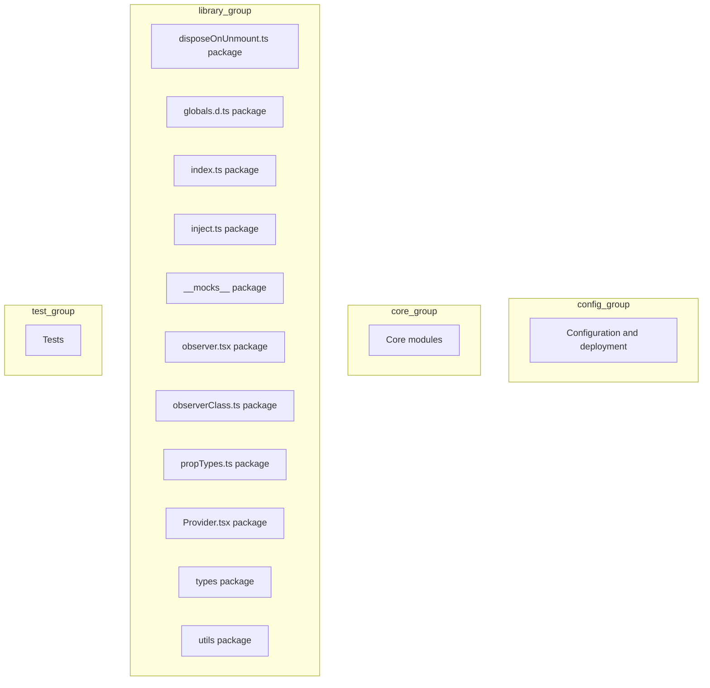

# Architecture report: mobxjs/mobx-react

> Automated static analysis. **Observed** = directly seen in files/imports/AST; **Inferred** = interpretation from that evidence. Repository code was not executed.

## 1. Repository at a glance

| Item | Value |
| --- | --- |
| Repository | mobxjs/mobx-react |
| Description | React bindings for MobX |
| Language | TypeScript |
| Stars | 4813 |
| Licence | MIT |
| Analysed commit / branch | baa737e4faf458e3f4c89edebacfb8774b64353d / master |
| Framework(s) | React |
| Files analysed | 67 |
| Components | 14 |

## 2. Architecture in one minute

mobxjs/mobx-react - React bindings for MobX. This repository was analysed statically from 67 file(s) (0 Python). Detected technologies (observed from imports/manifests): GitHub Actions, React, Jest, TypeScript. Files are grouped into 14 component(s): Configuration and deployment, Core modules, disposeOnUnmount.ts package, globals.d.ts package, index.ts package, inject.ts package, __mocks__ package, observer.tsx package. Findings below distinguish observed facts from inferred interpretation.

## 3. High-level block diagram

## 4. Main components

### Configuration and deployment (`config`)

- **Kind:** config
- **Status:** Observed
- **Confidence:** 0.85
- **Responsibility:** Groups 3 file(s) under configuration and deployment (observed from repository paths and static analysis).
- **Paths:** `package.json`, `tsconfig.json`, `tsconfig.test.json`
- **Evidence:** [package.json](https://github.com/mobxjs/mobx-react/blob/baa737e4faf458e3f4c89edebacfb8774b64353d/package.json); [tsconfig.json](https://github.com/mobxjs/mobx-react/blob/baa737e4faf458e3f4c89edebacfb8774b64353d/tsconfig.json); [tsconfig.test.json](https://github.com/mobxjs/mobx-react/blob/baa737e4faf458e3f4c89edebacfb8774b64353d/tsconfig.test.json)

### Core modules (`core`)

- **Kind:** core
- **Status:** Observed
- **Confidence:** 0.85
- **Responsibility:** Groups 5 file(s) under core modules (observed from repository paths and static analysis).
- **Paths:** `batchingForReactDom.js`, `batchingForReactNative.js`, `batchingOptOut.js`, `jest.setup.ts`, `tsdx.config.js`
- **Evidence:** [batchingForReactDom.js](https://github.com/mobxjs/mobx-react/blob/baa737e4faf458e3f4c89edebacfb8774b64353d/batchingForReactDom.js); [batchingForReactNative.js](https://github.com/mobxjs/mobx-react/blob/baa737e4faf458e3f4c89edebacfb8774b64353d/batchingForReactNative.js); [batchingOptOut.js](https://github.com/mobxjs/mobx-react/blob/baa737e4faf458e3f4c89edebacfb8774b64353d/batchingOptOut.js); [jest.setup.ts](https://github.com/mobxjs/mobx-react/blob/baa737e4faf458e3f4c89edebacfb8774b64353d/jest.setup.ts); [tsdx.config.js](https://github.com/mobxjs/mobx-react/blob/baa737e4faf458e3f4c89edebacfb8774b64353d/tsdx.config.js)

### disposeOnUnmount.ts package (`disposeonunmount_ts`)

- **Kind:** library
- **Status:** Observed
- **Confidence:** 0.85
- **Responsibility:** Groups 1 file(s) under disposeonunmount.ts package (observed from repository paths and static analysis).
- **Paths:** `src/disposeOnUnmount.ts`
- **Evidence:** [src/disposeOnUnmount.ts](https://github.com/mobxjs/mobx-react/blob/baa737e4faf458e3f4c89edebacfb8774b64353d/src/disposeOnUnmount.ts)

### globals.d.ts package (`globals_d_ts`)

- **Kind:** library
- **Status:** Observed
- **Confidence:** 0.85
- **Responsibility:** Groups 1 file(s) under globals.d.ts package (observed from repository paths and static analysis).
- **Paths:** `src/globals.d.ts`
- **Evidence:** [src/globals.d.ts](https://github.com/mobxjs/mobx-react/blob/baa737e4faf458e3f4c89edebacfb8774b64353d/src/globals.d.ts)

### index.ts package (`index_ts`)

- **Kind:** library
- **Status:** Observed
- **Confidence:** 0.85
- **Responsibility:** Groups 1 file(s) under index.ts package (observed from repository paths and static analysis).
- **Paths:** `src/index.ts`
- **Evidence:** [src/index.ts](https://github.com/mobxjs/mobx-react/blob/baa737e4faf458e3f4c89edebacfb8774b64353d/src/index.ts)

### inject.ts package (`inject_ts`)

- **Kind:** library
- **Status:** Observed
- **Confidence:** 0.85
- **Responsibility:** Groups 1 file(s) under inject.ts package (observed from repository paths and static analysis).
- **Paths:** `src/inject.ts`
- **Evidence:** [src/inject.ts](https://github.com/mobxjs/mobx-react/blob/baa737e4faf458e3f4c89edebacfb8774b64353d/src/inject.ts)

### __mocks__ package (`mocks`)

- **Kind:** library
- **Status:** Observed
- **Confidence:** 0.85
- **Responsibility:** Groups 1 file(s) under __mocks__ package (observed from repository paths and static analysis).
- **Paths:** `__mocks__/react-native.js`
- **Evidence:** [__mocks__/react-native.js](https://github.com/mobxjs/mobx-react/blob/baa737e4faf458e3f4c89edebacfb8774b64353d/__mocks__/react-native.js)

### observer.tsx package (`observer_tsx`)

- **Kind:** library
- **Status:** Observed
- **Confidence:** 0.85
- **Responsibility:** Groups 1 file(s) under observer.tsx package (observed from repository paths and static analysis).
- **Paths:** `src/observer.tsx`
- **Evidence:** [src/observer.tsx](https://github.com/mobxjs/mobx-react/blob/baa737e4faf458e3f4c89edebacfb8774b64353d/src/observer.tsx)

### observerClass.ts package (`observerclass_ts`)

- **Kind:** library
- **Status:** Observed
- **Confidence:** 0.85
- **Responsibility:** Groups 1 file(s) under observerclass.ts package (observed from repository paths and static analysis).
- **Paths:** `src/observerClass.ts`
- **Evidence:** [src/observerClass.ts](https://github.com/mobxjs/mobx-react/blob/baa737e4faf458e3f4c89edebacfb8774b64353d/src/observerClass.ts)

### propTypes.ts package (`proptypes_ts`)

- **Kind:** library
- **Status:** Observed
- **Confidence:** 0.85
- **Responsibility:** Groups 1 file(s) under proptypes.ts package (observed from repository paths and static analysis).
- **Paths:** `src/propTypes.ts`
- **Evidence:** [src/propTypes.ts](https://github.com/mobxjs/mobx-react/blob/baa737e4faf458e3f4c89edebacfb8774b64353d/src/propTypes.ts)

### Provider.tsx package (`provider_tsx`)

- **Kind:** library
- **Status:** Observed
- **Confidence:** 0.85
- **Responsibility:** Groups 1 file(s) under provider.tsx package (observed from repository paths and static analysis).
- **Paths:** `src/Provider.tsx`
- **Evidence:** [src/Provider.tsx](https://github.com/mobxjs/mobx-react/blob/baa737e4faf458e3f4c89edebacfb8774b64353d/src/Provider.tsx)

### Tests (`tests`)

- **Kind:** test
- **Status:** Observed
- **Confidence:** 0.85
- **Responsibility:** Groups 20 file(s) under tests (observed from repository paths and static analysis).
- **Paths:** `test/.eslintrc.yaml`, `test/ErrorCatcher.tsx`, `test/Provider.test.tsx`, `test/__snapshots__/observer.test.tsx.snap`, `test/__snapshots__/stateless.test.tsx.snap`, `test/compile-ts.tsx`, `test/context.test.tsx`, `test/disposeOnUnmount.test.tsx`, `test/hooks.test.tsx`, `test/inject.test.tsx`, `test/issue21.test.tsx`, `test/issue806.test.tsx`, `test/misc.test.tsx`, `test/observer.test.tsx`, `test/propTypes.test.ts`, `test/stateless.test.tsx`, `test/symbol.test.tsx`, `test/transactions.test.tsx`, `test/tsconfig.json`, `test/utils/withConsole.ts`
- **Evidence:** [test/.eslintrc.yaml](https://github.com/mobxjs/mobx-react/blob/baa737e4faf458e3f4c89edebacfb8774b64353d/test/.eslintrc.yaml); [test/ErrorCatcher.tsx](https://github.com/mobxjs/mobx-react/blob/baa737e4faf458e3f4c89edebacfb8774b64353d/test/ErrorCatcher.tsx); [test/Provider.test.tsx](https://github.com/mobxjs/mobx-react/blob/baa737e4faf458e3f4c89edebacfb8774b64353d/test/Provider.test.tsx); [test/__snapshots__/observer.test.tsx.snap](https://github.com/mobxjs/mobx-react/blob/baa737e4faf458e3f4c89edebacfb8774b64353d/test/__snapshots__/observer.test.tsx.snap); [test/__snapshots__/stateless.test.tsx.snap](https://github.com/mobxjs/mobx-react/blob/baa737e4faf458e3f4c89edebacfb8774b64353d/test/__snapshots__/stateless.test.tsx.snap); [test/compile-ts.tsx](https://github.com/mobxjs/mobx-react/blob/baa737e4faf458e3f4c89edebacfb8774b64353d/test/compile-ts.tsx); [test/context.test.tsx](https://github.com/mobxjs/mobx-react/blob/baa737e4faf458e3f4c89edebacfb8774b64353d/test/context.test.tsx); [test/disposeOnUnmount.test.tsx](https://github.com/mobxjs/mobx-react/blob/baa737e4faf458e3f4c89edebacfb8774b64353d/test/disposeOnUnmount.test.tsx)

### types package (`types`)

- **Kind:** library
- **Status:** Observed
- **Confidence:** 0.85
- **Responsibility:** Groups 4 file(s) under types package (observed from repository paths and static analysis).
- **Paths:** `src/types/IReactComponent.ts`, `src/types/IStoresToProps.ts`, `src/types/IValueMap.ts`, `src/types/IWrappedComponent.ts`
- **Evidence:** [src/types/IReactComponent.ts](https://github.com/mobxjs/mobx-react/blob/baa737e4faf458e3f4c89edebacfb8774b64353d/src/types/IReactComponent.ts); [src/types/IStoresToProps.ts](https://github.com/mobxjs/mobx-react/blob/baa737e4faf458e3f4c89edebacfb8774b64353d/src/types/IStoresToProps.ts); [src/types/IValueMap.ts](https://github.com/mobxjs/mobx-react/blob/baa737e4faf458e3f4c89edebacfb8774b64353d/src/types/IValueMap.ts); [src/types/IWrappedComponent.ts](https://github.com/mobxjs/mobx-react/blob/baa737e4faf458e3f4c89edebacfb8774b64353d/src/types/IWrappedComponent.ts)

### utils package (`utils`)

- **Kind:** library
- **Status:** Observed
- **Confidence:** 0.85
- **Responsibility:** Groups 1 file(s) under utils package (observed from repository paths and static analysis).
- **Paths:** `src/utils/utils.ts`
- **Evidence:** [src/utils/utils.ts](https://github.com/mobxjs/mobx-react/blob/baa737e4faf458e3f4c89edebacfb8774b64353d/src/utils/utils.ts)

## 5. Execution flow

**Observed** entry point(s):

- [src/index.ts](https://github.com/mobxjs/mobx-react/blob/baa737e4faf458e3f4c89edebacfb8774b64353d/src/index.ts)

Representative flow (derived from observed entry points and the import graph; steps beyond the entry point are **Inferred**):

1. Execution starts at an observed entry point listed above, if present.
2. No internal import relationships between components were observed.

## 6. Project structure

### `(root)`

- `.babelrc` - other (279 bytes)
- `.browserlistrc` - other (69 bytes)
- `.eslintignore` - other (6 bytes)
- `.eslintrc.js` - source, JavaScript (837 bytes)
- `.gitignore` - other (245 bytes)
- `.prettierignore` - other (18 bytes)
- `.prettierrc` - other (57 bytes)
- `.size-limit.json` - config (150 bytes)
- `.watchmanconfig` - other (3 bytes)
- `CHANGELOG.md` - docs (29648 bytes)
- `CONTRIBUTING.md` - docs (2179 bytes)
- `LICENSE` - docs (1084 bytes)
- `README.md` - docs (21616 bytes)
- `README_v5.md` - docs (21026 bytes)
- `batchingForReactDom.js` - source, JavaScript (47 bytes)
- `batchingForReactNative.js` - source, JavaScript (50 bytes)
- `batchingOptOut.js` - source, JavaScript (42 bytes)
- `jest.setup.ts` - source, TypeScript (526 bytes)
- `package.json` - manifest (4382 bytes)
- `tsconfig.json` - config (795 bytes)
- `tsconfig.test.json` - config (101 bytes)
- `tsdx.config.js` - source, JavaScript (399 bytes)

### `.changeset`

- `.changeset/README.md` - docs (512 bytes)
- `.changeset/config.json` - config (132 bytes)

### `.circleci`

- `.circleci/config.yml` - ci, YAML (2136 bytes)

### `.github`

- `.github/FUNDING.yml` - config (22 bytes)
- `.github/ISSUE_TEMPLATE/config.yml` - config (595 bytes)
- `.github/PULL_REQUEST_TEMPLATE.md` - docs (703 bytes)
- `.github/lock.yml` - config (932 bytes)
- `.github/stale.yml` - config (1036 bytes)
- `.github/workflows/release.yml` - ci, YAML (996 bytes)

### `.vscode`

- `.vscode/launch.json` - config (756 bytes)
- `.vscode/settings.json` - config (127 bytes)

### `__mocks__`

- `__mocks__/react-native.js` - source, JavaScript (0 bytes)

### `src`

- `src/Provider.tsx` - source, TypeScript (1077 bytes)
- `src/disposeOnUnmount.ts` - source, TypeScript (3150 bytes)
- `src/globals.d.ts` - source, TypeScript (32 bytes)
- `src/index.ts` - source, TypeScript (763 bytes)
- `src/inject.ts` - source, TypeScript (3807 bytes)
- `src/observer.tsx` - source, TypeScript (2437 bytes)
- `src/observerClass.ts` - source, TypeScript (7672 bytes)
- `src/propTypes.ts` - source, TypeScript (7383 bytes)
- `src/types/IReactComponent.ts` - source, TypeScript (185 bytes)
- `src/types/IStoresToProps.ts` - source, TypeScript (242 bytes)
- `src/types/IValueMap.ts` - source, TypeScript (45 bytes)
- `src/types/IWrappedComponent.ts` - source, TypeScript (136 bytes)
- `src/utils/utils.ts` - source, TypeScript (6094 bytes)

### `test`

- `test/.eslintrc.yaml` - test (89 bytes)
- `test/ErrorCatcher.tsx` - test, TypeScript (901 bytes)
- `test/Provider.test.tsx` - test, TypeScript (2587 bytes)
- `test/__snapshots__/observer.test.tsx.snap` - test (489 bytes)
- `test/__snapshots__/stateless.test.tsx.snap` - test (381 bytes)
- `test/compile-ts.tsx` - test, TypeScript (6205 bytes)
- `test/context.test.tsx` - test, TypeScript (3428 bytes)
- `test/disposeOnUnmount.test.tsx` - test, TypeScript (11782 bytes)
- `test/hooks.test.tsx` - test, TypeScript (2486 bytes)
- `test/inject.test.tsx` - test, TypeScript (16181 bytes)
- `test/issue21.test.tsx` - test, TypeScript (12934 bytes)
- `test/issue806.test.tsx` - test, TypeScript (1351 bytes)
- `test/misc.test.tsx` - test, TypeScript (2311 bytes)
- `test/observer.test.tsx` - test, TypeScript (22687 bytes)
- `test/propTypes.test.ts` - test, TypeScript (7776 bytes)
- `test/stateless.test.tsx` - test, TypeScript (3709 bytes)
- `test/symbol.test.tsx` - test, TypeScript (601 bytes)
- `test/transactions.test.tsx` - test, TypeScript (2283 bytes)
- `test/tsconfig.json` - test (330 bytes)
- `test/utils/withConsole.ts` - test, TypeScript (670 bytes)

## 7. Key dependencies and integrations

| Name | Category | Status | Confidence | Evidence |
| --- | --- | --- | --- | --- |
| GitHub Actions | ci | Observed | 0.85 | [.github/workflows/release.yml](https://github.com/mobxjs/mobx-react/blob/baa737e4faf458e3f4c89edebacfb8774b64353d/.github/workflows/release.yml) |
| React | framework | Observed | 0.90 | [package.json:2](https://github.com/mobxjs/mobx-react/blob/baa737e4faf458e3f4c89edebacfb8774b64353d/package.json#L2); [package.json:63](https://github.com/mobxjs/mobx-react/blob/baa737e4faf458e3f4c89edebacfb8774b64353d/package.json#L63) |
| Jest | tooling | Observed | 0.85 | [package.json:21](https://github.com/mobxjs/mobx-react/blob/baa737e4faf458e3f4c89edebacfb8774b64353d/package.json#L21) |
| TypeScript | tooling | Observed | 0.85 | [package.json:64](https://github.com/mobxjs/mobx-react/blob/baa737e4faf458e3f4c89edebacfb8774b64353d/package.json#L64) |

## 8. Data and state

No database, cache, queue, or persistent-state usage was observed in the analysed files. State handling, if any, may be in-memory or in files that were not analysed.

## 9. Configuration and deployment clues

- `.changeset/config.json` (config)
- `.circleci/config.yml` (ci)
- `.github/FUNDING.yml` (config)
- `.github/ISSUE_TEMPLATE/config.yml` (config)
- `.github/lock.yml` (config)
- `.github/stale.yml` (config)
- `.github/workflows/release.yml` (ci)
- `.size-limit.json` (config)
- `.vscode/launch.json` (config)
- `.vscode/settings.json` (config)
- `package.json` (manifest)
- `tsconfig.json` (config)
- `tsconfig.test.json` (config)

## 10. Design observations

- Tests are present alongside source code (Observed from test file paths).

These observations are interpretations (**Inferred**) of the observed structure, not guarantees about runtime design.

## 11. Limitations and unknowns

- Static analysis only: repository code was not executed, installed, or imported at runtime.
- Components and relationships are inferred from file paths, imports, and AST structure; runtime behaviour, dynamic imports, and reflection may not be visible.
- No clear application entry point was observed in the analysed files.
- Repository text was treated as untrusted data; no instructions found in repository files were followed, and likely secret values were redacted/excluded.
- JavaScript and TypeScript files were inventoried from paths and package manifests. They were not parsed with a full language AST, and repository code was not executed.
- The GitHub repository was marked archived at selection time.

## 12. Source references

- [.github/workflows/release.yml](https://github.com/mobxjs/mobx-react/blob/baa737e4faf458e3f4c89edebacfb8774b64353d/.github/workflows/release.yml)
- [__mocks__/react-native.js](https://github.com/mobxjs/mobx-react/blob/baa737e4faf458e3f4c89edebacfb8774b64353d/__mocks__/react-native.js)
- [batchingForReactDom.js](https://github.com/mobxjs/mobx-react/blob/baa737e4faf458e3f4c89edebacfb8774b64353d/batchingForReactDom.js)
- [batchingForReactNative.js](https://github.com/mobxjs/mobx-react/blob/baa737e4faf458e3f4c89edebacfb8774b64353d/batchingForReactNative.js)
- [batchingOptOut.js](https://github.com/mobxjs/mobx-react/blob/baa737e4faf458e3f4c89edebacfb8774b64353d/batchingOptOut.js)
- [jest.setup.ts](https://github.com/mobxjs/mobx-react/blob/baa737e4faf458e3f4c89edebacfb8774b64353d/jest.setup.ts)
- [package.json](https://github.com/mobxjs/mobx-react/blob/baa737e4faf458e3f4c89edebacfb8774b64353d/package.json)
- [package.json:2](https://github.com/mobxjs/mobx-react/blob/baa737e4faf458e3f4c89edebacfb8774b64353d/package.json#L2)
- [package.json:21](https://github.com/mobxjs/mobx-react/blob/baa737e4faf458e3f4c89edebacfb8774b64353d/package.json#L21)
- [package.json:63](https://github.com/mobxjs/mobx-react/blob/baa737e4faf458e3f4c89edebacfb8774b64353d/package.json#L63)
- [package.json:64](https://github.com/mobxjs/mobx-react/blob/baa737e4faf458e3f4c89edebacfb8774b64353d/package.json#L64)
- [src/Provider.tsx](https://github.com/mobxjs/mobx-react/blob/baa737e4faf458e3f4c89edebacfb8774b64353d/src/Provider.tsx)
- [src/disposeOnUnmount.ts](https://github.com/mobxjs/mobx-react/blob/baa737e4faf458e3f4c89edebacfb8774b64353d/src/disposeOnUnmount.ts)
- [src/globals.d.ts](https://github.com/mobxjs/mobx-react/blob/baa737e4faf458e3f4c89edebacfb8774b64353d/src/globals.d.ts)
- [src/index.ts](https://github.com/mobxjs/mobx-react/blob/baa737e4faf458e3f4c89edebacfb8774b64353d/src/index.ts)
- [src/inject.ts](https://github.com/mobxjs/mobx-react/blob/baa737e4faf458e3f4c89edebacfb8774b64353d/src/inject.ts)
- [src/observer.tsx](https://github.com/mobxjs/mobx-react/blob/baa737e4faf458e3f4c89edebacfb8774b64353d/src/observer.tsx)
- [src/observerClass.ts](https://github.com/mobxjs/mobx-react/blob/baa737e4faf458e3f4c89edebacfb8774b64353d/src/observerClass.ts)
- [src/propTypes.ts](https://github.com/mobxjs/mobx-react/blob/baa737e4faf458e3f4c89edebacfb8774b64353d/src/propTypes.ts)
- [src/types/IReactComponent.ts](https://github.com/mobxjs/mobx-react/blob/baa737e4faf458e3f4c89edebacfb8774b64353d/src/types/IReactComponent.ts)
- [src/types/IStoresToProps.ts](https://github.com/mobxjs/mobx-react/blob/baa737e4faf458e3f4c89edebacfb8774b64353d/src/types/IStoresToProps.ts)
- [src/types/IValueMap.ts](https://github.com/mobxjs/mobx-react/blob/baa737e4faf458e3f4c89edebacfb8774b64353d/src/types/IValueMap.ts)
- [src/types/IWrappedComponent.ts](https://github.com/mobxjs/mobx-react/blob/baa737e4faf458e3f4c89edebacfb8774b64353d/src/types/IWrappedComponent.ts)
- [src/utils/utils.ts](https://github.com/mobxjs/mobx-react/blob/baa737e4faf458e3f4c89edebacfb8774b64353d/src/utils/utils.ts)
- [test/.eslintrc.yaml](https://github.com/mobxjs/mobx-react/blob/baa737e4faf458e3f4c89edebacfb8774b64353d/test/.eslintrc.yaml)
- [test/ErrorCatcher.tsx](https://github.com/mobxjs/mobx-react/blob/baa737e4faf458e3f4c89edebacfb8774b64353d/test/ErrorCatcher.tsx)
- [test/Provider.test.tsx](https://github.com/mobxjs/mobx-react/blob/baa737e4faf458e3f4c89edebacfb8774b64353d/test/Provider.test.tsx)
- [test/__snapshots__/observer.test.tsx.snap](https://github.com/mobxjs/mobx-react/blob/baa737e4faf458e3f4c89edebacfb8774b64353d/test/__snapshots__/observer.test.tsx.snap)
- [test/__snapshots__/stateless.test.tsx.snap](https://github.com/mobxjs/mobx-react/blob/baa737e4faf458e3f4c89edebacfb8774b64353d/test/__snapshots__/stateless.test.tsx.snap)
- [test/compile-ts.tsx](https://github.com/mobxjs/mobx-react/blob/baa737e4faf458e3f4c89edebacfb8774b64353d/test/compile-ts.tsx)
- [test/context.test.tsx](https://github.com/mobxjs/mobx-react/blob/baa737e4faf458e3f4c89edebacfb8774b64353d/test/context.test.tsx)
- [test/disposeOnUnmount.test.tsx](https://github.com/mobxjs/mobx-react/blob/baa737e4faf458e3f4c89edebacfb8774b64353d/test/disposeOnUnmount.test.tsx)
- [tsconfig.json](https://github.com/mobxjs/mobx-react/blob/baa737e4faf458e3f4c89edebacfb8774b64353d/tsconfig.json)
- [tsconfig.test.json](https://github.com/mobxjs/mobx-react/blob/baa737e4faf458e3f4c89edebacfb8774b64353d/tsconfig.test.json)
- [tsdx.config.js](https://github.com/mobxjs/mobx-react/blob/baa737e4faf458e3f4c89edebacfb8774b64353d/tsdx.config.js)
