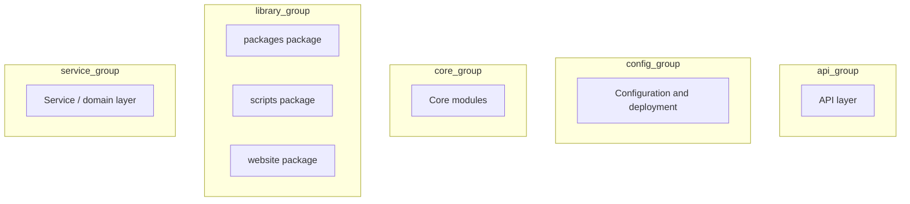

# Architecture report: mobxjs/mobx

> Automated static analysis. **Observed** = directly seen in files/imports/AST; **Inferred** = interpretation from that evidence. Repository code was not executed.

## 1. Repository at a glance

| Item | Value |
| --- | --- |
| Repository | mobxjs/mobx |
| Description | Simple, scalable state management. |
| Language | TypeScript |
| Stars | 28211 |
| Licence | MIT |
| Analysed commit / branch | bf94b8e866c58995f78189c5412cf06042012720 / main |
| Framework(s) | React |
| Files analysed | 366 |
| Components | 7 |

## 2. Architecture in one minute

mobxjs/mobx - Simple, scalable state management.. This repository was analysed statically from 366 file(s) (0 Python). Detected technologies (observed from imports/manifests): GitHub Actions, React, Jest, TypeScript. Files are grouped into 7 component(s): API layer, Configuration and deployment, Core modules, packages package, scripts package, Service / domain layer, website package. Findings below distinguish observed facts from inferred interpretation.

## 3. High-level block diagram

## 4. Main components

### API layer (`api_layer`)

- **Kind:** api
- **Status:** Observed
- **Confidence:** 0.85
- **Responsibility:** Groups 22 file(s) under api layer (observed from repository paths and static analysis).
- **Paths:** `packages/mobx/src/api/action.ts`, `packages/mobx/src/api/annotation.ts`, `packages/mobx/src/api/autorun.ts`, `packages/mobx/src/api/become-observed.ts`, `packages/mobx/src/api/computed.ts`, `packages/mobx/src/api/configure.ts`, `packages/mobx/src/api/decoratorannotation.ts`, `packages/mobx/src/api/decorators.ts`, `packages/mobx/src/api/extendobservable.ts`, `packages/mobx/src/api/extras.ts`, `packages/mobx/src/api/flow.ts`, `packages/mobx/src/api/intercept-read.ts`, `packages/mobx/src/api/intercept.ts`, `packages/mobx/src/api/iscomputed.ts`, `packages/mobx/src/api/isobservable.ts`, `packages/mobx/src/api/makeObservable.ts`, `packages/mobx/src/api/object-api.ts`, `packages/mobx/src/api/observable.ts`, `packages/mobx/src/api/observe.ts`, `packages/mobx/src/api/tojs.ts`, `packages/mobx/src/api/transaction.ts`, `packages/mobx/src/api/when.ts`
- **Evidence:** [packages/mobx/src/api/action.ts](https://github.com/mobxjs/mobx/blob/bf94b8e866c58995f78189c5412cf06042012720/packages/mobx/src/api/action.ts); [packages/mobx/src/api/annotation.ts](https://github.com/mobxjs/mobx/blob/bf94b8e866c58995f78189c5412cf06042012720/packages/mobx/src/api/annotation.ts); [packages/mobx/src/api/autorun.ts](https://github.com/mobxjs/mobx/blob/bf94b8e866c58995f78189c5412cf06042012720/packages/mobx/src/api/autorun.ts); [packages/mobx/src/api/become-observed.ts](https://github.com/mobxjs/mobx/blob/bf94b8e866c58995f78189c5412cf06042012720/packages/mobx/src/api/become-observed.ts); [packages/mobx/src/api/computed.ts](https://github.com/mobxjs/mobx/blob/bf94b8e866c58995f78189c5412cf06042012720/packages/mobx/src/api/computed.ts); [packages/mobx/src/api/configure.ts](https://github.com/mobxjs/mobx/blob/bf94b8e866c58995f78189c5412cf06042012720/packages/mobx/src/api/configure.ts); [packages/mobx/src/api/decoratorannotation.ts](https://github.com/mobxjs/mobx/blob/bf94b8e866c58995f78189c5412cf06042012720/packages/mobx/src/api/decoratorannotation.ts); [packages/mobx/src/api/decorators.ts](https://github.com/mobxjs/mobx/blob/bf94b8e866c58995f78189c5412cf06042012720/packages/mobx/src/api/decorators.ts)

### Configuration and deployment (`config`)

- **Kind:** config
- **Status:** Observed
- **Confidence:** 0.85
- **Responsibility:** Groups 28 file(s) under configuration and deployment (observed from repository paths and static analysis).
- **Paths:** `package.json`, `packages/eslint-plugin-mobx/package.json`, `packages/eslint-plugin-mobx/tsconfig.json`, `packages/mobx-react-lite/__tests__/.eslintrc.yaml`, `packages/mobx-react-lite/__tests__/tsconfig.json`, `packages/mobx-react-lite/package.json`, `packages/mobx-react-lite/tsconfig.json`, `packages/mobx-react-lite/tsconfig.test.json`, `packages/mobx-react-plugin/package.json`, `packages/mobx-react-plugin/tsconfig.json`, `packages/mobx-react-plugin/tsconfig.test.json`, `packages/mobx-react/__tests__/.eslintrc.yaml`, `packages/mobx-react/__tests__/tsconfig.json`, `packages/mobx-react/package.json`, `packages/mobx-react/tsconfig.json`, `packages/mobx-react/tsconfig.test.json`, `packages/mobx-undecorate/__tests__/tsconfig.json`, `packages/mobx-undecorate/package.json`, `packages/mobx-undecorate/tsconfig.json`, `packages/mobx/__tests__/perf/tsconfig.decorator.json`, `packages/mobx/__tests__/tsconfig.json`, `packages/mobx/package.json`, `packages/mobx/tsconfig.json`, `tsconfig.json`, `tsconfig.test.json`, `website/i18n/en.json`, `website/package.json`, `website/sidebars.json`
- **Evidence:** [package.json](https://github.com/mobxjs/mobx/blob/bf94b8e866c58995f78189c5412cf06042012720/package.json); [packages/eslint-plugin-mobx/package.json](https://github.com/mobxjs/mobx/blob/bf94b8e866c58995f78189c5412cf06042012720/packages/eslint-plugin-mobx/package.json); [packages/eslint-plugin-mobx/tsconfig.json](https://github.com/mobxjs/mobx/blob/bf94b8e866c58995f78189c5412cf06042012720/packages/eslint-plugin-mobx/tsconfig.json); [packages/mobx-react-lite/__tests__/.eslintrc.yaml](https://github.com/mobxjs/mobx/blob/bf94b8e866c58995f78189c5412cf06042012720/packages/mobx-react-lite/__tests__/.eslintrc.yaml); [packages/mobx-react-lite/__tests__/tsconfig.json](https://github.com/mobxjs/mobx/blob/bf94b8e866c58995f78189c5412cf06042012720/packages/mobx-react-lite/__tests__/tsconfig.json); [packages/mobx-react-lite/package.json](https://github.com/mobxjs/mobx/blob/bf94b8e866c58995f78189c5412cf06042012720/packages/mobx-react-lite/package.json); [packages/mobx-react-lite/tsconfig.json](https://github.com/mobxjs/mobx/blob/bf94b8e866c58995f78189c5412cf06042012720/packages/mobx-react-lite/tsconfig.json); [packages/mobx-react-lite/tsconfig.test.json](https://github.com/mobxjs/mobx/blob/bf94b8e866c58995f78189c5412cf06042012720/packages/mobx-react-lite/tsconfig.test.json)

### Core modules (`core`)

- **Kind:** core
- **Status:** Observed
- **Confidence:** 0.85
- **Responsibility:** Groups 3 file(s) under core modules (observed from repository paths and static analysis).
- **Paths:** `jest.base.config.js`, `jest.config.js`, `jest.setup.base.ts`
- **Evidence:** [jest.base.config.js](https://github.com/mobxjs/mobx/blob/bf94b8e866c58995f78189c5412cf06042012720/jest.base.config.js); [jest.config.js](https://github.com/mobxjs/mobx/blob/bf94b8e866c58995f78189c5412cf06042012720/jest.config.js); [jest.setup.base.ts](https://github.com/mobxjs/mobx/blob/bf94b8e866c58995f78189c5412cf06042012720/jest.setup.base.ts)

### packages package (`packages`)

- **Kind:** library
- **Status:** Observed
- **Confidence:** 0.85
- **Responsibility:** Groups 160 file(s) under packages package (observed from repository paths and static analysis).
- **Paths:** `packages/eslint-plugin-mobx/__tests__/exhaustive-make-observable.js`, `packages/eslint-plugin-mobx/__tests__/missing-observer.js`, `packages/eslint-plugin-mobx/__tests__/no-anonymous-observer.js`, `packages/eslint-plugin-mobx/__tests__/unconditional-make-observable.js`, `packages/eslint-plugin-mobx/__tests__/utils/get-rule-tester.js`, `packages/eslint-plugin-mobx/jest.config-eslint-7.js`, `packages/eslint-plugin-mobx/jest.config-eslint-9.js`, `packages/eslint-plugin-mobx/jest.setup.js`, `packages/eslint-plugin-mobx/preview/.eslintrc.js`, `packages/eslint-plugin-mobx/preview/make-observable.js`, `packages/eslint-plugin-mobx/preview/missing-observer.js`, `packages/eslint-plugin-mobx/preview/no-anonymous-observer.js`, `packages/eslint-plugin-mobx/src/exhaustive-make-observable.ts`, `packages/eslint-plugin-mobx/src/index.ts`, `packages/eslint-plugin-mobx/src/missing-observer.ts`, `packages/eslint-plugin-mobx/src/no-anonymous-observer.ts`, `packages/eslint-plugin-mobx/src/unconditional-make-observable.ts`, `packages/eslint-plugin-mobx/src/utils.ts`, `packages/mobx-react-lite/__tests__/ObserverComponent.test.tsx`, `packages/mobx-react-lite/__tests__/UniversalFinalizationRegistry.test.ts`, `packages/mobx-react-lite/__tests__/api.test.tsx`, `packages/mobx-react-lite/__tests__/assertEnvironment.test.tsx`, `packages/mobx-react-lite/__tests__/enforceActions.test.tsx`, `packages/mobx-react-lite/__tests__/observer.test.tsx`, `packages/mobx-react-lite/__tests__/strictAndConcurrentMode.test.tsx`, `packages/mobx-react-lite/__tests__/strictAndConcurrentModeUsingFinalizationRegistry.test.tsx`, `packages/mobx-react-lite/__tests__/strictAndConcurrentModeUsingTimers.test.tsx`, `packages/mobx-react-lite/__tests__/suspenseCleanup.test.tsx`, `packages/mobx-react-lite/__tests__/transactions.test.tsx`, `packages/mobx-react-lite/__tests__/useLocalObservable.test.tsx`, `packages/mobx-react-lite/__tests__/useObserverRetention.test.tsx`, `packages/mobx-react-lite/__tests__/utils/killFinalizationRegistry.ts`, `packages/mobx-react-lite/jest.config.js`, `packages/mobx-react-lite/jest.setup.ts`, `packages/mobx-react-lite/rollup.config.mjs`, `packages/mobx-react-lite/src/ObserverComponent.ts`, `packages/mobx-react-lite/src/index.ts`, `packages/mobx-react-lite/src/observer.ts`, `packages/mobx-react-lite/src/staticRendering.ts`, `packages/mobx-react-lite/src/useLocalObservable.ts`, `packages/mobx-react-lite/src/useObserver.ts`, `packages/mobx-react-lite/src/utils/UniversalFinalizationRegistry.ts`, `packages/mobx-react-lite/src/utils/assertEnvironment.ts`, `packages/mobx-react-lite/src/utils/observerFinalizationRegistry.ts`, `packages/mobx-react-plugin/__tests__/flow.test.ts`, `packages/mobx-react-plugin/__tests__/react-compiler.test.ts`, `packages/mobx-react-plugin/__tests__/transform.test.ts`, `packages/mobx-react-plugin/__tests__/utils/transform.ts`, `packages/mobx-react-plugin/__tests__/vite.test.ts`, `packages/mobx-react-plugin/jest.config.js`, `packages/mobx-react-plugin/src/babel.ts`, `packages/mobx-react-plugin/src/flow.ts`, `packages/mobx-react-plugin/src/imports.ts`, `packages/mobx-react-plugin/src/options.ts`, `packages/mobx-react-plugin/src/plugin.ts`, `packages/mobx-react-plugin/src/precheck.ts`, `packages/mobx-react-plugin/src/transform.ts`, `packages/mobx-react-plugin/src/vite.ts`, `packages/mobx-react/__mocks__/react-native.js`, `packages/mobx-react/__tests__/ObserverComponent.test.tsx`, `packages/mobx-react/__tests__/api.test.tsx`, `packages/mobx-react/__tests__/enforceActions.test.tsx`, `packages/mobx-react/__tests__/finalizationRegistry.tsx`, `packages/mobx-react/__tests__/issue21.test.tsx`, `packages/mobx-react/__tests__/issue806.test.tsx`, `packages/mobx-react/__tests__/misc.test.tsx`, `packages/mobx-react/__tests__/observer.test.tsx`, `packages/mobx-react/__tests__/reactBatching.test.tsx`, `packages/mobx-react/__tests__/reactContext.test.tsx`, `packages/mobx-react/__tests__/stateless.test.tsx`, `packages/mobx-react/__tests__/timerBasedFinalizationRegistry.tsx`, `packages/mobx-react/__tests__/transactions.test.tsx`, `packages/mobx-react/__tests__/utils/ErrorCatcher.tsx`, `packages/mobx-react/__tests__/utils/killFinalizationRegistry.ts`, `packages/mobx-react/__tests__/utils/withConsole.ts`, `packages/mobx-react/jest.config.js`, `packages/mobx-react/jest.setup.ts`, `packages/mobx-react/rollup.config.mjs`, `packages/mobx-react/src/globals.d.ts`, `packages/mobx-react/src/index.ts`, `packages/mobx-react/src/observer.tsx`, `packages/mobx-react/src/observerClass.ts`, `packages/mobx-react/src/types/IReactComponent.ts`, `packages/mobx-react/src/utils/utils.ts`, `packages/mobx-undecorate/__tests__/cli.spec.tsx`, `packages/mobx-undecorate/__tests__/undecorate.spec.ts`, `packages/mobx-undecorate/cli.js`, `packages/mobx-undecorate/jest.config.js`, `packages/mobx-undecorate/src/undecorate.ts`, `packages/mobx/__tests__/base/action.js`, `packages/mobx/__tests__/base/api.js`, `packages/mobx/__tests__/base/array.js`, `packages/mobx/__tests__/base/autorun.js`, `packages/mobx/__tests__/base/autorunAsync.ts`, `packages/mobx/__tests__/base/babel-tests.js`, `packages/mobx/__tests__/base/become-observed.ts`, `packages/mobx/__tests__/base/cycles.js`, `packages/mobx/__tests__/base/decorate.js`, `packages/mobx/__tests__/base/errorhandling.js`, `packages/mobx/__tests__/base/extendObservable.js`, `packages/mobx/__tests__/base/extras.js`, `packages/mobx/__tests__/base/flow.js`, `packages/mobx/__tests__/base/intercept.js`, `packages/mobx/__tests__/base/make-observable.ts`, `packages/mobx/__tests__/base/makereactive.js`, `packages/mobx/__tests__/base/map.js`, `packages/mobx/__tests__/base/nested.js`, `packages/mobx/__tests__/base/object-api-proxy.js`, `packages/mobx/__tests__/base/object-api.js`, `packages/mobx/__tests__/base/observables.js`, `packages/mobx/__tests__/base/observe.ts`, `packages/mobx/__tests__/base/proxies.js`, `packages/mobx/__tests__/base/reaction.js`, `packages/mobx/__tests__/base/set.js`, `packages/mobx/__tests__/base/spy.js`, `packages/mobx/__tests__/base/stage3-decorators-inheritance.ts`, `packages/mobx/__tests__/base/stage3-decorators.ts`, `packages/mobx/__tests__/base/strict-mode.js`, `packages/mobx/__tests__/base/tojs.js`, `packages/mobx/__tests__/base/typescript-tests.ts`, `packages/mobx/__tests__/base/untracked.ts`, `packages/mobx/__tests__/mixed-versions/mixed-versions.js`, `packages/mobx/__tests__/mixed-versions/state-sharing.js`, `packages/mobx/__tests__/perf/index.js`, `packages/mobx/__tests__/perf/lazy-computed-decorator.ts`, `packages/mobx/__tests__/perf/lazy-observable-decorator.ts`, `packages/mobx/__tests__/perf/perf.js`, `packages/mobx/__tests__/utils/test-utils.ts`, `packages/mobx/jest.config.js`, `packages/mobx/jest.projects.js`, `packages/mobx/jest.setup.ts`, `packages/mobx/rollup.config.mjs`, `packages/mobx/scripts/perf.sh`, `packages/mobx/scripts/prepublish.js`, `packages/mobx/src/errors.ts`, `packages/mobx/src/global.d.ts`, `packages/mobx/src/internal.ts`, `packages/mobx/src/mobx.ts`, `packages/mobx/src/types/actionannotation.ts`, `packages/mobx/src/types/autoannotation.ts`, `packages/mobx/src/types/computedannotation.ts`, `packages/mobx/src/types/decorator_fills.ts`, `packages/mobx/src/types/dynamicobject.ts`, `packages/mobx/src/types/flowannotation.ts`, `packages/mobx/src/types/generic-abort-signal.ts`, `packages/mobx/src/types/intercept-utils.ts`, `packages/mobx/src/types/listen-utils.ts`, `packages/mobx/src/types/modifiers.ts`, `packages/mobx/src/types/observableannotation.ts`, `packages/mobx/src/types/observablearray.ts`, `packages/mobx/src/types/observablemap.ts`, `packages/mobx/src/types/observableobject.ts`, `packages/mobx/src/types/observableset.ts`, `packages/mobx/src/types/observablevalue.ts`, `packages/mobx/src/types/overrideannotation.ts`, `packages/mobx/src/types/type-utils.ts`, `packages/mobx/src/utils/comparer.ts`, `packages/mobx/src/utils/eq.ts`, `packages/mobx/src/utils/iterable.ts`, `packages/mobx/src/utils/utils.ts`
- **Evidence:** [packages/eslint-plugin-mobx/__tests__/exhaustive-make-observable.js](https://github.com/mobxjs/mobx/blob/bf94b8e866c58995f78189c5412cf06042012720/packages/eslint-plugin-mobx/__tests__/exhaustive-make-observable.js); [packages/eslint-plugin-mobx/__tests__/missing-observer.js](https://github.com/mobxjs/mobx/blob/bf94b8e866c58995f78189c5412cf06042012720/packages/eslint-plugin-mobx/__tests__/missing-observer.js); [packages/eslint-plugin-mobx/__tests__/no-anonymous-observer.js](https://github.com/mobxjs/mobx/blob/bf94b8e866c58995f78189c5412cf06042012720/packages/eslint-plugin-mobx/__tests__/no-anonymous-observer.js); [packages/eslint-plugin-mobx/__tests__/unconditional-make-observable.js](https://github.com/mobxjs/mobx/blob/bf94b8e866c58995f78189c5412cf06042012720/packages/eslint-plugin-mobx/__tests__/unconditional-make-observable.js); [packages/eslint-plugin-mobx/__tests__/utils/get-rule-tester.js](https://github.com/mobxjs/mobx/blob/bf94b8e866c58995f78189c5412cf06042012720/packages/eslint-plugin-mobx/__tests__/utils/get-rule-tester.js); [packages/eslint-plugin-mobx/jest.config-eslint-7.js](https://github.com/mobxjs/mobx/blob/bf94b8e866c58995f78189c5412cf06042012720/packages/eslint-plugin-mobx/jest.config-eslint-7.js); [packages/eslint-plugin-mobx/jest.config-eslint-9.js](https://github.com/mobxjs/mobx/blob/bf94b8e866c58995f78189c5412cf06042012720/packages/eslint-plugin-mobx/jest.config-eslint-9.js); [packages/eslint-plugin-mobx/jest.setup.js](https://github.com/mobxjs/mobx/blob/bf94b8e866c58995f78189c5412cf06042012720/packages/eslint-plugin-mobx/jest.setup.js)

### scripts package (`scripts`)

- **Kind:** library
- **Status:** Observed
- **Confidence:** 0.85
- **Responsibility:** Groups 3 file(s) under scripts package (observed from repository paths and static analysis).
- **Paths:** `scripts/create-rollup-config.mjs`, `scripts/size/index.js`, `scripts/size/minimal-example.js`
- **Evidence:** [scripts/create-rollup-config.mjs](https://github.com/mobxjs/mobx/blob/bf94b8e866c58995f78189c5412cf06042012720/scripts/create-rollup-config.mjs); [scripts/size/index.js](https://github.com/mobxjs/mobx/blob/bf94b8e866c58995f78189c5412cf06042012720/scripts/size/index.js); [scripts/size/minimal-example.js](https://github.com/mobxjs/mobx/blob/bf94b8e866c58995f78189c5412cf06042012720/scripts/size/minimal-example.js)

### Service / domain layer (`service_layer`)

- **Kind:** service
- **Status:** Observed
- **Confidence:** 0.85
- **Responsibility:** Groups 9 file(s) under service / domain layer (observed from repository paths and static analysis).
- **Paths:** `packages/mobx/src/core/action.ts`, `packages/mobx/src/core/atom.ts`, `packages/mobx/src/core/computedvalue.ts`, `packages/mobx/src/core/derivation.ts`, `packages/mobx/src/core/globalstate.ts`, `packages/mobx/src/core/observable.ts`, `packages/mobx/src/core/reaction.ts`, `packages/mobx/src/core/spy.ts`, `website/core/Footer.js`
- **Evidence:** [packages/mobx/src/core/action.ts](https://github.com/mobxjs/mobx/blob/bf94b8e866c58995f78189c5412cf06042012720/packages/mobx/src/core/action.ts); [packages/mobx/src/core/atom.ts](https://github.com/mobxjs/mobx/blob/bf94b8e866c58995f78189c5412cf06042012720/packages/mobx/src/core/atom.ts); [packages/mobx/src/core/computedvalue.ts](https://github.com/mobxjs/mobx/blob/bf94b8e866c58995f78189c5412cf06042012720/packages/mobx/src/core/computedvalue.ts); [packages/mobx/src/core/derivation.ts](https://github.com/mobxjs/mobx/blob/bf94b8e866c58995f78189c5412cf06042012720/packages/mobx/src/core/derivation.ts); [packages/mobx/src/core/globalstate.ts](https://github.com/mobxjs/mobx/blob/bf94b8e866c58995f78189c5412cf06042012720/packages/mobx/src/core/globalstate.ts); [packages/mobx/src/core/observable.ts](https://github.com/mobxjs/mobx/blob/bf94b8e866c58995f78189c5412cf06042012720/packages/mobx/src/core/observable.ts); [packages/mobx/src/core/reaction.ts](https://github.com/mobxjs/mobx/blob/bf94b8e866c58995f78189c5412cf06042012720/packages/mobx/src/core/reaction.ts); [packages/mobx/src/core/spy.ts](https://github.com/mobxjs/mobx/blob/bf94b8e866c58995f78189c5412cf06042012720/packages/mobx/src/core/spy.ts)

### website package (`website`)

- **Kind:** library
- **Status:** Observed
- **Confidence:** 0.85
- **Responsibility:** Groups 3 file(s) under website package (observed from repository paths and static analysis).
- **Paths:** `website/scripts/generate-error-docs.js`, `website/siteConfig.js`, `website/static/js/scripts.js`
- **Evidence:** [website/scripts/generate-error-docs.js](https://github.com/mobxjs/mobx/blob/bf94b8e866c58995f78189c5412cf06042012720/website/scripts/generate-error-docs.js); [website/siteConfig.js](https://github.com/mobxjs/mobx/blob/bf94b8e866c58995f78189c5412cf06042012720/website/siteConfig.js); [website/static/js/scripts.js](https://github.com/mobxjs/mobx/blob/bf94b8e866c58995f78189c5412cf06042012720/website/static/js/scripts.js)

## 5. Execution flow

**Observed** entry point(s):

- [packages/eslint-plugin-mobx/src/index.ts](https://github.com/mobxjs/mobx/blob/bf94b8e866c58995f78189c5412cf06042012720/packages/eslint-plugin-mobx/src/index.ts)
- [packages/mobx-react-lite/src/index.ts](https://github.com/mobxjs/mobx/blob/bf94b8e866c58995f78189c5412cf06042012720/packages/mobx-react-lite/src/index.ts)
- [packages/mobx-react/src/index.ts](https://github.com/mobxjs/mobx/blob/bf94b8e866c58995f78189c5412cf06042012720/packages/mobx-react/src/index.ts)
- [packages/mobx-undecorate/cli.js](https://github.com/mobxjs/mobx/blob/bf94b8e866c58995f78189c5412cf06042012720/packages/mobx-undecorate/cli.js)
- [scripts/size/index.js](https://github.com/mobxjs/mobx/blob/bf94b8e866c58995f78189c5412cf06042012720/scripts/size/index.js)

Representative flow (derived from observed entry points and the import graph; steps beyond the entry point are **Inferred**):

1. Execution starts at an observed entry point listed above, if present.
2. No internal import relationships between components were observed.

## 6. Project structure

### `(root)`

- `.editorconfig` - config (140 bytes)
- `.eslintrc.js` - source, JavaScript (1025 bytes)
- `.gitignore` - other (224 bytes)
- `.prettierignore` - other (63 bytes)
- `.prettierrc` - other (169 bytes)
- `.watchmanconfig` - other (67 bytes)
- `CODE_OF_CONDUCT.md` - docs (1113 bytes)
- `CONTRIBUTING.md` - docs (2379 bytes)
- `LICENSE` - docs (1084 bytes)
- `README.md` - docs (13210 bytes)
- `SECURITY.md` - docs (487 bytes)
- `jest.base.config.js` - source, JavaScript (1056 bytes)
- `jest.config.js` - source, JavaScript (203 bytes)
- `jest.setup.base.ts` - source, TypeScript (841 bytes)
- `package.json` - manifest (3466 bytes)
- `sponsors.md` - docs (1716 bytes)
- `tsconfig.json` - config (643 bytes)
- `tsconfig.test.json` - config (159 bytes)

### `.changeset`

- `.changeset/README.md` - docs (512 bytes)
- `.changeset/config.json` - config (273 bytes)

### `.github`

- `.github/FUNDING.yml` - config (22 bytes)
- `.github/ISSUE_TEMPLATE/bug.md` - docs (1968 bytes)
- `.github/ISSUE_TEMPLATE/config.yml` - config (565 bytes)
- `.github/ISSUE_TEMPLATE/documentation.md` - docs (319 bytes)
- `.github/PULL_REQUEST_TEMPLATE.md` - docs (881 bytes)
- `.github/dependabot.yml` - config (118 bytes)
- `.github/lock.yml` - config (932 bytes)
- `.github/stale.yml` - config (1086 bytes)
- `.github/workflows/build_and_test.yml` - ci, YAML (795 bytes)
- `.github/workflows/coveralls.yml` - ci, YAML (800 bytes)
- `.github/workflows/release.yml` - ci, YAML (1207 bytes)

### `.vscode`

- `.vscode/launch.json` - config (768 bytes)
- `.vscode/settings.json` - config (628 bytes)

### `docs`

- `docs/LINKS.md` - docs (2619 bytes)
- `docs/README.md` - docs (12939 bytes)
- `docs/about-this-documentation.md` - docs (2716 bytes)
- `docs/actions.md` - docs (14689 bytes)
- `docs/analyzing-reactivity.md` - docs (3481 bytes)
- `docs/api.md` - docs (20190 bytes)
- `docs/assets/action-state-view.excalidraw` - docs (9758 bytes)
- `docs/assets/canva.svg` - docs (4109 bytes)
- `docs/assets/flow.excalidraw..excalidraw..excalidraw` - docs (14942 bytes)
- `docs/assets/getting-started-assets/javascripts/codemirror/javascript/index.html` - docs (4193 bytes)
- `docs/assets/getting-started-assets/javascripts/codemirror/javascript/javascript.js` - docs (35011 bytes)
- `docs/assets/getting-started-assets/javascripts/codemirror/javascript/json-ld.html` - docs (2150 bytes)
- `docs/assets/getting-started-assets/javascripts/codemirror/javascript/test.js` - docs (8429 bytes)
- `docs/assets/getting-started-assets/javascripts/codemirror/javascript/typescript.html` - docs (1547 bytes)
- `docs/assets/getting-started-assets/javascripts/codemirror/lib/codemirror.css` - docs (9399 bytes)
- `docs/assets/getting-started-assets/javascripts/codemirror/theme/xq-light.css` - docs (2202 bytes)
- `docs/assets/getting-started-assets/javascripts/mobx-react.js` - docs (8635 bytes)
- `docs/assets/getting-started-assets/javascripts/mobx.umd.js` - docs (113871 bytes)
- `docs/assets/getting-started-assets/script.js` - docs (3929 bytes)
- `docs/assets/getting-started-assets/style.css` - docs (2883 bytes)
- `docs/assets/getting-started-assets/stylesheets/github-light.css` - docs (2721 bytes)
- `docs/assets/getting-started-assets/stylesheets/stylesheet.css` - docs (8335 bytes)
- `docs/assets/mobservable.svg` - docs (4710 bytes)
- `docs/assets/overview.svg` - docs (29083 bytes)
- `docs/assets/overview_bw.svg` - docs (29308 bytes)
- `docs/backers-sponsors.md` - docs (18078 bytes)
- `docs/best/debugging-mobx.md` - docs (321 bytes)
- `docs/best/decorators.md` - docs (319 bytes)
- `docs/best/store.md` - docs (321 bytes)
- `docs/best/what-does-mobx-react-to.md` - docs (329 bytes)
- `docs/collection-utilities.md` - docs (1830 bytes)
- `docs/computeds-with-args.md` - docs (4244 bytes)
- `docs/computeds.md` - docs (12000 bytes)
- `docs/configuration.md` - docs (9048 bytes)
- `docs/custom-observables.md` - docs (3545 bytes)
- `docs/defining-data-stores.md` - docs (11328 bytes)
- `docs/enabling-decorators.md` - docs (5127 bytes)
- `docs/faq/migrate-to-6.md` - docs (325 bytes)
- `docs/installation.md` - docs (2750 bytes)
- `docs/intercept-and-observe.md` - docs (12471 bytes)
- `docs/intro/concepts.md` - docs (313 bytes)
- `docs/intro/how-to-read.md` - docs (329 bytes)
- `docs/intro/installation.md` - docs (305 bytes)
- `docs/lazy-observables.md` - docs (1695 bytes)
- `docs/migrating-from-4-or-5.md` - docs (7644 bytes)
- `docs/migrating-from-6-to-7.md` - docs (10189 bytes)
- `docs/mobx-utils.md` - docs (391 bytes)
- `docs/observable-state.md` - docs (21575 bytes)
- `docs/react-compiler.md` - docs (3556 bytes)
- `docs/react-integration.md` - docs (23217 bytes)
- `docs/react-optimizations.md` - docs (4441 bytes)
- `docs/react/react-integration.md` - docs (315 bytes)
- `docs/react/react-performance.md` - docs (336 bytes)
- `docs/reactions.md` - docs (16683 bytes)
- `docs/refguide/action.md` - docs (316 bytes)
- `docs/refguide/api.md` - docs (301 bytes)
- `docs/refguide/autorun.md` - docs (325 bytes)
- `docs/refguide/computed-with-args.md` - docs (324 bytes)
- `docs/refguide/computed.md` - docs (325 bytes)
- `docs/refguide/configure.md` - docs (307 bytes)
- `docs/refguide/extending.md` - docs (326 bytes)
- `docs/refguide/mobx-utils.md` - docs (301 bytes)
- `docs/refguide/modifiers.md` - docs (339 bytes)
- `docs/refguide/object-api.md` - docs (321 bytes)
- `docs/refguide/object.md` - docs (319 bytes)
- `docs/refguide/observable.md` - docs (322 bytes)
- `docs/refguide/observe.md` - docs (321 bytes)
- `docs/refguide/on-become-observed.md` - docs (322 bytes)
- `docs/refguide/set.md` - docs (313 bytes)
- `docs/styles/website.css` - docs (128 bytes)
- `docs/subclassing.md` - docs (5754 bytes)
- `docs/the-gist-of-mobx.md` - docs (10121 bytes)
- `docs/understanding-reactivity.md` - docs (10654 bytes)

### `packages`

- `packages/eslint-plugin-mobx/CHANGELOG.md` - docs (7234 bytes)
- `packages/eslint-plugin-mobx/LICENSE` - docs (1084 bytes)
- `packages/eslint-plugin-mobx/README.md` - docs (4692 bytes)
- `packages/eslint-plugin-mobx/__tests__/exhaustive-make-observable.js` - source, JavaScript (4023 bytes)
- `packages/eslint-plugin-mobx/__tests__/missing-observer.js` - source, JavaScript (2701 bytes)
- `packages/eslint-plugin-mobx/__tests__/no-anonymous-observer.js` - source, JavaScript (1365 bytes)
- `packages/eslint-plugin-mobx/__tests__/unconditional-make-observable.js` - source, JavaScript (1306 bytes)
- `packages/eslint-plugin-mobx/__tests__/utils/get-rule-tester.js` - source, JavaScript (782 bytes)
- `packages/eslint-plugin-mobx/jest.config-eslint-7.js` - source, JavaScript (293 bytes)
- `packages/eslint-plugin-mobx/jest.config-eslint-9.js` - source, JavaScript (293 bytes)
- `packages/eslint-plugin-mobx/jest.setup.js` - source, JavaScript (134 bytes)
- `packages/eslint-plugin-mobx/package.json` - manifest (1498 bytes)
- `packages/eslint-plugin-mobx/preview/.eslintrc.js` - source, JavaScript (540 bytes)
- `packages/eslint-plugin-mobx/preview/.gitignore` - other (14 bytes)
- `packages/eslint-plugin-mobx/preview/make-observable.js` - source, JavaScript (2253 bytes)
- `packages/eslint-plugin-mobx/preview/missing-observer.js` - source, JavaScript (1317 bytes)
- `packages/eslint-plugin-mobx/preview/no-anonymous-observer.js` - source, JavaScript (432 bytes)
- `packages/eslint-plugin-mobx/src/exhaustive-make-observable.ts` - source, TypeScript (4524 bytes)
- `packages/eslint-plugin-mobx/src/index.ts` - source, TypeScript (1455 bytes)
- `packages/eslint-plugin-mobx/src/missing-observer.ts` - source, TypeScript (4497 bytes)
- `packages/eslint-plugin-mobx/src/no-anonymous-observer.ts` - source, TypeScript (2318 bytes)
- `packages/eslint-plugin-mobx/src/unconditional-make-observable.ts` - source, TypeScript (1563 bytes)
- `packages/eslint-plugin-mobx/src/utils.ts` - source, TypeScript (615 bytes)
- `packages/eslint-plugin-mobx/tsconfig.json` - config (256 bytes)
- `packages/mobx-react-lite/.eslintignore` - other (15 bytes)
- `packages/mobx-react-lite/.gitignore` - other (68 bytes)
- `packages/mobx-react-lite/CHANGELOG.md` - docs (21500 bytes)
- `packages/mobx-react-lite/LICENSE` - docs (1084 bytes)
- `packages/mobx-react-lite/README.md` - docs (4216 bytes)
- `packages/mobx-react-lite/__tests__/.eslintrc.yaml` - config (89 bytes)
- `packages/mobx-react-lite/__tests__/ObserverComponent.test.tsx` - source, TypeScript (1857 bytes)
- `packages/mobx-react-lite/__tests__/UniversalFinalizationRegistry.test.ts` - source, TypeScript (8565 bytes)
- `packages/mobx-react-lite/__tests__/__snapshots__/observer.test.tsx.snap` - other (697 bytes)
- `packages/mobx-react-lite/__tests__/api.test.tsx` - source, TypeScript (479 bytes)
- `packages/mobx-react-lite/__tests__/assertEnvironment.test.tsx` - source, TypeScript (1129 bytes)
- `packages/mobx-react-lite/__tests__/enforceActions.test.tsx` - source, TypeScript (1851 bytes)
- `packages/mobx-react-lite/__tests__/observer.test.tsx` - source, TypeScript (32307 bytes)
- `packages/mobx-react-lite/__tests__/strictAndConcurrentMode.test.tsx` - source, TypeScript (6314 bytes)
- `packages/mobx-react-lite/__tests__/strictAndConcurrentModeUsingFinalizationRegistry.test.tsx` - source, TypeScript (2337 bytes)
- `packages/mobx-react-lite/__tests__/strictAndConcurrentModeUsingTimers.test.tsx` - source, TypeScript (7813 bytes)
- `packages/mobx-react-lite/__tests__/suspenseCleanup.test.tsx` - source, TypeScript (5896 bytes)
- `packages/mobx-react-lite/__tests__/transactions.test.tsx` - source, TypeScript (1804 bytes)
- `packages/mobx-react-lite/__tests__/tsconfig.json` - config (43 bytes)
- `packages/mobx-react-lite/__tests__/useLocalObservable.test.tsx` - source, TypeScript (17855 bytes)
- `packages/mobx-react-lite/__tests__/useObserverRetention.test.tsx` - source, TypeScript (1867 bytes)
- `packages/mobx-react-lite/__tests__/utils/killFinalizationRegistry.ts` - source, TypeScript (290 bytes)
- `packages/mobx-react-lite/jest.config.js` - source, JavaScript (266 bytes)
- `packages/mobx-react-lite/jest.setup.ts` - source, TypeScript (221 bytes)
- `packages/mobx-react-lite/package.json` - manifest (2615 bytes)
- `packages/mobx-react-lite/rollup.config.mjs` - source, JavaScript (273 bytes)
- `packages/mobx-react-lite/src/ObserverComponent.ts` - source, TypeScript (712 bytes)
- `packages/mobx-react-lite/src/index.ts` - source, TypeScript (499 bytes)
- `packages/mobx-react-lite/src/observer.ts` - source, TypeScript (4501 bytes)
- `packages/mobx-react-lite/src/staticRendering.ts` - source, TypeScript (238 bytes)
- `packages/mobx-react-lite/src/useLocalObservable.ts` - source, TypeScript (325 bytes)
- `packages/mobx-react-lite/src/useObserver.ts` - source, TypeScript (5177 bytes)
- `packages/mobx-react-lite/src/utils/UniversalFinalizationRegistry.ts` - source, TypeScript (4715 bytes)
- `packages/mobx-react-lite/src/utils/assertEnvironment.ts` - source, TypeScript (339 bytes)
- `packages/mobx-react-lite/src/utils/observerFinalizationRegistry.ts` - source, TypeScript (340 bytes)
- `packages/mobx-react-lite/tsconfig.json` - config (156 bytes)
- `packages/mobx-react-lite/tsconfig.test.json` - config (111 bytes)
- `packages/mobx-react-plugin/CHANGELOG.md` - docs (1968 bytes)
- `packages/mobx-react-plugin/LICENSE` - docs (1084 bytes)
- `packages/mobx-react-plugin/README.md` - docs (15925 bytes)
- `packages/mobx-react-plugin/__tests__/flow.test.ts` - source, TypeScript (8423 bytes)
- `packages/mobx-react-plugin/__tests__/react-compiler.test.ts` - source, TypeScript (980 bytes)
- `packages/mobx-react-plugin/__tests__/transform.test.ts` - source, TypeScript (26363 bytes)
- `packages/mobx-react-plugin/__tests__/utils/transform.ts` - source, TypeScript (1224 bytes)
- `packages/mobx-react-plugin/__tests__/vite.test.ts` - source, TypeScript (6978 bytes)
- `packages/mobx-react-plugin/jest.config.js` - source, JavaScript (172 bytes)
- `packages/mobx-react-plugin/package.json` - manifest (2251 bytes)
- `packages/mobx-react-plugin/src/babel.ts` - source, TypeScript (411 bytes)
- `packages/mobx-react-plugin/src/flow.ts` - source, TypeScript (10203 bytes)
- `packages/mobx-react-plugin/src/imports.ts` - source, TypeScript (3017 bytes)
- `packages/mobx-react-plugin/src/options.ts` - source, TypeScript (5652 bytes)
- `packages/mobx-react-plugin/src/plugin.ts` - source, TypeScript (2654 bytes)
- `packages/mobx-react-plugin/src/precheck.ts` - source, TypeScript (1095 bytes)
- `packages/mobx-react-plugin/src/transform.ts` - source, TypeScript (33753 bytes)
- `packages/mobx-react-plugin/src/vite.ts` - source, TypeScript (4905 bytes)
- `packages/mobx-react-plugin/tsconfig.json` - config (411 bytes)
- `packages/mobx-react-plugin/tsconfig.test.json` - config (149 bytes)
- `packages/mobx-react/.browserlistrc` - other (69 bytes)
- `packages/mobx-react/CHANGELOG.md` - docs (50917 bytes)
- `packages/mobx-react/LICENSE` - docs (1084 bytes)
- `packages/mobx-react/README.md` - docs (14380 bytes)
- `packages/mobx-react/__mocks__/react-native.js` - source, JavaScript (0 bytes)
- `packages/mobx-react/__tests__/.eslintrc.yaml` - config (89 bytes)
- `packages/mobx-react/__tests__/ObserverComponent.test.tsx` - source, TypeScript (1370 bytes)
- `packages/mobx-react/__tests__/__snapshots__/observer.test.tsx.snap` - other (646 bytes)
- `packages/mobx-react/__tests__/__snapshots__/stateless.test.tsx.snap` - other (399 bytes)
- `packages/mobx-react/__tests__/api.test.tsx` - source, TypeScript (479 bytes)
- `packages/mobx-react/__tests__/enforceActions.test.tsx` - source, TypeScript (1851 bytes)
- `packages/mobx-react/__tests__/finalizationRegistry.tsx` - source, TypeScript (2163 bytes)
- `packages/mobx-react/__tests__/issue21.test.tsx` - source, TypeScript (9014 bytes)
- `packages/mobx-react/__tests__/issue806.test.tsx` - source, TypeScript (1360 bytes)
- `packages/mobx-react/__tests__/misc.test.tsx` - source, TypeScript (2338 bytes)
- `packages/mobx-react/__tests__/observer.test.tsx` - source, TypeScript (32364 bytes)
- `packages/mobx-react/__tests__/reactBatching.test.tsx` - source, TypeScript (1260 bytes)
- `packages/mobx-react/__tests__/reactContext.test.tsx` - source, TypeScript (1871 bytes)
- `packages/mobx-react/__tests__/stateless.test.tsx` - source, TypeScript (1671 bytes)
- `packages/mobx-react/__tests__/timerBasedFinalizationRegistry.tsx` - source, TypeScript (850 bytes)
- `packages/mobx-react/__tests__/transactions.test.tsx` - source, TypeScript (1728 bytes)
- `packages/mobx-react/__tests__/tsconfig.json` - config (43 bytes)
- `packages/mobx-react/__tests__/utils/ErrorCatcher.tsx` - source, TypeScript (902 bytes)
- `packages/mobx-react/__tests__/utils/killFinalizationRegistry.ts` - source, TypeScript (290 bytes)
- `packages/mobx-react/__tests__/utils/withConsole.ts` - source, TypeScript (670 bytes)
- `packages/mobx-react/jest.config.js` - source, JavaScript (369 bytes)
- `packages/mobx-react/jest.setup.ts` - source, TypeScript (221 bytes)
- `packages/mobx-react/package.json` - manifest (2561 bytes)
- `packages/mobx-react/rollup.config.mjs` - source, JavaScript (309 bytes)
- `packages/mobx-react/src/globals.d.ts` - source, TypeScript (31 bytes)
- `packages/mobx-react/src/index.ts` - source, TypeScript (458 bytes)
- `packages/mobx-react/src/observer.tsx` - source, TypeScript (1107 bytes)
- `packages/mobx-react/src/observerClass.ts` - source, TypeScript (11435 bytes)
- `packages/mobx-react/src/types/IReactComponent.ts` - source, TypeScript (180 bytes)
- `packages/mobx-react/src/utils/utils.ts` - source, TypeScript (4443 bytes)
- `packages/mobx-react/tsconfig.json` - config (153 bytes)
- `packages/mobx-react/tsconfig.test.json` - config (111 bytes)
- `packages/mobx-undecorate/CHANGELOG.md` - docs (3226 bytes)
- `packages/mobx-undecorate/LICENSE` - docs (1084 bytes)
- `packages/mobx-undecorate/README.md` - docs (1368 bytes)
- `packages/mobx-undecorate/__tests__/cli.spec.tsx` - source, TypeScript (2925 bytes)
- `packages/mobx-undecorate/__tests__/fixtures/.gitignore` - other (6 bytes)
- `packages/mobx-undecorate/__tests__/tsconfig.json` - config (49 bytes)
- `packages/mobx-undecorate/__tests__/undecorate.spec.ts` - source, TypeScript (37388 bytes)
- `packages/mobx-undecorate/cli.js` - source, JavaScript (3982 bytes)
- `packages/mobx-undecorate/jest.config.js` - source, JavaScript (149 bytes)
- `packages/mobx-undecorate/package.json` - manifest (1215 bytes)
- `packages/mobx-undecorate/src/undecorate.ts` - source, TypeScript (20443 bytes)
- `packages/mobx-undecorate/tsconfig.json` - config (122 bytes)
- `packages/mobx/.gitignore` - other (94 bytes)
- `packages/mobx/CHANGELOG.md` - docs (161435 bytes)
- `packages/mobx/__tests__/base/__snapshots__/action.js.snap` - other (430 bytes)
- `packages/mobx/__tests__/base/__snapshots__/extras.js.snap` - other (617 bytes)
- `packages/mobx/__tests__/base/__snapshots__/flow.js.snap` - other (1925 bytes)
- `packages/mobx/__tests__/base/__snapshots__/makereactive.js.snap` - other (122 bytes)
- `packages/mobx/__tests__/base/__snapshots__/object-api.js.snap` - other (869 bytes)
- `packages/mobx/__tests__/base/__snapshots__/observables.js.snap` - other (3759 bytes)
- `packages/mobx/__tests__/base/__snapshots__/proxies.js.snap` - other (1315 bytes)
- `packages/mobx/__tests__/base/__snapshots__/spy.js.snap` - other (7793 bytes)
- `packages/mobx/__tests__/base/action.js` - source, JavaScript (15462 bytes)
- `packages/mobx/__tests__/base/api.js` - source, JavaScript (2609 bytes)
- `packages/mobx/__tests__/base/array.js` - source, JavaScript (24470 bytes)
- `packages/mobx/__tests__/base/autorun.js` - source, JavaScript (3831 bytes)
- `packages/mobx/__tests__/base/autorunAsync.ts` - source, TypeScript (7887 bytes)
- `packages/mobx/__tests__/base/babel-tests.js` - source, JavaScript (33093 bytes)
- `packages/mobx/__tests__/base/become-observed.ts` - source, TypeScript (22380 bytes)
- `packages/mobx/__tests__/base/cycles.js` - source, JavaScript (5411 bytes)
- `packages/mobx/__tests__/base/decorate.js` - source, JavaScript (11472 bytes)
- `packages/mobx/__tests__/base/errorhandling.js` - source, JavaScript (21399 bytes)
- `packages/mobx/__tests__/base/extendObservable.js` - source, JavaScript (4081 bytes)
- `packages/mobx/__tests__/base/extras.js` - source, JavaScript (29263 bytes)
- `packages/mobx/__tests__/base/flow.js` - source, JavaScript (12516 bytes)
- `packages/mobx/__tests__/base/intercept.js` - source, JavaScript (5984 bytes)
- `packages/mobx/__tests__/base/make-observable.ts` - source, TypeScript (36638 bytes)
- `packages/mobx/__tests__/base/makereactive.js` - source, JavaScript (17040 bytes)
- `packages/mobx/__tests__/base/map.js` - source, JavaScript (34836 bytes)
- `packages/mobx/__tests__/base/nested.js` - source, JavaScript (2065 bytes)
- `packages/mobx/__tests__/base/object-api-proxy.js` - source, JavaScript (8487 bytes)
- `packages/mobx/__tests__/base/object-api.js` - source, JavaScript (16414 bytes)
- `packages/mobx/__tests__/base/observables.js` - source, JavaScript (60746 bytes)
- `packages/mobx/__tests__/base/observe.ts` - source, TypeScript (2872 bytes)
- `packages/mobx/__tests__/base/proxies.js` - source, JavaScript (8051 bytes)
- `packages/mobx/__tests__/base/reaction.js` - source, JavaScript (17734 bytes)
- `packages/mobx/__tests__/base/set.js` - source, JavaScript (18913 bytes)
- `packages/mobx/__tests__/base/spy.js` - source, JavaScript (3937 bytes)
- `packages/mobx/__tests__/base/stage3-decorators-inheritance.ts` - source, TypeScript (12261 bytes)
- `packages/mobx/__tests__/base/stage3-decorators.ts` - source, TypeScript (37379 bytes)
- `packages/mobx/__tests__/base/strict-mode.js` - source, JavaScript (11332 bytes)
- `packages/mobx/__tests__/base/tojs.js` - source, JavaScript (9599 bytes)
- `packages/mobx/__tests__/base/typescript-tests.ts` - source, TypeScript (63309 bytes)
- `packages/mobx/__tests__/base/untracked.ts` - source, TypeScript (671 bytes)
- `packages/mobx/__tests__/mixed-versions/mixed-versions.js` - source, JavaScript (2052 bytes)
- `packages/mobx/__tests__/mixed-versions/state-sharing.js` - source, JavaScript (1561 bytes)
- `packages/mobx/__tests__/perf/index.js` - source, JavaScript (795 bytes)
- `packages/mobx/__tests__/perf/lazy-computed-decorator.ts` - source, TypeScript (4093 bytes)
- `packages/mobx/__tests__/perf/lazy-observable-decorator.ts` - source, TypeScript (7110 bytes)
- `packages/mobx/__tests__/perf/perf.js` - source, JavaScript (20232 bytes)
- `packages/mobx/__tests__/perf/tsconfig.decorator.json` - config (438 bytes)
- `packages/mobx/__tests__/tsconfig.json` - config (49 bytes)
- `packages/mobx/__tests__/utils/test-utils.ts` - source, TypeScript (1639 bytes)
- `packages/mobx/jest.config.js` - source, JavaScript (200 bytes)
- `packages/mobx/jest.projects.js` - source, JavaScript (232 bytes)
- `packages/mobx/jest.setup.ts` - source, TypeScript (120 bytes)
- `packages/mobx/package.json` - manifest (2978 bytes)
- `packages/mobx/rollup.config.mjs` - source, JavaScript (246 bytes)
- `packages/mobx/scripts/perf.sh` - source, Shell (61 bytes)
- `packages/mobx/scripts/prepublish.js` - source, JavaScript (217 bytes)
- `packages/mobx/src/api/action.ts` - source, TypeScript (3157 bytes)
- `packages/mobx/src/api/annotation.ts` - source, TypeScript (1314 bytes)
- `packages/mobx/src/api/autorun.ts` - source, TypeScript (5437 bytes)
- `packages/mobx/src/api/become-observed.ts` - source, TypeScript (1994 bytes)
- `packages/mobx/src/api/computed.ts` - source, TypeScript (2414 bytes)
- `packages/mobx/src/api/configure.ts` - source, TypeScript (1775 bytes)
- `packages/mobx/src/api/decoratorannotation.ts` - source, TypeScript (794 bytes)
- `packages/mobx/src/api/decorators.ts` - source, TypeScript (828 bytes)
- `packages/mobx/src/api/extendobservable.ts` - source, TypeScript (1821 bytes)
- `packages/mobx/src/api/extras.ts` - source, TypeScript (1211 bytes)
- `packages/mobx/src/api/flow.ts` - source, TypeScript (5658 bytes)
- `packages/mobx/src/api/intercept-read.ts` - source, TypeScript (1867 bytes)
- `packages/mobx/src/api/intercept.ts` - source, TypeScript (1795 bytes)
- `packages/mobx/src/api/iscomputed.ts` - source, TypeScript (1083 bytes)
- `packages/mobx/src/api/isobservable.ts` - source, TypeScript (1613 bytes)
- `packages/mobx/src/api/makeObservable.ts` - source, TypeScript (3581 bytes)
- `packages/mobx/src/api/object-api.ts` - source, TypeScript (6169 bytes)
- `packages/mobx/src/api/observable.ts` - source, TypeScript (7557 bytes)
- `packages/mobx/src/api/observe.ts` - source, TypeScript (4606 bytes)
- `packages/mobx/src/api/tojs.ts` - source, TypeScript (3939 bytes)
- `packages/mobx/src/api/transaction.ts` - source, TypeScript (509 bytes)
- `packages/mobx/src/api/when.ts` - source, TypeScript (2884 bytes)
- `packages/mobx/src/core/action.ts` - source, TypeScript (4756 bytes)
- `packages/mobx/src/core/atom.ts` - source, TypeScript (3438 bytes)
- `packages/mobx/src/core/computedvalue.ts` - source, TypeScript (11297 bytes)
- `packages/mobx/src/core/derivation.ts` - source, TypeScript (12909 bytes)
- `packages/mobx/src/core/globalstate.ts` - source, TypeScript (6576 bytes)
- `packages/mobx/src/core/observable.ts` - source, TypeScript (11435 bytes)
- `packages/mobx/src/core/reaction.ts` - source, TypeScript (10712 bytes)
- `packages/mobx/src/core/spy.ts` - source, TypeScript (2304 bytes)
- `packages/mobx/src/errors.ts` - source, TypeScript (4729 bytes)
- `packages/mobx/src/global.d.ts` - source, TypeScript (31 bytes)
- `packages/mobx/src/internal.ts` - source, TypeScript (2200 bytes)
- `packages/mobx/src/mobx.ts` - source, TypeScript (4193 bytes)
- `packages/mobx/src/types/actionannotation.ts` - source, TypeScript (4573 bytes)
- `packages/mobx/src/types/autoannotation.ts` - source, TypeScript (4232 bytes)
- `packages/mobx/src/types/computedannotation.ts` - source, TypeScript (3613 bytes)
- `packages/mobx/src/types/decorator_fills.ts` - source, TypeScript (1018 bytes)
- `packages/mobx/src/types/dynamicobject.ts` - source, TypeScript (1975 bytes)
- `packages/mobx/src/types/flowannotation.ts` - source, TypeScript (4088 bytes)
- `packages/mobx/src/types/generic-abort-signal.ts` - source, TypeScript (254 bytes)
- `packages/mobx/src/types/intercept-utils.ts` - source, TypeScript (1634 bytes)
- `packages/mobx/src/types/listen-utils.ts` - source, TypeScript (1178 bytes)
- `packages/mobx/src/types/modifiers.ts` - source, TypeScript (2401 bytes)
- `packages/mobx/src/types/observableannotation.ts` - source, TypeScript (3543 bytes)
- `packages/mobx/src/types/observablearray.ts` - source, TypeScript (17782 bytes)
- `packages/mobx/src/types/observablemap.ts` - source, TypeScript (16203 bytes)
- `packages/mobx/src/types/observableobject.ts` - source, TypeScript (25043 bytes)
- `packages/mobx/src/types/observableset.ts` - source, TypeScript (10211 bytes)
- `packages/mobx/src/types/observablevalue.ts` - source, TypeScript (4497 bytes)
- `packages/mobx/src/types/overrideannotation.ts` - source, TypeScript (1137 bytes)
- `packages/mobx/src/types/type-utils.ts` - source, TypeScript (3883 bytes)
- `packages/mobx/src/utils/comparer.ts` - source, TypeScript (411 bytes)
- `packages/mobx/src/utils/eq.ts` - source, TypeScript (6133 bytes)
- `packages/mobx/src/utils/iterable.ts` - source, TypeScript (417 bytes)
- `packages/mobx/src/utils/utils.ts` - source, TypeScript (5074 bytes)
- `packages/mobx/tsconfig.json` - config (122 bytes)

### `scripts`

- `scripts/create-rollup-config.mjs` - source, JavaScript (8477 bytes)
- `scripts/size/index.js` - source, JavaScript (4438 bytes)
- `scripts/size/minimal-example.js` - source, JavaScript (296 bytes)

### `website`

- `website/core/Footer.js` - source, JavaScript (4283 bytes)
- `website/i18n/en.json` - config (6286 bytes)
- `website/package.json` - manifest (902 bytes)
- `website/scripts/generate-error-docs.js` - source, JavaScript (2630 bytes)
- `website/sidebars.json` - config (839 bytes)
- `website/siteConfig.js` - source, JavaScript (3857 bytes)
- `website/static/css/custom.css` - other (4282 bytes)
- `website/static/getting-started.html` - other (29431 bytes)
- `website/static/img/github-brand.svg` - other (1511 bytes)
- `website/static/img/reacteurope.svg` - other (18172 bytes)
- `website/static/index.html` - other (380 bytes)
- `website/static/js/scripts.js` - source, JavaScript (3062 bytes)

## 7. Key dependencies and integrations

| Name | Category | Status | Confidence | Evidence |
| --- | --- | --- | --- | --- |
| GitHub Actions | ci | Observed | 0.90 | [.github/workflows/build_and_test.yml](https://github.com/mobxjs/mobx/blob/bf94b8e866c58995f78189c5412cf06042012720/.github/workflows/build_and_test.yml); [.github/workflows/coveralls.yml](https://github.com/mobxjs/mobx/blob/bf94b8e866c58995f78189c5412cf06042012720/.github/workflows/coveralls.yml); [.github/workflows/release.yml](https://github.com/mobxjs/mobx/blob/bf94b8e866c58995f78189c5412cf06042012720/.github/workflows/release.yml) |
| React | framework | Observed | 0.90 | [package.json:6](https://github.com/mobxjs/mobx/blob/bf94b8e866c58995f78189c5412cf06042012720/package.json#L6); [package.json:61](https://github.com/mobxjs/mobx/blob/bf94b8e866c58995f78189c5412cf06042012720/package.json#L61); [packages/mobx-react-lite/package.json:2](https://github.com/mobxjs/mobx/blob/bf94b8e866c58995f78189c5412cf06042012720/packages/mobx-react-lite/package.json#L2); [packages/mobx-react-plugin/package.json:2](https://github.com/mobxjs/mobx/blob/bf94b8e866c58995f78189c5412cf06042012720/packages/mobx-react-plugin/package.json#L2) |
| Jest | tooling | Observed | 0.85 | [package.json:13](https://github.com/mobxjs/mobx/blob/bf94b8e866c58995f78189c5412cf06042012720/package.json#L13) |
| TypeScript | tooling | Observed | 0.85 | [package.json:14](https://github.com/mobxjs/mobx/blob/bf94b8e866c58995f78189c5412cf06042012720/package.json#L14) |

## 8. Data and state

No database, cache, queue, or persistent-state usage was observed in the analysed files. State handling, if any, may be in-memory or in files that were not analysed.

## 9. Configuration and deployment clues

- `.changeset/config.json` (config)
- `.editorconfig` (config)
- `.github/FUNDING.yml` (config)
- `.github/ISSUE_TEMPLATE/config.yml` (config)
- `.github/dependabot.yml` (config)
- `.github/lock.yml` (config)
- `.github/stale.yml` (config)
- `.github/workflows/build_and_test.yml` (ci)
- `.github/workflows/coveralls.yml` (ci)
- `.github/workflows/release.yml` (ci)
- `.vscode/launch.json` (config)
- `.vscode/settings.json` (config)
- `package.json` (manifest)
- `packages/eslint-plugin-mobx/package.json` (manifest)
- `packages/eslint-plugin-mobx/tsconfig.json` (config)
- `packages/mobx-react-lite/__tests__/.eslintrc.yaml` (config)
- `packages/mobx-react-lite/__tests__/tsconfig.json` (config)
- `packages/mobx-react-lite/package.json` (manifest)
- `packages/mobx-react-lite/tsconfig.json` (config)
- `packages/mobx-react-lite/tsconfig.test.json` (config)
- `packages/mobx-react-plugin/package.json` (manifest)
- `packages/mobx-react-plugin/tsconfig.json` (config)
- `packages/mobx-react-plugin/tsconfig.test.json` (config)
- `packages/mobx-react/__tests__/.eslintrc.yaml` (config)
- `packages/mobx-react/__tests__/tsconfig.json` (config)
- `packages/mobx-react/package.json` (manifest)
- `packages/mobx-react/tsconfig.json` (config)
- `packages/mobx-react/tsconfig.test.json` (config)
- `packages/mobx-undecorate/__tests__/tsconfig.json` (config)
- `packages/mobx-undecorate/package.json` (manifest)
- `packages/mobx-undecorate/tsconfig.json` (config)
- `packages/mobx/__tests__/perf/tsconfig.decorator.json` (config)
- `packages/mobx/__tests__/tsconfig.json` (config)
- `packages/mobx/package.json` (manifest)
- `packages/mobx/tsconfig.json` (config)
- `tsconfig.json` (config)
- `tsconfig.test.json` (config)
- `website/i18n/en.json` (config)
- `website/package.json` (manifest)
- `website/sidebars.json` (config)

## 10. Design observations

- An entry/API layer is separated from other code (Inferred from paths and decorators).
- Service/domain code is distinct from entry and data code, suggesting layered separation (Inferred).

These observations are interpretations (**Inferred**) of the observed structure, not guarantees about runtime design.

## 11. Limitations and unknowns

- Static analysis only: repository code was not executed, installed, or imported at runtime.
- Components and relationships are inferred from file paths, imports, and AST structure; runtime behaviour, dynamic imports, and reflection may not be visible.
- 4 file(s) were skipped during inventory (2 x lockfile excluded; 2 x vendored/generated directory excluded).
- No clear application entry point was observed in the analysed files.
- Repository text was treated as untrusted data; no instructions found in repository files were followed, and likely secret values were redacted/excluded.
- JavaScript and TypeScript files were inventoried from paths and package manifests. They were not parsed with a full language AST, and repository code was not executed.

## 12. Source references

- [.github/workflows/build_and_test.yml](https://github.com/mobxjs/mobx/blob/bf94b8e866c58995f78189c5412cf06042012720/.github/workflows/build_and_test.yml)
- [.github/workflows/coveralls.yml](https://github.com/mobxjs/mobx/blob/bf94b8e866c58995f78189c5412cf06042012720/.github/workflows/coveralls.yml)
- [.github/workflows/release.yml](https://github.com/mobxjs/mobx/blob/bf94b8e866c58995f78189c5412cf06042012720/.github/workflows/release.yml)
- [jest.base.config.js](https://github.com/mobxjs/mobx/blob/bf94b8e866c58995f78189c5412cf06042012720/jest.base.config.js)
- [jest.config.js](https://github.com/mobxjs/mobx/blob/bf94b8e866c58995f78189c5412cf06042012720/jest.config.js)
- [jest.setup.base.ts](https://github.com/mobxjs/mobx/blob/bf94b8e866c58995f78189c5412cf06042012720/jest.setup.base.ts)
- [package.json](https://github.com/mobxjs/mobx/blob/bf94b8e866c58995f78189c5412cf06042012720/package.json)
- [package.json:6](https://github.com/mobxjs/mobx/blob/bf94b8e866c58995f78189c5412cf06042012720/package.json#L6)
- [package.json:13](https://github.com/mobxjs/mobx/blob/bf94b8e866c58995f78189c5412cf06042012720/package.json#L13)
- [package.json:14](https://github.com/mobxjs/mobx/blob/bf94b8e866c58995f78189c5412cf06042012720/package.json#L14)
- [package.json:61](https://github.com/mobxjs/mobx/blob/bf94b8e866c58995f78189c5412cf06042012720/package.json#L61)
- [packages/eslint-plugin-mobx/__tests__/exhaustive-make-observable.js](https://github.com/mobxjs/mobx/blob/bf94b8e866c58995f78189c5412cf06042012720/packages/eslint-plugin-mobx/__tests__/exhaustive-make-observable.js)
- [packages/eslint-plugin-mobx/__tests__/missing-observer.js](https://github.com/mobxjs/mobx/blob/bf94b8e866c58995f78189c5412cf06042012720/packages/eslint-plugin-mobx/__tests__/missing-observer.js)
- [packages/eslint-plugin-mobx/__tests__/no-anonymous-observer.js](https://github.com/mobxjs/mobx/blob/bf94b8e866c58995f78189c5412cf06042012720/packages/eslint-plugin-mobx/__tests__/no-anonymous-observer.js)
- [packages/eslint-plugin-mobx/__tests__/unconditional-make-observable.js](https://github.com/mobxjs/mobx/blob/bf94b8e866c58995f78189c5412cf06042012720/packages/eslint-plugin-mobx/__tests__/unconditional-make-observable.js)
- [packages/eslint-plugin-mobx/__tests__/utils/get-rule-tester.js](https://github.com/mobxjs/mobx/blob/bf94b8e866c58995f78189c5412cf06042012720/packages/eslint-plugin-mobx/__tests__/utils/get-rule-tester.js)
- [packages/eslint-plugin-mobx/jest.config-eslint-7.js](https://github.com/mobxjs/mobx/blob/bf94b8e866c58995f78189c5412cf06042012720/packages/eslint-plugin-mobx/jest.config-eslint-7.js)
- [packages/eslint-plugin-mobx/jest.config-eslint-9.js](https://github.com/mobxjs/mobx/blob/bf94b8e866c58995f78189c5412cf06042012720/packages/eslint-plugin-mobx/jest.config-eslint-9.js)
- [packages/eslint-plugin-mobx/jest.setup.js](https://github.com/mobxjs/mobx/blob/bf94b8e866c58995f78189c5412cf06042012720/packages/eslint-plugin-mobx/jest.setup.js)
- [packages/eslint-plugin-mobx/package.json](https://github.com/mobxjs/mobx/blob/bf94b8e866c58995f78189c5412cf06042012720/packages/eslint-plugin-mobx/package.json)
- [packages/eslint-plugin-mobx/src/index.ts](https://github.com/mobxjs/mobx/blob/bf94b8e866c58995f78189c5412cf06042012720/packages/eslint-plugin-mobx/src/index.ts)
- [packages/eslint-plugin-mobx/tsconfig.json](https://github.com/mobxjs/mobx/blob/bf94b8e866c58995f78189c5412cf06042012720/packages/eslint-plugin-mobx/tsconfig.json)
- [packages/mobx-react-lite/__tests__/.eslintrc.yaml](https://github.com/mobxjs/mobx/blob/bf94b8e866c58995f78189c5412cf06042012720/packages/mobx-react-lite/__tests__/.eslintrc.yaml)
- [packages/mobx-react-lite/__tests__/tsconfig.json](https://github.com/mobxjs/mobx/blob/bf94b8e866c58995f78189c5412cf06042012720/packages/mobx-react-lite/__tests__/tsconfig.json)
- [packages/mobx-react-lite/package.json](https://github.com/mobxjs/mobx/blob/bf94b8e866c58995f78189c5412cf06042012720/packages/mobx-react-lite/package.json)
- [packages/mobx-react-lite/package.json:2](https://github.com/mobxjs/mobx/blob/bf94b8e866c58995f78189c5412cf06042012720/packages/mobx-react-lite/package.json#L2)
- [packages/mobx-react-lite/src/index.ts](https://github.com/mobxjs/mobx/blob/bf94b8e866c58995f78189c5412cf06042012720/packages/mobx-react-lite/src/index.ts)
- [packages/mobx-react-lite/tsconfig.json](https://github.com/mobxjs/mobx/blob/bf94b8e866c58995f78189c5412cf06042012720/packages/mobx-react-lite/tsconfig.json)
- [packages/mobx-react-lite/tsconfig.test.json](https://github.com/mobxjs/mobx/blob/bf94b8e866c58995f78189c5412cf06042012720/packages/mobx-react-lite/tsconfig.test.json)
- [packages/mobx-react-plugin/package.json:2](https://github.com/mobxjs/mobx/blob/bf94b8e866c58995f78189c5412cf06042012720/packages/mobx-react-plugin/package.json#L2)
- [packages/mobx-react/package.json:2](https://github.com/mobxjs/mobx/blob/bf94b8e866c58995f78189c5412cf06042012720/packages/mobx-react/package.json#L2)
- [packages/mobx-react/src/index.ts](https://github.com/mobxjs/mobx/blob/bf94b8e866c58995f78189c5412cf06042012720/packages/mobx-react/src/index.ts)
- [packages/mobx-undecorate/cli.js](https://github.com/mobxjs/mobx/blob/bf94b8e866c58995f78189c5412cf06042012720/packages/mobx-undecorate/cli.js)
- [packages/mobx/src/api/action.ts](https://github.com/mobxjs/mobx/blob/bf94b8e866c58995f78189c5412cf06042012720/packages/mobx/src/api/action.ts)
- [packages/mobx/src/api/annotation.ts](https://github.com/mobxjs/mobx/blob/bf94b8e866c58995f78189c5412cf06042012720/packages/mobx/src/api/annotation.ts)
- [packages/mobx/src/api/autorun.ts](https://github.com/mobxjs/mobx/blob/bf94b8e866c58995f78189c5412cf06042012720/packages/mobx/src/api/autorun.ts)
- [packages/mobx/src/api/become-observed.ts](https://github.com/mobxjs/mobx/blob/bf94b8e866c58995f78189c5412cf06042012720/packages/mobx/src/api/become-observed.ts)
- [packages/mobx/src/api/computed.ts](https://github.com/mobxjs/mobx/blob/bf94b8e866c58995f78189c5412cf06042012720/packages/mobx/src/api/computed.ts)
- [packages/mobx/src/api/configure.ts](https://github.com/mobxjs/mobx/blob/bf94b8e866c58995f78189c5412cf06042012720/packages/mobx/src/api/configure.ts)
- [packages/mobx/src/api/decoratorannotation.ts](https://github.com/mobxjs/mobx/blob/bf94b8e866c58995f78189c5412cf06042012720/packages/mobx/src/api/decoratorannotation.ts)
- [packages/mobx/src/api/decorators.ts](https://github.com/mobxjs/mobx/blob/bf94b8e866c58995f78189c5412cf06042012720/packages/mobx/src/api/decorators.ts)
- [packages/mobx/src/core/action.ts](https://github.com/mobxjs/mobx/blob/bf94b8e866c58995f78189c5412cf06042012720/packages/mobx/src/core/action.ts)
- [packages/mobx/src/core/atom.ts](https://github.com/mobxjs/mobx/blob/bf94b8e866c58995f78189c5412cf06042012720/packages/mobx/src/core/atom.ts)
- [packages/mobx/src/core/computedvalue.ts](https://github.com/mobxjs/mobx/blob/bf94b8e866c58995f78189c5412cf06042012720/packages/mobx/src/core/computedvalue.ts)
- [packages/mobx/src/core/derivation.ts](https://github.com/mobxjs/mobx/blob/bf94b8e866c58995f78189c5412cf06042012720/packages/mobx/src/core/derivation.ts)
- [packages/mobx/src/core/globalstate.ts](https://github.com/mobxjs/mobx/blob/bf94b8e866c58995f78189c5412cf06042012720/packages/mobx/src/core/globalstate.ts)
- [packages/mobx/src/core/observable.ts](https://github.com/mobxjs/mobx/blob/bf94b8e866c58995f78189c5412cf06042012720/packages/mobx/src/core/observable.ts)
- [packages/mobx/src/core/reaction.ts](https://github.com/mobxjs/mobx/blob/bf94b8e866c58995f78189c5412cf06042012720/packages/mobx/src/core/reaction.ts)
- [packages/mobx/src/core/spy.ts](https://github.com/mobxjs/mobx/blob/bf94b8e866c58995f78189c5412cf06042012720/packages/mobx/src/core/spy.ts)
- [scripts/create-rollup-config.mjs](https://github.com/mobxjs/mobx/blob/bf94b8e866c58995f78189c5412cf06042012720/scripts/create-rollup-config.mjs)
- [scripts/size/index.js](https://github.com/mobxjs/mobx/blob/bf94b8e866c58995f78189c5412cf06042012720/scripts/size/index.js)
- [scripts/size/minimal-example.js](https://github.com/mobxjs/mobx/blob/bf94b8e866c58995f78189c5412cf06042012720/scripts/size/minimal-example.js)
- [website/scripts/generate-error-docs.js](https://github.com/mobxjs/mobx/blob/bf94b8e866c58995f78189c5412cf06042012720/website/scripts/generate-error-docs.js)
- [website/siteConfig.js](https://github.com/mobxjs/mobx/blob/bf94b8e866c58995f78189c5412cf06042012720/website/siteConfig.js)
- [website/static/js/scripts.js](https://github.com/mobxjs/mobx/blob/bf94b8e866c58995f78189c5412cf06042012720/website/static/js/scripts.js)
