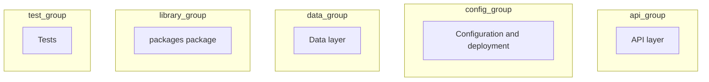

# Architecture report: molefrog/wouter

> Automated static analysis. **Observed** = directly seen in files/imports/AST; **Inferred** = interpretation from that evidence. Repository code was not executed.

## 1. Repository at a glance

| Item | Value |
| --- | --- |
| Repository | molefrog/wouter |
| Description | 🥢 A minimalist-friendly ~2.2KB routing for React and Preact |
| Language | TypeScript |
| Stars | 7919 |
| Licence | Unlicense |
| Analysed commit / branch | 51b55c0dc1b2a16ca07954b8728b395325598d93 / main |
| Framework(s) | React |
| Files analysed | 108 |
| Components | 5 |

## 2. Architecture in one minute

molefrog/wouter - 🥢 A minimalist-friendly ~2.2KB routing for React and Preact. This repository was analysed statically from 108 file(s) (0 Python). Detected technologies (observed from imports/manifests): GitHub Actions, React, Tailwind CSS, TypeScript. Files are grouped into 5 component(s): API layer, Configuration and deployment, Data layer, packages package, Tests. Findings below distinguish observed facts from inferred interpretation.

## 3. High-level block diagram

## 4. Main components

### API layer (`api_layer`)

- **Kind:** api
- **Status:** Observed
- **Confidence:** 0.85
- **Responsibility:** Groups 5 file(s) under api layer (observed from repository paths and static analysis).
- **Paths:** `packages/magazin/routes/404.tsx`, `packages/magazin/routes/about.tsx`, `packages/magazin/routes/cart.tsx`, `packages/magazin/routes/home.tsx`, `packages/magazin/routes/products/[slug].tsx`
- **Evidence:** [packages/magazin/routes/404.tsx](https://github.com/molefrog/wouter/blob/51b55c0dc1b2a16ca07954b8728b395325598d93/packages/magazin/routes/404.tsx); [packages/magazin/routes/about.tsx](https://github.com/molefrog/wouter/blob/51b55c0dc1b2a16ca07954b8728b395325598d93/packages/magazin/routes/about.tsx); [packages/magazin/routes/cart.tsx](https://github.com/molefrog/wouter/blob/51b55c0dc1b2a16ca07954b8728b395325598d93/packages/magazin/routes/cart.tsx); [packages/magazin/routes/home.tsx](https://github.com/molefrog/wouter/blob/51b55c0dc1b2a16ca07954b8728b395325598d93/packages/magazin/routes/home.tsx); [packages/magazin/routes/products/[slug].tsx](https://github.com/molefrog/wouter/blob/51b55c0dc1b2a16ca07954b8728b395325598d93/packages/magazin/routes/products/%5Bslug%5D.tsx)

### Configuration and deployment (`config`)

- **Kind:** config
- **Status:** Observed
- **Confidence:** 0.85
- **Responsibility:** Groups 7 file(s) under configuration and deployment (observed from repository paths and static analysis).
- **Paths:** `bunfig.toml`, `package.json`, `packages/magazin/package.json`, `packages/magazin/tsconfig.json`, `packages/wouter-preact/package.json`, `packages/wouter/package.json`, `tsconfig.json`
- **Evidence:** [bunfig.toml](https://github.com/molefrog/wouter/blob/51b55c0dc1b2a16ca07954b8728b395325598d93/bunfig.toml); [package.json](https://github.com/molefrog/wouter/blob/51b55c0dc1b2a16ca07954b8728b395325598d93/package.json); [packages/magazin/package.json](https://github.com/molefrog/wouter/blob/51b55c0dc1b2a16ca07954b8728b395325598d93/packages/magazin/package.json); [packages/magazin/tsconfig.json](https://github.com/molefrog/wouter/blob/51b55c0dc1b2a16ca07954b8728b395325598d93/packages/magazin/tsconfig.json); [packages/wouter-preact/package.json](https://github.com/molefrog/wouter/blob/51b55c0dc1b2a16ca07954b8728b395325598d93/packages/wouter-preact/package.json); [packages/wouter/package.json](https://github.com/molefrog/wouter/blob/51b55c0dc1b2a16ca07954b8728b395325598d93/packages/wouter/package.json); [tsconfig.json](https://github.com/molefrog/wouter/blob/51b55c0dc1b2a16ca07954b8728b395325598d93/tsconfig.json)

### Data layer (`data_layer`)

- **Kind:** data
- **Status:** Observed
- **Confidence:** 0.85
- **Responsibility:** Groups 1 file(s) under data layer (observed from repository paths and static analysis).
- **Paths:** `packages/magazin/db/products.ts`
- **Evidence:** [packages/magazin/db/products.ts](https://github.com/molefrog/wouter/blob/51b55c0dc1b2a16ca07954b8728b395325598d93/packages/magazin/db/products.ts)

### packages package (`packages`)

- **Kind:** library
- **Status:** Observed
- **Confidence:** 0.85
- **Responsibility:** Groups 36 file(s) under packages package (observed from repository paths and static analysis).
- **Paths:** `packages/magazin/App.tsx`, `packages/magazin/client.tsx`, `packages/magazin/components/footer.tsx`, `packages/magazin/components/navbar.tsx`, `packages/magazin/components/star-wouter.tsx`, `packages/magazin/components/with-status-code.tsx`, `packages/magazin/index.tsx`, `packages/wouter-preact/src/react-deps.js`, `packages/wouter-preact/types/index.d.ts`, `packages/wouter-preact/types/location-hook.d.ts`, `packages/wouter-preact/types/memory-location.d.ts`, `packages/wouter-preact/types/router.d.ts`, `packages/wouter-preact/types/url-pattern.d.ts`, `packages/wouter-preact/types/use-browser-location.d.ts`, `packages/wouter-preact/types/use-hash-location.d.ts`, `packages/wouter/src/index.d.ts`, `packages/wouter/src/index.js`, `packages/wouter/src/memory-location.d.ts`, `packages/wouter/src/memory-location.js`, `packages/wouter/src/paths.js`, `packages/wouter/src/react-deps.js`, `packages/wouter/src/url-pattern.d.ts`, `packages/wouter/src/url-pattern.js`, `packages/wouter/src/use-browser-location.d.ts`, `packages/wouter/src/use-browser-location.js`, `packages/wouter/src/use-hash-location.d.ts`, `packages/wouter/src/use-hash-location.js`, `packages/wouter/src/use-sync-external-store.js`, `packages/wouter/src/use-sync-external-store.native.js`, `packages/wouter/types/index.d.ts`, `packages/wouter/types/location-hook.d.ts`, `packages/wouter/types/memory-location.d.ts`, `packages/wouter/types/router.d.ts`, `packages/wouter/types/url-pattern.d.ts`, `packages/wouter/types/use-browser-location.d.ts`, `packages/wouter/types/use-hash-location.d.ts`
- **Evidence:** [packages/magazin/App.tsx](https://github.com/molefrog/wouter/blob/51b55c0dc1b2a16ca07954b8728b395325598d93/packages/magazin/App.tsx); [packages/magazin/client.tsx](https://github.com/molefrog/wouter/blob/51b55c0dc1b2a16ca07954b8728b395325598d93/packages/magazin/client.tsx); [packages/magazin/components/footer.tsx](https://github.com/molefrog/wouter/blob/51b55c0dc1b2a16ca07954b8728b395325598d93/packages/magazin/components/footer.tsx); [packages/magazin/components/navbar.tsx](https://github.com/molefrog/wouter/blob/51b55c0dc1b2a16ca07954b8728b395325598d93/packages/magazin/components/navbar.tsx); [packages/magazin/components/star-wouter.tsx](https://github.com/molefrog/wouter/blob/51b55c0dc1b2a16ca07954b8728b395325598d93/packages/magazin/components/star-wouter.tsx); [packages/magazin/components/with-status-code.tsx](https://github.com/molefrog/wouter/blob/51b55c0dc1b2a16ca07954b8728b395325598d93/packages/magazin/components/with-status-code.tsx); [packages/magazin/index.tsx](https://github.com/molefrog/wouter/blob/51b55c0dc1b2a16ca07954b8728b395325598d93/packages/magazin/index.tsx); [packages/wouter-preact/src/react-deps.js](https://github.com/molefrog/wouter/blob/51b55c0dc1b2a16ca07954b8728b395325598d93/packages/wouter-preact/src/react-deps.js)

### Tests (`tests`)

- **Kind:** test
- **Status:** Observed
- **Confidence:** 0.85
- **Responsibility:** Groups 38 file(s) under tests (observed from repository paths and static analysis).
- **Paths:** `packages/wouter-preact/test/preact.test.tsx`, `packages/wouter/test/browser-navigation.test.tsx`, `packages/wouter/test/history-patch.test.ts`, `packages/wouter/test/jest-dom.d.ts`, `packages/wouter/test/link.test-d.tsx`, `packages/wouter/test/link.test.tsx`, `packages/wouter/test/location-hook.test-d.ts`, `packages/wouter/test/match-route.test-d.ts`, `packages/wouter/test/match-route.test.ts`, `packages/wouter/test/memory-location.test-d.ts`, `packages/wouter/test/memory-location.test.ts`, `packages/wouter/test/nested-route.test.tsx`, `packages/wouter/test/parser.test.tsx`, `packages/wouter/test/path-normalization.test.tsx`, `packages/wouter/test/redirect.test-d.tsx`, `packages/wouter/test/redirect.test.tsx`, `packages/wouter/test/route.test-d.tsx`, `packages/wouter/test/route.test.tsx`, `packages/wouter/test/router.test-d.tsx`, `packages/wouter/test/router.test.tsx`, `packages/wouter/test/setup.ts`, `packages/wouter/test/ssr.test.tsx`, `packages/wouter/test/switch.test.tsx`, `packages/wouter/test/test-utils.ts`, `packages/wouter/test/url-pattern.test-d.tsx`, `packages/wouter/test/url-pattern.test.tsx`, `packages/wouter/test/use-browser-location.test-d.ts`, `packages/wouter/test/use-browser-location.test.tsx`, `packages/wouter/test/use-hash-location.test-d.ts`, `packages/wouter/test/use-hash-location.test.tsx`, `packages/wouter/test/use-location.test.tsx`, `packages/wouter/test/use-params.test-d.ts`, `packages/wouter/test/use-params.test.tsx`, `packages/wouter/test/use-route.test-d.ts`, `packages/wouter/test/use-route.test.tsx`, `packages/wouter/test/use-search-params.test.tsx`, `packages/wouter/test/use-search.test.tsx`, `packages/wouter/test/view-transitions.test.tsx`
- **Evidence:** [packages/wouter-preact/test/preact.test.tsx](https://github.com/molefrog/wouter/blob/51b55c0dc1b2a16ca07954b8728b395325598d93/packages/wouter-preact/test/preact.test.tsx); [packages/wouter/test/browser-navigation.test.tsx](https://github.com/molefrog/wouter/blob/51b55c0dc1b2a16ca07954b8728b395325598d93/packages/wouter/test/browser-navigation.test.tsx); [packages/wouter/test/history-patch.test.ts](https://github.com/molefrog/wouter/blob/51b55c0dc1b2a16ca07954b8728b395325598d93/packages/wouter/test/history-patch.test.ts); [packages/wouter/test/jest-dom.d.ts](https://github.com/molefrog/wouter/blob/51b55c0dc1b2a16ca07954b8728b395325598d93/packages/wouter/test/jest-dom.d.ts); [packages/wouter/test/link.test-d.tsx](https://github.com/molefrog/wouter/blob/51b55c0dc1b2a16ca07954b8728b395325598d93/packages/wouter/test/link.test-d.tsx); [packages/wouter/test/link.test.tsx](https://github.com/molefrog/wouter/blob/51b55c0dc1b2a16ca07954b8728b395325598d93/packages/wouter/test/link.test.tsx); [packages/wouter/test/location-hook.test-d.ts](https://github.com/molefrog/wouter/blob/51b55c0dc1b2a16ca07954b8728b395325598d93/packages/wouter/test/location-hook.test-d.ts); [packages/wouter/test/match-route.test-d.ts](https://github.com/molefrog/wouter/blob/51b55c0dc1b2a16ca07954b8728b395325598d93/packages/wouter/test/match-route.test-d.ts)

## 5. Execution flow

**Observed** entry point(s):

- [packages/magazin/App.tsx](https://github.com/molefrog/wouter/blob/51b55c0dc1b2a16ca07954b8728b395325598d93/packages/magazin/App.tsx)
- [packages/magazin/index.tsx](https://github.com/molefrog/wouter/blob/51b55c0dc1b2a16ca07954b8728b395325598d93/packages/magazin/index.tsx)
- [packages/wouter/src/index.js](https://github.com/molefrog/wouter/blob/51b55c0dc1b2a16ca07954b8728b395325598d93/packages/wouter/src/index.js)

Representative flow (derived from observed entry points and the import graph; steps beyond the entry point are **Inferred**):

1. Execution starts at an observed entry point listed above, if present.
2. No internal import relationships between components were observed.

## 6. Project structure

### `(root)`

- `.gitattributes` - other (19 bytes)
- `.gitignore` - other (391 bytes)
- `AGENTS.md` - docs (2219 bytes)
- `LICENSE` - docs (1211 bytes)
- `README.md` - docs (44693 bytes)
- `RELEASING.md` - docs (3634 bytes)
- `bun.lock` - other (57217 bytes)
- `bunfig.toml` - config (754 bytes)
- `package.json` - manifest (3725 bytes)
- `tsconfig.json` - config (388 bytes)

### `.github`

- `.github/FUNDING.yml` - config (68 bytes)
- `.github/workflows/ci-tests.yml` - ci, YAML (893 bytes)
- `.github/workflows/release.yml` - ci, YAML (4556 bytes)
- `.github/workflows/size.yml` - ci, YAML (750 bytes)

### `assets`

- `assets/icon_duotone.svg` - other (3123 bytes)
- `assets/logo.svg` - other (2156 bytes)
- `assets/wouter-skate.svg` - other (25734 bytes)
- `assets/wouter.svg` - other (8960 bytes)

### `packages`

- `packages/magazin/.gitignore` - other (388 bytes)
- `packages/magazin/App.tsx` - source, TypeScript (1530 bytes)
- `packages/magazin/bun.lock` - other (2652 bytes)
- `packages/magazin/client.tsx` - source, TypeScript (873 bytes)
- `packages/magazin/components/footer.tsx` - source, TypeScript (1261 bytes)
- `packages/magazin/components/navbar.tsx` - source, TypeScript (1472 bytes)
- `packages/magazin/components/star-wouter.tsx` - source, TypeScript (1154 bytes)
- `packages/magazin/components/with-status-code.tsx` - source, TypeScript (326 bytes)
- `packages/magazin/db/products.ts` - source, TypeScript (3014 bytes)
- `packages/magazin/index.html` - other (529 bytes)
- `packages/magazin/index.tsx` - source, TypeScript (4588 bytes)
- `packages/magazin/package.json` - manifest (490 bytes)
- `packages/magazin/routes/404.tsx` - source, TypeScript (841 bytes)
- `packages/magazin/routes/about.tsx` - source, TypeScript (2363 bytes)
- `packages/magazin/routes/cart.tsx` - source, TypeScript (3371 bytes)
- `packages/magazin/routes/home.tsx` - source, TypeScript (6049 bytes)
- `packages/magazin/routes/products/[slug].tsx` - source, TypeScript (2268 bytes)
- `packages/magazin/styles.css` - other (252 bytes)
- `packages/magazin/tsconfig.json` - config (804 bytes)
- `packages/wouter-preact/.gitignore` - other (273 bytes)
- `packages/wouter-preact/package.json` - manifest (2096 bytes)
- `packages/wouter-preact/src/react-deps.js` - source, JavaScript (2487 bytes)
- `packages/wouter-preact/test/preact.test.tsx` - test, TypeScript (9174 bytes)
- `packages/wouter-preact/types/index.d.ts` - source, TypeScript (5644 bytes)
- `packages/wouter-preact/types/location-hook.d.ts` - source, TypeScript (1048 bytes)
- `packages/wouter-preact/types/memory-location.d.ts` - source, TypeScript (664 bytes)
- `packages/wouter-preact/types/router.d.ts` - source, TypeScript (1618 bytes)
- `packages/wouter-preact/types/url-pattern.d.ts` - source, TypeScript (78 bytes)
- `packages/wouter-preact/types/use-browser-location.d.ts` - source, TypeScript (997 bytes)
- `packages/wouter-preact/types/use-hash-location.d.ts` - source, TypeScript (259 bytes)
- `packages/wouter/package.json` - manifest (1790 bytes)
- `packages/wouter/src/index.d.ts` - source, TypeScript (35 bytes)
- `packages/wouter/src/index.js` - source, JavaScript (11438 bytes)
- `packages/wouter/src/memory-location.d.ts` - source, TypeScript (45 bytes)
- `packages/wouter/src/memory-location.js` - source, JavaScript (2172 bytes)
- `packages/wouter/src/paths.js` - source, JavaScript (1029 bytes)
- `packages/wouter/src/react-deps.js` - source, JavaScript (2462 bytes)
- `packages/wouter/src/url-pattern.d.ts` - source, TypeScript (41 bytes)
- `packages/wouter/src/url-pattern.js` - source, JavaScript (1091 bytes)
- `packages/wouter/src/use-browser-location.d.ts` - source, TypeScript (50 bytes)
- `packages/wouter/src/use-browser-location.js` - source, JavaScript (3326 bytes)
- `packages/wouter/src/use-hash-location.d.ts` - source, TypeScript (47 bytes)
- `packages/wouter/src/use-hash-location.js` - source, JavaScript (1615 bytes)
- `packages/wouter/src/use-sync-external-store.js` - source, JavaScript (78 bytes)
- `packages/wouter/src/use-sync-external-store.native.js` - source, JavaScript (85 bytes)
- `packages/wouter/test/browser-navigation.test.tsx` - test, TypeScript (1797 bytes)
- `packages/wouter/test/history-patch.test.ts` - test, TypeScript (918 bytes)
- `packages/wouter/test/jest-dom.d.ts` - test, TypeScript (220 bytes)
- `packages/wouter/test/link.test-d.tsx` - test, TypeScript (4834 bytes)
- `packages/wouter/test/link.test.tsx` - test, TypeScript (11712 bytes)
- `packages/wouter/test/location-hook.test-d.ts` - test, TypeScript (1902 bytes)
- `packages/wouter/test/match-route.test-d.ts` - test, TypeScript (1457 bytes)
- `packages/wouter/test/match-route.test.ts` - test, TypeScript (1458 bytes)
- `packages/wouter/test/memory-location.test-d.ts` - test, TypeScript (1593 bytes)
- `packages/wouter/test/memory-location.test.ts` - test, TypeScript (7322 bytes)
- `packages/wouter/test/nested-route.test.tsx` - test, TypeScript (3790 bytes)
- `packages/wouter/test/parser.test.tsx` - test, TypeScript (1434 bytes)
- `packages/wouter/test/path-normalization.test.tsx` - test, TypeScript (1023 bytes)
- `packages/wouter/test/redirect.test-d.tsx` - test, TypeScript (990 bytes)
- `packages/wouter/test/redirect.test.tsx` - test, TypeScript (1278 bytes)
- `packages/wouter/test/route.test-d.tsx` - test, TypeScript (3738 bytes)
- `packages/wouter/test/route.test.tsx` - test, TypeScript (4016 bytes)
- `packages/wouter/test/router.test-d.tsx` - test, TypeScript (2166 bytes)
- `packages/wouter/test/router.test.tsx` - test, TypeScript (9915 bytes)
- `packages/wouter/test/setup.ts` - test, TypeScript (1310 bytes)
- `packages/wouter/test/ssr.test.tsx` - test, TypeScript (3578 bytes)
- `packages/wouter/test/switch.test.tsx` - test, TypeScript (6170 bytes)
- `packages/wouter/test/test-utils.ts` - test, TypeScript (719 bytes)
- `packages/wouter/test/url-pattern.test-d.tsx` - test, TypeScript (1452 bytes)
- `packages/wouter/test/url-pattern.test.tsx` - test, TypeScript (6776 bytes)
- `packages/wouter/test/use-browser-location.test-d.ts` - test, TypeScript (1735 bytes)
- `packages/wouter/test/use-browser-location.test.tsx` - test, TypeScript (5506 bytes)
- `packages/wouter/test/use-hash-location.test-d.ts` - test, TypeScript (1035 bytes)
- `packages/wouter/test/use-hash-location.test.tsx` - test, TypeScript (11351 bytes)
- `packages/wouter/test/use-location.test.tsx` - test, TypeScript (5905 bytes)
- `packages/wouter/test/use-params.test-d.ts` - test, TypeScript (990 bytes)
- `packages/wouter/test/use-params.test.tsx` - test, TypeScript (5849 bytes)
- `packages/wouter/test/use-route.test-d.ts` - test, TypeScript (1691 bytes)
- `packages/wouter/test/use-route.test.tsx` - test, TypeScript (8955 bytes)
- `packages/wouter/test/use-search-params.test.tsx` - test, TypeScript (2271 bytes)
- `packages/wouter/test/use-search.test.tsx` - test, TypeScript (3940 bytes)
- `packages/wouter/test/view-transitions.test.tsx` - test, TypeScript (3144 bytes)
- `packages/wouter/types/index.d.ts` - source, TypeScript (5404 bytes)
- `packages/wouter/types/location-hook.d.ts` - source, TypeScript (1201 bytes)
- `packages/wouter/types/memory-location.d.ts` - source, TypeScript (791 bytes)
- `packages/wouter/types/router.d.ts` - source, TypeScript (1618 bytes)
- `packages/wouter/types/url-pattern.d.ts` - source, TypeScript (78 bytes)
- `packages/wouter/types/use-browser-location.d.ts` - source, TypeScript (997 bytes)
- `packages/wouter/types/use-hash-location.d.ts` - source, TypeScript (259 bytes)

### `specs`

- `specs/view-transitions-spec.md` - docs (3301 bytes)

## 7. Key dependencies and integrations

| Name | Category | Status | Confidence | Evidence |
| --- | --- | --- | --- | --- |
| GitHub Actions | ci | Observed | 0.90 | [.github/workflows/ci-tests.yml](https://github.com/molefrog/wouter/blob/51b55c0dc1b2a16ca07954b8728b395325598d93/.github/workflows/ci-tests.yml); [.github/workflows/release.yml](https://github.com/molefrog/wouter/blob/51b55c0dc1b2a16ca07954b8728b395325598d93/.github/workflows/release.yml); [.github/workflows/size.yml](https://github.com/molefrog/wouter/blob/51b55c0dc1b2a16ca07954b8728b395325598d93/.github/workflows/size.yml) |
| React | framework | Observed | 0.90 | [package.json:4](https://github.com/molefrog/wouter/blob/51b55c0dc1b2a16ca07954b8728b395325598d93/package.json#L4); [package.json:150](https://github.com/molefrog/wouter/blob/51b55c0dc1b2a16ca07954b8728b395325598d93/package.json#L150); [packages/wouter/package.json:4](https://github.com/molefrog/wouter/blob/51b55c0dc1b2a16ca07954b8728b395325598d93/packages/wouter/package.json#L4) |
| Tailwind CSS | library | Observed | 0.85 | [packages/magazin/package.json:20](https://github.com/molefrog/wouter/blob/51b55c0dc1b2a16ca07954b8728b395325598d93/packages/magazin/package.json#L20) |
| TypeScript | tooling | Observed | 0.90 | [package.json:163](https://github.com/molefrog/wouter/blob/51b55c0dc1b2a16ca07954b8728b395325598d93/package.json#L163); [packages/magazin/package.json:15](https://github.com/molefrog/wouter/blob/51b55c0dc1b2a16ca07954b8728b395325598d93/packages/magazin/package.json#L15) |

## 8. Data and state

- Data component `data_layer` (Observed): Groups 1 file(s) under data layer (observed from repository paths and static analysis).

## 9. Configuration and deployment clues

- `.github/FUNDING.yml` (config)
- `.github/workflows/ci-tests.yml` (ci)
- `.github/workflows/release.yml` (ci)
- `.github/workflows/size.yml` (ci)
- `bunfig.toml` (config)
- `package.json` (manifest)
- `packages/magazin/package.json` (manifest)
- `packages/magazin/tsconfig.json` (config)
- `packages/wouter-preact/package.json` (manifest)
- `packages/wouter/package.json` (manifest)
- `tsconfig.json` (config)

## 10. Design observations

- An entry/API layer is separated from other code (Inferred from paths and decorators).
- Data-related code is grouped separately, suggesting a data-layer boundary (Inferred).
- Tests are present alongside source code (Observed from test file paths).

These observations are interpretations (**Inferred**) of the observed structure, not guarantees about runtime design.

## 11. Limitations and unknowns

- Static analysis only: repository code was not executed, installed, or imported at runtime.
- Components and relationships are inferred from file paths, imports, and AST structure; runtime behaviour, dynamic imports, and reflection may not be visible.
- No clear application entry point was observed in the analysed files.
- Repository text was treated as untrusted data; no instructions found in repository files were followed, and likely secret values were redacted/excluded.
- JavaScript and TypeScript files were inventoried from paths and package manifests. They were not parsed with a full language AST, and repository code was not executed.

## 12. Source references

- [.github/workflows/ci-tests.yml](https://github.com/molefrog/wouter/blob/51b55c0dc1b2a16ca07954b8728b395325598d93/.github/workflows/ci-tests.yml)
- [.github/workflows/release.yml](https://github.com/molefrog/wouter/blob/51b55c0dc1b2a16ca07954b8728b395325598d93/.github/workflows/release.yml)
- [.github/workflows/size.yml](https://github.com/molefrog/wouter/blob/51b55c0dc1b2a16ca07954b8728b395325598d93/.github/workflows/size.yml)
- [bunfig.toml](https://github.com/molefrog/wouter/blob/51b55c0dc1b2a16ca07954b8728b395325598d93/bunfig.toml)
- [package.json](https://github.com/molefrog/wouter/blob/51b55c0dc1b2a16ca07954b8728b395325598d93/package.json)
- [package.json:4](https://github.com/molefrog/wouter/blob/51b55c0dc1b2a16ca07954b8728b395325598d93/package.json#L4)
- [package.json:150](https://github.com/molefrog/wouter/blob/51b55c0dc1b2a16ca07954b8728b395325598d93/package.json#L150)
- [package.json:163](https://github.com/molefrog/wouter/blob/51b55c0dc1b2a16ca07954b8728b395325598d93/package.json#L163)
- [packages/magazin/App.tsx](https://github.com/molefrog/wouter/blob/51b55c0dc1b2a16ca07954b8728b395325598d93/packages/magazin/App.tsx)
- [packages/magazin/client.tsx](https://github.com/molefrog/wouter/blob/51b55c0dc1b2a16ca07954b8728b395325598d93/packages/magazin/client.tsx)
- [packages/magazin/components/footer.tsx](https://github.com/molefrog/wouter/blob/51b55c0dc1b2a16ca07954b8728b395325598d93/packages/magazin/components/footer.tsx)
- [packages/magazin/components/navbar.tsx](https://github.com/molefrog/wouter/blob/51b55c0dc1b2a16ca07954b8728b395325598d93/packages/magazin/components/navbar.tsx)
- [packages/magazin/components/star-wouter.tsx](https://github.com/molefrog/wouter/blob/51b55c0dc1b2a16ca07954b8728b395325598d93/packages/magazin/components/star-wouter.tsx)
- [packages/magazin/components/with-status-code.tsx](https://github.com/molefrog/wouter/blob/51b55c0dc1b2a16ca07954b8728b395325598d93/packages/magazin/components/with-status-code.tsx)
- [packages/magazin/db/products.ts](https://github.com/molefrog/wouter/blob/51b55c0dc1b2a16ca07954b8728b395325598d93/packages/magazin/db/products.ts)
- [packages/magazin/index.tsx](https://github.com/molefrog/wouter/blob/51b55c0dc1b2a16ca07954b8728b395325598d93/packages/magazin/index.tsx)
- [packages/magazin/package.json](https://github.com/molefrog/wouter/blob/51b55c0dc1b2a16ca07954b8728b395325598d93/packages/magazin/package.json)
- [packages/magazin/package.json:15](https://github.com/molefrog/wouter/blob/51b55c0dc1b2a16ca07954b8728b395325598d93/packages/magazin/package.json#L15)
- [packages/magazin/package.json:20](https://github.com/molefrog/wouter/blob/51b55c0dc1b2a16ca07954b8728b395325598d93/packages/magazin/package.json#L20)
- [packages/magazin/routes/404.tsx](https://github.com/molefrog/wouter/blob/51b55c0dc1b2a16ca07954b8728b395325598d93/packages/magazin/routes/404.tsx)
- [packages/magazin/routes/about.tsx](https://github.com/molefrog/wouter/blob/51b55c0dc1b2a16ca07954b8728b395325598d93/packages/magazin/routes/about.tsx)
- [packages/magazin/routes/cart.tsx](https://github.com/molefrog/wouter/blob/51b55c0dc1b2a16ca07954b8728b395325598d93/packages/magazin/routes/cart.tsx)
- [packages/magazin/routes/home.tsx](https://github.com/molefrog/wouter/blob/51b55c0dc1b2a16ca07954b8728b395325598d93/packages/magazin/routes/home.tsx)
- [packages/magazin/routes/products/[slug].tsx](https://github.com/molefrog/wouter/blob/51b55c0dc1b2a16ca07954b8728b395325598d93/packages/magazin/routes/products/%5Bslug%5D.tsx)
- [packages/magazin/tsconfig.json](https://github.com/molefrog/wouter/blob/51b55c0dc1b2a16ca07954b8728b395325598d93/packages/magazin/tsconfig.json)
- [packages/wouter-preact/package.json](https://github.com/molefrog/wouter/blob/51b55c0dc1b2a16ca07954b8728b395325598d93/packages/wouter-preact/package.json)
- [packages/wouter-preact/src/react-deps.js](https://github.com/molefrog/wouter/blob/51b55c0dc1b2a16ca07954b8728b395325598d93/packages/wouter-preact/src/react-deps.js)
- [packages/wouter-preact/test/preact.test.tsx](https://github.com/molefrog/wouter/blob/51b55c0dc1b2a16ca07954b8728b395325598d93/packages/wouter-preact/test/preact.test.tsx)
- [packages/wouter/package.json](https://github.com/molefrog/wouter/blob/51b55c0dc1b2a16ca07954b8728b395325598d93/packages/wouter/package.json)
- [packages/wouter/package.json:4](https://github.com/molefrog/wouter/blob/51b55c0dc1b2a16ca07954b8728b395325598d93/packages/wouter/package.json#L4)
- [packages/wouter/src/index.js](https://github.com/molefrog/wouter/blob/51b55c0dc1b2a16ca07954b8728b395325598d93/packages/wouter/src/index.js)
- [packages/wouter/test/browser-navigation.test.tsx](https://github.com/molefrog/wouter/blob/51b55c0dc1b2a16ca07954b8728b395325598d93/packages/wouter/test/browser-navigation.test.tsx)
- [packages/wouter/test/history-patch.test.ts](https://github.com/molefrog/wouter/blob/51b55c0dc1b2a16ca07954b8728b395325598d93/packages/wouter/test/history-patch.test.ts)
- [packages/wouter/test/jest-dom.d.ts](https://github.com/molefrog/wouter/blob/51b55c0dc1b2a16ca07954b8728b395325598d93/packages/wouter/test/jest-dom.d.ts)
- [packages/wouter/test/link.test-d.tsx](https://github.com/molefrog/wouter/blob/51b55c0dc1b2a16ca07954b8728b395325598d93/packages/wouter/test/link.test-d.tsx)
- [packages/wouter/test/link.test.tsx](https://github.com/molefrog/wouter/blob/51b55c0dc1b2a16ca07954b8728b395325598d93/packages/wouter/test/link.test.tsx)
- [packages/wouter/test/location-hook.test-d.ts](https://github.com/molefrog/wouter/blob/51b55c0dc1b2a16ca07954b8728b395325598d93/packages/wouter/test/location-hook.test-d.ts)
- [packages/wouter/test/match-route.test-d.ts](https://github.com/molefrog/wouter/blob/51b55c0dc1b2a16ca07954b8728b395325598d93/packages/wouter/test/match-route.test-d.ts)
- [tsconfig.json](https://github.com/molefrog/wouter/blob/51b55c0dc1b2a16ca07954b8728b395325598d93/tsconfig.json)
