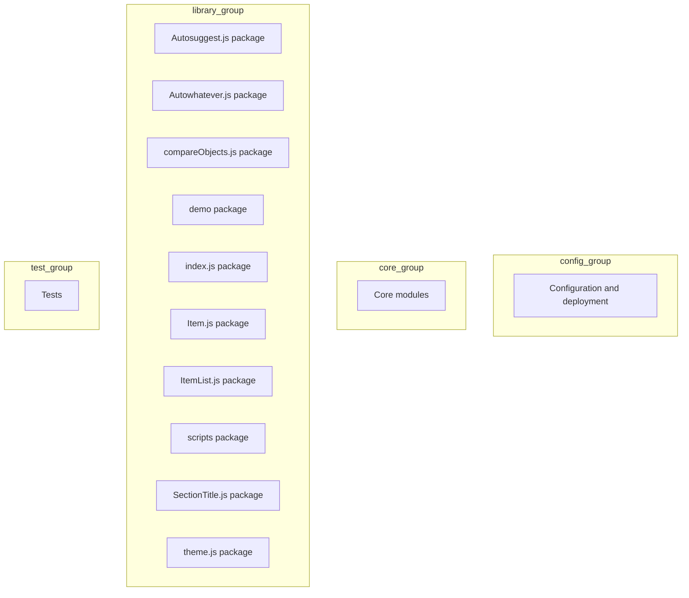

# Architecture report: moroshko/react-autosuggest

> Automated static analysis. **Observed** = directly seen in files/imports/AST; **Inferred** = interpretation from that evidence. Repository code was not executed.

## 1. Repository at a glance

| Item | Value |
| --- | --- |
| Repository | moroshko/react-autosuggest |
| Description | WAI-ARIA compliant React autosuggest component |
| Language | JavaScript |
| Stars | 5932 |
| Licence | MIT |
| Analysed commit / branch | e2c84d906afc7b6723d29d1c2283c3f322ee2552 / master |
| Framework(s) | React |
| Files analysed | 116 |
| Components | 13 |

## 2. Architecture in one minute

moroshko/react-autosuggest - WAI-ARIA compliant React autosuggest component. This repository was analysed statically from 116 file(s) (0 Python). Detected technologies (observed from imports/manifests): GitHub Actions, React, webpack. Files are grouped into 13 component(s): Autosuggest.js package, Autowhatever.js package, compareObjects.js package, Configuration and deployment, Core modules, demo package, index.js package, Item.js package. Findings below distinguish observed facts from inferred interpretation.

## 3. High-level block diagram

## 4. Main components

### Autosuggest.js package (`autosuggest_js`)

- **Kind:** library
- **Status:** Observed
- **Confidence:** 0.85
- **Responsibility:** Groups 1 file(s) under autosuggest.js package (observed from repository paths and static analysis).
- **Paths:** `src/Autosuggest.js`
- **Evidence:** [src/Autosuggest.js](https://github.com/moroshko/react-autosuggest/blob/e2c84d906afc7b6723d29d1c2283c3f322ee2552/src/Autosuggest.js)

### Autowhatever.js package (`autowhatever_js`)

- **Kind:** library
- **Status:** Observed
- **Confidence:** 0.85
- **Responsibility:** Groups 1 file(s) under autowhatever.js package (observed from repository paths and static analysis).
- **Paths:** `src/Autowhatever.js`
- **Evidence:** [src/Autowhatever.js](https://github.com/moroshko/react-autosuggest/blob/e2c84d906afc7b6723d29d1c2283c3f322ee2552/src/Autowhatever.js)

### compareObjects.js package (`compareobjects_js`)

- **Kind:** library
- **Status:** Observed
- **Confidence:** 0.85
- **Responsibility:** Groups 1 file(s) under compareobjects.js package (observed from repository paths and static analysis).
- **Paths:** `src/compareObjects.js`
- **Evidence:** [src/compareObjects.js](https://github.com/moroshko/react-autosuggest/blob/e2c84d906afc7b6723d29d1c2283c3f322ee2552/src/compareObjects.js)

### Configuration and deployment (`config`)

- **Kind:** config
- **Status:** Observed
- **Confidence:** 0.85
- **Responsibility:** Groups 1 file(s) under configuration and deployment (observed from repository paths and static analysis).
- **Paths:** `package.json`
- **Evidence:** [package.json](https://github.com/moroshko/react-autosuggest/blob/e2c84d906afc7b6723d29d1c2283c3f322ee2552/package.json)

### Core modules (`core`)

- **Kind:** core
- **Status:** Observed
- **Confidence:** 0.85
- **Responsibility:** Groups 6 file(s) under core modules (observed from repository paths and static analysis).
- **Paths:** `nyc.config.js`, `server.js`, `webpack.dev.config.js`, `webpack.gh-pages.config.js`, `webpack.standalone-demo.config.js`, `webpack.standalone.config.js`
- **Evidence:** [nyc.config.js](https://github.com/moroshko/react-autosuggest/blob/e2c84d906afc7b6723d29d1c2283c3f322ee2552/nyc.config.js); [server.js](https://github.com/moroshko/react-autosuggest/blob/e2c84d906afc7b6723d29d1c2283c3f322ee2552/server.js); [webpack.dev.config.js](https://github.com/moroshko/react-autosuggest/blob/e2c84d906afc7b6723d29d1c2283c3f322ee2552/webpack.dev.config.js); [webpack.gh-pages.config.js](https://github.com/moroshko/react-autosuggest/blob/e2c84d906afc7b6723d29d1c2283c3f322ee2552/webpack.gh-pages.config.js); [webpack.standalone-demo.config.js](https://github.com/moroshko/react-autosuggest/blob/e2c84d906afc7b6723d29d1c2283c3f322ee2552/webpack.standalone-demo.config.js); [webpack.standalone.config.js](https://github.com/moroshko/react-autosuggest/blob/e2c84d906afc7b6723d29d1c2283c3f322ee2552/webpack.standalone.config.js)

### demo package (`demo`)

- **Kind:** library
- **Status:** Observed
- **Confidence:** 0.85
- **Responsibility:** Groups 19 file(s) under demo package (observed from repository paths and static analysis).
- **Paths:** `demo/src/components/App/App.js`, `demo/src/components/App/components/Examples/Examples.js`, `demo/src/components/App/components/Examples/components/Basic/Basic.js`, `demo/src/components/App/components/Examples/components/Basic/languages.js`, `demo/src/components/App/components/Examples/components/CustomRender/CustomRender.js`, `demo/src/components/App/components/Examples/components/CustomRender/people.js`, `demo/src/components/App/components/Examples/components/MultipleSections/MultipleSections.js`, `demo/src/components/App/components/Examples/components/MultipleSections/languages.js`, `demo/src/components/App/components/Examples/components/ScrollableContainer/ScrollableContainer.js`, `demo/src/components/App/components/Examples/components/ScrollableContainer/countries.js`, `demo/src/components/App/components/Features/Features.js`, `demo/src/components/App/components/Footer/Footer.js`, `demo/src/components/App/components/GitHub/GitHub.js`, `demo/src/components/App/components/Header/Header.js`, `demo/src/components/App/components/Link/Link.js`, `demo/src/components/utils/utils.js`, `demo/src/index.js`, `demo/standalone/app.js`, `demo/standalone/compiled.app.js`
- **Evidence:** [demo/src/components/App/App.js](https://github.com/moroshko/react-autosuggest/blob/e2c84d906afc7b6723d29d1c2283c3f322ee2552/demo/src/components/App/App.js); [demo/src/components/App/components/Examples/Examples.js](https://github.com/moroshko/react-autosuggest/blob/e2c84d906afc7b6723d29d1c2283c3f322ee2552/demo/src/components/App/components/Examples/Examples.js); [demo/src/components/App/components/Examples/components/Basic/Basic.js](https://github.com/moroshko/react-autosuggest/blob/e2c84d906afc7b6723d29d1c2283c3f322ee2552/demo/src/components/App/components/Examples/components/Basic/Basic.js); [demo/src/components/App/components/Examples/components/Basic/languages.js](https://github.com/moroshko/react-autosuggest/blob/e2c84d906afc7b6723d29d1c2283c3f322ee2552/demo/src/components/App/components/Examples/components/Basic/languages.js); [demo/src/components/App/components/Examples/components/CustomRender/CustomRender.js](https://github.com/moroshko/react-autosuggest/blob/e2c84d906afc7b6723d29d1c2283c3f322ee2552/demo/src/components/App/components/Examples/components/CustomRender/CustomRender.js); [demo/src/components/App/components/Examples/components/CustomRender/people.js](https://github.com/moroshko/react-autosuggest/blob/e2c84d906afc7b6723d29d1c2283c3f322ee2552/demo/src/components/App/components/Examples/components/CustomRender/people.js); [demo/src/components/App/components/Examples/components/MultipleSections/MultipleSections.js](https://github.com/moroshko/react-autosuggest/blob/e2c84d906afc7b6723d29d1c2283c3f322ee2552/demo/src/components/App/components/Examples/components/MultipleSections/MultipleSections.js); [demo/src/components/App/components/Examples/components/MultipleSections/languages.js](https://github.com/moroshko/react-autosuggest/blob/e2c84d906afc7b6723d29d1c2283c3f322ee2552/demo/src/components/App/components/Examples/components/MultipleSections/languages.js)

### index.js package (`index_js`)

- **Kind:** library
- **Status:** Observed
- **Confidence:** 0.85
- **Responsibility:** Groups 1 file(s) under index.js package (observed from repository paths and static analysis).
- **Paths:** `src/index.js`
- **Evidence:** [src/index.js](https://github.com/moroshko/react-autosuggest/blob/e2c84d906afc7b6723d29d1c2283c3f322ee2552/src/index.js)

### Item.js package (`item_js`)

- **Kind:** library
- **Status:** Observed
- **Confidence:** 0.85
- **Responsibility:** Groups 1 file(s) under item.js package (observed from repository paths and static analysis).
- **Paths:** `src/Item.js`
- **Evidence:** [src/Item.js](https://github.com/moroshko/react-autosuggest/blob/e2c84d906afc7b6723d29d1c2283c3f322ee2552/src/Item.js)

### ItemList.js package (`itemlist_js`)

- **Kind:** library
- **Status:** Observed
- **Confidence:** 0.85
- **Responsibility:** Groups 1 file(s) under itemlist.js package (observed from repository paths and static analysis).
- **Paths:** `src/ItemList.js`
- **Evidence:** [src/ItemList.js](https://github.com/moroshko/react-autosuggest/blob/e2c84d906afc7b6723d29d1c2283c3f322ee2552/src/ItemList.js)

### scripts package (`scripts`)

- **Kind:** library
- **Status:** Observed
- **Confidence:** 0.85
- **Responsibility:** Groups 1 file(s) under scripts package (observed from repository paths and static analysis).
- **Paths:** `scripts/deploy-to-gh-pages.sh`
- **Evidence:** [scripts/deploy-to-gh-pages.sh](https://github.com/moroshko/react-autosuggest/blob/e2c84d906afc7b6723d29d1c2283c3f322ee2552/scripts/deploy-to-gh-pages.sh)

### SectionTitle.js package (`sectiontitle_js`)

- **Kind:** library
- **Status:** Observed
- **Confidence:** 0.85
- **Responsibility:** Groups 1 file(s) under sectiontitle.js package (observed from repository paths and static analysis).
- **Paths:** `src/SectionTitle.js`
- **Evidence:** [src/SectionTitle.js](https://github.com/moroshko/react-autosuggest/blob/e2c84d906afc7b6723d29d1c2283c3f322ee2552/src/SectionTitle.js)

### Tests (`tests`)

- **Kind:** test
- **Status:** Observed
- **Confidence:** 0.85
- **Responsibility:** Groups 44 file(s) under tests (observed from repository paths and static analysis).
- **Paths:** `test/always-render-suggestions/AutosuggestApp.js`, `test/always-render-suggestions/AutosuggestApp.test.js`, `test/async-suggestions/AutosuggestApp.js`, `test/async-suggestions/AutosuggestApp.test.js`, `test/autowhatever/autowhatever-helpers.js`, `test/autowhatever/compareObjects.test.js`, `test/autowhatever/default-props/Autowhatever.test.js`, `test/autowhatever/default-props/AutowhateverApp.js`, `test/autowhatever/default-props/sections.js`, `test/autowhatever/function-ref/Autowhatever.test.js`, `test/autowhatever/function-ref/AutowhateverApp.js`, `test/autowhatever/function-ref/items.js`, `test/autowhatever/multi-section/Autowhatever.test.js`, `test/autowhatever/multi-section/AutowhateverApp.js`, `test/autowhatever/multi-section/sections.js`, `test/autowhatever/plain-list/Autowhatever.test.js`, `test/autowhatever/plain-list/AutowhateverApp.js`, `test/autowhatever/plain-list/items.js`, `test/autowhatever/render-items-container/Autowhatever.test.js`, `test/autowhatever/render-items-container/AutowhateverApp.js`, `test/autowhatever/render-items-container/items.js`, `test/do-not-focus-input-on-suggestion-click/AutosuggestApp.js`, `test/do-not-focus-input-on-suggestion-click/AutosuggestApp.test.js`, `test/focus-first-suggestion-clear-on-enter/AutosuggestApp.js`, `test/focus-first-suggestion-clear-on-enter/AutosuggestApp.test.js`, `test/focus-first-suggestion/AutosuggestApp.js`, `test/focus-first-suggestion/AutosuggestApp.test.js`, `test/helpers.js`, `test/keep-suggestions-on-select/AutosuggestApp.js`, `test/keep-suggestions-on-select/AutosuggestApp.test.js`, `test/multi-section/AutosuggestApp.js`, `test/multi-section/AutosuggestApp.test.js`, `test/multi-section/languages.js`, `test/plain-list/AutosuggestApp.js`, `test/plain-list/AutosuggestApp.test.js`, `test/plain-list/languages.js`, `test/render-input-component/AutosuggestApp.js`, `test/render-input-component/AutosuggestApp.test.js`, `test/render-suggestions-container/AutosuggestApp.js`, `test/render-suggestions-container/AutosuggestApp.test.js`, `test/setup.js`, `test/textarea/AutosuggestApp.js`, `test/textarea/AutosuggestApp.test.js`, `test/textarea/languages.js`
- **Evidence:** [test/always-render-suggestions/AutosuggestApp.js](https://github.com/moroshko/react-autosuggest/blob/e2c84d906afc7b6723d29d1c2283c3f322ee2552/test/always-render-suggestions/AutosuggestApp.js); [test/always-render-suggestions/AutosuggestApp.test.js](https://github.com/moroshko/react-autosuggest/blob/e2c84d906afc7b6723d29d1c2283c3f322ee2552/test/always-render-suggestions/AutosuggestApp.test.js); [test/async-suggestions/AutosuggestApp.js](https://github.com/moroshko/react-autosuggest/blob/e2c84d906afc7b6723d29d1c2283c3f322ee2552/test/async-suggestions/AutosuggestApp.js); [test/async-suggestions/AutosuggestApp.test.js](https://github.com/moroshko/react-autosuggest/blob/e2c84d906afc7b6723d29d1c2283c3f322ee2552/test/async-suggestions/AutosuggestApp.test.js); [test/autowhatever/autowhatever-helpers.js](https://github.com/moroshko/react-autosuggest/blob/e2c84d906afc7b6723d29d1c2283c3f322ee2552/test/autowhatever/autowhatever-helpers.js); [test/autowhatever/compareObjects.test.js](https://github.com/moroshko/react-autosuggest/blob/e2c84d906afc7b6723d29d1c2283c3f322ee2552/test/autowhatever/compareObjects.test.js); [test/autowhatever/default-props/Autowhatever.test.js](https://github.com/moroshko/react-autosuggest/blob/e2c84d906afc7b6723d29d1c2283c3f322ee2552/test/autowhatever/default-props/Autowhatever.test.js); [test/autowhatever/default-props/AutowhateverApp.js](https://github.com/moroshko/react-autosuggest/blob/e2c84d906afc7b6723d29d1c2283c3f322ee2552/test/autowhatever/default-props/AutowhateverApp.js)

### theme.js package (`theme_js`)

- **Kind:** library
- **Status:** Observed
- **Confidence:** 0.85
- **Responsibility:** Groups 1 file(s) under theme.js package (observed from repository paths and static analysis).
- **Paths:** `src/theme.js`
- **Evidence:** [src/theme.js](https://github.com/moroshko/react-autosuggest/blob/e2c84d906afc7b6723d29d1c2283c3f322ee2552/src/theme.js)

## 5. Execution flow

**Observed** entry point(s):

- [demo/src/index.js](https://github.com/moroshko/react-autosuggest/blob/e2c84d906afc7b6723d29d1c2283c3f322ee2552/demo/src/index.js)
- [demo/standalone/app.js](https://github.com/moroshko/react-autosuggest/blob/e2c84d906afc7b6723d29d1c2283c3f322ee2552/demo/standalone/app.js)
- [server.js](https://github.com/moroshko/react-autosuggest/blob/e2c84d906afc7b6723d29d1c2283c3f322ee2552/server.js)
- [src/index.js](https://github.com/moroshko/react-autosuggest/blob/e2c84d906afc7b6723d29d1c2283c3f322ee2552/src/index.js)

Representative flow (derived from observed entry points and the import graph; steps beyond the entry point are **Inferred**):

1. Execution starts at an observed entry point listed above, if present.
2. No internal import relationships between components were observed.

## 6. Project structure

### `(root)`

- `.babelrc` - other (379 bytes)
- `.editorconfig` - config (166 bytes)
- `.eslintrc.js` - source, JavaScript (2919 bytes)
- `.gitignore` - other (83 bytes)
- `.mocharc.yaml` - config (53 bytes)
- `FAQ.md` - docs (1306 bytes)
- `LICENSE` - docs (1088 bytes)
- `README.md` - docs (30184 bytes)
- `nyc.config.js` - source, JavaScript (297 bytes)
- `package.json` - manifest (3979 bytes)
- `server.js` - source, JavaScript (643 bytes)
- `webpack.dev.config.js` - source, JavaScript (2016 bytes)
- `webpack.gh-pages.config.js` - source, JavaScript (1932 bytes)
- `webpack.standalone-demo.config.js` - source, JavaScript (394 bytes)
- `webpack.standalone.config.js` - source, JavaScript (1363 bytes)

### `.github`

- `.github/CONTRIBUTING.md` - docs (337 bytes)
- `.github/ISSUE_TEMPLATE.md` - docs (927 bytes)
- `.github/PULL_REQUEST_TEMPLATE.md` - docs (236 bytes)
- `.github/workflows/build-and-test.yml` - ci, YAML (484 bytes)

### `demo`

- `demo/src/components/App/App.js` - source, JavaScript (372 bytes)
- `demo/src/components/App/App.less` - other (310 bytes)
- `demo/src/components/App/components/Examples/Examples.js` - source, JavaScript (531 bytes)
- `demo/src/components/App/components/Examples/Examples.less` - other (308 bytes)
- `demo/src/components/App/components/Examples/components/Basic/Basic.js` - source, JavaScript (2422 bytes)
- `demo/src/components/App/components/Examples/components/Basic/Basic.less` - other (811 bytes)
- `demo/src/components/App/components/Examples/components/Basic/autosuggest.css` - other (1400 bytes)
- `demo/src/components/App/components/Examples/components/Basic/languages.js` - source, JavaScript (612 bytes)
- `demo/src/components/App/components/Examples/components/CustomRender/CustomRender.js` - source, JavaScript (3366 bytes)
- `demo/src/components/App/components/Examples/components/CustomRender/CustomRender.less` - other (785 bytes)
- `demo/src/components/App/components/Examples/components/CustomRender/people.js` - source, JavaScript (317 bytes)
- `demo/src/components/App/components/Examples/components/CustomRender/theme.less` - other (1758 bytes)
- `demo/src/components/App/components/Examples/components/MultipleSections/MultipleSections.js` - source, JavaScript (3121 bytes)
- `demo/src/components/App/components/Examples/components/MultipleSections/MultipleSections.less` - other (785 bytes)
- `demo/src/components/App/components/Examples/components/MultipleSections/languages.js` - source, JavaScript (1091 bytes)
- `demo/src/components/App/components/Examples/components/MultipleSections/theme.less` - other (1262 bytes)
- `demo/src/components/App/components/Examples/components/ScrollableContainer/ScrollableContainer.js` - source, JavaScript (3996 bytes)
- `demo/src/components/App/components/Examples/components/ScrollableContainer/ScrollableContainer.less` - other (1364 bytes)
- `demo/src/components/App/components/Examples/components/ScrollableContainer/countries.js` - source, JavaScript (12338 bytes)
- `demo/src/components/App/components/Examples/components/ScrollableContainer/theme.less` - other (1368 bytes)
- `demo/src/components/App/components/Features/Features.js` - source, JavaScript (1723 bytes)
- `demo/src/components/App/components/Features/Features.less` - other (2637 bytes)
- `demo/src/components/App/components/Features/accessible.svg` - other (5064 bytes)
- `demo/src/components/App/components/Features/customizable.svg` - other (3574 bytes)
- `demo/src/components/App/components/Features/mobile-friendly.svg` - other (2927 bytes)
- `demo/src/components/App/components/Footer/Footer.js` - source, JavaScript (864 bytes)
- `demo/src/components/App/components/Footer/Footer.less` - other (314 bytes)
- `demo/src/components/App/components/GitHub/GitHub.js` - source, JavaScript (1515 bytes)
- `demo/src/components/App/components/GitHub/GitHub.less` - other (538 bytes)
- `demo/src/components/App/components/Header/Header.js` - source, JavaScript (1775 bytes)
- `demo/src/components/App/components/Header/Header.less` - other (1777 bytes)
- `demo/src/components/App/components/Header/logo.svg` - other (5040 bytes)
- `demo/src/components/App/components/Header/star.svg` - other (1084 bytes)
- `demo/src/components/App/components/Header/twitter.svg` - other (2817 bytes)
- `demo/src/components/App/components/Link/Link.js` - source, JavaScript (690 bytes)
- `demo/src/components/App/components/Link/Link.less` - other (194 bytes)
- `demo/src/components/utils/utils.js` - source, JavaScript (223 bytes)
- `demo/src/index.html` - other (1130 bytes)
- `demo/src/index.js` - source, JavaScript (254 bytes)
- `demo/src/variables.less` - other (133 bytes)
- `demo/standalone/app.css` - other (1160 bytes)
- `demo/standalone/app.js` - source, JavaScript (2426 bytes)
- `demo/standalone/compiled.app.js` - source, JavaScript (1626 bytes)
- `demo/standalone/index.html` - other (814 bytes)

### `scripts`

- `scripts/deploy-to-gh-pages.sh` - source, Shell (272 bytes)

### `src`

- `src/Autosuggest.js` - source, JavaScript (24305 bytes)
- `src/Autowhatever.js` - source, JavaScript (12540 bytes)
- `src/Item.js` - source, JavaScript (2210 bytes)
- `src/ItemList.js` - source, JavaScript (2817 bytes)
- `src/SectionTitle.js` - source, JavaScript (809 bytes)
- `src/compareObjects.js` - source, JavaScript (1115 bytes)
- `src/index.js` - source, JavaScript (51 bytes)
- `src/theme.js` - source, JavaScript (1593 bytes)

### `test`

- `test/always-render-suggestions/AutosuggestApp.js` - test, JavaScript (1675 bytes)
- `test/always-render-suggestions/AutosuggestApp.test.js` - test, JavaScript (4300 bytes)
- `test/async-suggestions/AutosuggestApp.js` - test, JavaScript (1886 bytes)
- `test/async-suggestions/AutosuggestApp.test.js` - test, JavaScript (1590 bytes)
- `test/autowhatever/autowhatever-helpers.js` - test, JavaScript (2085 bytes)
- `test/autowhatever/compareObjects.test.js` - test, JavaScript (2164 bytes)
- `test/autowhatever/default-props/Autowhatever.test.js` - test, JavaScript (1186 bytes)
- `test/autowhatever/default-props/AutowhateverApp.js` - test, JavaScript (1678 bytes)
- `test/autowhatever/default-props/sections.js` - test, JavaScript (319 bytes)
- `test/autowhatever/function-ref/Autowhatever.test.js` - test, JavaScript (474 bytes)
- `test/autowhatever/function-ref/AutowhateverApp.js` - test, JavaScript (1026 bytes)
- `test/autowhatever/function-ref/items.js` - test, JavaScript (167 bytes)
- `test/autowhatever/multi-section/Autowhatever.test.js` - test, JavaScript (3289 bytes)
- `test/autowhatever/multi-section/AutowhateverApp.js` - test, JavaScript (1806 bytes)
- `test/autowhatever/multi-section/sections.js` - test, JavaScript (319 bytes)
- `test/autowhatever/plain-list/Autowhatever.test.js` - test, JavaScript (4239 bytes)
- `test/autowhatever/plain-list/AutowhateverApp.js` - test, JavaScript (1627 bytes)
- `test/autowhatever/plain-list/items.js` - test, JavaScript (167 bytes)
- `test/autowhatever/render-items-container/Autowhatever.test.js` - test, JavaScript (1144 bytes)
- `test/autowhatever/render-items-container/AutowhateverApp.js` - test, JavaScript (1009 bytes)
- `test/autowhatever/render-items-container/items.js` - test, JavaScript (167 bytes)
- `test/do-not-focus-input-on-suggestion-click/AutosuggestApp.js` - test, JavaScript (1883 bytes)
- `test/do-not-focus-input-on-suggestion-click/AutosuggestApp.test.js` - test, JavaScript (1383 bytes)
- `test/focus-first-suggestion-clear-on-enter/AutosuggestApp.js` - test, JavaScript (1906 bytes)
- `test/focus-first-suggestion-clear-on-enter/AutosuggestApp.test.js` - test, JavaScript (1313 bytes)
- `test/focus-first-suggestion/AutosuggestApp.js` - test, JavaScript (2284 bytes)
- `test/focus-first-suggestion/AutosuggestApp.test.js` - test, JavaScript (6013 bytes)
- `test/helpers.js` - test, JavaScript (9865 bytes)
- `test/keep-suggestions-on-select/AutosuggestApp.js` - test, JavaScript (1892 bytes)
- `test/keep-suggestions-on-select/AutosuggestApp.test.js` - test, JavaScript (923 bytes)
- `test/multi-section/AutosuggestApp.js` - test, JavaScript (3006 bytes)
- `test/multi-section/AutosuggestApp.test.js` - test, JavaScript (9065 bytes)
- `test/multi-section/languages.js` - test, JavaScript (1212 bytes)
- `test/plain-list/AutosuggestApp.js` - test, JavaScript (3099 bytes)
- `test/plain-list/AutosuggestApp.test.js` - test, JavaScript (32028 bytes)
- `test/plain-list/languages.js` - test, JavaScript (612 bytes)
- `test/render-input-component/AutosuggestApp.js` - test, JavaScript (1870 bytes)
- `test/render-input-component/AutosuggestApp.test.js` - test, JavaScript (597 bytes)
- `test/render-suggestions-container/AutosuggestApp.js` - test, JavaScript (2101 bytes)
- `test/render-suggestions-container/AutosuggestApp.test.js` - test, JavaScript (1119 bytes)
- `test/setup.js` - test, JavaScript (209 bytes)
- `test/textarea/AutosuggestApp.js` - test, JavaScript (2031 bytes)
- `test/textarea/AutosuggestApp.test.js` - test, JavaScript (1063 bytes)
- `test/textarea/languages.js` - test, JavaScript (612 bytes)

## 7. Key dependencies and integrations

| Name | Category | Status | Confidence | Evidence |
| --- | --- | --- | --- | --- |
| GitHub Actions | ci | Observed | 0.85 | [.github/workflows/build-and-test.yml](https://github.com/moroshko/react-autosuggest/blob/e2c84d906afc7b6723d29d1c2283c3f322ee2552/.github/workflows/build-and-test.yml) |
| React | framework | Observed | 0.90 | [package.json:2](https://github.com/moroshko/react-autosuggest/blob/e2c84d906afc7b6723d29d1c2283c3f322ee2552/package.json#L2); [package.json:73](https://github.com/moroshko/react-autosuggest/blob/e2c84d906afc7b6723d29d1c2283c3f322ee2552/package.json#L73) |
| webpack | tooling | Observed | 0.85 | [package.json:16](https://github.com/moroshko/react-autosuggest/blob/e2c84d906afc7b6723d29d1c2283c3f322ee2552/package.json#L16) |

## 8. Data and state

No database, cache, queue, or persistent-state usage was observed in the analysed files. State handling, if any, may be in-memory or in files that were not analysed.

## 9. Configuration and deployment clues

- `.editorconfig` (config)
- `.github/workflows/build-and-test.yml` (ci)
- `.mocharc.yaml` (config)
- `package.json` (manifest)

## 10. Design observations

- Tests are present alongside source code (Observed from test file paths).

These observations are interpretations (**Inferred**) of the observed structure, not guarantees about runtime design.

## 11. Limitations and unknowns

- Static analysis only: repository code was not executed, installed, or imported at runtime.
- Components and relationships are inferred from file paths, imports, and AST structure; runtime behaviour, dynamic imports, and reflection may not be visible.
- No clear application entry point was observed in the analysed files.
- Repository text was treated as untrusted data; no instructions found in repository files were followed, and likely secret values were redacted/excluded.
- JavaScript and TypeScript files were inventoried from paths and package manifests. They were not parsed with a full language AST, and repository code was not executed.

## 12. Source references

- [.github/workflows/build-and-test.yml](https://github.com/moroshko/react-autosuggest/blob/e2c84d906afc7b6723d29d1c2283c3f322ee2552/.github/workflows/build-and-test.yml)
- [demo/src/components/App/App.js](https://github.com/moroshko/react-autosuggest/blob/e2c84d906afc7b6723d29d1c2283c3f322ee2552/demo/src/components/App/App.js)
- [demo/src/components/App/components/Examples/Examples.js](https://github.com/moroshko/react-autosuggest/blob/e2c84d906afc7b6723d29d1c2283c3f322ee2552/demo/src/components/App/components/Examples/Examples.js)
- [demo/src/components/App/components/Examples/components/Basic/Basic.js](https://github.com/moroshko/react-autosuggest/blob/e2c84d906afc7b6723d29d1c2283c3f322ee2552/demo/src/components/App/components/Examples/components/Basic/Basic.js)
- [demo/src/components/App/components/Examples/components/Basic/languages.js](https://github.com/moroshko/react-autosuggest/blob/e2c84d906afc7b6723d29d1c2283c3f322ee2552/demo/src/components/App/components/Examples/components/Basic/languages.js)
- [demo/src/components/App/components/Examples/components/CustomRender/CustomRender.js](https://github.com/moroshko/react-autosuggest/blob/e2c84d906afc7b6723d29d1c2283c3f322ee2552/demo/src/components/App/components/Examples/components/CustomRender/CustomRender.js)
- [demo/src/components/App/components/Examples/components/CustomRender/people.js](https://github.com/moroshko/react-autosuggest/blob/e2c84d906afc7b6723d29d1c2283c3f322ee2552/demo/src/components/App/components/Examples/components/CustomRender/people.js)
- [demo/src/components/App/components/Examples/components/MultipleSections/MultipleSections.js](https://github.com/moroshko/react-autosuggest/blob/e2c84d906afc7b6723d29d1c2283c3f322ee2552/demo/src/components/App/components/Examples/components/MultipleSections/MultipleSections.js)
- [demo/src/components/App/components/Examples/components/MultipleSections/languages.js](https://github.com/moroshko/react-autosuggest/blob/e2c84d906afc7b6723d29d1c2283c3f322ee2552/demo/src/components/App/components/Examples/components/MultipleSections/languages.js)
- [demo/src/index.js](https://github.com/moroshko/react-autosuggest/blob/e2c84d906afc7b6723d29d1c2283c3f322ee2552/demo/src/index.js)
- [demo/standalone/app.js](https://github.com/moroshko/react-autosuggest/blob/e2c84d906afc7b6723d29d1c2283c3f322ee2552/demo/standalone/app.js)
- [nyc.config.js](https://github.com/moroshko/react-autosuggest/blob/e2c84d906afc7b6723d29d1c2283c3f322ee2552/nyc.config.js)
- [package.json](https://github.com/moroshko/react-autosuggest/blob/e2c84d906afc7b6723d29d1c2283c3f322ee2552/package.json)
- [package.json:2](https://github.com/moroshko/react-autosuggest/blob/e2c84d906afc7b6723d29d1c2283c3f322ee2552/package.json#L2)
- [package.json:16](https://github.com/moroshko/react-autosuggest/blob/e2c84d906afc7b6723d29d1c2283c3f322ee2552/package.json#L16)
- [package.json:73](https://github.com/moroshko/react-autosuggest/blob/e2c84d906afc7b6723d29d1c2283c3f322ee2552/package.json#L73)
- [scripts/deploy-to-gh-pages.sh](https://github.com/moroshko/react-autosuggest/blob/e2c84d906afc7b6723d29d1c2283c3f322ee2552/scripts/deploy-to-gh-pages.sh)
- [server.js](https://github.com/moroshko/react-autosuggest/blob/e2c84d906afc7b6723d29d1c2283c3f322ee2552/server.js)
- [src/Autosuggest.js](https://github.com/moroshko/react-autosuggest/blob/e2c84d906afc7b6723d29d1c2283c3f322ee2552/src/Autosuggest.js)
- [src/Autowhatever.js](https://github.com/moroshko/react-autosuggest/blob/e2c84d906afc7b6723d29d1c2283c3f322ee2552/src/Autowhatever.js)
- [src/Item.js](https://github.com/moroshko/react-autosuggest/blob/e2c84d906afc7b6723d29d1c2283c3f322ee2552/src/Item.js)
- [src/ItemList.js](https://github.com/moroshko/react-autosuggest/blob/e2c84d906afc7b6723d29d1c2283c3f322ee2552/src/ItemList.js)
- [src/SectionTitle.js](https://github.com/moroshko/react-autosuggest/blob/e2c84d906afc7b6723d29d1c2283c3f322ee2552/src/SectionTitle.js)
- [src/compareObjects.js](https://github.com/moroshko/react-autosuggest/blob/e2c84d906afc7b6723d29d1c2283c3f322ee2552/src/compareObjects.js)
- [src/index.js](https://github.com/moroshko/react-autosuggest/blob/e2c84d906afc7b6723d29d1c2283c3f322ee2552/src/index.js)
- [src/theme.js](https://github.com/moroshko/react-autosuggest/blob/e2c84d906afc7b6723d29d1c2283c3f322ee2552/src/theme.js)
- [test/always-render-suggestions/AutosuggestApp.js](https://github.com/moroshko/react-autosuggest/blob/e2c84d906afc7b6723d29d1c2283c3f322ee2552/test/always-render-suggestions/AutosuggestApp.js)
- [test/always-render-suggestions/AutosuggestApp.test.js](https://github.com/moroshko/react-autosuggest/blob/e2c84d906afc7b6723d29d1c2283c3f322ee2552/test/always-render-suggestions/AutosuggestApp.test.js)
- [test/async-suggestions/AutosuggestApp.js](https://github.com/moroshko/react-autosuggest/blob/e2c84d906afc7b6723d29d1c2283c3f322ee2552/test/async-suggestions/AutosuggestApp.js)
- [test/async-suggestions/AutosuggestApp.test.js](https://github.com/moroshko/react-autosuggest/blob/e2c84d906afc7b6723d29d1c2283c3f322ee2552/test/async-suggestions/AutosuggestApp.test.js)
- [test/autowhatever/autowhatever-helpers.js](https://github.com/moroshko/react-autosuggest/blob/e2c84d906afc7b6723d29d1c2283c3f322ee2552/test/autowhatever/autowhatever-helpers.js)
- [test/autowhatever/compareObjects.test.js](https://github.com/moroshko/react-autosuggest/blob/e2c84d906afc7b6723d29d1c2283c3f322ee2552/test/autowhatever/compareObjects.test.js)
- [test/autowhatever/default-props/Autowhatever.test.js](https://github.com/moroshko/react-autosuggest/blob/e2c84d906afc7b6723d29d1c2283c3f322ee2552/test/autowhatever/default-props/Autowhatever.test.js)
- [test/autowhatever/default-props/AutowhateverApp.js](https://github.com/moroshko/react-autosuggest/blob/e2c84d906afc7b6723d29d1c2283c3f322ee2552/test/autowhatever/default-props/AutowhateverApp.js)
- [webpack.dev.config.js](https://github.com/moroshko/react-autosuggest/blob/e2c84d906afc7b6723d29d1c2283c3f322ee2552/webpack.dev.config.js)
- [webpack.gh-pages.config.js](https://github.com/moroshko/react-autosuggest/blob/e2c84d906afc7b6723d29d1c2283c3f322ee2552/webpack.gh-pages.config.js)
- [webpack.standalone-demo.config.js](https://github.com/moroshko/react-autosuggest/blob/e2c84d906afc7b6723d29d1c2283c3f322ee2552/webpack.standalone-demo.config.js)
- [webpack.standalone.config.js](https://github.com/moroshko/react-autosuggest/blob/e2c84d906afc7b6723d29d1c2283c3f322ee2552/webpack.standalone.config.js)
