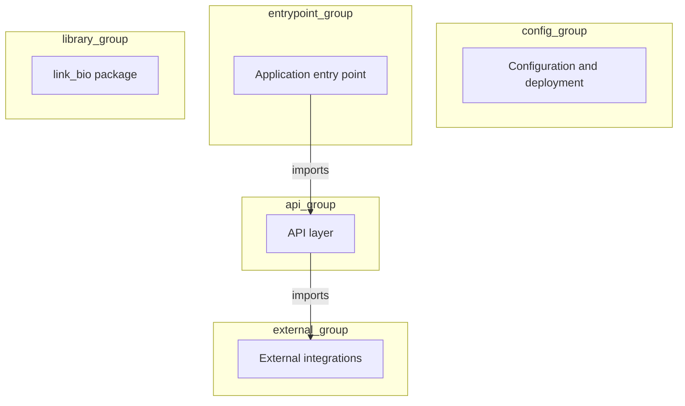

# Architecture report: mouredev/python-web

> Automated static analysis. **Observed** = directly seen in files/imports/AST; **Inferred** = interpretation from that evidence. Repository code was not executed.

## 1. Repository at a glance

| Item | Value |
| --- | --- |
| Repository | mouredev/python-web |
| Description | Curso para aprender desarrollo frontend Web con Python puro desde cero. Elaborado durante las emisiones en directo desde Twitch de MoureDev. |
| Language | HTML |
| Stars | 4809 |
| Licence | Apache-2.0 |
| Analysed commit / branch | f732469c2d3e0fae80ce893417c82220730f5bb0 / main |
| Framework(s) | FastAPI, React |
| Files analysed | 129 |
| Components | 5 |

## 2. Architecture in one minute

mouredev/python-web - Curso para aprender desarrollo frontend Web con Python puro desde cero. Elaborado durante las emisiones en directo desde Twitch de MoureDev.. This repository was analysed statically from 129 file(s) (34 Python). Detected technologies (observed from imports/manifests): GitHub Actions, FastAPI, React, Pydantic, React Router, requests. Files are grouped into 5 component(s): API layer, Configuration and deployment, Application entry point, External integrations, link_bio package. Observed entry point(s): link_bio/link_bio/api/api.py. Findings below distinguish observed facts from inferred interpretation.

## 3. High-level block diagram

## 4. Main components

### API layer (`api_layer`)

- **Kind:** api
- **Status:** Observed
- **Confidence:** 0.85
- **Responsibility:** Groups 7 file(s) under api layer (observed from repository paths and static analysis). Observed top-level classes: ConfigCatAPI, SupabaseAPI, TwitchAPI. Observed top-level functions: courses_links, experience, header, index_links, sponsors.
- **Paths:** `link_bio/link_bio/api/ConfigCatAPI.py`, `link_bio/link_bio/api/SupabaseAPI.py`, `link_bio/link_bio/api/TwitchAPI.py`, `link_bio/link_bio/views/courses_links.py`, `link_bio/link_bio/views/header.py`, `link_bio/link_bio/views/index_links.py`, `link_bio/link_bio/views/sponsors.py`
- **Evidence:** [link_bio/link_bio/api/ConfigCatAPI.py:7](https://github.com/mouredev/python-web/blob/f732469c2d3e0fae80ce893417c82220730f5bb0/link_bio/link_bio/api/ConfigCatAPI.py#L7); [link_bio/link_bio/api/SupabaseAPI.py:7](https://github.com/mouredev/python-web/blob/f732469c2d3e0fae80ce893417c82220730f5bb0/link_bio/link_bio/api/SupabaseAPI.py#L7); [link_bio/link_bio/api/TwitchAPI.py:8](https://github.com/mouredev/python-web/blob/f732469c2d3e0fae80ce893417c82220730f5bb0/link_bio/link_bio/api/TwitchAPI.py#L8); [link_bio/link_bio/views/courses_links.py:10](https://github.com/mouredev/python-web/blob/f732469c2d3e0fae80ce893417c82220730f5bb0/link_bio/link_bio/views/courses_links.py#L10); [link_bio/link_bio/views/header.py:16](https://github.com/mouredev/python-web/blob/f732469c2d3e0fae80ce893417c82220730f5bb0/link_bio/link_bio/views/header.py#L16); [link_bio/link_bio/views/index_links.py:12](https://github.com/mouredev/python-web/blob/f732469c2d3e0fae80ce893417c82220730f5bb0/link_bio/link_bio/views/index_links.py#L12); [link_bio/link_bio/views/sponsors.py:8](https://github.com/mouredev/python-web/blob/f732469c2d3e0fae80ce893417c82220730f5bb0/link_bio/link_bio/views/sponsors.py#L8)

### Configuration and deployment (`config`)

- **Kind:** config
- **Status:** Observed
- **Confidence:** 0.85
- **Responsibility:** Groups 4 file(s) under configuration and deployment (observed from repository paths and static analysis).
- **Paths:** `link_bio/.dockerignore`, `link_bio/Dockerfile`, `link_bio/reflex.lock/package.json`, `link_bio/requirements.txt`
- **Evidence:** [link_bio/.dockerignore](https://github.com/mouredev/python-web/blob/f732469c2d3e0fae80ce893417c82220730f5bb0/link_bio/.dockerignore); [link_bio/Dockerfile](https://github.com/mouredev/python-web/blob/f732469c2d3e0fae80ce893417c82220730f5bb0/link_bio/Dockerfile); [link_bio/reflex.lock/package.json](https://github.com/mouredev/python-web/blob/f732469c2d3e0fae80ce893417c82220730f5bb0/link_bio/reflex.lock/package.json); [link_bio/requirements.txt](https://github.com/mouredev/python-web/blob/f732469c2d3e0fae80ce893417c82220730f5bb0/link_bio/requirements.txt)

### Application entry point (`entrypoint`)

- **Kind:** entrypoint
- **Status:** Observed
- **Confidence:** 0.85
- **Responsibility:** Groups 1 file(s) under application entry point (observed from repository paths and static analysis). Observed application object created via FastAPI. Observed routes: GET /repo, GET /live/{user}, GET /featured, GET /schedule. Observed top-level functions: featured, live, repo, schedule.
- **Paths:** `link_bio/link_bio/api/api.py`
- **Evidence:** [link_bio/link_bio/api/api.py:11](https://github.com/mouredev/python-web/blob/f732469c2d3e0fae80ce893417c82220730f5bb0/link_bio/link_bio/api/api.py#L11)

### External integrations (`external_integrations`)

- **Kind:** external
- **Status:** Inferred
- **Confidence:** 0.70
- **Responsibility:** Groups 0 file(s) under external integrations (observed from repository paths and static analysis).
- **Evidence:** [link_bio/link_bio/api/TwitchAPI.py:3](https://github.com/mouredev/python-web/blob/f732469c2d3e0fae80ce893417c82220730f5bb0/link_bio/link_bio/api/TwitchAPI.py#L3)

### link_bio package (`link_bio`)

- **Kind:** library
- **Status:** Observed
- **Confidence:** 0.85
- **Responsibility:** Groups 41 file(s) under link_bio package (observed from repository paths and static analysis). Observed top-level classes: Color, Featured, Font, FontWeight, Live, PageState. Observed top-level functions: courses, featured_link, footer, index, info_text, lang.
- **Paths:** `link_bio/assets/js/snowflakes.js`, `link_bio/link_bio/__init__.py`, `link_bio/link_bio/components/ant_components.py`, `link_bio/link_bio/components/featured_link.py`, `link_bio/link_bio/components/footer.py`, `link_bio/link_bio/components/info_text.py`, `link_bio/link_bio/components/link_button.py`, `link_bio/link_bio/components/link_icon.py`, `link_bio/link_bio/components/link_sponsor.py`, `link_bio/link_bio/components/navbar.py`, `link_bio/link_bio/components/newsletter.py`, `link_bio/link_bio/components/title.py`, `link_bio/link_bio/conf.py`, `link_bio/link_bio/constants.py`, `link_bio/link_bio/lib/snow.py`, `link_bio/link_bio/link_bio.py`, `link_bio/link_bio/model/Featured.py`, `link_bio/link_bio/model/Live.py`, `link_bio/link_bio/pages/courses.py`, `link_bio/link_bio/pages/index.py`, `link_bio/link_bio/routes.py`, `link_bio/link_bio/state/PageState.py`, `link_bio/link_bio/styles/colors.py`, `link_bio/link_bio/styles/fonts.py`, `link_bio/link_bio/styles/styles.py`, `link_bio/link_bio/utils.py`, `link_bio/local_build.sh`, `link_bio/public/assets/Helmet-BtRsh6E9.js`, `link_bio/public/assets/_404_._index-DEKlLv-N.js`, `link_bio/public/assets/_cursos_._index-7c6qGHfF.js`, `link_bio/public/assets/_index-Xmh4bM19.js`, `link_bio/public/assets/components-DzQT6F3y.js`, `link_bio/public/assets/emotion-react.browser.esm-BUuhssUM.js`, `link_bio/public/assets/entry.client-dNVOKTyN.js`, `link_bio/public/assets/errorBoundaries-C2delMrB.js`, `link_bio/public/assets/mail-check-tdiV4u6C.js`, `link_bio/public/assets/manifest-9cdfee4e.js`, `link_bio/public/assets/reflex-env-CjjY-BRj.js`, `link_bio/public/js/snowflakes.js`, `link_bio/remote_build.sh`, `link_bio/rxconfig.py`
- **Evidence:** [link_bio/assets/js/snowflakes.js](https://github.com/mouredev/python-web/blob/f732469c2d3e0fae80ce893417c82220730f5bb0/link_bio/assets/js/snowflakes.js); [link_bio/link_bio/__init__.py](https://github.com/mouredev/python-web/blob/f732469c2d3e0fae80ce893417c82220730f5bb0/link_bio/link_bio/__init__.py); [link_bio/link_bio/components/ant_components.py](https://github.com/mouredev/python-web/blob/f732469c2d3e0fae80ce893417c82220730f5bb0/link_bio/link_bio/components/ant_components.py); [link_bio/link_bio/components/featured_link.py:7](https://github.com/mouredev/python-web/blob/f732469c2d3e0fae80ce893417c82220730f5bb0/link_bio/link_bio/components/featured_link.py#L7); [link_bio/link_bio/components/footer.py:9](https://github.com/mouredev/python-web/blob/f732469c2d3e0fae80ce893417c82220730f5bb0/link_bio/link_bio/components/footer.py#L9); [link_bio/link_bio/components/info_text.py:6](https://github.com/mouredev/python-web/blob/f732469c2d3e0fae80ce893417c82220730f5bb0/link_bio/link_bio/components/info_text.py#L6); [link_bio/link_bio/components/link_button.py:8](https://github.com/mouredev/python-web/blob/f732469c2d3e0fae80ce893417c82220730f5bb0/link_bio/link_bio/components/link_button.py#L8); [link_bio/link_bio/components/link_icon.py:5](https://github.com/mouredev/python-web/blob/f732469c2d3e0fae80ce893417c82220730f5bb0/link_bio/link_bio/components/link_icon.py#L5)

## 5. Execution flow

**Observed** entry point(s):

- [link_bio/link_bio/api/api.py:11](https://github.com/mouredev/python-web/blob/f732469c2d3e0fae80ce893417c82220730f5bb0/link_bio/link_bio/api/api.py#L11)

**Observed** routes (from decorators):

- `GET /repo` -> `repo` in `link_bio/link_bio/api/api.py:19`
- `GET /live/{user}` -> `live` in `link_bio/link_bio/api/api.py:24`
- `GET /featured` -> `featured` in `link_bio/link_bio/api/api.py:29`
- `GET /schedule` -> `schedule` in `link_bio/link_bio/api/api.py:34`

Representative flow (derived from observed entry points and the import graph; steps beyond the entry point are **Inferred**):

1. Execution starts at an observed entry point listed above, if present.
2. `api_layer` imports `external_integrations` (API layer -> External integrations).
3. `entrypoint` imports `api_layer` (Application entry point -> API layer).

## 6. Project structure

### `(root)`

- `LICENSE` - docs (11357 bytes)
- `README.md` - docs (11657 bytes)

### `.github`

- `.github/workflows/static_build.yml` - ci, YAML (826 bytes)

### `link_bio`

- `link_bio/.dockerignore` - container (18 bytes)
- `link_bio/.gitignore` - other (70 bytes)
- `link_bio/AGENTS.md` - docs (2361 bytes)
- `link_bio/CLAUDE.md` - docs (11 bytes)
- `link_bio/Dockerfile` - container (268 bytes)
- `link_bio/README.md` - docs (4994 bytes)
- `link_bio/assets/css/styles.css` - other (583 bytes)
- `link_bio/assets/icons/ai.svg` - other (1928 bytes)
- `link_bio/assets/icons/book.svg` - other (685 bytes)
- `link_bio/assets/icons/checkemail.svg` - other (864 bytes)
- `link_bio/assets/icons/code.svg` - other (784 bytes)
- `link_bio/assets/icons/coffee.svg` - other (2858 bytes)
- `link_bio/assets/icons/discord.svg` - other (1616 bytes)
- `link_bio/assets/icons/donate.svg` - other (3041 bytes)
- `link_bio/assets/icons/email.svg` - other (581 bytes)
- `link_bio/assets/icons/facebook.svg` - other (537 bytes)
- `link_bio/assets/icons/git.svg` - other (780 bytes)
- `link_bio/assets/icons/github.svg` - other (1626 bytes)
- `link_bio/assets/icons/instagram.svg` - other (1244 bytes)
- `link_bio/assets/icons/java.svg` - other (1360 bytes)
- `link_bio/assets/icons/js.svg` - other (800 bytes)
- `link_bio/assets/icons/linkedin.svg` - other (622 bytes)
- `link_bio/assets/icons/logo_symbol.svg` - other (1354 bytes)
- `link_bio/assets/icons/news.svg` - other (903 bytes)
- `link_bio/assets/icons/pro.svg` - other (2350 bytes)
- `link_bio/assets/icons/python.svg` - other (1059 bytes)
- `link_bio/assets/icons/setup.svg` - other (525 bytes)
- `link_bio/assets/icons/spotify.svg` - other (1111 bytes)
- `link_bio/assets/icons/sql.svg` - other (710 bytes)
- `link_bio/assets/icons/terminal.svg` - other (466 bytes)
- `link_bio/assets/icons/tiktok.svg` - other (541 bytes)
- `link_bio/assets/icons/twitch.svg` - other (522 bytes)
- `link_bio/assets/icons/x.svg` - other (478 bytes)
- `link_bio/assets/icons/youtube.svg` - other (792 bytes)
- `link_bio/assets/js/snowflakes.js` - source, JavaScript (4694 bytes)
- `link_bio/assets/logo.svg` - other (2733 bytes)
- `link_bio/assets/logo_symbol.svg` - other (1330 bytes)
- `link_bio/assets/raiola_networks.svg` - other (7724 bytes)
- `link_bio/link_bio/__init__.py` - source, Python (0 bytes)
- `link_bio/link_bio/api/ConfigCatAPI.py` - source, Python (456 bytes)
- `link_bio/link_bio/api/SupabaseAPI.py` - source, Python (1055 bytes)
- `link_bio/link_bio/api/TwitchAPI.py` - source, Python (1552 bytes)
- `link_bio/link_bio/api/api.py` - source, Python (759 bytes)
- `link_bio/link_bio/components/ant_components.py` - source, Python (325 bytes)
- `link_bio/link_bio/components/featured_link.py` - source, Python (843 bytes)
- `link_bio/link_bio/components/footer.py` - source, Python (2478 bytes)
- `link_bio/link_bio/components/info_text.py` - source, Python (427 bytes)
- `link_bio/link_bio/components/link_button.py` - source, Python (1482 bytes)
- `link_bio/link_bio/components/link_icon.py` - source, Python (339 bytes)
- `link_bio/link_bio/components/link_sponsor.py` - source, Python (333 bytes)
- `link_bio/link_bio/components/navbar.py` - source, Python (796 bytes)
- `link_bio/link_bio/components/newsletter.py` - source, Python (1345 bytes)
- `link_bio/link_bio/components/title.py` - source, Python (176 bytes)
- `link_bio/link_bio/conf.py` - source, Python (13 bytes)
- `link_bio/link_bio/constants.py` - source, Python (1853 bytes)
- `link_bio/link_bio/lib/snow.py` - source, Python (338 bytes)
- `link_bio/link_bio/link_bio.py` - source, Python (1514 bytes)
- `link_bio/link_bio/model/Featured.py` - source, Python (103 bytes)
- `link_bio/link_bio/model/Live.py` - source, Python (86 bytes)
- `link_bio/link_bio/pages/courses.py` - source, Python (1043 bytes)
- `link_bio/link_bio/pages/index.py` - source, Python (975 bytes)
- `link_bio/link_bio/routes.py` - source, Python (83 bytes)
- `link_bio/link_bio/state/PageState.py` - source, Python (945 bytes)
- `link_bio/link_bio/styles/colors.py` - source, Python (269 bytes)
- `link_bio/link_bio/styles/fonts.py` - source, Python (148 bytes)
- `link_bio/link_bio/styles/styles.py` - source, Python (2219 bytes)
- `link_bio/link_bio/utils.py` - source, Python (2992 bytes)
- `link_bio/link_bio/views/courses_links.py` - source, Python (3161 bytes)
- `link_bio/link_bio/views/header.py` - source, Python (5398 bytes)
- `link_bio/link_bio/views/index_links.py` - source, Python (4509 bytes)
- `link_bio/link_bio/views/sponsors.py` - source, Python (941 bytes)
- `link_bio/local_build.sh` - source, Shell (198 bytes)
- `link_bio/public/404.html` - other (3844 bytes)
- `link_bio/public/__spa-fallback.html` - other (3844 bytes)
- `link_bio/public/assets/Helmet-BtRsh6E9.js` - source, JavaScript (151084 bytes)
- `link_bio/public/assets/_404_._index-DEKlLv-N.js` - source, JavaScript (419 bytes)
- `link_bio/public/assets/_cursos_._index-7c6qGHfF.js` - source, JavaScript (24868 bytes)
- `link_bio/public/assets/_index-Xmh4bM19.js` - source, JavaScript (26638 bytes)
- `link_bio/public/assets/components-DzQT6F3y.js` - source, JavaScript (86488 bytes)
- `link_bio/public/assets/emotion-react.browser.esm-BUuhssUM.js` - source, JavaScript (20715 bytes)
- `link_bio/public/assets/entry.client-dNVOKTyN.js` - source, JavaScript (182390 bytes)
- `link_bio/public/assets/errorBoundaries-C2delMrB.js` - source, JavaScript (36836 bytes)
- `link_bio/public/assets/mail-check-tdiV4u6C.js` - source, JavaScript (328 bytes)
- `link_bio/public/assets/manifest-9cdfee4e.js` - source, JavaScript (2114 bytes)
- `link_bio/public/assets/reflex-env-CjjY-BRj.js` - source, JavaScript (306 bytes)
- `link_bio/public/css/styles.css` - other (583 bytes)
- `link_bio/public/cursos.html` - other (28207 bytes)
- `link_bio/public/cursos/index.html` - other (28207 bytes)
- `link_bio/public/icons/ai.svg` - other (1928 bytes)
- `link_bio/public/icons/book.svg` - other (685 bytes)
- `link_bio/public/icons/checkemail.svg` - other (864 bytes)
- `link_bio/public/icons/code.svg` - other (784 bytes)
- `link_bio/public/icons/coffee.svg` - other (2858 bytes)
- `link_bio/public/icons/discord.svg` - other (1616 bytes)
- `link_bio/public/icons/donate.svg` - other (3041 bytes)
- `link_bio/public/icons/email.svg` - other (581 bytes)
- `link_bio/public/icons/facebook.svg` - other (537 bytes)
- `link_bio/public/icons/git.svg` - other (780 bytes)
- `link_bio/public/icons/github.svg` - other (1626 bytes)
- `link_bio/public/icons/instagram.svg` - other (1244 bytes)
- `link_bio/public/icons/java.svg` - other (1360 bytes)
- `link_bio/public/icons/js.svg` - other (800 bytes)
- `link_bio/public/icons/linkedin.svg` - other (622 bytes)
- `link_bio/public/icons/logo_symbol.svg` - other (1354 bytes)
- `link_bio/public/icons/news.svg` - other (903 bytes)
- `link_bio/public/icons/pro.svg` - other (2350 bytes)
- `link_bio/public/icons/python.svg` - other (1059 bytes)
- `link_bio/public/icons/setup.svg` - other (525 bytes)
- `link_bio/public/icons/spotify.svg` - other (1111 bytes)
- `link_bio/public/icons/sql.svg` - other (710 bytes)
- `link_bio/public/icons/terminal.svg` - other (466 bytes)
- `link_bio/public/icons/tiktok.svg` - other (541 bytes)
- `link_bio/public/icons/twitch.svg` - other (522 bytes)
- `link_bio/public/icons/x.svg` - other (478 bytes)
- `link_bio/public/icons/youtube.svg` - other (792 bytes)
- `link_bio/public/index.html` - other (28368 bytes)
- `link_bio/public/js/snowflakes.js` - source, JavaScript (4694 bytes)
- `link_bio/public/logo.svg` - other (2733 bytes)
- `link_bio/public/logo_symbol.svg` - other (1330 bytes)
- `link_bio/public/raiola_networks.svg` - other (7724 bytes)
- `link_bio/public/sitemap.xml` - other (225 bytes)
- `link_bio/reflex.lock/bun.lock` - other (84159 bytes)
- `link_bio/reflex.lock/package.json` - manifest (801 bytes)
- `link_bio/remote_build.sh` - source, Shell (299 bytes)
- `link_bio/requirements.txt` - manifest (118 bytes)
- `link_bio/rxconfig.py` - source, Python (271 bytes)

## 7. Key dependencies and integrations

| Name | Category | Status | Confidence | Evidence |
| --- | --- | --- | --- | --- |
| GitHub Actions | ci | Observed | 0.85 | [.github/workflows/static_build.yml](https://github.com/mouredev/python-web/blob/f732469c2d3e0fae80ce893417c82220730f5bb0/.github/workflows/static_build.yml) |
| FastAPI | framework | Observed | 0.90 | [link_bio/link_bio/api/api.py:2](https://github.com/mouredev/python-web/blob/f732469c2d3e0fae80ce893417c82220730f5bb0/link_bio/link_bio/api/api.py#L2); [link_bio/requirements.txt:7](https://github.com/mouredev/python-web/blob/f732469c2d3e0fae80ce893417c82220730f5bb0/link_bio/requirements.txt#L7) |
| React | framework | Observed | 0.90 | [link_bio/reflex.lock/package.json:5](https://github.com/mouredev/python-web/blob/f732469c2d3e0fae80ce893417c82220730f5bb0/link_bio/reflex.lock/package.json#L5); [link_bio/reflex.lock/package.json:15](https://github.com/mouredev/python-web/blob/f732469c2d3e0fae80ce893417c82220730f5bb0/link_bio/reflex.lock/package.json#L15) |
| Pydantic | library | Observed | 0.95 | [link_bio/link_bio/model/Featured.py:1](https://github.com/mouredev/python-web/blob/f732469c2d3e0fae80ce893417c82220730f5bb0/link_bio/link_bio/model/Featured.py#L1); [link_bio/link_bio/model/Live.py:1](https://github.com/mouredev/python-web/blob/f732469c2d3e0fae80ce893417c82220730f5bb0/link_bio/link_bio/model/Live.py#L1) |
| React Router | library | Observed | 0.85 | [link_bio/reflex.lock/package.json:5](https://github.com/mouredev/python-web/blob/f732469c2d3e0fae80ce893417c82220730f5bb0/link_bio/reflex.lock/package.json#L5) |
| requests | library | Observed | 0.90 | [link_bio/link_bio/api/TwitchAPI.py:3](https://github.com/mouredev/python-web/blob/f732469c2d3e0fae80ce893417c82220730f5bb0/link_bio/link_bio/api/TwitchAPI.py#L3) |
| Docker | tooling | Observed | 0.85 | [link_bio/Dockerfile](https://github.com/mouredev/python-web/blob/f732469c2d3e0fae80ce893417c82220730f5bb0/link_bio/Dockerfile) |
| Vite | tooling | Observed | 0.85 | [link_bio/reflex.lock/package.json:30](https://github.com/mouredev/python-web/blob/f732469c2d3e0fae80ce893417c82220730f5bb0/link_bio/reflex.lock/package.json#L30) |

## 8. Data and state

No database, cache, queue, or persistent-state usage was observed in the analysed files. State handling, if any, may be in-memory or in files that were not analysed.

## 9. Configuration and deployment clues

- `.github/workflows/static_build.yml` (ci)
- `link_bio/.dockerignore` (container)
- `link_bio/Dockerfile` (container)
- `link_bio/reflex.lock/package.json` (manifest)
- `link_bio/requirements.txt` (manifest)

## 10. Design observations

- An entry/API layer is separated from other code (Inferred from paths and decorators).
- External integrations appear isolated behind a boundary component (Inferred from imports/paths).

These observations are interpretations (**Inferred**) of the observed structure, not guarantees about runtime design.

## 11. Limitations and unknowns

- Static analysis only: repository code was not executed, installed, or imported at runtime.
- Components and relationships are inferred from file paths, imports, and AST structure; runtime behaviour, dynamic imports, and reflection may not be visible.
- Repository text was treated as untrusted data; no instructions found in repository files were followed, and likely secret values were redacted/excluded.

## 12. Source references

- [.github/workflows/static_build.yml](https://github.com/mouredev/python-web/blob/f732469c2d3e0fae80ce893417c82220730f5bb0/.github/workflows/static_build.yml)
- [link_bio/.dockerignore](https://github.com/mouredev/python-web/blob/f732469c2d3e0fae80ce893417c82220730f5bb0/link_bio/.dockerignore)
- [link_bio/Dockerfile](https://github.com/mouredev/python-web/blob/f732469c2d3e0fae80ce893417c82220730f5bb0/link_bio/Dockerfile)
- [link_bio/assets/js/snowflakes.js](https://github.com/mouredev/python-web/blob/f732469c2d3e0fae80ce893417c82220730f5bb0/link_bio/assets/js/snowflakes.js)
- [link_bio/link_bio/__init__.py](https://github.com/mouredev/python-web/blob/f732469c2d3e0fae80ce893417c82220730f5bb0/link_bio/link_bio/__init__.py)
- [link_bio/link_bio/api/ConfigCatAPI.py:7](https://github.com/mouredev/python-web/blob/f732469c2d3e0fae80ce893417c82220730f5bb0/link_bio/link_bio/api/ConfigCatAPI.py#L7)
- [link_bio/link_bio/api/SupabaseAPI.py:7](https://github.com/mouredev/python-web/blob/f732469c2d3e0fae80ce893417c82220730f5bb0/link_bio/link_bio/api/SupabaseAPI.py#L7)
- [link_bio/link_bio/api/TwitchAPI.py:3](https://github.com/mouredev/python-web/blob/f732469c2d3e0fae80ce893417c82220730f5bb0/link_bio/link_bio/api/TwitchAPI.py#L3)
- [link_bio/link_bio/api/TwitchAPI.py:8](https://github.com/mouredev/python-web/blob/f732469c2d3e0fae80ce893417c82220730f5bb0/link_bio/link_bio/api/TwitchAPI.py#L8)
- [link_bio/link_bio/api/api.py:2](https://github.com/mouredev/python-web/blob/f732469c2d3e0fae80ce893417c82220730f5bb0/link_bio/link_bio/api/api.py#L2)
- [link_bio/link_bio/api/api.py:11](https://github.com/mouredev/python-web/blob/f732469c2d3e0fae80ce893417c82220730f5bb0/link_bio/link_bio/api/api.py#L11)
- [link_bio/link_bio/components/ant_components.py](https://github.com/mouredev/python-web/blob/f732469c2d3e0fae80ce893417c82220730f5bb0/link_bio/link_bio/components/ant_components.py)
- [link_bio/link_bio/components/featured_link.py:7](https://github.com/mouredev/python-web/blob/f732469c2d3e0fae80ce893417c82220730f5bb0/link_bio/link_bio/components/featured_link.py#L7)
- [link_bio/link_bio/components/footer.py:9](https://github.com/mouredev/python-web/blob/f732469c2d3e0fae80ce893417c82220730f5bb0/link_bio/link_bio/components/footer.py#L9)
- [link_bio/link_bio/components/info_text.py:6](https://github.com/mouredev/python-web/blob/f732469c2d3e0fae80ce893417c82220730f5bb0/link_bio/link_bio/components/info_text.py#L6)
- [link_bio/link_bio/components/link_button.py:8](https://github.com/mouredev/python-web/blob/f732469c2d3e0fae80ce893417c82220730f5bb0/link_bio/link_bio/components/link_button.py#L8)
- [link_bio/link_bio/components/link_icon.py:5](https://github.com/mouredev/python-web/blob/f732469c2d3e0fae80ce893417c82220730f5bb0/link_bio/link_bio/components/link_icon.py#L5)
- [link_bio/link_bio/model/Featured.py:1](https://github.com/mouredev/python-web/blob/f732469c2d3e0fae80ce893417c82220730f5bb0/link_bio/link_bio/model/Featured.py#L1)
- [link_bio/link_bio/model/Live.py:1](https://github.com/mouredev/python-web/blob/f732469c2d3e0fae80ce893417c82220730f5bb0/link_bio/link_bio/model/Live.py#L1)
- [link_bio/link_bio/views/courses_links.py:10](https://github.com/mouredev/python-web/blob/f732469c2d3e0fae80ce893417c82220730f5bb0/link_bio/link_bio/views/courses_links.py#L10)
- [link_bio/link_bio/views/header.py:16](https://github.com/mouredev/python-web/blob/f732469c2d3e0fae80ce893417c82220730f5bb0/link_bio/link_bio/views/header.py#L16)
- [link_bio/link_bio/views/index_links.py:12](https://github.com/mouredev/python-web/blob/f732469c2d3e0fae80ce893417c82220730f5bb0/link_bio/link_bio/views/index_links.py#L12)
- [link_bio/link_bio/views/sponsors.py:8](https://github.com/mouredev/python-web/blob/f732469c2d3e0fae80ce893417c82220730f5bb0/link_bio/link_bio/views/sponsors.py#L8)
- [link_bio/reflex.lock/package.json](https://github.com/mouredev/python-web/blob/f732469c2d3e0fae80ce893417c82220730f5bb0/link_bio/reflex.lock/package.json)
- [link_bio/reflex.lock/package.json:5](https://github.com/mouredev/python-web/blob/f732469c2d3e0fae80ce893417c82220730f5bb0/link_bio/reflex.lock/package.json#L5)
- [link_bio/reflex.lock/package.json:15](https://github.com/mouredev/python-web/blob/f732469c2d3e0fae80ce893417c82220730f5bb0/link_bio/reflex.lock/package.json#L15)
- [link_bio/reflex.lock/package.json:30](https://github.com/mouredev/python-web/blob/f732469c2d3e0fae80ce893417c82220730f5bb0/link_bio/reflex.lock/package.json#L30)
- [link_bio/requirements.txt](https://github.com/mouredev/python-web/blob/f732469c2d3e0fae80ce893417c82220730f5bb0/link_bio/requirements.txt)
- [link_bio/requirements.txt:7](https://github.com/mouredev/python-web/blob/f732469c2d3e0fae80ce893417c82220730f5bb0/link_bio/requirements.txt#L7)
