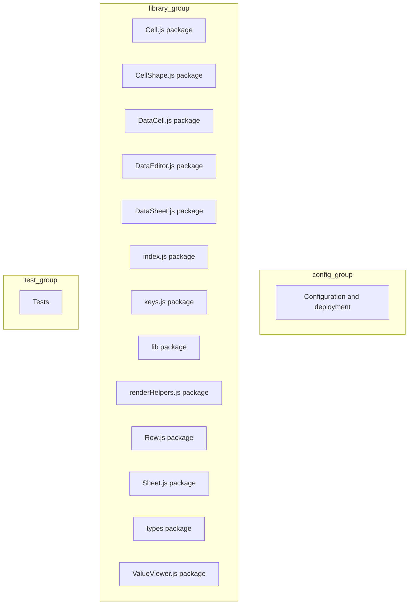

# Architecture report: nadbm/react-datasheet

> Automated static analysis. **Observed** = directly seen in files/imports/AST; **Inferred** = interpretation from that evidence. Repository code was not executed.

## 1. Repository at a glance

| Item | Value |
| --- | --- |
| Repository | nadbm/react-datasheet |
| Description | Excel-like data grid (table) component for React |
| Language | JavaScript |
| Stars | 5440 |
| Licence | MIT |
| Analysed commit / branch | 13b5c35f28b4bab2547402b2c406986ef1913245 / master |
| Framework(s) | React |
| Files analysed | 53 |
| Components | 15 |

## 2. Architecture in one minute

nadbm/react-datasheet - Excel-like data grid (table) component for React. This repository was analysed statically from 53 file(s) (0 Python). Detected technologies (observed from imports/manifests): React. Files are grouped into 15 component(s): Cell.js package, CellShape.js package, Configuration and deployment, DataCell.js package, DataEditor.js package, DataSheet.js package, index.js package, keys.js package. Findings below distinguish observed facts from inferred interpretation.

## 3. High-level block diagram

## 4. Main components

### Cell.js package (`cell_js`)

- **Kind:** library
- **Status:** Observed
- **Confidence:** 0.85
- **Responsibility:** Groups 1 file(s) under cell.js package (observed from repository paths and static analysis).
- **Paths:** `src/Cell.js`
- **Evidence:** [src/Cell.js](https://github.com/nadbm/react-datasheet/blob/13b5c35f28b4bab2547402b2c406986ef1913245/src/Cell.js)

### CellShape.js package (`cellshape_js`)

- **Kind:** library
- **Status:** Observed
- **Confidence:** 0.85
- **Responsibility:** Groups 1 file(s) under cellshape.js package (observed from repository paths and static analysis).
- **Paths:** `src/CellShape.js`
- **Evidence:** [src/CellShape.js](https://github.com/nadbm/react-datasheet/blob/13b5c35f28b4bab2547402b2c406986ef1913245/src/CellShape.js)

### Configuration and deployment (`config`)

- **Kind:** config
- **Status:** Observed
- **Confidence:** 0.85
- **Responsibility:** Groups 2 file(s) under configuration and deployment (observed from repository paths and static analysis).
- **Paths:** `package.json`, `params.json`
- **Evidence:** [package.json](https://github.com/nadbm/react-datasheet/blob/13b5c35f28b4bab2547402b2c406986ef1913245/package.json); [params.json](https://github.com/nadbm/react-datasheet/blob/13b5c35f28b4bab2547402b2c406986ef1913245/params.json)

### DataCell.js package (`datacell_js`)

- **Kind:** library
- **Status:** Observed
- **Confidence:** 0.85
- **Responsibility:** Groups 1 file(s) under datacell.js package (observed from repository paths and static analysis).
- **Paths:** `src/DataCell.js`
- **Evidence:** [src/DataCell.js](https://github.com/nadbm/react-datasheet/blob/13b5c35f28b4bab2547402b2c406986ef1913245/src/DataCell.js)

### DataEditor.js package (`dataeditor_js`)

- **Kind:** library
- **Status:** Observed
- **Confidence:** 0.85
- **Responsibility:** Groups 1 file(s) under dataeditor.js package (observed from repository paths and static analysis).
- **Paths:** `src/DataEditor.js`
- **Evidence:** [src/DataEditor.js](https://github.com/nadbm/react-datasheet/blob/13b5c35f28b4bab2547402b2c406986ef1913245/src/DataEditor.js)

### DataSheet.js package (`datasheet_js`)

- **Kind:** library
- **Status:** Observed
- **Confidence:** 0.85
- **Responsibility:** Groups 1 file(s) under datasheet.js package (observed from repository paths and static analysis).
- **Paths:** `src/DataSheet.js`
- **Evidence:** [src/DataSheet.js](https://github.com/nadbm/react-datasheet/blob/13b5c35f28b4bab2547402b2c406986ef1913245/src/DataSheet.js)

### index.js package (`index_js`)

- **Kind:** library
- **Status:** Observed
- **Confidence:** 0.85
- **Responsibility:** Groups 1 file(s) under index.js package (observed from repository paths and static analysis).
- **Paths:** `src/index.js`
- **Evidence:** [src/index.js](https://github.com/nadbm/react-datasheet/blob/13b5c35f28b4bab2547402b2c406986ef1913245/src/index.js)

### keys.js package (`keys_js`)

- **Kind:** library
- **Status:** Observed
- **Confidence:** 0.85
- **Responsibility:** Groups 1 file(s) under keys.js package (observed from repository paths and static analysis).
- **Paths:** `src/keys.js`
- **Evidence:** [src/keys.js](https://github.com/nadbm/react-datasheet/blob/13b5c35f28b4bab2547402b2c406986ef1913245/src/keys.js)

### lib package (`lib`)

- **Kind:** library
- **Status:** Observed
- **Confidence:** 0.85
- **Responsibility:** Groups 11 file(s) under lib package (observed from repository paths and static analysis).
- **Paths:** `lib/Cell.js`, `lib/CellShape.js`, `lib/DataCell.js`, `lib/DataEditor.js`, `lib/DataSheet.js`, `lib/Row.js`, `lib/Sheet.js`, `lib/ValueViewer.js`, `lib/index.js`, `lib/keys.js`, `lib/renderHelpers.js`
- **Evidence:** [lib/Cell.js](https://github.com/nadbm/react-datasheet/blob/13b5c35f28b4bab2547402b2c406986ef1913245/lib/Cell.js); [lib/CellShape.js](https://github.com/nadbm/react-datasheet/blob/13b5c35f28b4bab2547402b2c406986ef1913245/lib/CellShape.js); [lib/DataCell.js](https://github.com/nadbm/react-datasheet/blob/13b5c35f28b4bab2547402b2c406986ef1913245/lib/DataCell.js); [lib/DataEditor.js](https://github.com/nadbm/react-datasheet/blob/13b5c35f28b4bab2547402b2c406986ef1913245/lib/DataEditor.js); [lib/DataSheet.js](https://github.com/nadbm/react-datasheet/blob/13b5c35f28b4bab2547402b2c406986ef1913245/lib/DataSheet.js); [lib/Row.js](https://github.com/nadbm/react-datasheet/blob/13b5c35f28b4bab2547402b2c406986ef1913245/lib/Row.js); [lib/Sheet.js](https://github.com/nadbm/react-datasheet/blob/13b5c35f28b4bab2547402b2c406986ef1913245/lib/Sheet.js); [lib/ValueViewer.js](https://github.com/nadbm/react-datasheet/blob/13b5c35f28b4bab2547402b2c406986ef1913245/lib/ValueViewer.js)

### renderHelpers.js package (`renderhelpers_js`)

- **Kind:** library
- **Status:** Observed
- **Confidence:** 0.85
- **Responsibility:** Groups 1 file(s) under renderhelpers.js package (observed from repository paths and static analysis).
- **Paths:** `src/renderHelpers.js`
- **Evidence:** [src/renderHelpers.js](https://github.com/nadbm/react-datasheet/blob/13b5c35f28b4bab2547402b2c406986ef1913245/src/renderHelpers.js)

### Row.js package (`row_js`)

- **Kind:** library
- **Status:** Observed
- **Confidence:** 0.85
- **Responsibility:** Groups 1 file(s) under row.js package (observed from repository paths and static analysis).
- **Paths:** `src/Row.js`
- **Evidence:** [src/Row.js](https://github.com/nadbm/react-datasheet/blob/13b5c35f28b4bab2547402b2c406986ef1913245/src/Row.js)

### Sheet.js package (`sheet_js`)

- **Kind:** library
- **Status:** Observed
- **Confidence:** 0.85
- **Responsibility:** Groups 1 file(s) under sheet.js package (observed from repository paths and static analysis).
- **Paths:** `src/Sheet.js`
- **Evidence:** [src/Sheet.js](https://github.com/nadbm/react-datasheet/blob/13b5c35f28b4bab2547402b2c406986ef1913245/src/Sheet.js)

### Tests (`tests`)

- **Kind:** test
- **Status:** Observed
- **Confidence:** 0.85
- **Responsibility:** Groups 1 file(s) under tests (observed from repository paths and static analysis).
- **Paths:** `test/Datasheet.js`
- **Evidence:** [test/Datasheet.js](https://github.com/nadbm/react-datasheet/blob/13b5c35f28b4bab2547402b2c406986ef1913245/test/Datasheet.js)

### types package (`types`)

- **Kind:** library
- **Status:** Observed
- **Confidence:** 0.85
- **Responsibility:** Groups 1 file(s) under types package (observed from repository paths and static analysis).
- **Paths:** `types/react-datasheet.d.ts`
- **Evidence:** [types/react-datasheet.d.ts](https://github.com/nadbm/react-datasheet/blob/13b5c35f28b4bab2547402b2c406986ef1913245/types/react-datasheet.d.ts)

### ValueViewer.js package (`valueviewer_js`)

- **Kind:** library
- **Status:** Observed
- **Confidence:** 0.85
- **Responsibility:** Groups 1 file(s) under valueviewer.js package (observed from repository paths and static analysis).
- **Paths:** `src/ValueViewer.js`
- **Evidence:** [src/ValueViewer.js](https://github.com/nadbm/react-datasheet/blob/13b5c35f28b4bab2547402b2c406986ef1913245/src/ValueViewer.js)

## 5. Execution flow

**Observed** entry point(s):

- [lib/index.js](https://github.com/nadbm/react-datasheet/blob/13b5c35f28b4bab2547402b2c406986ef1913245/lib/index.js)
- [src/index.js](https://github.com/nadbm/react-datasheet/blob/13b5c35f28b4bab2547402b2c406986ef1913245/src/index.js)

Representative flow (derived from observed entry points and the import graph; steps beyond the entry point are **Inferred**):

1. Execution starts at an observed entry point listed above, if present.
2. No internal import relationships between components were observed.

## 6. Project structure

### `(root)`

- `.babelrc` - other (49 bytes)
- `.codeclimate.yml` - config (267 bytes)
- `.csslintrc` - other (107 bytes)
- `.gitignore` - other (87 bytes)
- `.npmignore` - other (85 bytes)
- `.prettierrc` - other (123 bytes)
- `.travis.yml` - ci, YAML (72 bytes)
- `LICENSE` - docs (1077 bytes)
- `README.md` - docs (31427 bytes)
- `USAGE_TYPESCRIPT.md` - docs (2119 bytes)
- `package.json` - manifest (2374 bytes)
- `params.json` - config (2010 bytes)

### `docs`

- `docs/.gitignore` - docs (218 bytes)
- `docs/package.json` - manifest (895 bytes)
- `docs/public/index.html` - docs (1380 bytes)
- `docs/src/app.js` - docs (4894 bytes)
- `docs/src/examples/BasicSheet.js` - docs (1668 bytes)
- `docs/src/examples/ComponentSheet.js` - docs (2285 bytes)
- `docs/src/examples/CustomRendererSheet.js` - docs (7545 bytes)
- `docs/src/examples/MathSheet.js` - docs (3239 bytes)
- `docs/src/examples/MathSheetFC.js` - docs (4203 bytes)
- `docs/src/examples/OverrideEverythingSheet.js` - docs (7572 bytes)
- `docs/src/examples/drag-drop.js` - docs (2412 bytes)
- `docs/src/examples/index.js` - docs (334 bytes)
- `docs/src/examples/override-everything.css` - docs (844 bytes)
- `docs/src/index.css` - docs (3132 bytes)
- `docs/src/index.js` - docs (174 bytes)

### `lib`

- `lib/Cell.js` - source, JavaScript (4363 bytes)
- `lib/CellShape.js` - source, JavaScript (2153 bytes)
- `lib/DataCell.js` - source, JavaScript (12630 bytes)
- `lib/DataEditor.js` - source, JavaScript (3493 bytes)
- `lib/DataSheet.js` - source, JavaScript (34203 bytes)
- `lib/Row.js` - source, JavaScript (2576 bytes)
- `lib/Sheet.js` - source, JavaScript (2563 bytes)
- `lib/ValueViewer.js` - source, JavaScript (2758 bytes)
- `lib/index.js` - source, JavaScript (1221 bytes)
- `lib/keys.js` - source, JavaScript (435 bytes)
- `lib/react-datasheet.css` - other (2350 bytes)
- `lib/renderHelpers.js` - source, JavaScript (564 bytes)

### `src`

- `src/Cell.js` - source, JavaScript (1521 bytes)
- `src/CellShape.js` - source, JavaScript (1746 bytes)
- `src/DataCell.js` - source, JavaScript (7047 bytes)
- `src/DataEditor.js` - source, JavaScript (1020 bytes)
- `src/DataSheet.js` - source, JavaScript (22968 bytes)
- `src/Row.js` - source, JavaScript (363 bytes)
- `src/Sheet.js` - source, JavaScript (379 bytes)
- `src/ValueViewer.js` - source, JavaScript (463 bytes)
- `src/index.js` - source, JavaScript (364 bytes)
- `src/keys.js` - source, JavaScript (258 bytes)
- `src/react-datasheet.css` - other (2350 bytes)
- `src/renderHelpers.js` - source, JavaScript (443 bytes)

### `test`

- `test/Datasheet.js` - test, JavaScript (83271 bytes)

### `types`

- `types/react-datasheet.d.ts` - source, TypeScript (17839 bytes)

## 7. Key dependencies and integrations

| Name | Category | Status | Confidence | Evidence |
| --- | --- | --- | --- | --- |
| React | framework | Observed | 0.90 | [docs/package.json:2](https://github.com/nadbm/react-datasheet/blob/13b5c35f28b4bab2547402b2c406986ef1913245/docs/package.json#L2); [docs/package.json:15](https://github.com/nadbm/react-datasheet/blob/13b5c35f28b4bab2547402b2c406986ef1913245/docs/package.json#L15); [package.json:2](https://github.com/nadbm/react-datasheet/blob/13b5c35f28b4bab2547402b2c406986ef1913245/package.json#L2); [package.json:62](https://github.com/nadbm/react-datasheet/blob/13b5c35f28b4bab2547402b2c406986ef1913245/package.json#L62) |

## 8. Data and state

No database, cache, queue, or persistent-state usage was observed in the analysed files. State handling, if any, may be in-memory or in files that were not analysed.

## 9. Configuration and deployment clues

- `.codeclimate.yml` (config)
- `.travis.yml` (ci)
- `docs/package.json` (manifest)
- `package.json` (manifest)
- `params.json` (config)

## 10. Design observations

- Tests are present alongside source code (Observed from test file paths).

These observations are interpretations (**Inferred**) of the observed structure, not guarantees about runtime design.

## 11. Limitations and unknowns

- Static analysis only: repository code was not executed, installed, or imported at runtime.
- Components and relationships are inferred from file paths, imports, and AST structure; runtime behaviour, dynamic imports, and reflection may not be visible.
- 2 file(s) were skipped during inventory (2 x vendored/generated directory excluded).
- No clear application entry point was observed in the analysed files.
- Repository text was treated as untrusted data; no instructions found in repository files were followed, and likely secret values were redacted/excluded.
- JavaScript and TypeScript files were inventoried from paths and package manifests. They were not parsed with a full language AST, and repository code was not executed.

## 12. Source references

- [docs/package.json:2](https://github.com/nadbm/react-datasheet/blob/13b5c35f28b4bab2547402b2c406986ef1913245/docs/package.json#L2)
- [docs/package.json:15](https://github.com/nadbm/react-datasheet/blob/13b5c35f28b4bab2547402b2c406986ef1913245/docs/package.json#L15)
- [lib/Cell.js](https://github.com/nadbm/react-datasheet/blob/13b5c35f28b4bab2547402b2c406986ef1913245/lib/Cell.js)
- [lib/CellShape.js](https://github.com/nadbm/react-datasheet/blob/13b5c35f28b4bab2547402b2c406986ef1913245/lib/CellShape.js)
- [lib/DataCell.js](https://github.com/nadbm/react-datasheet/blob/13b5c35f28b4bab2547402b2c406986ef1913245/lib/DataCell.js)
- [lib/DataEditor.js](https://github.com/nadbm/react-datasheet/blob/13b5c35f28b4bab2547402b2c406986ef1913245/lib/DataEditor.js)
- [lib/DataSheet.js](https://github.com/nadbm/react-datasheet/blob/13b5c35f28b4bab2547402b2c406986ef1913245/lib/DataSheet.js)
- [lib/Row.js](https://github.com/nadbm/react-datasheet/blob/13b5c35f28b4bab2547402b2c406986ef1913245/lib/Row.js)
- [lib/Sheet.js](https://github.com/nadbm/react-datasheet/blob/13b5c35f28b4bab2547402b2c406986ef1913245/lib/Sheet.js)
- [lib/ValueViewer.js](https://github.com/nadbm/react-datasheet/blob/13b5c35f28b4bab2547402b2c406986ef1913245/lib/ValueViewer.js)
- [lib/index.js](https://github.com/nadbm/react-datasheet/blob/13b5c35f28b4bab2547402b2c406986ef1913245/lib/index.js)
- [package.json](https://github.com/nadbm/react-datasheet/blob/13b5c35f28b4bab2547402b2c406986ef1913245/package.json)
- [package.json:2](https://github.com/nadbm/react-datasheet/blob/13b5c35f28b4bab2547402b2c406986ef1913245/package.json#L2)
- [package.json:62](https://github.com/nadbm/react-datasheet/blob/13b5c35f28b4bab2547402b2c406986ef1913245/package.json#L62)
- [params.json](https://github.com/nadbm/react-datasheet/blob/13b5c35f28b4bab2547402b2c406986ef1913245/params.json)
- [src/Cell.js](https://github.com/nadbm/react-datasheet/blob/13b5c35f28b4bab2547402b2c406986ef1913245/src/Cell.js)
- [src/CellShape.js](https://github.com/nadbm/react-datasheet/blob/13b5c35f28b4bab2547402b2c406986ef1913245/src/CellShape.js)
- [src/DataCell.js](https://github.com/nadbm/react-datasheet/blob/13b5c35f28b4bab2547402b2c406986ef1913245/src/DataCell.js)
- [src/DataEditor.js](https://github.com/nadbm/react-datasheet/blob/13b5c35f28b4bab2547402b2c406986ef1913245/src/DataEditor.js)
- [src/DataSheet.js](https://github.com/nadbm/react-datasheet/blob/13b5c35f28b4bab2547402b2c406986ef1913245/src/DataSheet.js)
- [src/Row.js](https://github.com/nadbm/react-datasheet/blob/13b5c35f28b4bab2547402b2c406986ef1913245/src/Row.js)
- [src/Sheet.js](https://github.com/nadbm/react-datasheet/blob/13b5c35f28b4bab2547402b2c406986ef1913245/src/Sheet.js)
- [src/ValueViewer.js](https://github.com/nadbm/react-datasheet/blob/13b5c35f28b4bab2547402b2c406986ef1913245/src/ValueViewer.js)
- [src/index.js](https://github.com/nadbm/react-datasheet/blob/13b5c35f28b4bab2547402b2c406986ef1913245/src/index.js)
- [src/keys.js](https://github.com/nadbm/react-datasheet/blob/13b5c35f28b4bab2547402b2c406986ef1913245/src/keys.js)
- [src/renderHelpers.js](https://github.com/nadbm/react-datasheet/blob/13b5c35f28b4bab2547402b2c406986ef1913245/src/renderHelpers.js)
- [test/Datasheet.js](https://github.com/nadbm/react-datasheet/blob/13b5c35f28b4bab2547402b2c406986ef1913245/test/Datasheet.js)
- [types/react-datasheet.d.ts](https://github.com/nadbm/react-datasheet/blob/13b5c35f28b4bab2547402b2c406986ef1913245/types/react-datasheet.d.ts)
