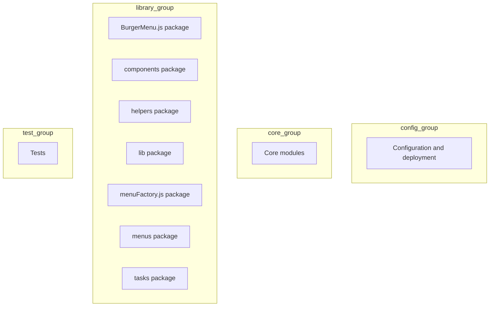

# Architecture report: negomi/react-burger-menu

> Automated static analysis. **Observed** = directly seen in files/imports/AST; **Inferred** = interpretation from that evidence. Repository code was not executed.

## 1. Repository at a glance

| Item | Value |
| --- | --- |
| Repository | negomi/react-burger-menu |
| Description | :hamburger: An off-canvas sidebar component with a collection of effects and styles using CSS transitions and SVG path animations |
| Language | JavaScript |
| Stars | 5082 |
| Licence | MIT |
| Analysed commit / branch | a3df3e6d7b6718faf215a6d15f7cf1f8ebf77acb / main |
| Framework(s) | React |
| Files analysed | 73 |
| Components | 10 |

## 2. Architecture in one minute

negomi/react-burger-menu - :hamburger: An off-canvas sidebar component with a collection of effects and styles using CSS transitions and SVG path animations. This repository was analysed statically from 73 file(s) (0 Python). Detected technologies (observed from imports/manifests): React. Files are grouped into 10 component(s): BurgerMenu.js package, components package, Configuration and deployment, Core modules, helpers package, lib package, menuFactory.js package, menus package. Findings below distinguish observed facts from inferred interpretation.

## 3. High-level block diagram

## 4. Main components

### BurgerMenu.js package (`burgermenu_js`)

- **Kind:** library
- **Status:** Observed
- **Confidence:** 0.85
- **Responsibility:** Groups 1 file(s) under burgermenu.js package (observed from repository paths and static analysis).
- **Paths:** `src/BurgerMenu.js`
- **Evidence:** [src/BurgerMenu.js](https://github.com/negomi/react-burger-menu/blob/a3df3e6d7b6718faf215a6d15f7cf1f8ebf77acb/src/BurgerMenu.js)

### components package (`components`)

- **Kind:** library
- **Status:** Observed
- **Confidence:** 0.85
- **Responsibility:** Groups 2 file(s) under components package (observed from repository paths and static analysis).
- **Paths:** `src/components/BurgerIcon.js`, `src/components/CrossIcon.js`
- **Evidence:** [src/components/BurgerIcon.js](https://github.com/negomi/react-burger-menu/blob/a3df3e6d7b6718faf215a6d15f7cf1f8ebf77acb/src/components/BurgerIcon.js); [src/components/CrossIcon.js](https://github.com/negomi/react-burger-menu/blob/a3df3e6d7b6718faf215a6d15f7cf1f8ebf77acb/src/components/CrossIcon.js)

### Configuration and deployment (`config`)

- **Kind:** config
- **Status:** Observed
- **Confidence:** 0.85
- **Responsibility:** Groups 2 file(s) under configuration and deployment (observed from repository paths and static analysis).
- **Paths:** `bower.json`, `package.json`
- **Evidence:** [bower.json](https://github.com/negomi/react-burger-menu/blob/a3df3e6d7b6718faf215a6d15f7cf1f8ebf77acb/bower.json); [package.json](https://github.com/negomi/react-burger-menu/blob/a3df3e6d7b6718faf215a6d15f7cf1f8ebf77acb/package.json)

### Core modules (`core`)

- **Kind:** core
- **Status:** Observed
- **Confidence:** 0.85
- **Responsibility:** Groups 1 file(s) under core modules (observed from repository paths and static analysis).
- **Paths:** `gulpfile.js`
- **Evidence:** [gulpfile.js](https://github.com/negomi/react-burger-menu/blob/a3df3e6d7b6718faf215a6d15f7cf1f8ebf77acb/gulpfile.js)

### helpers package (`helpers`)

- **Kind:** library
- **Status:** Observed
- **Confidence:** 0.85
- **Responsibility:** Groups 4 file(s) under helpers package (observed from repository paths and static analysis).
- **Paths:** `src/helpers/baseStyles.js`, `src/helpers/dom.js`, `src/helpers/snapsvgImporter.js`, `src/helpers/utils.js`
- **Evidence:** [src/helpers/baseStyles.js](https://github.com/negomi/react-burger-menu/blob/a3df3e6d7b6718faf215a6d15f7cf1f8ebf77acb/src/helpers/baseStyles.js); [src/helpers/dom.js](https://github.com/negomi/react-burger-menu/blob/a3df3e6d7b6718faf215a6d15f7cf1f8ebf77acb/src/helpers/dom.js); [src/helpers/snapsvgImporter.js](https://github.com/negomi/react-burger-menu/blob/a3df3e6d7b6718faf215a6d15f7cf1f8ebf77acb/src/helpers/snapsvgImporter.js); [src/helpers/utils.js](https://github.com/negomi/react-burger-menu/blob/a3df3e6d7b6718faf215a6d15f7cf1f8ebf77acb/src/helpers/utils.js)

### lib package (`lib`)

- **Kind:** library
- **Status:** Observed
- **Confidence:** 0.85
- **Responsibility:** Groups 18 file(s) under lib package (observed from repository paths and static analysis).
- **Paths:** `lib/BurgerMenu.js`, `lib/components/BurgerIcon.js`, `lib/components/CrossIcon.js`, `lib/helpers/baseStyles.js`, `lib/helpers/dom.js`, `lib/helpers/snapsvgImporter.js`, `lib/helpers/utils.js`, `lib/menuFactory.js`, `lib/menus/bubble.js`, `lib/menus/elastic.js`, `lib/menus/fallDown.js`, `lib/menus/push.js`, `lib/menus/pushRotate.js`, `lib/menus/reveal.js`, `lib/menus/scaleDown.js`, `lib/menus/scaleRotate.js`, `lib/menus/slide.js`, `lib/menus/stack.js`
- **Evidence:** [lib/BurgerMenu.js](https://github.com/negomi/react-burger-menu/blob/a3df3e6d7b6718faf215a6d15f7cf1f8ebf77acb/lib/BurgerMenu.js); [lib/components/BurgerIcon.js](https://github.com/negomi/react-burger-menu/blob/a3df3e6d7b6718faf215a6d15f7cf1f8ebf77acb/lib/components/BurgerIcon.js); [lib/components/CrossIcon.js](https://github.com/negomi/react-burger-menu/blob/a3df3e6d7b6718faf215a6d15f7cf1f8ebf77acb/lib/components/CrossIcon.js); [lib/helpers/baseStyles.js](https://github.com/negomi/react-burger-menu/blob/a3df3e6d7b6718faf215a6d15f7cf1f8ebf77acb/lib/helpers/baseStyles.js); [lib/helpers/dom.js](https://github.com/negomi/react-burger-menu/blob/a3df3e6d7b6718faf215a6d15f7cf1f8ebf77acb/lib/helpers/dom.js); [lib/helpers/snapsvgImporter.js](https://github.com/negomi/react-burger-menu/blob/a3df3e6d7b6718faf215a6d15f7cf1f8ebf77acb/lib/helpers/snapsvgImporter.js); [lib/helpers/utils.js](https://github.com/negomi/react-burger-menu/blob/a3df3e6d7b6718faf215a6d15f7cf1f8ebf77acb/lib/helpers/utils.js); [lib/menuFactory.js](https://github.com/negomi/react-burger-menu/blob/a3df3e6d7b6718faf215a6d15f7cf1f8ebf77acb/lib/menuFactory.js)

### menuFactory.js package (`menufactory_js`)

- **Kind:** library
- **Status:** Observed
- **Confidence:** 0.85
- **Responsibility:** Groups 1 file(s) under menufactory.js package (observed from repository paths and static analysis).
- **Paths:** `src/menuFactory.js`
- **Evidence:** [src/menuFactory.js](https://github.com/negomi/react-burger-menu/blob/a3df3e6d7b6718faf215a6d15f7cf1f8ebf77acb/src/menuFactory.js)

### menus package (`menus`)

- **Kind:** library
- **Status:** Observed
- **Confidence:** 0.85
- **Responsibility:** Groups 10 file(s) under menus package (observed from repository paths and static analysis).
- **Paths:** `src/menus/bubble.js`, `src/menus/elastic.js`, `src/menus/fallDown.js`, `src/menus/push.js`, `src/menus/pushRotate.js`, `src/menus/reveal.js`, `src/menus/scaleDown.js`, `src/menus/scaleRotate.js`, `src/menus/slide.js`, `src/menus/stack.js`
- **Evidence:** [src/menus/bubble.js](https://github.com/negomi/react-burger-menu/blob/a3df3e6d7b6718faf215a6d15f7cf1f8ebf77acb/src/menus/bubble.js); [src/menus/elastic.js](https://github.com/negomi/react-burger-menu/blob/a3df3e6d7b6718faf215a6d15f7cf1f8ebf77acb/src/menus/elastic.js); [src/menus/fallDown.js](https://github.com/negomi/react-burger-menu/blob/a3df3e6d7b6718faf215a6d15f7cf1f8ebf77acb/src/menus/fallDown.js); [src/menus/push.js](https://github.com/negomi/react-burger-menu/blob/a3df3e6d7b6718faf215a6d15f7cf1f8ebf77acb/src/menus/push.js); [src/menus/pushRotate.js](https://github.com/negomi/react-burger-menu/blob/a3df3e6d7b6718faf215a6d15f7cf1f8ebf77acb/src/menus/pushRotate.js); [src/menus/reveal.js](https://github.com/negomi/react-burger-menu/blob/a3df3e6d7b6718faf215a6d15f7cf1f8ebf77acb/src/menus/reveal.js); [src/menus/scaleDown.js](https://github.com/negomi/react-burger-menu/blob/a3df3e6d7b6718faf215a6d15f7cf1f8ebf77acb/src/menus/scaleDown.js); [src/menus/scaleRotate.js](https://github.com/negomi/react-burger-menu/blob/a3df3e6d7b6718faf215a6d15f7cf1f8ebf77acb/src/menus/scaleRotate.js)

### tasks package (`tasks`)

- **Kind:** library
- **Status:** Observed
- **Confidence:** 0.85
- **Responsibility:** Groups 1 file(s) under tasks package (observed from repository paths and static analysis).
- **Paths:** `tasks/release.js`
- **Evidence:** [tasks/release.js](https://github.com/negomi/react-burger-menu/blob/a3df3e6d7b6718faf215a6d15f7cf1f8ebf77acb/tasks/release.js)

### Tests (`tests`)

- **Kind:** test
- **Status:** Observed
- **Confidence:** 0.85
- **Responsibility:** Groups 19 file(s) under tests (observed from repository paths and static analysis).
- **Paths:** `test/.eslintrc.json`, `test/BurgerIcon.spec.js`, `test/BurgerMenu.spec.js`, `test/CrossIcon.spec.js`, `test/baseStyles.spec.js`, `test/bubble.spec.js`, `test/elastic.spec.js`, `test/fallDown.spec.js`, `test/menuFactory.spec.js`, `test/push.spec.js`, `test/pushRotate.spec.js`, `test/reveal.spec.js`, `test/scaleDown.spec.js`, `test/scaleRotate.spec.js`, `test/slide.spec.js`, `test/stack.spec.js`, `test/utils/createMountedComponent.js`, `test/utils/createShallowComponent.js`, `test/utils/renderIntoDocument.js`
- **Evidence:** [test/.eslintrc.json](https://github.com/negomi/react-burger-menu/blob/a3df3e6d7b6718faf215a6d15f7cf1f8ebf77acb/test/.eslintrc.json); [test/BurgerIcon.spec.js](https://github.com/negomi/react-burger-menu/blob/a3df3e6d7b6718faf215a6d15f7cf1f8ebf77acb/test/BurgerIcon.spec.js); [test/BurgerMenu.spec.js](https://github.com/negomi/react-burger-menu/blob/a3df3e6d7b6718faf215a6d15f7cf1f8ebf77acb/test/BurgerMenu.spec.js); [test/CrossIcon.spec.js](https://github.com/negomi/react-burger-menu/blob/a3df3e6d7b6718faf215a6d15f7cf1f8ebf77acb/test/CrossIcon.spec.js); [test/baseStyles.spec.js](https://github.com/negomi/react-burger-menu/blob/a3df3e6d7b6718faf215a6d15f7cf1f8ebf77acb/test/baseStyles.spec.js); [test/bubble.spec.js](https://github.com/negomi/react-burger-menu/blob/a3df3e6d7b6718faf215a6d15f7cf1f8ebf77acb/test/bubble.spec.js); [test/elastic.spec.js](https://github.com/negomi/react-burger-menu/blob/a3df3e6d7b6718faf215a6d15f7cf1f8ebf77acb/test/elastic.spec.js); [test/fallDown.spec.js](https://github.com/negomi/react-burger-menu/blob/a3df3e6d7b6718faf215a6d15f7cf1f8ebf77acb/test/fallDown.spec.js)

## 5. Execution flow

**Observed** entry point(s):

- [lib/BurgerMenu.js](https://github.com/negomi/react-burger-menu/blob/a3df3e6d7b6718faf215a6d15f7cf1f8ebf77acb/lib/BurgerMenu.js)

Representative flow (derived from observed entry points and the import graph; steps beyond the entry point are **Inferred**):

1. Execution starts at an observed entry point listed above, if present.
2. No internal import relationships between components were observed.

## 6. Project structure

### `(root)`

- `.babelrc` - other (144 bytes)
- `.editorconfig` - config (243 bytes)
- `.eslintignore` - other (54 bytes)
- `.eslintrc.json` - config (802 bytes)
- `.gitignore` - other (297 bytes)
- `.travis.yml` - ci, YAML (34 bytes)
- `LICENSE` - docs (1084 bytes)
- `README.md` - docs (14194 bytes)
- `bower.json` - config (612 bytes)
- `gulpfile.js` - source, JavaScript (1259 bytes)
- `package.json` - manifest (3149 bytes)

### `.github`

- `.github/stale.yml` - config (1985 bytes)

### `example`

- `example/src/.gitignore` - other (171 bytes)
- `example/src/example.js` - source, JavaScript (5715 bytes)
- `example/src/example.less` - other (6883 bytes)
- `example/src/index.html` - other (966 bytes)
- `example/src/normalize.css` - other (1825 bytes)

### `lib`

- `lib/BurgerMenu.js` - source, JavaScript (533 bytes)
- `lib/components/BurgerIcon.js` - source, JavaScript (5770 bytes)
- `lib/components/CrossIcon.js` - source, JavaScript (5404 bytes)
- `lib/helpers/baseStyles.js` - source, JavaScript (1768 bytes)
- `lib/helpers/dom.js` - source, JavaScript (1619 bytes)
- `lib/helpers/snapsvgImporter.js` - source, JavaScript (258 bytes)
- `lib/helpers/utils.js` - source, JavaScript (188 bytes)
- `lib/menuFactory.js` - source, JavaScript (17210 bytes)
- `lib/menus/bubble.js` - source, JavaScript (5967 bytes)
- `lib/menus/elastic.js` - source, JavaScript (3407 bytes)
- `lib/menus/fallDown.js` - source, JavaScript (1680 bytes)
- `lib/menus/push.js` - source, JavaScript (1202 bytes)
- `lib/menus/pushRotate.js` - source, JavaScript (1477 bytes)
- `lib/menus/reveal.js` - source, JavaScript (3271 bytes)
- `lib/menus/scaleDown.js` - source, JavaScript (1021 bytes)
- `lib/menus/scaleRotate.js` - source, JavaScript (1433 bytes)
- `lib/menus/slide.js` - source, JavaScript (400 bytes)
- `lib/menus/stack.js` - source, JavaScript (1785 bytes)

### `src`

- `src/BurgerMenu.js` - source, JavaScript (411 bytes)
- `src/components/BurgerIcon.js` - source, JavaScript (2712 bytes)
- `src/components/CrossIcon.js` - source, JavaScript (2318 bytes)
- `src/helpers/baseStyles.js` - source, JavaScript (1730 bytes)
- `src/helpers/dom.js` - source, JavaScript (1253 bytes)
- `src/helpers/snapsvgImporter.js` - source, JavaScript (116 bytes)
- `src/helpers/utils.js` - source, JavaScript (62 bytes)
- `src/menuFactory.js` - source, JavaScript (14347 bytes)
- `src/menus/bubble.js` - source, JavaScript (5970 bytes)
- `src/menus/elastic.js` - source, JavaScript (3153 bytes)
- `src/menus/fallDown.js` - source, JavaScript (1441 bytes)
- `src/menus/push.js` - source, JavaScript (982 bytes)
- `src/menus/pushRotate.js` - source, JavaScript (1257 bytes)
- `src/menus/reveal.js` - source, JavaScript (3253 bytes)
- `src/menus/scaleDown.js` - source, JavaScript (666 bytes)
- `src/menus/scaleRotate.js` - source, JavaScript (1263 bytes)
- `src/menus/slide.js` - source, JavaScript (114 bytes)
- `src/menus/stack.js` - source, JavaScript (1623 bytes)

### `tasks`

- `tasks/release.js` - source, JavaScript (351 bytes)

### `test`

- `test/.eslintrc.json` - test (80 bytes)
- `test/BurgerIcon.spec.js` - test, JavaScript (5718 bytes)
- `test/BurgerMenu.spec.js` - test, JavaScript (437 bytes)
- `test/CrossIcon.spec.js` - test, JavaScript (4485 bytes)
- `test/baseStyles.spec.js` - test, JavaScript (1108 bytes)
- `test/bubble.spec.js` - test, JavaScript (2664 bytes)
- `test/elastic.spec.js` - test, JavaScript (3606 bytes)
- `test/fallDown.spec.js` - test, JavaScript (3053 bytes)
- `test/menuFactory.spec.js` - test, JavaScript (29760 bytes)
- `test/push.spec.js` - test, JavaScript (3045 bytes)
- `test/pushRotate.spec.js` - test, JavaScript (3057 bytes)
- `test/reveal.spec.js` - test, JavaScript (3047 bytes)
- `test/scaleDown.spec.js` - test, JavaScript (3055 bytes)
- `test/scaleRotate.spec.js` - test, JavaScript (3059 bytes)
- `test/slide.spec.js` - test, JavaScript (2014 bytes)
- `test/stack.spec.js` - test, JavaScript (2197 bytes)
- `test/utils/createMountedComponent.js` - test, JavaScript (178 bytes)
- `test/utils/createShallowComponent.js` - test, JavaScript (267 bytes)
- `test/utils/renderIntoDocument.js` - test, JavaScript (313 bytes)

## 7. Key dependencies and integrations

| Name | Category | Status | Confidence | Evidence |
| --- | --- | --- | --- | --- |
| React | framework | Observed | 0.90 | [package.json:2](https://github.com/negomi/react-burger-menu/blob/a3df3e6d7b6718faf215a6d15f7cf1f8ebf77acb/package.json#L2); [package.json:46](https://github.com/negomi/react-burger-menu/blob/a3df3e6d7b6718faf215a6d15f7cf1f8ebf77acb/package.json#L46) |

## 8. Data and state

No database, cache, queue, or persistent-state usage was observed in the analysed files. State handling, if any, may be in-memory or in files that were not analysed.

## 9. Configuration and deployment clues

- `.editorconfig` (config)
- `.eslintrc.json` (config)
- `.github/stale.yml` (config)
- `.travis.yml` (ci)
- `bower.json` (config)
- `package.json` (manifest)

## 10. Design observations

- Tests are present alongside source code (Observed from test file paths).

These observations are interpretations (**Inferred**) of the observed structure, not guarantees about runtime design.

## 11. Limitations and unknowns

- Static analysis only: repository code was not executed, installed, or imported at runtime.
- Components and relationships are inferred from file paths, imports, and AST structure; runtime behaviour, dynamic imports, and reflection may not be visible.
- 2 file(s) were skipped during inventory (1 x generated/minified file excluded; 1 x vendored/generated directory excluded).
- No clear application entry point was observed in the analysed files.
- Repository text was treated as untrusted data; no instructions found in repository files were followed, and likely secret values were redacted/excluded.
- JavaScript and TypeScript files were inventoried from paths and package manifests. They were not parsed with a full language AST, and repository code was not executed.

## 12. Source references

- [bower.json](https://github.com/negomi/react-burger-menu/blob/a3df3e6d7b6718faf215a6d15f7cf1f8ebf77acb/bower.json)
- [gulpfile.js](https://github.com/negomi/react-burger-menu/blob/a3df3e6d7b6718faf215a6d15f7cf1f8ebf77acb/gulpfile.js)
- [lib/BurgerMenu.js](https://github.com/negomi/react-burger-menu/blob/a3df3e6d7b6718faf215a6d15f7cf1f8ebf77acb/lib/BurgerMenu.js)
- [lib/components/BurgerIcon.js](https://github.com/negomi/react-burger-menu/blob/a3df3e6d7b6718faf215a6d15f7cf1f8ebf77acb/lib/components/BurgerIcon.js)
- [lib/components/CrossIcon.js](https://github.com/negomi/react-burger-menu/blob/a3df3e6d7b6718faf215a6d15f7cf1f8ebf77acb/lib/components/CrossIcon.js)
- [lib/helpers/baseStyles.js](https://github.com/negomi/react-burger-menu/blob/a3df3e6d7b6718faf215a6d15f7cf1f8ebf77acb/lib/helpers/baseStyles.js)
- [lib/helpers/dom.js](https://github.com/negomi/react-burger-menu/blob/a3df3e6d7b6718faf215a6d15f7cf1f8ebf77acb/lib/helpers/dom.js)
- [lib/helpers/snapsvgImporter.js](https://github.com/negomi/react-burger-menu/blob/a3df3e6d7b6718faf215a6d15f7cf1f8ebf77acb/lib/helpers/snapsvgImporter.js)
- [lib/helpers/utils.js](https://github.com/negomi/react-burger-menu/blob/a3df3e6d7b6718faf215a6d15f7cf1f8ebf77acb/lib/helpers/utils.js)
- [lib/menuFactory.js](https://github.com/negomi/react-burger-menu/blob/a3df3e6d7b6718faf215a6d15f7cf1f8ebf77acb/lib/menuFactory.js)
- [package.json](https://github.com/negomi/react-burger-menu/blob/a3df3e6d7b6718faf215a6d15f7cf1f8ebf77acb/package.json)
- [package.json:2](https://github.com/negomi/react-burger-menu/blob/a3df3e6d7b6718faf215a6d15f7cf1f8ebf77acb/package.json#L2)
- [package.json:46](https://github.com/negomi/react-burger-menu/blob/a3df3e6d7b6718faf215a6d15f7cf1f8ebf77acb/package.json#L46)
- [src/BurgerMenu.js](https://github.com/negomi/react-burger-menu/blob/a3df3e6d7b6718faf215a6d15f7cf1f8ebf77acb/src/BurgerMenu.js)
- [src/components/BurgerIcon.js](https://github.com/negomi/react-burger-menu/blob/a3df3e6d7b6718faf215a6d15f7cf1f8ebf77acb/src/components/BurgerIcon.js)
- [src/components/CrossIcon.js](https://github.com/negomi/react-burger-menu/blob/a3df3e6d7b6718faf215a6d15f7cf1f8ebf77acb/src/components/CrossIcon.js)
- [src/helpers/baseStyles.js](https://github.com/negomi/react-burger-menu/blob/a3df3e6d7b6718faf215a6d15f7cf1f8ebf77acb/src/helpers/baseStyles.js)
- [src/helpers/dom.js](https://github.com/negomi/react-burger-menu/blob/a3df3e6d7b6718faf215a6d15f7cf1f8ebf77acb/src/helpers/dom.js)
- [src/helpers/snapsvgImporter.js](https://github.com/negomi/react-burger-menu/blob/a3df3e6d7b6718faf215a6d15f7cf1f8ebf77acb/src/helpers/snapsvgImporter.js)
- [src/helpers/utils.js](https://github.com/negomi/react-burger-menu/blob/a3df3e6d7b6718faf215a6d15f7cf1f8ebf77acb/src/helpers/utils.js)
- [src/menuFactory.js](https://github.com/negomi/react-burger-menu/blob/a3df3e6d7b6718faf215a6d15f7cf1f8ebf77acb/src/menuFactory.js)
- [src/menus/bubble.js](https://github.com/negomi/react-burger-menu/blob/a3df3e6d7b6718faf215a6d15f7cf1f8ebf77acb/src/menus/bubble.js)
- [src/menus/elastic.js](https://github.com/negomi/react-burger-menu/blob/a3df3e6d7b6718faf215a6d15f7cf1f8ebf77acb/src/menus/elastic.js)
- [src/menus/fallDown.js](https://github.com/negomi/react-burger-menu/blob/a3df3e6d7b6718faf215a6d15f7cf1f8ebf77acb/src/menus/fallDown.js)
- [src/menus/push.js](https://github.com/negomi/react-burger-menu/blob/a3df3e6d7b6718faf215a6d15f7cf1f8ebf77acb/src/menus/push.js)
- [src/menus/pushRotate.js](https://github.com/negomi/react-burger-menu/blob/a3df3e6d7b6718faf215a6d15f7cf1f8ebf77acb/src/menus/pushRotate.js)
- [src/menus/reveal.js](https://github.com/negomi/react-burger-menu/blob/a3df3e6d7b6718faf215a6d15f7cf1f8ebf77acb/src/menus/reveal.js)
- [src/menus/scaleDown.js](https://github.com/negomi/react-burger-menu/blob/a3df3e6d7b6718faf215a6d15f7cf1f8ebf77acb/src/menus/scaleDown.js)
- [src/menus/scaleRotate.js](https://github.com/negomi/react-burger-menu/blob/a3df3e6d7b6718faf215a6d15f7cf1f8ebf77acb/src/menus/scaleRotate.js)
- [tasks/release.js](https://github.com/negomi/react-burger-menu/blob/a3df3e6d7b6718faf215a6d15f7cf1f8ebf77acb/tasks/release.js)
- [test/.eslintrc.json](https://github.com/negomi/react-burger-menu/blob/a3df3e6d7b6718faf215a6d15f7cf1f8ebf77acb/test/.eslintrc.json)
- [test/BurgerIcon.spec.js](https://github.com/negomi/react-burger-menu/blob/a3df3e6d7b6718faf215a6d15f7cf1f8ebf77acb/test/BurgerIcon.spec.js)
- [test/BurgerMenu.spec.js](https://github.com/negomi/react-burger-menu/blob/a3df3e6d7b6718faf215a6d15f7cf1f8ebf77acb/test/BurgerMenu.spec.js)
- [test/CrossIcon.spec.js](https://github.com/negomi/react-burger-menu/blob/a3df3e6d7b6718faf215a6d15f7cf1f8ebf77acb/test/CrossIcon.spec.js)
- [test/baseStyles.spec.js](https://github.com/negomi/react-burger-menu/blob/a3df3e6d7b6718faf215a6d15f7cf1f8ebf77acb/test/baseStyles.spec.js)
- [test/bubble.spec.js](https://github.com/negomi/react-burger-menu/blob/a3df3e6d7b6718faf215a6d15f7cf1f8ebf77acb/test/bubble.spec.js)
- [test/elastic.spec.js](https://github.com/negomi/react-burger-menu/blob/a3df3e6d7b6718faf215a6d15f7cf1f8ebf77acb/test/elastic.spec.js)
- [test/fallDown.spec.js](https://github.com/negomi/react-burger-menu/blob/a3df3e6d7b6718faf215a6d15f7cf1f8ebf77acb/test/fallDown.spec.js)
