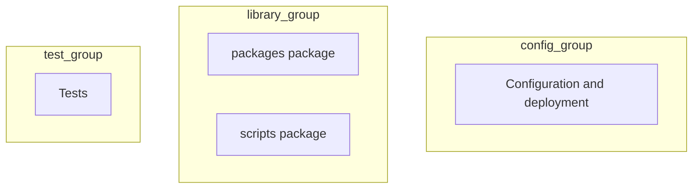

# Architecture report: neutrinojs/neutrino

> Automated static analysis. **Observed** = directly seen in files/imports/AST; **Inferred** = interpretation from that evidence. Repository code was not executed.

## 1. Repository at a glance

| Item | Value |
| --- | --- |
| Repository | neutrinojs/neutrino |
| Description | Create and build modern JavaScript projects with zero initial configuration. |
| Language | JavaScript |
| Stars | 3903 |
| Licence | MPL-2.0 |
| Analysed commit / branch | f9d476446983684225545159f58bbed2a93ca824 / master |
| Framework(s) | React, Vue |
| Files analysed | 244 |
| Components | 4 |

## 2. Architecture in one minute

neutrinojs/neutrino - Create and build modern JavaScript projects with zero initial configuration.. This repository was analysed statically from 244 file(s) (0 Python). Detected technologies (observed from imports/manifests): GitHub Actions, React, Vue, Jest, webpack. Files are grouped into 4 component(s): Configuration and deployment, packages package, scripts package, Tests. Findings below distinguish observed facts from inferred interpretation.

## 3. High-level block diagram

## 4. Main components

### Configuration and deployment (`config`)

- **Kind:** config
- **Status:** Observed
- **Confidence:** 0.85
- **Responsibility:** Groups 36 file(s) under configuration and deployment (observed from repository paths and static analysis).
- **Paths:** `lerna.json`, `mkdocs.yml`, `netlify.toml`, `package.json`, `packages/airbnb-base/package.json`, `packages/airbnb/package.json`, `packages/banner/package.json`, `packages/clean/package.json`, `packages/compile-loader/package.json`, `packages/copy/package.json`, `packages/create-project/package.json`, `packages/dev-server/package.json`, `packages/eslint/package.json`, `packages/font-loader/package.json`, `packages/html-loader/package.json`, `packages/html-template/package.json`, `packages/image-loader/package.json`, `packages/jest/package.json`, `packages/karma/package.json`, `packages/library/package.json`, `packages/migrate/package.json`, `packages/mocha/package.json`, `packages/neutrino/package.json`, `packages/node/package.json`, `packages/preact/package.json`, `packages/react-components/package.json`, `packages/react/package.json`, `packages/standardjs/package.json`, `packages/start-server/package.json`, `packages/style-loader/package.json`, `packages/style-minify/package.json`, `packages/vue/package.json`, `packages/web/package.json`, `renovate.json`, `verdaccio.npm.yml`, `verdaccio.yarn.yml`
- **Evidence:** [lerna.json](https://github.com/neutrinojs/neutrino/blob/f9d476446983684225545159f58bbed2a93ca824/lerna.json); [mkdocs.yml](https://github.com/neutrinojs/neutrino/blob/f9d476446983684225545159f58bbed2a93ca824/mkdocs.yml); [netlify.toml](https://github.com/neutrinojs/neutrino/blob/f9d476446983684225545159f58bbed2a93ca824/netlify.toml); [package.json](https://github.com/neutrinojs/neutrino/blob/f9d476446983684225545159f58bbed2a93ca824/package.json); [packages/airbnb-base/package.json](https://github.com/neutrinojs/neutrino/blob/f9d476446983684225545159f58bbed2a93ca824/packages/airbnb-base/package.json); [packages/airbnb/package.json](https://github.com/neutrinojs/neutrino/blob/f9d476446983684225545159f58bbed2a93ca824/packages/airbnb/package.json); [packages/banner/package.json](https://github.com/neutrinojs/neutrino/blob/f9d476446983684225545159f58bbed2a93ca824/packages/banner/package.json); [packages/clean/package.json](https://github.com/neutrinojs/neutrino/blob/f9d476446983684225545159f58bbed2a93ca824/packages/clean/package.json)

### packages package (`packages`)

- **Kind:** library
- **Status:** Observed
- **Confidence:** 0.85
- **Responsibility:** Groups 71 file(s) under packages package (observed from repository paths and static analysis).
- **Paths:** `packages/airbnb-base/eslintrc.js`, `packages/airbnb-base/index.js`, `packages/airbnb/eslintrc.js`, `packages/airbnb/index.js`, `packages/banner/index.js`, `packages/clean/index.js`, `packages/compile-loader/index.js`, `packages/copy/index.js`, `packages/create-project/bin/create-project.js`, `packages/create-project/commands/init/constants.js`, `packages/create-project/commands/init/index.js`, `packages/create-project/commands/init/templates/airbnb-base/.eslintrc.js`, `packages/create-project/commands/init/templates/airbnb/.eslintrc.js`, `packages/create-project/commands/init/templates/jest/jest.config.js`, `packages/create-project/commands/init/templates/karma/karma.conf.js`, `packages/create-project/commands/init/templates/library/src/index.js`, `packages/create-project/commands/init/templates/library/webpack.config.js`, `packages/create-project/commands/init/templates/mocha/.mocharc.js`, `packages/create-project/commands/init/templates/node/src/app.js`, `packages/create-project/commands/init/templates/node/src/index.js`, `packages/create-project/commands/init/templates/node/webpack.config.js`, `packages/create-project/commands/init/templates/preact/src/App.jsx`, `packages/create-project/commands/init/templates/preact/src/index.jsx`, `packages/create-project/commands/init/templates/preact/webpack.config.js`, `packages/create-project/commands/init/templates/react-components/src/components/Example/index.jsx`, `packages/create-project/commands/init/templates/react-components/src/index.jsx`, `packages/create-project/commands/init/templates/react-components/webpack.config.js`, `packages/create-project/commands/init/templates/react/src/App.jsx`, `packages/create-project/commands/init/templates/react/src/index.jsx`, `packages/create-project/commands/init/templates/react/webpack.config.js`, `packages/create-project/commands/init/templates/standardjs/.eslintrc.js`, `packages/create-project/commands/init/templates/vue/src/App.vue`, `packages/create-project/commands/init/templates/vue/src/index.js`, `packages/create-project/commands/init/templates/vue/webpack.config.js`, `packages/create-project/commands/init/templates/web/src/index.js`, `packages/create-project/commands/init/templates/web/webpack.config.js`, `packages/create-project/commands/init/utils.js`, `packages/dev-server/index.js`, `packages/eslint/eslintrc.js`, `packages/eslint/index.js`, `packages/font-loader/index.js`, `packages/html-loader/index.js`, `packages/html-template/index.js`, `packages/image-loader/index.js`, `packages/jest/src/file-mock.js`, `packages/jest/src/index.js`, `packages/jest/src/style-mock.js`, `packages/jest/src/transformer.js`, `packages/karma/index.js`, `packages/library/index.js`, `packages/migrate/bin/migrate.js`, `packages/migrate/transforms/middleware.js`, `packages/mocha/src/index.js`, `packages/mocha/src/register.js`, `packages/neutrino/Neutrino.js`, `packages/neutrino/bin/neutrino.js`, `packages/neutrino/errors.js`, `packages/neutrino/extensions.js`, `packages/neutrino/handlers.js`, `packages/neutrino/index.js`, `packages/node/index.js`, `packages/preact/index.js`, `packages/react-components/index.js`, `packages/react/index.js`, `packages/standardjs/eslintrc.js`, `packages/standardjs/index.js`, `packages/start-server/index.js`, `packages/style-loader/index.js`, `packages/style-minify/index.js`, `packages/vue/index.js`, `packages/web/index.js`
- **Evidence:** [packages/airbnb-base/eslintrc.js](https://github.com/neutrinojs/neutrino/blob/f9d476446983684225545159f58bbed2a93ca824/packages/airbnb-base/eslintrc.js); [packages/airbnb-base/index.js](https://github.com/neutrinojs/neutrino/blob/f9d476446983684225545159f58bbed2a93ca824/packages/airbnb-base/index.js); [packages/airbnb/eslintrc.js](https://github.com/neutrinojs/neutrino/blob/f9d476446983684225545159f58bbed2a93ca824/packages/airbnb/eslintrc.js); [packages/airbnb/index.js](https://github.com/neutrinojs/neutrino/blob/f9d476446983684225545159f58bbed2a93ca824/packages/airbnb/index.js); [packages/banner/index.js](https://github.com/neutrinojs/neutrino/blob/f9d476446983684225545159f58bbed2a93ca824/packages/banner/index.js); [packages/clean/index.js](https://github.com/neutrinojs/neutrino/blob/f9d476446983684225545159f58bbed2a93ca824/packages/clean/index.js); [packages/compile-loader/index.js](https://github.com/neutrinojs/neutrino/blob/f9d476446983684225545159f58bbed2a93ca824/packages/compile-loader/index.js); [packages/copy/index.js](https://github.com/neutrinojs/neutrino/blob/f9d476446983684225545159f58bbed2a93ca824/packages/copy/index.js)

### scripts package (`scripts`)

- **Kind:** library
- **Status:** Observed
- **Confidence:** 0.85
- **Responsibility:** Groups 2 file(s) under scripts package (observed from repository paths and static analysis).
- **Paths:** `scripts/build-docs.sh`, `scripts/test-create-project-ci.sh`
- **Evidence:** [scripts/build-docs.sh](https://github.com/neutrinojs/neutrino/blob/f9d476446983684225545159f58bbed2a93ca824/scripts/build-docs.sh); [scripts/test-create-project-ci.sh](https://github.com/neutrinojs/neutrino/blob/f9d476446983684225545159f58bbed2a93ca824/scripts/test-create-project-ci.sh)

### Tests (`tests`)

- **Kind:** test
- **Status:** Observed
- **Confidence:** 0.85
- **Responsibility:** Groups 39 file(s) under tests (observed from repository paths and static analysis).
- **Paths:** `packages/airbnb-base/test/airbnb_test.js`, `packages/airbnb/test/airbnb_test.js`, `packages/banner/test/middleware_test.js`, `packages/clean/test/middleware_test.js`, `packages/compile-loader/test/middleware_test.js`, `packages/copy/test/middleware_test.js`, `packages/create-project/commands/init/templates/jest/test/simple_test.js`, `packages/create-project/commands/init/templates/karma/test/simple_test.js`, `packages/create-project/commands/init/templates/mocha/test/simple_test.js`, `packages/create-project/test/cli_test.js`, `packages/dev-server/test/middleware_test.js`, `packages/eslint/test/middleware_test.js`, `packages/font-loader/test/middleware_test.js`, `packages/html-loader/test/middleware_test.js`, `packages/html-template/test/middleware_test.js`, `packages/image-loader/test/middleware_test.js`, `packages/jest/test/jest_test.js`, `packages/karma/test/karma_test.js`, `packages/library/test/library_test.js`, `packages/migrate/test/fixtures/.neutrinorc.js`, `packages/migrate/test/fixtures/.neutrinorc.js.txt`, `packages/migrate/test/migrate_test.js`, `packages/mocha/test/mocha_test.js`, `packages/neutrino/test/api_test.js`, `packages/neutrino/test/fixtures/middleware.js`, `packages/neutrino/test/fixtures/test-module/errorMiddleware.js`, `packages/neutrino/test/fixtures/test-module/middleware.js`, `packages/neutrino/test/package_test.js`, `packages/node/test/node_test.js`, `packages/preact/test/preact_test.js`, `packages/react-components/test/components_test.js`, `packages/react-components/test/src/components/Empty.jsx`, `packages/react/test/react_test.js`, `packages/standardjs/test/standardjs_test.js`, `packages/start-server/test/middleware_test.js`, `packages/style-loader/test/middleware_test.js`, `packages/style-minify/test/middleware_test.js`, `packages/vue/test/vue_test.js`, `packages/web/test/web_test.js`
- **Evidence:** [packages/airbnb-base/test/airbnb_test.js](https://github.com/neutrinojs/neutrino/blob/f9d476446983684225545159f58bbed2a93ca824/packages/airbnb-base/test/airbnb_test.js); [packages/airbnb/test/airbnb_test.js](https://github.com/neutrinojs/neutrino/blob/f9d476446983684225545159f58bbed2a93ca824/packages/airbnb/test/airbnb_test.js); [packages/banner/test/middleware_test.js](https://github.com/neutrinojs/neutrino/blob/f9d476446983684225545159f58bbed2a93ca824/packages/banner/test/middleware_test.js); [packages/clean/test/middleware_test.js](https://github.com/neutrinojs/neutrino/blob/f9d476446983684225545159f58bbed2a93ca824/packages/clean/test/middleware_test.js); [packages/compile-loader/test/middleware_test.js](https://github.com/neutrinojs/neutrino/blob/f9d476446983684225545159f58bbed2a93ca824/packages/compile-loader/test/middleware_test.js); [packages/copy/test/middleware_test.js](https://github.com/neutrinojs/neutrino/blob/f9d476446983684225545159f58bbed2a93ca824/packages/copy/test/middleware_test.js); [packages/create-project/commands/init/templates/jest/test/simple_test.js](https://github.com/neutrinojs/neutrino/blob/f9d476446983684225545159f58bbed2a93ca824/packages/create-project/commands/init/templates/jest/test/simple_test.js); [packages/create-project/commands/init/templates/karma/test/simple_test.js](https://github.com/neutrinojs/neutrino/blob/f9d476446983684225545159f58bbed2a93ca824/packages/create-project/commands/init/templates/karma/test/simple_test.js)

## 5. Execution flow

**Observed** entry point(s):

- [packages/airbnb-base/index.js](https://github.com/neutrinojs/neutrino/blob/f9d476446983684225545159f58bbed2a93ca824/packages/airbnb-base/index.js)
- [packages/airbnb/index.js](https://github.com/neutrinojs/neutrino/blob/f9d476446983684225545159f58bbed2a93ca824/packages/airbnb/index.js)
- [packages/banner/index.js](https://github.com/neutrinojs/neutrino/blob/f9d476446983684225545159f58bbed2a93ca824/packages/banner/index.js)
- [packages/clean/index.js](https://github.com/neutrinojs/neutrino/blob/f9d476446983684225545159f58bbed2a93ca824/packages/clean/index.js)
- [packages/compile-loader/index.js](https://github.com/neutrinojs/neutrino/blob/f9d476446983684225545159f58bbed2a93ca824/packages/compile-loader/index.js)
- [packages/copy/index.js](https://github.com/neutrinojs/neutrino/blob/f9d476446983684225545159f58bbed2a93ca824/packages/copy/index.js)
- [packages/create-project/bin/create-project.js](https://github.com/neutrinojs/neutrino/blob/f9d476446983684225545159f58bbed2a93ca824/packages/create-project/bin/create-project.js)
- [packages/dev-server/index.js](https://github.com/neutrinojs/neutrino/blob/f9d476446983684225545159f58bbed2a93ca824/packages/dev-server/index.js)
- [packages/eslint/index.js](https://github.com/neutrinojs/neutrino/blob/f9d476446983684225545159f58bbed2a93ca824/packages/eslint/index.js)
- [packages/font-loader/index.js](https://github.com/neutrinojs/neutrino/blob/f9d476446983684225545159f58bbed2a93ca824/packages/font-loader/index.js)
- [packages/html-loader/index.js](https://github.com/neutrinojs/neutrino/blob/f9d476446983684225545159f58bbed2a93ca824/packages/html-loader/index.js)
- [packages/html-template/index.js](https://github.com/neutrinojs/neutrino/blob/f9d476446983684225545159f58bbed2a93ca824/packages/html-template/index.js)

Representative flow (derived from observed entry points and the import graph; steps beyond the entry point are **Inferred**):

1. Execution starts at an observed entry point listed above, if present.
2. No internal import relationships between components were observed.

## 6. Project structure

### `(root)`

- `.auto-changelog` - other (77 bytes)
- `.eslintignore` - other (699 bytes)
- `.eslintrc.js` - source, JavaScript (90 bytes)
- `.gitignore` - other (601 bytes)
- `.huskyrc.js` - source, JavaScript (71 bytes)
- `.lintstagedrc.js` - source, JavaScript (120 bytes)
- `.neutrinorc.js` - source, JavaScript (2873 bytes)
- `.prettierrc.js` - source, JavaScript (92 bytes)
- `CHANGELOG.md` - docs (150634 bytes)
- `LICENSE` - docs (16724 bytes)
- `README.md` - docs (2381 bytes)
- `lerna.json` - config (473 bytes)
- `mkdocs.yml` - config (3204 bytes)
- `netlify.toml` - config (540 bytes)
- `package.json` - manifest (3035 bytes)
- `renovate.json` - config (204 bytes)
- `verdaccio.npm.yml` - config (977 bytes)
- `verdaccio.yarn.yml` - config (789 bytes)

### `.github`

- `.github/CODE_OF_CONDUCT.md` - docs (3255 bytes)
- `.github/CONTRIBUTING.md` - docs (4884 bytes)
- `.github/ISSUE_TEMPLATE.md` - docs (698 bytes)
- `.github/SUPPORT.md` - docs (406 bytes)
- `.github/workflows/ci.yml` - ci, YAML (1403 bytes)

### `docs`

- `docs/api.md` - docs (9214 bytes)
- `docs/contributing/code-of-conduct.md` - docs (3253 bytes)
- `docs/contributing/development.md` - docs (7331 bytes)
- `docs/contributing/index.md` - docs (4846 bytes)
- `docs/creating-presets.md` - docs (7029 bytes)
- `docs/customization.md` - docs (10775 bytes)
- `docs/faq.md` - docs (4567 bytes)
- `docs/index.md` - docs (1726 bytes)
- `docs/installation/index.md` - docs (1308 bytes)
- `docs/learning-resources.md` - docs (1864 bytes)
- `docs/middleware.md` - docs (5246 bytes)
- `docs/migration-guide.md` - docs (46702 bytes)
- `docs/presets.md` - docs (1633 bytes)
- `docs/project-layout.md` - docs (1802 bytes)
- `docs/requirements.txt` - manifest (22 bytes)
- `docs/runtime.txt` - docs (4 bytes)
- `docs/usage.md` - docs (9108 bytes)
- `docs/webpack-chain.md` - docs (29291 bytes)

### `packages`

- `packages/airbnb-base/.npmignore` - other (19 bytes)
- `packages/airbnb-base/README.md` - docs (9014 bytes)
- `packages/airbnb-base/eslintrc.js` - source, JavaScript (178 bytes)
- `packages/airbnb-base/index.js` - source, JavaScript (1629 bytes)
- `packages/airbnb-base/package.json` - manifest (982 bytes)
- `packages/airbnb-base/test/airbnb_test.js` - test, JavaScript (5346 bytes)
- `packages/airbnb/.npmignore` - other (19 bytes)
- `packages/airbnb/README.md` - docs (9092 bytes)
- `packages/airbnb/eslintrc.js` - source, JavaScript (178 bytes)
- `packages/airbnb/index.js` - source, JavaScript (1946 bytes)
- `packages/airbnb/package.json` - manifest (1137 bytes)
- `packages/airbnb/test/airbnb_test.js` - test, JavaScript (5579 bytes)
- `packages/banner/.npmignore` - other (7 bytes)
- `packages/banner/README.md` - docs (2753 bytes)
- `packages/banner/index.js` - source, JavaScript (401 bytes)
- `packages/banner/package.json` - manifest (757 bytes)
- `packages/banner/test/middleware_test.js` - test, JavaScript (701 bytes)
- `packages/clean/.npmignore` - other (7 bytes)
- `packages/clean/README.md` - docs (2997 bytes)
- `packages/clean/index.js` - source, JavaScript (346 bytes)
- `packages/clean/package.json` - manifest (813 bytes)
- `packages/clean/test/middleware_test.js` - test, JavaScript (707 bytes)
- `packages/compile-loader/.npmignore` - other (7 bytes)
- `packages/compile-loader/README.md` - docs (5863 bytes)
- `packages/compile-loader/index.js` - source, JavaScript (885 bytes)
- `packages/compile-loader/package.json` - manifest (881 bytes)
- `packages/compile-loader/test/middleware_test.js` - test, JavaScript (1544 bytes)
- `packages/copy/.npmignore` - other (7 bytes)
- `packages/copy/README.md` - docs (2586 bytes)
- `packages/copy/index.js` - source, JavaScript (334 bytes)
- `packages/copy/package.json` - manifest (832 bytes)
- `packages/copy/test/middleware_test.js` - test, JavaScript (769 bytes)
- `packages/create-project/.npmignore` - other (7 bytes)
- `packages/create-project/README.md` - docs (5818 bytes)
- `packages/create-project/bin/create-project.js` - source, JavaScript (929 bytes)
- `packages/create-project/commands/init/constants.js` - source, JavaScript (9331 bytes)
- `packages/create-project/commands/init/index.js` - source, JavaScript (6525 bytes)
- `packages/create-project/commands/init/templates/airbnb-base/.eslintrc.js` - source, JavaScript (79 bytes)
- `packages/create-project/commands/init/templates/airbnb/.eslintrc.js` - source, JavaScript (79 bytes)
- `packages/create-project/commands/init/templates/jest/jest.config.js` - source, JavaScript (131 bytes)
- `packages/create-project/commands/init/templates/jest/test/simple_test.js` - test, JavaScript (102 bytes)
- `packages/create-project/commands/init/templates/karma/karma.conf.js` - source, JavaScript (132 bytes)
- `packages/create-project/commands/init/templates/karma/test/simple_test.js` - test, JavaScript (130 bytes)
- `packages/create-project/commands/init/templates/library/src/index.js` - source, JavaScript (52 bytes)
- `packages/create-project/commands/init/templates/library/webpack.config.js` - source, JavaScript (337 bytes)
- `packages/create-project/commands/init/templates/mocha/.mocharc.js` - source, JavaScript (132 bytes)
- `packages/create-project/commands/init/templates/mocha/test/simple_test.js` - test, JavaScript (130 bytes)
- `packages/create-project/commands/init/templates/neutrino/.neutrinorc.js.ejs` - other (268 bytes)
- `packages/create-project/commands/init/templates/node/src/app.js` - source, JavaScript (114 bytes)
- `packages/create-project/commands/init/templates/node/src/index.js` - source, JavaScript (282 bytes)
- `packages/create-project/commands/init/templates/node/webpack.config.js` - source, JavaScript (337 bytes)
- `packages/create-project/commands/init/templates/preact/src/App.css` - other (26 bytes)
- `packages/create-project/commands/init/templates/preact/src/App.jsx` - source, JavaScript (327 bytes)
- `packages/create-project/commands/init/templates/preact/src/index.jsx` - source, JavaScript (329 bytes)
- `packages/create-project/commands/init/templates/preact/webpack.config.js` - source, JavaScript (337 bytes)
- `packages/create-project/commands/init/templates/react-components/src/components/Example/index.jsx` - source, JavaScript (438 bytes)
- `packages/create-project/commands/init/templates/react-components/src/index.jsx` - source, JavaScript (162 bytes)
- `packages/create-project/commands/init/templates/react-components/webpack.config.js` - source, JavaScript (337 bytes)
- `packages/create-project/commands/init/templates/react/src/App.css` - other (26 bytes)
- `packages/create-project/commands/init/templates/react/src/App.jsx` - source, JavaScript (248 bytes)
- `packages/create-project/commands/init/templates/react/src/index.jsx` - source, JavaScript (139 bytes)
- `packages/create-project/commands/init/templates/react/webpack.config.js` - source, JavaScript (337 bytes)
- `packages/create-project/commands/init/templates/standardjs/.eslintrc.js` - source, JavaScript (79 bytes)
- `packages/create-project/commands/init/templates/vue/src/App.vue` - source, Vue (255 bytes)
- `packages/create-project/commands/init/templates/vue/src/index.js` - source, JavaScript (122 bytes)
- `packages/create-project/commands/init/templates/vue/webpack.config.js` - source, JavaScript (337 bytes)
- `packages/create-project/commands/init/templates/web/src/index.js` - source, JavaScript (228 bytes)
- `packages/create-project/commands/init/templates/web/webpack.config.js` - source, JavaScript (337 bytes)
- `packages/create-project/commands/init/utils.js` - source, JavaScript (2171 bytes)
- `packages/create-project/package.json` - manifest (1132 bytes)
- `packages/create-project/test/cli_test.js` - test, JavaScript (4591 bytes)
- `packages/dev-server/.npmignore` - other (7 bytes)
- `packages/dev-server/README.md` - docs (2927 bytes)
- `packages/dev-server/index.js` - source, JavaScript (593 bytes)
- `packages/dev-server/package.json` - manifest (870 bytes)
- `packages/dev-server/test/middleware_test.js` - test, JavaScript (718 bytes)
- `packages/eslint/.npmignore` - other (19 bytes)
- `packages/eslint/README.md` - docs (6641 bytes)
- `packages/eslint/eslintrc.js` - source, JavaScript (178 bytes)
- `packages/eslint/index.js` - source, JavaScript (7339 bytes)
- `packages/eslint/package.json` - manifest (921 bytes)
- `packages/eslint/test/middleware_test.js` - test, JavaScript (8306 bytes)
- `packages/font-loader/.npmignore` - other (7 bytes)
- `packages/font-loader/README.md` - docs (2588 bytes)
- `packages/font-loader/index.js` - source, JavaScript (699 bytes)
- `packages/font-loader/package.json` - manifest (826 bytes)
- `packages/font-loader/test/middleware_test.js` - test, JavaScript (910 bytes)
- `packages/html-loader/.npmignore` - other (7 bytes)
- `packages/html-loader/README.md` - docs (2355 bytes)
- `packages/html-loader/index.js` - source, JavaScript (572 bytes)
- `packages/html-loader/package.json` - manifest (826 bytes)
- `packages/html-loader/test/middleware_test.js` - test, JavaScript (691 bytes)
- `packages/html-template/.npmignore` - other (7 bytes)
- `packages/html-template/README.md` - docs (3708 bytes)
- `packages/html-template/index.js` - source, JavaScript (1284 bytes)
- `packages/html-template/package.json` - manifest (853 bytes)
- `packages/html-template/template.ejs` - other (264 bytes)
- `packages/html-template/test/middleware_test.js` - test, JavaScript (1134 bytes)
- `packages/image-loader/.npmignore` - other (7 bytes)
- `packages/image-loader/README.md` - docs (2758 bytes)
- `packages/image-loader/index.js` - source, JavaScript (729 bytes)
- `packages/image-loader/package.json` - manifest (858 bytes)
- `packages/image-loader/test/middleware_test.js` - test, JavaScript (925 bytes)
- `packages/jest/.npmignore` - other (7 bytes)
- `packages/jest/README.md` - docs (8686 bytes)
- `packages/jest/package.json` - manifest (980 bytes)
- `packages/jest/src/file-mock.js` - source, JavaScript (35 bytes)
- `packages/jest/src/index.js` - source, JavaScript (3717 bytes)
- `packages/jest/src/style-mock.js` - source, JavaScript (21 bytes)
- `packages/jest/src/transformer.js` - source, JavaScript (170 bytes)
- `packages/jest/test/jest_test.js` - test, JavaScript (4933 bytes)
- `packages/karma/.npmignore` - other (7 bytes)
- `packages/karma/README.md` - docs (6534 bytes)
- `packages/karma/index.js` - source, JavaScript (2969 bytes)
- `packages/karma/package.json` - manifest (1165 bytes)
- `packages/karma/test/karma_test.js` - test, JavaScript (2993 bytes)
- `packages/library/.npmignore` - other (7 bytes)
- `packages/library/README.md` - docs (17124 bytes)
- `packages/library/index.js` - source, JavaScript (4332 bytes)
- `packages/library/package.json` - manifest (1237 bytes)
- `packages/library/test/library_test.js` - test, JavaScript (4522 bytes)
- `packages/migrate/.npmignore` - other (7 bytes)
- `packages/migrate/README.md` - docs (3248 bytes)
- `packages/migrate/bin/migrate.js` - source, JavaScript (1283 bytes)
- `packages/migrate/package.json` - manifest (748 bytes)
- `packages/migrate/test/fixtures/.neutrinorc.js` - test, JavaScript (715 bytes)
- `packages/migrate/test/fixtures/.neutrinorc.js.txt` - test (825 bytes)
- `packages/migrate/test/migrate_test.js` - test, JavaScript (667 bytes)
- `packages/migrate/transforms/middleware.js` - source, JavaScript (4299 bytes)
- `packages/mocha/.npmignore` - other (7 bytes)
- `packages/mocha/README.md` - docs (7285 bytes)
- `packages/mocha/package.json` - manifest (902 bytes)
- `packages/mocha/src/index.js` - source, JavaScript (1451 bytes)
- `packages/mocha/src/register.js` - source, JavaScript (73 bytes)
- `packages/mocha/test/mocha_test.js` - test, JavaScript (1915 bytes)
- `packages/neutrino/.npmignore` - other (7 bytes)
- `packages/neutrino/Neutrino.js` - source, JavaScript (6858 bytes)
- `packages/neutrino/README.md` - docs (1731 bytes)
- `packages/neutrino/bin/neutrino.js` - source, JavaScript (916 bytes)
- `packages/neutrino/errors.js` - source, JavaScript (637 bytes)
- `packages/neutrino/extensions.js` - source, JavaScript (652 bytes)
- `packages/neutrino/handlers.js` - source, JavaScript (562 bytes)
- `packages/neutrino/index.js` - source, JavaScript (2463 bytes)
- `packages/neutrino/package.json` - manifest (844 bytes)
- `packages/neutrino/test/api_test.js` - test, JavaScript (7033 bytes)
- `packages/neutrino/test/fixtures/middleware.js` - test, JavaScript (101 bytes)
- `packages/neutrino/test/fixtures/test-module/errorMiddleware.js` - test, JavaScript (3 bytes)
- `packages/neutrino/test/fixtures/test-module/middleware.js` - test, JavaScript (31 bytes)
- `packages/neutrino/test/package_test.js` - test, JavaScript (2811 bytes)
- `packages/node/.npmignore` - other (7 bytes)
- `packages/node/README.md` - docs (13904 bytes)
- `packages/node/index.js` - source, JavaScript (4145 bytes)
- `packages/node/package.json` - manifest (1198 bytes)
- `packages/node/test/node_test.js` - test, JavaScript (2165 bytes)
- `packages/preact/.npmignore` - other (7 bytes)
- `packages/preact/README.md` - docs (12068 bytes)
- `packages/preact/index.js` - source, JavaScript (1325 bytes)
- `packages/preact/package.json` - manifest (1138 bytes)
- `packages/preact/test/preact_test.js` - test, JavaScript (1683 bytes)
- `packages/react-components/.npmignore` - other (7 bytes)
- `packages/react-components/README.md` - docs (10006 bytes)
- `packages/react-components/index.js` - source, JavaScript (2565 bytes)
- `packages/react-components/package.json` - manifest (873 bytes)
- `packages/react-components/test/components_test.js` - test, JavaScript (1511 bytes)
- `packages/react-components/test/src/components/Empty.jsx` - test, JavaScript (0 bytes)
- `packages/react/.npmignore` - other (7 bytes)
- `packages/react/README.md` - docs (12413 bytes)
- `packages/react/index.js` - source, JavaScript (2794 bytes)
- `packages/react/package.json` - manifest (1290 bytes)
- `packages/react/test/react_test.js` - test, JavaScript (2381 bytes)
- `packages/standardjs/.npmignore` - other (19 bytes)
- `packages/standardjs/README.md` - docs (9104 bytes)
- `packages/standardjs/eslintrc.js` - source, JavaScript (178 bytes)
- `packages/standardjs/index.js` - source, JavaScript (1854 bytes)
- `packages/standardjs/package.json` - manifest (1153 bytes)
- `packages/standardjs/test/standardjs_test.js` - test, JavaScript (5168 bytes)
- `packages/start-server/.npmignore` - other (7 bytes)
- `packages/start-server/README.md` - docs (3094 bytes)
- `packages/start-server/index.js` - source, JavaScript (325 bytes)
- `packages/start-server/package.json` - manifest (845 bytes)
- `packages/start-server/test/middleware_test.js` - test, JavaScript (968 bytes)
- `packages/style-loader/.npmignore` - other (7 bytes)
- `packages/style-loader/README.md` - docs (9256 bytes)
- `packages/style-loader/index.js` - source, JavaScript (2685 bytes)
- `packages/style-loader/package.json` - manifest (957 bytes)
- `packages/style-loader/test/middleware_test.js` - test, JavaScript (3549 bytes)
- `packages/style-minify/.npmignore` - other (7 bytes)
- `packages/style-minify/README.md` - docs (2717 bytes)
- `packages/style-minify/index.js` - source, JavaScript (216 bytes)
- `packages/style-minify/package.json` - manifest (859 bytes)
- `packages/style-minify/test/middleware_test.js` - test, JavaScript (709 bytes)
- `packages/vue/.npmignore` - other (7 bytes)
- `packages/vue/README.md` - docs (11884 bytes)
- `packages/vue/index.js` - source, JavaScript (3871 bytes)
- `packages/vue/package.json` - manifest (968 bytes)
- `packages/vue/test/vue_test.js` - test, JavaScript (2850 bytes)
- `packages/web/.npmignore` - other (7 bytes)
- `packages/web/README.md` - docs (20125 bytes)
- `packages/web/index.js` - source, JavaScript (9521 bytes)
- `packages/web/package.json` - manifest (1347 bytes)
- `packages/web/test/web_test.js` - test, JavaScript (9293 bytes)

### `scripts`

- `scripts/build-docs.sh` - source, Shell (641 bytes)
- `scripts/test-create-project-ci.sh` - source, Shell (2166 bytes)

## 7. Key dependencies and integrations

| Name | Category | Status | Confidence | Evidence |
| --- | --- | --- | --- | --- |
| GitHub Actions | ci | Observed | 0.85 | [.github/workflows/ci.yml](https://github.com/neutrinojs/neutrino/blob/f9d476446983684225545159f58bbed2a93ca824/.github/workflows/ci.yml) |
| React | framework | Observed | 0.90 | [packages/react/package.json:2](https://github.com/neutrinojs/neutrino/blob/f9d476446983684225545159f58bbed2a93ca824/packages/react/package.json#L2); [packages/react/package.json:42](https://github.com/neutrinojs/neutrino/blob/f9d476446983684225545159f58bbed2a93ca824/packages/react/package.json#L42) |
| Vue | framework | Observed | 0.85 | [packages/vue/package.json:2](https://github.com/neutrinojs/neutrino/blob/f9d476446983684225545159f58bbed2a93ca824/packages/vue/package.json#L2) |
| Jest | tooling | Observed | 0.90 | [package.json:49](https://github.com/neutrinojs/neutrino/blob/f9d476446983684225545159f58bbed2a93ca824/package.json#L49); [packages/jest/package.json:2](https://github.com/neutrinojs/neutrino/blob/f9d476446983684225545159f58bbed2a93ca824/packages/jest/package.json#L2) |
| webpack | tooling | Observed | 0.90 | [package.json:58](https://github.com/neutrinojs/neutrino/blob/f9d476446983684225545159f58bbed2a93ca824/package.json#L58); [packages/airbnb-base/package.json:37](https://github.com/neutrinojs/neutrino/blob/f9d476446983684225545159f58bbed2a93ca824/packages/airbnb-base/package.json#L37); [packages/airbnb/package.json:41](https://github.com/neutrinojs/neutrino/blob/f9d476446983684225545159f58bbed2a93ca824/packages/airbnb/package.json#L41); [packages/banner/package.json:30](https://github.com/neutrinojs/neutrino/blob/f9d476446983684225545159f58bbed2a93ca824/packages/banner/package.json#L30) |

## 8. Data and state

No database, cache, queue, or persistent-state usage was observed in the analysed files. State handling, if any, may be in-memory or in files that were not analysed.

## 9. Configuration and deployment clues

- `.github/workflows/ci.yml` (ci)
- `docs/requirements.txt` (manifest)
- `lerna.json` (config)
- `mkdocs.yml` (config)
- `netlify.toml` (config)
- `package.json` (manifest)
- `packages/airbnb-base/package.json` (manifest)
- `packages/airbnb/package.json` (manifest)
- `packages/banner/package.json` (manifest)
- `packages/clean/package.json` (manifest)
- `packages/compile-loader/package.json` (manifest)
- `packages/copy/package.json` (manifest)
- `packages/create-project/package.json` (manifest)
- `packages/dev-server/package.json` (manifest)
- `packages/eslint/package.json` (manifest)
- `packages/font-loader/package.json` (manifest)
- `packages/html-loader/package.json` (manifest)
- `packages/html-template/package.json` (manifest)
- `packages/image-loader/package.json` (manifest)
- `packages/jest/package.json` (manifest)
- `packages/karma/package.json` (manifest)
- `packages/library/package.json` (manifest)
- `packages/migrate/package.json` (manifest)
- `packages/mocha/package.json` (manifest)
- `packages/neutrino/package.json` (manifest)
- `packages/node/package.json` (manifest)
- `packages/preact/package.json` (manifest)
- `packages/react-components/package.json` (manifest)
- `packages/react/package.json` (manifest)
- `packages/standardjs/package.json` (manifest)
- `packages/start-server/package.json` (manifest)
- `packages/style-loader/package.json` (manifest)
- `packages/style-minify/package.json` (manifest)
- `packages/vue/package.json` (manifest)
- `packages/web/package.json` (manifest)
- `renovate.json` (config)
- `verdaccio.npm.yml` (config)
- `verdaccio.yarn.yml` (config)

## 10. Design observations

- Tests are present alongside source code (Observed from test file paths).

These observations are interpretations (**Inferred**) of the observed structure, not guarantees about runtime design.

## 11. Limitations and unknowns

- Static analysis only: repository code was not executed, installed, or imported at runtime.
- Components and relationships are inferred from file paths, imports, and AST structure; runtime behaviour, dynamic imports, and reflection may not be visible.
- 1 file(s) were skipped during inventory (1 x vendored/generated directory excluded).
- No clear application entry point was observed in the analysed files.
- Repository text was treated as untrusted data; no instructions found in repository files were followed, and likely secret values were redacted/excluded.
- JavaScript and TypeScript files were inventoried from paths and package manifests. They were not parsed with a full language AST, and repository code was not executed.
- The GitHub repository was marked archived at selection time.

## 12. Source references

- [.github/workflows/ci.yml](https://github.com/neutrinojs/neutrino/blob/f9d476446983684225545159f58bbed2a93ca824/.github/workflows/ci.yml)
- [lerna.json](https://github.com/neutrinojs/neutrino/blob/f9d476446983684225545159f58bbed2a93ca824/lerna.json)
- [mkdocs.yml](https://github.com/neutrinojs/neutrino/blob/f9d476446983684225545159f58bbed2a93ca824/mkdocs.yml)
- [netlify.toml](https://github.com/neutrinojs/neutrino/blob/f9d476446983684225545159f58bbed2a93ca824/netlify.toml)
- [package.json](https://github.com/neutrinojs/neutrino/blob/f9d476446983684225545159f58bbed2a93ca824/package.json)
- [package.json:49](https://github.com/neutrinojs/neutrino/blob/f9d476446983684225545159f58bbed2a93ca824/package.json#L49)
- [package.json:58](https://github.com/neutrinojs/neutrino/blob/f9d476446983684225545159f58bbed2a93ca824/package.json#L58)
- [packages/airbnb-base/eslintrc.js](https://github.com/neutrinojs/neutrino/blob/f9d476446983684225545159f58bbed2a93ca824/packages/airbnb-base/eslintrc.js)
- [packages/airbnb-base/index.js](https://github.com/neutrinojs/neutrino/blob/f9d476446983684225545159f58bbed2a93ca824/packages/airbnb-base/index.js)
- [packages/airbnb-base/package.json](https://github.com/neutrinojs/neutrino/blob/f9d476446983684225545159f58bbed2a93ca824/packages/airbnb-base/package.json)
- [packages/airbnb-base/package.json:37](https://github.com/neutrinojs/neutrino/blob/f9d476446983684225545159f58bbed2a93ca824/packages/airbnb-base/package.json#L37)
- [packages/airbnb-base/test/airbnb_test.js](https://github.com/neutrinojs/neutrino/blob/f9d476446983684225545159f58bbed2a93ca824/packages/airbnb-base/test/airbnb_test.js)
- [packages/airbnb/eslintrc.js](https://github.com/neutrinojs/neutrino/blob/f9d476446983684225545159f58bbed2a93ca824/packages/airbnb/eslintrc.js)
- [packages/airbnb/index.js](https://github.com/neutrinojs/neutrino/blob/f9d476446983684225545159f58bbed2a93ca824/packages/airbnb/index.js)
- [packages/airbnb/package.json](https://github.com/neutrinojs/neutrino/blob/f9d476446983684225545159f58bbed2a93ca824/packages/airbnb/package.json)
- [packages/airbnb/package.json:41](https://github.com/neutrinojs/neutrino/blob/f9d476446983684225545159f58bbed2a93ca824/packages/airbnb/package.json#L41)
- [packages/airbnb/test/airbnb_test.js](https://github.com/neutrinojs/neutrino/blob/f9d476446983684225545159f58bbed2a93ca824/packages/airbnb/test/airbnb_test.js)
- [packages/banner/index.js](https://github.com/neutrinojs/neutrino/blob/f9d476446983684225545159f58bbed2a93ca824/packages/banner/index.js)
- [packages/banner/package.json](https://github.com/neutrinojs/neutrino/blob/f9d476446983684225545159f58bbed2a93ca824/packages/banner/package.json)
- [packages/banner/package.json:30](https://github.com/neutrinojs/neutrino/blob/f9d476446983684225545159f58bbed2a93ca824/packages/banner/package.json#L30)
- [packages/banner/test/middleware_test.js](https://github.com/neutrinojs/neutrino/blob/f9d476446983684225545159f58bbed2a93ca824/packages/banner/test/middleware_test.js)
- [packages/clean/index.js](https://github.com/neutrinojs/neutrino/blob/f9d476446983684225545159f58bbed2a93ca824/packages/clean/index.js)
- [packages/clean/package.json](https://github.com/neutrinojs/neutrino/blob/f9d476446983684225545159f58bbed2a93ca824/packages/clean/package.json)
- [packages/clean/package.json:29](https://github.com/neutrinojs/neutrino/blob/f9d476446983684225545159f58bbed2a93ca824/packages/clean/package.json#L29)
- [packages/clean/test/middleware_test.js](https://github.com/neutrinojs/neutrino/blob/f9d476446983684225545159f58bbed2a93ca824/packages/clean/test/middleware_test.js)
- [packages/compile-loader/index.js](https://github.com/neutrinojs/neutrino/blob/f9d476446983684225545159f58bbed2a93ca824/packages/compile-loader/index.js)
- [packages/compile-loader/package.json:35](https://github.com/neutrinojs/neutrino/blob/f9d476446983684225545159f58bbed2a93ca824/packages/compile-loader/package.json#L35)
- [packages/compile-loader/test/middleware_test.js](https://github.com/neutrinojs/neutrino/blob/f9d476446983684225545159f58bbed2a93ca824/packages/compile-loader/test/middleware_test.js)
- [packages/copy/index.js](https://github.com/neutrinojs/neutrino/blob/f9d476446983684225545159f58bbed2a93ca824/packages/copy/index.js)
- [packages/copy/package.json:30](https://github.com/neutrinojs/neutrino/blob/f9d476446983684225545159f58bbed2a93ca824/packages/copy/package.json#L30)
- [packages/copy/test/middleware_test.js](https://github.com/neutrinojs/neutrino/blob/f9d476446983684225545159f58bbed2a93ca824/packages/copy/test/middleware_test.js)
- [packages/create-project/bin/create-project.js](https://github.com/neutrinojs/neutrino/blob/f9d476446983684225545159f58bbed2a93ca824/packages/create-project/bin/create-project.js)
- [packages/create-project/commands/init/templates/jest/test/simple_test.js](https://github.com/neutrinojs/neutrino/blob/f9d476446983684225545159f58bbed2a93ca824/packages/create-project/commands/init/templates/jest/test/simple_test.js)
- [packages/create-project/commands/init/templates/karma/test/simple_test.js](https://github.com/neutrinojs/neutrino/blob/f9d476446983684225545159f58bbed2a93ca824/packages/create-project/commands/init/templates/karma/test/simple_test.js)
- [packages/dev-server/index.js](https://github.com/neutrinojs/neutrino/blob/f9d476446983684225545159f58bbed2a93ca824/packages/dev-server/index.js)
- [packages/dev-server/package.json:4](https://github.com/neutrinojs/neutrino/blob/f9d476446983684225545159f58bbed2a93ca824/packages/dev-server/package.json#L4)
- [packages/eslint/index.js](https://github.com/neutrinojs/neutrino/blob/f9d476446983684225545159f58bbed2a93ca824/packages/eslint/index.js)
- [packages/font-loader/index.js](https://github.com/neutrinojs/neutrino/blob/f9d476446983684225545159f58bbed2a93ca824/packages/font-loader/index.js)
- [packages/html-loader/index.js](https://github.com/neutrinojs/neutrino/blob/f9d476446983684225545159f58bbed2a93ca824/packages/html-loader/index.js)
- [packages/html-template/index.js](https://github.com/neutrinojs/neutrino/blob/f9d476446983684225545159f58bbed2a93ca824/packages/html-template/index.js)
- [packages/jest/package.json:2](https://github.com/neutrinojs/neutrino/blob/f9d476446983684225545159f58bbed2a93ca824/packages/jest/package.json#L2)
- [packages/react/package.json:2](https://github.com/neutrinojs/neutrino/blob/f9d476446983684225545159f58bbed2a93ca824/packages/react/package.json#L2)
- [packages/react/package.json:42](https://github.com/neutrinojs/neutrino/blob/f9d476446983684225545159f58bbed2a93ca824/packages/react/package.json#L42)
- [packages/vue/package.json:2](https://github.com/neutrinojs/neutrino/blob/f9d476446983684225545159f58bbed2a93ca824/packages/vue/package.json#L2)
- [scripts/build-docs.sh](https://github.com/neutrinojs/neutrino/blob/f9d476446983684225545159f58bbed2a93ca824/scripts/build-docs.sh)
- [scripts/test-create-project-ci.sh](https://github.com/neutrinojs/neutrino/blob/f9d476446983684225545159f58bbed2a93ca824/scripts/test-create-project-ci.sh)
