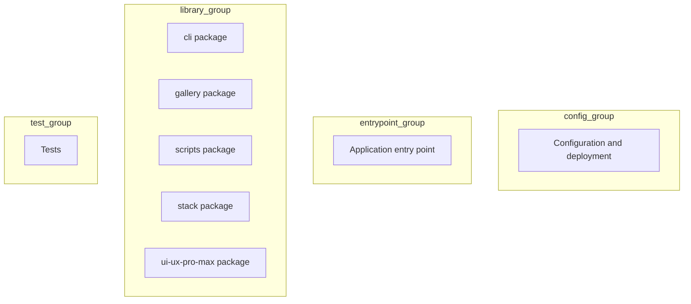

# Architecture report: nextlevelbuilder/ui-ux-pro-max-skill

> Automated static analysis. **Observed** = directly seen in files/imports/AST; **Inferred** = interpretation from that evidence. Repository code was not executed.

## 1. Repository at a glance

| Item | Value |
| --- | --- |
| Repository | nextlevelbuilder/ui-ux-pro-max-skill |
| Description | An AI skill that provides design intelligence for building professional UI/UX across multiple platforms. |
| Language | Python |
| Stars | 149450 |
| Licence | MIT |
| Analysed commit / branch | d643997c82e94742dd3bee43210b0198e8bbba3d / main |
| Framework(s) | Next.js, React |
| Files analysed | 639 |
| Components | 8 |

## 2. Architecture in one minute

nextlevelbuilder/ui-ux-pro-max-skill - An AI skill that provides design intelligence for building professional UI/UX across multiple platforms.. This repository was analysed statically from 639 file(s) (116 Python). Detected technologies (observed from imports/manifests): GitHub Actions, Next.js, React, Tailwind CSS, pytest, TypeScript. Files are grouped into 8 component(s): cli package, Configuration and deployment, Application entry point, gallery package, scripts package, stack package, Tests, ui-ux-pro-max package. Observed entry point(s): .claude/skills/design-system/scripts/fetch-background.py, .claude/skills/design-system/scripts/generate-slide.py, .claude/skills/design-system/scripts/html-token-validator.py. Findings below distinguish observed facts from inferred interpretation.

## 3. High-level block diagram

## 4. Main components

### cli package (`cli`)

- **Kind:** library
- **Status:** Observed
- **Confidence:** 0.85
- **Responsibility:** Groups 27 file(s) under cli package (observed from repository paths and static analysis). Observed top-level classes: BM25. Observed top-level functions: _contains_phrase, _domain_keywords, _exact_match_diagnostic, _exact_row_identity, _exact_stack_identifier, _file_signature.
- **Paths:** `cli/assets/scripts/core.py`, `cli/assets/scripts/reasoning_contract.py`, `cli/assets/skills/brand/scripts/extract-colors.cjs`, `cli/assets/skills/brand/scripts/inject-brand-context.cjs`, `cli/assets/skills/brand/scripts/sync-brand-to-tokens.cjs`, `cli/assets/skills/brand/scripts/validate-asset.cjs`, `cli/assets/skills/design-system/scripts/embed-tokens.cjs`, `cli/assets/skills/design-system/scripts/generate-tokens.cjs`, `cli/assets/skills/design-system/scripts/slide_search_core.py`, `cli/assets/skills/design-system/scripts/validate-tokens.cjs`, `cli/assets/skills/design/scripts/cip/core.py`, `cli/assets/skills/design/scripts/logo/core.py`, `cli/playwright.config.ts`, `cli/scripts/build.mjs`, `cli/scripts/run-python.mjs`, `cli/scripts/sync-assets.mjs`, `cli/src/commands/init.ts`, `cli/src/commands/uninstall.ts`, `cli/src/commands/update.ts`, `cli/src/commands/versions.ts`, `cli/src/index.ts`, `cli/src/types/index.ts`, `cli/src/utils/detect.ts`, `cli/src/utils/extract.ts`, `cli/src/utils/github.ts`, `cli/src/utils/logger.ts`, `cli/src/utils/template.ts`
- **Evidence:** [cli/assets/scripts/core.py:282](https://github.com/nextlevelbuilder/ui-ux-pro-max-skill/blob/d643997c82e94742dd3bee43210b0198e8bbba3d/cli/assets/scripts/core.py#L282); [cli/assets/scripts/reasoning_contract.py:58](https://github.com/nextlevelbuilder/ui-ux-pro-max-skill/blob/d643997c82e94742dd3bee43210b0198e8bbba3d/cli/assets/scripts/reasoning_contract.py#L58); [cli/assets/skills/brand/scripts/extract-colors.cjs](https://github.com/nextlevelbuilder/ui-ux-pro-max-skill/blob/d643997c82e94742dd3bee43210b0198e8bbba3d/cli/assets/skills/brand/scripts/extract-colors.cjs); [cli/assets/skills/brand/scripts/inject-brand-context.cjs](https://github.com/nextlevelbuilder/ui-ux-pro-max-skill/blob/d643997c82e94742dd3bee43210b0198e8bbba3d/cli/assets/skills/brand/scripts/inject-brand-context.cjs); [cli/assets/skills/brand/scripts/sync-brand-to-tokens.cjs](https://github.com/nextlevelbuilder/ui-ux-pro-max-skill/blob/d643997c82e94742dd3bee43210b0198e8bbba3d/cli/assets/skills/brand/scripts/sync-brand-to-tokens.cjs); [cli/assets/skills/brand/scripts/validate-asset.cjs](https://github.com/nextlevelbuilder/ui-ux-pro-max-skill/blob/d643997c82e94742dd3bee43210b0198e8bbba3d/cli/assets/skills/brand/scripts/validate-asset.cjs); [cli/assets/skills/design-system/scripts/embed-tokens.cjs](https://github.com/nextlevelbuilder/ui-ux-pro-max-skill/blob/d643997c82e94742dd3bee43210b0198e8bbba3d/cli/assets/skills/design-system/scripts/embed-tokens.cjs); [cli/assets/skills/design-system/scripts/generate-tokens.cjs](https://github.com/nextlevelbuilder/ui-ux-pro-max-skill/blob/d643997c82e94742dd3bee43210b0198e8bbba3d/cli/assets/skills/design-system/scripts/generate-tokens.cjs)

### Configuration and deployment (`config`)

- **Kind:** config
- **Status:** Observed
- **Confidence:** 0.85
- **Responsibility:** Groups 67 file(s) under configuration and deployment (observed from repository paths and static analysis).
- **Paths:** `cli/assets/data/catalog-summary.json`, `cli/assets/data/data-provenance.json`, `cli/assets/skills/design-system/templates/design-tokens-starter.json`, `cli/assets/skills/ui-styling/scripts/requirements.txt`, `cli/assets/templates/platforms/agent.json`, `cli/assets/templates/platforms/amazonq.json`, `cli/assets/templates/platforms/augment.json`, `cli/assets/templates/platforms/autoclaw.json`, `cli/assets/templates/platforms/claude.json`, `cli/assets/templates/platforms/codebuddy.json`, `cli/assets/templates/platforms/codewhale.json`, `cli/assets/templates/platforms/codex.json`, `cli/assets/templates/platforms/continue.json`, `cli/assets/templates/platforms/copilot.json`, `cli/assets/templates/platforms/cursor.json`, `cli/assets/templates/platforms/droid.json`, `cli/assets/templates/platforms/gemini.json`, `cli/assets/templates/platforms/kilocode.json`, `cli/assets/templates/platforms/kimi.json`, `cli/assets/templates/platforms/kiro.json`, `cli/assets/templates/platforms/openclaw.json`, `cli/assets/templates/platforms/opencode.json`, `cli/assets/templates/platforms/qoder.json`, `cli/assets/templates/platforms/roocode.json`, `cli/assets/templates/platforms/trae.json`, `cli/assets/templates/platforms/universal.json`, `cli/assets/templates/platforms/warp.json`, `cli/assets/templates/platforms/windsurf.json`, `cli/assets/templates/platforms/zcode.json`, `cli/package.json`, `cli/tsconfig.json`, `gallery/package.json`, `gallery/tsconfig.json`, `gallery/tsconfig.test.json`, `skill.json`, `src/ui-ux-pro-max/data/catalog-summary.json`, `src/ui-ux-pro-max/data/data-provenance.json`, `src/ui-ux-pro-max/templates/platforms/agent.json`, `src/ui-ux-pro-max/templates/platforms/amazonq.json`, `src/ui-ux-pro-max/templates/platforms/augment.json`, `src/ui-ux-pro-max/templates/platforms/autoclaw.json`, `src/ui-ux-pro-max/templates/platforms/claude.json`, `src/ui-ux-pro-max/templates/platforms/codebuddy.json`, `src/ui-ux-pro-max/templates/platforms/codewhale.json`, `src/ui-ux-pro-max/templates/platforms/codex.json`, `src/ui-ux-pro-max/templates/platforms/continue.json`, `src/ui-ux-pro-max/templates/platforms/copilot.json`, `src/ui-ux-pro-max/templates/platforms/cursor.json`, `src/ui-ux-pro-max/templates/platforms/droid.json`, `src/ui-ux-pro-max/templates/platforms/gemini.json`, `src/ui-ux-pro-max/templates/platforms/kilocode.json`, `src/ui-ux-pro-max/templates/platforms/kimi.json`, `src/ui-ux-pro-max/templates/platforms/kiro.json`, `src/ui-ux-pro-max/templates/platforms/openclaw.json`, `src/ui-ux-pro-max/templates/platforms/opencode.json`, `src/ui-ux-pro-max/templates/platforms/qoder.json`, `src/ui-ux-pro-max/templates/platforms/roocode.json`, `src/ui-ux-pro-max/templates/platforms/trae.json`, `src/ui-ux-pro-max/templates/platforms/universal.json`, `src/ui-ux-pro-max/templates/platforms/warp.json`, `src/ui-ux-pro-max/templates/platforms/windsurf.json`, `src/ui-ux-pro-max/templates/platforms/zcode.json`, `stack/.claude/settings.json`, `stack/.github/workflows/design-review.yml`, `stack/.mcp.json`, `stack/examples/juniper-audit/report.json`, `stack/package.json`
- **Evidence:** [cli/assets/data/catalog-summary.json](https://github.com/nextlevelbuilder/ui-ux-pro-max-skill/blob/d643997c82e94742dd3bee43210b0198e8bbba3d/cli/assets/data/catalog-summary.json); [cli/assets/data/data-provenance.json](https://github.com/nextlevelbuilder/ui-ux-pro-max-skill/blob/d643997c82e94742dd3bee43210b0198e8bbba3d/cli/assets/data/data-provenance.json); [cli/assets/skills/design-system/templates/design-tokens-starter.json](https://github.com/nextlevelbuilder/ui-ux-pro-max-skill/blob/d643997c82e94742dd3bee43210b0198e8bbba3d/cli/assets/skills/design-system/templates/design-tokens-starter.json); [cli/assets/skills/ui-styling/scripts/requirements.txt](https://github.com/nextlevelbuilder/ui-ux-pro-max-skill/blob/d643997c82e94742dd3bee43210b0198e8bbba3d/cli/assets/skills/ui-styling/scripts/requirements.txt); [cli/assets/templates/platforms/agent.json](https://github.com/nextlevelbuilder/ui-ux-pro-max-skill/blob/d643997c82e94742dd3bee43210b0198e8bbba3d/cli/assets/templates/platforms/agent.json); [cli/assets/templates/platforms/amazonq.json](https://github.com/nextlevelbuilder/ui-ux-pro-max-skill/blob/d643997c82e94742dd3bee43210b0198e8bbba3d/cli/assets/templates/platforms/amazonq.json); [cli/assets/templates/platforms/augment.json](https://github.com/nextlevelbuilder/ui-ux-pro-max-skill/blob/d643997c82e94742dd3bee43210b0198e8bbba3d/cli/assets/templates/platforms/augment.json); [cli/assets/templates/platforms/autoclaw.json](https://github.com/nextlevelbuilder/ui-ux-pro-max-skill/blob/d643997c82e94742dd3bee43210b0198e8bbba3d/cli/assets/templates/platforms/autoclaw.json)

### Application entry point (`entrypoint`)

- **Kind:** entrypoint
- **Status:** Observed
- **Confidence:** 0.85
- **Responsibility:** Groups 25 file(s) under application entry point (observed from repository paths and static analysis). Observed top-level classes: DesignSystemGenerator, ShadcnInstaller, TailwindConfigGenerator, ValidationResult, _SafeRedirectHandler. Observed top-level functions: _atlas_prediction_data, _button_outline_text_color, _catalog_date, _check_app_interface_contract, _check_catalog_contract, _check_catalog_summary.
- **Paths:** `cli/assets/scripts/design_system.py`, `cli/assets/scripts/search.py`, `cli/assets/scripts/validate_data.py`, `cli/assets/skills/design-system/scripts/fetch-background.py`, `cli/assets/skills/design-system/scripts/generate-slide.py`, `cli/assets/skills/design-system/scripts/html-token-validator.py`, `cli/assets/skills/design-system/scripts/search-slides.py`, `cli/assets/skills/design-system/scripts/slide-token-validator.py`, `cli/assets/skills/design/scripts/cip/generate.py`, `cli/assets/skills/design/scripts/cip/render-html.py`, `cli/assets/skills/design/scripts/cip/search.py`, `cli/assets/skills/design/scripts/icon/generate.py`, `cli/assets/skills/design/scripts/logo/generate.py`, `cli/assets/skills/design/scripts/logo/search.py`, `cli/assets/skills/ui-styling/scripts/shadcn_add.py`, `cli/assets/skills/ui-styling/scripts/tailwind_config_gen.py`, `scripts/evaluate-relevance.py`, `scripts/generate-catalog-summary.py`, `scripts/refresh-google-fonts.py`, `scripts/refresh-icon-catalog.py`, `scripts/validate-agent-guide.py`, `scripts/validate-csv.py`, `src/ui-ux-pro-max/scripts/design_system.py`, `src/ui-ux-pro-max/scripts/search.py`, `src/ui-ux-pro-max/scripts/validate_data.py`
- **Evidence:** [cli/assets/scripts/design_system.py:90](https://github.com/nextlevelbuilder/ui-ux-pro-max-skill/blob/d643997c82e94742dd3bee43210b0198e8bbba3d/cli/assets/scripts/design_system.py#L90); [cli/assets/scripts/search.py:51](https://github.com/nextlevelbuilder/ui-ux-pro-max-skill/blob/d643997c82e94742dd3bee43210b0198e8bbba3d/cli/assets/scripts/search.py#L51); [cli/assets/scripts/validate_data.py:148](https://github.com/nextlevelbuilder/ui-ux-pro-max-skill/blob/d643997c82e94742dd3bee43210b0198e8bbba3d/cli/assets/scripts/validate_data.py#L148); [cli/assets/skills/design-system/scripts/fetch-background.py:20](https://github.com/nextlevelbuilder/ui-ux-pro-max-skill/blob/d643997c82e94742dd3bee43210b0198e8bbba3d/cli/assets/skills/design-system/scripts/fetch-background.py#L20); [cli/assets/skills/design-system/scripts/generate-slide.py:16](https://github.com/nextlevelbuilder/ui-ux-pro-max-skill/blob/d643997c82e94742dd3bee43210b0198e8bbba3d/cli/assets/skills/design-system/scripts/generate-slide.py#L16); [cli/assets/skills/design-system/scripts/html-token-validator.py:27](https://github.com/nextlevelbuilder/ui-ux-pro-max-skill/blob/d643997c82e94742dd3bee43210b0198e8bbba3d/cli/assets/skills/design-system/scripts/html-token-validator.py#L27); [cli/assets/skills/design-system/scripts/search-slides.py:27](https://github.com/nextlevelbuilder/ui-ux-pro-max-skill/blob/d643997c82e94742dd3bee43210b0198e8bbba3d/cli/assets/skills/design-system/scripts/search-slides.py#L27); [cli/assets/skills/design-system/scripts/slide-token-validator.py:20](https://github.com/nextlevelbuilder/ui-ux-pro-max-skill/blob/d643997c82e94742dd3bee43210b0198e8bbba3d/cli/assets/skills/design-system/scripts/slide-token-validator.py#L20)

### gallery package (`gallery`)

- **Kind:** library
- **Status:** Observed
- **Confidence:** 0.85
- **Responsibility:** Groups 28 file(s) under gallery package (observed from repository paths and static analysis).
- **Paths:** `gallery/app/layout.tsx`, `gallery/app/page.tsx`, `gallery/app/providers.tsx`, `gallery/components/CodeSnippet.tsx`, `gallery/components/ColorPalette.tsx`, `gallery/components/DarkModeToggle.tsx`, `gallery/components/ExpandableSection.tsx`, `gallery/components/FilterBar.tsx`, `gallery/components/GalleryGrid.tsx`, `gallery/components/InteractiveChecklist.tsx`, `gallery/components/MetadataBadges.tsx`, `gallery/components/PhoneMockup.tsx`, `gallery/components/SearchInput.tsx`, `gallery/components/StyleCard.tsx`, `gallery/components/StyleDetailModal.tsx`, `gallery/components/StylePreview.tsx`, `gallery/components/UIControlsShowcase.tsx`, `gallery/components/metadata-badges.test.tsx`, `gallery/lib/colorExtractor.ts`, `gallery/lib/cssGenerator.ts`, `gallery/lib/filterStyles.ts`, `gallery/lib/parseStyles.test.ts`, `gallery/lib/parseStyles.ts`, `gallery/lib/types.ts`, `gallery/next-env.d.ts`, `gallery/next.config.js`, `gallery/postcss.config.js`, `gallery/tailwind.config.ts`
- **Evidence:** [gallery/app/layout.tsx](https://github.com/nextlevelbuilder/ui-ux-pro-max-skill/blob/d643997c82e94742dd3bee43210b0198e8bbba3d/gallery/app/layout.tsx); [gallery/app/page.tsx](https://github.com/nextlevelbuilder/ui-ux-pro-max-skill/blob/d643997c82e94742dd3bee43210b0198e8bbba3d/gallery/app/page.tsx); [gallery/app/providers.tsx](https://github.com/nextlevelbuilder/ui-ux-pro-max-skill/blob/d643997c82e94742dd3bee43210b0198e8bbba3d/gallery/app/providers.tsx); [gallery/components/CodeSnippet.tsx](https://github.com/nextlevelbuilder/ui-ux-pro-max-skill/blob/d643997c82e94742dd3bee43210b0198e8bbba3d/gallery/components/CodeSnippet.tsx); [gallery/components/ColorPalette.tsx](https://github.com/nextlevelbuilder/ui-ux-pro-max-skill/blob/d643997c82e94742dd3bee43210b0198e8bbba3d/gallery/components/ColorPalette.tsx); [gallery/components/DarkModeToggle.tsx](https://github.com/nextlevelbuilder/ui-ux-pro-max-skill/blob/d643997c82e94742dd3bee43210b0198e8bbba3d/gallery/components/DarkModeToggle.tsx); [gallery/components/ExpandableSection.tsx](https://github.com/nextlevelbuilder/ui-ux-pro-max-skill/blob/d643997c82e94742dd3bee43210b0198e8bbba3d/gallery/components/ExpandableSection.tsx); [gallery/components/FilterBar.tsx](https://github.com/nextlevelbuilder/ui-ux-pro-max-skill/blob/d643997c82e94742dd3bee43210b0198e8bbba3d/gallery/components/FilterBar.tsx)

### scripts package (`scripts`)

- **Kind:** library
- **Status:** Observed
- **Confidence:** 0.85
- **Responsibility:** Groups 4 file(s) under scripts package (observed from repository paths and static analysis). Observed top-level functions: _check_rules, check_thresholds, grades_for_results, ndcg_at_k, precision_at_k, reciprocal_rank.
- **Paths:** `scripts/relevance_metrics.py`, `scripts/smoke-domains.sh`, `scripts/smoke-stacks.sh`, `scripts/sync-release-version.mjs`
- **Evidence:** [scripts/relevance_metrics.py:12](https://github.com/nextlevelbuilder/ui-ux-pro-max-skill/blob/d643997c82e94742dd3bee43210b0198e8bbba3d/scripts/relevance_metrics.py#L12); [scripts/smoke-domains.sh](https://github.com/nextlevelbuilder/ui-ux-pro-max-skill/blob/d643997c82e94742dd3bee43210b0198e8bbba3d/scripts/smoke-domains.sh); [scripts/smoke-stacks.sh](https://github.com/nextlevelbuilder/ui-ux-pro-max-skill/blob/d643997c82e94742dd3bee43210b0198e8bbba3d/scripts/smoke-stacks.sh); [scripts/sync-release-version.mjs](https://github.com/nextlevelbuilder/ui-ux-pro-max-skill/blob/d643997c82e94742dd3bee43210b0198e8bbba3d/scripts/sync-release-version.mjs)

### stack package (`stack`)

- **Kind:** library
- **Status:** Observed
- **Confidence:** 0.85
- **Responsibility:** Groups 2 file(s) under stack package (observed from repository paths and static analysis).
- **Paths:** `stack/scripts/design-audit.mjs`, `stack/scripts/setup.sh`
- **Evidence:** [stack/scripts/design-audit.mjs](https://github.com/nextlevelbuilder/ui-ux-pro-max-skill/blob/d643997c82e94742dd3bee43210b0198e8bbba3d/stack/scripts/design-audit.mjs); [stack/scripts/setup.sh](https://github.com/nextlevelbuilder/ui-ux-pro-max-skill/blob/d643997c82e94742dd3bee43210b0198e8bbba3d/stack/scripts/setup.sh)

### Tests (`tests`)

- **Kind:** test
- **Status:** Observed
- **Confidence:** 0.85
- **Responsibility:** Groups 114 file(s) under tests (observed from repository paths and static analysis). Observed routes: PATCH subprocess.run, PATCH subprocess.run, PATCH subprocess.run, PATCH subprocess.run, PATCH subprocess.run. Observed top-level classes: AtlasGenerationTests, CatalogRefreshTest, CatalogSummaryLineEndingsTest, CommunityDocsTest, ExitStatusTests, GeminiImageTypeTests. Observed top-level functions: _fake_genai, _image_response, _load_generator, _load_module, _response, _rows.
- **Paths:** `.claude/skills/brand/scripts/tests/test_sync_brand_to_tokens.py`, `.claude/skills/design-system/scripts/tests/test_utf8_io.py`, `.claude/skills/design-system/scripts/tests/test_validate_tokens.py`, `.claude/skills/design/scripts/logo/tests/test_generate.py`, `.claude/skills/design/scripts/tests/test_cip_generate.py`, `.claude/skills/design/scripts/tests/test_icon_generate.py`, `.claude/skills/ui-styling/scripts/tests/coverage-ui.json`, `.claude/skills/ui-styling/scripts/tests/requirements.txt`, `.claude/skills/ui-styling/scripts/tests/test_shadcn_add.py`, `.claude/skills/ui-styling/scripts/tests/test_tailwind_config_gen.py`, `.claude/skills/ui-ux-pro-max/scripts/tests/fixtures/catalogs/google-api.json`, `.claude/skills/ui-ux-pro-max/scripts/tests/fixtures/catalogs/google-catalog.json`, `.claude/skills/ui-ux-pro-max/scripts/tests/fixtures/catalogs/google-existing.csv`, `.claude/skills/ui-ux-pro-max/scripts/tests/fixtures/catalogs/google-metadata.json`, `.claude/skills/ui-ux-pro-max/scripts/tests/fixtures/catalogs/google-overrides.json`, `.claude/skills/ui-ux-pro-max/scripts/tests/fixtures/catalogs/icons-curated.csv`, `.claude/skills/ui-ux-pro-max/scripts/tests/fixtures/catalogs/phosphor-core.json`, `.claude/skills/ui-ux-pro-max/scripts/tests/fixtures/catalogs/phosphor-package.json`, `.claude/skills/ui-ux-pro-max/scripts/tests/fixtures/catalogs/phosphor-react-exports.json`, `.claude/skills/ui-ux-pro-max/scripts/tests/fixtures/catalogs/phosphor-react-package.json`, `.claude/skills/ui-ux-pro-max/scripts/tests/fixtures/relevance-baseline.json`, `.claude/skills/ui-ux-pro-max/scripts/tests/fixtures/relevance-cases.json`, `.claude/skills/ui-ux-pro-max/scripts/tests/fixtures/relevance-thresholds.json`, `.claude/skills/ui-ux-pro-max/scripts/tests/test_catalog_refresh.py`, `.claude/skills/ui-ux-pro-max/scripts/tests/test_catalog_summary_line_endings.py`, `.claude/skills/ui-ux-pro-max/scripts/tests/test_core.py`, `.claude/skills/ui-ux-pro-max/scripts/tests/test_core_data_quality.py`, `.claude/skills/ui-ux-pro-max/scripts/tests/test_data_contracts.py`, `.claude/skills/ui-ux-pro-max/scripts/tests/test_design_system_mode.py`, `.claude/skills/ui-ux-pro-max/scripts/tests/test_design_system_stack.py`, `.claude/skills/ui-ux-pro-max/scripts/tests/test_ime_composition.py`, `.claude/skills/ui-ux-pro-max/scripts/tests/test_native_desktop_stack_freshness.py`, `.claude/skills/ui-ux-pro-max/scripts/tests/test_relevance_evaluator.py`, `.claude/skills/ui-ux-pro-max/scripts/tests/test_rtl_support.py`, `.claude/skills/ui-ux-pro-max/scripts/tests/test_skill_script_paths.py`, `.claude/skills/ui-ux-pro-max/scripts/tests/test_style_taxonomy.py`, `.claude/skills/ui-ux-pro-max/scripts/tests/test_text_layout_resilience.py`, `.claude/skills/ui-ux-pro-max/scripts/tests/test_web_stack_freshness.py`, `cli/assets/scripts/tests/fixtures/catalogs/google-api.json`, `cli/assets/scripts/tests/fixtures/catalogs/google-catalog.json`, `cli/assets/scripts/tests/fixtures/catalogs/google-existing.csv`, `cli/assets/scripts/tests/fixtures/catalogs/google-metadata.json`, `cli/assets/scripts/tests/fixtures/catalogs/google-overrides.json`, `cli/assets/scripts/tests/fixtures/catalogs/icons-curated.csv`, `cli/assets/scripts/tests/fixtures/catalogs/phosphor-core.json`, `cli/assets/scripts/tests/fixtures/catalogs/phosphor-package.json`, `cli/assets/scripts/tests/fixtures/catalogs/phosphor-react-exports.json`, `cli/assets/scripts/tests/fixtures/catalogs/phosphor-react-package.json`, `cli/assets/scripts/tests/fixtures/relevance-baseline.json`, `cli/assets/scripts/tests/fixtures/relevance-cases.json`, `cli/assets/scripts/tests/fixtures/relevance-thresholds.json`, `cli/assets/scripts/tests/test_catalog_refresh.py`, `cli/assets/scripts/tests/test_catalog_summary_line_endings.py`, `cli/assets/scripts/tests/test_core.py`, `cli/assets/scripts/tests/test_core_data_quality.py`, `cli/assets/scripts/tests/test_data_contracts.py`, `cli/assets/scripts/tests/test_design_system_mode.py`, `cli/assets/scripts/tests/test_design_system_stack.py`, `cli/assets/scripts/tests/test_ime_composition.py`, `cli/assets/scripts/tests/test_native_desktop_stack_freshness.py`, `cli/assets/scripts/tests/test_relevance_evaluator.py`, `cli/assets/scripts/tests/test_rtl_support.py`, `cli/assets/scripts/tests/test_skill_script_paths.py`, `cli/assets/scripts/tests/test_style_taxonomy.py`, `cli/assets/scripts/tests/test_text_layout_resilience.py`, `cli/assets/scripts/tests/test_web_stack_freshness.py`, `cli/assets/skills/brand/scripts/tests/test_sync_brand_to_tokens.py`, `cli/assets/skills/design-system/scripts/tests/test_utf8_io.py`, `cli/assets/skills/design-system/scripts/tests/test_validate_tokens.py`, `cli/assets/skills/design/scripts/logo/tests/test_generate.py`, `cli/assets/skills/design/scripts/tests/test_cip_generate.py`, `cli/assets/skills/design/scripts/tests/test_icon_generate.py`, `cli/assets/skills/ui-styling/scripts/tests/coverage-ui.json`, `cli/assets/skills/ui-styling/scripts/tests/requirements.txt`, `cli/assets/skills/ui-styling/scripts/tests/test_shadcn_add.py`, `cli/assets/skills/ui-styling/scripts/tests/test_tailwind_config_gen.py`, `cli/tests/e2e/agent-query-contract.spec.ts`, `cli/tests/e2e/banner-design-path-contract.spec.ts`, `cli/tests/e2e/copilot-skills.spec.ts`, `cli/tests/e2e/detect.spec.ts`, `cli/tests/e2e/dry-run.spec.ts`, `cli/tests/e2e/kimi-skills.spec.ts`, `cli/tests/e2e/legacy-cleanup.spec.ts`, `cli/tests/e2e/preview.spec.ts`, `cli/tests/e2e/template-script-paths.spec.ts`, `scripts/tests/test_community_docs.py`, `src/ui-ux-pro-max/scripts/tests/fixtures/catalogs/google-api.json`, `src/ui-ux-pro-max/scripts/tests/fixtures/catalogs/google-catalog.json`, `src/ui-ux-pro-max/scripts/tests/fixtures/catalogs/google-existing.csv`, `src/ui-ux-pro-max/scripts/tests/fixtures/catalogs/google-metadata.json`, `src/ui-ux-pro-max/scripts/tests/fixtures/catalogs/google-overrides.json`, `src/ui-ux-pro-max/scripts/tests/fixtures/catalogs/icons-curated.csv`, `src/ui-ux-pro-max/scripts/tests/fixtures/catalogs/phosphor-core.json`, `src/ui-ux-pro-max/scripts/tests/fixtures/catalogs/phosphor-package.json`, `src/ui-ux-pro-max/scripts/tests/fixtures/catalogs/phosphor-react-exports.json`, `src/ui-ux-pro-max/scripts/tests/fixtures/catalogs/phosphor-react-package.json`, `src/ui-ux-pro-max/scripts/tests/fixtures/relevance-baseline.json`, `src/ui-ux-pro-max/scripts/tests/fixtures/relevance-cases.json`, `src/ui-ux-pro-max/scripts/tests/fixtures/relevance-thresholds.json`, `src/ui-ux-pro-max/scripts/tests/test_catalog_refresh.py`, `src/ui-ux-pro-max/scripts/tests/test_catalog_summary_line_endings.py`, `src/ui-ux-pro-max/scripts/tests/test_core.py`, `src/ui-ux-pro-max/scripts/tests/test_core_data_quality.py`, `src/ui-ux-pro-max/scripts/tests/test_data_contracts.py`, `src/ui-ux-pro-max/scripts/tests/test_design_system_mode.py`, `src/ui-ux-pro-max/scripts/tests/test_design_system_stack.py`, `src/ui-ux-pro-max/scripts/tests/test_ime_composition.py`, `src/ui-ux-pro-max/scripts/tests/test_native_desktop_stack_freshness.py`, `src/ui-ux-pro-max/scripts/tests/test_relevance_evaluator.py`, `src/ui-ux-pro-max/scripts/tests/test_rtl_support.py`, `src/ui-ux-pro-max/scripts/tests/test_skill_script_paths.py`, `src/ui-ux-pro-max/scripts/tests/test_style_taxonomy.py`, `src/ui-ux-pro-max/scripts/tests/test_text_layout_resilience.py`, `src/ui-ux-pro-max/scripts/tests/test_web_stack_freshness.py`
- **Evidence:** [.claude/skills/brand/scripts/tests/test_sync_brand_to_tokens.py:27](https://github.com/nextlevelbuilder/ui-ux-pro-max-skill/blob/d643997c82e94742dd3bee43210b0198e8bbba3d/.claude/skills/brand/scripts/tests/test_sync_brand_to_tokens.py#L27); [.claude/skills/design-system/scripts/tests/test_utf8_io.py:27](https://github.com/nextlevelbuilder/ui-ux-pro-max-skill/blob/d643997c82e94742dd3bee43210b0198e8bbba3d/.claude/skills/design-system/scripts/tests/test_utf8_io.py#L27); [.claude/skills/design-system/scripts/tests/test_validate_tokens.py:19](https://github.com/nextlevelbuilder/ui-ux-pro-max-skill/blob/d643997c82e94742dd3bee43210b0198e8bbba3d/.claude/skills/design-system/scripts/tests/test_validate_tokens.py#L19); [.claude/skills/design/scripts/logo/tests/test_generate.py:14](https://github.com/nextlevelbuilder/ui-ux-pro-max-skill/blob/d643997c82e94742dd3bee43210b0198e8bbba3d/.claude/skills/design/scripts/logo/tests/test_generate.py#L14); [.claude/skills/design/scripts/tests/test_cip_generate.py:25](https://github.com/nextlevelbuilder/ui-ux-pro-max-skill/blob/d643997c82e94742dd3bee43210b0198e8bbba3d/.claude/skills/design/scripts/tests/test_cip_generate.py#L25); [.claude/skills/design/scripts/tests/test_icon_generate.py:15](https://github.com/nextlevelbuilder/ui-ux-pro-max-skill/blob/d643997c82e94742dd3bee43210b0198e8bbba3d/.claude/skills/design/scripts/tests/test_icon_generate.py#L15); [.claude/skills/ui-styling/scripts/tests/coverage-ui.json](https://github.com/nextlevelbuilder/ui-ux-pro-max-skill/blob/d643997c82e94742dd3bee43210b0198e8bbba3d/.claude/skills/ui-styling/scripts/tests/coverage-ui.json); [.claude/skills/ui-styling/scripts/tests/requirements.txt](https://github.com/nextlevelbuilder/ui-ux-pro-max-skill/blob/d643997c82e94742dd3bee43210b0198e8bbba3d/.claude/skills/ui-styling/scripts/tests/requirements.txt)

### ui-ux-pro-max package (`ui_ux_pro_max`)

- **Kind:** library
- **Status:** Observed
- **Confidence:** 0.85
- **Responsibility:** Groups 2 file(s) under ui-ux-pro-max package (observed from repository paths and static analysis). Observed top-level classes: BM25. Observed top-level functions: _contains_phrase, _domain_keywords, _exact_match_diagnostic, _exact_row_identity, _exact_stack_identifier, _file_signature.
- **Paths:** `src/ui-ux-pro-max/scripts/core.py`, `src/ui-ux-pro-max/scripts/reasoning_contract.py`
- **Evidence:** [src/ui-ux-pro-max/scripts/core.py:282](https://github.com/nextlevelbuilder/ui-ux-pro-max-skill/blob/d643997c82e94742dd3bee43210b0198e8bbba3d/src/ui-ux-pro-max/scripts/core.py#L282); [src/ui-ux-pro-max/scripts/reasoning_contract.py:58](https://github.com/nextlevelbuilder/ui-ux-pro-max-skill/blob/d643997c82e94742dd3bee43210b0198e8bbba3d/src/ui-ux-pro-max/scripts/reasoning_contract.py#L58)

## 5. Execution flow

**Observed** entry point(s):

- [.claude/skills/design-system/scripts/fetch-background.py:338](https://github.com/nextlevelbuilder/ui-ux-pro-max-skill/blob/d643997c82e94742dd3bee43210b0198e8bbba3d/.claude/skills/design-system/scripts/fetch-background.py#L338)
- [.claude/skills/design-system/scripts/generate-slide.py:769](https://github.com/nextlevelbuilder/ui-ux-pro-max-skill/blob/d643997c82e94742dd3bee43210b0198e8bbba3d/.claude/skills/design-system/scripts/generate-slide.py#L769)
- [.claude/skills/design-system/scripts/html-token-validator.py:358](https://github.com/nextlevelbuilder/ui-ux-pro-max-skill/blob/d643997c82e94742dd3bee43210b0198e8bbba3d/.claude/skills/design-system/scripts/html-token-validator.py#L358)
- [.claude/skills/design-system/scripts/search-slides.py:227](https://github.com/nextlevelbuilder/ui-ux-pro-max-skill/blob/d643997c82e94742dd3bee43210b0198e8bbba3d/.claude/skills/design-system/scripts/search-slides.py#L227)
- [.claude/skills/design-system/scripts/slide-token-validator.py:34](https://github.com/nextlevelbuilder/ui-ux-pro-max-skill/blob/d643997c82e94742dd3bee43210b0198e8bbba3d/.claude/skills/design-system/scripts/slide-token-validator.py#L34)
- [.claude/skills/design/scripts/cip/generate.py:503](https://github.com/nextlevelbuilder/ui-ux-pro-max-skill/blob/d643997c82e94742dd3bee43210b0198e8bbba3d/.claude/skills/design/scripts/cip/generate.py#L503)
- [.claude/skills/design/scripts/cip/render-html.py:423](https://github.com/nextlevelbuilder/ui-ux-pro-max-skill/blob/d643997c82e94742dd3bee43210b0198e8bbba3d/.claude/skills/design/scripts/cip/render-html.py#L423)
- [.claude/skills/design/scripts/cip/search.py:126](https://github.com/nextlevelbuilder/ui-ux-pro-max-skill/blob/d643997c82e94742dd3bee43210b0198e8bbba3d/.claude/skills/design/scripts/cip/search.py#L126)
- [.claude/skills/design/scripts/icon/generate.py:534](https://github.com/nextlevelbuilder/ui-ux-pro-max-skill/blob/d643997c82e94742dd3bee43210b0198e8bbba3d/.claude/skills/design/scripts/icon/generate.py#L534)
- [src/ui-ux-pro-max/scripts/design_system.py:1657](https://github.com/nextlevelbuilder/ui-ux-pro-max-skill/blob/d643997c82e94742dd3bee43210b0198e8bbba3d/src/ui-ux-pro-max/scripts/design_system.py#L1657)
- [src/ui-ux-pro-max/scripts/search.py:103](https://github.com/nextlevelbuilder/ui-ux-pro-max-skill/blob/d643997c82e94742dd3bee43210b0198e8bbba3d/src/ui-ux-pro-max/scripts/search.py#L103)
- [src/ui-ux-pro-max/scripts/validate_data.py:1094](https://github.com/nextlevelbuilder/ui-ux-pro-max-skill/blob/d643997c82e94742dd3bee43210b0198e8bbba3d/src/ui-ux-pro-max/scripts/validate_data.py#L1094)

**Observed** routes (from decorators):

- `PATCH subprocess.run` -> `test_add_components_success` in `.claude/skills/ui-styling/scripts/tests/test_shadcn_add.py:157`
- `PATCH subprocess.run` -> `test_add_components_subprocess_error` in `.claude/skills/ui-styling/scripts/tests/test_shadcn_add.py:181`
- `PATCH subprocess.run` -> `test_add_components_npx_not_found` in `.claude/skills/ui-styling/scripts/tests/test_shadcn_add.py:194`
- `PATCH subprocess.run` -> `test_add_all_components_success` in `.claude/skills/ui-styling/scripts/tests/test_shadcn_add.py:222`
- `PATCH subprocess.run` -> `test_add_components_success` in `cli/assets/skills/ui-styling/scripts/tests/test_shadcn_add.py:157`
- `PATCH subprocess.run` -> `test_add_components_subprocess_error` in `cli/assets/skills/ui-styling/scripts/tests/test_shadcn_add.py:181`
- `PATCH subprocess.run` -> `test_add_components_npx_not_found` in `cli/assets/skills/ui-styling/scripts/tests/test_shadcn_add.py:194`
- `PATCH subprocess.run` -> `test_add_all_components_success` in `cli/assets/skills/ui-styling/scripts/tests/test_shadcn_add.py:222`

Representative flow (derived from observed entry points and the import graph; steps beyond the entry point are **Inferred**):

1. Execution starts at an observed entry point listed above, if present.
2. No internal import relationships between components were observed.

## 6. Project structure

### `(root)`

- `.gitattributes` - other (1206 bytes)
- `.gitignore` - other (568 bytes)
- `.releaserc.json` - config (640 bytes)
- `CLAUDE.md` - docs (6225 bytes)
- `CODE_OF_CONDUCT.md` - docs (1978 bytes)
- `CONTRIBUTING.md` - docs (5394 bytes)
- `LICENSE` - docs (1075 bytes)
- `README.az.md` - docs (44212 bytes)
- `README.fa.md` - docs (57059 bytes)
- `README.fr.md` - docs (47234 bytes)
- `README.id.md` - docs (35807 bytes)
- `README.ja.md` - docs (51405 bytes)
- `README.ko.md` - docs (33742 bytes)
- `README.md` - docs (41745 bytes)
- `README.vi.md` - docs (41431 bytes)
- `README.zh.md` - docs (34609 bytes)
- `SECURITY.md` - docs (1499 bytes)
- `skill.json` - config (943 bytes)

### `.claude`

- `.claude/skills/banner-design/SKILL.md` - docs (7071 bytes)
- `.claude/skills/banner-design/references/banner-sizes-and-styles.md` - docs (4993 bytes)
- `.claude/skills/brand/SKILL.md` - docs (3926 bytes)
- `.claude/skills/brand/references/approval-checklist.md` - docs (4224 bytes)
- `.claude/skills/brand/references/asset-organization.md` - docs (5110 bytes)
- `.claude/skills/brand/references/brand-guideline-template.md` - docs (3572 bytes)
- `.claude/skills/brand/references/color-palette-management.md` - docs (4254 bytes)
- `.claude/skills/brand/references/consistency-checklist.md` - docs (1926 bytes)
- `.claude/skills/brand/references/logo-usage-rules.md` - docs (5464 bytes)
- `.claude/skills/brand/references/messaging-framework.md` - docs (1763 bytes)
- `.claude/skills/brand/references/typography-specifications.md` - docs (5042 bytes)
- `.claude/skills/brand/references/update.md` - docs (3842 bytes)
- `.claude/skills/brand/references/visual-identity.md` - docs (1884 bytes)
- `.claude/skills/brand/references/voice-framework.md` - docs (1997 bytes)
- `.claude/skills/brand/scripts/extract-colors.cjs` - source, JavaScript (9182 bytes)
- `.claude/skills/brand/scripts/inject-brand-context.cjs` - source, JavaScript (9677 bytes)
- `.claude/skills/brand/scripts/sync-brand-to-tokens.cjs` - source, JavaScript (15233 bytes)
- `.claude/skills/brand/scripts/tests/test_sync_brand_to_tokens.py` - test, Python (14370 bytes)
- `.claude/skills/brand/scripts/validate-asset.cjs` - source, JavaScript (10173 bytes)
- `.claude/skills/brand/templates/brand-guidelines-starter.md` - docs (6638 bytes)
- `.claude/skills/design-system/SKILL.md` - docs (7458 bytes)
- `.claude/skills/design-system/data/slide-backgrounds.csv` - data (1038 bytes)
- `.claude/skills/design-system/data/slide-charts.csv` - data (8631 bytes)
- `.claude/skills/design-system/data/slide-color-logic.csv` - data (877 bytes)
- `.claude/skills/design-system/data/slide-copy.csv` - data (6427 bytes)
- `.claude/skills/design-system/data/slide-layout-logic.csv` - data (981 bytes)
- `.claude/skills/design-system/data/slide-layouts.csv` - data (8760 bytes)
- `.claude/skills/design-system/data/slide-strategies.csv` - data (8232 bytes)
- `.claude/skills/design-system/data/slide-typography.csv` - data (735 bytes)
- `.claude/skills/design-system/references/component-specs.md` - docs (6914 bytes)
- `.claude/skills/design-system/references/component-tokens.md` - docs (4986 bytes)
- `.claude/skills/design-system/references/primitive-tokens.md` - docs (4562 bytes)
- `.claude/skills/design-system/references/semantic-tokens.md` - docs (4245 bytes)
- `.claude/skills/design-system/references/states-and-variants.md` - docs (4771 bytes)
- `.claude/skills/design-system/references/tailwind-integration.md` - docs (5633 bytes)
- `.claude/skills/design-system/references/token-architecture.md` - docs (5365 bytes)
- `.claude/skills/design-system/scripts/embed-tokens.cjs` - source, JavaScript (2726 bytes)
- `.claude/skills/design-system/scripts/fetch-background.py` - source, Python (13152 bytes)
- `.claude/skills/design-system/scripts/generate-slide.py` - source, Python (28613 bytes)
- `.claude/skills/design-system/scripts/generate-tokens.cjs` - source, JavaScript (4968 bytes)
- `.claude/skills/design-system/scripts/html-token-validator.py` - source, Python (13219 bytes)
- `.claude/skills/design-system/scripts/search-slides.py` - source, Python (9674 bytes)
- `.claude/skills/design-system/scripts/slide-token-validator.py` - source, Python (973 bytes)
- `.claude/skills/design-system/scripts/slide_search_core.py` - source, Python (14756 bytes)
- `.claude/skills/design-system/scripts/tests/test_utf8_io.py` - test, Python (2615 bytes)
- `.claude/skills/design-system/scripts/tests/test_validate_tokens.py` - test, Python (1895 bytes)
- `.claude/skills/design-system/scripts/validate-tokens.cjs` - source, JavaScript (5942 bytes)
- `.claude/skills/design-system/templates/design-tokens-starter.json` - config (7184 bytes)
- `.claude/skills/design/SKILL.md` - docs (14196 bytes)
- `.claude/skills/design/data/cip/deliverables.csv` - data (13385 bytes)
- `.claude/skills/design/data/cip/industries.csv` - data (4935 bytes)
- `.claude/skills/design/data/cip/mockup-contexts.csv` - data (5205 bytes)
- `.claude/skills/design/data/cip/styles.csv` - data (5967 bytes)
- `.claude/skills/design/data/icon/styles.csv` - data (2250 bytes)
- `.claude/skills/design/data/logo/colors.csv` - data (10674 bytes)
- `.claude/skills/design/data/logo/industries.csv` - data (13274 bytes)
- `.claude/skills/design/data/logo/styles.csv` - data (13678 bytes)
- `.claude/skills/design/references/banner-sizes-and-styles.md` - docs (4993 bytes)
- `.claude/skills/design/references/cip-deliverable-guide.md` - docs (1735 bytes)
- `.claude/skills/design/references/cip-design.md` - docs (4385 bytes)
- `.claude/skills/design/references/cip-prompt-engineering.md` - docs (2493 bytes)
- `.claude/skills/design/references/cip-style-guide.md` - docs (2357 bytes)
- `.claude/skills/design/references/design-routing.md` - docs (5778 bytes)
- `.claude/skills/design/references/icon-design.md` - docs (4151 bytes)
- `.claude/skills/design/references/logo-color-psychology.md` - docs (3341 bytes)
- `.claude/skills/design/references/logo-design.md` - docs (4253 bytes)
- `.claude/skills/design/references/logo-prompt-engineering.md` - docs (4314 bytes)
- `.claude/skills/design/references/logo-style-guide.md` - docs (3435 bytes)
- `.claude/skills/design/references/slides-copywriting-formulas.md` - docs (2580 bytes)
- `.claude/skills/design/references/slides-create.md` - docs (153 bytes)
- `.claude/skills/design/references/slides-html-template.md` - docs (9004 bytes)
- `.claude/skills/design/references/slides-layout-patterns.md` - docs (3667 bytes)
- `.claude/skills/design/references/slides-strategies.md` - docs (2691 bytes)
- `.claude/skills/design/references/slides.md` - docs (1742 bytes)
- `.claude/skills/design/references/social-photos-design.md` - docs (11294 bytes)
- `.claude/skills/design/scripts/cip/core.py` - source, Python (8062 bytes)
- `.claude/skills/design/scripts/cip/generate.py` - source, Python (20631 bytes)
- `.claude/skills/design/scripts/cip/render-html.py` - source, Python (13941 bytes)
- `.claude/skills/design/scripts/cip/search.py` - source, Python (4524 bytes)
- `.claude/skills/design/scripts/icon/generate.py` - source, Python (18999 bytes)
- `.claude/skills/design/scripts/logo/core.py` - source, Python (6023 bytes)
- `.claude/skills/design/scripts/logo/generate.py` - source, Python (29116 bytes)
- `.claude/skills/design/scripts/logo/search.py` - source, Python (4745 bytes)
- `.claude/skills/design/scripts/logo/tests/test_generate.py` - test, Python (16414 bytes)
- `.claude/skills/design/scripts/tests/test_cip_generate.py` - test, Python (4996 bytes)
- `.claude/skills/design/scripts/tests/test_icon_generate.py` - test, Python (7024 bytes)
- `.claude/skills/slides/SKILL.md` - docs (1720 bytes)
- `.claude/skills/slides/references/copywriting-formulas.md` - docs (2580 bytes)
- `.claude/skills/slides/references/create.md` - docs (153 bytes)
- `.claude/skills/slides/references/html-template.md` - docs (9004 bytes)
- `.claude/skills/slides/references/layout-patterns.md` - docs (3667 bytes)
- `.claude/skills/slides/references/slide-strategies.md` - docs (2691 bytes)
- `.claude/skills/ui-styling/LICENSE.txt` - docs (11357 bytes)
- `.claude/skills/ui-styling/SKILL.md` - docs (10945 bytes)
- `.claude/skills/ui-styling/canvas-fonts/ArsenalSC-OFL.txt` - docs (4373 bytes)
- `.claude/skills/ui-styling/canvas-fonts/BigShoulders-OFL.txt` - docs (4397 bytes)
- `.claude/skills/ui-styling/canvas-fonts/Boldonse-OFL.txt` - docs (4390 bytes)
- `.claude/skills/ui-styling/canvas-fonts/BricolageGrotesque-OFL.txt` - docs (4403 bytes)
- `.claude/skills/ui-styling/canvas-fonts/CrimsonPro-OFL.txt` - docs (4394 bytes)
- `.claude/skills/ui-styling/canvas-fonts/DMMono-OFL.txt` - docs (4392 bytes)
- `.claude/skills/ui-styling/canvas-fonts/EricaOne-OFL.txt` - docs (4410 bytes)
- `.claude/skills/ui-styling/canvas-fonts/GeistMono-OFL.txt` - docs (4388 bytes)
- `.claude/skills/ui-styling/canvas-fonts/Gloock-OFL.txt` - docs (4381 bytes)
- `.claude/skills/ui-styling/canvas-fonts/IBMPlexMono-OFL.txt` - docs (4363 bytes)
- `.claude/skills/ui-styling/canvas-fonts/InstrumentSans-OFL.txt` - docs (4403 bytes)
- `.claude/skills/ui-styling/canvas-fonts/Italiana-OFL.txt` - docs (4394 bytes)
- `.claude/skills/ui-styling/canvas-fonts/JetBrainsMono-OFL.txt` - docs (4399 bytes)
- `.claude/skills/ui-styling/canvas-fonts/Jura-OFL.txt` - docs (4380 bytes)
- `.claude/skills/ui-styling/canvas-fonts/LibreBaskerville-OFL.txt` - docs (4449 bytes)
- `.claude/skills/ui-styling/canvas-fonts/Lora-OFL.txt` - docs (4423 bytes)
- `.claude/skills/ui-styling/canvas-fonts/NationalPark-OFL.txt` - docs (4399 bytes)
- `.claude/skills/ui-styling/canvas-fonts/NothingYouCouldDo-OFL.txt` - docs (4363 bytes)
- `.claude/skills/ui-styling/canvas-fonts/Outfit-OFL.txt` - docs (4389 bytes)
- `.claude/skills/ui-styling/canvas-fonts/PixelifySans-OFL.txt` - docs (4395 bytes)
- `.claude/skills/ui-styling/canvas-fonts/PoiretOne-OFL.txt` - docs (4366 bytes)
- `.claude/skills/ui-styling/canvas-fonts/RedHatMono-OFL.txt` - docs (4394 bytes)
- `.claude/skills/ui-styling/canvas-fonts/Silkscreen-OFL.txt` - docs (4394 bytes)
- `.claude/skills/ui-styling/canvas-fonts/SmoochSans-OFL.txt` - docs (4396 bytes)
- `.claude/skills/ui-styling/canvas-fonts/Tektur-OFL.txt` - docs (4385 bytes)
- `.claude/skills/ui-styling/canvas-fonts/WorkSans-OFL.txt` - docs (4397 bytes)
- `.claude/skills/ui-styling/canvas-fonts/YoungSerif-OFL.txt` - docs (4398 bytes)
- `.claude/skills/ui-styling/references/canvas-design-system.md` - docs (7888 bytes)
- `.claude/skills/ui-styling/references/shadcn-accessibility.md` - docs (9976 bytes)
- `.claude/skills/ui-styling/references/shadcn-components.md` - docs (11155 bytes)
- `.claude/skills/ui-styling/references/shadcn-theming.md` - docs (8672 bytes)
- `.claude/skills/ui-styling/references/tailwind-customization.md` - docs (10171 bytes)
- `.claude/skills/ui-styling/references/tailwind-responsive.md` - docs (8270 bytes)
- `.claude/skills/ui-styling/references/tailwind-utilities.md` - docs (9980 bytes)
- `.claude/skills/ui-styling/scripts/requirements.txt` - manifest (444 bytes)
- `.claude/skills/ui-styling/scripts/shadcn_add.py` - source, Python (8969 bytes)
- `.claude/skills/ui-styling/scripts/tailwind_config_gen.py` - source, Python (15730 bytes)
- `.claude/skills/ui-styling/scripts/tests/coverage-ui.json` - test (35121 bytes)
- `.claude/skills/ui-styling/scripts/tests/requirements.txt` - test (52 bytes)
- `.claude/skills/ui-styling/scripts/tests/test_shadcn_add.py` - test, Python (9919 bytes)
- `.claude/skills/ui-styling/scripts/tests/test_tailwind_config_gen.py` - test, Python (19154 bytes)
- `.claude/skills/ui-ux-pro-max/SKILL.md` - docs (16646 bytes)
- `.claude/skills/ui-ux-pro-max/data/app-interface.csv` - data (11046 bytes)
- `.claude/skills/ui-ux-pro-max/data/catalog-summary.json` - config (2392 bytes)
- `.claude/skills/ui-ux-pro-max/data/charts.csv` - data (23365 bytes)
- `.claude/skills/ui-ux-pro-max/data/colors.csv` - data (37940 bytes)
- `.claude/skills/ui-ux-pro-max/data/data-provenance.json` - config (38203 bytes)
- `.claude/skills/ui-ux-pro-max/data/icons.csv` - data (57945 bytes)
- `.claude/skills/ui-ux-pro-max/data/landing.csv` - data (25449 bytes)
- `.claude/skills/ui-ux-pro-max/data/motion.csv` - data (14679 bytes)
- `.claude/skills/ui-ux-pro-max/data/products.csv` - data (76959 bytes)
- `.claude/skills/ui-ux-pro-max/data/react-performance.csv` - data (15080 bytes)
- `.claude/skills/ui-ux-pro-max/data/stacks/angular.csv` - data (19863 bytes)
- `.claude/skills/ui-ux-pro-max/data/stacks/astro.csv` - data (14591 bytes)
- `.claude/skills/ui-ux-pro-max/data/stacks/avalonia.csv` - data (27327 bytes)
- `.claude/skills/ui-ux-pro-max/data/stacks/flutter.csv` - data (14192 bytes)
- `.claude/skills/ui-ux-pro-max/data/stacks/html-tailwind.csv` - data (16551 bytes)
- `.claude/skills/ui-ux-pro-max/data/stacks/javafx.csv` - data (33577 bytes)
- `.claude/skills/ui-ux-pro-max/data/stacks/jetpack-compose.csv` - data (12295 bytes)
- `.claude/skills/ui-ux-pro-max/data/stacks/laravel.csv` - data (20163 bytes)
- `.claude/skills/ui-ux-pro-max/data/stacks/nextjs.csv` - data (18687 bytes)
- `.claude/skills/ui-ux-pro-max/data/stacks/nuxt-ui.csv` - data (32292 bytes)
- `.claude/skills/ui-ux-pro-max/data/stacks/nuxtjs.csv` - data (23014 bytes)
- `.claude/skills/ui-ux-pro-max/data/stacks/react-native.csv` - data (14049 bytes)
- `.claude/skills/ui-ux-pro-max/data/stacks/react.csv` - data (21166 bytes)
- `.claude/skills/ui-ux-pro-max/data/stacks/shadcn.csv` - data (23184 bytes)
- `.claude/skills/ui-ux-pro-max/data/stacks/svelte.csv` - data (15078 bytes)
- `.claude/skills/ui-ux-pro-max/data/stacks/swiftui.csv` - data (15323 bytes)
- `.claude/skills/ui-ux-pro-max/data/stacks/threejs.csv` - data (46769 bytes)
- `.claude/skills/ui-ux-pro-max/data/stacks/uno.csv` - data (30091 bytes)
- `.claude/skills/ui-ux-pro-max/data/stacks/uwp.csv` - data (24692 bytes)
- `.claude/skills/ui-ux-pro-max/data/stacks/vue.csv` - data (12813 bytes)
- `.claude/skills/ui-ux-pro-max/data/stacks/winui.csv` - data (27890 bytes)
- `.claude/skills/ui-ux-pro-max/data/stacks/wpf.csv` - data (24158 bytes)
- `.claude/skills/ui-ux-pro-max/data/styles.csv` - data (152958 bytes)
- `.claude/skills/ui-ux-pro-max/data/typography.csv` - data (49997 bytes)
- `.claude/skills/ui-ux-pro-max/data/ui-reasoning.csv` - data (77360 bytes)
- `.claude/skills/ui-ux-pro-max/data/ux-guidelines.csv` - data (28310 bytes)
- `.claude/skills/ui-ux-pro-max/references/pro-rules.md` - docs (10909 bytes)
- `.claude/skills/ui-ux-pro-max/references/quick-reference.md` - docs (24773 bytes)
- `.claude/skills/ui-ux-pro-max/scripts/core.py` - source, Python (43933 bytes)
- `.claude/skills/ui-ux-pro-max/scripts/design_system.py` - source, Python (71537 bytes)
- `.claude/skills/ui-ux-pro-max/scripts/reasoning_contract.py` - source, Python (5824 bytes)
- `.claude/skills/ui-ux-pro-max/scripts/search.py` - source, Python (10642 bytes)
- `.claude/skills/ui-ux-pro-max/scripts/tests/fixtures/catalogs/google-api.json` - test (1079 bytes)
- `.claude/skills/ui-ux-pro-max/scripts/tests/fixtures/catalogs/google-catalog.json` - test (1772 bytes)
- `.claude/skills/ui-ux-pro-max/scripts/tests/fixtures/catalogs/google-existing.csv` - test (480 bytes)
- `.claude/skills/ui-ux-pro-max/scripts/tests/fixtures/catalogs/google-metadata.json` - test (328 bytes)
- `.claude/skills/ui-ux-pro-max/scripts/tests/fixtures/catalogs/google-overrides.json` - test (97 bytes)
- `.claude/skills/ui-ux-pro-max/scripts/tests/fixtures/catalogs/icons-curated.csv` - test (495 bytes)
- `.claude/skills/ui-ux-pro-max/scripts/tests/fixtures/catalogs/phosphor-core.json` - test (571 bytes)
- `.claude/skills/ui-ux-pro-max/scripts/tests/fixtures/catalogs/phosphor-package.json` - test (370 bytes)
- `.claude/skills/ui-ux-pro-max/scripts/tests/fixtures/catalogs/phosphor-react-exports.json` - test (87 bytes)
- `.claude/skills/ui-ux-pro-max/scripts/tests/fixtures/catalogs/phosphor-react-package.json` - test (81 bytes)
- `.claude/skills/ui-ux-pro-max/scripts/tests/fixtures/relevance-baseline.json` - test (89426 bytes)
- `.claude/skills/ui-ux-pro-max/scripts/tests/fixtures/relevance-cases.json` - test (36734 bytes)
- `.claude/skills/ui-ux-pro-max/scripts/tests/fixtures/relevance-thresholds.json` - test (5079 bytes)
- `.claude/skills/ui-ux-pro-max/scripts/tests/test_catalog_refresh.py` - test, Python (19466 bytes)
- `.claude/skills/ui-ux-pro-max/scripts/tests/test_catalog_summary_line_endings.py` - test, Python (2947 bytes)
- `.claude/skills/ui-ux-pro-max/scripts/tests/test_core.py` - test, Python (16680 bytes)
- `.claude/skills/ui-ux-pro-max/scripts/tests/test_core_data_quality.py` - test, Python (8954 bytes)
- `.claude/skills/ui-ux-pro-max/scripts/tests/test_data_contracts.py` - test, Python (19513 bytes)
- `.claude/skills/ui-ux-pro-max/scripts/tests/test_design_system_mode.py` - test, Python (9815 bytes)
- `.claude/skills/ui-ux-pro-max/scripts/tests/test_design_system_stack.py` - test, Python (2261 bytes)
- `.claude/skills/ui-ux-pro-max/scripts/tests/test_ime_composition.py` - test, Python (4675 bytes)
- `.claude/skills/ui-ux-pro-max/scripts/tests/test_native_desktop_stack_freshness.py` - test, Python (8375 bytes)
- `.claude/skills/ui-ux-pro-max/scripts/tests/test_relevance_evaluator.py` - test, Python (8430 bytes)
- `.claude/skills/ui-ux-pro-max/scripts/tests/test_rtl_support.py` - test, Python (6836 bytes)
- `.claude/skills/ui-ux-pro-max/scripts/tests/test_skill_script_paths.py` - test, Python (4305 bytes)
- `.claude/skills/ui-ux-pro-max/scripts/tests/test_style_taxonomy.py` - test, Python (7425 bytes)
- `.claude/skills/ui-ux-pro-max/scripts/tests/test_text_layout_resilience.py` - test, Python (5874 bytes)
- `.claude/skills/ui-ux-pro-max/scripts/tests/test_web_stack_freshness.py` - test, Python (8288 bytes)
- `.claude/skills/ui-ux-pro-max/scripts/validate_data.py` - source, Python (52230 bytes)

### `.claude-plugin`

- `.claude-plugin/marketplace.json` - config (1070 bytes)
- `.claude-plugin/plugin.json` - config (815 bytes)

### `.github`

- `.github/ISSUE_TEMPLATE/bug_report.yml` - config (1157 bytes)
- `.github/ISSUE_TEMPLATE/feature_request.yml` - config (731 bytes)
- `.github/PULL_REQUEST_TEMPLATE.md` - docs (650 bytes)
- `.github/workflows/bump-versions.yml` - ci, YAML (2179 bytes)
- `.github/workflows/check-asset-sync.yml` - ci, YAML (11087 bytes)
- `.github/workflows/refresh-catalogs.yml` - ci, YAML (9562 bytes)
- `.github/workflows/release.yml` - ci, YAML (2156 bytes)
- `.github/workflows/smoke-stacks.yml` - ci, YAML (894 bytes)
- `.github/workflows/tests.yml` - ci, YAML (2040 bytes)

### `cli`

- `cli/.gitignore` - other (36 bytes)
- `cli/.npmignore` - other (39 bytes)
- `cli/README.md` - docs (3557 bytes)
- `cli/assets/data/app-interface.csv` - data (11046 bytes)
- `cli/assets/data/catalog-summary.json` - config (2392 bytes)
- `cli/assets/data/charts.csv` - data (23365 bytes)
- `cli/assets/data/colors.csv` - data (37940 bytes)
- `cli/assets/data/data-provenance.json` - config (38203 bytes)
- `cli/assets/data/icons.csv` - data (57945 bytes)
- `cli/assets/data/landing.csv` - data (25449 bytes)
- `cli/assets/data/motion.csv` - data (14679 bytes)
- `cli/assets/data/products.csv` - data (76959 bytes)
- `cli/assets/data/react-performance.csv` - data (15080 bytes)
- `cli/assets/data/stacks/angular.csv` - data (19863 bytes)
- `cli/assets/data/stacks/astro.csv` - data (14591 bytes)
- `cli/assets/data/stacks/avalonia.csv` - data (27327 bytes)
- `cli/assets/data/stacks/flutter.csv` - data (14192 bytes)
- `cli/assets/data/stacks/html-tailwind.csv` - data (16551 bytes)
- `cli/assets/data/stacks/javafx.csv` - data (33577 bytes)
- `cli/assets/data/stacks/jetpack-compose.csv` - data (12295 bytes)
- `cli/assets/data/stacks/laravel.csv` - data (20163 bytes)
- `cli/assets/data/stacks/nextjs.csv` - data (18687 bytes)
- `cli/assets/data/stacks/nuxt-ui.csv` - data (32292 bytes)
- `cli/assets/data/stacks/nuxtjs.csv` - data (23014 bytes)
- `cli/assets/data/stacks/react-native.csv` - data (14049 bytes)
- `cli/assets/data/stacks/react.csv` - data (21166 bytes)
- `cli/assets/data/stacks/shadcn.csv` - data (23184 bytes)
- `cli/assets/data/stacks/svelte.csv` - data (15078 bytes)
- `cli/assets/data/stacks/swiftui.csv` - data (15323 bytes)
- `cli/assets/data/stacks/threejs.csv` - data (46769 bytes)
- `cli/assets/data/stacks/uno.csv` - data (30091 bytes)
- `cli/assets/data/stacks/uwp.csv` - data (24692 bytes)
- `cli/assets/data/stacks/vue.csv` - data (12813 bytes)
- `cli/assets/data/stacks/winui.csv` - data (27890 bytes)
- `cli/assets/data/stacks/wpf.csv` - data (24158 bytes)
- `cli/assets/data/styles.csv` - data (152958 bytes)
- `cli/assets/data/typography.csv` - data (49997 bytes)
- `cli/assets/data/ui-reasoning.csv` - data (77360 bytes)
- `cli/assets/data/ux-guidelines.csv` - data (28310 bytes)
- `cli/assets/scripts/core.py` - source, Python (43933 bytes)
- `cli/assets/scripts/design_system.py` - source, Python (71537 bytes)
- `cli/assets/scripts/reasoning_contract.py` - source, Python (5824 bytes)
- `cli/assets/scripts/search.py` - source, Python (10642 bytes)
- `cli/assets/scripts/tests/fixtures/catalogs/google-api.json` - test (1079 bytes)
- `cli/assets/scripts/tests/fixtures/catalogs/google-catalog.json` - test (1772 bytes)
- `cli/assets/scripts/tests/fixtures/catalogs/google-existing.csv` - test (480 bytes)
- `cli/assets/scripts/tests/fixtures/catalogs/google-metadata.json` - test (328 bytes)
- `cli/assets/scripts/tests/fixtures/catalogs/google-overrides.json` - test (97 bytes)
- `cli/assets/scripts/tests/fixtures/catalogs/icons-curated.csv` - test (495 bytes)
- `cli/assets/scripts/tests/fixtures/catalogs/phosphor-core.json` - test (571 bytes)
- `cli/assets/scripts/tests/fixtures/catalogs/phosphor-package.json` - test (370 bytes)
- `cli/assets/scripts/tests/fixtures/catalogs/phosphor-react-exports.json` - test (87 bytes)
- `cli/assets/scripts/tests/fixtures/catalogs/phosphor-react-package.json` - test (81 bytes)
- `cli/assets/scripts/tests/fixtures/relevance-baseline.json` - test (89426 bytes)
- `cli/assets/scripts/tests/fixtures/relevance-cases.json` - test (36734 bytes)
- `cli/assets/scripts/tests/fixtures/relevance-thresholds.json` - test (5079 bytes)
- `cli/assets/scripts/tests/test_catalog_refresh.py` - test, Python (19466 bytes)
- `cli/assets/scripts/tests/test_catalog_summary_line_endings.py` - test, Python (2947 bytes)
- `cli/assets/scripts/tests/test_core.py` - test, Python (16680 bytes)
- `cli/assets/scripts/tests/test_core_data_quality.py` - test, Python (8954 bytes)
- `cli/assets/scripts/tests/test_data_contracts.py` - test, Python (19513 bytes)
- `cli/assets/scripts/tests/test_design_system_mode.py` - test, Python (9815 bytes)
- `cli/assets/scripts/tests/test_design_system_stack.py` - test, Python (2261 bytes)
- `cli/assets/scripts/tests/test_ime_composition.py` - test, Python (4675 bytes)
- `cli/assets/scripts/tests/test_native_desktop_stack_freshness.py` - test, Python (8375 bytes)
- `cli/assets/scripts/tests/test_relevance_evaluator.py` - test, Python (8430 bytes)
- `cli/assets/scripts/tests/test_rtl_support.py` - test, Python (6836 bytes)
- `cli/assets/scripts/tests/test_skill_script_paths.py` - test, Python (4305 bytes)
- `cli/assets/scripts/tests/test_style_taxonomy.py` - test, Python (7425 bytes)
- `cli/assets/scripts/tests/test_text_layout_resilience.py` - test, Python (5874 bytes)
- `cli/assets/scripts/tests/test_web_stack_freshness.py` - test, Python (8288 bytes)
- `cli/assets/scripts/validate_data.py` - source, Python (52230 bytes)
- `cli/assets/skills/banner-design/SKILL.md` - docs (7071 bytes)
- `cli/assets/skills/banner-design/references/banner-sizes-and-styles.md` - docs (4993 bytes)
- `cli/assets/skills/brand/SKILL.md` - docs (3926 bytes)
- `cli/assets/skills/brand/references/approval-checklist.md` - docs (4224 bytes)
- `cli/assets/skills/brand/references/asset-organization.md` - docs (5110 bytes)
- `cli/assets/skills/brand/references/brand-guideline-template.md` - docs (3572 bytes)
- `cli/assets/skills/brand/references/color-palette-management.md` - docs (4254 bytes)
- `cli/assets/skills/brand/references/consistency-checklist.md` - docs (1926 bytes)
- `cli/assets/skills/brand/references/logo-usage-rules.md` - docs (5464 bytes)
- `cli/assets/skills/brand/references/messaging-framework.md` - docs (1763 bytes)
- `cli/assets/skills/brand/references/typography-specifications.md` - docs (5042 bytes)
- `cli/assets/skills/brand/references/update.md` - docs (3842 bytes)
- `cli/assets/skills/brand/references/visual-identity.md` - docs (1884 bytes)
- `cli/assets/skills/brand/references/voice-framework.md` - docs (1997 bytes)
- `cli/assets/skills/brand/scripts/extract-colors.cjs` - source, JavaScript (9182 bytes)
- `cli/assets/skills/brand/scripts/inject-brand-context.cjs` - source, JavaScript (9677 bytes)
- `cli/assets/skills/brand/scripts/sync-brand-to-tokens.cjs` - source, JavaScript (15233 bytes)
- `cli/assets/skills/brand/scripts/tests/test_sync_brand_to_tokens.py` - test, Python (14370 bytes)
- `cli/assets/skills/brand/scripts/validate-asset.cjs` - source, JavaScript (10173 bytes)
- `cli/assets/skills/brand/templates/brand-guidelines-starter.md` - docs (6638 bytes)
- `cli/assets/skills/design-system/SKILL.md` - docs (7458 bytes)
- `cli/assets/skills/design-system/data/slide-backgrounds.csv` - data (1038 bytes)
- `cli/assets/skills/design-system/data/slide-charts.csv` - data (8631 bytes)
- `cli/assets/skills/design-system/data/slide-color-logic.csv` - data (877 bytes)
- `cli/assets/skills/design-system/data/slide-copy.csv` - data (6427 bytes)
- `cli/assets/skills/design-system/data/slide-layout-logic.csv` - data (981 bytes)
- `cli/assets/skills/design-system/data/slide-layouts.csv` - data (8760 bytes)
- `cli/assets/skills/design-system/data/slide-strategies.csv` - data (8232 bytes)
- `cli/assets/skills/design-system/data/slide-typography.csv` - data (735 bytes)
- `cli/assets/skills/design-system/references/component-specs.md` - docs (6914 bytes)
- `cli/assets/skills/design-system/references/component-tokens.md` - docs (4986 bytes)
- `cli/assets/skills/design-system/references/primitive-tokens.md` - docs (4562 bytes)
- `cli/assets/skills/design-system/references/semantic-tokens.md` - docs (4245 bytes)
- `cli/assets/skills/design-system/references/states-and-variants.md` - docs (4771 bytes)
- `cli/assets/skills/design-system/references/tailwind-integration.md` - docs (5633 bytes)
- `cli/assets/skills/design-system/references/token-architecture.md` - docs (5365 bytes)
- `cli/assets/skills/design-system/scripts/embed-tokens.cjs` - source, JavaScript (2726 bytes)
- `cli/assets/skills/design-system/scripts/fetch-background.py` - source, Python (13152 bytes)
- `cli/assets/skills/design-system/scripts/generate-slide.py` - source, Python (28613 bytes)
- `cli/assets/skills/design-system/scripts/generate-tokens.cjs` - source, JavaScript (4968 bytes)
- `cli/assets/skills/design-system/scripts/html-token-validator.py` - source, Python (13219 bytes)
- `cli/assets/skills/design-system/scripts/search-slides.py` - source, Python (9674 bytes)
- `cli/assets/skills/design-system/scripts/slide-token-validator.py` - source, Python (973 bytes)
- `cli/assets/skills/design-system/scripts/slide_search_core.py` - source, Python (14756 bytes)
- `cli/assets/skills/design-system/scripts/tests/test_utf8_io.py` - test, Python (2615 bytes)
- `cli/assets/skills/design-system/scripts/tests/test_validate_tokens.py` - test, Python (1895 bytes)
- `cli/assets/skills/design-system/scripts/validate-tokens.cjs` - source, JavaScript (5942 bytes)
- `cli/assets/skills/design-system/templates/design-tokens-starter.json` - config (7184 bytes)
- `cli/assets/skills/design/SKILL.md` - docs (14196 bytes)
- `cli/assets/skills/design/data/cip/deliverables.csv` - data (13385 bytes)
- `cli/assets/skills/design/data/cip/industries.csv` - data (4935 bytes)
- `cli/assets/skills/design/data/cip/mockup-contexts.csv` - data (5205 bytes)
- `cli/assets/skills/design/data/cip/styles.csv` - data (5967 bytes)
- `cli/assets/skills/design/data/icon/styles.csv` - data (2250 bytes)
- `cli/assets/skills/design/data/logo/colors.csv` - data (10674 bytes)
- `cli/assets/skills/design/data/logo/industries.csv` - data (13274 bytes)
- `cli/assets/skills/design/data/logo/styles.csv` - data (13678 bytes)
- `cli/assets/skills/design/references/banner-sizes-and-styles.md` - docs (4993 bytes)
- `cli/assets/skills/design/references/cip-deliverable-guide.md` - docs (1735 bytes)
- `cli/assets/skills/design/references/cip-design.md` - docs (4385 bytes)
- `cli/assets/skills/design/references/cip-prompt-engineering.md` - docs (2493 bytes)
- `cli/assets/skills/design/references/cip-style-guide.md` - docs (2357 bytes)
- `cli/assets/skills/design/references/design-routing.md` - docs (5778 bytes)
- `cli/assets/skills/design/references/icon-design.md` - docs (4151 bytes)
- `cli/assets/skills/design/references/logo-color-psychology.md` - docs (3341 bytes)
- `cli/assets/skills/design/references/logo-design.md` - docs (4253 bytes)
- `cli/assets/skills/design/references/logo-prompt-engineering.md` - docs (4314 bytes)
- `cli/assets/skills/design/references/logo-style-guide.md` - docs (3435 bytes)
- `cli/assets/skills/design/references/slides-copywriting-formulas.md` - docs (2580 bytes)
- `cli/assets/skills/design/references/slides-create.md` - docs (153 bytes)
- `cli/assets/skills/design/references/slides-html-template.md` - docs (9004 bytes)
- `cli/assets/skills/design/references/slides-layout-patterns.md` - docs (3667 bytes)
- `cli/assets/skills/design/references/slides-strategies.md` - docs (2691 bytes)
- `cli/assets/skills/design/references/slides.md` - docs (1742 bytes)
- `cli/assets/skills/design/references/social-photos-design.md` - docs (11294 bytes)
- `cli/assets/skills/design/scripts/cip/core.py` - source, Python (8062 bytes)
- `cli/assets/skills/design/scripts/cip/generate.py` - source, Python (20631 bytes)
- `cli/assets/skills/design/scripts/cip/render-html.py` - source, Python (13941 bytes)
- `cli/assets/skills/design/scripts/cip/search.py` - source, Python (4524 bytes)
- `cli/assets/skills/design/scripts/icon/generate.py` - source, Python (18999 bytes)
- `cli/assets/skills/design/scripts/logo/core.py` - source, Python (6023 bytes)
- `cli/assets/skills/design/scripts/logo/generate.py` - source, Python (29116 bytes)
- `cli/assets/skills/design/scripts/logo/search.py` - source, Python (4745 bytes)
- `cli/assets/skills/design/scripts/logo/tests/test_generate.py` - test, Python (16414 bytes)
- `cli/assets/skills/design/scripts/tests/test_cip_generate.py` - test, Python (4996 bytes)
- `cli/assets/skills/design/scripts/tests/test_icon_generate.py` - test, Python (7024 bytes)
- `cli/assets/skills/slides/SKILL.md` - docs (1720 bytes)
- `cli/assets/skills/slides/references/copywriting-formulas.md` - docs (2580 bytes)
- `cli/assets/skills/slides/references/create.md` - docs (153 bytes)
- `cli/assets/skills/slides/references/html-template.md` - docs (9004 bytes)
- `cli/assets/skills/slides/references/layout-patterns.md` - docs (3667 bytes)
- `cli/assets/skills/slides/references/slide-strategies.md` - docs (2691 bytes)
- `cli/assets/skills/ui-styling/LICENSE.txt` - docs (11357 bytes)
- `cli/assets/skills/ui-styling/SKILL.md` - docs (10945 bytes)
- `cli/assets/skills/ui-styling/references/canvas-design-system.md` - docs (7888 bytes)
- `cli/assets/skills/ui-styling/references/shadcn-accessibility.md` - docs (9976 bytes)
- `cli/assets/skills/ui-styling/references/shadcn-components.md` - docs (11155 bytes)
- `cli/assets/skills/ui-styling/references/shadcn-theming.md` - docs (8672 bytes)
- `cli/assets/skills/ui-styling/references/tailwind-customization.md` - docs (10171 bytes)
- `cli/assets/skills/ui-styling/references/tailwind-responsive.md` - docs (8270 bytes)
- `cli/assets/skills/ui-styling/references/tailwind-utilities.md` - docs (9980 bytes)
- `cli/assets/skills/ui-styling/scripts/requirements.txt` - manifest (444 bytes)
- `cli/assets/skills/ui-styling/scripts/shadcn_add.py` - source, Python (8969 bytes)
- `cli/assets/skills/ui-styling/scripts/tailwind_config_gen.py` - source, Python (15730 bytes)
- `cli/assets/skills/ui-styling/scripts/tests/coverage-ui.json` - test (35121 bytes)
- `cli/assets/skills/ui-styling/scripts/tests/requirements.txt` - test (52 bytes)
- `cli/assets/skills/ui-styling/scripts/tests/test_shadcn_add.py` - test, Python (9919 bytes)
- `cli/assets/skills/ui-styling/scripts/tests/test_tailwind_config_gen.py` - test, Python (19154 bytes)
- `cli/assets/templates/base/quick-reference.md` - docs (27665 bytes)
- `cli/assets/templates/base/skill-content.md` - docs (28451 bytes)
- `cli/assets/templates/platforms/agent.json` - config (1475 bytes)
- `cli/assets/templates/platforms/amazonq.json` - config (949 bytes)
- `cli/assets/templates/platforms/augment.json` - config (905 bytes)
- `cli/assets/templates/platforms/autoclaw.json` - config (1485 bytes)
- `cli/assets/templates/platforms/claude.json` - config (1475 bytes)
- `cli/assets/templates/platforms/codebuddy.json` - config (1458 bytes)
- `cli/assets/templates/platforms/codewhale.json` - config (1458 bytes)
- `cli/assets/templates/platforms/codex.json` - config (1446 bytes)
- `cli/assets/templates/platforms/continue.json` - config (1455 bytes)
- `cli/assets/templates/platforms/copilot.json` - config (1488 bytes)
- `cli/assets/templates/platforms/cursor.json` - config (1449 bytes)
- `cli/assets/templates/platforms/droid.json` - config (1480 bytes)
- `cli/assets/templates/platforms/gemini.json` - config (1453 bytes)
- `cli/assets/templates/platforms/kilocode.json` - config (1455 bytes)
- `cli/assets/templates/platforms/kimi.json` - config (1453 bytes)
- `cli/assets/templates/platforms/kiro.json` - config (1450 bytes)
- `cli/assets/templates/platforms/openclaw.json` - config (1453 bytes)
- `cli/assets/templates/platforms/opencode.json` - config (1455 bytes)
- `cli/assets/templates/platforms/qoder.json` - config (1446 bytes)
- `cli/assets/templates/platforms/roocode.json` - config (1452 bytes)
- `cli/assets/templates/platforms/trae.json` - config (1443 bytes)
- `cli/assets/templates/platforms/universal.json` - config (1472 bytes)
- `cli/assets/templates/platforms/warp.json` - config (896 bytes)
- `cli/assets/templates/platforms/windsurf.json` - config (1455 bytes)
- `cli/assets/templates/platforms/zcode.json` - config (1446 bytes)
- `cli/bun.lock` - other (5611 bytes)
- `cli/package.json` - manifest (2435 bytes)
- `cli/playwright.config.ts` - source, TypeScript (373 bytes)
- `cli/scripts/build.mjs` - source, JavaScript (1024 bytes)
- `cli/scripts/run-python.mjs` - source, JavaScript (429 bytes)
- `cli/scripts/sync-assets.mjs` - source, JavaScript (7396 bytes)
- `cli/src/commands/init.ts` - source, TypeScript (7755 bytes)
- `cli/src/commands/uninstall.ts` - source, TypeScript (5822 bytes)
- `cli/src/commands/update.ts` - source, TypeScript (3910 bytes)
- `cli/src/commands/versions.ts` - source, TypeScript (1322 bytes)
- `cli/src/index.ts` - source, TypeScript (3390 bytes)
- `cli/src/types/index.ts` - source, TypeScript (2620 bytes)
- `cli/src/utils/detect.ts` - source, TypeScript (5175 bytes)
- `cli/src/utils/extract.ts` - source, TypeScript (4144 bytes)
- `cli/src/utils/github.ts` - source, TypeScript (4000 bytes)
- `cli/src/utils/logger.ts` - source, TypeScript (441 bytes)
- `cli/src/utils/template.ts` - source, TypeScript (16946 bytes)
- `cli/tests/e2e/agent-query-contract.spec.ts` - test, TypeScript (5275 bytes)
- `cli/tests/e2e/banner-design-path-contract.spec.ts` - test, TypeScript (2243 bytes)
- `cli/tests/e2e/copilot-skills.spec.ts` - test, TypeScript (7984 bytes)
- `cli/tests/e2e/detect.spec.ts` - test, TypeScript (2025 bytes)
- `cli/tests/e2e/dry-run.spec.ts` - test, TypeScript (7194 bytes)
- `cli/tests/e2e/kimi-skills.spec.ts` - test, TypeScript (2166 bytes)
- `cli/tests/e2e/legacy-cleanup.spec.ts` - test, TypeScript (2619 bytes)
- `cli/tests/e2e/preview.spec.ts` - test, TypeScript (1240 bytes)
- `cli/tests/e2e/template-script-paths.spec.ts` - test, TypeScript (3126 bytes)
- `cli/tsconfig.json` - config (396 bytes)

### `docs`

- `docs/INSTALL.md` - docs (6344 bytes)
- `docs/ime-composition.md` - docs (5218 bytes)
- `docs/journals/260812-1844-search-data-quality-planning.md` - docs (3307 bytes)
- `docs/journals/260813-0816-phase-6-accessibility-refresh.md` - docs (2913 bytes)
- `docs/journals/260813-1622-phase-7-web-stack-freshness.md` - docs (3263 bytes)
- `docs/journals/260813-1800-search-data-overhaul-completion.md` - docs (3245 bytes)
- `docs/三个 data-scripts-templates 的区别.md` - docs (1774 bytes)

### `gallery`

- `gallery/.gitignore` - other (52 bytes)
- `gallery/app/globals.css` - other (414 bytes)
- `gallery/app/layout.tsx` - source, TypeScript (572 bytes)
- `gallery/app/page.tsx` - source, TypeScript (435 bytes)
- `gallery/app/providers.tsx` - source, TypeScript (263 bytes)
- `gallery/components/CodeSnippet.tsx` - source, TypeScript (1767 bytes)
- `gallery/components/ColorPalette.tsx` - source, TypeScript (1542 bytes)
- `gallery/components/DarkModeToggle.tsx` - source, TypeScript (1322 bytes)
- `gallery/components/ExpandableSection.tsx` - source, TypeScript (1077 bytes)
- `gallery/components/FilterBar.tsx` - source, TypeScript (3516 bytes)
- `gallery/components/GalleryGrid.tsx` - source, TypeScript (3365 bytes)
- `gallery/components/InteractiveChecklist.tsx` - source, TypeScript (1653 bytes)
- `gallery/components/MetadataBadges.tsx` - source, TypeScript (3323 bytes)
- `gallery/components/PhoneMockup.tsx` - source, TypeScript (3133 bytes)
- `gallery/components/SearchInput.tsx` - source, TypeScript (1892 bytes)
- `gallery/components/StyleCard.tsx` - source, TypeScript (4357 bytes)
- `gallery/components/StyleDetailModal.tsx` - source, TypeScript (8284 bytes)
- `gallery/components/StylePreview.tsx` - source, TypeScript (2879 bytes)
- `gallery/components/UIControlsShowcase.tsx` - source, TypeScript (15485 bytes)
- `gallery/components/metadata-badges.test.tsx` - source, TypeScript (3277 bytes)
- `gallery/lib/colorExtractor.ts` - source, TypeScript (842 bytes)
- `gallery/lib/cssGenerator.ts` - source, TypeScript (3240 bytes)
- `gallery/lib/filterStyles.ts` - source, TypeScript (1330 bytes)
- `gallery/lib/parseStyles.test.ts` - source, TypeScript (3044 bytes)
- `gallery/lib/parseStyles.ts` - source, TypeScript (4114 bytes)
- `gallery/lib/types.ts` - source, TypeScript (883 bytes)
- `gallery/next-env.d.ts` - source, TypeScript (228 bytes)
- `gallery/next.config.js` - source, JavaScript (93 bytes)
- `gallery/package.json` - manifest (668 bytes)
- `gallery/postcss.config.js` - source, JavaScript (83 bytes)
- `gallery/tailwind.config.ts` - source, TypeScript (243 bytes)
- `gallery/tsconfig.json` - config (562 bytes)
- `gallery/tsconfig.test.json` - config (593 bytes)

### `preview`

- `preview/xiaomaomi-app.html` - other (15303 bytes)

### `projects`

- `projects/healthcare-dashboard/index.html` - other (23938 bytes)
- `projects/portfolio-dark/index.html` - other (27816 bytes)
- `projects/saas-landing/index.html` - other (27754 bytes)

### `scripts`

- `scripts/evaluate-relevance.py` - source, Python (12374 bytes)
- `scripts/generate-catalog-summary.py` - source, Python (5572 bytes)
- `scripts/refresh-google-fonts.py` - source, Python (26900 bytes)
- `scripts/refresh-icon-catalog.py` - source, Python (10378 bytes)
- `scripts/relevance_metrics.py` - source, Python (8536 bytes)
- `scripts/smoke-domains.sh` - source, Shell (3028 bytes)
- `scripts/smoke-stacks.sh` - source, Shell (4417 bytes)
- `scripts/sync-release-version.mjs` - source, JavaScript (2360 bytes)
- `scripts/tests/test_community_docs.py` - test, Python (2685 bytes)
- `scripts/validate-agent-guide.py` - source, Python (8342 bytes)
- `scripts/validate-csv.py` - source, Python (2861 bytes)

### `src`

- `src/ui-ux-pro-max/data/app-interface.csv` - data (11046 bytes)
- `src/ui-ux-pro-max/data/catalog-summary.json` - config (2392 bytes)
- `src/ui-ux-pro-max/data/charts.csv` - data (23365 bytes)
- `src/ui-ux-pro-max/data/colors.csv` - data (37940 bytes)
- `src/ui-ux-pro-max/data/data-provenance.json` - config (38203 bytes)
- `src/ui-ux-pro-max/data/icons.csv` - data (57945 bytes)
- `src/ui-ux-pro-max/data/landing.csv` - data (25449 bytes)
- `src/ui-ux-pro-max/data/motion.csv` - data (14679 bytes)
- `src/ui-ux-pro-max/data/products.csv` - data (76959 bytes)
- `src/ui-ux-pro-max/data/react-performance.csv` - data (15080 bytes)
- `src/ui-ux-pro-max/data/stacks/angular.csv` - data (19863 bytes)
- `src/ui-ux-pro-max/data/stacks/astro.csv` - data (14591 bytes)
- `src/ui-ux-pro-max/data/stacks/avalonia.csv` - data (27327 bytes)
- `src/ui-ux-pro-max/data/stacks/flutter.csv` - data (14192 bytes)
- `src/ui-ux-pro-max/data/stacks/html-tailwind.csv` - data (16551 bytes)
- `src/ui-ux-pro-max/data/stacks/javafx.csv` - data (33577 bytes)
- `src/ui-ux-pro-max/data/stacks/jetpack-compose.csv` - data (12295 bytes)
- `src/ui-ux-pro-max/data/stacks/laravel.csv` - data (20163 bytes)
- `src/ui-ux-pro-max/data/stacks/nextjs.csv` - data (18687 bytes)
- `src/ui-ux-pro-max/data/stacks/nuxt-ui.csv` - data (32292 bytes)
- `src/ui-ux-pro-max/data/stacks/nuxtjs.csv` - data (23014 bytes)
- `src/ui-ux-pro-max/data/stacks/react-native.csv` - data (14049 bytes)
- `src/ui-ux-pro-max/data/stacks/react.csv` - data (21166 bytes)
- `src/ui-ux-pro-max/data/stacks/shadcn.csv` - data (23184 bytes)
- `src/ui-ux-pro-max/data/stacks/svelte.csv` - data (15078 bytes)
- `src/ui-ux-pro-max/data/stacks/swiftui.csv` - data (15323 bytes)
- `src/ui-ux-pro-max/data/stacks/threejs.csv` - data (46769 bytes)
- `src/ui-ux-pro-max/data/stacks/uno.csv` - data (30091 bytes)
- `src/ui-ux-pro-max/data/stacks/uwp.csv` - data (24692 bytes)
- `src/ui-ux-pro-max/data/stacks/vue.csv` - data (12813 bytes)
- `src/ui-ux-pro-max/data/stacks/winui.csv` - data (27890 bytes)
- `src/ui-ux-pro-max/data/stacks/wpf.csv` - data (24158 bytes)
- `src/ui-ux-pro-max/data/styles.csv` - data (152958 bytes)
- `src/ui-ux-pro-max/data/typography.csv` - data (49997 bytes)
- `src/ui-ux-pro-max/data/ui-reasoning.csv` - data (77360 bytes)
- `src/ui-ux-pro-max/data/ux-guidelines.csv` - data (28310 bytes)
- `src/ui-ux-pro-max/scripts/core.py` - source, Python (43933 bytes)
- `src/ui-ux-pro-max/scripts/design_system.py` - source, Python (71537 bytes)
- `src/ui-ux-pro-max/scripts/reasoning_contract.py` - source, Python (5824 bytes)
- `src/ui-ux-pro-max/scripts/search.py` - source, Python (10642 bytes)
- `src/ui-ux-pro-max/scripts/tests/fixtures/catalogs/google-api.json` - test (1079 bytes)
- `src/ui-ux-pro-max/scripts/tests/fixtures/catalogs/google-catalog.json` - test (1772 bytes)
- `src/ui-ux-pro-max/scripts/tests/fixtures/catalogs/google-existing.csv` - test (480 bytes)
- `src/ui-ux-pro-max/scripts/tests/fixtures/catalogs/google-metadata.json` - test (328 bytes)
- `src/ui-ux-pro-max/scripts/tests/fixtures/catalogs/google-overrides.json` - test (97 bytes)
- `src/ui-ux-pro-max/scripts/tests/fixtures/catalogs/icons-curated.csv` - test (495 bytes)
- `src/ui-ux-pro-max/scripts/tests/fixtures/catalogs/phosphor-core.json` - test (571 bytes)
- `src/ui-ux-pro-max/scripts/tests/fixtures/catalogs/phosphor-package.json` - test (370 bytes)
- `src/ui-ux-pro-max/scripts/tests/fixtures/catalogs/phosphor-react-exports.json` - test (87 bytes)
- `src/ui-ux-pro-max/scripts/tests/fixtures/catalogs/phosphor-react-package.json` - test (81 bytes)
- `src/ui-ux-pro-max/scripts/tests/fixtures/relevance-baseline.json` - test (89426 bytes)
- `src/ui-ux-pro-max/scripts/tests/fixtures/relevance-cases.json` - test (36734 bytes)
- `src/ui-ux-pro-max/scripts/tests/fixtures/relevance-thresholds.json` - test (5079 bytes)
- `src/ui-ux-pro-max/scripts/tests/test_catalog_refresh.py` - test, Python (19466 bytes)
- `src/ui-ux-pro-max/scripts/tests/test_catalog_summary_line_endings.py` - test, Python (2947 bytes)
- `src/ui-ux-pro-max/scripts/tests/test_core.py` - test, Python (16680 bytes)
- `src/ui-ux-pro-max/scripts/tests/test_core_data_quality.py` - test, Python (8954 bytes)
- `src/ui-ux-pro-max/scripts/tests/test_data_contracts.py` - test, Python (19513 bytes)
- `src/ui-ux-pro-max/scripts/tests/test_design_system_mode.py` - test, Python (9815 bytes)
- `src/ui-ux-pro-max/scripts/tests/test_design_system_stack.py` - test, Python (2261 bytes)
- `src/ui-ux-pro-max/scripts/tests/test_ime_composition.py` - test, Python (4675 bytes)
- `src/ui-ux-pro-max/scripts/tests/test_native_desktop_stack_freshness.py` - test, Python (8375 bytes)
- `src/ui-ux-pro-max/scripts/tests/test_relevance_evaluator.py` - test, Python (8430 bytes)
- `src/ui-ux-pro-max/scripts/tests/test_rtl_support.py` - test, Python (6836 bytes)
- `src/ui-ux-pro-max/scripts/tests/test_skill_script_paths.py` - test, Python (4305 bytes)
- `src/ui-ux-pro-max/scripts/tests/test_style_taxonomy.py` - test, Python (7425 bytes)
- `src/ui-ux-pro-max/scripts/tests/test_text_layout_resilience.py` - test, Python (5874 bytes)
- `src/ui-ux-pro-max/scripts/tests/test_web_stack_freshness.py` - test, Python (8288 bytes)
- `src/ui-ux-pro-max/scripts/validate_data.py` - source, Python (52230 bytes)
- `src/ui-ux-pro-max/templates/base/quick-reference.md` - docs (27665 bytes)
- `src/ui-ux-pro-max/templates/base/skill-content.md` - docs (28451 bytes)
- `src/ui-ux-pro-max/templates/platforms/agent.json` - config (1475 bytes)
- `src/ui-ux-pro-max/templates/platforms/amazonq.json` - config (949 bytes)
- `src/ui-ux-pro-max/templates/platforms/augment.json` - config (905 bytes)
- `src/ui-ux-pro-max/templates/platforms/autoclaw.json` - config (1485 bytes)
- `src/ui-ux-pro-max/templates/platforms/claude.json` - config (1475 bytes)
- `src/ui-ux-pro-max/templates/platforms/codebuddy.json` - config (1458 bytes)
- `src/ui-ux-pro-max/templates/platforms/codewhale.json` - config (1458 bytes)
- `src/ui-ux-pro-max/templates/platforms/codex.json` - config (1446 bytes)
- `src/ui-ux-pro-max/templates/platforms/continue.json` - config (1455 bytes)
- `src/ui-ux-pro-max/templates/platforms/copilot.json` - config (1488 bytes)
- `src/ui-ux-pro-max/templates/platforms/cursor.json` - config (1449 bytes)
- `src/ui-ux-pro-max/templates/platforms/droid.json` - config (1480 bytes)
- `src/ui-ux-pro-max/templates/platforms/gemini.json` - config (1453 bytes)
- `src/ui-ux-pro-max/templates/platforms/kilocode.json` - config (1455 bytes)
- `src/ui-ux-pro-max/templates/platforms/kimi.json` - config (1453 bytes)
- `src/ui-ux-pro-max/templates/platforms/kiro.json` - config (1450 bytes)
- `src/ui-ux-pro-max/templates/platforms/openclaw.json` - config (1453 bytes)
- `src/ui-ux-pro-max/templates/platforms/opencode.json` - config (1455 bytes)
- `src/ui-ux-pro-max/templates/platforms/qoder.json` - config (1446 bytes)
- `src/ui-ux-pro-max/templates/platforms/roocode.json` - config (1452 bytes)
- `src/ui-ux-pro-max/templates/platforms/trae.json` - config (1443 bytes)
- `src/ui-ux-pro-max/templates/platforms/universal.json` - config (1472 bytes)
- `src/ui-ux-pro-max/templates/platforms/warp.json` - config (896 bytes)
- `src/ui-ux-pro-max/templates/platforms/windsurf.json` - config (1455 bytes)
- `src/ui-ux-pro-max/templates/platforms/zcode.json` - config (1446 bytes)

### `stack`

- `stack/.claude/agents/design-review.md` - docs (4567 bytes)
- `stack/.claude/commands/design-plan.md` - docs (1307 bytes)
- `stack/.claude/commands/design-review.md` - docs (709 bytes)
- `stack/.claude/settings.json` - config (367 bytes)
- `stack/.github/workflows/design-review.yml` - ci, YAML (1368 bytes)
- `stack/.gitignore` - other (390 bytes)
- `stack/.mcp.json` - config (376 bytes)
- `stack/CLAUDE.md` - docs (4350 bytes)
- `stack/README.md` - docs (4520 bytes)
- `stack/docs/SETUP.md` - docs (2674 bytes)
- `stack/docs/STACK.md` - docs (3742 bytes)
- `stack/docs/WORKFLOW.md` - docs (3370 bytes)
- `stack/examples/juniper-audit/README.md` - docs (2932 bytes)
- `stack/examples/juniper-audit/report.json` - config (1215 bytes)
- `stack/examples/juniper-audit/report.md` - docs (1267 bytes)
- `stack/package.json` - manifest (622 bytes)
- `stack/scripts/design-audit.mjs` - source, JavaScript (11310 bytes)
- `stack/scripts/setup.sh` - source, Shell (1417 bytes)

## 7. Key dependencies and integrations

| Name | Category | Status | Confidence | Evidence |
| --- | --- | --- | --- | --- |
| GitHub Actions | ci | Observed | 0.90 | [.github/workflows/bump-versions.yml](https://github.com/nextlevelbuilder/ui-ux-pro-max-skill/blob/d643997c82e94742dd3bee43210b0198e8bbba3d/.github/workflows/bump-versions.yml); [.github/workflows/check-asset-sync.yml](https://github.com/nextlevelbuilder/ui-ux-pro-max-skill/blob/d643997c82e94742dd3bee43210b0198e8bbba3d/.github/workflows/check-asset-sync.yml); [.github/workflows/refresh-catalogs.yml](https://github.com/nextlevelbuilder/ui-ux-pro-max-skill/blob/d643997c82e94742dd3bee43210b0198e8bbba3d/.github/workflows/refresh-catalogs.yml); [.github/workflows/release.yml](https://github.com/nextlevelbuilder/ui-ux-pro-max-skill/blob/d643997c82e94742dd3bee43210b0198e8bbba3d/.github/workflows/release.yml) |
| Next.js | framework | Observed | 0.85 | [gallery/package.json:6](https://github.com/nextlevelbuilder/ui-ux-pro-max-skill/blob/d643997c82e94742dd3bee43210b0198e8bbba3d/gallery/package.json#L6) |
| React | framework | Observed | 0.90 | [gallery/package.json:13](https://github.com/nextlevelbuilder/ui-ux-pro-max-skill/blob/d643997c82e94742dd3bee43210b0198e8bbba3d/gallery/package.json#L13); [gallery/package.json:14](https://github.com/nextlevelbuilder/ui-ux-pro-max-skill/blob/d643997c82e94742dd3bee43210b0198e8bbba3d/gallery/package.json#L14) |
| Tailwind CSS | library | Observed | 0.85 | [gallery/package.json:23](https://github.com/nextlevelbuilder/ui-ux-pro-max-skill/blob/d643997c82e94742dd3bee43210b0198e8bbba3d/gallery/package.json#L23) |
| pytest | tooling | Observed | 0.95 | [.claude/skills/brand/scripts/tests/test_sync_brand_to_tokens.py:17](https://github.com/nextlevelbuilder/ui-ux-pro-max-skill/blob/d643997c82e94742dd3bee43210b0198e8bbba3d/.claude/skills/brand/scripts/tests/test_sync_brand_to_tokens.py#L17); [.claude/skills/design-system/scripts/tests/test_validate_tokens.py:14](https://github.com/nextlevelbuilder/ui-ux-pro-max-skill/blob/d643997c82e94742dd3bee43210b0198e8bbba3d/.claude/skills/design-system/scripts/tests/test_validate_tokens.py#L14); [.claude/skills/design/scripts/tests/test_cip_generate.py:9](https://github.com/nextlevelbuilder/ui-ux-pro-max-skill/blob/d643997c82e94742dd3bee43210b0198e8bbba3d/.claude/skills/design/scripts/tests/test_cip_generate.py#L9); [.claude/skills/design/scripts/tests/test_icon_generate.py:10](https://github.com/nextlevelbuilder/ui-ux-pro-max-skill/blob/d643997c82e94742dd3bee43210b0198e8bbba3d/.claude/skills/design/scripts/tests/test_icon_generate.py#L10) |
| TypeScript | tooling | Observed | 0.90 | [cli/package.json:61](https://github.com/nextlevelbuilder/ui-ux-pro-max-skill/blob/d643997c82e94742dd3bee43210b0198e8bbba3d/cli/package.json#L61); [gallery/package.json:24](https://github.com/nextlevelbuilder/ui-ux-pro-max-skill/blob/d643997c82e94742dd3bee43210b0198e8bbba3d/gallery/package.json#L24) |
| unittest | tooling | Observed | 0.95 | [.claude/skills/design/scripts/logo/tests/test_generate.py:6](https://github.com/nextlevelbuilder/ui-ux-pro-max-skill/blob/d643997c82e94742dd3bee43210b0198e8bbba3d/.claude/skills/design/scripts/logo/tests/test_generate.py#L6); [.claude/skills/design/scripts/logo/tests/test_generate.py:9](https://github.com/nextlevelbuilder/ui-ux-pro-max-skill/blob/d643997c82e94742dd3bee43210b0198e8bbba3d/.claude/skills/design/scripts/logo/tests/test_generate.py#L9); [.claude/skills/design/scripts/tests/test_cip_generate.py:7](https://github.com/nextlevelbuilder/ui-ux-pro-max-skill/blob/d643997c82e94742dd3bee43210b0198e8bbba3d/.claude/skills/design/scripts/tests/test_cip_generate.py#L7); [.claude/skills/design/scripts/tests/test_icon_generate.py:8](https://github.com/nextlevelbuilder/ui-ux-pro-max-skill/blob/d643997c82e94742dd3bee43210b0198e8bbba3d/.claude/skills/design/scripts/tests/test_icon_generate.py#L8) |

## 8. Data and state

No database, cache, queue, or persistent-state usage was observed in the analysed files. State handling, if any, may be in-memory or in files that were not analysed.

## 9. Configuration and deployment clues

- `.claude-plugin/marketplace.json` (config)
- `.claude-plugin/plugin.json` (config)
- `.claude/skills/design-system/templates/design-tokens-starter.json` (config)
- `.claude/skills/ui-styling/scripts/requirements.txt` (manifest)
- `.claude/skills/ui-ux-pro-max/data/catalog-summary.json` (config)
- `.claude/skills/ui-ux-pro-max/data/data-provenance.json` (config)
- `.github/ISSUE_TEMPLATE/bug_report.yml` (config)
- `.github/ISSUE_TEMPLATE/feature_request.yml` (config)
- `.github/workflows/bump-versions.yml` (ci)
- `.github/workflows/check-asset-sync.yml` (ci)
- `.github/workflows/refresh-catalogs.yml` (ci)
- `.github/workflows/release.yml` (ci)
- `.github/workflows/smoke-stacks.yml` (ci)
- `.github/workflows/tests.yml` (ci)
- `.releaserc.json` (config)
- `cli/assets/data/catalog-summary.json` (config)
- `cli/assets/data/data-provenance.json` (config)
- `cli/assets/skills/design-system/templates/design-tokens-starter.json` (config)
- `cli/assets/skills/ui-styling/scripts/requirements.txt` (manifest)
- `cli/assets/templates/platforms/agent.json` (config)
- `cli/assets/templates/platforms/amazonq.json` (config)
- `cli/assets/templates/platforms/augment.json` (config)
- `cli/assets/templates/platforms/autoclaw.json` (config)
- `cli/assets/templates/platforms/claude.json` (config)
- `cli/assets/templates/platforms/codebuddy.json` (config)
- `cli/assets/templates/platforms/codewhale.json` (config)
- `cli/assets/templates/platforms/codex.json` (config)
- `cli/assets/templates/platforms/continue.json` (config)
- `cli/assets/templates/platforms/copilot.json` (config)
- `cli/assets/templates/platforms/cursor.json` (config)
- `cli/assets/templates/platforms/droid.json` (config)
- `cli/assets/templates/platforms/gemini.json` (config)
- `cli/assets/templates/platforms/kilocode.json` (config)
- `cli/assets/templates/platforms/kimi.json` (config)
- `cli/assets/templates/platforms/kiro.json` (config)
- `cli/assets/templates/platforms/openclaw.json` (config)
- `cli/assets/templates/platforms/opencode.json` (config)
- `cli/assets/templates/platforms/qoder.json` (config)
- `cli/assets/templates/platforms/roocode.json` (config)
- `cli/assets/templates/platforms/trae.json` (config)
- `cli/assets/templates/platforms/universal.json` (config)
- `cli/assets/templates/platforms/warp.json` (config)
- `cli/assets/templates/platforms/windsurf.json` (config)
- `cli/assets/templates/platforms/zcode.json` (config)
- `cli/package.json` (manifest)
- `cli/tsconfig.json` (config)
- `gallery/package.json` (manifest)
- `gallery/tsconfig.json` (config)
- `gallery/tsconfig.test.json` (config)
- `skill.json` (config)
- `src/ui-ux-pro-max/data/catalog-summary.json` (config)
- `src/ui-ux-pro-max/data/data-provenance.json` (config)
- `src/ui-ux-pro-max/templates/platforms/agent.json` (config)
- `src/ui-ux-pro-max/templates/platforms/amazonq.json` (config)
- `src/ui-ux-pro-max/templates/platforms/augment.json` (config)
- `src/ui-ux-pro-max/templates/platforms/autoclaw.json` (config)
- `src/ui-ux-pro-max/templates/platforms/claude.json` (config)
- `src/ui-ux-pro-max/templates/platforms/codebuddy.json` (config)
- `src/ui-ux-pro-max/templates/platforms/codewhale.json` (config)
- `src/ui-ux-pro-max/templates/platforms/codex.json` (config)
- `src/ui-ux-pro-max/templates/platforms/continue.json` (config)
- `src/ui-ux-pro-max/templates/platforms/copilot.json` (config)
- `src/ui-ux-pro-max/templates/platforms/cursor.json` (config)
- `src/ui-ux-pro-max/templates/platforms/droid.json` (config)
- `src/ui-ux-pro-max/templates/platforms/gemini.json` (config)
- `src/ui-ux-pro-max/templates/platforms/kilocode.json` (config)
- `src/ui-ux-pro-max/templates/platforms/kimi.json` (config)
- `src/ui-ux-pro-max/templates/platforms/kiro.json` (config)
- `src/ui-ux-pro-max/templates/platforms/openclaw.json` (config)
- `src/ui-ux-pro-max/templates/platforms/opencode.json` (config)
- `src/ui-ux-pro-max/templates/platforms/qoder.json` (config)
- `src/ui-ux-pro-max/templates/platforms/roocode.json` (config)
- `src/ui-ux-pro-max/templates/platforms/trae.json` (config)
- `src/ui-ux-pro-max/templates/platforms/universal.json` (config)
- `src/ui-ux-pro-max/templates/platforms/warp.json` (config)
- `src/ui-ux-pro-max/templates/platforms/windsurf.json` (config)
- `src/ui-ux-pro-max/templates/platforms/zcode.json` (config)
- `stack/.claude/settings.json` (config)
- `stack/.github/workflows/design-review.yml` (ci)
- `stack/.mcp.json` (config)
- `stack/examples/juniper-audit/report.json` (config)
- `stack/package.json` (manifest)

## 10. Design observations

- An entry/API layer is separated from other code (Inferred from paths and decorators).
- Tests are present alongside source code (Observed from test file paths).

These observations are interpretations (**Inferred**) of the observed structure, not guarantees about runtime design.

## 11. Limitations and unknowns

- Static analysis only: repository code was not executed, installed, or imported at runtime.
- Components and relationships are inferred from file paths, imports, and AST structure; runtime behaviour, dynamic imports, and reflection may not be visible.
- 2 file(s) were skipped during inventory (2 x lockfile excluded).
- Repository text was treated as untrusted data; no instructions found in repository files were followed, and likely secret values were redacted/excluded.

## 12. Source references

- [.claude/skills/brand/scripts/tests/test_sync_brand_to_tokens.py:17](https://github.com/nextlevelbuilder/ui-ux-pro-max-skill/blob/d643997c82e94742dd3bee43210b0198e8bbba3d/.claude/skills/brand/scripts/tests/test_sync_brand_to_tokens.py#L17)
- [.claude/skills/brand/scripts/tests/test_sync_brand_to_tokens.py:27](https://github.com/nextlevelbuilder/ui-ux-pro-max-skill/blob/d643997c82e94742dd3bee43210b0198e8bbba3d/.claude/skills/brand/scripts/tests/test_sync_brand_to_tokens.py#L27)
- [.claude/skills/design-system/scripts/fetch-background.py:338](https://github.com/nextlevelbuilder/ui-ux-pro-max-skill/blob/d643997c82e94742dd3bee43210b0198e8bbba3d/.claude/skills/design-system/scripts/fetch-background.py#L338)
- [.claude/skills/design-system/scripts/generate-slide.py:769](https://github.com/nextlevelbuilder/ui-ux-pro-max-skill/blob/d643997c82e94742dd3bee43210b0198e8bbba3d/.claude/skills/design-system/scripts/generate-slide.py#L769)
- [.claude/skills/design-system/scripts/html-token-validator.py:358](https://github.com/nextlevelbuilder/ui-ux-pro-max-skill/blob/d643997c82e94742dd3bee43210b0198e8bbba3d/.claude/skills/design-system/scripts/html-token-validator.py#L358)
- [.claude/skills/design-system/scripts/search-slides.py:227](https://github.com/nextlevelbuilder/ui-ux-pro-max-skill/blob/d643997c82e94742dd3bee43210b0198e8bbba3d/.claude/skills/design-system/scripts/search-slides.py#L227)
- [.claude/skills/design-system/scripts/slide-token-validator.py:34](https://github.com/nextlevelbuilder/ui-ux-pro-max-skill/blob/d643997c82e94742dd3bee43210b0198e8bbba3d/.claude/skills/design-system/scripts/slide-token-validator.py#L34)
- [.claude/skills/design-system/scripts/tests/test_utf8_io.py:27](https://github.com/nextlevelbuilder/ui-ux-pro-max-skill/blob/d643997c82e94742dd3bee43210b0198e8bbba3d/.claude/skills/design-system/scripts/tests/test_utf8_io.py#L27)
- [.claude/skills/design-system/scripts/tests/test_validate_tokens.py:14](https://github.com/nextlevelbuilder/ui-ux-pro-max-skill/blob/d643997c82e94742dd3bee43210b0198e8bbba3d/.claude/skills/design-system/scripts/tests/test_validate_tokens.py#L14)
- [.claude/skills/design-system/scripts/tests/test_validate_tokens.py:19](https://github.com/nextlevelbuilder/ui-ux-pro-max-skill/blob/d643997c82e94742dd3bee43210b0198e8bbba3d/.claude/skills/design-system/scripts/tests/test_validate_tokens.py#L19)
- [.claude/skills/design/scripts/cip/generate.py:503](https://github.com/nextlevelbuilder/ui-ux-pro-max-skill/blob/d643997c82e94742dd3bee43210b0198e8bbba3d/.claude/skills/design/scripts/cip/generate.py#L503)
- [.claude/skills/design/scripts/cip/render-html.py:423](https://github.com/nextlevelbuilder/ui-ux-pro-max-skill/blob/d643997c82e94742dd3bee43210b0198e8bbba3d/.claude/skills/design/scripts/cip/render-html.py#L423)
- [.claude/skills/design/scripts/cip/search.py:126](https://github.com/nextlevelbuilder/ui-ux-pro-max-skill/blob/d643997c82e94742dd3bee43210b0198e8bbba3d/.claude/skills/design/scripts/cip/search.py#L126)
- [.claude/skills/design/scripts/icon/generate.py:534](https://github.com/nextlevelbuilder/ui-ux-pro-max-skill/blob/d643997c82e94742dd3bee43210b0198e8bbba3d/.claude/skills/design/scripts/icon/generate.py#L534)
- [.claude/skills/design/scripts/logo/tests/test_generate.py:6](https://github.com/nextlevelbuilder/ui-ux-pro-max-skill/blob/d643997c82e94742dd3bee43210b0198e8bbba3d/.claude/skills/design/scripts/logo/tests/test_generate.py#L6)
- [.claude/skills/design/scripts/logo/tests/test_generate.py:9](https://github.com/nextlevelbuilder/ui-ux-pro-max-skill/blob/d643997c82e94742dd3bee43210b0198e8bbba3d/.claude/skills/design/scripts/logo/tests/test_generate.py#L9)
- [.claude/skills/design/scripts/logo/tests/test_generate.py:14](https://github.com/nextlevelbuilder/ui-ux-pro-max-skill/blob/d643997c82e94742dd3bee43210b0198e8bbba3d/.claude/skills/design/scripts/logo/tests/test_generate.py#L14)
- [.claude/skills/design/scripts/tests/test_cip_generate.py:7](https://github.com/nextlevelbuilder/ui-ux-pro-max-skill/blob/d643997c82e94742dd3bee43210b0198e8bbba3d/.claude/skills/design/scripts/tests/test_cip_generate.py#L7)
- [.claude/skills/design/scripts/tests/test_cip_generate.py:9](https://github.com/nextlevelbuilder/ui-ux-pro-max-skill/blob/d643997c82e94742dd3bee43210b0198e8bbba3d/.claude/skills/design/scripts/tests/test_cip_generate.py#L9)
- [.claude/skills/design/scripts/tests/test_cip_generate.py:25](https://github.com/nextlevelbuilder/ui-ux-pro-max-skill/blob/d643997c82e94742dd3bee43210b0198e8bbba3d/.claude/skills/design/scripts/tests/test_cip_generate.py#L25)
- [.claude/skills/design/scripts/tests/test_icon_generate.py:8](https://github.com/nextlevelbuilder/ui-ux-pro-max-skill/blob/d643997c82e94742dd3bee43210b0198e8bbba3d/.claude/skills/design/scripts/tests/test_icon_generate.py#L8)
- [.claude/skills/design/scripts/tests/test_icon_generate.py:10](https://github.com/nextlevelbuilder/ui-ux-pro-max-skill/blob/d643997c82e94742dd3bee43210b0198e8bbba3d/.claude/skills/design/scripts/tests/test_icon_generate.py#L10)
- [.claude/skills/design/scripts/tests/test_icon_generate.py:15](https://github.com/nextlevelbuilder/ui-ux-pro-max-skill/blob/d643997c82e94742dd3bee43210b0198e8bbba3d/.claude/skills/design/scripts/tests/test_icon_generate.py#L15)
- [.claude/skills/ui-styling/scripts/requirements.txt:7](https://github.com/nextlevelbuilder/ui-ux-pro-max-skill/blob/d643997c82e94742dd3bee43210b0198e8bbba3d/.claude/skills/ui-styling/scripts/requirements.txt#L7)
- [.claude/skills/ui-styling/scripts/tests/coverage-ui.json](https://github.com/nextlevelbuilder/ui-ux-pro-max-skill/blob/d643997c82e94742dd3bee43210b0198e8bbba3d/.claude/skills/ui-styling/scripts/tests/coverage-ui.json)
- [.claude/skills/ui-styling/scripts/tests/requirements.txt](https://github.com/nextlevelbuilder/ui-ux-pro-max-skill/blob/d643997c82e94742dd3bee43210b0198e8bbba3d/.claude/skills/ui-styling/scripts/tests/requirements.txt)
- [.claude/skills/ui-styling/scripts/tests/requirements.txt:1](https://github.com/nextlevelbuilder/ui-ux-pro-max-skill/blob/d643997c82e94742dd3bee43210b0198e8bbba3d/.claude/skills/ui-styling/scripts/tests/requirements.txt#L1)
- [.claude/skills/ui-styling/scripts/tests/test_shadcn_add.py:6](https://github.com/nextlevelbuilder/ui-ux-pro-max-skill/blob/d643997c82e94742dd3bee43210b0198e8bbba3d/.claude/skills/ui-styling/scripts/tests/test_shadcn_add.py#L6)
- [.claude/skills/ui-styling/scripts/tests/test_shadcn_add.py:8](https://github.com/nextlevelbuilder/ui-ux-pro-max-skill/blob/d643997c82e94742dd3bee43210b0198e8bbba3d/.claude/skills/ui-styling/scripts/tests/test_shadcn_add.py#L8)
- [.claude/skills/ui-styling/scripts/tests/test_tailwind_config_gen.py:7](https://github.com/nextlevelbuilder/ui-ux-pro-max-skill/blob/d643997c82e94742dd3bee43210b0198e8bbba3d/.claude/skills/ui-styling/scripts/tests/test_tailwind_config_gen.py#L7)
- [.claude/skills/ui-ux-pro-max/scripts/tests/test_catalog_refresh.py:10](https://github.com/nextlevelbuilder/ui-ux-pro-max-skill/blob/d643997c82e94742dd3bee43210b0198e8bbba3d/.claude/skills/ui-ux-pro-max/scripts/tests/test_catalog_refresh.py#L10)
- [.claude/skills/ui-ux-pro-max/scripts/tests/test_catalog_summary_line_endings.py:14](https://github.com/nextlevelbuilder/ui-ux-pro-max-skill/blob/d643997c82e94742dd3bee43210b0198e8bbba3d/.claude/skills/ui-ux-pro-max/scripts/tests/test_catalog_summary_line_endings.py#L14)
- [.claude/skills/ui-ux-pro-max/scripts/tests/test_core.py:19](https://github.com/nextlevelbuilder/ui-ux-pro-max-skill/blob/d643997c82e94742dd3bee43210b0198e8bbba3d/.claude/skills/ui-ux-pro-max/scripts/tests/test_core.py#L19)
- [.github/workflows/bump-versions.yml](https://github.com/nextlevelbuilder/ui-ux-pro-max-skill/blob/d643997c82e94742dd3bee43210b0198e8bbba3d/.github/workflows/bump-versions.yml)
- [.github/workflows/check-asset-sync.yml](https://github.com/nextlevelbuilder/ui-ux-pro-max-skill/blob/d643997c82e94742dd3bee43210b0198e8bbba3d/.github/workflows/check-asset-sync.yml)
- [.github/workflows/refresh-catalogs.yml](https://github.com/nextlevelbuilder/ui-ux-pro-max-skill/blob/d643997c82e94742dd3bee43210b0198e8bbba3d/.github/workflows/refresh-catalogs.yml)
- [.github/workflows/release.yml](https://github.com/nextlevelbuilder/ui-ux-pro-max-skill/blob/d643997c82e94742dd3bee43210b0198e8bbba3d/.github/workflows/release.yml)
- [.github/workflows/smoke-stacks.yml](https://github.com/nextlevelbuilder/ui-ux-pro-max-skill/blob/d643997c82e94742dd3bee43210b0198e8bbba3d/.github/workflows/smoke-stacks.yml)
- [.github/workflows/tests.yml](https://github.com/nextlevelbuilder/ui-ux-pro-max-skill/blob/d643997c82e94742dd3bee43210b0198e8bbba3d/.github/workflows/tests.yml)
- [cli/assets/data/catalog-summary.json](https://github.com/nextlevelbuilder/ui-ux-pro-max-skill/blob/d643997c82e94742dd3bee43210b0198e8bbba3d/cli/assets/data/catalog-summary.json)
- [cli/assets/data/data-provenance.json](https://github.com/nextlevelbuilder/ui-ux-pro-max-skill/blob/d643997c82e94742dd3bee43210b0198e8bbba3d/cli/assets/data/data-provenance.json)
- [cli/assets/scripts/core.py:282](https://github.com/nextlevelbuilder/ui-ux-pro-max-skill/blob/d643997c82e94742dd3bee43210b0198e8bbba3d/cli/assets/scripts/core.py#L282)
- [cli/assets/scripts/design_system.py:90](https://github.com/nextlevelbuilder/ui-ux-pro-max-skill/blob/d643997c82e94742dd3bee43210b0198e8bbba3d/cli/assets/scripts/design_system.py#L90)
- [cli/assets/scripts/reasoning_contract.py:58](https://github.com/nextlevelbuilder/ui-ux-pro-max-skill/blob/d643997c82e94742dd3bee43210b0198e8bbba3d/cli/assets/scripts/reasoning_contract.py#L58)
- [cli/assets/scripts/search.py:51](https://github.com/nextlevelbuilder/ui-ux-pro-max-skill/blob/d643997c82e94742dd3bee43210b0198e8bbba3d/cli/assets/scripts/search.py#L51)
- [cli/assets/scripts/validate_data.py:148](https://github.com/nextlevelbuilder/ui-ux-pro-max-skill/blob/d643997c82e94742dd3bee43210b0198e8bbba3d/cli/assets/scripts/validate_data.py#L148)
- [cli/assets/skills/brand/scripts/extract-colors.cjs](https://github.com/nextlevelbuilder/ui-ux-pro-max-skill/blob/d643997c82e94742dd3bee43210b0198e8bbba3d/cli/assets/skills/brand/scripts/extract-colors.cjs)
- [cli/assets/skills/brand/scripts/inject-brand-context.cjs](https://github.com/nextlevelbuilder/ui-ux-pro-max-skill/blob/d643997c82e94742dd3bee43210b0198e8bbba3d/cli/assets/skills/brand/scripts/inject-brand-context.cjs)
- [cli/assets/skills/brand/scripts/sync-brand-to-tokens.cjs](https://github.com/nextlevelbuilder/ui-ux-pro-max-skill/blob/d643997c82e94742dd3bee43210b0198e8bbba3d/cli/assets/skills/brand/scripts/sync-brand-to-tokens.cjs)
- [cli/assets/skills/brand/scripts/validate-asset.cjs](https://github.com/nextlevelbuilder/ui-ux-pro-max-skill/blob/d643997c82e94742dd3bee43210b0198e8bbba3d/cli/assets/skills/brand/scripts/validate-asset.cjs)
- [cli/assets/skills/design-system/scripts/embed-tokens.cjs](https://github.com/nextlevelbuilder/ui-ux-pro-max-skill/blob/d643997c82e94742dd3bee43210b0198e8bbba3d/cli/assets/skills/design-system/scripts/embed-tokens.cjs)
- [cli/assets/skills/design-system/scripts/fetch-background.py:20](https://github.com/nextlevelbuilder/ui-ux-pro-max-skill/blob/d643997c82e94742dd3bee43210b0198e8bbba3d/cli/assets/skills/design-system/scripts/fetch-background.py#L20)
- [cli/assets/skills/design-system/scripts/generate-slide.py:16](https://github.com/nextlevelbuilder/ui-ux-pro-max-skill/blob/d643997c82e94742dd3bee43210b0198e8bbba3d/cli/assets/skills/design-system/scripts/generate-slide.py#L16)
- [cli/assets/skills/design-system/scripts/generate-tokens.cjs](https://github.com/nextlevelbuilder/ui-ux-pro-max-skill/blob/d643997c82e94742dd3bee43210b0198e8bbba3d/cli/assets/skills/design-system/scripts/generate-tokens.cjs)
- [cli/assets/skills/design-system/scripts/html-token-validator.py:27](https://github.com/nextlevelbuilder/ui-ux-pro-max-skill/blob/d643997c82e94742dd3bee43210b0198e8bbba3d/cli/assets/skills/design-system/scripts/html-token-validator.py#L27)
- [cli/assets/skills/design-system/scripts/search-slides.py:27](https://github.com/nextlevelbuilder/ui-ux-pro-max-skill/blob/d643997c82e94742dd3bee43210b0198e8bbba3d/cli/assets/skills/design-system/scripts/search-slides.py#L27)
- [cli/assets/skills/design-system/scripts/slide-token-validator.py:20](https://github.com/nextlevelbuilder/ui-ux-pro-max-skill/blob/d643997c82e94742dd3bee43210b0198e8bbba3d/cli/assets/skills/design-system/scripts/slide-token-validator.py#L20)
- [cli/assets/skills/design-system/templates/design-tokens-starter.json](https://github.com/nextlevelbuilder/ui-ux-pro-max-skill/blob/d643997c82e94742dd3bee43210b0198e8bbba3d/cli/assets/skills/design-system/templates/design-tokens-starter.json)
- [cli/assets/skills/ui-styling/scripts/requirements.txt](https://github.com/nextlevelbuilder/ui-ux-pro-max-skill/blob/d643997c82e94742dd3bee43210b0198e8bbba3d/cli/assets/skills/ui-styling/scripts/requirements.txt)
- [cli/assets/templates/platforms/agent.json](https://github.com/nextlevelbuilder/ui-ux-pro-max-skill/blob/d643997c82e94742dd3bee43210b0198e8bbba3d/cli/assets/templates/platforms/agent.json)
- [cli/assets/templates/platforms/amazonq.json](https://github.com/nextlevelbuilder/ui-ux-pro-max-skill/blob/d643997c82e94742dd3bee43210b0198e8bbba3d/cli/assets/templates/platforms/amazonq.json)
- [cli/assets/templates/platforms/augment.json](https://github.com/nextlevelbuilder/ui-ux-pro-max-skill/blob/d643997c82e94742dd3bee43210b0198e8bbba3d/cli/assets/templates/platforms/augment.json)
- [cli/assets/templates/platforms/autoclaw.json](https://github.com/nextlevelbuilder/ui-ux-pro-max-skill/blob/d643997c82e94742dd3bee43210b0198e8bbba3d/cli/assets/templates/platforms/autoclaw.json)
- [cli/package.json:61](https://github.com/nextlevelbuilder/ui-ux-pro-max-skill/blob/d643997c82e94742dd3bee43210b0198e8bbba3d/cli/package.json#L61)
- [gallery/app/layout.tsx](https://github.com/nextlevelbuilder/ui-ux-pro-max-skill/blob/d643997c82e94742dd3bee43210b0198e8bbba3d/gallery/app/layout.tsx)
- [gallery/app/page.tsx](https://github.com/nextlevelbuilder/ui-ux-pro-max-skill/blob/d643997c82e94742dd3bee43210b0198e8bbba3d/gallery/app/page.tsx)
- [gallery/app/providers.tsx](https://github.com/nextlevelbuilder/ui-ux-pro-max-skill/blob/d643997c82e94742dd3bee43210b0198e8bbba3d/gallery/app/providers.tsx)
- [gallery/components/CodeSnippet.tsx](https://github.com/nextlevelbuilder/ui-ux-pro-max-skill/blob/d643997c82e94742dd3bee43210b0198e8bbba3d/gallery/components/CodeSnippet.tsx)
- [gallery/components/ColorPalette.tsx](https://github.com/nextlevelbuilder/ui-ux-pro-max-skill/blob/d643997c82e94742dd3bee43210b0198e8bbba3d/gallery/components/ColorPalette.tsx)
- [gallery/components/DarkModeToggle.tsx](https://github.com/nextlevelbuilder/ui-ux-pro-max-skill/blob/d643997c82e94742dd3bee43210b0198e8bbba3d/gallery/components/DarkModeToggle.tsx)
- [gallery/components/ExpandableSection.tsx](https://github.com/nextlevelbuilder/ui-ux-pro-max-skill/blob/d643997c82e94742dd3bee43210b0198e8bbba3d/gallery/components/ExpandableSection.tsx)
- [gallery/components/FilterBar.tsx](https://github.com/nextlevelbuilder/ui-ux-pro-max-skill/blob/d643997c82e94742dd3bee43210b0198e8bbba3d/gallery/components/FilterBar.tsx)
- [gallery/package.json:6](https://github.com/nextlevelbuilder/ui-ux-pro-max-skill/blob/d643997c82e94742dd3bee43210b0198e8bbba3d/gallery/package.json#L6)
- [gallery/package.json:13](https://github.com/nextlevelbuilder/ui-ux-pro-max-skill/blob/d643997c82e94742dd3bee43210b0198e8bbba3d/gallery/package.json#L13)
- [gallery/package.json:14](https://github.com/nextlevelbuilder/ui-ux-pro-max-skill/blob/d643997c82e94742dd3bee43210b0198e8bbba3d/gallery/package.json#L14)
- [gallery/package.json:23](https://github.com/nextlevelbuilder/ui-ux-pro-max-skill/blob/d643997c82e94742dd3bee43210b0198e8bbba3d/gallery/package.json#L23)
- [gallery/package.json:24](https://github.com/nextlevelbuilder/ui-ux-pro-max-skill/blob/d643997c82e94742dd3bee43210b0198e8bbba3d/gallery/package.json#L24)
- [scripts/relevance_metrics.py:12](https://github.com/nextlevelbuilder/ui-ux-pro-max-skill/blob/d643997c82e94742dd3bee43210b0198e8bbba3d/scripts/relevance_metrics.py#L12)
- [scripts/smoke-domains.sh](https://github.com/nextlevelbuilder/ui-ux-pro-max-skill/blob/d643997c82e94742dd3bee43210b0198e8bbba3d/scripts/smoke-domains.sh)
- [scripts/smoke-stacks.sh](https://github.com/nextlevelbuilder/ui-ux-pro-max-skill/blob/d643997c82e94742dd3bee43210b0198e8bbba3d/scripts/smoke-stacks.sh)
- [scripts/sync-release-version.mjs](https://github.com/nextlevelbuilder/ui-ux-pro-max-skill/blob/d643997c82e94742dd3bee43210b0198e8bbba3d/scripts/sync-release-version.mjs)
- [src/ui-ux-pro-max/scripts/core.py:282](https://github.com/nextlevelbuilder/ui-ux-pro-max-skill/blob/d643997c82e94742dd3bee43210b0198e8bbba3d/src/ui-ux-pro-max/scripts/core.py#L282)
- [src/ui-ux-pro-max/scripts/design_system.py:1657](https://github.com/nextlevelbuilder/ui-ux-pro-max-skill/blob/d643997c82e94742dd3bee43210b0198e8bbba3d/src/ui-ux-pro-max/scripts/design_system.py#L1657)
- [src/ui-ux-pro-max/scripts/reasoning_contract.py:58](https://github.com/nextlevelbuilder/ui-ux-pro-max-skill/blob/d643997c82e94742dd3bee43210b0198e8bbba3d/src/ui-ux-pro-max/scripts/reasoning_contract.py#L58)
- [src/ui-ux-pro-max/scripts/search.py:103](https://github.com/nextlevelbuilder/ui-ux-pro-max-skill/blob/d643997c82e94742dd3bee43210b0198e8bbba3d/src/ui-ux-pro-max/scripts/search.py#L103)
- [src/ui-ux-pro-max/scripts/validate_data.py:1094](https://github.com/nextlevelbuilder/ui-ux-pro-max-skill/blob/d643997c82e94742dd3bee43210b0198e8bbba3d/src/ui-ux-pro-max/scripts/validate_data.py#L1094)
- [stack/.github/workflows/design-review.yml](https://github.com/nextlevelbuilder/ui-ux-pro-max-skill/blob/d643997c82e94742dd3bee43210b0198e8bbba3d/stack/.github/workflows/design-review.yml)
- [stack/scripts/design-audit.mjs](https://github.com/nextlevelbuilder/ui-ux-pro-max-skill/blob/d643997c82e94742dd3bee43210b0198e8bbba3d/stack/scripts/design-audit.mjs)
- [stack/scripts/setup.sh](https://github.com/nextlevelbuilder/ui-ux-pro-max-skill/blob/d643997c82e94742dd3bee43210b0198e8bbba3d/stack/scripts/setup.sh)
