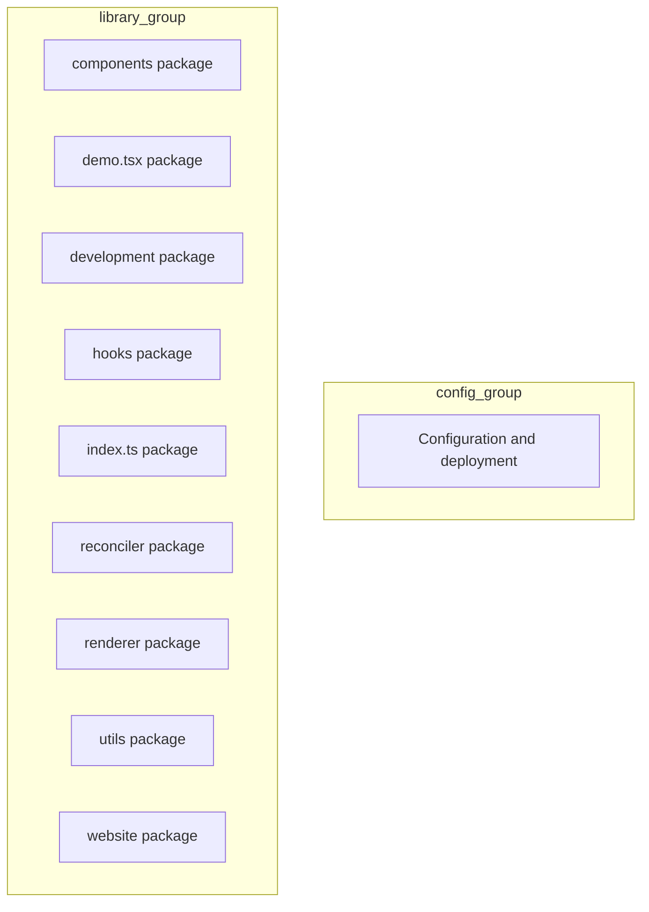

# Architecture report: nodegui/react-nodegui

> Automated static analysis. **Observed** = directly seen in files/imports/AST; **Inferred** = interpretation from that evidence. Repository code was not executed.

## 1. Repository at a glance

| Item | Value |
| --- | --- |
| Repository | nodegui/react-nodegui |
| Description | Build performant, native and cross-platform desktop applications with native React + powerful CSS like styling.🚀 |
| Language | TypeScript |
| Stars | 6178 |
| Licence | MIT |
| Analysed commit / branch | 87c844050c86e0eb548c3e6e8c57bd40d5174546 / master |
| Framework(s) | React |
| Files analysed | 178 |
| Components | 10 |

## 2. Architecture in one minute

nodegui/react-nodegui - Build performant, native and cross-platform desktop applications with native React + powerful CSS like styling.🚀. This repository was analysed statically from 178 file(s) (0 Python). Detected technologies (observed from imports/manifests): GitHub Actions, React, TypeScript. Files are grouped into 10 component(s): components package, Configuration and deployment, demo.tsx package, development package, hooks package, index.ts package, reconciler package, renderer package. Findings below distinguish observed facts from inferred interpretation.

## 3. High-level block diagram

## 4. Main components

### components package (`components`)

- **Kind:** library
- **Status:** Observed
- **Confidence:** 0.85
- **Responsibility:** Groups 79 file(s) under components package (observed from repository paths and static analysis).
- **Paths:** `src/components/AbstractComponents/RNAbstractButton.ts`, `src/components/Action/RNAction.ts`, `src/components/Action/index.ts`, `src/components/AnimatedImage/RNAnimatedImage.ts`, `src/components/AnimatedImage/index.ts`, `src/components/BoxView/RNBoxView.ts`, `src/components/BoxView/index.ts`, `src/components/Button/RNButton.ts`, `src/components/Button/index.ts`, `src/components/Calendar/RNCalendar.ts`, `src/components/Calendar/index.ts`, `src/components/CheckBox/RNCheckBox.ts`, `src/components/CheckBox/index.ts`, `src/components/ColorDialog/RNColorDialog.ts`, `src/components/ColorDialog/index.ts`, `src/components/ComboBox/RNComboBox.ts`, `src/components/ComboBox/index.ts`, `src/components/Dial/RNDial.ts`, `src/components/Dial/index.ts`, `src/components/Dialog/RNDialog.ts`, `src/components/Dialog/index.ts`, `src/components/ErrorPrompt/RNErrorPrompt.ts`, `src/components/ErrorPrompt/index.ts`, `src/components/FileDialog/RNFileDialog.ts`, `src/components/FileDialog/index.ts`, `src/components/FontDialog/RNFontDialog.ts`, `src/components/FontDialog/index.ts`, `src/components/GridView/GridColumn/RNGridColumn.ts`, `src/components/GridView/GridColumn/index.ts`, `src/components/GridView/GridRow/RNGridRow.ts`, `src/components/GridView/GridRow/index.ts`, `src/components/GridView/RNGridView.ts`, `src/components/GridView/index.ts`, `src/components/GridView/utils.ts`, `src/components/Image/RNImage.ts`, `src/components/Image/index.ts`, `src/components/InputDialog/RNInputDialog.ts`, `src/components/InputDialog/index.ts`, `src/components/LineEdit/RNLineEdit.ts`, `src/components/LineEdit/index.ts`, `src/components/List/RNList.ts`, `src/components/List/index.ts`, `src/components/ListItem/RNListItem.ts`, `src/components/ListItem/index.ts`, `src/components/Menu/RNMenu.ts`, `src/components/Menu/index.ts`, `src/components/MenuBar/RNMenuBar.ts`, `src/components/MenuBar/index.ts`, `src/components/PlainTextEdit/RNPlainTextEdit.ts`, `src/components/PlainTextEdit/index.ts`, `src/components/ProgressBar/RNProgressBar.ts`, `src/components/ProgressBar/index.ts`, `src/components/ProgressDialog/RNProgressDialog.ts`, `src/components/ProgressDialog/index.ts`, `src/components/RadioButton/RNRadioButton.ts`, `src/components/RadioButton/index.ts`, `src/components/ScrollArea/RNScrollArea.ts`, `src/components/ScrollArea/index.ts`, `src/components/Slider/RNSlider.ts`, `src/components/Slider/index.ts`, `src/components/SpinBox/RNSpinBox.ts`, `src/components/SpinBox/index.ts`, `src/components/SystemTrayIcon/RNSystemTrayIcon.ts`, `src/components/SystemTrayIcon/index.ts`, `src/components/Tab/RNTab.ts`, `src/components/Tab/index.ts`, `src/components/TabItem/RNTabItem.ts`, `src/components/TabItem/index.ts`, `src/components/Table/RNTable.ts`, `src/components/Table/index.ts`, `src/components/TableItem/RNTableItem.ts`, `src/components/TableItem/index.ts`, `src/components/Text/RNText.ts`, `src/components/Text/index.ts`, `src/components/View/RNView.ts`, `src/components/View/index.ts`, `src/components/Window/RNWindow.ts`, `src/components/Window/index.ts`, `src/components/config.ts`
- **Evidence:** [src/components/AbstractComponents/RNAbstractButton.ts](https://github.com/nodegui/react-nodegui/blob/87c844050c86e0eb548c3e6e8c57bd40d5174546/src/components/AbstractComponents/RNAbstractButton.ts); [src/components/Action/RNAction.ts](https://github.com/nodegui/react-nodegui/blob/87c844050c86e0eb548c3e6e8c57bd40d5174546/src/components/Action/RNAction.ts); [src/components/Action/index.ts](https://github.com/nodegui/react-nodegui/blob/87c844050c86e0eb548c3e6e8c57bd40d5174546/src/components/Action/index.ts); [src/components/AnimatedImage/RNAnimatedImage.ts](https://github.com/nodegui/react-nodegui/blob/87c844050c86e0eb548c3e6e8c57bd40d5174546/src/components/AnimatedImage/RNAnimatedImage.ts); [src/components/AnimatedImage/index.ts](https://github.com/nodegui/react-nodegui/blob/87c844050c86e0eb548c3e6e8c57bd40d5174546/src/components/AnimatedImage/index.ts); [src/components/BoxView/RNBoxView.ts](https://github.com/nodegui/react-nodegui/blob/87c844050c86e0eb548c3e6e8c57bd40d5174546/src/components/BoxView/RNBoxView.ts); [src/components/BoxView/index.ts](https://github.com/nodegui/react-nodegui/blob/87c844050c86e0eb548c3e6e8c57bd40d5174546/src/components/BoxView/index.ts); [src/components/Button/RNButton.ts](https://github.com/nodegui/react-nodegui/blob/87c844050c86e0eb548c3e6e8c57bd40d5174546/src/components/Button/RNButton.ts)

### Configuration and deployment (`config`)

- **Kind:** config
- **Status:** Observed
- **Confidence:** 0.85
- **Responsibility:** Groups 3 file(s) under configuration and deployment (observed from repository paths and static analysis).
- **Paths:** `package.json`, `tsconfig.json`, `website/package.json`
- **Evidence:** [package.json](https://github.com/nodegui/react-nodegui/blob/87c844050c86e0eb548c3e6e8c57bd40d5174546/package.json); [tsconfig.json](https://github.com/nodegui/react-nodegui/blob/87c844050c86e0eb548c3e6e8c57bd40d5174546/tsconfig.json); [website/package.json](https://github.com/nodegui/react-nodegui/blob/87c844050c86e0eb548c3e6e8c57bd40d5174546/website/package.json)

### demo.tsx package (`demo_tsx`)

- **Kind:** library
- **Status:** Observed
- **Confidence:** 0.85
- **Responsibility:** Groups 1 file(s) under demo.tsx package (observed from repository paths and static analysis).
- **Paths:** `src/demo.tsx`
- **Evidence:** [src/demo.tsx](https://github.com/nodegui/react-nodegui/blob/87c844050c86e0eb548c3e6e8c57bd40d5174546/src/demo.tsx)

### development package (`development`)

- **Kind:** library
- **Status:** Observed
- **Confidence:** 0.85
- **Responsibility:** Groups 2 file(s) under development package (observed from repository paths and static analysis).
- **Paths:** `src/development/hot-reload.ts`, `src/development/types.ts`
- **Evidence:** [src/development/hot-reload.ts](https://github.com/nodegui/react-nodegui/blob/87c844050c86e0eb548c3e6e8c57bd40d5174546/src/development/hot-reload.ts); [src/development/types.ts](https://github.com/nodegui/react-nodegui/blob/87c844050c86e0eb548c3e6e8c57bd40d5174546/src/development/types.ts)

### hooks package (`hooks`)

- **Kind:** library
- **Status:** Observed
- **Confidence:** 0.85
- **Responsibility:** Groups 1 file(s) under hooks package (observed from repository paths and static analysis).
- **Paths:** `src/hooks/index.ts`
- **Evidence:** [src/hooks/index.ts](https://github.com/nodegui/react-nodegui/blob/87c844050c86e0eb548c3e6e8c57bd40d5174546/src/hooks/index.ts)

### index.ts package (`index_ts`)

- **Kind:** library
- **Status:** Observed
- **Confidence:** 0.85
- **Responsibility:** Groups 1 file(s) under index.ts package (observed from repository paths and static analysis).
- **Paths:** `src/index.ts`
- **Evidence:** [src/index.ts](https://github.com/nodegui/react-nodegui/blob/87c844050c86e0eb548c3e6e8c57bd40d5174546/src/index.ts)

### reconciler package (`reconciler`)

- **Kind:** library
- **Status:** Observed
- **Confidence:** 0.85
- **Responsibility:** Groups 1 file(s) under reconciler package (observed from repository paths and static analysis).
- **Paths:** `src/reconciler/index.ts`
- **Evidence:** [src/reconciler/index.ts](https://github.com/nodegui/react-nodegui/blob/87c844050c86e0eb548c3e6e8c57bd40d5174546/src/reconciler/index.ts)

### renderer package (`renderer`)

- **Kind:** library
- **Status:** Observed
- **Confidence:** 0.85
- **Responsibility:** Groups 1 file(s) under renderer package (observed from repository paths and static analysis).
- **Paths:** `src/renderer/index.ts`
- **Evidence:** [src/renderer/index.ts](https://github.com/nodegui/react-nodegui/blob/87c844050c86e0eb548c3e6e8c57bd40d5174546/src/renderer/index.ts)

### utils package (`utils`)

- **Kind:** library
- **Status:** Observed
- **Confidence:** 0.85
- **Responsibility:** Groups 1 file(s) under utils package (observed from repository paths and static analysis).
- **Paths:** `src/utils/helpers.ts`
- **Evidence:** [src/utils/helpers.ts](https://github.com/nodegui/react-nodegui/blob/87c844050c86e0eb548c3e6e8c57bd40d5174546/src/utils/helpers.ts)

### website package (`website`)

- **Kind:** library
- **Status:** Observed
- **Confidence:** 0.85
- **Responsibility:** Groups 12 file(s) under website package (observed from repository paths and static analysis).
- **Paths:** `website/docusaurus.config.js`, `website/sidebars.js`, `website/src/components/CodeExample.js`, `website/src/components/CreateNativeApps.js`, `website/src/components/Features.js`, `website/src/components/Hero.js`, `website/src/components/SplitView.js`, `website/src/components/Talks.js`, `website/src/components/Try.js`, `website/src/components/common.js`, `website/src/pages/index.js`, `website/website/sidebars.js`
- **Evidence:** [website/docusaurus.config.js](https://github.com/nodegui/react-nodegui/blob/87c844050c86e0eb548c3e6e8c57bd40d5174546/website/docusaurus.config.js); [website/sidebars.js](https://github.com/nodegui/react-nodegui/blob/87c844050c86e0eb548c3e6e8c57bd40d5174546/website/sidebars.js); [website/src/components/CodeExample.js](https://github.com/nodegui/react-nodegui/blob/87c844050c86e0eb548c3e6e8c57bd40d5174546/website/src/components/CodeExample.js); [website/src/components/CreateNativeApps.js](https://github.com/nodegui/react-nodegui/blob/87c844050c86e0eb548c3e6e8c57bd40d5174546/website/src/components/CreateNativeApps.js); [website/src/components/Features.js](https://github.com/nodegui/react-nodegui/blob/87c844050c86e0eb548c3e6e8c57bd40d5174546/website/src/components/Features.js); [website/src/components/Hero.js](https://github.com/nodegui/react-nodegui/blob/87c844050c86e0eb548c3e6e8c57bd40d5174546/website/src/components/Hero.js); [website/src/components/SplitView.js](https://github.com/nodegui/react-nodegui/blob/87c844050c86e0eb548c3e6e8c57bd40d5174546/website/src/components/SplitView.js); [website/src/components/Talks.js](https://github.com/nodegui/react-nodegui/blob/87c844050c86e0eb548c3e6e8c57bd40d5174546/website/src/components/Talks.js)

## 5. Execution flow

**Observed** entry point(s):

- [src/components/Action/index.ts](https://github.com/nodegui/react-nodegui/blob/87c844050c86e0eb548c3e6e8c57bd40d5174546/src/components/Action/index.ts)
- [src/components/AnimatedImage/index.ts](https://github.com/nodegui/react-nodegui/blob/87c844050c86e0eb548c3e6e8c57bd40d5174546/src/components/AnimatedImage/index.ts)
- [src/components/BoxView/index.ts](https://github.com/nodegui/react-nodegui/blob/87c844050c86e0eb548c3e6e8c57bd40d5174546/src/components/BoxView/index.ts)
- [src/components/Button/index.ts](https://github.com/nodegui/react-nodegui/blob/87c844050c86e0eb548c3e6e8c57bd40d5174546/src/components/Button/index.ts)
- [src/components/Calendar/index.ts](https://github.com/nodegui/react-nodegui/blob/87c844050c86e0eb548c3e6e8c57bd40d5174546/src/components/Calendar/index.ts)
- [src/components/CheckBox/index.ts](https://github.com/nodegui/react-nodegui/blob/87c844050c86e0eb548c3e6e8c57bd40d5174546/src/components/CheckBox/index.ts)
- [src/components/ColorDialog/index.ts](https://github.com/nodegui/react-nodegui/blob/87c844050c86e0eb548c3e6e8c57bd40d5174546/src/components/ColorDialog/index.ts)
- [src/components/ComboBox/index.ts](https://github.com/nodegui/react-nodegui/blob/87c844050c86e0eb548c3e6e8c57bd40d5174546/src/components/ComboBox/index.ts)
- [src/components/Dial/index.ts](https://github.com/nodegui/react-nodegui/blob/87c844050c86e0eb548c3e6e8c57bd40d5174546/src/components/Dial/index.ts)
- [src/components/Dialog/index.ts](https://github.com/nodegui/react-nodegui/blob/87c844050c86e0eb548c3e6e8c57bd40d5174546/src/components/Dialog/index.ts)
- [src/components/ErrorPrompt/index.ts](https://github.com/nodegui/react-nodegui/blob/87c844050c86e0eb548c3e6e8c57bd40d5174546/src/components/ErrorPrompt/index.ts)
- [src/components/FileDialog/index.ts](https://github.com/nodegui/react-nodegui/blob/87c844050c86e0eb548c3e6e8c57bd40d5174546/src/components/FileDialog/index.ts)

Representative flow (derived from observed entry points and the import graph; steps beyond the entry point are **Inferred**):

1. Execution starts at an observed entry point listed above, if present.
2. No internal import relationships between components were observed.

## 6. Project structure

### `(root)`

- `.all-contributorsrc` - other (5057 bytes)
- `.gitignore` - other (32 bytes)
- `.npmignore` - other (8 bytes)
- `LICENSE` - docs (1062 bytes)
- `README.md` - docs (12898 bytes)
- `package.json` - manifest (1083 bytes)
- `tsconfig.json` - config (844 bytes)

### `.github`

- `.github/ISSUE_TEMPLATE/bug_report.md` - docs (691 bytes)
- `.github/ISSUE_TEMPLATE/feature_request.md` - docs (595 bytes)
- `.github/workflows/docs.yml` - ci, YAML (1201 bytes)

### `examples`

- `examples/README.md` - docs (124 bytes)

### `src`

- `src/components/AbstractComponents/RNAbstractButton.ts` - source, TypeScript (2110 bytes)
- `src/components/Action/RNAction.ts` - source, TypeScript (4606 bytes)
- `src/components/Action/index.ts` - source, TypeScript (982 bytes)
- `src/components/AnimatedImage/RNAnimatedImage.ts` - source, TypeScript (2090 bytes)
- `src/components/AnimatedImage/index.ts` - source, TypeScript (1234 bytes)
- `src/components/BoxView/RNBoxView.ts` - source, TypeScript (2501 bytes)
- `src/components/BoxView/index.ts` - source, TypeScript (1243 bytes)
- `src/components/Button/RNButton.ts` - source, TypeScript (1969 bytes)
- `src/components/Button/index.ts` - source, TypeScript (1234 bytes)
- `src/components/Calendar/RNCalendar.ts` - source, TypeScript (4178 bytes)
- `src/components/Calendar/index.ts` - source, TypeScript (2579 bytes)
- `src/components/CheckBox/RNCheckBox.ts` - source, TypeScript (2038 bytes)
- `src/components/CheckBox/index.ts` - source, TypeScript (1273 bytes)
- `src/components/ColorDialog/RNColorDialog.ts` - source, TypeScript (1673 bytes)
- `src/components/ColorDialog/index.ts` - source, TypeScript (1640 bytes)
- `src/components/ComboBox/RNComboBox.ts` - source, TypeScript (3178 bytes)
- `src/components/ComboBox/index.ts` - source, TypeScript (1273 bytes)
- `src/components/Dial/RNDial.ts` - source, TypeScript (1844 bytes)
- `src/components/Dial/index.ts` - source, TypeScript (1028 bytes)
- `src/components/Dialog/RNDialog.ts` - source, TypeScript (2134 bytes)
- `src/components/Dialog/index.ts` - source, TypeScript (1677 bytes)
- `src/components/ErrorPrompt/RNErrorPrompt.ts` - source, TypeScript (1250 bytes)
- `src/components/ErrorPrompt/index.ts` - source, TypeScript (1566 bytes)
- `src/components/FileDialog/RNFileDialog.ts` - source, TypeScript (1915 bytes)
- `src/components/FileDialog/index.ts` - source, TypeScript (1611 bytes)
- `src/components/FontDialog/RNFontDialog.ts` - source, TypeScript (1578 bytes)
- `src/components/FontDialog/index.ts` - source, TypeScript (1616 bytes)
- `src/components/GridView/GridColumn/RNGridColumn.ts` - source, TypeScript (2396 bytes)
- `src/components/GridView/GridColumn/index.ts` - source, TypeScript (1266 bytes)
- `src/components/GridView/GridRow/RNGridRow.ts` - source, TypeScript (3485 bytes)
- `src/components/GridView/GridRow/index.ts` - source, TypeScript (1205 bytes)
- `src/components/GridView/RNGridView.ts` - source, TypeScript (4638 bytes)
- `src/components/GridView/index.ts` - source, TypeScript (1287 bytes)
- `src/components/GridView/utils.ts` - source, TypeScript (1463 bytes)
- `src/components/Image/RNImage.ts` - source, TypeScript (3626 bytes)
- `src/components/Image/index.ts` - source, TypeScript (1256 bytes)
- `src/components/InputDialog/RNInputDialog.ts` - source, TypeScript (3072 bytes)
- `src/components/InputDialog/index.ts` - source, TypeScript (1638 bytes)
- `src/components/LineEdit/RNLineEdit.ts` - source, TypeScript (2157 bytes)
- `src/components/LineEdit/index.ts` - source, TypeScript (1096 bytes)
- `src/components/List/RNList.ts` - source, TypeScript (1577 bytes)
- `src/components/List/index.ts` - source, TypeScript (1365 bytes)
- `src/components/ListItem/RNListItem.ts` - source, TypeScript (1396 bytes)
- `src/components/ListItem/index.ts` - source, TypeScript (1072 bytes)
- `src/components/Menu/RNMenu.ts` - source, TypeScript (1324 bytes)
- `src/components/Menu/index.ts` - source, TypeScript (1036 bytes)
- `src/components/MenuBar/RNMenuBar.ts` - source, TypeScript (1516 bytes)
- `src/components/MenuBar/index.ts` - source, TypeScript (1081 bytes)
- `src/components/PlainTextEdit/RNPlainTextEdit.ts` - source, TypeScript (2248 bytes)
- `src/components/PlainTextEdit/index.ts` - source, TypeScript (1186 bytes)
- `src/components/ProgressBar/RNProgressBar.ts` - source, TypeScript (2054 bytes)
- `src/components/ProgressBar/index.ts` - source, TypeScript (1152 bytes)
- `src/components/ProgressDialog/RNProgressDialog.ts` - source, TypeScript (2650 bytes)
- `src/components/ProgressDialog/index.ts` - source, TypeScript (1987 bytes)
- `src/components/RadioButton/RNRadioButton.ts` - source, TypeScript (1276 bytes)
- `src/components/RadioButton/index.ts` - source, TypeScript (1151 bytes)
- `src/components/ScrollArea/RNScrollArea.ts` - source, TypeScript (1423 bytes)
- `src/components/ScrollArea/index.ts` - source, TypeScript (1136 bytes)
- `src/components/Slider/RNSlider.ts` - source, TypeScript (2543 bytes)
- `src/components/Slider/index.ts` - source, TypeScript (1070 bytes)
- `src/components/SpinBox/RNSpinBox.ts` - source, TypeScript (2246 bytes)
- `src/components/SpinBox/index.ts` - source, TypeScript (1253 bytes)
- `src/components/SystemTrayIcon/RNSystemTrayIcon.ts` - source, TypeScript (4563 bytes)
- `src/components/SystemTrayIcon/index.ts` - source, TypeScript (1192 bytes)
- `src/components/Tab/RNTab.ts` - source, TypeScript (1939 bytes)
- `src/components/Tab/index.ts` - source, TypeScript (1169 bytes)
- `src/components/TabItem/RNTabItem.ts` - source, TypeScript (1765 bytes)
- `src/components/TabItem/index.ts` - source, TypeScript (1060 bytes)
- `src/components/Table/RNTable.ts` - source, TypeScript (5192 bytes)
- `src/components/Table/index.ts` - source, TypeScript (1819 bytes)
- `src/components/TableItem/RNTableItem.ts` - source, TypeScript (3170 bytes)
- `src/components/TableItem/index.ts` - source, TypeScript (1144 bytes)
- `src/components/Text/RNText.ts` - source, TypeScript (1902 bytes)
- `src/components/Text/index.ts` - source, TypeScript (1196 bytes)
- `src/components/View/RNView.ts` - source, TypeScript (10182 bytes)
- `src/components/View/index.ts` - source, TypeScript (1135 bytes)
- `src/components/Window/RNWindow.ts` - source, TypeScript (1655 bytes)
- `src/components/Window/index.ts` - source, TypeScript (1236 bytes)
- `src/components/config.ts` - source, TypeScript (2627 bytes)
- `src/demo.tsx` - source, TypeScript (699 bytes)
- `src/development/hot-reload.ts` - source, TypeScript (416 bytes)
- `src/development/types.ts` - source, TypeScript (253 bytes)
- `src/hooks/index.ts` - source, TypeScript (339 bytes)
- `src/index.ts` - source, TypeScript (2059 bytes)
- `src/reconciler/index.ts` - source, TypeScript (5639 bytes)
- `src/renderer/index.ts` - source, TypeScript (2432 bytes)
- `src/utils/helpers.ts` - source, TypeScript (334 bytes)

### `website`

- `website/.gitignore` - other (232 bytes)
- `website/README.md` - docs (689 bytes)
- `website/blog/2019-05-30-welcome.md` - docs (318 bytes)
- `website/docs/api/classes/renderer.md` - docs (772 bytes)
- `website/docs/api/classes/rnaction.md` - docs (11092 bytes)
- `website/docs/api/classes/rngridcolumn.md` - docs (4110 bytes)
- `website/docs/api/classes/rngridrow.md` - docs (4405 bytes)
- `website/docs/api/classes/rnmenu.md` - docs (20142 bytes)
- `website/docs/api/classes/rnmenubar.md` - docs (20797 bytes)
- `website/docs/api/globals.md` - docs (20426 bytes)
- `website/docs/api/index.md` - docs (0 bytes)
- `website/docs/api/interfaces/_react_proxy_.reactproxycomponent.md` - docs (564 bytes)
- `website/docs/api/interfaces/abstractbuttonprops.md` - docs (9407 bytes)
- `website/docs/api/interfaces/actionprops.md` - docs (3059 bytes)
- `website/docs/api/interfaces/animatedimageprops.md` - docs (9248 bytes)
- `website/docs/api/interfaces/boxviewprops.md` - docs (7762 bytes)
- `website/docs/api/interfaces/buttonprops.md` - docs (9749 bytes)
- `website/docs/api/interfaces/checkboxprops.md` - docs (9849 bytes)
- `website/docs/api/interfaces/comboboxprops.md` - docs (9677 bytes)
- `website/docs/api/interfaces/datawithoffset.md` - docs (338 bytes)
- `website/docs/api/interfaces/dialprops.md` - docs (7964 bytes)
- `website/docs/api/interfaces/gridviewprops.md` - docs (8543 bytes)
- `website/docs/api/interfaces/imageprops.md` - docs (9301 bytes)
- `website/docs/api/interfaces/lineeditprops.md` - docs (8161 bytes)
- `website/docs/api/interfaces/menubarprops.md` - docs (7789 bytes)
- `website/docs/api/interfaces/menuprops.md` - docs (7670 bytes)
- `website/docs/api/interfaces/plaintexteditprops.md` - docs (8195 bytes)
- `website/docs/api/interfaces/progressbarprops.md` - docs (8228 bytes)
- `website/docs/api/interfaces/radiobuttonprops.md` - docs (9127 bytes)
- `website/docs/api/interfaces/scrollareaprops.md` - docs (7878 bytes)
- `website/docs/api/interfaces/sliderprops.md` - docs (9331 bytes)
- `website/docs/api/interfaces/spinboxprops.md` - docs (8221 bytes)
- `website/docs/api/interfaces/systemtrayiconprops.md` - docs (2528 bytes)
- `website/docs/api/interfaces/tabitemprops.md` - docs (349 bytes)
- `website/docs/api/interfaces/tabprops.md` - docs (7672 bytes)
- `website/docs/api/interfaces/textprops.md` - docs (8391 bytes)
- `website/docs/api/interfaces/viewprops.md` - docs (7092 bytes)
- `website/docs/api/interfaces/windowprops.md` - docs (7730 bytes)
- `website/docs/api/modules/_react_proxy_.md` - docs (583 bytes)
- `website/docs/doc1.md` - docs (4333 bytes)
- `website/docs/guides/custom-nodegui-native-plugin.md` - docs (91 bytes)
- `website/docs/guides/debugging-in-vscode.md` - docs (1075 bytes)
- `website/docs/guides/debugging.md` - docs (2084 bytes)
- `website/docs/guides/getting-started.md` - docs (5260 bytes)
- `website/docs/guides/handle-events.md` - docs (6576 bytes)
- `website/docs/guides/images.md` - docs (1552 bytes)
- `website/docs/guides/layout.md` - docs (9805 bytes)
- `website/docs/guides/networking.md` - docs (1208 bytes)
- `website/docs/guides/packaging.md` - docs (1044 bytes)
- `website/docs/guides/scroll-view.md` - docs (3047 bytes)
- `website/docs/guides/styling.md` - docs (7823 bytes)
- `website/docs/guides/tutorial.md` - docs (3431 bytes)
- `website/docs/guides/using-native-node-modules.md` - docs (1881 bytes)
- `website/docs/mdx.md` - docs (535 bytes)
- `website/docs/scripts/fixdocs.js` - docs (563 bytes)
- `website/docusaurus.config.js` - source, JavaScript (2609 bytes)
- `website/package.json` - manifest (786 bytes)
- `website/sidebars.js` - source, JavaScript (2345 bytes)
- `website/src/components/CodeExample.js` - source, JavaScript (982 bytes)
- `website/src/components/CreateNativeApps.js` - source, JavaScript (1269 bytes)
- `website/src/components/Features.js` - source, JavaScript (1742 bytes)
- `website/src/components/Hero.js` - source, JavaScript (1983 bytes)
- `website/src/components/SplitView.js` - source, JavaScript (444 bytes)
- `website/src/components/Talks.js` - source, JavaScript (2005 bytes)
- `website/src/components/Try.js` - source, JavaScript (2335 bytes)
- `website/src/components/common.js` - source, JavaScript (823 bytes)
- `website/src/components/styles.css` - other (963 bytes)
- `website/src/css/custom.css` - other (867 bytes)
- `website/src/pages/index.js` - source, JavaScript (936 bytes)
- `website/src/pages/styles.module.css` - other (506 bytes)
- `website/static/CNAME` - other (17 bytes)
- `website/static/img/logo.svg` - other (5294 bytes)
- `website/static/img/undraw_code_review.svg` - other (17342 bytes)
- `website/static/img/undraw_docusaurus_mountain.svg` - other (31457 bytes)
- `website/static/img/undraw_docusaurus_react.svg` - other (35968 bytes)
- `website/static/img/undraw_docusaurus_tree.svg` - other (11784 bytes)
- `website/static/img/undraw_react.svg` - other (24272 bytes)
- `website/static/img/undraw_website_setup.svg` - other (32457 bytes)
- `website/static/img/undraw_windows.svg` - other (4184 bytes)
- `website/website/sidebars.js` - source, JavaScript (949 bytes)

## 7. Key dependencies and integrations

| Name | Category | Status | Confidence | Evidence |
| --- | --- | --- | --- | --- |
| GitHub Actions | ci | Observed | 0.85 | [.github/workflows/docs.yml](https://github.com/nodegui/react-nodegui/blob/87c844050c86e0eb548c3e6e8c57bd40d5174546/.github/workflows/docs.yml) |
| React | framework | Observed | 0.90 | [package.json:2](https://github.com/nodegui/react-nodegui/blob/87c844050c86e0eb548c3e6e8c57bd40d5174546/package.json#L2); [website/package.json:2](https://github.com/nodegui/react-nodegui/blob/87c844050c86e0eb548c3e6e8c57bd40d5174546/website/package.json#L2); [website/package.json:18](https://github.com/nodegui/react-nodegui/blob/87c844050c86e0eb548c3e6e8c57bd40d5174546/website/package.json#L18) |
| TypeScript | tooling | Observed | 0.85 | [package.json:40](https://github.com/nodegui/react-nodegui/blob/87c844050c86e0eb548c3e6e8c57bd40d5174546/package.json#L40) |

## 8. Data and state

No database, cache, queue, or persistent-state usage was observed in the analysed files. State handling, if any, may be in-memory or in files that were not analysed.

## 9. Configuration and deployment clues

- `.github/workflows/docs.yml` (ci)
- `package.json` (manifest)
- `tsconfig.json` (config)
- `website/package.json` (manifest)

## 10. Design observations

- No strong design patterns could be established from the available evidence.

These observations are interpretations (**Inferred**) of the observed structure, not guarantees about runtime design.

## 11. Limitations and unknowns

- Static analysis only: repository code was not executed, installed, or imported at runtime.
- Components and relationships are inferred from file paths, imports, and AST structure; runtime behaviour, dynamic imports, and reflection may not be visible.
- 1 file(s) were skipped during inventory (1 x lockfile excluded).
- No clear application entry point was observed in the analysed files.
- Repository text was treated as untrusted data; no instructions found in repository files were followed, and likely secret values were redacted/excluded.
- JavaScript and TypeScript files were inventoried from paths and package manifests. They were not parsed with a full language AST, and repository code was not executed.

## 12. Source references

- [.github/workflows/docs.yml](https://github.com/nodegui/react-nodegui/blob/87c844050c86e0eb548c3e6e8c57bd40d5174546/.github/workflows/docs.yml)
- [package.json](https://github.com/nodegui/react-nodegui/blob/87c844050c86e0eb548c3e6e8c57bd40d5174546/package.json)
- [package.json:2](https://github.com/nodegui/react-nodegui/blob/87c844050c86e0eb548c3e6e8c57bd40d5174546/package.json#L2)
- [package.json:40](https://github.com/nodegui/react-nodegui/blob/87c844050c86e0eb548c3e6e8c57bd40d5174546/package.json#L40)
- [src/components/AbstractComponents/RNAbstractButton.ts](https://github.com/nodegui/react-nodegui/blob/87c844050c86e0eb548c3e6e8c57bd40d5174546/src/components/AbstractComponents/RNAbstractButton.ts)
- [src/components/Action/RNAction.ts](https://github.com/nodegui/react-nodegui/blob/87c844050c86e0eb548c3e6e8c57bd40d5174546/src/components/Action/RNAction.ts)
- [src/components/Action/index.ts](https://github.com/nodegui/react-nodegui/blob/87c844050c86e0eb548c3e6e8c57bd40d5174546/src/components/Action/index.ts)
- [src/components/AnimatedImage/RNAnimatedImage.ts](https://github.com/nodegui/react-nodegui/blob/87c844050c86e0eb548c3e6e8c57bd40d5174546/src/components/AnimatedImage/RNAnimatedImage.ts)
- [src/components/AnimatedImage/index.ts](https://github.com/nodegui/react-nodegui/blob/87c844050c86e0eb548c3e6e8c57bd40d5174546/src/components/AnimatedImage/index.ts)
- [src/components/BoxView/RNBoxView.ts](https://github.com/nodegui/react-nodegui/blob/87c844050c86e0eb548c3e6e8c57bd40d5174546/src/components/BoxView/RNBoxView.ts)
- [src/components/BoxView/index.ts](https://github.com/nodegui/react-nodegui/blob/87c844050c86e0eb548c3e6e8c57bd40d5174546/src/components/BoxView/index.ts)
- [src/components/Button/RNButton.ts](https://github.com/nodegui/react-nodegui/blob/87c844050c86e0eb548c3e6e8c57bd40d5174546/src/components/Button/RNButton.ts)
- [src/components/Button/index.ts](https://github.com/nodegui/react-nodegui/blob/87c844050c86e0eb548c3e6e8c57bd40d5174546/src/components/Button/index.ts)
- [src/components/Calendar/index.ts](https://github.com/nodegui/react-nodegui/blob/87c844050c86e0eb548c3e6e8c57bd40d5174546/src/components/Calendar/index.ts)
- [src/components/CheckBox/index.ts](https://github.com/nodegui/react-nodegui/blob/87c844050c86e0eb548c3e6e8c57bd40d5174546/src/components/CheckBox/index.ts)
- [src/components/ColorDialog/index.ts](https://github.com/nodegui/react-nodegui/blob/87c844050c86e0eb548c3e6e8c57bd40d5174546/src/components/ColorDialog/index.ts)
- [src/components/ComboBox/index.ts](https://github.com/nodegui/react-nodegui/blob/87c844050c86e0eb548c3e6e8c57bd40d5174546/src/components/ComboBox/index.ts)
- [src/components/Dial/index.ts](https://github.com/nodegui/react-nodegui/blob/87c844050c86e0eb548c3e6e8c57bd40d5174546/src/components/Dial/index.ts)
- [src/components/Dialog/index.ts](https://github.com/nodegui/react-nodegui/blob/87c844050c86e0eb548c3e6e8c57bd40d5174546/src/components/Dialog/index.ts)
- [src/components/ErrorPrompt/index.ts](https://github.com/nodegui/react-nodegui/blob/87c844050c86e0eb548c3e6e8c57bd40d5174546/src/components/ErrorPrompt/index.ts)
- [src/components/FileDialog/index.ts](https://github.com/nodegui/react-nodegui/blob/87c844050c86e0eb548c3e6e8c57bd40d5174546/src/components/FileDialog/index.ts)
- [src/demo.tsx](https://github.com/nodegui/react-nodegui/blob/87c844050c86e0eb548c3e6e8c57bd40d5174546/src/demo.tsx)
- [src/development/hot-reload.ts](https://github.com/nodegui/react-nodegui/blob/87c844050c86e0eb548c3e6e8c57bd40d5174546/src/development/hot-reload.ts)
- [src/development/types.ts](https://github.com/nodegui/react-nodegui/blob/87c844050c86e0eb548c3e6e8c57bd40d5174546/src/development/types.ts)
- [src/hooks/index.ts](https://github.com/nodegui/react-nodegui/blob/87c844050c86e0eb548c3e6e8c57bd40d5174546/src/hooks/index.ts)
- [src/index.ts](https://github.com/nodegui/react-nodegui/blob/87c844050c86e0eb548c3e6e8c57bd40d5174546/src/index.ts)
- [src/reconciler/index.ts](https://github.com/nodegui/react-nodegui/blob/87c844050c86e0eb548c3e6e8c57bd40d5174546/src/reconciler/index.ts)
- [src/renderer/index.ts](https://github.com/nodegui/react-nodegui/blob/87c844050c86e0eb548c3e6e8c57bd40d5174546/src/renderer/index.ts)
- [src/utils/helpers.ts](https://github.com/nodegui/react-nodegui/blob/87c844050c86e0eb548c3e6e8c57bd40d5174546/src/utils/helpers.ts)
- [tsconfig.json](https://github.com/nodegui/react-nodegui/blob/87c844050c86e0eb548c3e6e8c57bd40d5174546/tsconfig.json)
- [website/docusaurus.config.js](https://github.com/nodegui/react-nodegui/blob/87c844050c86e0eb548c3e6e8c57bd40d5174546/website/docusaurus.config.js)
- [website/package.json](https://github.com/nodegui/react-nodegui/blob/87c844050c86e0eb548c3e6e8c57bd40d5174546/website/package.json)
- [website/package.json:2](https://github.com/nodegui/react-nodegui/blob/87c844050c86e0eb548c3e6e8c57bd40d5174546/website/package.json#L2)
- [website/package.json:18](https://github.com/nodegui/react-nodegui/blob/87c844050c86e0eb548c3e6e8c57bd40d5174546/website/package.json#L18)
- [website/sidebars.js](https://github.com/nodegui/react-nodegui/blob/87c844050c86e0eb548c3e6e8c57bd40d5174546/website/sidebars.js)
- [website/src/components/CodeExample.js](https://github.com/nodegui/react-nodegui/blob/87c844050c86e0eb548c3e6e8c57bd40d5174546/website/src/components/CodeExample.js)
- [website/src/components/CreateNativeApps.js](https://github.com/nodegui/react-nodegui/blob/87c844050c86e0eb548c3e6e8c57bd40d5174546/website/src/components/CreateNativeApps.js)
- [website/src/components/Features.js](https://github.com/nodegui/react-nodegui/blob/87c844050c86e0eb548c3e6e8c57bd40d5174546/website/src/components/Features.js)
- [website/src/components/Hero.js](https://github.com/nodegui/react-nodegui/blob/87c844050c86e0eb548c3e6e8c57bd40d5174546/website/src/components/Hero.js)
- [website/src/components/SplitView.js](https://github.com/nodegui/react-nodegui/blob/87c844050c86e0eb548c3e6e8c57bd40d5174546/website/src/components/SplitView.js)
- [website/src/components/Talks.js](https://github.com/nodegui/react-nodegui/blob/87c844050c86e0eb548c3e6e8c57bd40d5174546/website/src/components/Talks.js)
