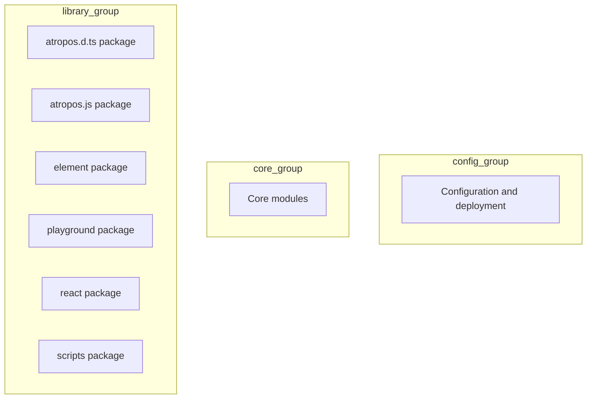

# Architecture report: nolimits4web/atropos

> Automated static analysis. **Observed** = directly seen in files/imports/AST; **Inferred** = interpretation from that evidence. Repository code was not executed.

## 1. Repository at a glance

| Item | Value |
| --- | --- |
| Repository | nolimits4web/atropos |
| Description | Stunning touch-friendly 3D parallax hover effects |
| Language | JavaScript |
| Stars | 3614 |
| Licence | MIT |
| Analysed commit / branch | eb4b4c5682117a53f60fccd459f64d06a99e9445 / master |
| Framework(s) | React |
| Files analysed | 74 |
| Components | 8 |

## 2. Architecture in one minute

nolimits4web/atropos - Stunning touch-friendly 3D parallax hover effects. This repository was analysed statically from 74 file(s) (0 Python). Detected technologies (observed from imports/manifests): React, Vite. Files are grouped into 8 component(s): atropos.d.ts package, atropos.js package, Configuration and deployment, Core modules, element package, playground package, react package, scripts package. Findings below distinguish observed facts from inferred interpretation.

## 3. High-level block diagram

## 4. Main components

### atropos.d.ts package (`atropos_d_ts`)

- **Kind:** library
- **Status:** Observed
- **Confidence:** 0.85
- **Responsibility:** Groups 1 file(s) under atropos.d.ts package (observed from repository paths and static analysis).
- **Paths:** `src/atropos.d.ts`
- **Evidence:** [src/atropos.d.ts](https://github.com/nolimits4web/atropos/blob/eb4b4c5682117a53f60fccd459f64d06a99e9445/src/atropos.d.ts)

### atropos.js package (`atropos_js`)

- **Kind:** library
- **Status:** Observed
- **Confidence:** 0.85
- **Responsibility:** Groups 1 file(s) under atropos.js package (observed from repository paths and static analysis).
- **Paths:** `src/atropos.js`
- **Evidence:** [src/atropos.js](https://github.com/nolimits4web/atropos/blob/eb4b4c5682117a53f60fccd459f64d06a99e9445/src/atropos.js)

### Configuration and deployment (`config`)

- **Kind:** config
- **Status:** Observed
- **Confidence:** 0.85
- **Responsibility:** Groups 2 file(s) under configuration and deployment (observed from repository paths and static analysis).
- **Paths:** `package.json`, `package/package.json`
- **Evidence:** [package.json](https://github.com/nolimits4web/atropos/blob/eb4b4c5682117a53f60fccd459f64d06a99e9445/package.json); [package/package.json](https://github.com/nolimits4web/atropos/blob/eb4b4c5682117a53f60fccd459f64d06a99e9445/package/package.json)

### Core modules (`core`)

- **Kind:** core
- **Status:** Observed
- **Confidence:** 0.85
- **Responsibility:** Groups 3 file(s) under core modules (observed from repository paths and static analysis).
- **Paths:** `babel.config.js`, `babel.config.react.js`, `babel.config.vue.js`
- **Evidence:** [babel.config.js](https://github.com/nolimits4web/atropos/blob/eb4b4c5682117a53f60fccd459f64d06a99e9445/babel.config.js); [babel.config.react.js](https://github.com/nolimits4web/atropos/blob/eb4b4c5682117a53f60fccd459f64d06a99e9445/babel.config.react.js); [babel.config.vue.js](https://github.com/nolimits4web/atropos/blob/eb4b4c5682117a53f60fccd459f64d06a99e9445/babel.config.vue.js)

### element package (`element`)

- **Kind:** library
- **Status:** Observed
- **Confidence:** 0.85
- **Responsibility:** Groups 2 file(s) under element package (observed from repository paths and static analysis).
- **Paths:** `src/element/atropos-element.d.ts`, `src/element/atropos-element.js`
- **Evidence:** [src/element/atropos-element.d.ts](https://github.com/nolimits4web/atropos/blob/eb4b4c5682117a53f60fccd459f64d06a99e9445/src/element/atropos-element.d.ts); [src/element/atropos-element.js](https://github.com/nolimits4web/atropos/blob/eb4b4c5682117a53f60fccd459f64d06a99e9445/src/element/atropos-element.js)

### playground package (`playground`)

- **Kind:** library
- **Status:** Observed
- **Confidence:** 0.85
- **Responsibility:** Groups 3 file(s) under playground package (observed from repository paths and static analysis).
- **Paths:** `playground/element/main.js`, `playground/react/App.jsx`, `playground/react/main.js`
- **Evidence:** [playground/element/main.js](https://github.com/nolimits4web/atropos/blob/eb4b4c5682117a53f60fccd459f64d06a99e9445/playground/element/main.js); [playground/react/App.jsx](https://github.com/nolimits4web/atropos/blob/eb4b4c5682117a53f60fccd459f64d06a99e9445/playground/react/App.jsx); [playground/react/main.js](https://github.com/nolimits4web/atropos/blob/eb4b4c5682117a53f60fccd459f64d06a99e9445/playground/react/main.js)

### react package (`react`)

- **Kind:** library
- **Status:** Observed
- **Confidence:** 0.85
- **Responsibility:** Groups 2 file(s) under react package (observed from repository paths and static analysis).
- **Paths:** `src/react/atropos-react.d.ts`, `src/react/atropos-react.js`
- **Evidence:** [src/react/atropos-react.d.ts](https://github.com/nolimits4web/atropos/blob/eb4b4c5682117a53f60fccd459f64d06a99e9445/src/react/atropos-react.d.ts); [src/react/atropos-react.js](https://github.com/nolimits4web/atropos/blob/eb4b4c5682117a53f60fccd459f64d06a99e9445/src/react/atropos-react.js)

### scripts package (`scripts`)

- **Kind:** library
- **Status:** Observed
- **Confidence:** 0.85
- **Responsibility:** Groups 14 file(s) under scripts package (observed from repository paths and static analysis).
- **Paths:** `scripts/banner.js`, `scripts/build-element.js`, `scripts/build-js.js`, `scripts/build-react.js`, `scripts/build-sponsors.mjs`, `scripts/build-styles.js`, `scripts/build-types.js`, `scripts/build.js`, `scripts/release.js`, `scripts/utils/autoprefixer.js`, `scripts/utils/clean-css.js`, `scripts/utils/fs-extra.js`, `scripts/utils/less.js`, `scripts/watch.js`
- **Evidence:** [scripts/banner.js](https://github.com/nolimits4web/atropos/blob/eb4b4c5682117a53f60fccd459f64d06a99e9445/scripts/banner.js); [scripts/build-element.js](https://github.com/nolimits4web/atropos/blob/eb4b4c5682117a53f60fccd459f64d06a99e9445/scripts/build-element.js); [scripts/build-js.js](https://github.com/nolimits4web/atropos/blob/eb4b4c5682117a53f60fccd459f64d06a99e9445/scripts/build-js.js); [scripts/build-react.js](https://github.com/nolimits4web/atropos/blob/eb4b4c5682117a53f60fccd459f64d06a99e9445/scripts/build-react.js); [scripts/build-sponsors.mjs](https://github.com/nolimits4web/atropos/blob/eb4b4c5682117a53f60fccd459f64d06a99e9445/scripts/build-sponsors.mjs); [scripts/build-styles.js](https://github.com/nolimits4web/atropos/blob/eb4b4c5682117a53f60fccd459f64d06a99e9445/scripts/build-styles.js); [scripts/build-types.js](https://github.com/nolimits4web/atropos/blob/eb4b4c5682117a53f60fccd459f64d06a99e9445/scripts/build-types.js); [scripts/build.js](https://github.com/nolimits4web/atropos/blob/eb4b4c5682117a53f60fccd459f64d06a99e9445/scripts/build.js)

## 5. Execution flow

**Observed** entry point(s):

- [playground/element/main.js](https://github.com/nolimits4web/atropos/blob/eb4b4c5682117a53f60fccd459f64d06a99e9445/playground/element/main.js)
- [playground/react/App.jsx](https://github.com/nolimits4web/atropos/blob/eb4b4c5682117a53f60fccd459f64d06a99e9445/playground/react/App.jsx)
- [playground/react/main.js](https://github.com/nolimits4web/atropos/blob/eb4b4c5682117a53f60fccd459f64d06a99e9445/playground/react/main.js)

Representative flow (derived from observed entry points and the import graph; steps beyond the entry point are **Inferred**):

1. Execution starts at an observed entry point listed above, if present.
2. No internal import relationships between components were observed.

## 6. Project structure

### `(root)`

- `.editorconfig` - config (147 bytes)
- `.eslintignore` - other (61 bytes)
- `.eslintrc.js` - source, JavaScript (819 bytes)
- `.gitignore` - other (1785 bytes)
- `.prettierignore` - other (33 bytes)
- `.prettierrc` - other (405 bytes)
- `BACKERS.md` - docs (540 bytes)
- `CHANGELOG.md` - docs (5423 bytes)
- `CODE_OF_CONDUCT.md` - docs (3374 bytes)
- `CONTRIBUTING.md` - docs (1795 bytes)
- `LICENSE` - docs (1077 bytes)
- `README.md` - docs (1934 bytes)
- `TODO.md` - docs (32 bytes)
- `babel.config.js` - source, JavaScript (192 bytes)
- `babel.config.react.js` - source, JavaScript (215 bytes)
- `babel.config.vue.js` - source, JavaScript (192 bytes)
- `package.json` - manifest (2983 bytes)

### `.github`

- `.github/CONTRIBUTING.md` - docs (1795 bytes)
- `.github/FUNDING.yml` - config (72 bytes)
- `.github/ISSUE_TEMPLATE/atropos_core_issue.yml` - config (3082 bytes)
- `.github/ISSUE_TEMPLATE/atropos_react_issue.yml` - config (3104 bytes)
- `.github/ISSUE_TEMPLATE/config.yml` - config (157 bytes)
- `.github/ISSUE_TEMPLATE/feature-request.yml` - config (1950 bytes)
- `.github/PULL_REQUEST_TEMPLATE.md` - docs (462 bytes)

### `.vscode`

- `.vscode/settings.json` - config (114 bytes)

### `package`

- `package/LICENSE` - docs (1077 bytes)
- `package/README.md` - docs (304 bytes)
- `package/package.json` - manifest (1867 bytes)

### `playground`

- `playground/core/i/atropos-bg.svg` - other (22458 bytes)
- `playground/core/i/atropos-forest-front.svg` - other (97811 bytes)
- `playground/core/i/atropos-forest-mid.svg` - other (180065 bytes)
- `playground/core/i/atropos-logo-en.svg` - other (1692 bytes)
- `playground/core/i/atropos-mountains.svg` - other (11192 bytes)
- `playground/core/index.html` - other (13629 bytes)
- `playground/core/main.css` - other (1291 bytes)
- `playground/element/i/atropos-bg.svg` - other (22458 bytes)
- `playground/element/i/atropos-forest-front.svg` - other (97811 bytes)
- `playground/element/i/atropos-forest-mid.svg` - other (180065 bytes)
- `playground/element/i/atropos-logo-en.svg` - other (1692 bytes)
- `playground/element/i/atropos-mountains.svg` - other (11192 bytes)
- `playground/element/index.html` - other (1056 bytes)
- `playground/element/main.css` - other (1371 bytes)
- `playground/element/main.js` - source, JavaScript (155 bytes)
- `playground/react/App.jsx` - source, JavaScript (858 bytes)
- `playground/react/i/atropos-bg.svg` - other (22458 bytes)
- `playground/react/i/atropos-forest-front.svg` - other (97811 bytes)
- `playground/react/i/atropos-forest-mid.svg` - other (180065 bytes)
- `playground/react/i/atropos-logo-en.svg` - other (1692 bytes)
- `playground/react/i/atropos-mountains.svg` - other (11192 bytes)
- `playground/react/index.html` - other (320 bytes)
- `playground/react/main.css` - other (1318 bytes)
- `playground/react/main.js` - source, JavaScript (258 bytes)

### `scripts`

- `scripts/banner.js` - source, JavaScript (513 bytes)
- `scripts/build-element.js` - source, JavaScript (2782 bytes)
- `scripts/build-js.js` - source, JavaScript (2456 bytes)
- `scripts/build-react.js` - source, JavaScript (826 bytes)
- `scripts/build-sponsors.mjs` - source, JavaScript (3485 bytes)
- `scripts/build-styles.js` - source, JavaScript (1787 bytes)
- `scripts/build-types.js` - source, JavaScript (1079 bytes)
- `scripts/build.js` - source, JavaScript (340 bytes)
- `scripts/release.js` - source, JavaScript (2947 bytes)
- `scripts/utils/autoprefixer.js` - source, JavaScript (624 bytes)
- `scripts/utils/clean-css.js` - source, JavaScript (735 bytes)
- `scripts/utils/fs-extra.js` - source, JavaScript (645 bytes)
- `scripts/utils/less.js` - source, JavaScript (472 bytes)
- `scripts/watch.js` - source, JavaScript (1515 bytes)

### `src`

- `src/atropos.d.ts` - source, TypeScript (932 bytes)
- `src/atropos.js` - source, JavaScript (14456 bytes)
- `src/atropos.less` - other (1681 bytes)
- `src/atropos.scss` - other (1591 bytes)
- `src/element/atropos-element.d.ts` - source, TypeScript (1526 bytes)
- `src/element/atropos-element.js` - source, JavaScript (3071 bytes)
- `src/react/atropos-react.d.ts` - source, TypeScript (528 bytes)
- `src/react/atropos-react.js` - source, JavaScript (2898 bytes)

## 7. Key dependencies and integrations

| Name | Category | Status | Confidence | Evidence |
| --- | --- | --- | --- | --- |
| React | framework | Observed | 0.90 | [package.json:14](https://github.com/nolimits4web/atropos/blob/eb4b4c5682117a53f60fccd459f64d06a99e9445/package.json#L14); [package.json:74](https://github.com/nolimits4web/atropos/blob/eb4b4c5682117a53f60fccd459f64d06a99e9445/package.json#L74) |
| Vite | tooling | Observed | 0.85 | [package.json:13](https://github.com/nolimits4web/atropos/blob/eb4b4c5682117a53f60fccd459f64d06a99e9445/package.json#L13) |

## 8. Data and state

No database, cache, queue, or persistent-state usage was observed in the analysed files. State handling, if any, may be in-memory or in files that were not analysed.

## 9. Configuration and deployment clues

- `.editorconfig` (config)
- `.github/FUNDING.yml` (config)
- `.github/ISSUE_TEMPLATE/atropos_core_issue.yml` (config)
- `.github/ISSUE_TEMPLATE/atropos_react_issue.yml` (config)
- `.github/ISSUE_TEMPLATE/config.yml` (config)
- `.github/ISSUE_TEMPLATE/feature-request.yml` (config)
- `.vscode/settings.json` (config)
- `package.json` (manifest)
- `package/package.json` (manifest)

## 10. Design observations

- No strong design patterns could be established from the available evidence.

These observations are interpretations (**Inferred**) of the observed structure, not guarantees about runtime design.

## 11. Limitations and unknowns

- Static analysis only: repository code was not executed, installed, or imported at runtime.
- Components and relationships are inferred from file paths, imports, and AST structure; runtime behaviour, dynamic imports, and reflection may not be visible.
- 1 file(s) were skipped during inventory (1 x vendored/generated directory excluded).
- No clear application entry point was observed in the analysed files.
- Repository text was treated as untrusted data; no instructions found in repository files were followed, and likely secret values were redacted/excluded.
- JavaScript and TypeScript files were inventoried from paths and package manifests. They were not parsed with a full language AST, and repository code was not executed.

## 12. Source references

- [babel.config.js](https://github.com/nolimits4web/atropos/blob/eb4b4c5682117a53f60fccd459f64d06a99e9445/babel.config.js)
- [babel.config.react.js](https://github.com/nolimits4web/atropos/blob/eb4b4c5682117a53f60fccd459f64d06a99e9445/babel.config.react.js)
- [babel.config.vue.js](https://github.com/nolimits4web/atropos/blob/eb4b4c5682117a53f60fccd459f64d06a99e9445/babel.config.vue.js)
- [package.json](https://github.com/nolimits4web/atropos/blob/eb4b4c5682117a53f60fccd459f64d06a99e9445/package.json)
- [package.json:13](https://github.com/nolimits4web/atropos/blob/eb4b4c5682117a53f60fccd459f64d06a99e9445/package.json#L13)
- [package.json:14](https://github.com/nolimits4web/atropos/blob/eb4b4c5682117a53f60fccd459f64d06a99e9445/package.json#L14)
- [package.json:74](https://github.com/nolimits4web/atropos/blob/eb4b4c5682117a53f60fccd459f64d06a99e9445/package.json#L74)
- [package/package.json](https://github.com/nolimits4web/atropos/blob/eb4b4c5682117a53f60fccd459f64d06a99e9445/package/package.json)
- [playground/element/main.js](https://github.com/nolimits4web/atropos/blob/eb4b4c5682117a53f60fccd459f64d06a99e9445/playground/element/main.js)
- [playground/react/App.jsx](https://github.com/nolimits4web/atropos/blob/eb4b4c5682117a53f60fccd459f64d06a99e9445/playground/react/App.jsx)
- [playground/react/main.js](https://github.com/nolimits4web/atropos/blob/eb4b4c5682117a53f60fccd459f64d06a99e9445/playground/react/main.js)
- [scripts/banner.js](https://github.com/nolimits4web/atropos/blob/eb4b4c5682117a53f60fccd459f64d06a99e9445/scripts/banner.js)
- [scripts/build-element.js](https://github.com/nolimits4web/atropos/blob/eb4b4c5682117a53f60fccd459f64d06a99e9445/scripts/build-element.js)
- [scripts/build-js.js](https://github.com/nolimits4web/atropos/blob/eb4b4c5682117a53f60fccd459f64d06a99e9445/scripts/build-js.js)
- [scripts/build-react.js](https://github.com/nolimits4web/atropos/blob/eb4b4c5682117a53f60fccd459f64d06a99e9445/scripts/build-react.js)
- [scripts/build-sponsors.mjs](https://github.com/nolimits4web/atropos/blob/eb4b4c5682117a53f60fccd459f64d06a99e9445/scripts/build-sponsors.mjs)
- [scripts/build-styles.js](https://github.com/nolimits4web/atropos/blob/eb4b4c5682117a53f60fccd459f64d06a99e9445/scripts/build-styles.js)
- [scripts/build-types.js](https://github.com/nolimits4web/atropos/blob/eb4b4c5682117a53f60fccd459f64d06a99e9445/scripts/build-types.js)
- [scripts/build.js](https://github.com/nolimits4web/atropos/blob/eb4b4c5682117a53f60fccd459f64d06a99e9445/scripts/build.js)
- [src/atropos.d.ts](https://github.com/nolimits4web/atropos/blob/eb4b4c5682117a53f60fccd459f64d06a99e9445/src/atropos.d.ts)
- [src/atropos.js](https://github.com/nolimits4web/atropos/blob/eb4b4c5682117a53f60fccd459f64d06a99e9445/src/atropos.js)
- [src/element/atropos-element.d.ts](https://github.com/nolimits4web/atropos/blob/eb4b4c5682117a53f60fccd459f64d06a99e9445/src/element/atropos-element.d.ts)
- [src/element/atropos-element.js](https://github.com/nolimits4web/atropos/blob/eb4b4c5682117a53f60fccd459f64d06a99e9445/src/element/atropos-element.js)
- [src/react/atropos-react.d.ts](https://github.com/nolimits4web/atropos/blob/eb4b4c5682117a53f60fccd459f64d06a99e9445/src/react/atropos-react.d.ts)
- [src/react/atropos-react.js](https://github.com/nolimits4web/atropos/blob/eb4b4c5682117a53f60fccd459f64d06a99e9445/src/react/atropos-react.js)
