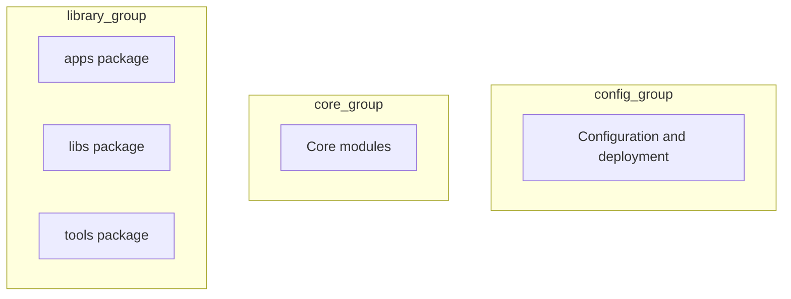

# Architecture report: nomcopter/react-mosaic

> Automated static analysis. **Observed** = directly seen in files/imports/AST; **Inferred** = interpretation from that evidence. Repository code was not executed.

## 1. Repository at a glance

| Item | Value |
| --- | --- |
| Repository | nomcopter/react-mosaic |
| Description | A React tiling window manager |
| Language | TypeScript |
| Stars | 4803 |
| Licence | Other |
| Analysed commit / branch | a189cd943d6d602672bc111163157697b8befd41 / master |
| Framework(s) | React |
| Files analysed | 174 |
| Components | 5 |

## 2. Architecture in one minute

nomcopter/react-mosaic - A React tiling window manager. This repository was analysed statically from 174 file(s) (0 Python). Detected technologies (observed from imports/manifests): GitHub Actions, React, TypeScript, Vite, Vitest. Files are grouped into 5 component(s): apps package, Configuration and deployment, Core modules, libs package, tools package. Findings below distinguish observed facts from inferred interpretation.

## 3. High-level block diagram

## 4. Main components

### apps package (`apps`)

- **Kind:** library
- **Status:** Observed
- **Confidence:** 0.85
- **Responsibility:** Groups 12 file(s) under apps package (observed from repository paths and static analysis).
- **Paths:** `apps/website/babel.config.js`, `apps/website/docusaurus.config.ts`, `apps/website/sidebars.ts`, `apps/website/src/components/Demo/EditableTabTitle.tsx`, `apps/website/src/components/Demo/ExampleWindow.tsx`, `apps/website/src/components/Demo/demo-types.ts`, `apps/website/src/components/Demo/demo-utils.ts`, `apps/website/src/components/Demo/index.tsx`, `apps/website/src/components/Demo/toolbars.tsx`, `apps/website/src/pages/demo.tsx`, `apps/website/src/pages/index.tsx`, `apps/website/src/theme/ReactLiveScope/index.tsx`
- **Evidence:** [apps/website/babel.config.js](https://github.com/nomcopter/react-mosaic/blob/a189cd943d6d602672bc111163157697b8befd41/apps/website/babel.config.js); [apps/website/docusaurus.config.ts](https://github.com/nomcopter/react-mosaic/blob/a189cd943d6d602672bc111163157697b8befd41/apps/website/docusaurus.config.ts); [apps/website/sidebars.ts](https://github.com/nomcopter/react-mosaic/blob/a189cd943d6d602672bc111163157697b8befd41/apps/website/sidebars.ts); [apps/website/src/components/Demo/EditableTabTitle.tsx](https://github.com/nomcopter/react-mosaic/blob/a189cd943d6d602672bc111163157697b8befd41/apps/website/src/components/Demo/EditableTabTitle.tsx); [apps/website/src/components/Demo/ExampleWindow.tsx](https://github.com/nomcopter/react-mosaic/blob/a189cd943d6d602672bc111163157697b8befd41/apps/website/src/components/Demo/ExampleWindow.tsx); [apps/website/src/components/Demo/demo-types.ts](https://github.com/nomcopter/react-mosaic/blob/a189cd943d6d602672bc111163157697b8befd41/apps/website/src/components/Demo/demo-types.ts); [apps/website/src/components/Demo/demo-utils.ts](https://github.com/nomcopter/react-mosaic/blob/a189cd943d6d602672bc111163157697b8befd41/apps/website/src/components/Demo/demo-utils.ts); [apps/website/src/components/Demo/index.tsx](https://github.com/nomcopter/react-mosaic/blob/a189cd943d6d602672bc111163157697b8befd41/apps/website/src/components/Demo/index.tsx)

### Configuration and deployment (`config`)

- **Kind:** config
- **Status:** Observed
- **Confidence:** 0.85
- **Responsibility:** Groups 13 file(s) under configuration and deployment (observed from repository paths and static analysis).
- **Paths:** `apps/website/package.json`, `apps/website/project.json`, `apps/website/tsconfig.json`, `lefthook.yml`, `libs/react-mosaic-component/package.json`, `libs/react-mosaic-component/project.json`, `libs/react-mosaic-component/tsconfig.json`, `libs/react-mosaic-component/tsconfig.lib.json`, `libs/react-mosaic-component/tsconfig.spec.json`, `nx.json`, `package.json`, `tsconfig.base.json`, `tsconfig.json`
- **Evidence:** [apps/website/package.json](https://github.com/nomcopter/react-mosaic/blob/a189cd943d6d602672bc111163157697b8befd41/apps/website/package.json); [apps/website/project.json](https://github.com/nomcopter/react-mosaic/blob/a189cd943d6d602672bc111163157697b8befd41/apps/website/project.json); [apps/website/tsconfig.json](https://github.com/nomcopter/react-mosaic/blob/a189cd943d6d602672bc111163157697b8befd41/apps/website/tsconfig.json); [lefthook.yml](https://github.com/nomcopter/react-mosaic/blob/a189cd943d6d602672bc111163157697b8befd41/lefthook.yml); [libs/react-mosaic-component/package.json](https://github.com/nomcopter/react-mosaic/blob/a189cd943d6d602672bc111163157697b8befd41/libs/react-mosaic-component/package.json); [libs/react-mosaic-component/project.json](https://github.com/nomcopter/react-mosaic/blob/a189cd943d6d602672bc111163157697b8befd41/libs/react-mosaic-component/project.json); [libs/react-mosaic-component/tsconfig.json](https://github.com/nomcopter/react-mosaic/blob/a189cd943d6d602672bc111163157697b8befd41/libs/react-mosaic-component/tsconfig.json); [libs/react-mosaic-component/tsconfig.lib.json](https://github.com/nomcopter/react-mosaic/blob/a189cd943d6d602672bc111163157697b8befd41/libs/react-mosaic-component/tsconfig.lib.json)

### Core modules (`core`)

- **Kind:** core
- **Status:** Observed
- **Confidence:** 0.85
- **Responsibility:** Groups 3 file(s) under core modules (observed from repository paths and static analysis).
- **Paths:** `eslint.config.mjs`, `tsup.config.ts`, `vitest.config.ts`
- **Evidence:** [eslint.config.mjs](https://github.com/nomcopter/react-mosaic/blob/a189cd943d6d602672bc111163157697b8befd41/eslint.config.mjs); [tsup.config.ts](https://github.com/nomcopter/react-mosaic/blob/a189cd943d6d602672bc111163157697b8befd41/tsup.config.ts); [vitest.config.ts](https://github.com/nomcopter/react-mosaic/blob/a189cd943d6d602672bc111163157697b8befd41/vitest.config.ts)

### libs package (`libs`)

- **Kind:** library
- **Status:** Observed
- **Confidence:** 0.85
- **Responsibility:** Groups 64 file(s) under libs package (observed from repository paths and static analysis).
- **Paths:** `libs/react-mosaic-component/eslint.config.mjs`, `libs/react-mosaic-component/src/index.ts`, `libs/react-mosaic-component/src/lib/DraggableTab.spec.tsx`, `libs/react-mosaic-component/src/lib/DraggableTab.tsx`, `libs/react-mosaic-component/src/lib/Mosaic.changeMeta.spec.tsx`, `libs/react-mosaic-component/src/lib/Mosaic.dragCancelMeta.spec.tsx`, `libs/react-mosaic-component/src/lib/Mosaic.dropBehavior.spec.tsx`, `libs/react-mosaic-component/src/lib/Mosaic.spec.tsx`, `libs/react-mosaic-component/src/lib/Mosaic.strictMode.spec.tsx`, `libs/react-mosaic-component/src/lib/Mosaic.touch.spec.tsx`, `libs/react-mosaic-component/src/lib/Mosaic.tsx`, `libs/react-mosaic-component/src/lib/MosaicDropTarget.tsx`, `libs/react-mosaic-component/src/lib/MosaicRoot.tsx`, `libs/react-mosaic-component/src/lib/MosaicTabs.tsx`, `libs/react-mosaic-component/src/lib/MosaicWindow.tsx`, `libs/react-mosaic-component/src/lib/MosaicZeroState.tsx`, `libs/react-mosaic-component/src/lib/RootDropTargets.tsx`, `libs/react-mosaic-component/src/lib/Split.spec.ts`, `libs/react-mosaic-component/src/lib/Split.tsx`, `libs/react-mosaic-component/src/lib/TouchDragPreview.tsx`, `libs/react-mosaic-component/src/lib/buttons/AddTabButton.tsx`, `libs/react-mosaic-component/src/lib/buttons/DefaultAddTabButton.spec.tsx`, `libs/react-mosaic-component/src/lib/buttons/DefaultAddTabButton.tsx`, `libs/react-mosaic-component/src/lib/buttons/ExpandButton.tsx`, `libs/react-mosaic-component/src/lib/buttons/MosaicButton.tsx`, `libs/react-mosaic-component/src/lib/buttons/RemoveButton.tsx`, `libs/react-mosaic-component/src/lib/buttons/ReplaceButton.tsx`, `libs/react-mosaic-component/src/lib/buttons/Separator.tsx`, `libs/react-mosaic-component/src/lib/buttons/SplitButton.tsx`, `libs/react-mosaic-component/src/lib/buttons/TabDragButton.tsx`, `libs/react-mosaic-component/src/lib/buttons/TabExpandButton.tsx`, `libs/react-mosaic-component/src/lib/buttons/TabRemoveButton.tsx`, `libs/react-mosaic-component/src/lib/buttons/TabSplitButton.tsx`, `libs/react-mosaic-component/src/lib/buttons/defaultToolbarControls.tsx`, `libs/react-mosaic-component/src/lib/contextHooks.spec.tsx`, `libs/react-mosaic-component/src/lib/contextHooks.ts`, `libs/react-mosaic-component/src/lib/contextTypes.ts`, `libs/react-mosaic-component/src/lib/dragOutOfLayout.spec.tsx`, `libs/react-mosaic-component/src/lib/index.spec.ts`, `libs/react-mosaic-component/src/lib/index.ts`, `libs/react-mosaic-component/src/lib/internalTypes.ts`, `libs/react-mosaic-component/src/lib/renderProfiling.spec.tsx`, `libs/react-mosaic-component/src/lib/styles/blueprint-theme.spec.ts`, `libs/react-mosaic-component/src/lib/styles/tabDropTarget.spec.ts`, `libs/react-mosaic-component/src/lib/styles/touch.spec.ts`, `libs/react-mosaic-component/src/lib/types.ts`, `libs/react-mosaic-component/src/lib/util/BoundingBox.ts`, `libs/react-mosaic-component/src/lib/util/OptionalBlueprint.tsx`, `libs/react-mosaic-component/src/lib/util/assertNever.ts`, `libs/react-mosaic-component/src/lib/util/boundingBox.spec.ts`, `libs/react-mosaic-component/src/lib/util/dragImage.ts`, `libs/react-mosaic-component/src/lib/util/dragPreviewRegistry.ts`, `libs/react-mosaic-component/src/lib/util/dragRestore.ts`, `libs/react-mosaic-component/src/lib/util/dragSource.ts`, `libs/react-mosaic-component/src/lib/util/mosaicUpdates.spec.ts`, `libs/react-mosaic-component/src/lib/util/mosaicUpdates.swap.spec.ts`, `libs/react-mosaic-component/src/lib/util/mosaicUpdates.ts`, `libs/react-mosaic-component/src/lib/util/mosaicUtilities.spec.ts`, `libs/react-mosaic-component/src/lib/util/mosaicUtilities.ts`, `libs/react-mosaic-component/src/lib/util/tabStripAutoScroll.spec.ts`, `libs/react-mosaic-component/src/lib/util/tabStripAutoScroll.ts`, `libs/react-mosaic-component/src/lib/util/touchGesture.spec.ts`, `libs/react-mosaic-component/src/lib/util/touchGesture.ts`, `libs/react-mosaic-component/vite.config.ts`
- **Evidence:** [libs/react-mosaic-component/eslint.config.mjs](https://github.com/nomcopter/react-mosaic/blob/a189cd943d6d602672bc111163157697b8befd41/libs/react-mosaic-component/eslint.config.mjs); [libs/react-mosaic-component/src/index.ts](https://github.com/nomcopter/react-mosaic/blob/a189cd943d6d602672bc111163157697b8befd41/libs/react-mosaic-component/src/index.ts); [libs/react-mosaic-component/src/lib/DraggableTab.spec.tsx](https://github.com/nomcopter/react-mosaic/blob/a189cd943d6d602672bc111163157697b8befd41/libs/react-mosaic-component/src/lib/DraggableTab.spec.tsx); [libs/react-mosaic-component/src/lib/DraggableTab.tsx](https://github.com/nomcopter/react-mosaic/blob/a189cd943d6d602672bc111163157697b8befd41/libs/react-mosaic-component/src/lib/DraggableTab.tsx); [libs/react-mosaic-component/src/lib/Mosaic.changeMeta.spec.tsx](https://github.com/nomcopter/react-mosaic/blob/a189cd943d6d602672bc111163157697b8befd41/libs/react-mosaic-component/src/lib/Mosaic.changeMeta.spec.tsx); [libs/react-mosaic-component/src/lib/Mosaic.dragCancelMeta.spec.tsx](https://github.com/nomcopter/react-mosaic/blob/a189cd943d6d602672bc111163157697b8befd41/libs/react-mosaic-component/src/lib/Mosaic.dragCancelMeta.spec.tsx); [libs/react-mosaic-component/src/lib/Mosaic.dropBehavior.spec.tsx](https://github.com/nomcopter/react-mosaic/blob/a189cd943d6d602672bc111163157697b8befd41/libs/react-mosaic-component/src/lib/Mosaic.dropBehavior.spec.tsx); [libs/react-mosaic-component/src/lib/Mosaic.spec.tsx](https://github.com/nomcopter/react-mosaic/blob/a189cd943d6d602672bc111163157697b8befd41/libs/react-mosaic-component/src/lib/Mosaic.spec.tsx)

### tools package (`tools`)

- **Kind:** library
- **Status:** Observed
- **Confidence:** 0.85
- **Responsibility:** Groups 1 file(s) under tools package (observed from repository paths and static analysis).
- **Paths:** `tools/package-tests/package-exports.test.mjs`
- **Evidence:** [tools/package-tests/package-exports.test.mjs](https://github.com/nomcopter/react-mosaic/blob/a189cd943d6d602672bc111163157697b8befd41/tools/package-tests/package-exports.test.mjs)

## 5. Execution flow

**Observed** entry point(s):

- [libs/react-mosaic-component/src/index.ts](https://github.com/nomcopter/react-mosaic/blob/a189cd943d6d602672bc111163157697b8befd41/libs/react-mosaic-component/src/index.ts)

Representative flow (derived from observed entry points and the import graph; steps beyond the entry point are **Inferred**):

1. Execution starts at an observed entry point listed above, if present.
2. No internal import relationships between components were observed.

## 6. Project structure

### `(root)`

- `.claudeignore` - other (953 bytes)
- `.commitlintrc.json` - config (527 bytes)
- `.editorconfig` - config (49 bytes)
- `.gitignore` - other (730 bytes)
- `.mcp.json` - config (120 bytes)
- `.node-version` - other (7 bytes)
- `.npmignore` - other (104 bytes)
- `.prettierignore` - other (158 bytes)
- `.prettierrc.yml` - config (89 bytes)
- `AGENTS.md` - docs (4400 bytes)
- `CLAUDE.md` - docs (691 bytes)
- `CONTRIBUTING.md` - docs (5544 bytes)
- `LICENSE` - docs (608 bytes)
- `README.md` - docs (4700 bytes)
- `eslint.config.mjs` - source, JavaScript (1049 bytes)
- `lefthook.yml` - config (218 bytes)
- `nx.json` - config (2070 bytes)
- `package.json` - manifest (4859 bytes)
- `tsconfig.base.json` - config (802 bytes)
- `tsconfig.json` - config (360 bytes)
- `tsup.config.ts` - source, TypeScript (2352 bytes)
- `vitest.config.ts` - source, TypeScript (228 bytes)

### `.claude`

- `.claude/README.md` - docs (1604 bytes)
- `.claude/agents/component-reviewer.md` - docs (2572 bytes)
- `.claude/agents/feature-planner.md` - docs (2778 bytes)
- `.claude/agents/mosaic-tree-expert.md` - docs (3693 bytes)
- `.claude/commands/add-feature.md` - docs (497 bytes)
- `.claude/commands/analyze-tree.md` - docs (490 bytes)
- `.claude/commands/build.md` - docs (176 bytes)
- `.claude/commands/explain-concept.md` - docs (632 bytes)
- `.claude/commands/fix-issue.md` - docs (455 bytes)
- `.claude/commands/lint.md` - docs (181 bytes)
- `.claude/commands/refactor.md` - docs (542 bytes)
- `.claude/commands/review-component.md` - docs (458 bytes)
- `.claude/commands/test.md` - docs (189 bytes)
- `.claude/commands/type-check.md` - docs (253 bytes)
- `.claude/commands/update-deps.md` - docs (406 bytes)
- `.claude/context/architecture.md` - docs (5387 bytes)
- `.claude/context/development.md` - docs (3522 bytes)
- `.claude/settings.json` - config (1062 bytes)

### `.cursor`

- `.cursor/mcp.json` - config (88 bytes)
- `.cursor/setting.json` - config (592 bytes)

### `.github`

- `.github/FUNDING.yml` - config (69 bytes)
- `.github/ISSUE_TEMPLATE.md` - docs (370 bytes)
- `.github/PULL_REQUEST_TEMPLATE.md` - docs (860 bytes)
- `.github/agents/ci-monitor-subagent.agent.md` - docs (28092 bytes)
- `.github/prompts/monitor-ci.prompt.md` - docs (33971 bytes)
- `.github/skills/link-workspace-packages/SKILL.md` - docs (3046 bytes)
- `.github/skills/monitor-ci/SKILL.md` - docs (33797 bytes)
- `.github/skills/nx-generate/SKILL.md` - docs (7766 bytes)
- `.github/skills/nx-plugins/SKILL.md` - docs (355 bytes)
- `.github/skills/nx-run-tasks/SKILL.md` - docs (2468 bytes)
- `.github/skills/nx-workspace/SKILL.md` - docs (7670 bytes)
- `.github/skills/nx-workspace/references/AFFECTED.md` - docs (661 bytes)
- `.github/workflows/claude.yml` - ci, YAML (1960 bytes)
- `.github/workflows/deployment.yml` - ci, YAML (2037 bytes)
- `.github/workflows/pr-validation.yml` - ci, YAML (728 bytes)
- `.github/workflows/preview-deploy.yml` - ci, YAML (1445 bytes)
- `.github/workflows/publish.yaml` - ci, YAML (1048 bytes)
- `.github/workflows/validate-commits.yml` - ci, YAML (1678 bytes)

### `.verdaccio`

- `.verdaccio/config.yml` - config (649 bytes)

### `.vscode`

- `.vscode/mcp.json` - config (19 bytes)
- `.vscode/settings.json` - config (103 bytes)

### `apps`

- `apps/website/.gitignore` - other (405 bytes)
- `apps/website/babel.config.js` - source, JavaScript (89 bytes)
- `apps/website/docs/concepts/controlled-vs-uncontrolled.mdx` - docs (3347 bytes)
- `apps/website/docs/concepts/tabs.mdx` - docs (3131 bytes)
- `apps/website/docs/concepts/tree-structure.mdx` - docs (3719 bytes)
- `apps/website/docs/concepts/updates.mdx` - docs (3386 bytes)
- `apps/website/docs/guides/custom-toolbar.mdx` - docs (10767 bytes)
- `apps/website/docs/guides/drag-and-drop.mdx` - docs (8955 bytes)
- `apps/website/docs/guides/persisting-layout.mdx` - docs (3526 bytes)
- `apps/website/docs/guides/recipes.mdx` - docs (6160 bytes)
- `apps/website/docs/guides/resizing.mdx` - docs (4174 bytes)
- `apps/website/docs/guides/theming.mdx` - docs (3919 bytes)
- `apps/website/docs/guides/zero-state.mdx` - docs (3154 bytes)
- `apps/website/docs/intro.md` - docs (3298 bytes)
- `apps/website/docs/migration/from-v6.md` - docs (3249 bytes)
- `apps/website/docusaurus.config.ts` - source, TypeScript (10347 bytes)
- `apps/website/package.json` - manifest (216 bytes)
- `apps/website/project.json` - config (969 bytes)
- `apps/website/sidebars.ts` - source, TypeScript (1421 bytes)
- `apps/website/src/components/Demo/EditableTabTitle.tsx` - source, TypeScript (1478 bytes)
- `apps/website/src/components/Demo/ExampleWindow.tsx` - source, TypeScript (4614 bytes)
- `apps/website/src/components/Demo/demo-types.ts` - source, TypeScript (552 bytes)
- `apps/website/src/components/Demo/demo-utils.ts` - source, TypeScript (219 bytes)
- `apps/website/src/components/Demo/demo.css` - other (7238 bytes)
- `apps/website/src/components/Demo/index.tsx` - source, TypeScript (7479 bytes)
- `apps/website/src/components/Demo/toolbars.tsx` - source, TypeScript (625 bytes)
- `apps/website/src/css/custom.css` - other (2751 bytes)
- `apps/website/src/pages/demo.module.css` - other (282 bytes)
- `apps/website/src/pages/demo.tsx` - source, TypeScript (1085 bytes)
- `apps/website/src/pages/index.module.css` - other (269 bytes)
- `apps/website/src/pages/index.tsx` - source, TypeScript (3078 bytes)
- `apps/website/src/theme/ReactLiveScope/index.tsx` - source, TypeScript (2527 bytes)
- `apps/website/static/img/favicon.svg` - other (840 bytes)
- `apps/website/tsconfig.json` - config (342 bytes)

### `libs`

- `libs/react-mosaic-component/.babelrc` - other (156 bytes)
- `libs/react-mosaic-component/eslint.config.mjs` - source, JavaScript (598 bytes)
- `libs/react-mosaic-component/package.json` - manifest (1222 bytes)
- `libs/react-mosaic-component/project.json` - config (889 bytes)
- `libs/react-mosaic-component/src/index.ts` - source, TypeScript (24 bytes)
- `libs/react-mosaic-component/src/lib/DraggableTab.spec.tsx` - source, TypeScript (10595 bytes)
- `libs/react-mosaic-component/src/lib/DraggableTab.tsx` - source, TypeScript (11553 bytes)
- `libs/react-mosaic-component/src/lib/Mosaic.changeMeta.spec.tsx` - source, TypeScript (9450 bytes)
- `libs/react-mosaic-component/src/lib/Mosaic.dragCancelMeta.spec.tsx` - source, TypeScript (7807 bytes)
- `libs/react-mosaic-component/src/lib/Mosaic.dropBehavior.spec.tsx` - source, TypeScript (16067 bytes)
- `libs/react-mosaic-component/src/lib/Mosaic.spec.tsx` - source, TypeScript (4432 bytes)
- `libs/react-mosaic-component/src/lib/Mosaic.strictMode.spec.tsx` - source, TypeScript (3500 bytes)
- `libs/react-mosaic-component/src/lib/Mosaic.touch.spec.tsx` - source, TypeScript (17005 bytes)
- `libs/react-mosaic-component/src/lib/Mosaic.tsx` - source, TypeScript (19605 bytes)
- `libs/react-mosaic-component/src/lib/MosaicDropTarget.tsx` - source, TypeScript (1365 bytes)
- `libs/react-mosaic-component/src/lib/MosaicRoot.tsx` - source, TypeScript (7215 bytes)
- `libs/react-mosaic-component/src/lib/MosaicTabs.tsx` - source, TypeScript (22733 bytes)
- `libs/react-mosaic-component/src/lib/MosaicWindow.tsx` - source, TypeScript (19595 bytes)
- `libs/react-mosaic-component/src/lib/MosaicZeroState.tsx` - source, TypeScript (2197 bytes)
- `libs/react-mosaic-component/src/lib/RootDropTargets.tsx` - source, TypeScript (1735 bytes)
- `libs/react-mosaic-component/src/lib/Split.spec.ts` - source, TypeScript (24281 bytes)
- `libs/react-mosaic-component/src/lib/Split.tsx` - source, TypeScript (14980 bytes)
- `libs/react-mosaic-component/src/lib/TouchDragPreview.tsx` - source, TypeScript (3220 bytes)
- `libs/react-mosaic-component/src/lib/buttons/AddTabButton.tsx` - source, TypeScript (1104 bytes)
- `libs/react-mosaic-component/src/lib/buttons/DefaultAddTabButton.spec.tsx` - source, TypeScript (1092 bytes)
- `libs/react-mosaic-component/src/lib/buttons/DefaultAddTabButton.tsx` - source, TypeScript (974 bytes)
- `libs/react-mosaic-component/src/lib/buttons/ExpandButton.tsx` - source, TypeScript (1273 bytes)
- `libs/react-mosaic-component/src/lib/buttons/MosaicButton.tsx` - source, TypeScript (1215 bytes)
- `libs/react-mosaic-component/src/lib/buttons/RemoveButton.tsx` - source, TypeScript (1220 bytes)
- `libs/react-mosaic-component/src/lib/buttons/ReplaceButton.tsx` - source, TypeScript (1114 bytes)
- `libs/react-mosaic-component/src/lib/buttons/Separator.tsx` - source, TypeScript (149 bytes)
- `libs/react-mosaic-component/src/lib/buttons/SplitButton.tsx` - source, TypeScript (1100 bytes)
- `libs/react-mosaic-component/src/lib/buttons/TabDragButton.tsx` - source, TypeScript (918 bytes)
- `libs/react-mosaic-component/src/lib/buttons/TabExpandButton.tsx` - source, TypeScript (1143 bytes)
- `libs/react-mosaic-component/src/lib/buttons/TabRemoveButton.tsx` - source, TypeScript (1138 bytes)
- `libs/react-mosaic-component/src/lib/buttons/TabSplitButton.tsx` - source, TypeScript (2530 bytes)
- `libs/react-mosaic-component/src/lib/buttons/defaultToolbarControls.tsx` - source, TypeScript (1565 bytes)
- `libs/react-mosaic-component/src/lib/contextHooks.spec.tsx` - source, TypeScript (2574 bytes)
- `libs/react-mosaic-component/src/lib/contextHooks.ts` - source, TypeScript (1003 bytes)
- `libs/react-mosaic-component/src/lib/contextTypes.ts` - source, TypeScript (5135 bytes)
- `libs/react-mosaic-component/src/lib/dragOutOfLayout.spec.tsx` - source, TypeScript (12596 bytes)
- `libs/react-mosaic-component/src/lib/index.spec.ts` - source, TypeScript (1698 bytes)
- `libs/react-mosaic-component/src/lib/index.ts` - source, TypeScript (3841 bytes)
- `libs/react-mosaic-component/src/lib/internalTypes.ts` - source, TypeScript (1769 bytes)
- `libs/react-mosaic-component/src/lib/renderProfiling.spec.tsx` - source, TypeScript (17618 bytes)
- `libs/react-mosaic-component/src/lib/styles/blueprint-theme.less` - other (6940 bytes)
- `libs/react-mosaic-component/src/lib/styles/blueprint-theme.spec.ts` - source, TypeScript (1660 bytes)
- `libs/react-mosaic-component/src/lib/styles/index.less` - other (759 bytes)
- `libs/react-mosaic-component/src/lib/styles/mixins.less` - other (154 bytes)
- `libs/react-mosaic-component/src/lib/styles/mosaic-window.less` - other (2635 bytes)
- `libs/react-mosaic-component/src/lib/styles/mosaic.less` - other (10792 bytes)
- `libs/react-mosaic-component/src/lib/styles/tabDropTarget.spec.ts` - source, TypeScript (4105 bytes)
- `libs/react-mosaic-component/src/lib/styles/touch.spec.ts` - source, TypeScript (2383 bytes)
- `libs/react-mosaic-component/src/lib/types.ts` - source, TypeScript (12432 bytes)
- `libs/react-mosaic-component/src/lib/util/BoundingBox.ts` - source, TypeScript (4949 bytes)
- `libs/react-mosaic-component/src/lib/util/OptionalBlueprint.tsx` - source, TypeScript (1520 bytes)
- `libs/react-mosaic-component/src/lib/util/assertNever.ts` - source, TypeScript (135 bytes)
- `libs/react-mosaic-component/src/lib/util/boundingBox.spec.ts` - source, TypeScript (4140 bytes)
- `libs/react-mosaic-component/src/lib/util/dragImage.ts` - source, TypeScript (516 bytes)
- `libs/react-mosaic-component/src/lib/util/dragPreviewRegistry.ts` - source, TypeScript (566 bytes)
- `libs/react-mosaic-component/src/lib/util/dragRestore.ts` - source, TypeScript (3985 bytes)
- `libs/react-mosaic-component/src/lib/util/dragSource.ts` - source, TypeScript (1503 bytes)
- `libs/react-mosaic-component/src/lib/util/mosaicUpdates.spec.ts` - source, TypeScript (10907 bytes)
- `libs/react-mosaic-component/src/lib/util/mosaicUpdates.swap.spec.ts` - source, TypeScript (3438 bytes)
- `libs/react-mosaic-component/src/lib/util/mosaicUpdates.ts` - source, TypeScript (23967 bytes)
- `libs/react-mosaic-component/src/lib/util/mosaicUtilities.spec.ts` - source, TypeScript (6168 bytes)
- `libs/react-mosaic-component/src/lib/util/mosaicUtilities.ts` - source, TypeScript (20501 bytes)
- `libs/react-mosaic-component/src/lib/util/tabStripAutoScroll.spec.ts` - source, TypeScript (1420 bytes)
- `libs/react-mosaic-component/src/lib/util/tabStripAutoScroll.ts` - source, TypeScript (3301 bytes)
- `libs/react-mosaic-component/src/lib/util/touchGesture.spec.ts` - source, TypeScript (2741 bytes)
- `libs/react-mosaic-component/src/lib/util/touchGesture.ts` - source, TypeScript (3645 bytes)
- `libs/react-mosaic-component/tsconfig.json` - config (457 bytes)
- `libs/react-mosaic-component/tsconfig.lib.json` - config (819 bytes)
- `libs/react-mosaic-component/tsconfig.spec.json` - config (579 bytes)
- `libs/react-mosaic-component/vite.config.ts` - source, TypeScript (2029 bytes)

### `skills`

- `skills/react-mosaic/SKILL.md` - docs (10158 bytes)

### `tools`

- `tools/package-tests/package-exports.test.mjs` - source, JavaScript (6543 bytes)

## 7. Key dependencies and integrations

| Name | Category | Status | Confidence | Evidence |
| --- | --- | --- | --- | --- |
| GitHub Actions | ci | Observed | 0.90 | [.github/workflows/claude.yml](https://github.com/nomcopter/react-mosaic/blob/a189cd943d6d602672bc111163157697b8befd41/.github/workflows/claude.yml); [.github/workflows/deployment.yml](https://github.com/nomcopter/react-mosaic/blob/a189cd943d6d602672bc111163157697b8befd41/.github/workflows/deployment.yml); [.github/workflows/pr-validation.yml](https://github.com/nomcopter/react-mosaic/blob/a189cd943d6d602672bc111163157697b8befd41/.github/workflows/pr-validation.yml); [.github/workflows/preview-deploy.yml](https://github.com/nomcopter/react-mosaic/blob/a189cd943d6d602672bc111163157697b8befd41/.github/workflows/preview-deploy.yml) |
| React | framework | Observed | 0.90 | [libs/react-mosaic-component/package.json:2](https://github.com/nomcopter/react-mosaic/blob/a189cd943d6d602672bc111163157697b8befd41/libs/react-mosaic-component/package.json#L2); [package.json:2](https://github.com/nomcopter/react-mosaic/blob/a189cd943d6d602672bc111163157697b8befd41/package.json#L2); [package.json:81](https://github.com/nomcopter/react-mosaic/blob/a189cd943d6d602672bc111163157697b8befd41/package.json#L81) |
| TypeScript | tooling | Observed | 0.85 | [package.json:10](https://github.com/nomcopter/react-mosaic/blob/a189cd943d6d602672bc111163157697b8befd41/package.json#L10) |
| Vite | tooling | Observed | 0.85 | [package.json:68](https://github.com/nomcopter/react-mosaic/blob/a189cd943d6d602672bc111163157697b8befd41/package.json#L68) |
| Vitest | tooling | Observed | 0.85 | [package.json:69](https://github.com/nomcopter/react-mosaic/blob/a189cd943d6d602672bc111163157697b8befd41/package.json#L69) |

## 8. Data and state

No database, cache, queue, or persistent-state usage was observed in the analysed files. State handling, if any, may be in-memory or in files that were not analysed.

## 9. Configuration and deployment clues

- `.claude/settings.json` (config)
- `.commitlintrc.json` (config)
- `.cursor/mcp.json` (config)
- `.cursor/setting.json` (config)
- `.editorconfig` (config)
- `.github/FUNDING.yml` (config)
- `.github/workflows/claude.yml` (ci)
- `.github/workflows/deployment.yml` (ci)
- `.github/workflows/pr-validation.yml` (ci)
- `.github/workflows/preview-deploy.yml` (ci)
- `.github/workflows/publish.yaml` (ci)
- `.github/workflows/validate-commits.yml` (ci)
- `.mcp.json` (config)
- `.prettierrc.yml` (config)
- `.verdaccio/config.yml` (config)
- `.vscode/mcp.json` (config)
- `.vscode/settings.json` (config)
- `apps/website/package.json` (manifest)
- `apps/website/project.json` (config)
- `apps/website/tsconfig.json` (config)
- `lefthook.yml` (config)
- `libs/react-mosaic-component/package.json` (manifest)
- `libs/react-mosaic-component/project.json` (config)
- `libs/react-mosaic-component/tsconfig.json` (config)
- `libs/react-mosaic-component/tsconfig.lib.json` (config)
- `libs/react-mosaic-component/tsconfig.spec.json` (config)
- `nx.json` (config)
- `package.json` (manifest)
- `tsconfig.base.json` (config)
- `tsconfig.json` (config)

## 10. Design observations

- No strong design patterns could be established from the available evidence.

These observations are interpretations (**Inferred**) of the observed structure, not guarantees about runtime design.

## 11. Limitations and unknowns

- Static analysis only: repository code was not executed, installed, or imported at runtime.
- Components and relationships are inferred from file paths, imports, and AST structure; runtime behaviour, dynamic imports, and reflection may not be visible.
- 2 file(s) were skipped during inventory (1 x likely secret file excluded; 1 x vendored/generated directory excluded).
- No clear application entry point was observed in the analysed files.
- Repository text was treated as untrusted data; no instructions found in repository files were followed, and likely secret values were redacted/excluded.
- JavaScript and TypeScript files were inventoried from paths and package manifests. They were not parsed with a full language AST, and repository code was not executed.

## 12. Source references

- [.github/workflows/claude.yml](https://github.com/nomcopter/react-mosaic/blob/a189cd943d6d602672bc111163157697b8befd41/.github/workflows/claude.yml)
- [.github/workflows/deployment.yml](https://github.com/nomcopter/react-mosaic/blob/a189cd943d6d602672bc111163157697b8befd41/.github/workflows/deployment.yml)
- [.github/workflows/pr-validation.yml](https://github.com/nomcopter/react-mosaic/blob/a189cd943d6d602672bc111163157697b8befd41/.github/workflows/pr-validation.yml)
- [.github/workflows/preview-deploy.yml](https://github.com/nomcopter/react-mosaic/blob/a189cd943d6d602672bc111163157697b8befd41/.github/workflows/preview-deploy.yml)
- [.github/workflows/publish.yaml](https://github.com/nomcopter/react-mosaic/blob/a189cd943d6d602672bc111163157697b8befd41/.github/workflows/publish.yaml)
- [.github/workflows/validate-commits.yml](https://github.com/nomcopter/react-mosaic/blob/a189cd943d6d602672bc111163157697b8befd41/.github/workflows/validate-commits.yml)
- [apps/website/babel.config.js](https://github.com/nomcopter/react-mosaic/blob/a189cd943d6d602672bc111163157697b8befd41/apps/website/babel.config.js)
- [apps/website/docusaurus.config.ts](https://github.com/nomcopter/react-mosaic/blob/a189cd943d6d602672bc111163157697b8befd41/apps/website/docusaurus.config.ts)
- [apps/website/package.json](https://github.com/nomcopter/react-mosaic/blob/a189cd943d6d602672bc111163157697b8befd41/apps/website/package.json)
- [apps/website/project.json](https://github.com/nomcopter/react-mosaic/blob/a189cd943d6d602672bc111163157697b8befd41/apps/website/project.json)
- [apps/website/sidebars.ts](https://github.com/nomcopter/react-mosaic/blob/a189cd943d6d602672bc111163157697b8befd41/apps/website/sidebars.ts)
- [apps/website/src/components/Demo/EditableTabTitle.tsx](https://github.com/nomcopter/react-mosaic/blob/a189cd943d6d602672bc111163157697b8befd41/apps/website/src/components/Demo/EditableTabTitle.tsx)
- [apps/website/src/components/Demo/ExampleWindow.tsx](https://github.com/nomcopter/react-mosaic/blob/a189cd943d6d602672bc111163157697b8befd41/apps/website/src/components/Demo/ExampleWindow.tsx)
- [apps/website/src/components/Demo/demo-types.ts](https://github.com/nomcopter/react-mosaic/blob/a189cd943d6d602672bc111163157697b8befd41/apps/website/src/components/Demo/demo-types.ts)
- [apps/website/src/components/Demo/demo-utils.ts](https://github.com/nomcopter/react-mosaic/blob/a189cd943d6d602672bc111163157697b8befd41/apps/website/src/components/Demo/demo-utils.ts)
- [apps/website/src/components/Demo/index.tsx](https://github.com/nomcopter/react-mosaic/blob/a189cd943d6d602672bc111163157697b8befd41/apps/website/src/components/Demo/index.tsx)
- [apps/website/tsconfig.json](https://github.com/nomcopter/react-mosaic/blob/a189cd943d6d602672bc111163157697b8befd41/apps/website/tsconfig.json)
- [eslint.config.mjs](https://github.com/nomcopter/react-mosaic/blob/a189cd943d6d602672bc111163157697b8befd41/eslint.config.mjs)
- [lefthook.yml](https://github.com/nomcopter/react-mosaic/blob/a189cd943d6d602672bc111163157697b8befd41/lefthook.yml)
- [libs/react-mosaic-component/eslint.config.mjs](https://github.com/nomcopter/react-mosaic/blob/a189cd943d6d602672bc111163157697b8befd41/libs/react-mosaic-component/eslint.config.mjs)
- [libs/react-mosaic-component/package.json](https://github.com/nomcopter/react-mosaic/blob/a189cd943d6d602672bc111163157697b8befd41/libs/react-mosaic-component/package.json)
- [libs/react-mosaic-component/package.json:2](https://github.com/nomcopter/react-mosaic/blob/a189cd943d6d602672bc111163157697b8befd41/libs/react-mosaic-component/package.json#L2)
- [libs/react-mosaic-component/project.json](https://github.com/nomcopter/react-mosaic/blob/a189cd943d6d602672bc111163157697b8befd41/libs/react-mosaic-component/project.json)
- [libs/react-mosaic-component/src/index.ts](https://github.com/nomcopter/react-mosaic/blob/a189cd943d6d602672bc111163157697b8befd41/libs/react-mosaic-component/src/index.ts)
- [libs/react-mosaic-component/src/lib/DraggableTab.spec.tsx](https://github.com/nomcopter/react-mosaic/blob/a189cd943d6d602672bc111163157697b8befd41/libs/react-mosaic-component/src/lib/DraggableTab.spec.tsx)
- [libs/react-mosaic-component/src/lib/DraggableTab.tsx](https://github.com/nomcopter/react-mosaic/blob/a189cd943d6d602672bc111163157697b8befd41/libs/react-mosaic-component/src/lib/DraggableTab.tsx)
- [libs/react-mosaic-component/src/lib/Mosaic.changeMeta.spec.tsx](https://github.com/nomcopter/react-mosaic/blob/a189cd943d6d602672bc111163157697b8befd41/libs/react-mosaic-component/src/lib/Mosaic.changeMeta.spec.tsx)
- [libs/react-mosaic-component/src/lib/Mosaic.dragCancelMeta.spec.tsx](https://github.com/nomcopter/react-mosaic/blob/a189cd943d6d602672bc111163157697b8befd41/libs/react-mosaic-component/src/lib/Mosaic.dragCancelMeta.spec.tsx)
- [libs/react-mosaic-component/src/lib/Mosaic.dropBehavior.spec.tsx](https://github.com/nomcopter/react-mosaic/blob/a189cd943d6d602672bc111163157697b8befd41/libs/react-mosaic-component/src/lib/Mosaic.dropBehavior.spec.tsx)
- [libs/react-mosaic-component/src/lib/Mosaic.spec.tsx](https://github.com/nomcopter/react-mosaic/blob/a189cd943d6d602672bc111163157697b8befd41/libs/react-mosaic-component/src/lib/Mosaic.spec.tsx)
- [libs/react-mosaic-component/tsconfig.json](https://github.com/nomcopter/react-mosaic/blob/a189cd943d6d602672bc111163157697b8befd41/libs/react-mosaic-component/tsconfig.json)
- [libs/react-mosaic-component/tsconfig.lib.json](https://github.com/nomcopter/react-mosaic/blob/a189cd943d6d602672bc111163157697b8befd41/libs/react-mosaic-component/tsconfig.lib.json)
- [package.json:2](https://github.com/nomcopter/react-mosaic/blob/a189cd943d6d602672bc111163157697b8befd41/package.json#L2)
- [package.json:10](https://github.com/nomcopter/react-mosaic/blob/a189cd943d6d602672bc111163157697b8befd41/package.json#L10)
- [package.json:68](https://github.com/nomcopter/react-mosaic/blob/a189cd943d6d602672bc111163157697b8befd41/package.json#L68)
- [package.json:69](https://github.com/nomcopter/react-mosaic/blob/a189cd943d6d602672bc111163157697b8befd41/package.json#L69)
- [package.json:81](https://github.com/nomcopter/react-mosaic/blob/a189cd943d6d602672bc111163157697b8befd41/package.json#L81)
- [tools/package-tests/package-exports.test.mjs](https://github.com/nomcopter/react-mosaic/blob/a189cd943d6d602672bc111163157697b8befd41/tools/package-tests/package-exports.test.mjs)
- [tsup.config.ts](https://github.com/nomcopter/react-mosaic/blob/a189cd943d6d602672bc111163157697b8befd41/tsup.config.ts)
- [vitest.config.ts](https://github.com/nomcopter/react-mosaic/blob/a189cd943d6d602672bc111163157697b8befd41/vitest.config.ts)
