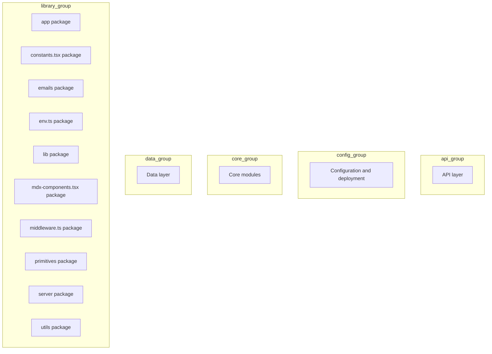

# Architecture report: noodle-run/noodle

> Automated static analysis. **Observed** = directly seen in files/imports/AST; **Inferred** = interpretation from that evidence. Repository code was not executed.

## 1. Repository at a glance

| Item | Value |
| --- | --- |
| Repository | noodle-run/noodle |
| Description | Rethinking Student Productivity |
| Language | TypeScript |
| Stars | 12151 |
| Licence | AGPL-3.0 |
| Analysed commit / branch | 4e26fb7c990ccccce203f1c30f79126ef1bfbcaa / main |
| Framework(s) | Next.js, React |
| Files analysed | 122 |
| Components | 14 |

## 2. Architecture in one minute

noodle-run/noodle - Rethinking Student Productivity. This repository was analysed statically from 122 file(s) (0 Python). Detected technologies (observed from imports/manifests): GitHub Actions, Database (unspecified), Redis, Next.js, React, Tailwind CSS. Files are grouped into 14 component(s): API layer, app package, Configuration and deployment, constants.tsx package, Core modules, Data layer, emails package, env.ts package. Findings below distinguish observed facts from inferred interpretation.

## 3. High-level block diagram

## 4. Main components

### API layer (`api_layer`)

- **Kind:** api
- **Status:** Observed
- **Confidence:** 0.85
- **Responsibility:** Groups 3 file(s) under api layer (observed from repository paths and static analysis).
- **Paths:** `src/app/api/trpc/[trpc]/route.ts`, `src/server/routers/early-access.ts`, `src/server/routers/modules.ts`
- **Evidence:** [src/app/api/trpc/[trpc]/route.ts](https://github.com/noodle-run/noodle/blob/4e26fb7c990ccccce203f1c30f79126ef1bfbcaa/src/app/api/trpc/%5Btrpc%5D/route.ts); [src/server/routers/early-access.ts](https://github.com/noodle-run/noodle/blob/4e26fb7c990ccccce203f1c30f79126ef1bfbcaa/src/server/routers/early-access.ts); [src/server/routers/modules.ts](https://github.com/noodle-run/noodle/blob/4e26fb7c990ccccce203f1c30f79126ef1bfbcaa/src/server/routers/modules.ts)

### app package (`app`)

- **Kind:** library
- **Status:** Observed
- **Confidence:** 0.85
- **Responsibility:** Groups 30 file(s) under app package (observed from repository paths and static analysis).
- **Paths:** `src/app/(dashboard)/(auth)/sign-in/[[...sign-in]]/page.tsx`, `src/app/(dashboard)/(auth)/sign-up/[[...sign-in]]/page.tsx`, `src/app/(dashboard)/app/_components/active-button.tsx`, `src/app/(dashboard)/app/_components/create-module-popover.tsx`, `src/app/(dashboard)/app/_components/module-card.tsx`, `src/app/(dashboard)/app/_components/recent-modules.tsx`, `src/app/(dashboard)/app/_components/side-menu.tsx`, `src/app/(dashboard)/app/_components/welcome-message.tsx`, `src/app/(dashboard)/app/layout.tsx`, `src/app/(dashboard)/app/lib/color-choices.ts`, `src/app/(dashboard)/app/module/[id]/page.tsx`, `src/app/(dashboard)/app/page.tsx`, `src/app/(dashboard)/layout.tsx`, `src/app/(site)/(legal)/layout.tsx`, `src/app/(site)/(legal)/privacy/page.tsx`, `src/app/(site)/(legal)/tos/page.tsx`, `src/app/(site)/_components/custom-mdx.tsx`, `src/app/(site)/_components/footer.tsx`, `src/app/(site)/_components/navbar.tsx`, `src/app/(site)/blog/[slug]/page.tsx`, `src/app/(site)/blog/page.tsx`, `src/app/(site)/early-access/_forms/join.tsx`, `src/app/(site)/early-access/layout.tsx`, `src/app/(site)/early-access/page.tsx`, `src/app/(site)/layout.tsx`, `src/app/(site)/page.tsx`, `src/app/layout.tsx`, `src/app/manifest.ts`, `src/app/not-found.tsx`, `src/app/robots.ts`
- **Evidence:** [src/app/(dashboard)/(auth)/sign-in/[[...sign-in]]/page.tsx](https://github.com/noodle-run/noodle/blob/4e26fb7c990ccccce203f1c30f79126ef1bfbcaa/src/app/%28dashboard%29/%28auth%29/sign-in/%5B%5B...sign-in%5D%5D/page.tsx); [src/app/(dashboard)/(auth)/sign-up/[[...sign-in]]/page.tsx](https://github.com/noodle-run/noodle/blob/4e26fb7c990ccccce203f1c30f79126ef1bfbcaa/src/app/%28dashboard%29/%28auth%29/sign-up/%5B%5B...sign-in%5D%5D/page.tsx); [src/app/(dashboard)/app/_components/active-button.tsx](https://github.com/noodle-run/noodle/blob/4e26fb7c990ccccce203f1c30f79126ef1bfbcaa/src/app/%28dashboard%29/app/_components/active-button.tsx); [src/app/(dashboard)/app/_components/create-module-popover.tsx](https://github.com/noodle-run/noodle/blob/4e26fb7c990ccccce203f1c30f79126ef1bfbcaa/src/app/%28dashboard%29/app/_components/create-module-popover.tsx); [src/app/(dashboard)/app/_components/module-card.tsx](https://github.com/noodle-run/noodle/blob/4e26fb7c990ccccce203f1c30f79126ef1bfbcaa/src/app/%28dashboard%29/app/_components/module-card.tsx); [src/app/(dashboard)/app/_components/recent-modules.tsx](https://github.com/noodle-run/noodle/blob/4e26fb7c990ccccce203f1c30f79126ef1bfbcaa/src/app/%28dashboard%29/app/_components/recent-modules.tsx); [src/app/(dashboard)/app/_components/side-menu.tsx](https://github.com/noodle-run/noodle/blob/4e26fb7c990ccccce203f1c30f79126ef1bfbcaa/src/app/%28dashboard%29/app/_components/side-menu.tsx); [src/app/(dashboard)/app/_components/welcome-message.tsx](https://github.com/noodle-run/noodle/blob/4e26fb7c990ccccce203f1c30f79126ef1bfbcaa/src/app/%28dashboard%29/app/_components/welcome-message.tsx)

### Configuration and deployment (`config`)

- **Kind:** config
- **Status:** Observed
- **Confidence:** 0.85
- **Responsibility:** Groups 7 file(s) under configuration and deployment (observed from repository paths and static analysis).
- **Paths:** `cspell.config.yaml`, `drizzle/meta/0000_snapshot.json`, `drizzle/meta/0001_snapshot.json`, `drizzle/meta/0002_snapshot.json`, `drizzle/meta/_journal.json`, `package.json`, `tsconfig.json`
- **Evidence:** [cspell.config.yaml](https://github.com/noodle-run/noodle/blob/4e26fb7c990ccccce203f1c30f79126ef1bfbcaa/cspell.config.yaml); [drizzle/meta/0000_snapshot.json](https://github.com/noodle-run/noodle/blob/4e26fb7c990ccccce203f1c30f79126ef1bfbcaa/drizzle/meta/0000_snapshot.json); [drizzle/meta/0001_snapshot.json](https://github.com/noodle-run/noodle/blob/4e26fb7c990ccccce203f1c30f79126ef1bfbcaa/drizzle/meta/0001_snapshot.json); [drizzle/meta/0002_snapshot.json](https://github.com/noodle-run/noodle/blob/4e26fb7c990ccccce203f1c30f79126ef1bfbcaa/drizzle/meta/0002_snapshot.json); [drizzle/meta/_journal.json](https://github.com/noodle-run/noodle/blob/4e26fb7c990ccccce203f1c30f79126ef1bfbcaa/drizzle/meta/_journal.json); [package.json](https://github.com/noodle-run/noodle/blob/4e26fb7c990ccccce203f1c30f79126ef1bfbcaa/package.json); [tsconfig.json](https://github.com/noodle-run/noodle/blob/4e26fb7c990ccccce203f1c30f79126ef1bfbcaa/tsconfig.json)

### constants.tsx package (`constants_tsx`)

- **Kind:** library
- **Status:** Observed
- **Confidence:** 0.85
- **Responsibility:** Groups 1 file(s) under constants.tsx package (observed from repository paths and static analysis).
- **Paths:** `src/constants.tsx`
- **Evidence:** [src/constants.tsx](https://github.com/noodle-run/noodle/blob/4e26fb7c990ccccce203f1c30f79126ef1bfbcaa/src/constants.tsx)

### Core modules (`core`)

- **Kind:** core
- **Status:** Observed
- **Confidence:** 0.85
- **Responsibility:** Groups 8 file(s) under core modules (observed from repository paths and static analysis).
- **Paths:** `drizzle.config.ts`, `eslint.config.js`, `eslint.d.ts`, `next.config.js`, `postcss.config.js`, `prettier.config.js`, `reset.d.ts`, `tailwind.config.ts`
- **Evidence:** [drizzle.config.ts](https://github.com/noodle-run/noodle/blob/4e26fb7c990ccccce203f1c30f79126ef1bfbcaa/drizzle.config.ts); [eslint.config.js](https://github.com/noodle-run/noodle/blob/4e26fb7c990ccccce203f1c30f79126ef1bfbcaa/eslint.config.js); [eslint.d.ts](https://github.com/noodle-run/noodle/blob/4e26fb7c990ccccce203f1c30f79126ef1bfbcaa/eslint.d.ts); [next.config.js](https://github.com/noodle-run/noodle/blob/4e26fb7c990ccccce203f1c30f79126ef1bfbcaa/next.config.js); [postcss.config.js](https://github.com/noodle-run/noodle/blob/4e26fb7c990ccccce203f1c30f79126ef1bfbcaa/postcss.config.js); [prettier.config.js](https://github.com/noodle-run/noodle/blob/4e26fb7c990ccccce203f1c30f79126ef1bfbcaa/prettier.config.js); [reset.d.ts](https://github.com/noodle-run/noodle/blob/4e26fb7c990ccccce203f1c30f79126ef1bfbcaa/reset.d.ts); [tailwind.config.ts](https://github.com/noodle-run/noodle/blob/4e26fb7c990ccccce203f1c30f79126ef1bfbcaa/tailwind.config.ts)

### Data layer (`data_layer`)

- **Kind:** data
- **Status:** Observed
- **Confidence:** 0.85
- **Responsibility:** Groups 4 file(s) under data layer (observed from repository paths and static analysis).
- **Paths:** `src/db/index.ts`, `src/db/schema/early-access.ts`, `src/db/schema/index.ts`, `src/db/schema/modules.ts`
- **Evidence:** [src/db/index.ts](https://github.com/noodle-run/noodle/blob/4e26fb7c990ccccce203f1c30f79126ef1bfbcaa/src/db/index.ts); [src/db/schema/early-access.ts](https://github.com/noodle-run/noodle/blob/4e26fb7c990ccccce203f1c30f79126ef1bfbcaa/src/db/schema/early-access.ts); [src/db/schema/index.ts](https://github.com/noodle-run/noodle/blob/4e26fb7c990ccccce203f1c30f79126ef1bfbcaa/src/db/schema/index.ts); [src/db/schema/modules.ts](https://github.com/noodle-run/noodle/blob/4e26fb7c990ccccce203f1c30f79126ef1bfbcaa/src/db/schema/modules.ts)

### emails package (`emails`)

- **Kind:** library
- **Status:** Observed
- **Confidence:** 0.85
- **Responsibility:** Groups 4 file(s) under emails package (observed from repository paths and static analysis).
- **Paths:** `src/emails/layouts/Base.tsx`, `src/emails/tailwind.ts`, `src/emails/templates/early-access-joined.tsx`, `src/emails/utils.ts`
- **Evidence:** [src/emails/layouts/Base.tsx](https://github.com/noodle-run/noodle/blob/4e26fb7c990ccccce203f1c30f79126ef1bfbcaa/src/emails/layouts/Base.tsx); [src/emails/tailwind.ts](https://github.com/noodle-run/noodle/blob/4e26fb7c990ccccce203f1c30f79126ef1bfbcaa/src/emails/tailwind.ts); [src/emails/templates/early-access-joined.tsx](https://github.com/noodle-run/noodle/blob/4e26fb7c990ccccce203f1c30f79126ef1bfbcaa/src/emails/templates/early-access-joined.tsx); [src/emails/utils.ts](https://github.com/noodle-run/noodle/blob/4e26fb7c990ccccce203f1c30f79126ef1bfbcaa/src/emails/utils.ts)

### env.ts package (`env_ts`)

- **Kind:** library
- **Status:** Observed
- **Confidence:** 0.85
- **Responsibility:** Groups 1 file(s) under env.ts package (observed from repository paths and static analysis).
- **Paths:** `src/env.ts`
- **Evidence:** [src/env.ts](https://github.com/noodle-run/noodle/blob/4e26fb7c990ccccce203f1c30f79126ef1bfbcaa/src/env.ts)

### lib package (`lib`)

- **Kind:** library
- **Status:** Observed
- **Confidence:** 0.85
- **Responsibility:** Groups 6 file(s) under lib package (observed from repository paths and static analysis).
- **Paths:** `src/lib/mdx.ts`, `src/lib/redis.ts`, `src/lib/resend.ts`, `src/lib/trpc/react.tsx`, `src/lib/trpc/server.ts`, `src/lib/trpc/types.ts`
- **Evidence:** [src/lib/mdx.ts](https://github.com/noodle-run/noodle/blob/4e26fb7c990ccccce203f1c30f79126ef1bfbcaa/src/lib/mdx.ts); [src/lib/redis.ts](https://github.com/noodle-run/noodle/blob/4e26fb7c990ccccce203f1c30f79126ef1bfbcaa/src/lib/redis.ts); [src/lib/resend.ts](https://github.com/noodle-run/noodle/blob/4e26fb7c990ccccce203f1c30f79126ef1bfbcaa/src/lib/resend.ts); [src/lib/trpc/react.tsx](https://github.com/noodle-run/noodle/blob/4e26fb7c990ccccce203f1c30f79126ef1bfbcaa/src/lib/trpc/react.tsx); [src/lib/trpc/server.ts](https://github.com/noodle-run/noodle/blob/4e26fb7c990ccccce203f1c30f79126ef1bfbcaa/src/lib/trpc/server.ts); [src/lib/trpc/types.ts](https://github.com/noodle-run/noodle/blob/4e26fb7c990ccccce203f1c30f79126ef1bfbcaa/src/lib/trpc/types.ts)

### mdx-components.tsx package (`mdx_components_tsx`)

- **Kind:** library
- **Status:** Observed
- **Confidence:** 0.85
- **Responsibility:** Groups 1 file(s) under mdx-components.tsx package (observed from repository paths and static analysis).
- **Paths:** `src/mdx-components.tsx`
- **Evidence:** [src/mdx-components.tsx](https://github.com/noodle-run/noodle/blob/4e26fb7c990ccccce203f1c30f79126ef1bfbcaa/src/mdx-components.tsx)

### middleware.ts package (`middleware_ts`)

- **Kind:** library
- **Status:** Observed
- **Confidence:** 0.85
- **Responsibility:** Groups 1 file(s) under middleware.ts package (observed from repository paths and static analysis).
- **Paths:** `src/middleware.ts`
- **Evidence:** [src/middleware.ts](https://github.com/noodle-run/noodle/blob/4e26fb7c990ccccce203f1c30f79126ef1bfbcaa/src/middleware.ts)

### primitives package (`primitives`)

- **Kind:** library
- **Status:** Observed
- **Confidence:** 0.85
- **Responsibility:** Groups 17 file(s) under primitives package (observed from repository paths and static analysis).
- **Paths:** `src/primitives/button.tsx`, `src/primitives/checkbox.tsx`, `src/primitives/dropdown-menu.tsx`, `src/primitives/form.tsx`, `src/primitives/icon.tsx`, `src/primitives/input.tsx`, `src/primitives/label.tsx`, `src/primitives/navigation-menu.tsx`, `src/primitives/popover.tsx`, `src/primitives/resizable-panel.tsx`, `src/primitives/scroll-area.tsx`, `src/primitives/select.tsx`, `src/primitives/separator.tsx`, `src/primitives/skeleton.tsx`, `src/primitives/sonner.tsx`, `src/primitives/tabs.tsx`, `src/primitives/textarea.tsx`
- **Evidence:** [src/primitives/button.tsx](https://github.com/noodle-run/noodle/blob/4e26fb7c990ccccce203f1c30f79126ef1bfbcaa/src/primitives/button.tsx); [src/primitives/checkbox.tsx](https://github.com/noodle-run/noodle/blob/4e26fb7c990ccccce203f1c30f79126ef1bfbcaa/src/primitives/checkbox.tsx); [src/primitives/dropdown-menu.tsx](https://github.com/noodle-run/noodle/blob/4e26fb7c990ccccce203f1c30f79126ef1bfbcaa/src/primitives/dropdown-menu.tsx); [src/primitives/form.tsx](https://github.com/noodle-run/noodle/blob/4e26fb7c990ccccce203f1c30f79126ef1bfbcaa/src/primitives/form.tsx); [src/primitives/icon.tsx](https://github.com/noodle-run/noodle/blob/4e26fb7c990ccccce203f1c30f79126ef1bfbcaa/src/primitives/icon.tsx); [src/primitives/input.tsx](https://github.com/noodle-run/noodle/blob/4e26fb7c990ccccce203f1c30f79126ef1bfbcaa/src/primitives/input.tsx); [src/primitives/label.tsx](https://github.com/noodle-run/noodle/blob/4e26fb7c990ccccce203f1c30f79126ef1bfbcaa/src/primitives/label.tsx); [src/primitives/navigation-menu.tsx](https://github.com/noodle-run/noodle/blob/4e26fb7c990ccccce203f1c30f79126ef1bfbcaa/src/primitives/navigation-menu.tsx)

### server package (`server`)

- **Kind:** library
- **Status:** Observed
- **Confidence:** 0.85
- **Responsibility:** Groups 2 file(s) under server package (observed from repository paths and static analysis).
- **Paths:** `src/server/index.ts`, `src/server/trpc.ts`
- **Evidence:** [src/server/index.ts](https://github.com/noodle-run/noodle/blob/4e26fb7c990ccccce203f1c30f79126ef1bfbcaa/src/server/index.ts); [src/server/trpc.ts](https://github.com/noodle-run/noodle/blob/4e26fb7c990ccccce203f1c30f79126ef1bfbcaa/src/server/trpc.ts)

### utils package (`utils`)

- **Kind:** library
- **Status:** Observed
- **Confidence:** 0.85
- **Responsibility:** Groups 3 file(s) under utils package (observed from repository paths and static analysis).
- **Paths:** `src/utils/base-url.ts`, `src/utils/cn.ts`, `src/utils/construct-metadata.ts`
- **Evidence:** [src/utils/base-url.ts](https://github.com/noodle-run/noodle/blob/4e26fb7c990ccccce203f1c30f79126ef1bfbcaa/src/utils/base-url.ts); [src/utils/cn.ts](https://github.com/noodle-run/noodle/blob/4e26fb7c990ccccce203f1c30f79126ef1bfbcaa/src/utils/cn.ts); [src/utils/construct-metadata.ts](https://github.com/noodle-run/noodle/blob/4e26fb7c990ccccce203f1c30f79126ef1bfbcaa/src/utils/construct-metadata.ts)

## 5. Execution flow

**Observed** entry point(s):

- [src/app/(site)/page.tsx](https://github.com/noodle-run/noodle/blob/4e26fb7c990ccccce203f1c30f79126ef1bfbcaa/src/app/%28site%29/page.tsx)
- [src/db/index.ts](https://github.com/noodle-run/noodle/blob/4e26fb7c990ccccce203f1c30f79126ef1bfbcaa/src/db/index.ts)
- [src/db/schema/index.ts](https://github.com/noodle-run/noodle/blob/4e26fb7c990ccccce203f1c30f79126ef1bfbcaa/src/db/schema/index.ts)
- [src/lib/trpc/server.ts](https://github.com/noodle-run/noodle/blob/4e26fb7c990ccccce203f1c30f79126ef1bfbcaa/src/lib/trpc/server.ts)
- [src/server/index.ts](https://github.com/noodle-run/noodle/blob/4e26fb7c990ccccce203f1c30f79126ef1bfbcaa/src/server/index.ts)

Representative flow (derived from observed entry points and the import graph; steps beyond the entry point are **Inferred**):

1. Execution starts at an observed entry point listed above, if present.
2. No internal import relationships between components were observed.

## 6. Project structure

### `(root)`

- `.editorconfig` - config (229 bytes)
- `.env.example` - config (602 bytes)
- `.gitignore` - other (2107 bytes)
- `.markdownlint.json` - config (195 bytes)
- `.prettierignore` - other (80 bytes)
- `CODE_OF_CONDUCT.md` - docs (5507 bytes)
- `CONTRIBUTING.md` - docs (5867 bytes)
- `LICENSE` - docs (34299 bytes)
- `README.md` - docs (2070 bytes)
- `SECURITY.md` - docs (501 bytes)
- `cspell.config.yaml` - config (1216 bytes)
- `drizzle.config.ts` - source, TypeScript (278 bytes)
- `eslint.config.js` - source, JavaScript (3092 bytes)
- `eslint.d.ts` - source, TypeScript (2043 bytes)
- `next.config.js` - source, JavaScript (569 bytes)
- `package.json` - manifest (5307 bytes)
- `postcss.config.js` - source, JavaScript (135 bytes)
- `prettier.config.js` - source, JavaScript (644 bytes)
- `reset.d.ts` - source, TypeScript (37 bytes)
- `tailwind.config.ts` - source, TypeScript (1945 bytes)
- `tsconfig.json` - config (1174 bytes)

### `.changeset`

- `.changeset/config.json` - config (275 bytes)

### `.github`

- `.github/FUNDING.yaml` - config (66 bytes)
- `.github/ISSUE_TEMPLATE/bug_report.md` - docs (535 bytes)
- `.github/ISSUE_TEMPLATE/config.yaml` - config (28 bytes)
- `.github/ISSUE_TEMPLATE/feature_request.md` - docs (594 bytes)
- `.github/PULL_REQUEST_TEMPLATE/pull_request_template.md` - docs (36 bytes)
- `.github/workflows/main-ci.yml` - ci, YAML (1363 bytes)
- `.github/workflows/pr-ci.yml` - ci, YAML (2021 bytes)
- `.github/workflows/pr-cleanup.yml` - ci, YAML (712 bytes)

### `.husky`

- `.husky/commit-msg` - other (26 bytes)
- `.husky/pre-commit` - other (15 bytes)
- `.husky/prepare-commit-msg` - other (118 bytes)

### `.vscode`

- `.vscode/extensions.json` - config (470 bytes)
- `.vscode/settings.json` - config (641 bytes)

### `drizzle`

- `drizzle/0000_funny_johnny_blaze.sql` - data, SQL (349 bytes)
- `drizzle/0001_minor_warlock.sql` - data, SQL (561 bytes)
- `drizzle/0002_complex_sally_floyd.sql` - data, SQL (63 bytes)
- `drizzle/meta/0000_snapshot.json` - config (1827 bytes)
- `drizzle/meta/0001_snapshot.json` - config (4237 bytes)
- `drizzle/meta/0002_snapshot.json` - config (4238 bytes)
- `drizzle/meta/_journal.json` - config (500 bytes)

### `public`

- `public/.well-known/security.txt` - docs (313 bytes)
- `public/browserconfig.xml` - other (246 bytes)
- `public/logo.svg` - other (940 bytes)

### `src`

- `src/app/(dashboard)/(auth)/sign-in/[[...sign-in]]/page.tsx` - source, TypeScript (275 bytes)
- `src/app/(dashboard)/(auth)/sign-up/[[...sign-in]]/page.tsx` - source, TypeScript (275 bytes)
- `src/app/(dashboard)/app/_components/active-button.tsx` - source, TypeScript (699 bytes)
- `src/app/(dashboard)/app/_components/create-module-popover.tsx` - source, TypeScript (13077 bytes)
- `src/app/(dashboard)/app/_components/module-card.tsx` - source, TypeScript (1857 bytes)
- `src/app/(dashboard)/app/_components/recent-modules.tsx` - source, TypeScript (2533 bytes)
- `src/app/(dashboard)/app/_components/side-menu.tsx` - source, TypeScript (3419 bytes)
- `src/app/(dashboard)/app/_components/welcome-message.tsx` - source, TypeScript (1212 bytes)
- `src/app/(dashboard)/app/layout.tsx` - source, TypeScript (773 bytes)
- `src/app/(dashboard)/app/lib/color-choices.ts` - source, TypeScript (1901 bytes)
- `src/app/(dashboard)/app/module/[id]/page.tsx` - source, TypeScript (3351 bytes)
- `src/app/(dashboard)/app/page.tsx` - source, TypeScript (543 bytes)
- `src/app/(dashboard)/layout.tsx` - source, TypeScript (950 bytes)
- `src/app/(site)/(legal)/layout.tsx` - source, TypeScript (202 bytes)
- `src/app/(site)/(legal)/privacy/page.tsx` - source, TypeScript (580 bytes)
- `src/app/(site)/(legal)/tos/page.tsx` - source, TypeScript (590 bytes)
- `src/app/(site)/_components/custom-mdx.tsx` - source, TypeScript (2604 bytes)
- `src/app/(site)/_components/footer.tsx` - source, TypeScript (2192 bytes)
- `src/app/(site)/_components/navbar.tsx` - source, TypeScript (6967 bytes)
- `src/app/(site)/blog/[slug]/page.tsx` - source, TypeScript (1680 bytes)
- `src/app/(site)/blog/page.tsx` - source, TypeScript (1558 bytes)
- `src/app/(site)/early-access/_forms/join.tsx` - source, TypeScript (5805 bytes)
- `src/app/(site)/early-access/layout.tsx` - source, TypeScript (242 bytes)
- `src/app/(site)/early-access/page.tsx` - source, TypeScript (1444 bytes)
- `src/app/(site)/layout.tsx` - source, TypeScript (771 bytes)
- `src/app/(site)/page.tsx` - source, TypeScript (1955 bytes)
- `src/app/api/trpc/[trpc]/route.ts` - source, TypeScript (766 bytes)
- `src/app/globals.css` - other (3282 bytes)
- `src/app/layout.tsx` - source, TypeScript (1239 bytes)
- `src/app/manifest.ts` - source, TypeScript (870 bytes)
- `src/app/not-found.tsx` - source, TypeScript (1604 bytes)
- `src/app/robots.ts` - source, TypeScript (450 bytes)
- `src/constants.tsx` - source, TypeScript (1446 bytes)
- `src/content/blog/noodle-resurgence.md` - docs (4554 bytes)
- `src/content/legal/privacy.md` - docs (1680 bytes)
- `src/content/legal/tos.md` - docs (1538 bytes)
- `src/db/index.ts` - source, TypeScript (292 bytes)
- `src/db/schema/early-access.ts` - source, TypeScript (580 bytes)
- `src/db/schema/index.ts` - source, TypeScript (59 bytes)
- `src/db/schema/modules.ts` - source, TypeScript (1424 bytes)
- `src/emails/layouts/Base.tsx` - source, TypeScript (1329 bytes)
- `src/emails/tailwind.ts` - source, TypeScript (4672 bytes)
- `src/emails/templates/early-access-joined.tsx` - source, TypeScript (2012 bytes)
- `src/emails/utils.ts` - source, TypeScript (421 bytes)
- `src/env.ts` - source, TypeScript (942 bytes)
- `src/lib/mdx.ts` - source, TypeScript (2137 bytes)
- `src/lib/redis.ts` - source, TypeScript (182 bytes)
- `src/lib/resend.ts` - source, TypeScript (117 bytes)
- `src/lib/trpc/react.tsx` - source, TypeScript (1993 bytes)
- `src/lib/trpc/server.ts` - source, TypeScript (410 bytes)
- `src/lib/trpc/types.ts` - source, TypeScript (385 bytes)
- `src/mdx-components.tsx` - source, TypeScript (1409 bytes)
- `src/middleware.ts` - source, TypeScript (438 bytes)
- `src/primitives/button.tsx` - source, TypeScript (2093 bytes)
- `src/primitives/checkbox.tsx` - source, TypeScript (1209 bytes)
- `src/primitives/dropdown-menu.tsx` - source, TypeScript (7445 bytes)
- `src/primitives/form.tsx` - source, TypeScript (4348 bytes)
- `src/primitives/icon.tsx` - source, TypeScript (525 bytes)
- `src/primitives/input.tsx` - source, TypeScript (833 bytes)
- `src/primitives/label.tsx` - source, TypeScript (778 bytes)
- `src/primitives/navigation-menu.tsx` - source, TypeScript (4957 bytes)
- `src/primitives/popover.tsx` - source, TypeScript (1315 bytes)
- `src/primitives/resizable-panel.tsx` - source, TypeScript (1342 bytes)
- `src/primitives/scroll-area.tsx` - source, TypeScript (1655 bytes)
- `src/primitives/select.tsx` - source, TypeScript (5733 bytes)
- `src/primitives/separator.tsx` - source, TypeScript (773 bytes)
- `src/primitives/skeleton.tsx` - source, TypeScript (373 bytes)
- `src/primitives/sonner.tsx` - source, TypeScript (981 bytes)
- `src/primitives/tabs.tsx` - source, TypeScript (2061 bytes)
- `src/primitives/textarea.tsx` - source, TypeScript (784 bytes)
- `src/server/index.ts` - source, TypeScript (447 bytes)
- `src/server/routers/early-access.ts` - source, TypeScript (5466 bytes)
- `src/server/routers/modules.ts` - source, TypeScript (3974 bytes)
- `src/server/trpc.ts` - source, TypeScript (1108 bytes)
- `src/utils/base-url.ts` - source, TypeScript (360 bytes)
- `src/utils/cn.ts` - source, TypeScript (504 bytes)
- `src/utils/construct-metadata.ts` - source, TypeScript (2124 bytes)

## 7. Key dependencies and integrations

| Name | Category | Status | Confidence | Evidence |
| --- | --- | --- | --- | --- |
| GitHub Actions | ci | Observed | 0.90 | [.github/workflows/main-ci.yml](https://github.com/noodle-run/noodle/blob/4e26fb7c990ccccce203f1c30f79126ef1bfbcaa/.github/workflows/main-ci.yml); [.github/workflows/pr-ci.yml](https://github.com/noodle-run/noodle/blob/4e26fb7c990ccccce203f1c30f79126ef1bfbcaa/.github/workflows/pr-ci.yml); [.github/workflows/pr-cleanup.yml](https://github.com/noodle-run/noodle/blob/4e26fb7c990ccccce203f1c30f79126ef1bfbcaa/.github/workflows/pr-cleanup.yml) |
| Database (unspecified) | database | Inferred | 0.45 | [.env.example:2](https://github.com/noodle-run/noodle/blob/4e26fb7c990ccccce203f1c30f79126ef1bfbcaa/.env.example#L2) |
| Redis | database | Observed | 0.60 | [.env.example:15](https://github.com/noodle-run/noodle/blob/4e26fb7c990ccccce203f1c30f79126ef1bfbcaa/.env.example#L15); [.env.example:16](https://github.com/noodle-run/noodle/blob/4e26fb7c990ccccce203f1c30f79126ef1bfbcaa/.env.example#L16) |
| Next.js | framework | Observed | 0.85 | [package.json:10](https://github.com/noodle-run/noodle/blob/4e26fb7c990ccccce203f1c30f79126ef1bfbcaa/package.json#L10) |
| React | framework | Observed | 0.90 | [package.json:63](https://github.com/noodle-run/noodle/blob/4e26fb7c990ccccce203f1c30f79126ef1bfbcaa/package.json#L63); [package.json:96](https://github.com/noodle-run/noodle/blob/4e26fb7c990ccccce203f1c30f79126ef1bfbcaa/package.json#L96) |
| Tailwind CSS | library | Observed | 0.85 | [package.json:122](https://github.com/noodle-run/noodle/blob/4e26fb7c990ccccce203f1c30f79126ef1bfbcaa/package.json#L122) |
| TypeScript | tooling | Observed | 0.85 | [package.json:125](https://github.com/noodle-run/noodle/blob/4e26fb7c990ccccce203f1c30f79126ef1bfbcaa/package.json#L125) |

## 8. Data and state

- **Database (unspecified)** (Inferred, confidence 0.45) - evidence: [.env.example:2](https://github.com/noodle-run/noodle/blob/4e26fb7c990ccccce203f1c30f79126ef1bfbcaa/.env.example#L2)
- **Redis** (Observed, confidence 0.60) - evidence: [.env.example:15](https://github.com/noodle-run/noodle/blob/4e26fb7c990ccccce203f1c30f79126ef1bfbcaa/.env.example#L15); [.env.example:16](https://github.com/noodle-run/noodle/blob/4e26fb7c990ccccce203f1c30f79126ef1bfbcaa/.env.example#L16)
- Data component `data_layer` (Observed): Groups 4 file(s) under data layer (observed from repository paths and static analysis).

## 9. Configuration and deployment clues

- `.changeset/config.json` (config)
- `.editorconfig` (config)
- `.env.example` (config)
- `.github/FUNDING.yaml` (config)
- `.github/ISSUE_TEMPLATE/config.yaml` (config)
- `.github/workflows/main-ci.yml` (ci)
- `.github/workflows/pr-ci.yml` (ci)
- `.github/workflows/pr-cleanup.yml` (ci)
- `.markdownlint.json` (config)
- `.vscode/extensions.json` (config)
- `.vscode/settings.json` (config)
- `cspell.config.yaml` (config)
- `drizzle/meta/0000_snapshot.json` (config)
- `drizzle/meta/0001_snapshot.json` (config)
- `drizzle/meta/0002_snapshot.json` (config)
- `drizzle/meta/_journal.json` (config)
- `package.json` (manifest)
- `tsconfig.json` (config)

Environment variable *names* seen in example env files (values never recorded):

- `.env.example`: `CLERK_SECRET_KEY`, `DATABASE_URL`, `NEXT_PUBLIC_CLERK_PUBLISHABLE_KEY`, `NEXT_PUBLIC_CLERK_SIGN_IN_FORCE_REDIRECT_URL`, `NEXT_PUBLIC_CLERK_SIGN_IN_URL`, `NEXT_PUBLIC_CLERK_SIGN_UP_FORCE_REDIRECT_URL`, `NEXT_PUBLIC_CLERK_SIGN_UP_URL`, `RESEND_API_KEY`, `UPSTASH_REDIS_REST_TOKEN`, `UPSTASH_REDIS_REST_URL`

## 10. Design observations

- An entry/API layer is separated from other code (Inferred from paths and decorators).
- Data-related code is grouped separately, suggesting a data-layer boundary (Inferred).

These observations are interpretations (**Inferred**) of the observed structure, not guarantees about runtime design.

## 11. Limitations and unknowns

- Static analysis only: repository code was not executed, installed, or imported at runtime.
- Components and relationships are inferred from file paths, imports, and AST structure; runtime behaviour, dynamic imports, and reflection may not be visible.
- No clear application entry point was observed in the analysed files.
- Repository text was treated as untrusted data; no instructions found in repository files were followed, and likely secret values were redacted/excluded.
- JavaScript and TypeScript files were inventoried from paths and package manifests. They were not parsed with a full language AST, and repository code was not executed.
- The GitHub repository was marked archived at selection time.

## 12. Source references

- [.env.example:2](https://github.com/noodle-run/noodle/blob/4e26fb7c990ccccce203f1c30f79126ef1bfbcaa/.env.example#L2)
- [.env.example:15](https://github.com/noodle-run/noodle/blob/4e26fb7c990ccccce203f1c30f79126ef1bfbcaa/.env.example#L15)
- [.env.example:16](https://github.com/noodle-run/noodle/blob/4e26fb7c990ccccce203f1c30f79126ef1bfbcaa/.env.example#L16)
- [.github/workflows/main-ci.yml](https://github.com/noodle-run/noodle/blob/4e26fb7c990ccccce203f1c30f79126ef1bfbcaa/.github/workflows/main-ci.yml)
- [.github/workflows/pr-ci.yml](https://github.com/noodle-run/noodle/blob/4e26fb7c990ccccce203f1c30f79126ef1bfbcaa/.github/workflows/pr-ci.yml)
- [.github/workflows/pr-cleanup.yml](https://github.com/noodle-run/noodle/blob/4e26fb7c990ccccce203f1c30f79126ef1bfbcaa/.github/workflows/pr-cleanup.yml)
- [cspell.config.yaml](https://github.com/noodle-run/noodle/blob/4e26fb7c990ccccce203f1c30f79126ef1bfbcaa/cspell.config.yaml)
- [drizzle.config.ts](https://github.com/noodle-run/noodle/blob/4e26fb7c990ccccce203f1c30f79126ef1bfbcaa/drizzle.config.ts)
- [drizzle/meta/0000_snapshot.json](https://github.com/noodle-run/noodle/blob/4e26fb7c990ccccce203f1c30f79126ef1bfbcaa/drizzle/meta/0000_snapshot.json)
- [drizzle/meta/0001_snapshot.json](https://github.com/noodle-run/noodle/blob/4e26fb7c990ccccce203f1c30f79126ef1bfbcaa/drizzle/meta/0001_snapshot.json)
- [drizzle/meta/0002_snapshot.json](https://github.com/noodle-run/noodle/blob/4e26fb7c990ccccce203f1c30f79126ef1bfbcaa/drizzle/meta/0002_snapshot.json)
- [drizzle/meta/_journal.json](https://github.com/noodle-run/noodle/blob/4e26fb7c990ccccce203f1c30f79126ef1bfbcaa/drizzle/meta/_journal.json)
- [eslint.config.js](https://github.com/noodle-run/noodle/blob/4e26fb7c990ccccce203f1c30f79126ef1bfbcaa/eslint.config.js)
- [eslint.d.ts](https://github.com/noodle-run/noodle/blob/4e26fb7c990ccccce203f1c30f79126ef1bfbcaa/eslint.d.ts)
- [next.config.js](https://github.com/noodle-run/noodle/blob/4e26fb7c990ccccce203f1c30f79126ef1bfbcaa/next.config.js)
- [package.json](https://github.com/noodle-run/noodle/blob/4e26fb7c990ccccce203f1c30f79126ef1bfbcaa/package.json)
- [package.json:10](https://github.com/noodle-run/noodle/blob/4e26fb7c990ccccce203f1c30f79126ef1bfbcaa/package.json#L10)
- [package.json:63](https://github.com/noodle-run/noodle/blob/4e26fb7c990ccccce203f1c30f79126ef1bfbcaa/package.json#L63)
- [package.json:96](https://github.com/noodle-run/noodle/blob/4e26fb7c990ccccce203f1c30f79126ef1bfbcaa/package.json#L96)
- [package.json:122](https://github.com/noodle-run/noodle/blob/4e26fb7c990ccccce203f1c30f79126ef1bfbcaa/package.json#L122)
- [package.json:125](https://github.com/noodle-run/noodle/blob/4e26fb7c990ccccce203f1c30f79126ef1bfbcaa/package.json#L125)
- [postcss.config.js](https://github.com/noodle-run/noodle/blob/4e26fb7c990ccccce203f1c30f79126ef1bfbcaa/postcss.config.js)
- [prettier.config.js](https://github.com/noodle-run/noodle/blob/4e26fb7c990ccccce203f1c30f79126ef1bfbcaa/prettier.config.js)
- [reset.d.ts](https://github.com/noodle-run/noodle/blob/4e26fb7c990ccccce203f1c30f79126ef1bfbcaa/reset.d.ts)
- [src/app/(dashboard)/(auth)/sign-in/[[...sign-in]]/page.tsx](https://github.com/noodle-run/noodle/blob/4e26fb7c990ccccce203f1c30f79126ef1bfbcaa/src/app/%28dashboard%29/%28auth%29/sign-in/%5B%5B...sign-in%5D%5D/page.tsx)
- [src/app/(dashboard)/(auth)/sign-up/[[...sign-in]]/page.tsx](https://github.com/noodle-run/noodle/blob/4e26fb7c990ccccce203f1c30f79126ef1bfbcaa/src/app/%28dashboard%29/%28auth%29/sign-up/%5B%5B...sign-in%5D%5D/page.tsx)
- [src/app/(dashboard)/app/_components/active-button.tsx](https://github.com/noodle-run/noodle/blob/4e26fb7c990ccccce203f1c30f79126ef1bfbcaa/src/app/%28dashboard%29/app/_components/active-button.tsx)
- [src/app/(dashboard)/app/_components/create-module-popover.tsx](https://github.com/noodle-run/noodle/blob/4e26fb7c990ccccce203f1c30f79126ef1bfbcaa/src/app/%28dashboard%29/app/_components/create-module-popover.tsx)
- [src/app/(dashboard)/app/_components/module-card.tsx](https://github.com/noodle-run/noodle/blob/4e26fb7c990ccccce203f1c30f79126ef1bfbcaa/src/app/%28dashboard%29/app/_components/module-card.tsx)
- [src/app/(dashboard)/app/_components/recent-modules.tsx](https://github.com/noodle-run/noodle/blob/4e26fb7c990ccccce203f1c30f79126ef1bfbcaa/src/app/%28dashboard%29/app/_components/recent-modules.tsx)
- [src/app/(dashboard)/app/_components/side-menu.tsx](https://github.com/noodle-run/noodle/blob/4e26fb7c990ccccce203f1c30f79126ef1bfbcaa/src/app/%28dashboard%29/app/_components/side-menu.tsx)
- [src/app/(dashboard)/app/_components/welcome-message.tsx](https://github.com/noodle-run/noodle/blob/4e26fb7c990ccccce203f1c30f79126ef1bfbcaa/src/app/%28dashboard%29/app/_components/welcome-message.tsx)
- [src/app/(site)/page.tsx](https://github.com/noodle-run/noodle/blob/4e26fb7c990ccccce203f1c30f79126ef1bfbcaa/src/app/%28site%29/page.tsx)
- [src/app/api/trpc/[trpc]/route.ts](https://github.com/noodle-run/noodle/blob/4e26fb7c990ccccce203f1c30f79126ef1bfbcaa/src/app/api/trpc/%5Btrpc%5D/route.ts)
- [src/constants.tsx](https://github.com/noodle-run/noodle/blob/4e26fb7c990ccccce203f1c30f79126ef1bfbcaa/src/constants.tsx)
- [src/db/index.ts](https://github.com/noodle-run/noodle/blob/4e26fb7c990ccccce203f1c30f79126ef1bfbcaa/src/db/index.ts)
- [src/db/schema/early-access.ts](https://github.com/noodle-run/noodle/blob/4e26fb7c990ccccce203f1c30f79126ef1bfbcaa/src/db/schema/early-access.ts)
- [src/db/schema/index.ts](https://github.com/noodle-run/noodle/blob/4e26fb7c990ccccce203f1c30f79126ef1bfbcaa/src/db/schema/index.ts)
- [src/db/schema/modules.ts](https://github.com/noodle-run/noodle/blob/4e26fb7c990ccccce203f1c30f79126ef1bfbcaa/src/db/schema/modules.ts)
- [src/emails/layouts/Base.tsx](https://github.com/noodle-run/noodle/blob/4e26fb7c990ccccce203f1c30f79126ef1bfbcaa/src/emails/layouts/Base.tsx)
- [src/emails/tailwind.ts](https://github.com/noodle-run/noodle/blob/4e26fb7c990ccccce203f1c30f79126ef1bfbcaa/src/emails/tailwind.ts)
- [src/emails/templates/early-access-joined.tsx](https://github.com/noodle-run/noodle/blob/4e26fb7c990ccccce203f1c30f79126ef1bfbcaa/src/emails/templates/early-access-joined.tsx)
- [src/emails/utils.ts](https://github.com/noodle-run/noodle/blob/4e26fb7c990ccccce203f1c30f79126ef1bfbcaa/src/emails/utils.ts)
- [src/env.ts](https://github.com/noodle-run/noodle/blob/4e26fb7c990ccccce203f1c30f79126ef1bfbcaa/src/env.ts)
- [src/lib/mdx.ts](https://github.com/noodle-run/noodle/blob/4e26fb7c990ccccce203f1c30f79126ef1bfbcaa/src/lib/mdx.ts)
- [src/lib/redis.ts](https://github.com/noodle-run/noodle/blob/4e26fb7c990ccccce203f1c30f79126ef1bfbcaa/src/lib/redis.ts)
- [src/lib/resend.ts](https://github.com/noodle-run/noodle/blob/4e26fb7c990ccccce203f1c30f79126ef1bfbcaa/src/lib/resend.ts)
- [src/lib/trpc/react.tsx](https://github.com/noodle-run/noodle/blob/4e26fb7c990ccccce203f1c30f79126ef1bfbcaa/src/lib/trpc/react.tsx)
- [src/lib/trpc/server.ts](https://github.com/noodle-run/noodle/blob/4e26fb7c990ccccce203f1c30f79126ef1bfbcaa/src/lib/trpc/server.ts)
- [src/lib/trpc/types.ts](https://github.com/noodle-run/noodle/blob/4e26fb7c990ccccce203f1c30f79126ef1bfbcaa/src/lib/trpc/types.ts)
- [src/mdx-components.tsx](https://github.com/noodle-run/noodle/blob/4e26fb7c990ccccce203f1c30f79126ef1bfbcaa/src/mdx-components.tsx)
- [src/middleware.ts](https://github.com/noodle-run/noodle/blob/4e26fb7c990ccccce203f1c30f79126ef1bfbcaa/src/middleware.ts)
- [src/primitives/button.tsx](https://github.com/noodle-run/noodle/blob/4e26fb7c990ccccce203f1c30f79126ef1bfbcaa/src/primitives/button.tsx)
- [src/primitives/checkbox.tsx](https://github.com/noodle-run/noodle/blob/4e26fb7c990ccccce203f1c30f79126ef1bfbcaa/src/primitives/checkbox.tsx)
- [src/primitives/dropdown-menu.tsx](https://github.com/noodle-run/noodle/blob/4e26fb7c990ccccce203f1c30f79126ef1bfbcaa/src/primitives/dropdown-menu.tsx)
- [src/primitives/form.tsx](https://github.com/noodle-run/noodle/blob/4e26fb7c990ccccce203f1c30f79126ef1bfbcaa/src/primitives/form.tsx)
- [src/primitives/icon.tsx](https://github.com/noodle-run/noodle/blob/4e26fb7c990ccccce203f1c30f79126ef1bfbcaa/src/primitives/icon.tsx)
- [src/primitives/input.tsx](https://github.com/noodle-run/noodle/blob/4e26fb7c990ccccce203f1c30f79126ef1bfbcaa/src/primitives/input.tsx)
- [src/primitives/label.tsx](https://github.com/noodle-run/noodle/blob/4e26fb7c990ccccce203f1c30f79126ef1bfbcaa/src/primitives/label.tsx)
- [src/primitives/navigation-menu.tsx](https://github.com/noodle-run/noodle/blob/4e26fb7c990ccccce203f1c30f79126ef1bfbcaa/src/primitives/navigation-menu.tsx)
- [src/server/index.ts](https://github.com/noodle-run/noodle/blob/4e26fb7c990ccccce203f1c30f79126ef1bfbcaa/src/server/index.ts)
- [src/server/routers/early-access.ts](https://github.com/noodle-run/noodle/blob/4e26fb7c990ccccce203f1c30f79126ef1bfbcaa/src/server/routers/early-access.ts)
- [src/server/routers/modules.ts](https://github.com/noodle-run/noodle/blob/4e26fb7c990ccccce203f1c30f79126ef1bfbcaa/src/server/routers/modules.ts)
- [src/server/trpc.ts](https://github.com/noodle-run/noodle/blob/4e26fb7c990ccccce203f1c30f79126ef1bfbcaa/src/server/trpc.ts)
- [src/utils/base-url.ts](https://github.com/noodle-run/noodle/blob/4e26fb7c990ccccce203f1c30f79126ef1bfbcaa/src/utils/base-url.ts)
- [src/utils/cn.ts](https://github.com/noodle-run/noodle/blob/4e26fb7c990ccccce203f1c30f79126ef1bfbcaa/src/utils/cn.ts)
- [src/utils/construct-metadata.ts](https://github.com/noodle-run/noodle/blob/4e26fb7c990ccccce203f1c30f79126ef1bfbcaa/src/utils/construct-metadata.ts)
- [tailwind.config.ts](https://github.com/noodle-run/noodle/blob/4e26fb7c990ccccce203f1c30f79126ef1bfbcaa/tailwind.config.ts)
- [tsconfig.json](https://github.com/noodle-run/noodle/blob/4e26fb7c990ccccce203f1c30f79126ef1bfbcaa/tsconfig.json)
