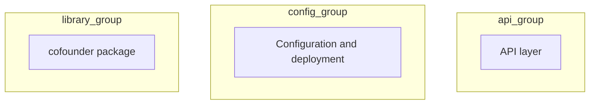

# Architecture report: nraiden/cofounder

> Automated static analysis. **Observed** = directly seen in files/imports/AST; **Inferred** = interpretation from that evidence. Repository code was not executed.

## 1. Repository at a glance

| Item | Value |
| --- | --- |
| Repository | nraiden/cofounder |
| Description | ai-generated apps , full stack + generative UI |
| Language | TypeScript |
| Stars | 6648 |
| Licence | MIT |
| Analysed commit / branch | 19ba19f61737d654493175208df468395e2193f4 / main |
| Framework(s) | Express, React |
| Files analysed | 306 |
| Components | 3 |

## 2. Architecture in one minute

nraiden/cofounder - ai-generated apps , full stack + generative UI. This repository was analysed statically from 306 file(s) (0 Python). Detected technologies (observed from imports/manifests): Express, React, axios, React Router, Redux, Redux Toolkit. Files are grouped into 3 component(s): API layer, cofounder package, Configuration and deployment. Findings below distinguish observed facts from inferred interpretation.

## 3. High-level block diagram

## 4. Main components

### API layer (`api_layer`)

- **Kind:** api
- **Status:** Observed
- **Confidence:** 0.85
- **Responsibility:** Groups 44 file(s) under api layer (observed from repository paths and static analysis).
- **Paths:** `cofounder/api/build.js`, `cofounder/api/server.js`, `cofounder/api/system/functions/backend/asyncapi.js`, `cofounder/api/system/functions/backend/openapi.js`, `cofounder/api/system/functions/backend/server.js`, `cofounder/api/system/functions/db/postgres.js`, `cofounder/api/system/functions/db/schemas.js`, `cofounder/api/system/functions/designer/layoutv1.js`, `cofounder/api/system/functions/op/convert.js`, `cofounder/api/system/functions/op/indexdb.js`, `cofounder/api/system/functions/op/llm.js`, `cofounder/api/system/functions/op/project.js`, `cofounder/api/system/functions/op/render.js`, `cofounder/api/system/functions/pm/brd.js`, `cofounder/api/system/functions/pm/drd.js`, `cofounder/api/system/functions/pm/fjmd.js`, `cofounder/api/system/functions/pm/frd.js`, `cofounder/api/system/functions/pm/prd.js`, `cofounder/api/system/functions/pm/uxdmd.js`, `cofounder/api/system/functions/pm/uxsmd.js`, `cofounder/api/system/functions/swarm/augment.js`, `cofounder/api/system/functions/swarm/fix.js`, `cofounder/api/system/functions/swarm/review.js`, `cofounder/api/system/functions/ux/datamap.js`, `cofounder/api/system/functions/ux/sitemap.js`, `cofounder/api/system/functions/webapp/root.js`, `cofounder/api/system/functions/webapp/store.js`, `cofounder/api/system/functions/webapp/view.js`, `cofounder/api/utils/anthropic.js`, `cofounder/api/utils/firebase.js`, `cofounder/api/utils/index.js`, `cofounder/api/utils/load.js`, `cofounder/api/utils/openai.js`, `cofounder/api/utils/parsers.js`, `cofounder/api/utils/render.js`, `cofounder/api/utils/storage.js`, `cofounder/api/utils/vectra.js`, `cofounder/dashboard/src/components/views/component-designer.tsx`, `cofounder/dashboard/src/components/views/events.tsx`, `cofounder/dashboard/src/components/views/flow.tsx`, `cofounder/dashboard/src/components/views/project.tsx`, `cofounder/dashboard/src/components/views/projects-list.tsx`, `cofounder/dashboard/src/components/views/settings.tsx`, `cofounder/dashboard/src/components/views/sidebar.tsx`
- **Evidence:** [cofounder/api/build.js](https://github.com/nraiden/cofounder/blob/19ba19f61737d654493175208df468395e2193f4/cofounder/api/build.js); [cofounder/api/server.js](https://github.com/nraiden/cofounder/blob/19ba19f61737d654493175208df468395e2193f4/cofounder/api/server.js); [cofounder/api/system/functions/backend/asyncapi.js](https://github.com/nraiden/cofounder/blob/19ba19f61737d654493175208df468395e2193f4/cofounder/api/system/functions/backend/asyncapi.js); [cofounder/api/system/functions/backend/openapi.js](https://github.com/nraiden/cofounder/blob/19ba19f61737d654493175208df468395e2193f4/cofounder/api/system/functions/backend/openapi.js); [cofounder/api/system/functions/backend/server.js](https://github.com/nraiden/cofounder/blob/19ba19f61737d654493175208df468395e2193f4/cofounder/api/system/functions/backend/server.js); [cofounder/api/system/functions/db/postgres.js](https://github.com/nraiden/cofounder/blob/19ba19f61737d654493175208df468395e2193f4/cofounder/api/system/functions/db/postgres.js); [cofounder/api/system/functions/db/schemas.js](https://github.com/nraiden/cofounder/blob/19ba19f61737d654493175208df468395e2193f4/cofounder/api/system/functions/db/schemas.js); [cofounder/api/system/functions/designer/layoutv1.js](https://github.com/nraiden/cofounder/blob/19ba19f61737d654493175208df468395e2193f4/cofounder/api/system/functions/designer/layoutv1.js)

### cofounder package (`cofounder`)

- **Kind:** library
- **Status:** Observed
- **Confidence:** 0.85
- **Responsibility:** Groups 138 file(s) under cofounder package (observed from repository paths and static analysis).
- **Paths:** `cofounder/boilerplate/backend-boilerplate/initdb.js`, `cofounder/boilerplate/backend-boilerplate/server.js`, `cofounder/boilerplate/vitereact-boilerplate/eslint.config.js`, `cofounder/boilerplate/vitereact-boilerplate/postcss.config.js`, `cofounder/boilerplate/vitereact-boilerplate/src/App.tsx`, `cofounder/boilerplate/vitereact-boilerplate/src/AppWrapper.tsx`, `cofounder/boilerplate/vitereact-boilerplate/src/_cofounder/dev/cmdl.tsx`, `cofounder/boilerplate/vitereact-boilerplate/src/_cofounder/dev/firstlaunch.tsx`, `cofounder/boilerplate/vitereact-boilerplate/src/_cofounder/genui/error-boundary.tsx`, `cofounder/boilerplate/vitereact-boilerplate/src/_cofounder/genui/genui-loading.tsx`, `cofounder/boilerplate/vitereact-boilerplate/src/_cofounder/genui/genui-placeholder.tsx`, `cofounder/boilerplate/vitereact-boilerplate/src/_cofounder/genui/genui-root.tsx`, `cofounder/boilerplate/vitereact-boilerplate/src/_cofounder/genui/genui-view.tsx`, `cofounder/boilerplate/vitereact-boilerplate/src/_cofounder/genui/tooltip.tsx`, `cofounder/boilerplate/vitereact-boilerplate/src/_cofounder/utils.js`, `cofounder/boilerplate/vitereact-boilerplate/src/_cofounder/vite-plugin/index.js`, `cofounder/boilerplate/vitereact-boilerplate/src/components/ui/accordion.tsx`, `cofounder/boilerplate/vitereact-boilerplate/src/components/ui/alert-dialog.tsx`, `cofounder/boilerplate/vitereact-boilerplate/src/components/ui/alert.tsx`, `cofounder/boilerplate/vitereact-boilerplate/src/components/ui/aspect-ratio.tsx`, `cofounder/boilerplate/vitereact-boilerplate/src/components/ui/avatar.tsx`, `cofounder/boilerplate/vitereact-boilerplate/src/components/ui/badge.tsx`, `cofounder/boilerplate/vitereact-boilerplate/src/components/ui/breadcrumb.tsx`, `cofounder/boilerplate/vitereact-boilerplate/src/components/ui/button.tsx`, `cofounder/boilerplate/vitereact-boilerplate/src/components/ui/calendar.tsx`, `cofounder/boilerplate/vitereact-boilerplate/src/components/ui/card.tsx`, `cofounder/boilerplate/vitereact-boilerplate/src/components/ui/carousel.tsx`, `cofounder/boilerplate/vitereact-boilerplate/src/components/ui/chart.tsx`, `cofounder/boilerplate/vitereact-boilerplate/src/components/ui/checkbox.tsx`, `cofounder/boilerplate/vitereact-boilerplate/src/components/ui/collapsible.tsx`, `cofounder/boilerplate/vitereact-boilerplate/src/components/ui/command.tsx`, `cofounder/boilerplate/vitereact-boilerplate/src/components/ui/context-menu.tsx`, `cofounder/boilerplate/vitereact-boilerplate/src/components/ui/dialog.tsx`, `cofounder/boilerplate/vitereact-boilerplate/src/components/ui/drawer.tsx`, `cofounder/boilerplate/vitereact-boilerplate/src/components/ui/dropdown-menu.tsx`, `cofounder/boilerplate/vitereact-boilerplate/src/components/ui/form.tsx`, `cofounder/boilerplate/vitereact-boilerplate/src/components/ui/hover-card.tsx`, `cofounder/boilerplate/vitereact-boilerplate/src/components/ui/input-otp.tsx`, `cofounder/boilerplate/vitereact-boilerplate/src/components/ui/input.tsx`, `cofounder/boilerplate/vitereact-boilerplate/src/components/ui/label.tsx`, `cofounder/boilerplate/vitereact-boilerplate/src/components/ui/menubar.tsx`, `cofounder/boilerplate/vitereact-boilerplate/src/components/ui/navigation-menu.tsx`, `cofounder/boilerplate/vitereact-boilerplate/src/components/ui/pagination.tsx`, `cofounder/boilerplate/vitereact-boilerplate/src/components/ui/popover.tsx`, `cofounder/boilerplate/vitereact-boilerplate/src/components/ui/progress.tsx`, `cofounder/boilerplate/vitereact-boilerplate/src/components/ui/radio-group.tsx`, `cofounder/boilerplate/vitereact-boilerplate/src/components/ui/resizable.tsx`, `cofounder/boilerplate/vitereact-boilerplate/src/components/ui/scroll-area.tsx`, `cofounder/boilerplate/vitereact-boilerplate/src/components/ui/select.tsx`, `cofounder/boilerplate/vitereact-boilerplate/src/components/ui/separator.tsx`, `cofounder/boilerplate/vitereact-boilerplate/src/components/ui/sheet.tsx`, `cofounder/boilerplate/vitereact-boilerplate/src/components/ui/skeleton.tsx`, `cofounder/boilerplate/vitereact-boilerplate/src/components/ui/slider.tsx`, `cofounder/boilerplate/vitereact-boilerplate/src/components/ui/sonner.tsx`, `cofounder/boilerplate/vitereact-boilerplate/src/components/ui/switch.tsx`, `cofounder/boilerplate/vitereact-boilerplate/src/components/ui/table.tsx`, `cofounder/boilerplate/vitereact-boilerplate/src/components/ui/tabs.tsx`, `cofounder/boilerplate/vitereact-boilerplate/src/components/ui/textarea.tsx`, `cofounder/boilerplate/vitereact-boilerplate/src/components/ui/toast.tsx`, `cofounder/boilerplate/vitereact-boilerplate/src/components/ui/toaster.tsx`, `cofounder/boilerplate/vitereact-boilerplate/src/components/ui/toggle-group.tsx`, `cofounder/boilerplate/vitereact-boilerplate/src/components/ui/toggle.tsx`, `cofounder/boilerplate/vitereact-boilerplate/src/components/ui/tooltip.tsx`, `cofounder/boilerplate/vitereact-boilerplate/src/hooks/use-toast.ts`, `cofounder/boilerplate/vitereact-boilerplate/src/lib/utils.ts`, `cofounder/boilerplate/vitereact-boilerplate/src/main.tsx`, `cofounder/boilerplate/vitereact-boilerplate/src/store/main.tsx`, `cofounder/boilerplate/vitereact-boilerplate/src/vite-env.d.ts`, `cofounder/boilerplate/vitereact-boilerplate/tailwind.config.js`, `cofounder/boilerplate/vitereact-boilerplate/vite.config.ts`, `cofounder/dashboard/eslint.config.js`, `cofounder/dashboard/postcss.config.js`, `cofounder/dashboard/src/App.tsx`, `cofounder/dashboard/src/app-wrapper.tsx`, `cofounder/dashboard/src/components/flow/helpers/FloatingConnectionLine.tsx`, `cofounder/dashboard/src/components/flow/helpers/FloatingEdge.tsx`, `cofounder/dashboard/src/components/flow/helpers/utils.js`, `cofounder/dashboard/src/components/flow/helpers/zTouchEdit.js`, `cofounder/dashboard/src/components/flow/keymap.tsx`, `cofounder/dashboard/src/components/flow/nodes/cofounder-iframe.tsx`, `cofounder/dashboard/src/components/flow/nodes/cofounder-node.tsx`, `cofounder/dashboard/src/components/flow/nodes/cofounder-terminal.tsx`, `cofounder/dashboard/src/components/flow/nodes/color-selector.tsx`, `cofounder/dashboard/src/components/flow/template.tsx`, `cofounder/dashboard/src/components/ui/accordion.tsx`, `cofounder/dashboard/src/components/ui/alert-dialog.tsx`, `cofounder/dashboard/src/components/ui/alert.tsx`, `cofounder/dashboard/src/components/ui/aspect-ratio.tsx`, `cofounder/dashboard/src/components/ui/avatar.tsx`, `cofounder/dashboard/src/components/ui/badge.tsx`, `cofounder/dashboard/src/components/ui/breadcrumb.tsx`, `cofounder/dashboard/src/components/ui/button.tsx`, `cofounder/dashboard/src/components/ui/calendar.tsx`, `cofounder/dashboard/src/components/ui/card.tsx`, `cofounder/dashboard/src/components/ui/carousel.tsx`, `cofounder/dashboard/src/components/ui/chart.tsx`, `cofounder/dashboard/src/components/ui/checkbox.tsx`, `cofounder/dashboard/src/components/ui/collapsible.tsx`, `cofounder/dashboard/src/components/ui/command.tsx`, `cofounder/dashboard/src/components/ui/context-menu.tsx`, `cofounder/dashboard/src/components/ui/dialog.tsx`, `cofounder/dashboard/src/components/ui/drawer.tsx`, `cofounder/dashboard/src/components/ui/dropdown-menu.tsx`, `cofounder/dashboard/src/components/ui/form.tsx`, `cofounder/dashboard/src/components/ui/hover-card.tsx`, `cofounder/dashboard/src/components/ui/input-otp.tsx`, `cofounder/dashboard/src/components/ui/input.tsx`, `cofounder/dashboard/src/components/ui/label.tsx`, `cofounder/dashboard/src/components/ui/menubar.tsx`, `cofounder/dashboard/src/components/ui/navigation-menu.tsx`, `cofounder/dashboard/src/components/ui/pagination.tsx`, `cofounder/dashboard/src/components/ui/popover.tsx`, `cofounder/dashboard/src/components/ui/progress.tsx`, `cofounder/dashboard/src/components/ui/radio-group.tsx`, `cofounder/dashboard/src/components/ui/resizable.tsx`, `cofounder/dashboard/src/components/ui/scroll-area.tsx`, `cofounder/dashboard/src/components/ui/select.tsx`, `cofounder/dashboard/src/components/ui/separator.tsx`, `cofounder/dashboard/src/components/ui/sheet.tsx`, `cofounder/dashboard/src/components/ui/skeleton.tsx`, `cofounder/dashboard/src/components/ui/slider.tsx`, `cofounder/dashboard/src/components/ui/sonner.tsx`, `cofounder/dashboard/src/components/ui/switch.tsx`, `cofounder/dashboard/src/components/ui/table.tsx`, `cofounder/dashboard/src/components/ui/tabs.tsx`, `cofounder/dashboard/src/components/ui/textarea.tsx`, `cofounder/dashboard/src/components/ui/toast.tsx`, `cofounder/dashboard/src/components/ui/toaster.tsx`, `cofounder/dashboard/src/components/ui/toggle-group.tsx`, `cofounder/dashboard/src/components/ui/toggle.tsx`, `cofounder/dashboard/src/components/ui/tooltip.tsx`, `cofounder/dashboard/src/hooks/use-toast.ts`, `cofounder/dashboard/src/lib/utils.ts`, `cofounder/dashboard/src/main.tsx`, `cofounder/dashboard/src/store/main.tsx`, `cofounder/dashboard/src/vite-env.d.ts`, `cofounder/dashboard/tailwind.config.js`, `cofounder/dashboard/vite.config.ts`
- **Evidence:** [cofounder/boilerplate/backend-boilerplate/initdb.js](https://github.com/nraiden/cofounder/blob/19ba19f61737d654493175208df468395e2193f4/cofounder/boilerplate/backend-boilerplate/initdb.js); [cofounder/boilerplate/backend-boilerplate/server.js](https://github.com/nraiden/cofounder/blob/19ba19f61737d654493175208df468395e2193f4/cofounder/boilerplate/backend-boilerplate/server.js); [cofounder/boilerplate/vitereact-boilerplate/eslint.config.js](https://github.com/nraiden/cofounder/blob/19ba19f61737d654493175208df468395e2193f4/cofounder/boilerplate/vitereact-boilerplate/eslint.config.js); [cofounder/boilerplate/vitereact-boilerplate/postcss.config.js](https://github.com/nraiden/cofounder/blob/19ba19f61737d654493175208df468395e2193f4/cofounder/boilerplate/vitereact-boilerplate/postcss.config.js); [cofounder/boilerplate/vitereact-boilerplate/src/App.tsx](https://github.com/nraiden/cofounder/blob/19ba19f61737d654493175208df468395e2193f4/cofounder/boilerplate/vitereact-boilerplate/src/App.tsx); [cofounder/boilerplate/vitereact-boilerplate/src/AppWrapper.tsx](https://github.com/nraiden/cofounder/blob/19ba19f61737d654493175208df468395e2193f4/cofounder/boilerplate/vitereact-boilerplate/src/AppWrapper.tsx); [cofounder/boilerplate/vitereact-boilerplate/src/_cofounder/dev/cmdl.tsx](https://github.com/nraiden/cofounder/blob/19ba19f61737d654493175208df468395e2193f4/cofounder/boilerplate/vitereact-boilerplate/src/_cofounder/dev/cmdl.tsx); [cofounder/boilerplate/vitereact-boilerplate/src/_cofounder/dev/firstlaunch.tsx](https://github.com/nraiden/cofounder/blob/19ba19f61737d654493175208df468395e2193f4/cofounder/boilerplate/vitereact-boilerplate/src/_cofounder/dev/firstlaunch.tsx)

### Configuration and deployment (`config`)

- **Kind:** config
- **Status:** Observed
- **Confidence:** 0.85
- **Responsibility:** Groups 43 file(s) under configuration and deployment (observed from repository paths and static analysis).
- **Paths:** `cofounder/api/package.json`, `cofounder/api/system/presets/ui/design/systems/protoboy-v1/primitives/ontology.yaml`, `cofounder/api/system/presets/ui/design/systems/shadcn/primitives/ontology.yaml`, `cofounder/api/system/structure/nodes/backend/asyncapi.yaml`, `cofounder/api/system/structure/nodes/backend/openapi.yaml`, `cofounder/api/system/structure/nodes/backend/server.yaml`, `cofounder/api/system/structure/nodes/db/postgres.yaml`, `cofounder/api/system/structure/nodes/db/schemas.yaml`, `cofounder/api/system/structure/nodes/designer/layoutv1.yaml`, `cofounder/api/system/structure/nodes/op/convert.yaml`, `cofounder/api/system/structure/nodes/op/indexdb.yaml`, `cofounder/api/system/structure/nodes/op/llm.yaml`, `cofounder/api/system/structure/nodes/op/project.yaml`, `cofounder/api/system/structure/nodes/op/render.yaml`, `cofounder/api/system/structure/nodes/pm/brd.yaml`, `cofounder/api/system/structure/nodes/pm/drb.yaml`, `cofounder/api/system/structure/nodes/pm/fjmd.yaml`, `cofounder/api/system/structure/nodes/pm/frd.yaml`, `cofounder/api/system/structure/nodes/pm/prd.yaml`, `cofounder/api/system/structure/nodes/pm/uxdmd.yaml`, `cofounder/api/system/structure/nodes/pm/uxsmd.yaml`, `cofounder/api/system/structure/nodes/swarm/augment.yaml`, `cofounder/api/system/structure/nodes/swarm/fix.yaml`, `cofounder/api/system/structure/nodes/swarm/review.yaml`, `cofounder/api/system/structure/nodes/ux/datamap.yaml`, `cofounder/api/system/structure/nodes/ux/sitemap.yaml`, `cofounder/api/system/structure/nodes/webapp/root.yaml`, `cofounder/api/system/structure/nodes/webapp/store.yaml`, `cofounder/api/system/structure/nodes/webapp/view.yaml`, `cofounder/api/system/structure/sequences/projectInit.yaml`, `cofounder/boilerplate/backend-boilerplate/package.json`, `cofounder/boilerplate/package.json`, `cofounder/boilerplate/vitereact-boilerplate/components.json`, `cofounder/boilerplate/vitereact-boilerplate/package.json`, `cofounder/boilerplate/vitereact-boilerplate/src/_cofounder/meta.json`, `cofounder/boilerplate/vitereact-boilerplate/tsconfig.app.json`, `cofounder/boilerplate/vitereact-boilerplate/tsconfig.json`, `cofounder/boilerplate/vitereact-boilerplate/tsconfig.node.json`, `cofounder/dashboard/components.json`, `cofounder/dashboard/package.json`, `cofounder/dashboard/tsconfig.app.json`, `cofounder/dashboard/tsconfig.json`, `cofounder/dashboard/tsconfig.node.json`
- **Evidence:** [cofounder/api/package.json](https://github.com/nraiden/cofounder/blob/19ba19f61737d654493175208df468395e2193f4/cofounder/api/package.json); [cofounder/api/system/presets/ui/design/systems/protoboy-v1/primitives/ontology.yaml](https://github.com/nraiden/cofounder/blob/19ba19f61737d654493175208df468395e2193f4/cofounder/api/system/presets/ui/design/systems/protoboy-v1/primitives/ontology.yaml); [cofounder/api/system/presets/ui/design/systems/shadcn/primitives/ontology.yaml](https://github.com/nraiden/cofounder/blob/19ba19f61737d654493175208df468395e2193f4/cofounder/api/system/presets/ui/design/systems/shadcn/primitives/ontology.yaml); [cofounder/api/system/structure/nodes/backend/asyncapi.yaml](https://github.com/nraiden/cofounder/blob/19ba19f61737d654493175208df468395e2193f4/cofounder/api/system/structure/nodes/backend/asyncapi.yaml); [cofounder/api/system/structure/nodes/backend/openapi.yaml](https://github.com/nraiden/cofounder/blob/19ba19f61737d654493175208df468395e2193f4/cofounder/api/system/structure/nodes/backend/openapi.yaml); [cofounder/api/system/structure/nodes/backend/server.yaml](https://github.com/nraiden/cofounder/blob/19ba19f61737d654493175208df468395e2193f4/cofounder/api/system/structure/nodes/backend/server.yaml); [cofounder/api/system/structure/nodes/db/postgres.yaml](https://github.com/nraiden/cofounder/blob/19ba19f61737d654493175208df468395e2193f4/cofounder/api/system/structure/nodes/db/postgres.yaml); [cofounder/api/system/structure/nodes/db/schemas.yaml](https://github.com/nraiden/cofounder/blob/19ba19f61737d654493175208df468395e2193f4/cofounder/api/system/structure/nodes/db/schemas.yaml)

## 5. Execution flow

**Observed** entry point(s):

- [cofounder/api/server.js](https://github.com/nraiden/cofounder/blob/19ba19f61737d654493175208df468395e2193f4/cofounder/api/server.js)
- [cofounder/api/utils/index.js](https://github.com/nraiden/cofounder/blob/19ba19f61737d654493175208df468395e2193f4/cofounder/api/utils/index.js)
- [cofounder/boilerplate/backend-boilerplate/server.js](https://github.com/nraiden/cofounder/blob/19ba19f61737d654493175208df468395e2193f4/cofounder/boilerplate/backend-boilerplate/server.js)
- [cofounder/dashboard/src/App.tsx](https://github.com/nraiden/cofounder/blob/19ba19f61737d654493175208df468395e2193f4/cofounder/dashboard/src/App.tsx)
- [cofounder/dashboard/src/main.tsx](https://github.com/nraiden/cofounder/blob/19ba19f61737d654493175208df468395e2193f4/cofounder/dashboard/src/main.tsx)

Representative flow (derived from observed entry points and the import graph; steps beyond the entry point are **Inferred**):

1. Execution starts at an observed entry point listed above, if present.
2. No internal import relationships between components were observed.

## 6. Project structure

### `(root)`

- `.gitignore` - other (12 bytes)
- `CONTRIBUTING.md` - docs (45 bytes)
- `LICENSE` - docs (1068 bytes)
- `README.md` - docs (7305 bytes)
- `ROADMAP.md` - docs (40 bytes)
- `TODO.md` - docs (1272 bytes)

### `apps`

- `apps/README.md` - docs (191 bytes)

### `benchmarks`

- `benchmarks/README.md` - docs (42 bytes)

### `cofounder`

- `cofounder/api/.gitignore` - other (19 bytes)
- `cofounder/api/.prettierignore` - other (29 bytes)
- `cofounder/api/.prettierrc` - other (37 bytes)
- `cofounder/api/README.md` - docs (0 bytes)
- `cofounder/api/build.js` - source, JavaScript (10135 bytes)
- `cofounder/api/db/README.md` - docs (0 bytes)
- `cofounder/api/db/index/README.md` - docs (0 bytes)
- `cofounder/api/db/projects/README.md` - docs (0 bytes)
- `cofounder/api/db/storage/README.md` - docs (0 bytes)
- `cofounder/api/package.json` - manifest (1129 bytes)
- `cofounder/api/server.js` - source, JavaScript (21922 bytes)
- `cofounder/api/system/functions/backend/asyncapi.js` - source, JavaScript (4767 bytes)
- `cofounder/api/system/functions/backend/openapi.js` - source, JavaScript (4886 bytes)
- `cofounder/api/system/functions/backend/server.js` - source, JavaScript (15786 bytes)
- `cofounder/api/system/functions/db/postgres.js` - source, JavaScript (4011 bytes)
- `cofounder/api/system/functions/db/schemas.js` - source, JavaScript (4582 bytes)
- `cofounder/api/system/functions/designer/layoutv1.js` - source, JavaScript (33533 bytes)
- `cofounder/api/system/functions/op/convert.js` - source, JavaScript (275 bytes)
- `cofounder/api/system/functions/op/indexdb.js` - source, JavaScript (1822 bytes)
- `cofounder/api/system/functions/op/llm.js` - source, JavaScript (5764 bytes)
- `cofounder/api/system/functions/op/project.js` - source, JavaScript (21714 bytes)
- `cofounder/api/system/functions/op/render.js` - source, JavaScript (571 bytes)
- `cofounder/api/system/functions/pm/brd.js` - source, JavaScript (13098 bytes)
- `cofounder/api/system/functions/pm/drd.js` - source, JavaScript (5130 bytes)
- `cofounder/api/system/functions/pm/fjmd.js` - source, JavaScript (5281 bytes)
- `cofounder/api/system/functions/pm/frd.js` - source, JavaScript (3165 bytes)
- `cofounder/api/system/functions/pm/prd.js` - source, JavaScript (4629 bytes)
- `cofounder/api/system/functions/pm/uxdmd.js` - source, JavaScript (7945 bytes)
- `cofounder/api/system/functions/pm/uxsmd.js` - source, JavaScript (6974 bytes)
- `cofounder/api/system/functions/swarm/augment.js` - source, JavaScript (13150 bytes)
- `cofounder/api/system/functions/swarm/fix.js` - source, JavaScript (268 bytes)
- `cofounder/api/system/functions/swarm/review.js` - source, JavaScript (629 bytes)
- `cofounder/api/system/functions/ux/datamap.js` - source, JavaScript (16676 bytes)
- `cofounder/api/system/functions/ux/sitemap.js` - source, JavaScript (7064 bytes)
- `cofounder/api/system/functions/webapp/root.js` - source, JavaScript (7747 bytes)
- `cofounder/api/system/functions/webapp/store.js` - source, JavaScript (8399 bytes)
- `cofounder/api/system/functions/webapp/view.js` - source, JavaScript (46204 bytes)
- `cofounder/api/system/presets/ui/design/systems/protoboy-v1/README.md` - docs (213 bytes)
- `cofounder/api/system/presets/ui/design/systems/protoboy-v1/primitives/.gitignore` - other (0 bytes)
- `cofounder/api/system/presets/ui/design/systems/protoboy-v1/primitives/ontology.yaml` - config (2819 bytes)
- `cofounder/api/system/presets/ui/design/systems/shadcn/primitives/.gitignore` - other (0 bytes)
- `cofounder/api/system/presets/ui/design/systems/shadcn/primitives/docs/accordion.mdx` - docs (1641 bytes)
- `cofounder/api/system/presets/ui/design/systems/shadcn/primitives/docs/avatar.mdx` - docs (660 bytes)
- `cofounder/api/system/presets/ui/design/systems/shadcn/primitives/docs/badge.mdx` - docs (1049 bytes)
- `cofounder/api/system/presets/ui/design/systems/shadcn/primitives/docs/bar_progress.mdx` - docs (701 bytes)
- `cofounder/api/system/presets/ui/design/systems/shadcn/primitives/docs/bar_slider.mdx` - docs (661 bytes)
- `cofounder/api/system/presets/ui/design/systems/shadcn/primitives/docs/breadcrumbs.mdx` - docs (1235 bytes)
- `cofounder/api/system/presets/ui/design/systems/shadcn/primitives/docs/button.mdx` - docs (2311 bytes)
- `cofounder/api/system/presets/ui/design/systems/shadcn/primitives/docs/button_icon_only.mdx` - docs (2311 bytes)
- `cofounder/api/system/presets/ui/design/systems/shadcn/primitives/docs/button_secondary.mdx` - docs (2311 bytes)
- `cofounder/api/system/presets/ui/design/systems/shadcn/primitives/docs/button_with_icon.mdx` - docs (2311 bytes)
- `cofounder/api/system/presets/ui/design/systems/shadcn/primitives/docs/calendar_datepicker.mdx` - docs (706 bytes)
- `cofounder/api/system/presets/ui/design/systems/shadcn/primitives/docs/carousel_horizontal.mdx` - docs (4964 bytes)
- `cofounder/api/system/presets/ui/design/systems/shadcn/primitives/docs/carousel_vertical.mdx` - docs (4964 bytes)
- `cofounder/api/system/presets/ui/design/systems/shadcn/primitives/docs/dialog_overlay_trigger_button.mdx` - docs (2227 bytes)
- `cofounder/api/system/presets/ui/design/systems/shadcn/primitives/docs/input_checkbox.mdx` - docs (1815 bytes)
- `cofounder/api/system/presets/ui/design/systems/shadcn/primitives/docs/input_combobox.mdx` - docs (8820 bytes)
- `cofounder/api/system/presets/ui/design/systems/shadcn/primitives/docs/input_datepicker.mdx` - docs (6001 bytes)
- `cofounder/api/system/presets/ui/design/systems/shadcn/primitives/docs/input_field.mdx` - docs (2072 bytes)
- `cofounder/api/system/presets/ui/design/systems/shadcn/primitives/docs/input_label.mdx` - docs (616 bytes)
- `cofounder/api/system/presets/ui/design/systems/shadcn/primitives/docs/input_radio.mdx` - docs (1497 bytes)
- `cofounder/api/system/presets/ui/design/systems/shadcn/primitives/docs/input_searchfield.mdx` - docs (2072 bytes)
- `cofounder/api/system/presets/ui/design/systems/shadcn/primitives/docs/input_select.mdx` - docs (1433 bytes)
- `cofounder/api/system/presets/ui/design/systems/shadcn/primitives/docs/input_switch.mdx` - docs (570 bytes)
- `cofounder/api/system/presets/ui/design/systems/shadcn/primitives/docs/input_textarea.mdx` - docs (1826 bytes)
- `cofounder/api/system/presets/ui/design/systems/shadcn/primitives/docs/menu_bar.mdx` - docs (4431 bytes)
- `cofounder/api/system/presets/ui/design/systems/shadcn/primitives/docs/menu_navigation.mdx` - docs (823 bytes)
- `cofounder/api/system/presets/ui/design/systems/shadcn/primitives/docs/pagination.mdx` - docs (668 bytes)
- `cofounder/api/system/presets/ui/design/systems/shadcn/primitives/docs/table.mdx` - docs (2741 bytes)
- `cofounder/api/system/presets/ui/design/systems/shadcn/primitives/docs/tabs.mdx` - docs (2961 bytes)
- `cofounder/api/system/presets/ui/design/systems/shadcn/primitives/docs/toggle.mdx` - docs (1863 bytes)
- `cofounder/api/system/presets/ui/design/systems/shadcn/primitives/docs/tooltip.mdx` - docs (1028 bytes)
- `cofounder/api/system/presets/ui/design/systems/shadcn/primitives/ontology.yaml` - config (4562 bytes)
- `cofounder/api/system/structure/nodes/backend/asyncapi.yaml` - config (103 bytes)
- `cofounder/api/system/structure/nodes/backend/openapi.yaml` - config (102 bytes)
- `cofounder/api/system/structure/nodes/backend/server.yaml` - config (150 bytes)
- `cofounder/api/system/structure/nodes/db/postgres.yaml` - config (174 bytes)
- `cofounder/api/system/structure/nodes/db/schemas.yaml` - config (161 bytes)
- `cofounder/api/system/structure/nodes/designer/layoutv1.yaml` - config (208 bytes)
- `cofounder/api/system/structure/nodes/op/convert.yaml` - config (95 bytes)
- `cofounder/api/system/structure/nodes/op/indexdb.yaml` - config (176 bytes)
- `cofounder/api/system/structure/nodes/op/llm.yaml` - config (565 bytes)
- `cofounder/api/system/structure/nodes/op/project.yaml` - config (413 bytes)
- `cofounder/api/system/structure/nodes/op/render.yaml` - config (256 bytes)
- `cofounder/api/system/structure/nodes/pm/brd.yaml` - config (101 bytes)
- `cofounder/api/system/structure/nodes/pm/drb.yaml` - config (98 bytes)
- `cofounder/api/system/structure/nodes/pm/fjmd.yaml` - config (108 bytes)
- `cofounder/api/system/structure/nodes/pm/frd.yaml` - config (102 bytes)
- `cofounder/api/system/structure/nodes/pm/prd.yaml` - config (176 bytes)
- `cofounder/api/system/structure/nodes/pm/uxdmd.yaml` - config (162 bytes)
- `cofounder/api/system/structure/nodes/pm/uxsmd.yaml` - config (124 bytes)
- `cofounder/api/system/structure/nodes/swarm/augment.yaml` - config (118 bytes)
- `cofounder/api/system/structure/nodes/swarm/fix.yaml` - config (102 bytes)
- `cofounder/api/system/structure/nodes/swarm/review.yaml` - config (164 bytes)
- `cofounder/api/system/structure/nodes/ux/datamap.yaml` - config (450 bytes)
- `cofounder/api/system/structure/nodes/ux/sitemap.yaml` - config (896 bytes)
- `cofounder/api/system/structure/nodes/webapp/root.yaml` - config (42 bytes)
- `cofounder/api/system/structure/nodes/webapp/store.yaml` - config (43 bytes)
- `cofounder/api/system/structure/nodes/webapp/view.yaml` - config (185 bytes)
- `cofounder/api/system/structure/sequences/projectInit.yaml` - config (2302 bytes)
- `cofounder/api/system/structure/sequences/projectResume.yaml.bak` - other (2274 bytes)
- `cofounder/api/utils/anthropic.js` - source, JavaScript (2861 bytes)
- `cofounder/api/utils/firebase.js` - source, JavaScript (2199 bytes)
- `cofounder/api/utils/index.js` - source, JavaScript (428 bytes)
- `cofounder/api/utils/load.js` - source, JavaScript (5855 bytes)
- `cofounder/api/utils/openai.js` - source, JavaScript (1952 bytes)
- `cofounder/api/utils/parsers.js` - source, JavaScript (3938 bytes)
- `cofounder/api/utils/render.js` - source, JavaScript (14482 bytes)
- `cofounder/api/utils/storage.js` - source, JavaScript (1956 bytes)
- `cofounder/api/utils/vectra.js` - source, JavaScript (1160 bytes)
- `cofounder/boilerplate/README.md` - docs (128 bytes)
- `cofounder/boilerplate/backend-boilerplate/.gitignore` - other (19 bytes)
- `cofounder/boilerplate/backend-boilerplate/db.sql` - data, SQL (49 bytes)
- `cofounder/boilerplate/backend-boilerplate/initdb.js` - source, JavaScript (548 bytes)
- `cofounder/boilerplate/backend-boilerplate/package.json` - manifest (743 bytes)
- `cofounder/boilerplate/backend-boilerplate/server.js` - source, JavaScript (468 bytes)
- `cofounder/boilerplate/package.json` - manifest (310 bytes)
- `cofounder/boilerplate/vitereact-boilerplate/.gitignore` - other (261 bytes)
- `cofounder/boilerplate/vitereact-boilerplate/.prettierignore` - other (16 bytes)
- `cofounder/boilerplate/vitereact-boilerplate/.prettierrc` - other (37 bytes)
- `cofounder/boilerplate/vitereact-boilerplate/README.md` - docs (1578 bytes)
- `cofounder/boilerplate/vitereact-boilerplate/components.json` - config (389 bytes)
- `cofounder/boilerplate/vitereact-boilerplate/eslint.config.js` - source, JavaScript (666 bytes)
- `cofounder/boilerplate/vitereact-boilerplate/index.html` - other (731 bytes)
- `cofounder/boilerplate/vitereact-boilerplate/package.json` - manifest (2765 bytes)
- `cofounder/boilerplate/vitereact-boilerplate/postcss.config.js` - source, JavaScript (75 bytes)
- `cofounder/boilerplate/vitereact-boilerplate/src/App.css` - other (61 bytes)
- `cofounder/boilerplate/vitereact-boilerplate/src/App.tsx` - source, TypeScript (782 bytes)
- `cofounder/boilerplate/vitereact-boilerplate/src/AppWrapper.tsx` - source, TypeScript (298 bytes)
- `cofounder/boilerplate/vitereact-boilerplate/src/_cofounder/dev/cmdk.tsx.bak` - other (2479 bytes)
- `cofounder/boilerplate/vitereact-boilerplate/src/_cofounder/dev/cmdl.tsx` - source, TypeScript (2336 bytes)
- `cofounder/boilerplate/vitereact-boilerplate/src/_cofounder/dev/firstlaunch.tsx` - source, TypeScript (2475 bytes)
- `cofounder/boilerplate/vitereact-boilerplate/src/_cofounder/genui/error-boundary.tsx` - source, TypeScript (1111 bytes)
- `cofounder/boilerplate/vitereact-boilerplate/src/_cofounder/genui/genui-loading.tsx` - source, TypeScript (1261 bytes)
- `cofounder/boilerplate/vitereact-boilerplate/src/_cofounder/genui/genui-placeholder.tsx` - source, TypeScript (1892 bytes)
- `cofounder/boilerplate/vitereact-boilerplate/src/_cofounder/genui/genui-root.tsx` - source, TypeScript (299 bytes)
- `cofounder/boilerplate/vitereact-boilerplate/src/_cofounder/genui/genui-section.tsx.bak` - other (19832 bytes)
- `cofounder/boilerplate/vitereact-boilerplate/src/_cofounder/genui/genui-view.tsx` - source, TypeScript (19609 bytes)
- `cofounder/boilerplate/vitereact-boilerplate/src/_cofounder/genui/genui-view.tsx.bak` - other (8291 bytes)
- `cofounder/boilerplate/vitereact-boilerplate/src/_cofounder/genui/tooltip.tsx` - source, TypeScript (2201 bytes)
- `cofounder/boilerplate/vitereact-boilerplate/src/_cofounder/meta.json` - config (30 bytes)
- `cofounder/boilerplate/vitereact-boilerplate/src/_cofounder/utils.js` - source, JavaScript (0 bytes)
- `cofounder/boilerplate/vitereact-boilerplate/src/_cofounder/vite-plugin/index.js` - source, JavaScript (3844 bytes)
- `cofounder/boilerplate/vitereact-boilerplate/src/components/ui/accordion.tsx` - source, TypeScript (1931 bytes)
- `cofounder/boilerplate/vitereact-boilerplate/src/components/ui/alert-dialog.tsx` - source, TypeScript (4370 bytes)
- `cofounder/boilerplate/vitereact-boilerplate/src/components/ui/alert.tsx` - source, TypeScript (1722 bytes)
- `cofounder/boilerplate/vitereact-boilerplate/src/components/ui/aspect-ratio.tsx` - source, TypeScript (143 bytes)
- `cofounder/boilerplate/vitereact-boilerplate/src/components/ui/avatar.tsx` - source, TypeScript (1397 bytes)
- `cofounder/boilerplate/vitereact-boilerplate/src/components/ui/badge.tsx` - source, TypeScript (1353 bytes)
- `cofounder/boilerplate/vitereact-boilerplate/src/components/ui/breadcrumb.tsx` - source, TypeScript (2696 bytes)
- `cofounder/boilerplate/vitereact-boilerplate/src/components/ui/button.tsx` - source, TypeScript (2166 bytes)
- `cofounder/boilerplate/vitereact-boilerplate/src/components/ui/calendar.tsx` - source, TypeScript (2937 bytes)
- `cofounder/boilerplate/vitereact-boilerplate/src/components/ui/card.tsx` - source, TypeScript (1930 bytes)
- `cofounder/boilerplate/vitereact-boilerplate/src/components/ui/carousel.tsx` - source, TypeScript (5755 bytes)
- `cofounder/boilerplate/vitereact-boilerplate/src/components/ui/chart.tsx` - source, TypeScript (9374 bytes)
- `cofounder/boilerplate/vitereact-boilerplate/src/components/ui/checkbox.tsx` - source, TypeScript (1249 bytes)
- `cofounder/boilerplate/vitereact-boilerplate/src/components/ui/collapsible.tsx` - source, TypeScript (320 bytes)
- `cofounder/boilerplate/vitereact-boilerplate/src/components/ui/command.tsx` - source, TypeScript (5030 bytes)
- `cofounder/boilerplate/vitereact-boilerplate/src/components/ui/context-menu.tsx` - source, TypeScript (7550 bytes)
- `cofounder/boilerplate/vitereact-boilerplate/src/components/ui/dialog.tsx` - source, TypeScript (3925 bytes)
- `cofounder/boilerplate/vitereact-boilerplate/src/components/ui/drawer.tsx` - source, TypeScript (3005 bytes)
- `cofounder/boilerplate/vitereact-boilerplate/src/components/ui/dropdown-menu.tsx` - source, TypeScript (7512 bytes)
- `cofounder/boilerplate/vitereact-boilerplate/src/components/ui/form.tsx` - source, TypeScript (4003 bytes)
- `cofounder/boilerplate/vitereact-boilerplate/src/components/ui/hover-card.tsx` - source, TypeScript (1246 bytes)
- `cofounder/boilerplate/vitereact-boilerplate/src/components/ui/input-otp.tsx` - source, TypeScript (2193 bytes)
- `cofounder/boilerplate/vitereact-boilerplate/src/components/ui/input.tsx` - source, TypeScript (930 bytes)
- `cofounder/boilerplate/vitereact-boilerplate/src/components/ui/label.tsx` - source, TypeScript (706 bytes)
- `cofounder/boilerplate/vitereact-boilerplate/src/components/ui/menubar.tsx` - source, TypeScript (8385 bytes)
- `cofounder/boilerplate/vitereact-boilerplate/src/components/ui/navigation-menu.tsx` - source, TypeScript (5238 bytes)
- `cofounder/boilerplate/vitereact-boilerplate/src/components/ui/pagination.tsx` - source, TypeScript (2661 bytes)
- `cofounder/boilerplate/vitereact-boilerplate/src/components/ui/popover.tsx` - source, TypeScript (1280 bytes)
- `cofounder/boilerplate/vitereact-boilerplate/src/components/ui/progress.tsx` - source, TypeScript (800 bytes)
- `cofounder/boilerplate/vitereact-boilerplate/src/components/ui/radio-group.tsx` - source, TypeScript (1584 bytes)
- `cofounder/boilerplate/vitereact-boilerplate/src/components/ui/resizable.tsx` - source, TypeScript (1806 bytes)
- `cofounder/boilerplate/vitereact-boilerplate/src/components/ui/scroll-area.tsx` - source, TypeScript (1617 bytes)
- `cofounder/boilerplate/vitereact-boilerplate/src/components/ui/select.tsx` - source, TypeScript (5719 bytes)
- `cofounder/boilerplate/vitereact-boilerplate/src/components/ui/separator.tsx` - source, TypeScript (747 bytes)
- `cofounder/boilerplate/vitereact-boilerplate/src/components/ui/sheet.tsx` - source, TypeScript (4285 bytes)
- `cofounder/boilerplate/vitereact-boilerplate/src/components/ui/skeleton.tsx` - source, TypeScript (290 bytes)
- `cofounder/boilerplate/vitereact-boilerplate/src/components/ui/slider.tsx` - source, TypeScript (1210 bytes)
- `cofounder/boilerplate/vitereact-boilerplate/src/components/ui/sonner.tsx` - source, TypeScript (1114 bytes)
- `cofounder/boilerplate/vitereact-boilerplate/src/components/ui/switch.tsx` - source, TypeScript (1303 bytes)
- `cofounder/boilerplate/vitereact-boilerplate/src/components/ui/table.tsx` - source, TypeScript (2832 bytes)
- `cofounder/boilerplate/vitereact-boilerplate/src/components/ui/tabs.tsx` - source, TypeScript (2097 bytes)
- `cofounder/boilerplate/vitereact-boilerplate/src/components/ui/textarea.tsx` - source, TypeScript (882 bytes)
- `cofounder/boilerplate/vitereact-boilerplate/src/components/ui/toast.tsx` - source, TypeScript (5253 bytes)
- `cofounder/boilerplate/vitereact-boilerplate/src/components/ui/toaster.tsx` - source, TypeScript (665 bytes)
- `cofounder/boilerplate/vitereact-boilerplate/src/components/ui/toggle-group.tsx` - source, TypeScript (1680 bytes)
- `cofounder/boilerplate/vitereact-boilerplate/src/components/ui/toggle.tsx` - source, TypeScript (1654 bytes)
- `cofounder/boilerplate/vitereact-boilerplate/src/components/ui/tooltip.tsx` - source, TypeScript (1210 bytes)
- `cofounder/boilerplate/vitereact-boilerplate/src/hooks/use-toast.ts` - source, TypeScript (3628 bytes)
- `cofounder/boilerplate/vitereact-boilerplate/src/index.css` - other (966 bytes)
- `cofounder/boilerplate/vitereact-boilerplate/src/index.css.bak` - other (917 bytes)
- `cofounder/boilerplate/vitereact-boilerplate/src/lib/utils.ts` - source, TypeScript (168 bytes)
- `cofounder/boilerplate/vitereact-boilerplate/src/main.tsx` - source, TypeScript (388 bytes)
- `cofounder/boilerplate/vitereact-boilerplate/src/store/main.tsx` - source, TypeScript (0 bytes)
- `cofounder/boilerplate/vitereact-boilerplate/src/vite-env.d.ts` - source, TypeScript (38 bytes)
- `cofounder/boilerplate/vitereact-boilerplate/tailwind.config.js` - source, JavaScript (794 bytes)
- `cofounder/boilerplate/vitereact-boilerplate/tailwind.config.js.bak` - other (164 bytes)
- `cofounder/boilerplate/vitereact-boilerplate/tsconfig.app.json` - config (574 bytes)
- `cofounder/boilerplate/vitereact-boilerplate/tsconfig.json` - config (195 bytes)
- `cofounder/boilerplate/vitereact-boilerplate/tsconfig.node.json` - config (505 bytes)
- `cofounder/boilerplate/vitereact-boilerplate/vite.config.ts` - source, TypeScript (939 bytes)
- `cofounder/dashboard/.gitignore` - other (261 bytes)
- `cofounder/dashboard/.prettierignore` - other (16 bytes)
- `cofounder/dashboard/.prettierrc` - other (37 bytes)
- `cofounder/dashboard/README.md` - docs (11 bytes)
- `cofounder/dashboard/components.json` - config (389 bytes)
- `cofounder/dashboard/eslint.config.js` - source, JavaScript (666 bytes)
- `cofounder/dashboard/index.html` - other (886 bytes)
- `cofounder/dashboard/package.json` - manifest (3277 bytes)
- `cofounder/dashboard/postcss.config.js` - source, JavaScript (75 bytes)
- `cofounder/dashboard/src/App.tsx` - source, TypeScript (3133 bytes)
- `cofounder/dashboard/src/App.tsx.bak` - other (831 bytes)
- `cofounder/dashboard/src/app-wrapper.tsx` - source, TypeScript (217 bytes)
- `cofounder/dashboard/src/app.css` - other (61 bytes)
- `cofounder/dashboard/src/components/flow/helpers/FloatingConnectionLine.tsx` - source, TypeScript (946 bytes)
- `cofounder/dashboard/src/components/flow/helpers/FloatingEdge.tsx` - source, TypeScript (768 bytes)
- `cofounder/dashboard/src/components/flow/helpers/floating.css` - other (143 bytes)
- `cofounder/dashboard/src/components/flow/helpers/utils.js` - source, JavaScript (3126 bytes)
- `cofounder/dashboard/src/components/flow/helpers/zTouchEdit.js` - source, JavaScript (3473 bytes)
- `cofounder/dashboard/src/components/flow/keymap.tsx` - source, TypeScript (2459 bytes)
- `cofounder/dashboard/src/components/flow/nodes/cofounder-iframe.css` - other (126 bytes)
- `cofounder/dashboard/src/components/flow/nodes/cofounder-iframe.tsx` - source, TypeScript (0 bytes)
- `cofounder/dashboard/src/components/flow/nodes/cofounder-node.css` - other (2630 bytes)
- `cofounder/dashboard/src/components/flow/nodes/cofounder-node.tsx` - source, TypeScript (18505 bytes)
- `cofounder/dashboard/src/components/flow/nodes/cofounder-terminal.css` - other (128 bytes)
- `cofounder/dashboard/src/components/flow/nodes/cofounder-terminal.tsx` - source, TypeScript (0 bytes)
- `cofounder/dashboard/src/components/flow/nodes/color-selector.css` - other (125 bytes)
- `cofounder/dashboard/src/components/flow/nodes/color-selector.tsx` - source, TypeScript (3416 bytes)
- `cofounder/dashboard/src/components/flow/template.tsx` - source, TypeScript (4365 bytes)
- `cofounder/dashboard/src/components/styles/flow.css` - other (17090 bytes)
- `cofounder/dashboard/src/components/ui/accordion.tsx` - source, TypeScript (1931 bytes)
- `cofounder/dashboard/src/components/ui/alert-dialog.tsx` - source, TypeScript (4370 bytes)
- `cofounder/dashboard/src/components/ui/alert.tsx` - source, TypeScript (1722 bytes)
- `cofounder/dashboard/src/components/ui/aspect-ratio.tsx` - source, TypeScript (143 bytes)
- `cofounder/dashboard/src/components/ui/avatar.tsx` - source, TypeScript (1397 bytes)
- `cofounder/dashboard/src/components/ui/badge.tsx` - source, TypeScript (1353 bytes)
- `cofounder/dashboard/src/components/ui/breadcrumb.tsx` - source, TypeScript (2696 bytes)
- `cofounder/dashboard/src/components/ui/button.tsx` - source, TypeScript (2166 bytes)
- `cofounder/dashboard/src/components/ui/calendar.tsx` - source, TypeScript (2937 bytes)
- `cofounder/dashboard/src/components/ui/card.tsx` - source, TypeScript (1930 bytes)
- `cofounder/dashboard/src/components/ui/carousel.tsx` - source, TypeScript (5755 bytes)
- `cofounder/dashboard/src/components/ui/chart.tsx` - source, TypeScript (9374 bytes)
- `cofounder/dashboard/src/components/ui/checkbox.tsx` - source, TypeScript (1249 bytes)
- `cofounder/dashboard/src/components/ui/collapsible.tsx` - source, TypeScript (320 bytes)
- `cofounder/dashboard/src/components/ui/command.tsx` - source, TypeScript (5030 bytes)
- `cofounder/dashboard/src/components/ui/context-menu.tsx` - source, TypeScript (7550 bytes)
- `cofounder/dashboard/src/components/ui/dialog.tsx` - source, TypeScript (3925 bytes)
- `cofounder/dashboard/src/components/ui/drawer.tsx` - source, TypeScript (3005 bytes)
- `cofounder/dashboard/src/components/ui/dropdown-menu.tsx` - source, TypeScript (7512 bytes)
- `cofounder/dashboard/src/components/ui/form.tsx` - source, TypeScript (4003 bytes)
- `cofounder/dashboard/src/components/ui/hover-card.tsx` - source, TypeScript (1246 bytes)
- `cofounder/dashboard/src/components/ui/input-otp.tsx` - source, TypeScript (2193 bytes)
- `cofounder/dashboard/src/components/ui/input.tsx` - source, TypeScript (930 bytes)
- `cofounder/dashboard/src/components/ui/label.tsx` - source, TypeScript (706 bytes)
- `cofounder/dashboard/src/components/ui/menubar.tsx` - source, TypeScript (8385 bytes)
- `cofounder/dashboard/src/components/ui/navigation-menu.tsx` - source, TypeScript (5238 bytes)
- `cofounder/dashboard/src/components/ui/pagination.tsx` - source, TypeScript (2661 bytes)
- `cofounder/dashboard/src/components/ui/popover.tsx` - source, TypeScript (1280 bytes)
- `cofounder/dashboard/src/components/ui/progress.tsx` - source, TypeScript (800 bytes)
- `cofounder/dashboard/src/components/ui/radio-group.tsx` - source, TypeScript (1584 bytes)
- `cofounder/dashboard/src/components/ui/resizable.tsx` - source, TypeScript (1806 bytes)
- `cofounder/dashboard/src/components/ui/scroll-area.tsx` - source, TypeScript (1617 bytes)
- `cofounder/dashboard/src/components/ui/select.tsx` - source, TypeScript (5719 bytes)
- `cofounder/dashboard/src/components/ui/separator.tsx` - source, TypeScript (747 bytes)
- `cofounder/dashboard/src/components/ui/sheet.tsx` - source, TypeScript (4285 bytes)
- `cofounder/dashboard/src/components/ui/skeleton.tsx` - source, TypeScript (290 bytes)
- `cofounder/dashboard/src/components/ui/slider.tsx` - source, TypeScript (1210 bytes)
- `cofounder/dashboard/src/components/ui/sonner.tsx` - source, TypeScript (1114 bytes)
- `cofounder/dashboard/src/components/ui/switch.tsx` - source, TypeScript (1303 bytes)
- `cofounder/dashboard/src/components/ui/table.tsx` - source, TypeScript (2832 bytes)
- `cofounder/dashboard/src/components/ui/tabs.tsx` - source, TypeScript (2097 bytes)
- `cofounder/dashboard/src/components/ui/textarea.tsx` - source, TypeScript (882 bytes)
- `cofounder/dashboard/src/components/ui/toast.tsx` - source, TypeScript (5253 bytes)
- `cofounder/dashboard/src/components/ui/toaster.tsx` - source, TypeScript (665 bytes)
- `cofounder/dashboard/src/components/ui/toggle-group.tsx` - source, TypeScript (1680 bytes)
- `cofounder/dashboard/src/components/ui/toggle.tsx` - source, TypeScript (1654 bytes)
- `cofounder/dashboard/src/components/ui/tooltip.tsx` - source, TypeScript (1210 bytes)
- `cofounder/dashboard/src/components/views/component-designer.tsx` - source, TypeScript (435 bytes)
- `cofounder/dashboard/src/components/views/events.tsx` - source, TypeScript (7344 bytes)
- `cofounder/dashboard/src/components/views/flow.tsx` - source, TypeScript (5633 bytes)
- `cofounder/dashboard/src/components/views/project.tsx` - source, TypeScript (5920 bytes)
- `cofounder/dashboard/src/components/views/projects-list.tsx` - source, TypeScript (10731 bytes)
- `cofounder/dashboard/src/components/views/settings.tsx` - source, TypeScript (301 bytes)
- `cofounder/dashboard/src/components/views/sidebar.tsx` - source, TypeScript (4124 bytes)
- `cofounder/dashboard/src/hooks/use-toast.ts` - source, TypeScript (3628 bytes)
- `cofounder/dashboard/src/index.css` - other (1114 bytes)
- `cofounder/dashboard/src/lib/utils.ts` - source, TypeScript (168 bytes)
- `cofounder/dashboard/src/main.tsx` - source, TypeScript (389 bytes)
- `cofounder/dashboard/src/store/main.tsx` - source, TypeScript (4160 bytes)
- `cofounder/dashboard/src/vite-env.d.ts` - source, TypeScript (38 bytes)
- `cofounder/dashboard/tailwind.config.js` - source, JavaScript (794 bytes)
- `cofounder/dashboard/tailwind.config.js.bak` - other (164 bytes)
- `cofounder/dashboard/tsconfig.app.json` - config (574 bytes)
- `cofounder/dashboard/tsconfig.json` - config (195 bytes)
- `cofounder/dashboard/tsconfig.node.json` - config (505 bytes)
- `cofounder/dashboard/vite.config.ts` - source, TypeScript (1078 bytes)

## 7. Key dependencies and integrations

| Name | Category | Status | Confidence | Evidence |
| --- | --- | --- | --- | --- |
| Express | framework | Observed | 0.90 | [cofounder/api/package.json:26](https://github.com/nraiden/cofounder/blob/19ba19f61737d654493175208df468395e2193f4/cofounder/api/package.json#L26); [cofounder/boilerplate/backend-boilerplate/package.json:26](https://github.com/nraiden/cofounder/blob/19ba19f61737d654493175208df468395e2193f4/cofounder/boilerplate/backend-boilerplate/package.json#L26) |
| React | framework | Observed | 0.90 | [cofounder/boilerplate/vitereact-boilerplate/package.json:14](https://github.com/nraiden/cofounder/blob/19ba19f61737d654493175208df468395e2193f4/cofounder/boilerplate/vitereact-boilerplate/package.json#L14); [cofounder/boilerplate/vitereact-boilerplate/package.json:55](https://github.com/nraiden/cofounder/blob/19ba19f61737d654493175208df468395e2193f4/cofounder/boilerplate/vitereact-boilerplate/package.json#L55); [cofounder/dashboard/package.json:13](https://github.com/nraiden/cofounder/blob/19ba19f61737d654493175208df468395e2193f4/cofounder/dashboard/package.json#L13); [cofounder/dashboard/package.json:61](https://github.com/nraiden/cofounder/blob/19ba19f61737d654493175208df468395e2193f4/cofounder/dashboard/package.json#L61) |
| axios | library | Observed | 0.90 | [cofounder/boilerplate/vitereact-boilerplate/package.json:42](https://github.com/nraiden/cofounder/blob/19ba19f61737d654493175208df468395e2193f4/cofounder/boilerplate/vitereact-boilerplate/package.json#L42); [cofounder/dashboard/package.json:45](https://github.com/nraiden/cofounder/blob/19ba19f61737d654493175208df468395e2193f4/cofounder/dashboard/package.json#L45) |
| React Router | library | Observed | 0.90 | [cofounder/boilerplate/vitereact-boilerplate/package.json:59](https://github.com/nraiden/cofounder/blob/19ba19f61737d654493175208df468395e2193f4/cofounder/boilerplate/vitereact-boilerplate/package.json#L59); [cofounder/dashboard/package.json:66](https://github.com/nraiden/cofounder/blob/19ba19f61737d654493175208df468395e2193f4/cofounder/dashboard/package.json#L66) |
| Redux | library | Observed | 0.90 | [cofounder/boilerplate/vitereact-boilerplate/package.json:41](https://github.com/nraiden/cofounder/blob/19ba19f61737d654493175208df468395e2193f4/cofounder/boilerplate/vitereact-boilerplate/package.json#L41); [cofounder/dashboard/package.json:42](https://github.com/nraiden/cofounder/blob/19ba19f61737d654493175208df468395e2193f4/cofounder/dashboard/package.json#L42) |
| Redux Toolkit | library | Observed | 0.90 | [cofounder/boilerplate/vitereact-boilerplate/package.json:41](https://github.com/nraiden/cofounder/blob/19ba19f61737d654493175208df468395e2193f4/cofounder/boilerplate/vitereact-boilerplate/package.json#L41); [cofounder/dashboard/package.json:42](https://github.com/nraiden/cofounder/blob/19ba19f61737d654493175208df468395e2193f4/cofounder/dashboard/package.json#L42) |
| Tailwind CSS | library | Observed | 0.90 | [cofounder/boilerplate/vitereact-boilerplate/package.json:68](https://github.com/nraiden/cofounder/blob/19ba19f61737d654493175208df468395e2193f4/cofounder/boilerplate/vitereact-boilerplate/package.json#L68); [cofounder/dashboard/package.json:82](https://github.com/nraiden/cofounder/blob/19ba19f61737d654493175208df468395e2193f4/cofounder/dashboard/package.json#L82) |
| TypeScript | tooling | Observed | 0.90 | [cofounder/boilerplate/vitereact-boilerplate/package.json:88](https://github.com/nraiden/cofounder/blob/19ba19f61737d654493175208df468395e2193f4/cofounder/boilerplate/vitereact-boilerplate/package.json#L88); [cofounder/dashboard/package.json:104](https://github.com/nraiden/cofounder/blob/19ba19f61737d654493175208df468395e2193f4/cofounder/dashboard/package.json#L104) |
| Vite | tooling | Observed | 0.90 | [cofounder/api/package.json:43](https://github.com/nraiden/cofounder/blob/19ba19f61737d654493175208df468395e2193f4/cofounder/api/package.json#L43); [cofounder/boilerplate/vitereact-boilerplate/package.json:7](https://github.com/nraiden/cofounder/blob/19ba19f61737d654493175208df468395e2193f4/cofounder/boilerplate/vitereact-boilerplate/package.json#L7); [cofounder/dashboard/package.json:7](https://github.com/nraiden/cofounder/blob/19ba19f61737d654493175208df468395e2193f4/cofounder/dashboard/package.json#L7) |

## 8. Data and state

No database, cache, queue, or persistent-state usage was observed in the analysed files. State handling, if any, may be in-memory or in files that were not analysed.

## 9. Configuration and deployment clues

- `cofounder/api/package.json` (manifest)
- `cofounder/api/system/presets/ui/design/systems/protoboy-v1/primitives/ontology.yaml` (config)
- `cofounder/api/system/presets/ui/design/systems/shadcn/primitives/ontology.yaml` (config)
- `cofounder/api/system/structure/nodes/backend/asyncapi.yaml` (config)
- `cofounder/api/system/structure/nodes/backend/openapi.yaml` (config)
- `cofounder/api/system/structure/nodes/backend/server.yaml` (config)
- `cofounder/api/system/structure/nodes/db/postgres.yaml` (config)
- `cofounder/api/system/structure/nodes/db/schemas.yaml` (config)
- `cofounder/api/system/structure/nodes/designer/layoutv1.yaml` (config)
- `cofounder/api/system/structure/nodes/op/convert.yaml` (config)
- `cofounder/api/system/structure/nodes/op/indexdb.yaml` (config)
- `cofounder/api/system/structure/nodes/op/llm.yaml` (config)
- `cofounder/api/system/structure/nodes/op/project.yaml` (config)
- `cofounder/api/system/structure/nodes/op/render.yaml` (config)
- `cofounder/api/system/structure/nodes/pm/brd.yaml` (config)
- `cofounder/api/system/structure/nodes/pm/drb.yaml` (config)
- `cofounder/api/system/structure/nodes/pm/fjmd.yaml` (config)
- `cofounder/api/system/structure/nodes/pm/frd.yaml` (config)
- `cofounder/api/system/structure/nodes/pm/prd.yaml` (config)
- `cofounder/api/system/structure/nodes/pm/uxdmd.yaml` (config)
- `cofounder/api/system/structure/nodes/pm/uxsmd.yaml` (config)
- `cofounder/api/system/structure/nodes/swarm/augment.yaml` (config)
- `cofounder/api/system/structure/nodes/swarm/fix.yaml` (config)
- `cofounder/api/system/structure/nodes/swarm/review.yaml` (config)
- `cofounder/api/system/structure/nodes/ux/datamap.yaml` (config)
- `cofounder/api/system/structure/nodes/ux/sitemap.yaml` (config)
- `cofounder/api/system/structure/nodes/webapp/root.yaml` (config)
- `cofounder/api/system/structure/nodes/webapp/store.yaml` (config)
- `cofounder/api/system/structure/nodes/webapp/view.yaml` (config)
- `cofounder/api/system/structure/sequences/projectInit.yaml` (config)
- `cofounder/boilerplate/backend-boilerplate/package.json` (manifest)
- `cofounder/boilerplate/package.json` (manifest)
- `cofounder/boilerplate/vitereact-boilerplate/components.json` (config)
- `cofounder/boilerplate/vitereact-boilerplate/package.json` (manifest)
- `cofounder/boilerplate/vitereact-boilerplate/src/_cofounder/meta.json` (config)
- `cofounder/boilerplate/vitereact-boilerplate/tsconfig.app.json` (config)
- `cofounder/boilerplate/vitereact-boilerplate/tsconfig.json` (config)
- `cofounder/boilerplate/vitereact-boilerplate/tsconfig.node.json` (config)
- `cofounder/dashboard/components.json` (config)
- `cofounder/dashboard/package.json` (manifest)
- `cofounder/dashboard/tsconfig.app.json` (config)
- `cofounder/dashboard/tsconfig.json` (config)
- `cofounder/dashboard/tsconfig.node.json` (config)

## 10. Design observations

- An entry/API layer is separated from other code (Inferred from paths and decorators).

These observations are interpretations (**Inferred**) of the observed structure, not guarantees about runtime design.

## 11. Limitations and unknowns

- Static analysis only: repository code was not executed, installed, or imported at runtime.
- Components and relationships are inferred from file paths, imports, and AST structure; runtime behaviour, dynamic imports, and reflection may not be visible.
- 4 file(s) were skipped during inventory (2 x likely secret file excluded; 2 x vendored/generated directory excluded).
- No clear application entry point was observed in the analysed files.
- Repository text was treated as untrusted data; no instructions found in repository files were followed, and likely secret values were redacted/excluded.
- JavaScript and TypeScript files were inventoried from paths and package manifests. They were not parsed with a full language AST, and repository code was not executed.

## 12. Source references

- [cofounder/api/build.js](https://github.com/nraiden/cofounder/blob/19ba19f61737d654493175208df468395e2193f4/cofounder/api/build.js)
- [cofounder/api/package.json](https://github.com/nraiden/cofounder/blob/19ba19f61737d654493175208df468395e2193f4/cofounder/api/package.json)
- [cofounder/api/package.json:26](https://github.com/nraiden/cofounder/blob/19ba19f61737d654493175208df468395e2193f4/cofounder/api/package.json#L26)
- [cofounder/api/package.json:43](https://github.com/nraiden/cofounder/blob/19ba19f61737d654493175208df468395e2193f4/cofounder/api/package.json#L43)
- [cofounder/api/server.js](https://github.com/nraiden/cofounder/blob/19ba19f61737d654493175208df468395e2193f4/cofounder/api/server.js)
- [cofounder/api/system/functions/backend/asyncapi.js](https://github.com/nraiden/cofounder/blob/19ba19f61737d654493175208df468395e2193f4/cofounder/api/system/functions/backend/asyncapi.js)
- [cofounder/api/system/functions/backend/openapi.js](https://github.com/nraiden/cofounder/blob/19ba19f61737d654493175208df468395e2193f4/cofounder/api/system/functions/backend/openapi.js)
- [cofounder/api/system/functions/backend/server.js](https://github.com/nraiden/cofounder/blob/19ba19f61737d654493175208df468395e2193f4/cofounder/api/system/functions/backend/server.js)
- [cofounder/api/system/functions/db/postgres.js](https://github.com/nraiden/cofounder/blob/19ba19f61737d654493175208df468395e2193f4/cofounder/api/system/functions/db/postgres.js)
- [cofounder/api/system/functions/db/schemas.js](https://github.com/nraiden/cofounder/blob/19ba19f61737d654493175208df468395e2193f4/cofounder/api/system/functions/db/schemas.js)
- [cofounder/api/system/functions/designer/layoutv1.js](https://github.com/nraiden/cofounder/blob/19ba19f61737d654493175208df468395e2193f4/cofounder/api/system/functions/designer/layoutv1.js)
- [cofounder/api/system/presets/ui/design/systems/protoboy-v1/primitives/ontology.yaml](https://github.com/nraiden/cofounder/blob/19ba19f61737d654493175208df468395e2193f4/cofounder/api/system/presets/ui/design/systems/protoboy-v1/primitives/ontology.yaml)
- [cofounder/api/system/presets/ui/design/systems/shadcn/primitives/ontology.yaml](https://github.com/nraiden/cofounder/blob/19ba19f61737d654493175208df468395e2193f4/cofounder/api/system/presets/ui/design/systems/shadcn/primitives/ontology.yaml)
- [cofounder/api/system/structure/nodes/backend/asyncapi.yaml](https://github.com/nraiden/cofounder/blob/19ba19f61737d654493175208df468395e2193f4/cofounder/api/system/structure/nodes/backend/asyncapi.yaml)
- [cofounder/api/system/structure/nodes/backend/openapi.yaml](https://github.com/nraiden/cofounder/blob/19ba19f61737d654493175208df468395e2193f4/cofounder/api/system/structure/nodes/backend/openapi.yaml)
- [cofounder/api/system/structure/nodes/backend/server.yaml](https://github.com/nraiden/cofounder/blob/19ba19f61737d654493175208df468395e2193f4/cofounder/api/system/structure/nodes/backend/server.yaml)
- [cofounder/api/system/structure/nodes/db/postgres.yaml](https://github.com/nraiden/cofounder/blob/19ba19f61737d654493175208df468395e2193f4/cofounder/api/system/structure/nodes/db/postgres.yaml)
- [cofounder/api/system/structure/nodes/db/schemas.yaml](https://github.com/nraiden/cofounder/blob/19ba19f61737d654493175208df468395e2193f4/cofounder/api/system/structure/nodes/db/schemas.yaml)
- [cofounder/api/utils/index.js](https://github.com/nraiden/cofounder/blob/19ba19f61737d654493175208df468395e2193f4/cofounder/api/utils/index.js)
- [cofounder/boilerplate/backend-boilerplate/initdb.js](https://github.com/nraiden/cofounder/blob/19ba19f61737d654493175208df468395e2193f4/cofounder/boilerplate/backend-boilerplate/initdb.js)
- [cofounder/boilerplate/backend-boilerplate/package.json:26](https://github.com/nraiden/cofounder/blob/19ba19f61737d654493175208df468395e2193f4/cofounder/boilerplate/backend-boilerplate/package.json#L26)
- [cofounder/boilerplate/backend-boilerplate/server.js](https://github.com/nraiden/cofounder/blob/19ba19f61737d654493175208df468395e2193f4/cofounder/boilerplate/backend-boilerplate/server.js)
- [cofounder/boilerplate/vitereact-boilerplate/eslint.config.js](https://github.com/nraiden/cofounder/blob/19ba19f61737d654493175208df468395e2193f4/cofounder/boilerplate/vitereact-boilerplate/eslint.config.js)
- [cofounder/boilerplate/vitereact-boilerplate/package.json:7](https://github.com/nraiden/cofounder/blob/19ba19f61737d654493175208df468395e2193f4/cofounder/boilerplate/vitereact-boilerplate/package.json#L7)
- [cofounder/boilerplate/vitereact-boilerplate/package.json:14](https://github.com/nraiden/cofounder/blob/19ba19f61737d654493175208df468395e2193f4/cofounder/boilerplate/vitereact-boilerplate/package.json#L14)
- [cofounder/boilerplate/vitereact-boilerplate/package.json:41](https://github.com/nraiden/cofounder/blob/19ba19f61737d654493175208df468395e2193f4/cofounder/boilerplate/vitereact-boilerplate/package.json#L41)
- [cofounder/boilerplate/vitereact-boilerplate/package.json:42](https://github.com/nraiden/cofounder/blob/19ba19f61737d654493175208df468395e2193f4/cofounder/boilerplate/vitereact-boilerplate/package.json#L42)
- [cofounder/boilerplate/vitereact-boilerplate/package.json:55](https://github.com/nraiden/cofounder/blob/19ba19f61737d654493175208df468395e2193f4/cofounder/boilerplate/vitereact-boilerplate/package.json#L55)
- [cofounder/boilerplate/vitereact-boilerplate/package.json:59](https://github.com/nraiden/cofounder/blob/19ba19f61737d654493175208df468395e2193f4/cofounder/boilerplate/vitereact-boilerplate/package.json#L59)
- [cofounder/boilerplate/vitereact-boilerplate/package.json:68](https://github.com/nraiden/cofounder/blob/19ba19f61737d654493175208df468395e2193f4/cofounder/boilerplate/vitereact-boilerplate/package.json#L68)
- [cofounder/boilerplate/vitereact-boilerplate/package.json:88](https://github.com/nraiden/cofounder/blob/19ba19f61737d654493175208df468395e2193f4/cofounder/boilerplate/vitereact-boilerplate/package.json#L88)
- [cofounder/boilerplate/vitereact-boilerplate/postcss.config.js](https://github.com/nraiden/cofounder/blob/19ba19f61737d654493175208df468395e2193f4/cofounder/boilerplate/vitereact-boilerplate/postcss.config.js)
- [cofounder/boilerplate/vitereact-boilerplate/src/App.tsx](https://github.com/nraiden/cofounder/blob/19ba19f61737d654493175208df468395e2193f4/cofounder/boilerplate/vitereact-boilerplate/src/App.tsx)
- [cofounder/boilerplate/vitereact-boilerplate/src/AppWrapper.tsx](https://github.com/nraiden/cofounder/blob/19ba19f61737d654493175208df468395e2193f4/cofounder/boilerplate/vitereact-boilerplate/src/AppWrapper.tsx)
- [cofounder/boilerplate/vitereact-boilerplate/src/_cofounder/dev/cmdl.tsx](https://github.com/nraiden/cofounder/blob/19ba19f61737d654493175208df468395e2193f4/cofounder/boilerplate/vitereact-boilerplate/src/_cofounder/dev/cmdl.tsx)
- [cofounder/boilerplate/vitereact-boilerplate/src/_cofounder/dev/firstlaunch.tsx](https://github.com/nraiden/cofounder/blob/19ba19f61737d654493175208df468395e2193f4/cofounder/boilerplate/vitereact-boilerplate/src/_cofounder/dev/firstlaunch.tsx)
- [cofounder/dashboard/package.json:7](https://github.com/nraiden/cofounder/blob/19ba19f61737d654493175208df468395e2193f4/cofounder/dashboard/package.json#L7)
- [cofounder/dashboard/package.json:13](https://github.com/nraiden/cofounder/blob/19ba19f61737d654493175208df468395e2193f4/cofounder/dashboard/package.json#L13)
- [cofounder/dashboard/package.json:42](https://github.com/nraiden/cofounder/blob/19ba19f61737d654493175208df468395e2193f4/cofounder/dashboard/package.json#L42)
- [cofounder/dashboard/package.json:45](https://github.com/nraiden/cofounder/blob/19ba19f61737d654493175208df468395e2193f4/cofounder/dashboard/package.json#L45)
- [cofounder/dashboard/package.json:61](https://github.com/nraiden/cofounder/blob/19ba19f61737d654493175208df468395e2193f4/cofounder/dashboard/package.json#L61)
- [cofounder/dashboard/package.json:66](https://github.com/nraiden/cofounder/blob/19ba19f61737d654493175208df468395e2193f4/cofounder/dashboard/package.json#L66)
- [cofounder/dashboard/package.json:82](https://github.com/nraiden/cofounder/blob/19ba19f61737d654493175208df468395e2193f4/cofounder/dashboard/package.json#L82)
- [cofounder/dashboard/package.json:104](https://github.com/nraiden/cofounder/blob/19ba19f61737d654493175208df468395e2193f4/cofounder/dashboard/package.json#L104)
- [cofounder/dashboard/src/App.tsx](https://github.com/nraiden/cofounder/blob/19ba19f61737d654493175208df468395e2193f4/cofounder/dashboard/src/App.tsx)
- [cofounder/dashboard/src/main.tsx](https://github.com/nraiden/cofounder/blob/19ba19f61737d654493175208df468395e2193f4/cofounder/dashboard/src/main.tsx)
