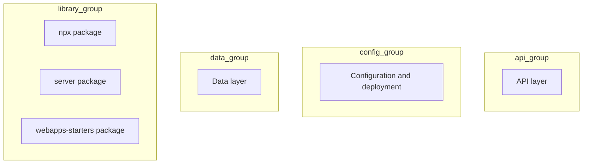

# Architecture report: nraiden/openv0

> Automated static analysis. **Observed** = directly seen in files/imports/AST; **Inferred** = interpretation from that evidence. Repository code was not executed.

## 1. Repository at a glance

| Item | Value |
| --- | --- |
| Repository | nraiden/openv0 |
| Description | AI generated UI components |
| Language | TypeScript |
| Stars | 3955 |
| Licence | MIT |
| Analysed commit / branch | 8d87809b09a4c65d5af7b0fa8ee7c9475b378286 / main |
| Framework(s) | Express, React, Svelte |
| Files analysed | 352 |
| Components | 6 |

## 2. Architecture in one minute

nraiden/openv0 - AI generated UI components. This repository was analysed statically from 352 file(s) (0 Python). Detected technologies (observed from imports/manifests): MongoDB, SQLite, Express, React, Svelte, axios. Files are grouped into 6 component(s): API layer, Configuration and deployment, Data layer, npx package, server package, webapps-starters package. Findings below distinguish observed facts from inferred interpretation.

## 3. High-level block diagram

## 4. Main components

### API layer (`api_layer`)

- **Kind:** api
- **Status:** Observed
- **Confidence:** 0.85
- **Responsibility:** Groups 16 file(s) under api layer (observed from repository paths and static analysis).
- **Paths:** `webapps-starters/react/flowbite/src/views/browse.tsx`, `webapps-starters/react/flowbite/src/views/view.tsx`, `webapps-starters/react/nextui/src/views/browse.tsx`, `webapps-starters/react/nextui/src/views/view.tsx`, `webapps-starters/react/shadcn/src/components/views/component-view.tsx`, `webapps-starters/react/shadcn/src/components/views/home.tsx`, `webapps-starters/react/shadcn/src/views/browse.tsx`, `webapps-starters/react/shadcn/src/views/view.tsx`, `webapps-starters/svelte/flowbite/src/routes/+layout.svelte`, `webapps-starters/svelte/flowbite/src/routes/+page.svelte`, `webapps-starters/svelte/flowbite/src/routes/view/[name]/+layout.svelte`, `webapps-starters/svelte/flowbite/src/routes/view/[name]/+page.svelte`, `webapps-starters/svelte/shadcn/src/routes/+layout.svelte`, `webapps-starters/svelte/shadcn/src/routes/+page.svelte`, `webapps-starters/svelte/shadcn/src/routes/view/[name]/+layout.svelte`, `webapps-starters/svelte/shadcn/src/routes/view/[name]/+page.svelte`
- **Evidence:** [webapps-starters/react/flowbite/src/views/browse.tsx](https://github.com/nraiden/openv0/blob/8d87809b09a4c65d5af7b0fa8ee7c9475b378286/webapps-starters/react/flowbite/src/views/browse.tsx); [webapps-starters/react/flowbite/src/views/view.tsx](https://github.com/nraiden/openv0/blob/8d87809b09a4c65d5af7b0fa8ee7c9475b378286/webapps-starters/react/flowbite/src/views/view.tsx); [webapps-starters/react/nextui/src/views/browse.tsx](https://github.com/nraiden/openv0/blob/8d87809b09a4c65d5af7b0fa8ee7c9475b378286/webapps-starters/react/nextui/src/views/browse.tsx); [webapps-starters/react/nextui/src/views/view.tsx](https://github.com/nraiden/openv0/blob/8d87809b09a4c65d5af7b0fa8ee7c9475b378286/webapps-starters/react/nextui/src/views/view.tsx); [webapps-starters/react/shadcn/src/components/views/component-view.tsx](https://github.com/nraiden/openv0/blob/8d87809b09a4c65d5af7b0fa8ee7c9475b378286/webapps-starters/react/shadcn/src/components/views/component-view.tsx); [webapps-starters/react/shadcn/src/components/views/home.tsx](https://github.com/nraiden/openv0/blob/8d87809b09a4c65d5af7b0fa8ee7c9475b378286/webapps-starters/react/shadcn/src/components/views/home.tsx); [webapps-starters/react/shadcn/src/views/browse.tsx](https://github.com/nraiden/openv0/blob/8d87809b09a4c65d5af7b0fa8ee7c9475b378286/webapps-starters/react/shadcn/src/views/browse.tsx); [webapps-starters/react/shadcn/src/views/view.tsx](https://github.com/nraiden/openv0/blob/8d87809b09a4c65d5af7b0fa8ee7c9475b378286/webapps-starters/react/shadcn/src/views/view.tsx)

### Configuration and deployment (`config`)

- **Kind:** config
- **Status:** Observed
- **Confidence:** 0.85
- **Responsibility:** Groups 27 file(s) under configuration and deployment (observed from repository paths and static analysis).
- **Paths:** `npx/package.json`, `server/library/components/next/flowbite/metadata.json`, `server/library/components/next/nextui/metadata.json`, `server/library/components/next/shadcn/dump.json`, `server/library/components/next/shadcn/metadata.json`, `server/library/components/react/flowbite/metadata.json`, `server/library/components/react/nextui/metadata.json`, `server/library/components/react/shadcn/dump.json`, `server/library/components/react/shadcn/metadata.json`, `server/library/components/svelte/flowbite/metadata.json`, `server/library/components/svelte/shadcn/dump.json`, `server/library/components/svelte/shadcn/metadata.json`, `server/library/icons/lucide/metadata.json`, `server/package.json`, `webapps-starters/react/flowbite/package.json`, `webapps-starters/react/flowbite/tsconfig.json`, `webapps-starters/react/flowbite/tsconfig.node.json`, `webapps-starters/react/nextui/package.json`, `webapps-starters/react/nextui/tsconfig.json`, `webapps-starters/react/nextui/tsconfig.node.json`, `webapps-starters/react/shadcn/components.json`, `webapps-starters/react/shadcn/package.json`, `webapps-starters/react/shadcn/tsconfig.json`, `webapps-starters/react/shadcn/tsconfig.node.json`, `webapps-starters/svelte/flowbite/package.json`, `webapps-starters/svelte/shadcn/components.json`, `webapps-starters/svelte/shadcn/package.json`
- **Evidence:** [npx/package.json](https://github.com/nraiden/openv0/blob/8d87809b09a4c65d5af7b0fa8ee7c9475b378286/npx/package.json); [server/library/components/next/flowbite/metadata.json](https://github.com/nraiden/openv0/blob/8d87809b09a4c65d5af7b0fa8ee7c9475b378286/server/library/components/next/flowbite/metadata.json); [server/library/components/next/nextui/metadata.json](https://github.com/nraiden/openv0/blob/8d87809b09a4c65d5af7b0fa8ee7c9475b378286/server/library/components/next/nextui/metadata.json); [server/library/components/next/shadcn/dump.json](https://github.com/nraiden/openv0/blob/8d87809b09a4c65d5af7b0fa8ee7c9475b378286/server/library/components/next/shadcn/dump.json); [server/library/components/next/shadcn/metadata.json](https://github.com/nraiden/openv0/blob/8d87809b09a4c65d5af7b0fa8ee7c9475b378286/server/library/components/next/shadcn/metadata.json); [server/library/components/react/flowbite/metadata.json](https://github.com/nraiden/openv0/blob/8d87809b09a4c65d5af7b0fa8ee7c9475b378286/server/library/components/react/flowbite/metadata.json); [server/library/components/react/nextui/metadata.json](https://github.com/nraiden/openv0/blob/8d87809b09a4c65d5af7b0fa8ee7c9475b378286/server/library/components/react/nextui/metadata.json); [server/library/components/react/shadcn/dump.json](https://github.com/nraiden/openv0/blob/8d87809b09a4c65d5af7b0fa8ee7c9475b378286/server/library/components/react/shadcn/dump.json)

### Data layer (`data_layer`)

- **Kind:** data
- **Status:** Inferred
- **Confidence:** 0.70
- **Responsibility:** Groups 0 file(s) under data layer (observed from repository paths and static analysis).
- **Evidence:** [server/package.json:28](https://github.com/nraiden/openv0/blob/8d87809b09a4c65d5af7b0fa8ee7c9475b378286/server/package.json#L28); [server/package.json:34](https://github.com/nraiden/openv0/blob/8d87809b09a4c65d5af7b0fa8ee7c9475b378286/server/package.json#L34)

### npx package (`npx`)

- **Kind:** library
- **Status:** Observed
- **Confidence:** 0.85
- **Responsibility:** Groups 1 file(s) under npx package (observed from repository paths and static analysis).
- **Paths:** `npx/bin.js`
- **Evidence:** [npx/bin.js](https://github.com/nraiden/openv0/blob/8d87809b09a4c65d5af7b0fa8ee7c9475b378286/npx/bin.js)

### server package (`server`)

- **Kind:** library
- **Status:** Observed
- **Confidence:** 0.85
- **Responsibility:** Groups 30 file(s) under server package (observed from repository paths and static analysis).
- **Paths:** `server/_test.build.js`, `server/_test.component_from_json.example.js`, `server/_test.db_build.js`, `server/_test.multipass.js`, `server/_validate+postprocess.test.js`, `server/api.js`, `server/build.js`, `server/db.js`, `server/modules/log/index.js`, `server/modules/multipass/index.js`, `server/modules/multipass/passes/animate-component/index.js`, `server/modules/multipass/passes/build-component-generation-context/index.js`, `server/modules/multipass/passes/build-component-generation-context/rag_components.js`, `server/modules/multipass/passes/build-component-generation-context/rag_icons.js`, `server/modules/multipass/passes/design-component-iteration-from-description/index.js`, `server/modules/multipass/passes/design-component-iteration-from-json/index.js`, `server/modules/multipass/passes/design-component-new-from-description/index.js`, `server/modules/multipass/passes/design-component-new-from-json/index.js`, `server/modules/multipass/passes/export-component/export_next.js`, `server/modules/multipass/passes/export-component/export_react.js`, `server/modules/multipass/passes/export-component/export_svelte.js`, `server/modules/multipass/passes/export-component/index.js`, `server/modules/multipass/passes/generate-component-iteration/index.js`, `server/modules/multipass/passes/generate-component-new/index.js`, `server/modules/multipass/passes/generate-component-placeholder-data/index.js`, `server/modules/multipass/passes/postprocess-generated-component/index.js`, `server/modules/multipass/passes/store-component/index.js`, `server/modules/multipass/passes/validate-check-generated-component/index.js`, `server/modules/multipass/passes/validate-fix-generated-component/index.js`, `server/modules/multipass/presets/index.js`
- **Evidence:** [server/_test.build.js](https://github.com/nraiden/openv0/blob/8d87809b09a4c65d5af7b0fa8ee7c9475b378286/server/_test.build.js); [server/_test.component_from_json.example.js](https://github.com/nraiden/openv0/blob/8d87809b09a4c65d5af7b0fa8ee7c9475b378286/server/_test.component_from_json.example.js); [server/_test.db_build.js](https://github.com/nraiden/openv0/blob/8d87809b09a4c65d5af7b0fa8ee7c9475b378286/server/_test.db_build.js); [server/_test.multipass.js](https://github.com/nraiden/openv0/blob/8d87809b09a4c65d5af7b0fa8ee7c9475b378286/server/_test.multipass.js); [server/_validate+postprocess.test.js](https://github.com/nraiden/openv0/blob/8d87809b09a4c65d5af7b0fa8ee7c9475b378286/server/_validate%2Bpostprocess.test.js); [server/api.js](https://github.com/nraiden/openv0/blob/8d87809b09a4c65d5af7b0fa8ee7c9475b378286/server/api.js); [server/build.js](https://github.com/nraiden/openv0/blob/8d87809b09a4c65d5af7b0fa8ee7c9475b378286/server/build.js); [server/db.js](https://github.com/nraiden/openv0/blob/8d87809b09a4c65d5af7b0fa8ee7c9475b378286/server/db.js)

### webapps-starters package (`webapps_starters`)

- **Kind:** library
- **Status:** Observed
- **Confidence:** 0.85
- **Responsibility:** Groups 224 file(s) under webapps-starters package (observed from repository paths and static analysis).
- **Paths:** `webapps-starters/react/flowbite/.eslintrc.cjs`, `webapps-starters/react/flowbite/postcss.config.js`, `webapps-starters/react/flowbite/src/App.tsx`, `webapps-starters/react/flowbite/src/main.tsx`, `webapps-starters/react/flowbite/src/vite-env.d.ts`, `webapps-starters/react/flowbite/tailwind.config.js`, `webapps-starters/react/flowbite/vite.config.ts`, `webapps-starters/react/nextui/.eslintrc.cjs`, `webapps-starters/react/nextui/postcss.config.js`, `webapps-starters/react/nextui/src/App.tsx`, `webapps-starters/react/nextui/src/main.tsx`, `webapps-starters/react/nextui/src/vite-env.d.ts`, `webapps-starters/react/nextui/tailwind.config.js`, `webapps-starters/react/nextui/vite.config.ts`, `webapps-starters/react/shadcn/.eslintrc.cjs`, `webapps-starters/react/shadcn/postcss.config.js`, `webapps-starters/react/shadcn/src/App.tsx`, `webapps-starters/react/shadcn/src/components/ErrorBoundary.tsx`, `webapps-starters/react/shadcn/src/components/Fallback.tsx`, `webapps-starters/react/shadcn/src/components/ui/accordion.tsx`, `webapps-starters/react/shadcn/src/components/ui/alert-dialog.tsx`, `webapps-starters/react/shadcn/src/components/ui/alert.tsx`, `webapps-starters/react/shadcn/src/components/ui/aspect-ratio.tsx`, `webapps-starters/react/shadcn/src/components/ui/avatar.tsx`, `webapps-starters/react/shadcn/src/components/ui/badge.tsx`, `webapps-starters/react/shadcn/src/components/ui/button.tsx`, `webapps-starters/react/shadcn/src/components/ui/calendar.tsx`, `webapps-starters/react/shadcn/src/components/ui/card.tsx`, `webapps-starters/react/shadcn/src/components/ui/checkbox.tsx`, `webapps-starters/react/shadcn/src/components/ui/collapsible.tsx`, `webapps-starters/react/shadcn/src/components/ui/command.tsx`, `webapps-starters/react/shadcn/src/components/ui/context-menu.tsx`, `webapps-starters/react/shadcn/src/components/ui/dialog.tsx`, `webapps-starters/react/shadcn/src/components/ui/dropdown-menu.tsx`, `webapps-starters/react/shadcn/src/components/ui/form.tsx`, `webapps-starters/react/shadcn/src/components/ui/hover-card.tsx`, `webapps-starters/react/shadcn/src/components/ui/input.tsx`, `webapps-starters/react/shadcn/src/components/ui/label.tsx`, `webapps-starters/react/shadcn/src/components/ui/menubar.tsx`, `webapps-starters/react/shadcn/src/components/ui/navigation-menu.tsx`, `webapps-starters/react/shadcn/src/components/ui/popover.tsx`, `webapps-starters/react/shadcn/src/components/ui/progress.tsx`, `webapps-starters/react/shadcn/src/components/ui/radio-group.tsx`, `webapps-starters/react/shadcn/src/components/ui/scroll-area.tsx`, `webapps-starters/react/shadcn/src/components/ui/select.tsx`, `webapps-starters/react/shadcn/src/components/ui/separator.tsx`, `webapps-starters/react/shadcn/src/components/ui/sheet.tsx`, `webapps-starters/react/shadcn/src/components/ui/skeleton.tsx`, `webapps-starters/react/shadcn/src/components/ui/slider.tsx`, `webapps-starters/react/shadcn/src/components/ui/switch.tsx`, `webapps-starters/react/shadcn/src/components/ui/table.tsx`, `webapps-starters/react/shadcn/src/components/ui/tabs.tsx`, `webapps-starters/react/shadcn/src/components/ui/textarea.tsx`, `webapps-starters/react/shadcn/src/components/ui/toast.tsx`, `webapps-starters/react/shadcn/src/components/ui/toaster.tsx`, `webapps-starters/react/shadcn/src/components/ui/toggle.tsx`, `webapps-starters/react/shadcn/src/components/ui/tooltip.tsx`, `webapps-starters/react/shadcn/src/components/ui/use-toast.tsx`, `webapps-starters/react/shadcn/src/lib/utils.ts`, `webapps-starters/react/shadcn/src/main.tsx`, `webapps-starters/react/shadcn/src/vite-env.d.ts`, `webapps-starters/react/shadcn/tailwind.config.js`, `webapps-starters/react/shadcn/vite.config.ts`, `webapps-starters/svelte/flowbite/postcss.config.cjs`, `webapps-starters/svelte/flowbite/src/lib/index.js`, `webapps-starters/svelte/flowbite/svelte.config.js`, `webapps-starters/svelte/flowbite/tailwind.config.cjs`, `webapps-starters/svelte/flowbite/vite.config.js`, `webapps-starters/svelte/shadcn/postcss.config.cjs`, `webapps-starters/svelte/shadcn/src/lib/components/ui/accordion/accordion-content.svelte`, `webapps-starters/svelte/shadcn/src/lib/components/ui/accordion/accordion-item.svelte`, `webapps-starters/svelte/shadcn/src/lib/components/ui/accordion/accordion-trigger.svelte`, `webapps-starters/svelte/shadcn/src/lib/components/ui/accordion/index.ts`, `webapps-starters/svelte/shadcn/src/lib/components/ui/alert-dialog/alert-dialog-action.svelte`, `webapps-starters/svelte/shadcn/src/lib/components/ui/alert-dialog/alert-dialog-cancel.svelte`, `webapps-starters/svelte/shadcn/src/lib/components/ui/alert-dialog/alert-dialog-content.svelte`, `webapps-starters/svelte/shadcn/src/lib/components/ui/alert-dialog/alert-dialog-description.svelte`, `webapps-starters/svelte/shadcn/src/lib/components/ui/alert-dialog/alert-dialog-footer.svelte`, `webapps-starters/svelte/shadcn/src/lib/components/ui/alert-dialog/alert-dialog-header.svelte`, `webapps-starters/svelte/shadcn/src/lib/components/ui/alert-dialog/alert-dialog-overlay.svelte`, `webapps-starters/svelte/shadcn/src/lib/components/ui/alert-dialog/alert-dialog-portal.svelte`, `webapps-starters/svelte/shadcn/src/lib/components/ui/alert-dialog/alert-dialog-title.svelte`, `webapps-starters/svelte/shadcn/src/lib/components/ui/alert-dialog/index.ts`, `webapps-starters/svelte/shadcn/src/lib/components/ui/alert/alert-description.svelte`, `webapps-starters/svelte/shadcn/src/lib/components/ui/alert/alert-title.svelte`, `webapps-starters/svelte/shadcn/src/lib/components/ui/alert/alert.svelte`, `webapps-starters/svelte/shadcn/src/lib/components/ui/alert/index.ts`, `webapps-starters/svelte/shadcn/src/lib/components/ui/aspect-ratio/aspect-ratio.svelte`, `webapps-starters/svelte/shadcn/src/lib/components/ui/aspect-ratio/index.ts`, `webapps-starters/svelte/shadcn/src/lib/components/ui/avatar/avatar-fallback.svelte`, `webapps-starters/svelte/shadcn/src/lib/components/ui/avatar/avatar-image.svelte`, `webapps-starters/svelte/shadcn/src/lib/components/ui/avatar/avatar.svelte`, `webapps-starters/svelte/shadcn/src/lib/components/ui/avatar/index.ts`, `webapps-starters/svelte/shadcn/src/lib/components/ui/badge/badge.svelte`, `webapps-starters/svelte/shadcn/src/lib/components/ui/badge/index.ts`, `webapps-starters/svelte/shadcn/src/lib/components/ui/button/button.svelte`, `webapps-starters/svelte/shadcn/src/lib/components/ui/button/index.ts`, `webapps-starters/svelte/shadcn/src/lib/components/ui/card/card-content.svelte`, `webapps-starters/svelte/shadcn/src/lib/components/ui/card/card-description.svelte`, `webapps-starters/svelte/shadcn/src/lib/components/ui/card/card-footer.svelte`, `webapps-starters/svelte/shadcn/src/lib/components/ui/card/card-header.svelte`, `webapps-starters/svelte/shadcn/src/lib/components/ui/card/card-title.svelte`, `webapps-starters/svelte/shadcn/src/lib/components/ui/card/card.svelte`, `webapps-starters/svelte/shadcn/src/lib/components/ui/card/index.ts`, `webapps-starters/svelte/shadcn/src/lib/components/ui/checkbox/checkbox.svelte`, `webapps-starters/svelte/shadcn/src/lib/components/ui/checkbox/index.ts`, `webapps-starters/svelte/shadcn/src/lib/components/ui/collapsible/collapsible-content.svelte`, `webapps-starters/svelte/shadcn/src/lib/components/ui/collapsible/index.ts`, `webapps-starters/svelte/shadcn/src/lib/components/ui/context-menu/context-menu-checkbox-item.svelte`, `webapps-starters/svelte/shadcn/src/lib/components/ui/context-menu/context-menu-content.svelte`, `webapps-starters/svelte/shadcn/src/lib/components/ui/context-menu/context-menu-item.svelte`, `webapps-starters/svelte/shadcn/src/lib/components/ui/context-menu/context-menu-label.svelte`, `webapps-starters/svelte/shadcn/src/lib/components/ui/context-menu/context-menu-radio-group.svelte`, `webapps-starters/svelte/shadcn/src/lib/components/ui/context-menu/context-menu-radio-item.svelte`, `webapps-starters/svelte/shadcn/src/lib/components/ui/context-menu/context-menu-separator.svelte`, `webapps-starters/svelte/shadcn/src/lib/components/ui/context-menu/context-menu-shortcut.svelte`, `webapps-starters/svelte/shadcn/src/lib/components/ui/context-menu/context-menu-sub-content.svelte`, `webapps-starters/svelte/shadcn/src/lib/components/ui/context-menu/context-menu-sub-trigger.svelte`, `webapps-starters/svelte/shadcn/src/lib/components/ui/context-menu/index.ts`, `webapps-starters/svelte/shadcn/src/lib/components/ui/dialog/dialog-content.svelte`, `webapps-starters/svelte/shadcn/src/lib/components/ui/dialog/dialog-description.svelte`, `webapps-starters/svelte/shadcn/src/lib/components/ui/dialog/dialog-footer.svelte`, `webapps-starters/svelte/shadcn/src/lib/components/ui/dialog/dialog-header.svelte`, `webapps-starters/svelte/shadcn/src/lib/components/ui/dialog/dialog-overlay.svelte`, `webapps-starters/svelte/shadcn/src/lib/components/ui/dialog/dialog-portal.svelte`, `webapps-starters/svelte/shadcn/src/lib/components/ui/dialog/dialog-title.svelte`, `webapps-starters/svelte/shadcn/src/lib/components/ui/dialog/index.ts`, `webapps-starters/svelte/shadcn/src/lib/components/ui/dropdown-menu/dropdown-menu-checkbox-item.svelte`, `webapps-starters/svelte/shadcn/src/lib/components/ui/dropdown-menu/dropdown-menu-content.svelte`, `webapps-starters/svelte/shadcn/src/lib/components/ui/dropdown-menu/dropdown-menu-item.svelte`, `webapps-starters/svelte/shadcn/src/lib/components/ui/dropdown-menu/dropdown-menu-label.svelte`, `webapps-starters/svelte/shadcn/src/lib/components/ui/dropdown-menu/dropdown-menu-radio-group.svelte`, `webapps-starters/svelte/shadcn/src/lib/components/ui/dropdown-menu/dropdown-menu-radio-item.svelte`, `webapps-starters/svelte/shadcn/src/lib/components/ui/dropdown-menu/dropdown-menu-separator.svelte`, `webapps-starters/svelte/shadcn/src/lib/components/ui/dropdown-menu/dropdown-menu-shortcut.svelte`, `webapps-starters/svelte/shadcn/src/lib/components/ui/dropdown-menu/dropdown-menu-sub-content.svelte`, `webapps-starters/svelte/shadcn/src/lib/components/ui/dropdown-menu/dropdown-menu-sub-trigger.svelte`, `webapps-starters/svelte/shadcn/src/lib/components/ui/dropdown-menu/index.ts`, `webapps-starters/svelte/shadcn/src/lib/components/ui/form/form-button.svelte`, `webapps-starters/svelte/shadcn/src/lib/components/ui/form/form-checkbox.svelte`, `webapps-starters/svelte/shadcn/src/lib/components/ui/form/form-description.svelte`, `webapps-starters/svelte/shadcn/src/lib/components/ui/form/form-input.svelte`, `webapps-starters/svelte/shadcn/src/lib/components/ui/form/form-item.svelte`, `webapps-starters/svelte/shadcn/src/lib/components/ui/form/form-label.svelte`, `webapps-starters/svelte/shadcn/src/lib/components/ui/form/form-native-select.svelte`, `webapps-starters/svelte/shadcn/src/lib/components/ui/form/form-radio-group.svelte`, `webapps-starters/svelte/shadcn/src/lib/components/ui/form/form-select-trigger.svelte`, `webapps-starters/svelte/shadcn/src/lib/components/ui/form/form-select.svelte`, `webapps-starters/svelte/shadcn/src/lib/components/ui/form/form-switch.svelte`, `webapps-starters/svelte/shadcn/src/lib/components/ui/form/form-textarea.svelte`, `webapps-starters/svelte/shadcn/src/lib/components/ui/form/form-validation.svelte`, `webapps-starters/svelte/shadcn/src/lib/components/ui/form/index.ts`, `webapps-starters/svelte/shadcn/src/lib/components/ui/hover-card/hover-card-content.svelte`, `webapps-starters/svelte/shadcn/src/lib/components/ui/hover-card/index.ts`, `webapps-starters/svelte/shadcn/src/lib/components/ui/input/index.ts`, `webapps-starters/svelte/shadcn/src/lib/components/ui/input/input.svelte`, `webapps-starters/svelte/shadcn/src/lib/components/ui/label/index.ts`, `webapps-starters/svelte/shadcn/src/lib/components/ui/label/label.svelte`, `webapps-starters/svelte/shadcn/src/lib/components/ui/menubar/index.ts`, `webapps-starters/svelte/shadcn/src/lib/components/ui/menubar/menubar-checkbox-item.svelte`, `webapps-starters/svelte/shadcn/src/lib/components/ui/menubar/menubar-content.svelte`, `webapps-starters/svelte/shadcn/src/lib/components/ui/menubar/menubar-item.svelte`, `webapps-starters/svelte/shadcn/src/lib/components/ui/menubar/menubar-label.svelte`, `webapps-starters/svelte/shadcn/src/lib/components/ui/menubar/menubar-radio-item.svelte`, `webapps-starters/svelte/shadcn/src/lib/components/ui/menubar/menubar-separator.svelte`, `webapps-starters/svelte/shadcn/src/lib/components/ui/menubar/menubar-shortcut.svelte`, `webapps-starters/svelte/shadcn/src/lib/components/ui/menubar/menubar-sub-content.svelte`, `webapps-starters/svelte/shadcn/src/lib/components/ui/menubar/menubar-sub-trigger.svelte`, `webapps-starters/svelte/shadcn/src/lib/components/ui/menubar/menubar-trigger.svelte`, `webapps-starters/svelte/shadcn/src/lib/components/ui/menubar/menubar.svelte`, `webapps-starters/svelte/shadcn/src/lib/components/ui/popover/index.ts`, `webapps-starters/svelte/shadcn/src/lib/components/ui/popover/popover-content.svelte`, `webapps-starters/svelte/shadcn/src/lib/components/ui/progress/index.ts`, `webapps-starters/svelte/shadcn/src/lib/components/ui/progress/progress.svelte`, `webapps-starters/svelte/shadcn/src/lib/components/ui/radio-group/index.ts`, `webapps-starters/svelte/shadcn/src/lib/components/ui/radio-group/radio-group-item.svelte`, `webapps-starters/svelte/shadcn/src/lib/components/ui/radio-group/radio-group.svelte`, `webapps-starters/svelte/shadcn/src/lib/components/ui/select/index.ts`, `webapps-starters/svelte/shadcn/src/lib/components/ui/select/select-content.svelte`, `webapps-starters/svelte/shadcn/src/lib/components/ui/select/select-item.svelte`, `webapps-starters/svelte/shadcn/src/lib/components/ui/select/select-label.svelte`, `webapps-starters/svelte/shadcn/src/lib/components/ui/select/select-separator.svelte`, `webapps-starters/svelte/shadcn/src/lib/components/ui/select/select-trigger.svelte`, `webapps-starters/svelte/shadcn/src/lib/components/ui/select/select.svelte`, `webapps-starters/svelte/shadcn/src/lib/components/ui/separator/index.ts`, `webapps-starters/svelte/shadcn/src/lib/components/ui/separator/separator.svelte`, `webapps-starters/svelte/shadcn/src/lib/components/ui/sheet/index.ts`, `webapps-starters/svelte/shadcn/src/lib/components/ui/sheet/sheet-content.svelte`, `webapps-starters/svelte/shadcn/src/lib/components/ui/sheet/sheet-description.svelte`, `webapps-starters/svelte/shadcn/src/lib/components/ui/sheet/sheet-footer.svelte`, `webapps-starters/svelte/shadcn/src/lib/components/ui/sheet/sheet-header.svelte`, `webapps-starters/svelte/shadcn/src/lib/components/ui/sheet/sheet-overlay.svelte`, `webapps-starters/svelte/shadcn/src/lib/components/ui/sheet/sheet-portal.svelte`, `webapps-starters/svelte/shadcn/src/lib/components/ui/sheet/sheet-title.svelte`, `webapps-starters/svelte/shadcn/src/lib/components/ui/skeleton/index.ts`, `webapps-starters/svelte/shadcn/src/lib/components/ui/skeleton/skeleton.svelte`, `webapps-starters/svelte/shadcn/src/lib/components/ui/slider/index.ts`, `webapps-starters/svelte/shadcn/src/lib/components/ui/slider/slider.svelte`, `webapps-starters/svelte/shadcn/src/lib/components/ui/switch/index.ts`, `webapps-starters/svelte/shadcn/src/lib/components/ui/switch/switch.svelte`, `webapps-starters/svelte/shadcn/src/lib/components/ui/table/index.ts`, `webapps-starters/svelte/shadcn/src/lib/components/ui/table/table-body.svelte`, `webapps-starters/svelte/shadcn/src/lib/components/ui/table/table-caption.svelte`, `webapps-starters/svelte/shadcn/src/lib/components/ui/table/table-cell.svelte`, `webapps-starters/svelte/shadcn/src/lib/components/ui/table/table-footer.svelte`, `webapps-starters/svelte/shadcn/src/lib/components/ui/table/table-head.svelte`, `webapps-starters/svelte/shadcn/src/lib/components/ui/table/table-header.svelte`, `webapps-starters/svelte/shadcn/src/lib/components/ui/table/table-row.svelte`, `webapps-starters/svelte/shadcn/src/lib/components/ui/table/table.svelte`, `webapps-starters/svelte/shadcn/src/lib/components/ui/tabs/index.ts`, `webapps-starters/svelte/shadcn/src/lib/components/ui/tabs/tabs-content.svelte`, `webapps-starters/svelte/shadcn/src/lib/components/ui/tabs/tabs-list.svelte`, `webapps-starters/svelte/shadcn/src/lib/components/ui/tabs/tabs-trigger.svelte`, `webapps-starters/svelte/shadcn/src/lib/components/ui/textarea/index.ts`, `webapps-starters/svelte/shadcn/src/lib/components/ui/textarea/textarea.svelte`, `webapps-starters/svelte/shadcn/src/lib/components/ui/toggle/index.ts`, `webapps-starters/svelte/shadcn/src/lib/components/ui/toggle/toggle.svelte`, `webapps-starters/svelte/shadcn/src/lib/components/ui/tooltip/index.ts`, `webapps-starters/svelte/shadcn/src/lib/components/ui/tooltip/tooltip-content.svelte`, `webapps-starters/svelte/shadcn/src/lib/index.js`, `webapps-starters/svelte/shadcn/src/lib/utils.ts`, `webapps-starters/svelte/shadcn/svelte.config.js`, `webapps-starters/svelte/shadcn/tailwind.config.js`, `webapps-starters/svelte/shadcn/vite.config.js`
- **Evidence:** [webapps-starters/react/flowbite/.eslintrc.cjs](https://github.com/nraiden/openv0/blob/8d87809b09a4c65d5af7b0fa8ee7c9475b378286/webapps-starters/react/flowbite/.eslintrc.cjs); [webapps-starters/react/flowbite/postcss.config.js](https://github.com/nraiden/openv0/blob/8d87809b09a4c65d5af7b0fa8ee7c9475b378286/webapps-starters/react/flowbite/postcss.config.js); [webapps-starters/react/flowbite/src/App.tsx](https://github.com/nraiden/openv0/blob/8d87809b09a4c65d5af7b0fa8ee7c9475b378286/webapps-starters/react/flowbite/src/App.tsx); [webapps-starters/react/flowbite/src/main.tsx](https://github.com/nraiden/openv0/blob/8d87809b09a4c65d5af7b0fa8ee7c9475b378286/webapps-starters/react/flowbite/src/main.tsx); [webapps-starters/react/flowbite/src/vite-env.d.ts](https://github.com/nraiden/openv0/blob/8d87809b09a4c65d5af7b0fa8ee7c9475b378286/webapps-starters/react/flowbite/src/vite-env.d.ts); [webapps-starters/react/flowbite/tailwind.config.js](https://github.com/nraiden/openv0/blob/8d87809b09a4c65d5af7b0fa8ee7c9475b378286/webapps-starters/react/flowbite/tailwind.config.js); [webapps-starters/react/flowbite/vite.config.ts](https://github.com/nraiden/openv0/blob/8d87809b09a4c65d5af7b0fa8ee7c9475b378286/webapps-starters/react/flowbite/vite.config.ts); [webapps-starters/react/nextui/.eslintrc.cjs](https://github.com/nraiden/openv0/blob/8d87809b09a4c65d5af7b0fa8ee7c9475b378286/webapps-starters/react/nextui/.eslintrc.cjs)

## 5. Execution flow

**Observed** entry point(s):

- [npx/bin.js](https://github.com/nraiden/openv0/blob/8d87809b09a4c65d5af7b0fa8ee7c9475b378286/npx/bin.js)
- [server/modules/log/index.js](https://github.com/nraiden/openv0/blob/8d87809b09a4c65d5af7b0fa8ee7c9475b378286/server/modules/log/index.js)
- [server/modules/multipass/index.js](https://github.com/nraiden/openv0/blob/8d87809b09a4c65d5af7b0fa8ee7c9475b378286/server/modules/multipass/index.js)

Representative flow (derived from observed entry points and the import graph; steps beyond the entry point are **Inferred**):

1. Execution starts at an observed entry point listed above, if present.
2. No internal import relationships between components were observed.

## 6. Project structure

### `(root)`

- `.gitignore` - other (20 bytes)
- `LICENSE` - docs (1068 bytes)
- `README.md` - docs (3420 bytes)

### `npx`

- `npx/.gitignore` - other (30 bytes)
- `npx/bin.js` - source, JavaScript (7117 bytes)
- `npx/package.json` - manifest (421 bytes)

### `server`

- `server/.gitignore` - other (12 bytes)
- `server/.prettierignore` - other (16 bytes)
- `server/_test.build.js` - source, JavaScript (9415 bytes)
- `server/_test.component_from_json.example.js` - source, JavaScript (5074 bytes)
- `server/_test.db_build.js` - source, JavaScript (91 bytes)
- `server/_test.multipass.js` - source, JavaScript (1457 bytes)
- `server/_validate+postprocess.test.js` - source, JavaScript (1205 bytes)
- `server/api.js` - source, JavaScript (5551 bytes)
- `server/build.js` - source, JavaScript (2131 bytes)
- `server/db.js` - source, JavaScript (3366 bytes)
- `server/library/README.md` - docs (49 bytes)
- `server/library/components/next/flowbite/metadata.json` - config (65 bytes)
- `server/library/components/next/nextui/metadata.json` - config (48 bytes)
- `server/library/components/next/shadcn/dump.json` - config (114498 bytes)
- `server/library/components/next/shadcn/metadata.json` - config (122 bytes)
- `server/library/components/react/flowbite/metadata.json` - config (129 bytes)
- `server/library/components/react/nextui/metadata.json` - config (73 bytes)
- `server/library/components/react/shadcn/dump.json` - config (107328 bytes)
- `server/library/components/react/shadcn/metadata.json` - config (146 bytes)
- `server/library/components/svelte/flowbite/metadata.json` - config (76 bytes)
- `server/library/components/svelte/shadcn/dump.json` - config (81351 bytes)
- `server/library/components/svelte/shadcn/metadata.json` - config (112 bytes)
- `server/library/icons/lucide/metadata.json` - config (109 bytes)
- `server/library/icons/lucide/vectordb/.gitignore` - other (10 bytes)
- `server/modules/README.md` - docs (60 bytes)
- `server/modules/log/index.js` - source, JavaScript (696 bytes)
- `server/modules/multipass/index.js` - source, JavaScript (2163 bytes)
- `server/modules/multipass/passes/animate-component/README.md` - docs (0 bytes)
- `server/modules/multipass/passes/animate-component/index.js` - source, JavaScript (236 bytes)
- `server/modules/multipass/passes/build-component-generation-context/README.md` - docs (0 bytes)
- `server/modules/multipass/passes/build-component-generation-context/index.js` - source, JavaScript (5850 bytes)
- `server/modules/multipass/passes/build-component-generation-context/rag_components.js` - source, JavaScript (513 bytes)
- `server/modules/multipass/passes/build-component-generation-context/rag_icons.js` - source, JavaScript (1315 bytes)
- `server/modules/multipass/passes/design-component-iteration-from-description/README.md` - docs (0 bytes)
- `server/modules/multipass/passes/design-component-iteration-from-description/index.js` - source, JavaScript (5834 bytes)
- `server/modules/multipass/passes/design-component-iteration-from-json/README.md` - docs (0 bytes)
- `server/modules/multipass/passes/design-component-iteration-from-json/index.js` - source, JavaScript (6499 bytes)
- `server/modules/multipass/passes/design-component-new-from-description/README.md` - docs (0 bytes)
- `server/modules/multipass/passes/design-component-new-from-description/index.js` - source, JavaScript (5908 bytes)
- `server/modules/multipass/passes/design-component-new-from-json/README.md` - docs (0 bytes)
- `server/modules/multipass/passes/design-component-new-from-json/index.js` - source, JavaScript (6578 bytes)
- `server/modules/multipass/passes/export-component/README.md` - docs (0 bytes)
- `server/modules/multipass/passes/export-component/export_next.js` - source, JavaScript (392 bytes)
- `server/modules/multipass/passes/export-component/export_react.js` - source, JavaScript (785 bytes)
- `server/modules/multipass/passes/export-component/export_svelte.js` - source, JavaScript (773 bytes)
- `server/modules/multipass/passes/export-component/index.js` - source, JavaScript (514 bytes)
- `server/modules/multipass/passes/generate-component-iteration/README.md` - docs (0 bytes)
- `server/modules/multipass/passes/generate-component-iteration/index.js` - source, JavaScript (6200 bytes)
- `server/modules/multipass/passes/generate-component-new/README.md` - docs (0 bytes)
- `server/modules/multipass/passes/generate-component-new/index.js` - source, JavaScript (5950 bytes)
- `server/modules/multipass/passes/generate-component-placeholder-data/README.md` - docs (0 bytes)
- `server/modules/multipass/passes/generate-component-placeholder-data/index.js` - source, JavaScript (253 bytes)
- `server/modules/multipass/passes/postprocess-generated-component/README.md` - docs (0 bytes)
- `server/modules/multipass/passes/postprocess-generated-component/index.js` - source, JavaScript (560 bytes)
- `server/modules/multipass/passes/store-component/README.md` - docs (0 bytes)
- `server/modules/multipass/passes/store-component/index.js` - source, JavaScript (3129 bytes)
- `server/modules/multipass/passes/validate-check-generated-component/README.md` - docs (0 bytes)
- `server/modules/multipass/passes/validate-check-generated-component/_index.js.bak` - other (8825 bytes)
- `server/modules/multipass/passes/validate-check-generated-component/index.js` - source, JavaScript (14549 bytes)
- `server/modules/multipass/passes/validate-fix-generated-component/README.md` - docs (0 bytes)
- `server/modules/multipass/passes/validate-fix-generated-component/index.js` - source, JavaScript (11646 bytes)
- `server/modules/multipass/presets/index.js` - source, JavaScript (1499 bytes)
- `server/package.json` - manifest (1042 bytes)

### `webapps-starters`

- `webapps-starters/README.md` - docs (81 bytes)
- `webapps-starters/react/flowbite/.eslintrc.cjs` - source, JavaScript (436 bytes)
- `webapps-starters/react/flowbite/.gitignore` - other (253 bytes)
- `webapps-starters/react/flowbite/README.md` - docs (1263 bytes)
- `webapps-starters/react/flowbite/index.html` - other (368 bytes)
- `webapps-starters/react/flowbite/package.json` - manifest (1140 bytes)
- `webapps-starters/react/flowbite/postcss.config.js` - source, JavaScript (80 bytes)
- `webapps-starters/react/flowbite/public/vite.svg` - other (1497 bytes)
- `webapps-starters/react/flowbite/src/App.css` - other (729 bytes)
- `webapps-starters/react/flowbite/src/App.tsx` - source, TypeScript (3063 bytes)
- `webapps-starters/react/flowbite/src/assets/react.svg` - other (4126 bytes)
- `webapps-starters/react/flowbite/src/index.css` - other (940 bytes)
- `webapps-starters/react/flowbite/src/main.tsx` - source, TypeScript (236 bytes)
- `webapps-starters/react/flowbite/src/views/browse.tsx` - source, TypeScript (13535 bytes)
- `webapps-starters/react/flowbite/src/views/view.tsx` - source, TypeScript (18404 bytes)
- `webapps-starters/react/flowbite/src/vite-env.d.ts` - source, TypeScript (38 bytes)
- `webapps-starters/react/flowbite/tailwind.config.js` - source, JavaScript (243 bytes)
- `webapps-starters/react/flowbite/tsconfig.json` - config (605 bytes)
- `webapps-starters/react/flowbite/tsconfig.node.json` - config (213 bytes)
- `webapps-starters/react/flowbite/vite.config.ts` - source, TypeScript (163 bytes)
- `webapps-starters/react/nextui/.eslintrc.cjs` - source, JavaScript (436 bytes)
- `webapps-starters/react/nextui/.gitignore` - other (253 bytes)
- `webapps-starters/react/nextui/README.md` - docs (1263 bytes)
- `webapps-starters/react/nextui/index.html` - other (632 bytes)
- `webapps-starters/react/nextui/package.json` - manifest (1184 bytes)
- `webapps-starters/react/nextui/postcss.config.js` - source, JavaScript (80 bytes)
- `webapps-starters/react/nextui/public/vite.svg` - other (1497 bytes)
- `webapps-starters/react/nextui/src/App.css` - other (0 bytes)
- `webapps-starters/react/nextui/src/App.tsx` - source, TypeScript (3064 bytes)
- `webapps-starters/react/nextui/src/assets/react.svg` - other (4126 bytes)
- `webapps-starters/react/nextui/src/index.css` - other (1032 bytes)
- `webapps-starters/react/nextui/src/main.tsx` - source, TypeScript (349 bytes)
- `webapps-starters/react/nextui/src/views/browse.tsx` - source, TypeScript (13529 bytes)
- `webapps-starters/react/nextui/src/views/view.tsx` - source, TypeScript (18398 bytes)
- `webapps-starters/react/nextui/src/vite-env.d.ts` - source, TypeScript (38 bytes)
- `webapps-starters/react/nextui/tailwind.config.js` - source, JavaScript (320 bytes)
- `webapps-starters/react/nextui/tsconfig.json` - config (605 bytes)
- `webapps-starters/react/nextui/tsconfig.node.json` - config (213 bytes)
- `webapps-starters/react/nextui/vite.config.ts` - source, TypeScript (163 bytes)
- `webapps-starters/react/shadcn/.eslintrc.cjs` - source, JavaScript (392 bytes)
- `webapps-starters/react/shadcn/.gitignore` - other (253 bytes)
- `webapps-starters/react/shadcn/LICENSE` - docs (1068 bytes)
- `webapps-starters/react/shadcn/README.md` - docs (115 bytes)
- `webapps-starters/react/shadcn/components.json` - config (317 bytes)
- `webapps-starters/react/shadcn/index.html` - other (615 bytes)
- `webapps-starters/react/shadcn/package.json` - manifest (2547 bytes)
- `webapps-starters/react/shadcn/postcss.config.js` - source, JavaScript (80 bytes)
- `webapps-starters/react/shadcn/public/vite.svg` - other (1497 bytes)
- `webapps-starters/react/shadcn/src/App.tsx` - source, TypeScript (3044 bytes)
- `webapps-starters/react/shadcn/src/assets/react.svg` - other (4126 bytes)
- `webapps-starters/react/shadcn/src/components/ErrorBoundary.tsx` - source, TypeScript (579 bytes)
- `webapps-starters/react/shadcn/src/components/Fallback.tsx` - source, TypeScript (237 bytes)
- `webapps-starters/react/shadcn/src/components/ui/accordion.tsx` - source, TypeScript (1994 bytes)
- `webapps-starters/react/shadcn/src/components/ui/alert-dialog.tsx` - source, TypeScript (4615 bytes)
- `webapps-starters/react/shadcn/src/components/ui/alert.tsx` - source, TypeScript (1584 bytes)
- `webapps-starters/react/shadcn/src/components/ui/aspect-ratio.tsx` - source, TypeScript (140 bytes)
- `webapps-starters/react/shadcn/src/components/ui/avatar.tsx` - source, TypeScript (1405 bytes)
- `webapps-starters/react/shadcn/src/components/ui/badge.tsx` - source, TypeScript (1128 bytes)
- `webapps-starters/react/shadcn/src/components/ui/button.tsx` - source, TypeScript (1817 bytes)
- `webapps-starters/react/shadcn/src/components/ui/calendar.tsx` - source, TypeScript (2349 bytes)
- `webapps-starters/react/shadcn/src/components/ui/card.tsx` - source, TypeScript (1877 bytes)
- `webapps-starters/react/shadcn/src/components/ui/checkbox.tsx` - source, TypeScript (1056 bytes)
- `webapps-starters/react/shadcn/src/components/ui/collapsible.tsx` - source, TypeScript (315 bytes)
- `webapps-starters/react/shadcn/src/components/ui/command.tsx` - source, TypeScript (4848 bytes)
- `webapps-starters/react/shadcn/src/components/ui/context-menu.tsx` - source, TypeScript (7246 bytes)
- `webapps-starters/react/shadcn/src/components/ui/dialog.tsx` - source, TypeScript (3952 bytes)
- `webapps-starters/react/shadcn/src/components/ui/dropdown-menu.tsx` - source, TypeScript (7295 bytes)
- `webapps-starters/react/shadcn/src/components/ui/form.tsx` - source, TypeScript (4085 bytes)
- `webapps-starters/react/shadcn/src/components/ui/hover-card.tsx` - source, TypeScript (1184 bytes)
- `webapps-starters/react/shadcn/src/components/ui/input.tsx` - source, TypeScript (824 bytes)
- `webapps-starters/react/shadcn/src/components/ui/label.tsx` - source, TypeScript (710 bytes)
- `webapps-starters/react/shadcn/src/components/ui/menubar.tsx` - source, TypeScript (7974 bytes)
- `webapps-starters/react/shadcn/src/components/ui/navigation-menu.tsx` - source, TypeScript (5046 bytes)
- `webapps-starters/react/shadcn/src/components/ui/popover.tsx` - source, TypeScript (1230 bytes)
- `webapps-starters/react/shadcn/src/components/ui/progress.tsx` - source, TypeScript (777 bytes)
- `webapps-starters/react/shadcn/src/components/ui/radio-group.tsx` - source, TypeScript (1477 bytes)
- `webapps-starters/react/shadcn/src/components/ui/scroll-area.tsx` - source, TypeScript (1633 bytes)
- `webapps-starters/react/shadcn/src/components/ui/select.tsx` - source, TypeScript (4355 bytes)
- `webapps-starters/react/shadcn/src/components/ui/separator.tsx` - source, TypeScript (756 bytes)
- `webapps-starters/react/shadcn/src/components/ui/sheet.tsx` - source, TypeScript (4431 bytes)
- `webapps-starters/react/shadcn/src/components/ui/skeleton.tsx` - source, TypeScript (261 bytes)
- `webapps-starters/react/shadcn/src/components/ui/slider.tsx` - source, TypeScript (1077 bytes)
- `webapps-starters/react/shadcn/src/components/ui/switch.tsx` - source, TypeScript (1148 bytes)
- `webapps-starters/react/shadcn/src/components/ui/table.tsx` - source, TypeScript (2729 bytes)
- `webapps-starters/react/shadcn/src/components/ui/tabs.tsx` - source, TypeScript (1883 bytes)
- `webapps-starters/react/shadcn/src/components/ui/textarea.tsx` - source, TypeScript (772 bytes)
- `webapps-starters/react/shadcn/src/components/ui/toast.tsx` - source, TypeScript (4845 bytes)
- `webapps-starters/react/shadcn/src/components/ui/toaster.tsx` - source, TypeScript (780 bytes)
- `webapps-starters/react/shadcn/src/components/ui/toggle.tsx` - source, TypeScript (1435 bytes)
- `webapps-starters/react/shadcn/src/components/ui/tooltip.tsx` - source, TypeScript (1145 bytes)
- `webapps-starters/react/shadcn/src/components/ui/use-toast.tsx` - source, TypeScript (3927 bytes)
- `webapps-starters/react/shadcn/src/components/views/component-view.tsx` - source, TypeScript (9337 bytes)
- `webapps-starters/react/shadcn/src/components/views/home.tsx` - source, TypeScript (3029 bytes)
- `webapps-starters/react/shadcn/src/lib/utils.ts` - source, TypeScript (167 bytes)
- `webapps-starters/react/shadcn/src/main.tsx` - source, TypeScript (265 bytes)
- `webapps-starters/react/shadcn/src/styles/globals.css` - other (2051 bytes)
- `webapps-starters/react/shadcn/src/views/browse.tsx` - source, TypeScript (13529 bytes)
- `webapps-starters/react/shadcn/src/views/view.tsx` - source, TypeScript (18398 bytes)
- `webapps-starters/react/shadcn/src/vite-env.d.ts` - source, TypeScript (38 bytes)
- `webapps-starters/react/shadcn/tailwind.config.js` - source, JavaScript (2086 bytes)
- `webapps-starters/react/shadcn/tsconfig.json` - config (688 bytes)
- `webapps-starters/react/shadcn/tsconfig.node.json` - config (213 bytes)
- `webapps-starters/react/shadcn/vite.config.ts` - source, TypeScript (273 bytes)
- `webapps-starters/svelte/flowbite/.gitignore` - other (132 bytes)
- `webapps-starters/svelte/flowbite/README.md` - docs (944 bytes)
- `webapps-starters/svelte/flowbite/package.json` - manifest (684 bytes)
- `webapps-starters/svelte/flowbite/postcss.config.cjs` - source, JavaScript (323 bytes)
- `webapps-starters/svelte/flowbite/src/app.html` - other (592 bytes)
- `webapps-starters/svelte/flowbite/src/app.postcss` - other (1856 bytes)
- `webapps-starters/svelte/flowbite/src/lib/index.js` - source, JavaScript (75 bytes)
- `webapps-starters/svelte/flowbite/src/routes/+layout.svelte` - source, Svelte (14287 bytes)
- `webapps-starters/svelte/flowbite/src/routes/+page.svelte` - source, Svelte (0 bytes)
- `webapps-starters/svelte/flowbite/src/routes/view/[name]/+layout.svelte` - source, Svelte (16320 bytes)
- `webapps-starters/svelte/flowbite/src/routes/view/[name]/+page.svelte` - source, Svelte (0 bytes)
- `webapps-starters/svelte/flowbite/svelte.config.js` - source, JavaScript (570 bytes)
- `webapps-starters/svelte/flowbite/tailwind.config.cjs` - source, JavaScript (629 bytes)
- `webapps-starters/svelte/flowbite/vite.config.js` - source, JavaScript (144 bytes)
- `webapps-starters/svelte/shadcn/.gitignore` - other (132 bytes)
- `webapps-starters/svelte/shadcn/README.md` - docs (944 bytes)
- `webapps-starters/svelte/shadcn/components.json` - config (275 bytes)
- `webapps-starters/svelte/shadcn/package.json` - manifest (824 bytes)
- `webapps-starters/svelte/shadcn/postcss.config.cjs` - source, JavaScript (323 bytes)
- `webapps-starters/svelte/shadcn/src/app.html` - other (594 bytes)
- `webapps-starters/svelte/shadcn/src/app.postcss` - other (2225 bytes)
- `webapps-starters/svelte/shadcn/src/lib/components/ui/accordion/accordion-content.svelte` - source, Svelte (655 bytes)
- `webapps-starters/svelte/shadcn/src/lib/components/ui/accordion/accordion-item.svelte` - source, Svelte (413 bytes)
- `webapps-starters/svelte/shadcn/src/lib/components/ui/accordion/accordion-trigger.svelte` - source, Svelte (826 bytes)
- `webapps-starters/svelte/shadcn/src/lib/components/ui/accordion/index.ts` - source, TypeScript (395 bytes)
- `webapps-starters/svelte/shadcn/src/lib/components/ui/alert-dialog/alert-dialog-action.svelte` - source, Svelte (547 bytes)
- `webapps-starters/svelte/shadcn/src/lib/components/ui/alert-dialog/alert-dialog-cancel.svelte` - source, Svelte (594 bytes)
- `webapps-starters/svelte/shadcn/src/lib/components/ui/alert-dialog/alert-dialog-content.svelte` - source, Svelte (834 bytes)
- `webapps-starters/svelte/shadcn/src/lib/components/ui/alert-dialog/alert-dialog-description.svelte` - source, Svelte (419 bytes)
- `webapps-starters/svelte/shadcn/src/lib/components/ui/alert-dialog/alert-dialog-footer.svelte` - source, Svelte (385 bytes)
- `webapps-starters/svelte/shadcn/src/lib/components/ui/alert-dialog/alert-dialog-header.svelte` - source, Svelte (365 bytes)
- `webapps-starters/svelte/shadcn/src/lib/components/ui/alert-dialog/alert-dialog-overlay.svelte` - source, Svelte (610 bytes)
- `webapps-starters/svelte/shadcn/src/lib/components/ui/alert-dialog/alert-dialog-portal.svelte` - source, Svelte (233 bytes)
- `webapps-starters/svelte/shadcn/src/lib/components/ui/alert-dialog/alert-dialog-title.svelte` - source, Svelte (446 bytes)
- `webapps-starters/svelte/shadcn/src/lib/components/ui/alert-dialog/index.ts` - source, TypeScript (1078 bytes)
- `webapps-starters/svelte/shadcn/src/lib/components/ui/alert/alert-description.svelte` - source, Svelte (343 bytes)
- `webapps-starters/svelte/shadcn/src/lib/components/ui/alert/alert-title.svelte` - source, Svelte (516 bytes)
- `webapps-starters/svelte/shadcn/src/lib/components/ui/alert/alert.svelte` - source, Svelte (486 bytes)
- `webapps-starters/svelte/shadcn/src/lib/components/ui/alert/index.ts` - source, TypeScript (904 bytes)
- `webapps-starters/svelte/shadcn/src/lib/components/ui/aspect-ratio/aspect-ratio.svelte` - source, Svelte (277 bytes)
- `webapps-starters/svelte/shadcn/src/lib/components/ui/aspect-ratio/index.ts` - source, TypeScript (81 bytes)
- `webapps-starters/svelte/shadcn/src/lib/components/ui/avatar/avatar-fallback.svelte` - source, Svelte (431 bytes)
- `webapps-starters/svelte/shadcn/src/lib/components/ui/avatar/avatar-image.svelte` - source, Svelte (444 bytes)
- `webapps-starters/svelte/shadcn/src/lib/components/ui/avatar/avatar.svelte` - source, Svelte (472 bytes)
- `webapps-starters/svelte/shadcn/src/lib/components/ui/avatar/index.ts` - source, TypeScript (239 bytes)
- `webapps-starters/svelte/shadcn/src/lib/components/ui/badge/badge.svelte` - source, Svelte (445 bytes)
- `webapps-starters/svelte/shadcn/src/lib/components/ui/badge/index.ts` - source, TypeScript (819 bytes)
- `webapps-starters/svelte/shadcn/src/lib/components/ui/button/button.svelte` - source, Svelte (624 bytes)
- `webapps-starters/svelte/shadcn/src/lib/components/ui/button/index.ts` - source, TypeScript (1535 bytes)
- `webapps-starters/svelte/shadcn/src/lib/components/ui/card/card-content.svelte` - source, Svelte (322 bytes)
- `webapps-starters/svelte/shadcn/src/lib/components/ui/card/card-description.svelte` - source, Svelte (345 bytes)
- `webapps-starters/svelte/shadcn/src/lib/components/ui/card/card-footer.svelte` - source, Svelte (340 bytes)
- `webapps-starters/svelte/shadcn/src/lib/components/ui/card/card-header.svelte` - source, Svelte (343 bytes)
- `webapps-starters/svelte/shadcn/src/lib/components/ui/card/card-title.svelte` - source, Svelte (513 bytes)
- `webapps-starters/svelte/shadcn/src/lib/components/ui/card/card.svelte` - source, Svelte (380 bytes)
- `webapps-starters/svelte/shadcn/src/lib/components/ui/card/index.ts` - source, TypeScript (541 bytes)
- `webapps-starters/svelte/shadcn/src/lib/components/ui/checkbox/checkbox.svelte` - source, Svelte (1098 bytes)
- `webapps-starters/svelte/shadcn/src/lib/components/ui/checkbox/index.ts` - source, TypeScript (79 bytes)
- `webapps-starters/svelte/shadcn/src/lib/components/ui/collapsible/collapsible-content.svelte` - source, Svelte (450 bytes)
- `webapps-starters/svelte/shadcn/src/lib/components/ui/collapsible/index.ts` - source, TypeScript (331 bytes)
- `webapps-starters/svelte/shadcn/src/lib/components/ui/context-menu/context-menu-checkbox-item.svelte` - source, Svelte (1099 bytes)
- `webapps-starters/svelte/shadcn/src/lib/components/ui/context-menu/context-menu-content.svelte` - source, Svelte (679 bytes)
- `webapps-starters/svelte/shadcn/src/lib/components/ui/context-menu/context-menu-item.svelte` - source, Svelte (847 bytes)
- `webapps-starters/svelte/shadcn/src/lib/components/ui/context-menu/context-menu-label.svelte` - source, Svelte (522 bytes)
- `webapps-starters/svelte/shadcn/src/lib/components/ui/context-menu/context-menu-radio-group.svelte` - source, Svelte (306 bytes)
- `webapps-starters/svelte/shadcn/src/lib/components/ui/context-menu/context-menu-radio-item.svelte` - source, Svelte (1103 bytes)
- `webapps-starters/svelte/shadcn/src/lib/components/ui/context-menu/context-menu-separator.svelte` - source, Svelte (366 bytes)
- `webapps-starters/svelte/shadcn/src/lib/components/ui/context-menu/context-menu-shortcut.svelte` - source, Svelte (380 bytes)
- `webapps-starters/svelte/shadcn/src/lib/components/ui/context-menu/context-menu-sub-content.svelte` - source, Svelte (745 bytes)
- `webapps-starters/svelte/shadcn/src/lib/components/ui/context-menu/context-menu-sub-trigger.svelte` - source, Svelte (941 bytes)
- `webapps-starters/svelte/shadcn/src/lib/components/ui/context-menu/index.ts` - source, TypeScript (1409 bytes)
- `webapps-starters/svelte/shadcn/src/lib/components/ui/dialog/dialog-content.svelte` - source, Svelte (1235 bytes)
- `webapps-starters/svelte/shadcn/src/lib/components/ui/dialog/dialog-description.svelte` - source, Svelte (394 bytes)
- `webapps-starters/svelte/shadcn/src/lib/components/ui/dialog/dialog-footer.svelte` - source, Svelte (385 bytes)
- `webapps-starters/svelte/shadcn/src/lib/components/ui/dialog/dialog-header.svelte` - source, Svelte (367 bytes)
- `webapps-starters/svelte/shadcn/src/lib/components/ui/dialog/dialog-overlay.svelte` - source, Svelte (589 bytes)
- `webapps-starters/svelte/shadcn/src/lib/components/ui/dialog/dialog-portal.svelte` - source, Svelte (207 bytes)
- `webapps-starters/svelte/shadcn/src/lib/components/ui/dialog/dialog-title.svelte` - source, Svelte (396 bytes)
- `webapps-starters/svelte/shadcn/src/lib/components/ui/dialog/index.ts` - source, TypeScript (791 bytes)
- `webapps-starters/svelte/shadcn/src/lib/components/ui/dropdown-menu/dropdown-menu-checkbox-item.svelte` - source, Svelte (1107 bytes)
- `webapps-starters/svelte/shadcn/src/lib/components/ui/dropdown-menu/dropdown-menu-content.svelte` - source, Svelte (738 bytes)
- `webapps-starters/svelte/shadcn/src/lib/components/ui/dropdown-menu/dropdown-menu-item.svelte` - source, Svelte (853 bytes)
- `webapps-starters/svelte/shadcn/src/lib/components/ui/dropdown-menu/dropdown-menu-label.svelte` - source, Svelte (502 bytes)
- `webapps-starters/svelte/shadcn/src/lib/components/ui/dropdown-menu/dropdown-menu-radio-group.svelte` - source, Svelte (311 bytes)
- `webapps-starters/svelte/shadcn/src/lib/components/ui/dropdown-menu/dropdown-menu-radio-item.svelte` - source, Svelte (1083 bytes)
- `webapps-starters/svelte/shadcn/src/lib/components/ui/dropdown-menu/dropdown-menu-separator.svelte` - source, Svelte (369 bytes)
- `webapps-starters/svelte/shadcn/src/lib/components/ui/dropdown-menu/dropdown-menu-shortcut.svelte` - source, Svelte (362 bytes)
- `webapps-starters/svelte/shadcn/src/lib/components/ui/dropdown-menu/dropdown-menu-sub-content.svelte` - source, Svelte (791 bytes)
- `webapps-starters/svelte/shadcn/src/lib/components/ui/dropdown-menu/dropdown-menu-sub-trigger.svelte` - source, Svelte (864 bytes)
- `webapps-starters/svelte/shadcn/src/lib/components/ui/dropdown-menu/index.ts` - source, TypeScript (1438 bytes)
- `webapps-starters/svelte/shadcn/src/lib/components/ui/form/form-button.svelte` - source, Svelte (236 bytes)
- `webapps-starters/svelte/shadcn/src/lib/components/ui/form/form-checkbox.svelte` - source, Svelte (705 bytes)
- `webapps-starters/svelte/shadcn/src/lib/components/ui/form/form-description.svelte` - source, Svelte (450 bytes)
- `webapps-starters/svelte/shadcn/src/lib/components/ui/form/form-input.svelte` - source, Svelte (522 bytes)
- `webapps-starters/svelte/shadcn/src/lib/components/ui/form/form-item.svelte` - source, Svelte (331 bytes)
- `webapps-starters/svelte/shadcn/src/lib/components/ui/form/form-label.svelte` - source, Svelte (491 bytes)
- `webapps-starters/svelte/shadcn/src/lib/components/ui/form/form-native-select.svelte` - source, Svelte (673 bytes)
- `webapps-starters/svelte/shadcn/src/lib/components/ui/form/form-radio-group.svelte` - source, Svelte (563 bytes)
- `webapps-starters/svelte/shadcn/src/lib/components/ui/form/form-select-trigger.svelte` - source, Svelte (510 bytes)
- `webapps-starters/svelte/shadcn/src/lib/components/ui/form/form-select.svelte` - source, Svelte (527 bytes)
- `webapps-starters/svelte/shadcn/src/lib/components/ui/form/form-switch.svelte` - source, Svelte (630 bytes)
- `webapps-starters/svelte/shadcn/src/lib/components/ui/form/form-textarea.svelte` - source, Svelte (620 bytes)
- `webapps-starters/svelte/shadcn/src/lib/components/ui/form/form-validation.svelte` - source, Svelte (423 bytes)
- `webapps-starters/svelte/shadcn/src/lib/components/ui/form/index.ts` - source, TypeScript (2215 bytes)
- `webapps-starters/svelte/shadcn/src/lib/components/ui/hover-card/hover-card-content.svelte` - source, Svelte (650 bytes)
- `webapps-starters/svelte/shadcn/src/lib/components/ui/hover-card/index.ts` - source, TypeScript (314 bytes)
- `webapps-starters/svelte/shadcn/src/lib/components/ui/input/index.ts` - source, TypeScript (669 bytes)
- `webapps-starters/svelte/shadcn/src/lib/components/ui/input/input.svelte` - source, Svelte (922 bytes)
- `webapps-starters/svelte/shadcn/src/lib/components/ui/label/index.ts` - source, TypeScript (74 bytes)
- `webapps-starters/svelte/shadcn/src/lib/components/ui/label/label.svelte` - source, Svelte (486 bytes)
- `webapps-starters/svelte/shadcn/src/lib/components/ui/menubar/index.ts` - source, TypeScript (1344 bytes)
- `webapps-starters/svelte/shadcn/src/lib/components/ui/menubar/menubar-checkbox-item.svelte` - source, Svelte (1063 bytes)
- `webapps-starters/svelte/shadcn/src/lib/components/ui/menubar/menubar-content.svelte` - source, Svelte (774 bytes)
- `webapps-starters/svelte/shadcn/src/lib/components/ui/menubar/menubar-item.svelte` - source, Svelte (823 bytes)
- `webapps-starters/svelte/shadcn/src/lib/components/ui/menubar/menubar-label.svelte` - source, Svelte (477 bytes)
- `webapps-starters/svelte/shadcn/src/lib/components/ui/menubar/menubar-radio-item.svelte` - source, Svelte (1043 bytes)
- `webapps-starters/svelte/shadcn/src/lib/components/ui/menubar/menubar-separator.svelte` - source, Svelte (349 bytes)
- `webapps-starters/svelte/shadcn/src/lib/components/ui/menubar/menubar-shortcut.svelte` - source, Svelte (380 bytes)
- `webapps-starters/svelte/shadcn/src/lib/components/ui/menubar/menubar-sub-content.svelte` - source, Svelte (746 bytes)
- `webapps-starters/svelte/shadcn/src/lib/components/ui/menubar/menubar-sub-trigger.svelte` - source, Svelte (917 bytes)
- `webapps-starters/svelte/shadcn/src/lib/components/ui/menubar/menubar-trigger.svelte` - source, Svelte (693 bytes)
- `webapps-starters/svelte/shadcn/src/lib/components/ui/menubar/menubar.svelte` - source, Svelte (420 bytes)
- `webapps-starters/svelte/shadcn/src/lib/components/ui/popover/index.ts` - source, TypeScript (298 bytes)
- `webapps-starters/svelte/shadcn/src/lib/components/ui/popover/popover-content.svelte` - source, Svelte (632 bytes)
- `webapps-starters/svelte/shadcn/src/lib/components/ui/progress/index.ts` - source, TypeScript (80 bytes)
- `webapps-starters/svelte/shadcn/src/lib/components/ui/progress/progress.svelte` - source, Svelte (650 bytes)
- `webapps-starters/svelte/shadcn/src/lib/components/ui/radio-group/index.ts` - source, TypeScript (301 bytes)
- `webapps-starters/svelte/shadcn/src/lib/components/ui/radio-group/radio-group-item.svelte` - source, Svelte (932 bytes)
- `webapps-starters/svelte/shadcn/src/lib/components/ui/radio-group/radio-group.svelte` - source, Svelte (431 bytes)
- `webapps-starters/svelte/shadcn/src/lib/components/ui/select/index.ts` - source, TypeScript (739 bytes)
- `webapps-starters/svelte/shadcn/src/lib/components/ui/select/select-content.svelte` - source, Svelte (1025 bytes)
- `webapps-starters/svelte/shadcn/src/lib/components/ui/select/select-item.svelte` - source, Svelte (1088 bytes)
- `webapps-starters/svelte/shadcn/src/lib/components/ui/select/select-label.svelte` - source, Svelte (385 bytes)
- `webapps-starters/svelte/shadcn/src/lib/components/ui/select/select-separator.svelte` - source, Svelte (345 bytes)
- `webapps-starters/svelte/shadcn/src/lib/components/ui/select/select-trigger.svelte` - source, Svelte (841 bytes)
- `webapps-starters/svelte/shadcn/src/lib/components/ui/select/select.svelte` - source, Svelte (325 bytes)
- `webapps-starters/svelte/shadcn/src/lib/components/ui/separator/index.ts` - source, TypeScript (82 bytes)
- `webapps-starters/svelte/shadcn/src/lib/components/ui/separator/separator.svelte` - source, Svelte (566 bytes)
- `webapps-starters/svelte/shadcn/src/lib/components/ui/sheet/index.ts` - source, TypeScript (1898 bytes)
- `webapps-starters/svelte/shadcn/src/lib/components/ui/sheet/sheet-content.svelte` - source, Svelte (1459 bytes)
- `webapps-starters/svelte/shadcn/src/lib/components/ui/sheet/sheet-description.svelte` - source, Svelte (390 bytes)
- `webapps-starters/svelte/shadcn/src/lib/components/ui/sheet/sheet-footer.svelte` - source, Svelte (385 bytes)
- `webapps-starters/svelte/shadcn/src/lib/components/ui/sheet/sheet-header.svelte` - source, Svelte (365 bytes)
- `webapps-starters/svelte/shadcn/src/lib/components/ui/sheet/sheet-overlay.svelte` - source, Svelte (587 bytes)
- `webapps-starters/svelte/shadcn/src/lib/components/ui/sheet/sheet-portal.svelte` - source, Svelte (339 bytes)
- `webapps-starters/svelte/shadcn/src/lib/components/ui/sheet/sheet-title.svelte` - source, Svelte (380 bytes)
- `webapps-starters/svelte/shadcn/src/lib/components/ui/skeleton/index.ts` - source, TypeScript (80 bytes)
- `webapps-starters/svelte/shadcn/src/lib/components/ui/skeleton/skeleton.svelte` - source, Svelte (334 bytes)
- `webapps-starters/svelte/shadcn/src/lib/components/ui/slider/index.ts` - source, TypeScript (76 bytes)
- `webapps-starters/svelte/shadcn/src/lib/components/ui/slider/slider.svelte` - source, Svelte (900 bytes)
- `webapps-starters/svelte/shadcn/src/lib/components/ui/switch/index.ts` - source, TypeScript (76 bytes)
- `webapps-starters/svelte/shadcn/src/lib/components/ui/switch/switch.svelte` - source, Svelte (1005 bytes)
- `webapps-starters/svelte/shadcn/src/lib/components/ui/table/index.ts` - source, TypeScript (573 bytes)
- `webapps-starters/svelte/shadcn/src/lib/components/ui/table/table-body.svelte` - source, Svelte (353 bytes)
- `webapps-starters/svelte/shadcn/src/lib/components/ui/table/table-caption.svelte` - source, Svelte (368 bytes)
- `webapps-starters/svelte/shadcn/src/lib/components/ui/table/table-cell.svelte` - source, Svelte (349 bytes)
- `webapps-starters/svelte/shadcn/src/lib/components/ui/table/table-footer.svelte` - source, Svelte (376 bytes)
- `webapps-starters/svelte/shadcn/src/lib/components/ui/table/table-head.svelte` - source, Svelte (406 bytes)
- `webapps-starters/svelte/shadcn/src/lib/components/ui/table/table-header.svelte` - source, Svelte (342 bytes)
- `webapps-starters/svelte/shadcn/src/lib/components/ui/table/table-row.svelte` - source, Svelte (435 bytes)
- `webapps-starters/svelte/shadcn/src/lib/components/ui/table/table.svelte` - source, Svelte (392 bytes)
- `webapps-starters/svelte/shadcn/src/lib/components/ui/tabs/index.ts` - source, TypeScript (346 bytes)
- `webapps-starters/svelte/shadcn/src/lib/components/ui/tabs/tabs-content.svelte` - source, Svelte (523 bytes)
- `webapps-starters/svelte/shadcn/src/lib/components/ui/tabs/tabs-list.svelte` - source, Svelte (431 bytes)
- `webapps-starters/svelte/shadcn/src/lib/components/ui/tabs/tabs-trigger.svelte` - source, Svelte (839 bytes)
- `webapps-starters/svelte/shadcn/src/lib/components/ui/textarea/index.ts` - source, TypeScript (761 bytes)
- `webapps-starters/svelte/shadcn/src/lib/components/ui/textarea/textarea.svelte` - source, Svelte (806 bytes)
- `webapps-starters/svelte/shadcn/src/lib/components/ui/toggle/index.ts` - source, TypeScript (994 bytes)
- `webapps-starters/svelte/shadcn/src/lib/components/ui/toggle/toggle.svelte` - source, Svelte (694 bytes)
- `webapps-starters/svelte/shadcn/src/lib/components/ui/tooltip/index.ts` - source, TypeScript (299 bytes)
- `webapps-starters/svelte/shadcn/src/lib/components/ui/tooltip/tooltip-content.svelte` - source, Svelte (731 bytes)
- `webapps-starters/svelte/shadcn/src/lib/index.js` - source, JavaScript (75 bytes)
- `webapps-starters/svelte/shadcn/src/lib/utils.ts` - source, TypeScript (1822 bytes)
- `webapps-starters/svelte/shadcn/src/routes/+layout.svelte` - source, Svelte (14228 bytes)
- `webapps-starters/svelte/shadcn/src/routes/+page.svelte` - source, Svelte (0 bytes)
- `webapps-starters/svelte/shadcn/src/routes/view/[name]/+layout.svelte` - source, Svelte (16021 bytes)
- `webapps-starters/svelte/shadcn/src/routes/view/[name]/+page.svelte` - source, Svelte (0 bytes)
- `webapps-starters/svelte/shadcn/svelte.config.js` - source, JavaScript (570 bytes)
- `webapps-starters/svelte/shadcn/tailwind.config.js` - source, JavaScript (1475 bytes)
- `webapps-starters/svelte/shadcn/vite.config.js` - source, JavaScript (144 bytes)

## 7. Key dependencies and integrations

| Name | Category | Status | Confidence | Evidence |
| --- | --- | --- | --- | --- |
| MongoDB | database | Observed | 0.85 | [server/package.json:28](https://github.com/nraiden/openv0/blob/8d87809b09a4c65d5af7b0fa8ee7c9475b378286/server/package.json#L28) |
| SQLite | database | Observed | 0.85 | [server/package.json:34](https://github.com/nraiden/openv0/blob/8d87809b09a4c65d5af7b0fa8ee7c9475b378286/server/package.json#L34) |
| Express | framework | Observed | 0.85 | [server/package.json:24](https://github.com/nraiden/openv0/blob/8d87809b09a4c65d5af7b0fa8ee7c9475b378286/server/package.json#L24) |
| React | framework | Observed | 0.90 | [webapps-starters/react/flowbite/package.json:16](https://github.com/nraiden/openv0/blob/8d87809b09a4c65d5af7b0fa8ee7c9475b378286/webapps-starters/react/flowbite/package.json#L16); [webapps-starters/react/flowbite/package.json:21](https://github.com/nraiden/openv0/blob/8d87809b09a4c65d5af7b0fa8ee7c9475b378286/webapps-starters/react/flowbite/package.json#L21); [webapps-starters/react/nextui/package.json:13](https://github.com/nraiden/openv0/blob/8d87809b09a4c65d5af7b0fa8ee7c9475b378286/webapps-starters/react/nextui/package.json#L13); [webapps-starters/react/nextui/package.json:22](https://github.com/nraiden/openv0/blob/8d87809b09a4c65d5af7b0fa8ee7c9475b378286/webapps-starters/react/nextui/package.json#L22) |
| Svelte | framework | Observed | 0.90 | [server/package.json:39](https://github.com/nraiden/openv0/blob/8d87809b09a4c65d5af7b0fa8ee7c9475b378286/server/package.json#L39); [webapps-starters/svelte/flowbite/package.json:11](https://github.com/nraiden/openv0/blob/8d87809b09a4c65d5af7b0fa8ee7c9475b378286/webapps-starters/svelte/flowbite/package.json#L11); [webapps-starters/svelte/shadcn/package.json:11](https://github.com/nraiden/openv0/blob/8d87809b09a4c65d5af7b0fa8ee7c9475b378286/webapps-starters/svelte/shadcn/package.json#L11) |
| axios | library | Observed | 0.90 | [server/package.json:18](https://github.com/nraiden/openv0/blob/8d87809b09a4c65d5af7b0fa8ee7c9475b378286/server/package.json#L18); [webapps-starters/react/flowbite/package.json:14](https://github.com/nraiden/openv0/blob/8d87809b09a4c65d5af7b0fa8ee7c9475b378286/webapps-starters/react/flowbite/package.json#L14); [webapps-starters/react/nextui/package.json:16](https://github.com/nraiden/openv0/blob/8d87809b09a4c65d5af7b0fa8ee7c9475b378286/webapps-starters/react/nextui/package.json#L16); [webapps-starters/svelte/flowbite/package.json:24](https://github.com/nraiden/openv0/blob/8d87809b09a4c65d5af7b0fa8ee7c9475b378286/webapps-starters/svelte/flowbite/package.json#L24) |
| React Router | library | Observed | 0.90 | [webapps-starters/react/flowbite/package.json:24](https://github.com/nraiden/openv0/blob/8d87809b09a4c65d5af7b0fa8ee7c9475b378286/webapps-starters/react/flowbite/package.json#L24); [webapps-starters/react/nextui/package.json:24](https://github.com/nraiden/openv0/blob/8d87809b09a4c65d5af7b0fa8ee7c9475b378286/webapps-starters/react/nextui/package.json#L24); [webapps-starters/react/shadcn/package.json:54](https://github.com/nraiden/openv0/blob/8d87809b09a4c65d5af7b0fa8ee7c9475b378286/webapps-starters/react/shadcn/package.json#L54) |
| Tailwind CSS | library | Observed | 0.90 | [webapps-starters/react/flowbite/package.json:26](https://github.com/nraiden/openv0/blob/8d87809b09a4c65d5af7b0fa8ee7c9475b378286/webapps-starters/react/flowbite/package.json#L26); [webapps-starters/react/nextui/package.json:39](https://github.com/nraiden/openv0/blob/8d87809b09a4c65d5af7b0fa8ee7c9475b378286/webapps-starters/react/nextui/package.json#L39); [webapps-starters/react/shadcn/package.json:55](https://github.com/nraiden/openv0/blob/8d87809b09a4c65d5af7b0fa8ee7c9475b378286/webapps-starters/react/shadcn/package.json#L55); [webapps-starters/svelte/flowbite/package.json:19](https://github.com/nraiden/openv0/blob/8d87809b09a4c65d5af7b0fa8ee7c9475b378286/webapps-starters/svelte/flowbite/package.json#L19) |
| TypeScript | tooling | Observed | 0.90 | [webapps-starters/react/flowbite/package.json:33](https://github.com/nraiden/openv0/blob/8d87809b09a4c65d5af7b0fa8ee7c9475b378286/webapps-starters/react/flowbite/package.json#L33); [webapps-starters/react/nextui/package.json:31](https://github.com/nraiden/openv0/blob/8d87809b09a4c65d5af7b0fa8ee7c9475b378286/webapps-starters/react/nextui/package.json#L31); [webapps-starters/react/shadcn/package.json:62](https://github.com/nraiden/openv0/blob/8d87809b09a4c65d5af7b0fa8ee7c9475b378286/webapps-starters/react/shadcn/package.json#L62) |
| Vite | tooling | Observed | 0.90 | [webapps-starters/react/flowbite/package.json:7](https://github.com/nraiden/openv0/blob/8d87809b09a4c65d5af7b0fa8ee7c9475b378286/webapps-starters/react/flowbite/package.json#L7); [webapps-starters/react/nextui/package.json:7](https://github.com/nraiden/openv0/blob/8d87809b09a4c65d5af7b0fa8ee7c9475b378286/webapps-starters/react/nextui/package.json#L7); [webapps-starters/react/shadcn/package.json:2](https://github.com/nraiden/openv0/blob/8d87809b09a4c65d5af7b0fa8ee7c9475b378286/webapps-starters/react/shadcn/package.json#L2); [webapps-starters/svelte/flowbite/package.json:6](https://github.com/nraiden/openv0/blob/8d87809b09a4c65d5af7b0fa8ee7c9475b378286/webapps-starters/svelte/flowbite/package.json#L6) |

## 8. Data and state

- **MongoDB** (Observed, confidence 0.85) - evidence: [server/package.json:28](https://github.com/nraiden/openv0/blob/8d87809b09a4c65d5af7b0fa8ee7c9475b378286/server/package.json#L28)
- **SQLite** (Observed, confidence 0.85) - evidence: [server/package.json:34](https://github.com/nraiden/openv0/blob/8d87809b09a4c65d5af7b0fa8ee7c9475b378286/server/package.json#L34)
- Data component `data_layer` (Inferred): Groups 0 file(s) under data layer (observed from repository paths and static analysis).

## 9. Configuration and deployment clues

- `npx/package.json` (manifest)
- `server/library/components/next/flowbite/metadata.json` (config)
- `server/library/components/next/nextui/metadata.json` (config)
- `server/library/components/next/shadcn/dump.json` (config)
- `server/library/components/next/shadcn/metadata.json` (config)
- `server/library/components/react/flowbite/metadata.json` (config)
- `server/library/components/react/nextui/metadata.json` (config)
- `server/library/components/react/shadcn/dump.json` (config)
- `server/library/components/react/shadcn/metadata.json` (config)
- `server/library/components/svelte/flowbite/metadata.json` (config)
- `server/library/components/svelte/shadcn/dump.json` (config)
- `server/library/components/svelte/shadcn/metadata.json` (config)
- `server/library/icons/lucide/metadata.json` (config)
- `server/package.json` (manifest)
- `webapps-starters/react/flowbite/package.json` (manifest)
- `webapps-starters/react/flowbite/tsconfig.json` (config)
- `webapps-starters/react/flowbite/tsconfig.node.json` (config)
- `webapps-starters/react/nextui/package.json` (manifest)
- `webapps-starters/react/nextui/tsconfig.json` (config)
- `webapps-starters/react/nextui/tsconfig.node.json` (config)
- `webapps-starters/react/shadcn/components.json` (config)
- `webapps-starters/react/shadcn/package.json` (manifest)
- `webapps-starters/react/shadcn/tsconfig.json` (config)
- `webapps-starters/react/shadcn/tsconfig.node.json` (config)
- `webapps-starters/svelte/flowbite/package.json` (manifest)
- `webapps-starters/svelte/shadcn/components.json` (config)
- `webapps-starters/svelte/shadcn/package.json` (manifest)

## 10. Design observations

- An entry/API layer is separated from other code (Inferred from paths and decorators).
- Data-related code is grouped separately, suggesting a data-layer boundary (Inferred).

These observations are interpretations (**Inferred**) of the observed structure, not guarantees about runtime design.

## 11. Limitations and unknowns

- Static analysis only: repository code was not executed, installed, or imported at runtime.
- Components and relationships are inferred from file paths, imports, and AST structure; runtime behaviour, dynamic imports, and reflection may not be visible.
- 23 file(s) were skipped during inventory (3 x likely secret file excluded; 3 x lockfile excluded; 17 x vendored/generated directory excluded).
- No clear application entry point was observed in the analysed files.
- Repository text was treated as untrusted data; no instructions found in repository files were followed, and likely secret values were redacted/excluded.
- JavaScript and TypeScript files were inventoried from paths and package manifests. They were not parsed with a full language AST, and repository code was not executed.

## 12. Source references

- [npx/bin.js](https://github.com/nraiden/openv0/blob/8d87809b09a4c65d5af7b0fa8ee7c9475b378286/npx/bin.js)
- [npx/package.json](https://github.com/nraiden/openv0/blob/8d87809b09a4c65d5af7b0fa8ee7c9475b378286/npx/package.json)
- [server/_test.build.js](https://github.com/nraiden/openv0/blob/8d87809b09a4c65d5af7b0fa8ee7c9475b378286/server/_test.build.js)
- [server/_test.component_from_json.example.js](https://github.com/nraiden/openv0/blob/8d87809b09a4c65d5af7b0fa8ee7c9475b378286/server/_test.component_from_json.example.js)
- [server/_test.db_build.js](https://github.com/nraiden/openv0/blob/8d87809b09a4c65d5af7b0fa8ee7c9475b378286/server/_test.db_build.js)
- [server/_test.multipass.js](https://github.com/nraiden/openv0/blob/8d87809b09a4c65d5af7b0fa8ee7c9475b378286/server/_test.multipass.js)
- [server/_validate+postprocess.test.js](https://github.com/nraiden/openv0/blob/8d87809b09a4c65d5af7b0fa8ee7c9475b378286/server/_validate%2Bpostprocess.test.js)
- [server/api.js](https://github.com/nraiden/openv0/blob/8d87809b09a4c65d5af7b0fa8ee7c9475b378286/server/api.js)
- [server/build.js](https://github.com/nraiden/openv0/blob/8d87809b09a4c65d5af7b0fa8ee7c9475b378286/server/build.js)
- [server/db.js](https://github.com/nraiden/openv0/blob/8d87809b09a4c65d5af7b0fa8ee7c9475b378286/server/db.js)
- [server/library/components/next/flowbite/metadata.json](https://github.com/nraiden/openv0/blob/8d87809b09a4c65d5af7b0fa8ee7c9475b378286/server/library/components/next/flowbite/metadata.json)
- [server/library/components/next/nextui/metadata.json](https://github.com/nraiden/openv0/blob/8d87809b09a4c65d5af7b0fa8ee7c9475b378286/server/library/components/next/nextui/metadata.json)
- [server/library/components/next/shadcn/dump.json](https://github.com/nraiden/openv0/blob/8d87809b09a4c65d5af7b0fa8ee7c9475b378286/server/library/components/next/shadcn/dump.json)
- [server/library/components/next/shadcn/metadata.json](https://github.com/nraiden/openv0/blob/8d87809b09a4c65d5af7b0fa8ee7c9475b378286/server/library/components/next/shadcn/metadata.json)
- [server/library/components/react/flowbite/metadata.json](https://github.com/nraiden/openv0/blob/8d87809b09a4c65d5af7b0fa8ee7c9475b378286/server/library/components/react/flowbite/metadata.json)
- [server/library/components/react/nextui/metadata.json](https://github.com/nraiden/openv0/blob/8d87809b09a4c65d5af7b0fa8ee7c9475b378286/server/library/components/react/nextui/metadata.json)
- [server/library/components/react/shadcn/dump.json](https://github.com/nraiden/openv0/blob/8d87809b09a4c65d5af7b0fa8ee7c9475b378286/server/library/components/react/shadcn/dump.json)
- [server/modules/log/index.js](https://github.com/nraiden/openv0/blob/8d87809b09a4c65d5af7b0fa8ee7c9475b378286/server/modules/log/index.js)
- [server/modules/multipass/index.js](https://github.com/nraiden/openv0/blob/8d87809b09a4c65d5af7b0fa8ee7c9475b378286/server/modules/multipass/index.js)
- [server/package.json:18](https://github.com/nraiden/openv0/blob/8d87809b09a4c65d5af7b0fa8ee7c9475b378286/server/package.json#L18)
- [server/package.json:24](https://github.com/nraiden/openv0/blob/8d87809b09a4c65d5af7b0fa8ee7c9475b378286/server/package.json#L24)
- [server/package.json:28](https://github.com/nraiden/openv0/blob/8d87809b09a4c65d5af7b0fa8ee7c9475b378286/server/package.json#L28)
- [server/package.json:34](https://github.com/nraiden/openv0/blob/8d87809b09a4c65d5af7b0fa8ee7c9475b378286/server/package.json#L34)
- [server/package.json:39](https://github.com/nraiden/openv0/blob/8d87809b09a4c65d5af7b0fa8ee7c9475b378286/server/package.json#L39)
- [webapps-starters/react/flowbite/.eslintrc.cjs](https://github.com/nraiden/openv0/blob/8d87809b09a4c65d5af7b0fa8ee7c9475b378286/webapps-starters/react/flowbite/.eslintrc.cjs)
- [webapps-starters/react/flowbite/package.json:7](https://github.com/nraiden/openv0/blob/8d87809b09a4c65d5af7b0fa8ee7c9475b378286/webapps-starters/react/flowbite/package.json#L7)
- [webapps-starters/react/flowbite/package.json:14](https://github.com/nraiden/openv0/blob/8d87809b09a4c65d5af7b0fa8ee7c9475b378286/webapps-starters/react/flowbite/package.json#L14)
- [webapps-starters/react/flowbite/package.json:16](https://github.com/nraiden/openv0/blob/8d87809b09a4c65d5af7b0fa8ee7c9475b378286/webapps-starters/react/flowbite/package.json#L16)
- [webapps-starters/react/flowbite/package.json:21](https://github.com/nraiden/openv0/blob/8d87809b09a4c65d5af7b0fa8ee7c9475b378286/webapps-starters/react/flowbite/package.json#L21)
- [webapps-starters/react/flowbite/package.json:24](https://github.com/nraiden/openv0/blob/8d87809b09a4c65d5af7b0fa8ee7c9475b378286/webapps-starters/react/flowbite/package.json#L24)
- [webapps-starters/react/flowbite/package.json:26](https://github.com/nraiden/openv0/blob/8d87809b09a4c65d5af7b0fa8ee7c9475b378286/webapps-starters/react/flowbite/package.json#L26)
- [webapps-starters/react/flowbite/package.json:33](https://github.com/nraiden/openv0/blob/8d87809b09a4c65d5af7b0fa8ee7c9475b378286/webapps-starters/react/flowbite/package.json#L33)
- [webapps-starters/react/flowbite/postcss.config.js](https://github.com/nraiden/openv0/blob/8d87809b09a4c65d5af7b0fa8ee7c9475b378286/webapps-starters/react/flowbite/postcss.config.js)
- [webapps-starters/react/flowbite/src/App.tsx](https://github.com/nraiden/openv0/blob/8d87809b09a4c65d5af7b0fa8ee7c9475b378286/webapps-starters/react/flowbite/src/App.tsx)
- [webapps-starters/react/flowbite/src/main.tsx](https://github.com/nraiden/openv0/blob/8d87809b09a4c65d5af7b0fa8ee7c9475b378286/webapps-starters/react/flowbite/src/main.tsx)
- [webapps-starters/react/flowbite/src/views/browse.tsx](https://github.com/nraiden/openv0/blob/8d87809b09a4c65d5af7b0fa8ee7c9475b378286/webapps-starters/react/flowbite/src/views/browse.tsx)
- [webapps-starters/react/flowbite/src/views/view.tsx](https://github.com/nraiden/openv0/blob/8d87809b09a4c65d5af7b0fa8ee7c9475b378286/webapps-starters/react/flowbite/src/views/view.tsx)
- [webapps-starters/react/flowbite/src/vite-env.d.ts](https://github.com/nraiden/openv0/blob/8d87809b09a4c65d5af7b0fa8ee7c9475b378286/webapps-starters/react/flowbite/src/vite-env.d.ts)
- [webapps-starters/react/flowbite/tailwind.config.js](https://github.com/nraiden/openv0/blob/8d87809b09a4c65d5af7b0fa8ee7c9475b378286/webapps-starters/react/flowbite/tailwind.config.js)
- [webapps-starters/react/flowbite/vite.config.ts](https://github.com/nraiden/openv0/blob/8d87809b09a4c65d5af7b0fa8ee7c9475b378286/webapps-starters/react/flowbite/vite.config.ts)
- [webapps-starters/react/nextui/.eslintrc.cjs](https://github.com/nraiden/openv0/blob/8d87809b09a4c65d5af7b0fa8ee7c9475b378286/webapps-starters/react/nextui/.eslintrc.cjs)
- [webapps-starters/react/nextui/package.json:7](https://github.com/nraiden/openv0/blob/8d87809b09a4c65d5af7b0fa8ee7c9475b378286/webapps-starters/react/nextui/package.json#L7)
- [webapps-starters/react/nextui/package.json:13](https://github.com/nraiden/openv0/blob/8d87809b09a4c65d5af7b0fa8ee7c9475b378286/webapps-starters/react/nextui/package.json#L13)
- [webapps-starters/react/nextui/package.json:16](https://github.com/nraiden/openv0/blob/8d87809b09a4c65d5af7b0fa8ee7c9475b378286/webapps-starters/react/nextui/package.json#L16)
- [webapps-starters/react/nextui/package.json:22](https://github.com/nraiden/openv0/blob/8d87809b09a4c65d5af7b0fa8ee7c9475b378286/webapps-starters/react/nextui/package.json#L22)
- [webapps-starters/react/nextui/package.json:24](https://github.com/nraiden/openv0/blob/8d87809b09a4c65d5af7b0fa8ee7c9475b378286/webapps-starters/react/nextui/package.json#L24)
- [webapps-starters/react/nextui/package.json:31](https://github.com/nraiden/openv0/blob/8d87809b09a4c65d5af7b0fa8ee7c9475b378286/webapps-starters/react/nextui/package.json#L31)
- [webapps-starters/react/nextui/package.json:39](https://github.com/nraiden/openv0/blob/8d87809b09a4c65d5af7b0fa8ee7c9475b378286/webapps-starters/react/nextui/package.json#L39)
- [webapps-starters/react/nextui/src/views/browse.tsx](https://github.com/nraiden/openv0/blob/8d87809b09a4c65d5af7b0fa8ee7c9475b378286/webapps-starters/react/nextui/src/views/browse.tsx)
- [webapps-starters/react/nextui/src/views/view.tsx](https://github.com/nraiden/openv0/blob/8d87809b09a4c65d5af7b0fa8ee7c9475b378286/webapps-starters/react/nextui/src/views/view.tsx)
- [webapps-starters/react/shadcn/package.json:2](https://github.com/nraiden/openv0/blob/8d87809b09a4c65d5af7b0fa8ee7c9475b378286/webapps-starters/react/shadcn/package.json#L2)
- [webapps-starters/react/shadcn/package.json:51](https://github.com/nraiden/openv0/blob/8d87809b09a4c65d5af7b0fa8ee7c9475b378286/webapps-starters/react/shadcn/package.json#L51)
- [webapps-starters/react/shadcn/package.json:54](https://github.com/nraiden/openv0/blob/8d87809b09a4c65d5af7b0fa8ee7c9475b378286/webapps-starters/react/shadcn/package.json#L54)
- [webapps-starters/react/shadcn/package.json:55](https://github.com/nraiden/openv0/blob/8d87809b09a4c65d5af7b0fa8ee7c9475b378286/webapps-starters/react/shadcn/package.json#L55)
- [webapps-starters/react/shadcn/package.json:62](https://github.com/nraiden/openv0/blob/8d87809b09a4c65d5af7b0fa8ee7c9475b378286/webapps-starters/react/shadcn/package.json#L62)
- [webapps-starters/react/shadcn/src/components/views/component-view.tsx](https://github.com/nraiden/openv0/blob/8d87809b09a4c65d5af7b0fa8ee7c9475b378286/webapps-starters/react/shadcn/src/components/views/component-view.tsx)
- [webapps-starters/react/shadcn/src/components/views/home.tsx](https://github.com/nraiden/openv0/blob/8d87809b09a4c65d5af7b0fa8ee7c9475b378286/webapps-starters/react/shadcn/src/components/views/home.tsx)
- [webapps-starters/react/shadcn/src/views/browse.tsx](https://github.com/nraiden/openv0/blob/8d87809b09a4c65d5af7b0fa8ee7c9475b378286/webapps-starters/react/shadcn/src/views/browse.tsx)
- [webapps-starters/react/shadcn/src/views/view.tsx](https://github.com/nraiden/openv0/blob/8d87809b09a4c65d5af7b0fa8ee7c9475b378286/webapps-starters/react/shadcn/src/views/view.tsx)
- [webapps-starters/svelte/flowbite/package.json:6](https://github.com/nraiden/openv0/blob/8d87809b09a4c65d5af7b0fa8ee7c9475b378286/webapps-starters/svelte/flowbite/package.json#L6)
- [webapps-starters/svelte/flowbite/package.json:11](https://github.com/nraiden/openv0/blob/8d87809b09a4c65d5af7b0fa8ee7c9475b378286/webapps-starters/svelte/flowbite/package.json#L11)
- [webapps-starters/svelte/flowbite/package.json:19](https://github.com/nraiden/openv0/blob/8d87809b09a4c65d5af7b0fa8ee7c9475b378286/webapps-starters/svelte/flowbite/package.json#L19)
- [webapps-starters/svelte/flowbite/package.json:24](https://github.com/nraiden/openv0/blob/8d87809b09a4c65d5af7b0fa8ee7c9475b378286/webapps-starters/svelte/flowbite/package.json#L24)
- [webapps-starters/svelte/shadcn/package.json:6](https://github.com/nraiden/openv0/blob/8d87809b09a4c65d5af7b0fa8ee7c9475b378286/webapps-starters/svelte/shadcn/package.json#L6)
- [webapps-starters/svelte/shadcn/package.json:11](https://github.com/nraiden/openv0/blob/8d87809b09a4c65d5af7b0fa8ee7c9475b378286/webapps-starters/svelte/shadcn/package.json#L11)
- [webapps-starters/svelte/shadcn/package.json:17](https://github.com/nraiden/openv0/blob/8d87809b09a4c65d5af7b0fa8ee7c9475b378286/webapps-starters/svelte/shadcn/package.json#L17)
- [webapps-starters/svelte/shadcn/package.json:22](https://github.com/nraiden/openv0/blob/8d87809b09a4c65d5af7b0fa8ee7c9475b378286/webapps-starters/svelte/shadcn/package.json#L22)
