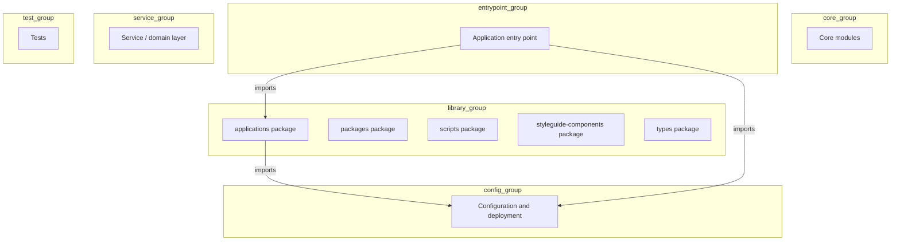

# Architecture report: nteract/archived-desktop-app

> Automated static analysis. **Observed** = directly seen in files/imports/AST; **Inferred** = interpretation from that evidence. Repository code was not executed.

## 1. Repository at a glance

| Item | Value |
| --- | --- |
| Repository | nteract/archived-desktop-app |
| Description | The old electron based nteract notebook |
| Language | TypeScript |
| Stars | 6238 |
| Licence | BSD-3-Clause |
| Analysed commit / branch | 7516211c27bad1e5a415505b023e2221bc430d8a / main |
| Framework(s) | Electron, Next.js, React |
| Files analysed | 755 |
| Components | 10 |

## 2. Architecture in one minute

nteract/archived-desktop-app - The old electron based nteract notebook. This repository was analysed statically from 755 file(s) (9 Python). Detected technologies (observed from imports/manifests): GitHub Actions, Electron, Next.js, React, React Router, Redux. Files are grouped into 10 component(s): applications package, Configuration and deployment, Core modules, Application entry point, packages package, scripts package, Service / domain layer, styleguide-components package. Observed entry point(s): applications/jupyter-extension/nteract_on_jupyter/nteractapp.py. Findings below distinguish observed facts from inferred interpretation.

## 3. High-level block diagram

## 4. Main components

### applications package (`applications`)

- **Kind:** library
- **Status:** Observed
- **Confidence:** 0.85
- **Responsibility:** Groups 119 file(s) under applications package (observed from repository paths and static analysis). Observed top-level classes: Comparator, Extendlist, NAppHandler, Range, SemVer, _R. Observed top-level functions: _jupyter_server_extension_paths, add_handlers, clean, cmd_in_new_dir, cmp, comparator.
- **Paths:** `applications/desktop/__mocks__/electron.ts`, `applications/desktop/__mocks__/enchannel-zmq-backend.ts`, `applications/desktop/__mocks__/fs.ts`, `applications/desktop/__mocks__/kernelspecs.ts`, `applications/desktop/__mocks__/spawnteract.ts`, `applications/desktop/__tests__/renderer/epics/close-notebook.spec.ts`, `applications/desktop/__tests__/renderer/epics/github-publish.spec.ts`, `applications/desktop/__tests__/renderer/epics/index.spec.ts`, `applications/desktop/__tests__/renderer/epics/kernel-launch.spec.ts`, `applications/desktop/__tests__/renderer/epics/loading.spec.ts`, `applications/desktop/__tests__/renderer/epics/zeromq-kernels.spec.ts`, `applications/desktop/__tests__/renderer/global-events.spec.ts`, `applications/desktop/__tests__/renderer/local-content-provider.spec.ts`, `applications/desktop/__tests__/renderer/native-window.spec.ts`, `applications/desktop/bin/nteract.js`, `applications/desktop/bin/nteract.sh`, `applications/desktop/src/common/accelerators.ts`, `applications/desktop/src/common/appname.ts`, `applications/desktop/src/common/commands/by-menu/app.ts`, `applications/desktop/src/common/commands/by-menu/cell.ts`, `applications/desktop/src/common/commands/by-menu/edit.ts`, `applications/desktop/src/common/commands/by-menu/file.tsx`, `applications/desktop/src/common/commands/by-menu/help.ts`, `applications/desktop/src/common/commands/by-menu/preferences.ts`, `applications/desktop/src/common/commands/by-menu/runtime.ts`, `applications/desktop/src/common/commands/by-menu/view.ts`, `applications/desktop/src/common/commands/by-menu/window.ts`, `applications/desktop/src/common/commands/dispatch.ts`, `applications/desktop/src/common/commands/index.ts`, `applications/desktop/src/common/commands/types.ts`, `applications/desktop/src/common/commands/utils/auth.ts`, `applications/desktop/src/common/commands/utils/dialogs.ts`, `applications/desktop/src/common/commands/utils/directories.ts`, `applications/desktop/src/common/commands/utils/notifications.tsx`, `applications/desktop/src/common/menu.ts`, `applications/desktop/src/index.d.ts`, `applications/desktop/src/main/actions.ts`, `applications/desktop/src/main/auto-updater.ts`, `applications/desktop/src/main/config-options.ts`, `applications/desktop/src/main/index.ts`, `applications/desktop/src/main/kernel-specs.ts`, `applications/desktop/src/main/kernels.ts`, `applications/desktop/src/main/launch.ts`, `applications/desktop/src/main/menu.ts`, `applications/desktop/src/main/newfile-entry.ts`, `applications/desktop/src/main/prepare-env.ts`, `applications/desktop/src/main/reducers.ts`, `applications/desktop/src/main/store.ts`, `applications/desktop/src/notebook/actionTypes.ts`, `applications/desktop/src/notebook/actions.ts`, `applications/desktop/src/notebook/epics/close-notebook.ts`, `applications/desktop/src/notebook/epics/github-publish.ts`, `applications/desktop/src/notebook/epics/index.ts`, `applications/desktop/src/notebook/epics/loading.ts`, `applications/desktop/src/notebook/epics/zeromq-kernels.ts`, `applications/desktop/src/notebook/fonts.ts`, `applications/desktop/src/notebook/global-events.ts`, `applications/desktop/src/notebook/index.tsx`, `applications/desktop/src/notebook/insert-images.ts`, `applications/desktop/src/notebook/local-content-provider.ts`, `applications/desktop/src/notebook/menu.ts`, `applications/desktop/src/notebook/native-window.ts`, `applications/desktop/src/notebook/reducers.ts`, `applications/desktop/src/notebook/state.ts`, `applications/desktop/src/notebook/store.ts`, `applications/desktop/webpack.common.js`, `applications/desktop/webpack.dev.js`, `applications/desktop/webpack.prod.js`, `applications/jupyter-extension/nteract_on_jupyter/__init__.py`, `applications/jupyter-extension/nteract_on_jupyter/_version.py`, `applications/jupyter-extension/nteract_on_jupyter/app/app.tsx`, `applications/jupyter-extension/nteract_on_jupyter/app/bootstrap.tsx`, `applications/jupyter-extension/nteract_on_jupyter/app/components/editable-title-overlay.tsx`, `applications/jupyter-extension/nteract_on_jupyter/app/components/last-saved.tsx`, `applications/jupyter-extension/nteract_on_jupyter/app/components/nav.tsx`, `applications/jupyter-extension/nteract_on_jupyter/app/components/themed-logo.tsx`, `applications/jupyter-extension/nteract_on_jupyter/app/config.tsx`, `applications/jupyter-extension/nteract_on_jupyter/app/contents/directory.tsx`, `applications/jupyter-extension/nteract_on_jupyter/app/contents/file/index.tsx`, `applications/jupyter-extension/nteract_on_jupyter/app/contents/file/text-file.tsx`, `applications/jupyter-extension/nteract_on_jupyter/app/contents/headers.tsx`, `applications/jupyter-extension/nteract_on_jupyter/app/contents/index.tsx`, `applications/jupyter-extension/nteract_on_jupyter/app/contents/iron-icons.tsx`, `applications/jupyter-extension/nteract_on_jupyter/app/contents/notebook.tsx`, `applications/jupyter-extension/nteract_on_jupyter/app/fonts.ts`, `applications/jupyter-extension/nteract_on_jupyter/app/globals.d.ts`, `applications/jupyter-extension/nteract_on_jupyter/app/index.tsx`, `applications/jupyter-extension/nteract_on_jupyter/app/store.ts`, `applications/jupyter-extension/nteract_on_jupyter/app/triggers/open-notebook.ts`, `applications/jupyter-extension/nteract_on_jupyter/extension.py`, `applications/jupyter-extension/nteract_on_jupyter/handlers.py`, `applications/jupyter-extension/nteract_on_jupyter/semver.py`, `applications/jupyter-extension/nteract_on_jupyter/utils.py`, `applications/jupyter-extension/nteract_on_jupyter/webpack.config.js`, `applications/web/components/Avatar.tsx`, `applications/web/components/Basic.tsx`, `applications/web/components/Binder.tsx`, `applications/web/components/BinderMenu.tsx`, `applications/web/components/Button.tsx`, `applications/web/components/Console.tsx`, `applications/web/components/Dialog.tsx`, `applications/web/components/FileExplorer.tsx`, `applications/web/components/FilesListing.tsx`, `applications/web/components/Header.tsx`, `applications/web/components/Input.tsx`, `applications/web/components/Layout.tsx`, `applications/web/components/Menu.tsx`, `applications/web/components/Notebook.tsx`, `applications/web/components/Notification.tsx`, `applications/web/next-env.d.ts`, `applications/web/next.config.js`, `applications/web/pages/_app.tsx`, `applications/web/pages/auth/index.tsx`, `applications/web/pages/index.tsx`, `applications/web/pages/p/index.tsx`, `applications/web/redux/store.ts`, `applications/web/util/github.ts`, `applications/web/util/helpers.ts`, `applications/web/util/icons.tsx`
- **Evidence:** [applications/desktop/__mocks__/electron.ts](https://github.com/nteract/archived-desktop-app/blob/7516211c27bad1e5a415505b023e2221bc430d8a/applications/desktop/__mocks__/electron.ts); [applications/desktop/__mocks__/enchannel-zmq-backend.ts](https://github.com/nteract/archived-desktop-app/blob/7516211c27bad1e5a415505b023e2221bc430d8a/applications/desktop/__mocks__/enchannel-zmq-backend.ts); [applications/desktop/__mocks__/fs.ts](https://github.com/nteract/archived-desktop-app/blob/7516211c27bad1e5a415505b023e2221bc430d8a/applications/desktop/__mocks__/fs.ts); [applications/desktop/__mocks__/kernelspecs.ts](https://github.com/nteract/archived-desktop-app/blob/7516211c27bad1e5a415505b023e2221bc430d8a/applications/desktop/__mocks__/kernelspecs.ts); [applications/desktop/__mocks__/spawnteract.ts](https://github.com/nteract/archived-desktop-app/blob/7516211c27bad1e5a415505b023e2221bc430d8a/applications/desktop/__mocks__/spawnteract.ts); [applications/desktop/__tests__/renderer/epics/close-notebook.spec.ts](https://github.com/nteract/archived-desktop-app/blob/7516211c27bad1e5a415505b023e2221bc430d8a/applications/desktop/__tests__/renderer/epics/close-notebook.spec.ts); [applications/desktop/__tests__/renderer/epics/github-publish.spec.ts](https://github.com/nteract/archived-desktop-app/blob/7516211c27bad1e5a415505b023e2221bc430d8a/applications/desktop/__tests__/renderer/epics/github-publish.spec.ts); [applications/desktop/__tests__/renderer/epics/index.spec.ts](https://github.com/nteract/archived-desktop-app/blob/7516211c27bad1e5a415505b023e2221bc430d8a/applications/desktop/__tests__/renderer/epics/index.spec.ts)

### Configuration and deployment (`config`)

- **Kind:** config
- **Status:** Observed
- **Confidence:** 0.85
- **Responsibility:** Groups 83 file(s) under configuration and deployment (observed from repository paths and static analysis). Observed top-level classes: NteractConfig.
- **Paths:** `applications/desktop/package.json`, `applications/desktop/static/default-map.json`, `applications/desktop/tsconfig.json`, `applications/jupyter-extension/MANIFEST.in`, `applications/jupyter-extension/jupyter-config/jupyter_notebook_config.d/nteract_on_jupyter.json`, `applications/jupyter-extension/nteract_on_jupyter/config.py`, `applications/jupyter-extension/nteract_on_jupyter/package.json`, `applications/jupyter-extension/nteract_on_jupyter/tsconfig.json`, `applications/jupyter-extension/package.json`, `applications/jupyter-extension/pyproject.toml`, `applications/jupyter-extension/requirements-dev.txt`, `applications/jupyter-extension/setup.py`, `applications/web/package.json`, `applications/web/tsconfig.json`, `codecov.yml`, `lerna.json`, `mkdocs.yml`, `nteract-packages/now.json`, `package.json`, `packages/actions/mkdocs.yml`, `packages/actions/package.json`, `packages/actions/tsconfig.json`, `packages/commutable/mkdocs.yml`, `packages/commutable/package.json`, `packages/commutable/tsconfig.json`, `packages/connected-components/package.json`, `packages/connected-components/tsconfig.json`, `packages/core/mkdocs.yml`, `packages/core/package.json`, `packages/core/tsconfig.json`, `packages/editor/package.json`, `packages/editor/tsconfig.json`, `packages/epics/mkdocs.yml`, `packages/epics/package.json`, `packages/epics/tsconfig.json`, `packages/fixtures/package.json`, `packages/fixtures/tsconfig.json`, `packages/host-cache/package.json`, `packages/host-cache/tsconfig.json`, `packages/messaging/package.json`, `packages/messaging/tsconfig.json`, `packages/monaco-editor/package.json`, `packages/monaco-editor/tsconfig.json`, `packages/mythic-configuration/package.json`, `packages/mythic-configuration/tsconfig.json`, `packages/mythic-multiselect/package.json`, `packages/mythic-multiselect/tsconfig.json`, `packages/mythic-notifications/package.json`, `packages/mythic-notifications/tsconfig.json`, `packages/mythic-rtc/package.json`, `packages/mythic-rtc/tsconfig.json`, `packages/mythic-windowing/package.json`, `packages/mythic-windowing/tsconfig.json`, `packages/myths/package.json`, `packages/myths/tsconfig.json`, `packages/notebook-app-component/package.json`, `packages/notebook-app-component/tsconfig.json`, `packages/presentational-components/__tests__/tsconfig.json`, `packages/presentational-components/package.json`, `packages/presentational-components/tsconfig.json`, `packages/reducers/package.json`, `packages/reducers/tsconfig.json`, `packages/rx-binder/package.json`, `packages/rx-binder/tsconfig.json`, `packages/rx-jupyter/package.json`, `packages/rx-jupyter/tsconfig.json`, `packages/selectors/package.json`, `packages/selectors/tsconfig.json`, `packages/stateful-components/mkdocs.yml`, `packages/stateful-components/package.json`, `packages/stateful-components/tsconfig.json`, `packages/styles/package.json`, `packages/styles/tsconfig.json`, `packages/tsconfig.json`, `packages/types/package.json`, `packages/types/tsconfig.json`, `packages/webpack-configurator/package.json`, `renovate.json`, `requirements.txt`, `styleguide/now.json`, `tsconfig.base.json`, `tsconfig.jest.json`, `tsconfig.json`
- **Evidence:** [applications/desktop/package.json](https://github.com/nteract/archived-desktop-app/blob/7516211c27bad1e5a415505b023e2221bc430d8a/applications/desktop/package.json); [applications/desktop/static/default-map.json](https://github.com/nteract/archived-desktop-app/blob/7516211c27bad1e5a415505b023e2221bc430d8a/applications/desktop/static/default-map.json); [applications/desktop/tsconfig.json](https://github.com/nteract/archived-desktop-app/blob/7516211c27bad1e5a415505b023e2221bc430d8a/applications/desktop/tsconfig.json); [applications/jupyter-extension/MANIFEST.in](https://github.com/nteract/archived-desktop-app/blob/7516211c27bad1e5a415505b023e2221bc430d8a/applications/jupyter-extension/MANIFEST.in); [applications/jupyter-extension/jupyter-config/jupyter_notebook_config.d/nteract_on_jupyter.json](https://github.com/nteract/archived-desktop-app/blob/7516211c27bad1e5a415505b023e2221bc430d8a/applications/jupyter-extension/jupyter-config/jupyter_notebook_config.d/nteract_on_jupyter.json); [applications/jupyter-extension/nteract_on_jupyter/config.py:5](https://github.com/nteract/archived-desktop-app/blob/7516211c27bad1e5a415505b023e2221bc430d8a/applications/jupyter-extension/nteract_on_jupyter/config.py#L5); [applications/jupyter-extension/nteract_on_jupyter/package.json](https://github.com/nteract/archived-desktop-app/blob/7516211c27bad1e5a415505b023e2221bc430d8a/applications/jupyter-extension/nteract_on_jupyter/package.json); [applications/jupyter-extension/nteract_on_jupyter/tsconfig.json](https://github.com/nteract/archived-desktop-app/blob/7516211c27bad1e5a415505b023e2221bc430d8a/applications/jupyter-extension/nteract_on_jupyter/tsconfig.json)

### Core modules (`core`)

- **Kind:** core
- **Status:** Observed
- **Confidence:** 0.85
- **Responsibility:** Groups 4 file(s) under core modules (observed from repository paths and static analysis).
- **Paths:** `babel.config.js`, `commitlint.config.js`, `styleguide.config.js`, `typedoc.js`
- **Evidence:** [babel.config.js](https://github.com/nteract/archived-desktop-app/blob/7516211c27bad1e5a415505b023e2221bc430d8a/babel.config.js); [commitlint.config.js](https://github.com/nteract/archived-desktop-app/blob/7516211c27bad1e5a415505b023e2221bc430d8a/commitlint.config.js); [styleguide.config.js](https://github.com/nteract/archived-desktop-app/blob/7516211c27bad1e5a415505b023e2221bc430d8a/styleguide.config.js); [typedoc.js](https://github.com/nteract/archived-desktop-app/blob/7516211c27bad1e5a415505b023e2221bc430d8a/typedoc.js)

### Application entry point (`entrypoint`)

- **Kind:** entrypoint
- **Status:** Observed
- **Confidence:** 0.85
- **Responsibility:** Groups 1 file(s) under application entry point (observed from repository paths and static analysis). Observed top-level classes: NteractApp.
- **Paths:** `applications/jupyter-extension/nteract_on_jupyter/nteractapp.py`
- **Evidence:** [applications/jupyter-extension/nteract_on_jupyter/nteractapp.py:43](https://github.com/nteract/archived-desktop-app/blob/7516211c27bad1e5a415505b023e2221bc430d8a/applications/jupyter-extension/nteract_on_jupyter/nteractapp.py#L43)

### packages package (`packages`)

- **Kind:** library
- **Status:** Observed
- **Confidence:** 0.85
- **Responsibility:** Groups 318 file(s) under packages package (observed from repository paths and static analysis).
- **Paths:** `packages/actions/__tests__/actions-spec.ts`, `packages/actions/src/actionTypes/cell_focus.ts`, `packages/actions/src/actionTypes/cell_io.ts`, `packages/actions/src/actionTypes/cell_state.ts`, `packages/actions/src/actionTypes/cell_structure.ts`, `packages/actions/src/actionTypes/comm.ts`, `packages/actions/src/actionTypes/content_publish.ts`, `packages/actions/src/actionTypes/content_save_load.ts`, `packages/actions/src/actionTypes/content_state.ts`, `packages/actions/src/actionTypes/content_structure.ts`, `packages/actions/src/actionTypes/global.ts`, `packages/actions/src/actionTypes/host.ts`, `packages/actions/src/actionTypes/kernel_execution.ts`, `packages/actions/src/actionTypes/kernel_lifecycle.ts`, `packages/actions/src/actionTypes/kernel_misc.ts`, `packages/actions/src/actionTypes/kernelspecs.ts`, `packages/actions/src/index.ts`, `packages/actions/src/utils.ts`, `packages/commutable/__tests__/notebook.spec.ts`, `packages/commutable/__tests__/outputs.spec.ts`, `packages/commutable/__tests__/primitive.spec.ts`, `packages/commutable/__tests__/structures.spec.ts`, `packages/commutable/__tests__/v3.spec.ts`, `packages/commutable/__tests__/v4.spec.ts`, `packages/commutable/src/cells.ts`, `packages/commutable/src/index.ts`, `packages/commutable/src/notebook.ts`, `packages/commutable/src/outputs.ts`, `packages/commutable/src/primitives.ts`, `packages/commutable/src/structures.ts`, `packages/commutable/src/v3.ts`, `packages/commutable/src/v4.ts`, `packages/connected-components/__tests__/header-editor.spec.tsx`, `packages/connected-components/__tests__/modal-controller.spec.tsx`, `packages/connected-components/__tests__/new-notebook-navigation.spec.tsx`, `packages/connected-components/__tests__/notebook-menu.spec.tsx`, `packages/connected-components/src/header-editor/index.tsx`, `packages/connected-components/src/header-editor/styled.ts`, `packages/connected-components/src/index.tsx`, `packages/connected-components/src/modal-controller/about-modal.tsx`, `packages/connected-components/src/modal-controller/constants.ts`, `packages/connected-components/src/modal-controller/index.tsx`, `packages/connected-components/src/new-notebook-navigation/index.tsx`, `packages/connected-components/src/new-notebook-navigation/logos.tsx`, `packages/connected-components/src/notebook-menu/PureNotebookMenu.tsx`, `packages/connected-components/src/notebook-menu/constants.ts`, `packages/connected-components/src/notebook-menu/index.tsx`, `packages/editor/__tests__/components/hint.spec.tsx`, `packages/editor/__tests__/components/tooltip.spec.tsx`, `packages/editor/__tests__/editor.spec.tsx`, `packages/editor/__tests__/jupyter/complete.spec.ts`, `packages/editor/__tests__/jupyter/surrogate.spec.ts`, `packages/editor/__tests__/jupyter/tooltip.spec.ts`, `packages/editor/src/components/hint.tsx`, `packages/editor/src/components/initial-text-area.tsx`, `packages/editor/src/components/tooltip.tsx`, `packages/editor/src/configurable.ts`, `packages/editor/src/index.tsx`, `packages/editor/src/jupyter/complete.tsx`, `packages/editor/src/jupyter/surrogate.ts`, `packages/editor/src/jupyter/tooltip.ts`, `packages/editor/src/mode/ipython.ts`, `packages/epics/__mocks__/file-saver.ts`, `packages/epics/__tests__/comm.spec.ts`, `packages/epics/__tests__/contents.spec.ts`, `packages/epics/__tests__/execute/execute.spec.ts`, `packages/epics/__tests__/execute/lazy-launch.spec.ts`, `packages/epics/__tests__/execute/map-to-execute.spec.ts`, `packages/epics/__tests__/execute/process-msgs.spec.ts`, `packages/epics/__tests__/hosts.spec.ts`, `packages/epics/__tests__/ipywidgets.spec.ts`, `packages/epics/__tests__/kernel-lifecycle.spec.ts`, `packages/epics/__tests__/kernelspecs.spec.ts`, `packages/epics/__tests__/websocket-kernel.spec.ts`, `packages/epics/src/comm.ts`, `packages/epics/src/contents.ts`, `packages/epics/src/execute/execute.ts`, `packages/epics/src/execute/index.ts`, `packages/epics/src/execute/lazy-launch.ts`, `packages/epics/src/execute/map-to-execute.ts`, `packages/epics/src/execute/process-msgs.ts`, `packages/epics/src/hosts.ts`, `packages/epics/src/index.ts`, `packages/epics/src/ipywidgets.ts`, `packages/epics/src/kernel-lifecycle.ts`, `packages/epics/src/kernelspecs.ts`, `packages/epics/src/websocket-kernel.ts`, `packages/fixtures/src/fixture-nb.ts`, `packages/fixtures/src/index.ts`, `packages/host-cache/src/components/host.tsx`, `packages/host-cache/src/components/kernel.tsx`, `packages/host-cache/src/host-storage.ts`, `packages/host-cache/src/index.ts`, `packages/messaging/__tests__/messaging-spec.ts`, `packages/messaging/__tests__/wire-protocol-spec.ts`, `packages/messaging/src/index.ts`, `packages/messaging/src/messages.ts`, `packages/messaging/src/types.ts`, `packages/messaging/src/wire-protocol.ts`, `packages/monaco-editor/__tests__/MonacoEditor.test.tsx`, `packages/monaco-editor/__tests__/completionItemProvider.test.ts`, `packages/monaco-editor/__tests__/layout.test.tsx`, `packages/monaco-editor/__tests__/resize.test.tsx`, `packages/monaco-editor/src/MonacoEditor.tsx`, `packages/monaco-editor/src/completions/completionItemProvider.ts`, `packages/monaco-editor/src/converter.ts`, `packages/monaco-editor/src/documentUri.ts`, `packages/monaco-editor/src/editor-base.ts`, `packages/monaco-editor/src/index.ts`, `packages/monaco-editor/src/intersectionObserver.ts`, `packages/monaco-editor/src/layoutSchedule.ts`, `packages/monaco-editor/src/polyfill/intersectionObserver.ts`, `packages/monaco-editor/src/polyfill/windowResizeEventObserver.ts`, `packages/monaco-editor/src/resizeObserver.ts`, `packages/monaco-editor/src/theme.ts`, `packages/mythic-configuration/__tests__/configuration.spec.ts`, `packages/mythic-configuration/src/backends/filesystem.ts`, `packages/mythic-configuration/src/backends/in-memory-transient.ts`, `packages/mythic-configuration/src/index.ts`, `packages/mythic-configuration/src/myths/load-config.ts`, `packages/mythic-configuration/src/myths/save-config.ts`, `packages/mythic-configuration/src/myths/set-config-at-key.ts`, `packages/mythic-configuration/src/myths/set-config-backend.ts`, `packages/mythic-configuration/src/myths/set-config.ts`, `packages/mythic-configuration/src/myths/toggle-config-at-key.ts`, `packages/mythic-configuration/src/package.ts`, `packages/mythic-configuration/src/types.ts`, `packages/mythic-multiselect/__tests__/multiselect.spec.ts`, `packages/mythic-multiselect/src/index.ts`, `packages/mythic-multiselect/src/myths/multi-select.ts`, `packages/mythic-multiselect/src/package.ts`, `packages/mythic-multiselect/src/types.ts`, `packages/mythic-notifications/__tests__/notifications.spec.ts`, `packages/mythic-notifications/src/backends/blueprintjs.tsx`, `packages/mythic-notifications/src/backends/console.ts`, `packages/mythic-notifications/src/index.ts`, `packages/mythic-notifications/src/myths/initialize-system.ts`, `packages/mythic-notifications/src/myths/send-notification.ts`, `packages/mythic-notifications/src/package.ts`, `packages/mythic-notifications/src/types.ts`, `packages/mythic-rtc/src/driver/driver.ts`, `packages/mythic-rtc/src/driver/index.ts`, `packages/mythic-rtc/src/index.ts`, `packages/mythic-rtc/src/middleware/index.ts`, `packages/mythic-rtc/src/middleware/middleware.ts`, `packages/mythic-rtc/src/myths/index.ts`, `packages/mythic-rtc/src/myths/init.ts`, `packages/mythic-rtc/src/myths/internal.ts`, `packages/mythic-rtc/src/myths/record.ts`, `packages/mythic-rtc/src/myths/session.ts`, `packages/mythic-rtc/src/package.ts`, `packages/mythic-rtc/src/types.ts`, `packages/mythic-windowing/src/backends/electron/index.ts`, `packages/mythic-windowing/src/index.ts`, `packages/mythic-windowing/src/myths/open-external.ts`, `packages/mythic-windowing/src/myths/window-lifecycle.ts`, `packages/mythic-windowing/src/myths/window-registry.ts`, `packages/mythic-windowing/src/package.ts`, `packages/mythic-windowing/src/types.ts`, `packages/myths/__tests__/myths.spec.ts`, `packages/myths/src/epics.ts`, `packages/myths/src/index.ts`, `packages/myths/src/myth.ts`, `packages/myths/src/operators.ts`, `packages/myths/src/package.ts`, `packages/myths/src/react.ts`, `packages/myths/src/reducer.ts`, `packages/myths/src/store.ts`, `packages/myths/src/types.ts`, `packages/notebook-app-component/__tests__/decorators/cell-creator.spec.tsx`, `packages/notebook-app-component/__tests__/decorators/draggable-cell.spec.tsx`, `packages/notebook-app-component/__tests__/decorators/kbd-shortcuts.spec.tsx`, `packages/notebook-app-component/__tests__/decorators/notebook-helmet.spec.tsx`, `packages/notebook-app-component/__tests__/decorators/undoable.spec.tsx`, `packages/notebook-app-component/src/decorators/cell-banner/index.tsx`, `packages/notebook-app-component/src/decorators/cell-creator/index.tsx`, `packages/notebook-app-component/src/decorators/draggable/index.tsx`, `packages/notebook-app-component/src/decorators/editor-loader/index.tsx`, `packages/notebook-app-component/src/decorators/hijack-scroll/index.tsx`, `packages/notebook-app-component/src/decorators/kbd-shortcuts/index.tsx`, `packages/notebook-app-component/src/decorators/notebook-helmet/index.tsx`, `packages/notebook-app-component/src/decorators/undoable/undoable-cell-delete.tsx`, `packages/notebook-app-component/src/decorators/undoable/undoable-delete.tsx`, `packages/notebook-app-component/src/derived-components/status-bar.tsx`, `packages/notebook-app-component/src/derived-components/themable-notifications.tsx`, `packages/notebook-app-component/src/derived-components/toolbar.tsx`, `packages/notebook-app-component/src/index.tsx`, `packages/notebook-app-component/src/notebook-apps/app-command-palette.tsx`, `packages/notebook-app-component/src/notebook-apps/app-sidebar.tsx`, `packages/notebook-app-component/src/notebook-apps/app-toolbar.tsx`, `packages/notebook-app-component/src/notebook-apps/base.tsx`, `packages/notebook-app-component/src/notebook-apps/draggable-with-cell-creator.tsx`, `packages/notebook-app-component/src/notebook-apps/draggable.tsx`, `packages/notebook-app-component/src/notebook-apps/web-draggable.tsx`, `packages/notebook-app-component/src/notebook-apps/with-helmet.tsx`, `packages/presentational-components/__tests__/styles.spec.tsx`, `packages/presentational-components/src/components/CellMenu/CellMenu.tsx`, `packages/presentational-components/src/components/CellMenu/index.ts`, `packages/presentational-components/src/components/CircularButton/CircularButton.tsx`, `packages/presentational-components/src/components/CircularButton/ProgressRing.tsx`, `packages/presentational-components/src/components/CircularButton/index.ts`, `packages/presentational-components/src/components/Icons.tsx`, `packages/presentational-components/src/components/ToggleSwitch/ToggleSwitch.tsx`, `packages/presentational-components/src/components/cell.tsx`, `packages/presentational-components/src/components/cells.tsx`, `packages/presentational-components/src/components/command-palette/command-button-row.tsx`, `packages/presentational-components/src/components/command-palette/command-palette.tsx`, `packages/presentational-components/src/components/command-palette/index.ts`, `packages/presentational-components/src/components/command-palette/key-tag.tsx`, `packages/presentational-components/src/components/error.tsx`, `packages/presentational-components/src/components/icons/icons.tsx`, `packages/presentational-components/src/components/icons/index.ts`, `packages/presentational-components/src/components/input.tsx`, `packages/presentational-components/src/components/outputs.tsx`, `packages/presentational-components/src/components/pagers.tsx`, `packages/presentational-components/src/components/prompt.tsx`, `packages/presentational-components/src/components/sidebar/index.ts`, `packages/presentational-components/src/components/sidebar/sidebar-item.tsx`, `packages/presentational-components/src/components/sidebar/sidebar.tsx`, `packages/presentational-components/src/components/source.tsx`, `packages/presentational-components/src/components/toolbar/Icons.tsx`, `packages/presentational-components/src/components/toolbar/index.ts`, `packages/presentational-components/src/components/toolbar/toolbar-item.tsx`, `packages/presentational-components/src/components/toolbar/toolbar.tsx`, `packages/presentational-components/src/index.ts`, `packages/presentational-components/src/styles.tsx`, `packages/presentational-components/src/syntax-highlighter/index.tsx`, `packages/presentational-components/src/themes.d.ts`, `packages/reducers/__tests__/app.spec.ts`, `packages/reducers/src/app.ts`, `packages/reducers/src/index.ts`, `packages/rx-binder/__tests__/index.test.ts`, `packages/rx-binder/src/index.ts`, `packages/rx-jupyter/__tests__/contents-spec.ts`, `packages/rx-jupyter/__tests__/index-spec.ts`, `packages/rx-jupyter/__tests__/kernel-spec.ts`, `packages/rx-jupyter/__tests__/kernelspecs-spec.ts`, `packages/rx-jupyter/__tests__/sessions-spec.ts`, `packages/rx-jupyter/__tests__/terminals-spec.ts`, `packages/rx-jupyter/__tests__/types.ts`, `packages/rx-jupyter/src/base.ts`, `packages/rx-jupyter/src/bookstore.ts`, `packages/rx-jupyter/src/contents.ts`, `packages/rx-jupyter/src/index.ts`, `packages/rx-jupyter/src/kernels.ts`, `packages/rx-jupyter/src/kernelspecs.ts`, `packages/rx-jupyter/src/sessions.ts`, `packages/rx-jupyter/src/terminals.ts`, `packages/selectors/__tests__/selectors.spec.ts`, `packages/selectors/src/app.ts`, `packages/selectors/src/comms.ts`, `packages/selectors/src/index.ts`, `packages/stateful-components/__tests__/cells/cell-types.spec.tsx`, `packages/stateful-components/__tests__/cells/cell.spec.tsx`, `packages/stateful-components/__tests__/cells/cells.spec.tsx`, `packages/stateful-components/__tests__/inputs/editor.spec.tsx`, `packages/stateful-components/__tests__/inputs/input.spec.tsx`, `packages/stateful-components/__tests__/outputs/index.spec.tsx`, `packages/stateful-components/__tests__/outputs/input-prompts.spec.tsx`, `packages/stateful-components/__tests__/outputs/pagers.spec.tsx`, `packages/stateful-components/__tests__/outputs/transform-media.spec.tsx`, `packages/stateful-components/src/app-sidebar/app-sidebar.tsx`, `packages/stateful-components/src/app-sidebar/index.ts`, `packages/stateful-components/src/app-toolbar/app-toolbar.tsx`, `packages/stateful-components/src/app-toolbar/index.ts`, `packages/stateful-components/src/cells/cell.tsx`, `packages/stateful-components/src/cells/cells.tsx`, `packages/stateful-components/src/cells/code-cell.tsx`, `packages/stateful-components/src/cells/markdown-cell.tsx`, `packages/stateful-components/src/cells/raw-cell.tsx`, `packages/stateful-components/src/cells/toolbar.tsx`, `packages/stateful-components/src/command-palette/command-palette.tsx`, `packages/stateful-components/src/config-options.ts`, `packages/stateful-components/src/decorators/theme-from-config/index.tsx`, `packages/stateful-components/src/index.tsx`, `packages/stateful-components/src/inputs/connected-editors/codemirror.tsx`, `packages/stateful-components/src/inputs/connected-editors/monacoEditor.tsx`, `packages/stateful-components/src/inputs/editor.tsx`, `packages/stateful-components/src/inputs/input.tsx`, `packages/stateful-components/src/inputs/prompt.tsx`, `packages/stateful-components/src/notebook/status-bar.tsx`, `packages/stateful-components/src/outputs/index.tsx`, `packages/stateful-components/src/outputs/input-prompts.tsx`, `packages/stateful-components/src/outputs/pagers.tsx`, `packages/stateful-components/src/outputs/transform-media.tsx`, `packages/styles/index.d.ts`, `packages/styles/index.js`, `packages/types/__tests__/entities/hosts/index.spec.ts`, `packages/types/src/content-provider.ts`, `packages/types/src/entities/comms.ts`, `packages/types/src/entities/contents/directory.ts`, `packages/types/src/entities/contents/dummy.ts`, `packages/types/src/entities/contents/file.ts`, `packages/types/src/entities/contents/index.ts`, `packages/types/src/entities/contents/notebook.ts`, `packages/types/src/entities/editors.ts`, `packages/types/src/entities/hosts/base.ts`, `packages/types/src/entities/hosts/empty.ts`, `packages/types/src/entities/hosts/index.ts`, `packages/types/src/entities/hosts/local-jupyter.ts`, `packages/types/src/entities/hosts/remote-jupyter.ts`, `packages/types/src/entities/index.ts`, `packages/types/src/entities/kernel-info.ts`, `packages/types/src/entities/kernels.ts`, `packages/types/src/entities/kernelspecs.ts`, `packages/types/src/entities/messages.ts`, `packages/types/src/entities/modals.ts`, `packages/types/src/entities/sidebar.ts`, `packages/types/src/entities/transforms.ts`, `packages/types/src/errors/execute.ts`, `packages/types/src/errors/index.ts`, `packages/types/src/errors/launch.ts`, `packages/types/src/ids.ts`, `packages/types/src/index.ts`, `packages/types/src/refs.ts`, `packages/webpack-configurator/aliases.js`, `packages/webpack-configurator/index.js`, `packages/webpack-configurator/monorepo.js`
- **Evidence:** [packages/actions/__tests__/actions-spec.ts](https://github.com/nteract/archived-desktop-app/blob/7516211c27bad1e5a415505b023e2221bc430d8a/packages/actions/__tests__/actions-spec.ts); [packages/actions/src/actionTypes/cell_focus.ts](https://github.com/nteract/archived-desktop-app/blob/7516211c27bad1e5a415505b023e2221bc430d8a/packages/actions/src/actionTypes/cell_focus.ts); [packages/actions/src/actionTypes/cell_io.ts](https://github.com/nteract/archived-desktop-app/blob/7516211c27bad1e5a415505b023e2221bc430d8a/packages/actions/src/actionTypes/cell_io.ts); [packages/actions/src/actionTypes/cell_state.ts](https://github.com/nteract/archived-desktop-app/blob/7516211c27bad1e5a415505b023e2221bc430d8a/packages/actions/src/actionTypes/cell_state.ts); [packages/actions/src/actionTypes/cell_structure.ts](https://github.com/nteract/archived-desktop-app/blob/7516211c27bad1e5a415505b023e2221bc430d8a/packages/actions/src/actionTypes/cell_structure.ts); [packages/actions/src/actionTypes/comm.ts](https://github.com/nteract/archived-desktop-app/blob/7516211c27bad1e5a415505b023e2221bc430d8a/packages/actions/src/actionTypes/comm.ts); [packages/actions/src/actionTypes/content_publish.ts](https://github.com/nteract/archived-desktop-app/blob/7516211c27bad1e5a415505b023e2221bc430d8a/packages/actions/src/actionTypes/content_publish.ts); [packages/actions/src/actionTypes/content_save_load.ts](https://github.com/nteract/archived-desktop-app/blob/7516211c27bad1e5a415505b023e2221bc430d8a/packages/actions/src/actionTypes/content_save_load.ts)

### scripts package (`scripts`)

- **Kind:** library
- **Status:** Observed
- **Confidence:** 0.85
- **Responsibility:** Groups 5 file(s) under scripts package (observed from repository paths and static analysis).
- **Paths:** `scripts/kernelspecs-diagnostics.js`, `scripts/make_icons.sh`, `scripts/noop-module.ts`, `scripts/test-setup.ts`, `scripts/test-shim.ts`
- **Evidence:** [scripts/kernelspecs-diagnostics.js](https://github.com/nteract/archived-desktop-app/blob/7516211c27bad1e5a415505b023e2221bc430d8a/scripts/kernelspecs-diagnostics.js); [scripts/make_icons.sh](https://github.com/nteract/archived-desktop-app/blob/7516211c27bad1e5a415505b023e2221bc430d8a/scripts/make_icons.sh); [scripts/noop-module.ts](https://github.com/nteract/archived-desktop-app/blob/7516211c27bad1e5a415505b023e2221bc430d8a/scripts/noop-module.ts); [scripts/test-setup.ts](https://github.com/nteract/archived-desktop-app/blob/7516211c27bad1e5a415505b023e2221bc430d8a/scripts/test-setup.ts); [scripts/test-shim.ts](https://github.com/nteract/archived-desktop-app/blob/7516211c27bad1e5a415505b023e2221bc430d8a/scripts/test-shim.ts)

### Service / domain layer (`service_layer`)

- **Kind:** service
- **Status:** Observed
- **Confidence:** 0.85
- **Responsibility:** Groups 36 file(s) under service / domain layer (observed from repository paths and static analysis).
- **Paths:** `packages/core/__mocks__/rx-jupyter.ts`, `packages/core/src/index.ts`, `packages/core/src/middlewares.ts`, `packages/reducers/__tests__/core/entities/contents/comms.spec.ts`, `packages/reducers/__tests__/core/entities/contents/file.spec.ts`, `packages/reducers/__tests__/core/entities/contents/index.spec.ts`, `packages/reducers/__tests__/core/entities/contents/notebook.spec.ts`, `packages/reducers/__tests__/core/entities/hosts.spec.ts`, `packages/reducers/__tests__/core/entities/kernels.spec.ts`, `packages/reducers/__tests__/core/entities/kernelspecs.spec.ts`, `packages/reducers/__tests__/core/entities/messages.spec.ts`, `packages/reducers/__tests__/core/entities/modals.spec.ts`, `packages/reducers/__tests__/core/entities/transforms.spec.ts`, `packages/reducers/__tests__/core/index.spec.ts`, `packages/reducers/src/core/entities/comms.ts`, `packages/reducers/src/core/entities/contents/file.ts`, `packages/reducers/src/core/entities/contents/index.ts`, `packages/reducers/src/core/entities/contents/notebook.ts`, `packages/reducers/src/core/entities/editors.ts`, `packages/reducers/src/core/entities/hosts.ts`, `packages/reducers/src/core/entities/index.ts`, `packages/reducers/src/core/entities/kernels.ts`, `packages/reducers/src/core/entities/kernelspecs.ts`, `packages/reducers/src/core/entities/messages.ts`, `packages/reducers/src/core/entities/modals.ts`, `packages/reducers/src/core/entities/sidebar.ts`, `packages/reducers/src/core/entities/transforms.ts`, `packages/reducers/src/core/index.ts`, `packages/selectors/src/core/contents/cell.ts`, `packages/selectors/src/core/contents/index.ts`, `packages/selectors/src/core/contents/notebook.ts`, `packages/selectors/src/core/editors.ts`, `packages/selectors/src/core/hosts.ts`, `packages/selectors/src/core/kernels.ts`, `packages/selectors/src/core/kernelspecs.ts`, `packages/selectors/src/core/transforms.ts`
- **Evidence:** [packages/core/__mocks__/rx-jupyter.ts](https://github.com/nteract/archived-desktop-app/blob/7516211c27bad1e5a415505b023e2221bc430d8a/packages/core/__mocks__/rx-jupyter.ts); [packages/core/src/index.ts](https://github.com/nteract/archived-desktop-app/blob/7516211c27bad1e5a415505b023e2221bc430d8a/packages/core/src/index.ts); [packages/core/src/middlewares.ts](https://github.com/nteract/archived-desktop-app/blob/7516211c27bad1e5a415505b023e2221bc430d8a/packages/core/src/middlewares.ts); [packages/reducers/__tests__/core/entities/contents/comms.spec.ts](https://github.com/nteract/archived-desktop-app/blob/7516211c27bad1e5a415505b023e2221bc430d8a/packages/reducers/__tests__/core/entities/contents/comms.spec.ts); [packages/reducers/__tests__/core/entities/contents/file.spec.ts](https://github.com/nteract/archived-desktop-app/blob/7516211c27bad1e5a415505b023e2221bc430d8a/packages/reducers/__tests__/core/entities/contents/file.spec.ts); [packages/reducers/__tests__/core/entities/contents/index.spec.ts](https://github.com/nteract/archived-desktop-app/blob/7516211c27bad1e5a415505b023e2221bc430d8a/packages/reducers/__tests__/core/entities/contents/index.spec.ts); [packages/reducers/__tests__/core/entities/contents/notebook.spec.ts](https://github.com/nteract/archived-desktop-app/blob/7516211c27bad1e5a415505b023e2221bc430d8a/packages/reducers/__tests__/core/entities/contents/notebook.spec.ts); [packages/reducers/__tests__/core/entities/hosts.spec.ts](https://github.com/nteract/archived-desktop-app/blob/7516211c27bad1e5a415505b023e2221bc430d8a/packages/reducers/__tests__/core/entities/hosts.spec.ts)

### styleguide-components package (`styleguide_components`)

- **Kind:** library
- **Status:** Observed
- **Confidence:** 0.85
- **Responsibility:** Groups 1 file(s) under styleguide-components package (observed from repository paths and static analysis).
- **Paths:** `styleguide-components/logo.tsx`
- **Evidence:** [styleguide-components/logo.tsx](https://github.com/nteract/archived-desktop-app/blob/7516211c27bad1e5a415505b023e2221bc430d8a/styleguide-components/logo.tsx)

### Tests (`tests`)

- **Kind:** test
- **Status:** Observed
- **Confidence:** 0.85
- **Responsibility:** Groups 1 file(s) under tests (observed from repository paths and static analysis).
- **Paths:** `TEST_PLAN.md`
- **Evidence:** [TEST_PLAN.md](https://github.com/nteract/archived-desktop-app/blob/7516211c27bad1e5a415505b023e2221bc430d8a/TEST_PLAN.md)

### types package (`types`)

- **Kind:** library
- **Status:** Observed
- **Confidence:** 0.85
- **Responsibility:** Groups 19 file(s) under types package (observed from repository paths and static analysis).
- **Paths:** `types/jmp/index.d.ts`, `types/jupyter-paths/index.d.ts`, `types/kernelspecs/index.d.ts`, `types/load-script/index.d.ts`, `types/mathjax-electron/index.d.ts`, `types/node/index.d.ts`, `types/nteract__vega-embed-v2/index.d.ts`, `types/nteract__vega-embed-v3/index.d.ts`, `types/react-katex/index.d.ts`, `types/react-table-hoc-fixed-columns/index.d.ts`, `types/redux-electron-store/index.d.ts`, `types/rehype-katex/index.d.ts`, `types/rehype-stringify/index.d.ts`, `types/remark-math/index.d.ts`, `types/remark-rehype/index.d.ts`, `types/semiotic/index.d.ts`, `types/spawnteract/index.d.ts`, `types/trim-trailing-lines/index.d.ts`, `types/yargs/index.d.ts`
- **Evidence:** [types/jmp/index.d.ts](https://github.com/nteract/archived-desktop-app/blob/7516211c27bad1e5a415505b023e2221bc430d8a/types/jmp/index.d.ts); [types/jupyter-paths/index.d.ts](https://github.com/nteract/archived-desktop-app/blob/7516211c27bad1e5a415505b023e2221bc430d8a/types/jupyter-paths/index.d.ts); [types/kernelspecs/index.d.ts](https://github.com/nteract/archived-desktop-app/blob/7516211c27bad1e5a415505b023e2221bc430d8a/types/kernelspecs/index.d.ts); [types/load-script/index.d.ts](https://github.com/nteract/archived-desktop-app/blob/7516211c27bad1e5a415505b023e2221bc430d8a/types/load-script/index.d.ts); [types/mathjax-electron/index.d.ts](https://github.com/nteract/archived-desktop-app/blob/7516211c27bad1e5a415505b023e2221bc430d8a/types/mathjax-electron/index.d.ts); [types/node/index.d.ts](https://github.com/nteract/archived-desktop-app/blob/7516211c27bad1e5a415505b023e2221bc430d8a/types/node/index.d.ts); [types/nteract__vega-embed-v2/index.d.ts](https://github.com/nteract/archived-desktop-app/blob/7516211c27bad1e5a415505b023e2221bc430d8a/types/nteract__vega-embed-v2/index.d.ts); [types/nteract__vega-embed-v3/index.d.ts](https://github.com/nteract/archived-desktop-app/blob/7516211c27bad1e5a415505b023e2221bc430d8a/types/nteract__vega-embed-v3/index.d.ts)

## 5. Execution flow

**Observed** entry point(s):

- [applications/jupyter-extension/nteract_on_jupyter/nteractapp.py:99](https://github.com/nteract/archived-desktop-app/blob/7516211c27bad1e5a415505b023e2221bc430d8a/applications/jupyter-extension/nteract_on_jupyter/nteractapp.py#L99)
- [applications/web/pages/index.tsx](https://github.com/nteract/archived-desktop-app/blob/7516211c27bad1e5a415505b023e2221bc430d8a/applications/web/pages/index.tsx)
- [packages/actions/src/index.ts](https://github.com/nteract/archived-desktop-app/blob/7516211c27bad1e5a415505b023e2221bc430d8a/packages/actions/src/index.ts)
- [packages/commutable/src/index.ts](https://github.com/nteract/archived-desktop-app/blob/7516211c27bad1e5a415505b023e2221bc430d8a/packages/commutable/src/index.ts)
- [packages/connected-components/src/index.tsx](https://github.com/nteract/archived-desktop-app/blob/7516211c27bad1e5a415505b023e2221bc430d8a/packages/connected-components/src/index.tsx)
- [packages/core/src/index.ts](https://github.com/nteract/archived-desktop-app/blob/7516211c27bad1e5a415505b023e2221bc430d8a/packages/core/src/index.ts)
- [packages/editor/src/index.tsx](https://github.com/nteract/archived-desktop-app/blob/7516211c27bad1e5a415505b023e2221bc430d8a/packages/editor/src/index.tsx)
- [packages/epics/src/index.ts](https://github.com/nteract/archived-desktop-app/blob/7516211c27bad1e5a415505b023e2221bc430d8a/packages/epics/src/index.ts)
- [packages/fixtures/src/index.ts](https://github.com/nteract/archived-desktop-app/blob/7516211c27bad1e5a415505b023e2221bc430d8a/packages/fixtures/src/index.ts)
- [packages/host-cache/src/index.ts](https://github.com/nteract/archived-desktop-app/blob/7516211c27bad1e5a415505b023e2221bc430d8a/packages/host-cache/src/index.ts)
- [packages/styles/index.js](https://github.com/nteract/archived-desktop-app/blob/7516211c27bad1e5a415505b023e2221bc430d8a/packages/styles/index.js)
- [packages/webpack-configurator/index.js](https://github.com/nteract/archived-desktop-app/blob/7516211c27bad1e5a415505b023e2221bc430d8a/packages/webpack-configurator/index.js)

Representative flow (derived from observed entry points and the import graph; steps beyond the entry point are **Inferred**):

1. Execution starts at an observed entry point listed above, if present.
2. `applications` imports `config` (applications package -> Configuration and deployment).
3. `entrypoint` imports `applications` (Application entry point -> applications package).
4. `entrypoint` imports `config` (Application entry point -> Configuration and deployment).

## 6. Project structure

### `(root)`

- `.eslintignore` - other (145 bytes)
- `.eslintrc.js` - source, JavaScript (1997 bytes)
- `.gitattributes` - other (78 bytes)
- `.gitignore` - other (1285 bytes)
- `.npmignore` - other (682 bytes)
- `.pre-commit-config.yaml` - config (122 bytes)
- `.prettierignore` - other (13 bytes)
- `.prettierrc.js` - source, JavaScript (431 bytes)
- `CHANGELOG.md` - docs (4498 bytes)
- `CODE_OF_CONDUCT.md` - docs (3265 bytes)
- `CONTRIBUTING.md` - docs (7613 bytes)
- `LICENSE` - docs (1486 bytes)
- `README.md` - docs (5783 bytes)
- `RELEASING.md` - docs (3759 bytes)
- `SECURITY.md` - docs (1383 bytes)
- `TEST_PLAN.md` - test (2715 bytes)
- `USER_GUIDE.md` - docs (3666 bytes)
- `babel.config.js` - source, JavaScript (105 bytes)
- `codecov.yml` - config (204 bytes)
- `commitlint.config.js` - source, JavaScript (64 bytes)
- `lerna.json` - config (79 bytes)
- `mkdocs.yml` - config (1234 bytes)
- `package.json` - manifest (10237 bytes)
- `renovate.json` - config (85 bytes)
- `requirements.txt` - manifest (47 bytes)
- `styleguide.config.js` - source, JavaScript (2801 bytes)
- `tsconfig.base.json` - config (666 bytes)
- `tsconfig.jest.json` - config (475 bytes)
- `tsconfig.json` - config (213 bytes)
- `typedoc.js` - source, JavaScript (575 bytes)

### `.github`

- `.github/FUNDING.yml` - config (64 bytes)
- `.github/ISSUE_TEMPLATE/---bug-report.md` - docs (793 bytes)
- `.github/ISSUE_TEMPLATE/---feature-request.md` - docs (669 bytes)
- `.github/ISSUE_TEMPLATE/---kernel---runtime-issue.md` - docs (562 bytes)
- `.github/PULL_REQUEST_TEMPLATE.md` - docs (967 bytes)
- `.github/auto-comment.yml` - config (532 bytes)
- `.github/config.yml` - config (28 bytes)
- `.github/dependabot.yml` - config (196 bytes)
- `.github/deploy-component-docs.workflow` - other (213 bytes)
- `.github/invite-contributors.yml` - config (65 bytes)
- `.github/lock.yml` - config (417 bytes)
- `.github/stale.yml` - config (1470 bytes)
- `.github/workflows/ci-workflow.yml` - ci, YAML (1256 bytes)
- `.github/workflows/codeql-analysis.yml` - ci, YAML (2013 bytes)
- `.github/workflows/desktop-release.yml` - ci, YAML (579 bytes)
- `.github/workflows/npm-release.yml` - ci, YAML (437 bytes)

### `.husky`

- `.husky/.gitignore` - other (2 bytes)
- `.husky/commit-msg` - other (82 bytes)
- `.husky/pre-commit` - other (58 bytes)

### `.vscode`

- `.vscode/extensions.json` - config (594 bytes)
- `.vscode/launch.json` - config (1620 bytes)
- `.vscode/tasks.json` - config (355 bytes)

### `applications`

- `applications/desktop/.gitignore` - other (90 bytes)
- `applications/desktop/PACKAGING-NOTES.md` - docs (4570 bytes)
- `applications/desktop/README.md` - docs (1552 bytes)
- `applications/desktop/__mocks__/electron.ts` - source, TypeScript (1373 bytes)
- `applications/desktop/__mocks__/enchannel-zmq-backend.ts` - source, TypeScript (622 bytes)
- `applications/desktop/__mocks__/fs.ts` - source, TypeScript (324 bytes)
- `applications/desktop/__mocks__/kernelspecs.ts` - source, TypeScript (82 bytes)
- `applications/desktop/__mocks__/spawnteract.ts` - source, TypeScript (866 bytes)
- `applications/desktop/__tests__/renderer/epics/close-notebook.spec.ts` - source, TypeScript (7964 bytes)
- `applications/desktop/__tests__/renderer/epics/github-publish.spec.ts` - source, TypeScript (1885 bytes)
- `applications/desktop/__tests__/renderer/epics/index.spec.ts` - source, TypeScript (1018 bytes)
- `applications/desktop/__tests__/renderer/epics/kernel-launch.spec.ts` - source, TypeScript (3242 bytes)
- `applications/desktop/__tests__/renderer/epics/loading.spec.ts` - source, TypeScript (4739 bytes)
- `applications/desktop/__tests__/renderer/epics/zeromq-kernels.spec.ts` - source, TypeScript (5825 bytes)
- `applications/desktop/__tests__/renderer/global-events.spec.ts` - source, TypeScript (3645 bytes)
- `applications/desktop/__tests__/renderer/local-content-provider.spec.ts` - source, TypeScript (5631 bytes)
- `applications/desktop/__tests__/renderer/native-window.spec.ts` - source, TypeScript (3526 bytes)
- `applications/desktop/bin/nteract.js` - source, JavaScript (338 bytes)
- `applications/desktop/bin/nteract.sh` - source, Shell (3089 bytes)
- `applications/desktop/bin/win/nteract` - other (472 bytes)
- `applications/desktop/bin/win/nteract.cmd` - other (472 bytes)
- `applications/desktop/package.json` - manifest (5306 bytes)
- `applications/desktop/scientists.txt` - docs (5445 bytes)
- `applications/desktop/src/README.md` - docs (569 bytes)
- `applications/desktop/src/common/accelerators.ts` - source, TypeScript (1136 bytes)
- `applications/desktop/src/common/appname.ts` - source, TypeScript (34 bytes)
- `applications/desktop/src/common/commands/by-menu/app.ts` - source, TypeScript (535 bytes)
- `applications/desktop/src/common/commands/by-menu/cell.ts` - source, TypeScript (1374 bytes)
- `applications/desktop/src/common/commands/by-menu/edit.ts` - source, TypeScript (2025 bytes)
- `applications/desktop/src/common/commands/by-menu/file.tsx` - source, TypeScript (5456 bytes)
- `applications/desktop/src/common/commands/by-menu/help.ts` - source, TypeScript (3112 bytes)
- `applications/desktop/src/common/commands/by-menu/preferences.ts` - source, TypeScript (523 bytes)
- `applications/desktop/src/common/commands/by-menu/runtime.ts` - source, TypeScript (1575 bytes)
- `applications/desktop/src/common/commands/by-menu/view.ts` - source, TypeScript (683 bytes)
- `applications/desktop/src/common/commands/by-menu/window.ts` - source, TypeScript (358 bytes)
- `applications/desktop/src/common/commands/dispatch.ts` - source, TypeScript (1090 bytes)
- `applications/desktop/src/common/commands/index.ts` - source, TypeScript (299 bytes)
- `applications/desktop/src/common/commands/types.ts` - source, TypeScript (3031 bytes)
- `applications/desktop/src/common/commands/utils/auth.ts` - source, TypeScript (1413 bytes)
- `applications/desktop/src/common/commands/utils/dialogs.ts` - source, TypeScript (2966 bytes)
- `applications/desktop/src/common/commands/utils/directories.ts` - source, TypeScript (1207 bytes)
- `applications/desktop/src/common/commands/utils/notifications.tsx` - source, TypeScript (1302 bytes)
- `applications/desktop/src/common/menu.ts` - source, TypeScript (5417 bytes)
- `applications/desktop/src/index.d.ts` - source, TypeScript (77 bytes)
- `applications/desktop/src/main/actions.ts` - source, TypeScript (597 bytes)
- `applications/desktop/src/main/auto-updater.ts` - source, TypeScript (311 bytes)
- `applications/desktop/src/main/config-options.ts` - source, TypeScript (426 bytes)
- `applications/desktop/src/main/index.ts` - source, TypeScript (8698 bytes)
- `applications/desktop/src/main/kernel-specs.ts` - source, TypeScript (2099 bytes)
- `applications/desktop/src/main/kernels.ts` - source, TypeScript (3821 bytes)
- `applications/desktop/src/main/launch.ts` - source, TypeScript (2058 bytes)
- `applications/desktop/src/main/menu.ts` - source, TypeScript (5779 bytes)
- `applications/desktop/src/main/newfile-entry.ts` - source, TypeScript (1186 bytes)
- `applications/desktop/src/main/prepare-env.ts` - source, TypeScript (870 bytes)
- `applications/desktop/src/main/reducers.ts` - source, TypeScript (546 bytes)
- `applications/desktop/src/main/store.ts` - source, TypeScript (1049 bytes)
- `applications/desktop/src/notebook/actionTypes.ts` - source, TypeScript (518 bytes)
- `applications/desktop/src/notebook/actions.ts` - source, TypeScript (799 bytes)
- `applications/desktop/src/notebook/epics/close-notebook.ts` - source, TypeScript (5726 bytes)
- `applications/desktop/src/notebook/epics/github-publish.ts` - source, TypeScript (6001 bytes)
- `applications/desktop/src/notebook/epics/index.ts` - source, TypeScript (1833 bytes)
- `applications/desktop/src/notebook/epics/kernels.md` - docs (3972 bytes)
- `applications/desktop/src/notebook/epics/loading.ts` - source, TypeScript (3713 bytes)
- `applications/desktop/src/notebook/epics/zeromq-kernels.ts` - source, TypeScript (15087 bytes)
- `applications/desktop/src/notebook/fonts.ts` - source, TypeScript (386 bytes)
- `applications/desktop/src/notebook/global-events.ts` - source, TypeScript (5263 bytes)
- `applications/desktop/src/notebook/index.tsx` - source, TypeScript (6177 bytes)
- `applications/desktop/src/notebook/insert-images.ts` - source, TypeScript (5388 bytes)
- `applications/desktop/src/notebook/local-content-provider.ts` - source, TypeScript (4954 bytes)
- `applications/desktop/src/notebook/menu.ts` - source, TypeScript (789 bytes)
- `applications/desktop/src/notebook/native-window.ts` - source, TypeScript (3690 bytes)
- `applications/desktop/src/notebook/reducers.ts` - source, TypeScript (652 bytes)
- `applications/desktop/src/notebook/state.ts` - source, TypeScript (1081 bytes)
- `applications/desktop/src/notebook/store.ts` - source, TypeScript (1183 bytes)
- `applications/desktop/static/default-map.json` - config (44 bytes)
- `applications/desktop/static/index.html` - other (7009 bytes)
- `applications/desktop/static/splash.html` - other (308 bytes)
- `applications/desktop/tsconfig.json` - config (627 bytes)
- `applications/desktop/webpack.common.js` - source, JavaScript (3260 bytes)
- `applications/desktop/webpack.dev.js` - source, JavaScript (527 bytes)
- `applications/desktop/webpack.prod.js` - source, JavaScript (451 bytes)
- `applications/jupyter-extension/.gitignore` - other (106 bytes)
- `applications/jupyter-extension/MANIFEST.in` - manifest (149 bytes)
- `applications/jupyter-extension/README.md` - docs (4445 bytes)
- `applications/jupyter-extension/jupyter-config/jupyter_notebook_config.d/nteract_on_jupyter.json` - config (95 bytes)
- `applications/jupyter-extension/nteract_on_jupyter/__init__.py` - source, Python (265 bytes)
- `applications/jupyter-extension/nteract_on_jupyter/_version.py` - source, Python (231 bytes)
- `applications/jupyter-extension/nteract_on_jupyter/app/app.tsx` - source, TypeScript (457 bytes)
- `applications/jupyter-extension/nteract_on_jupyter/app/bootstrap.tsx` - source, TypeScript (5033 bytes)
- `applications/jupyter-extension/nteract_on_jupyter/app/components/editable-title-overlay.tsx` - source, TypeScript (2482 bytes)
- `applications/jupyter-extension/nteract_on_jupyter/app/components/last-saved.tsx` - source, TypeScript (1248 bytes)
- `applications/jupyter-extension/nteract_on_jupyter/app/components/nav.tsx` - source, TypeScript (1690 bytes)
- `applications/jupyter-extension/nteract_on_jupyter/app/components/themed-logo.tsx` - source, TypeScript (350 bytes)
- `applications/jupyter-extension/nteract_on_jupyter/app/config.tsx` - source, TypeScript (1204 bytes)
- `applications/jupyter-extension/nteract_on_jupyter/app/contents/directory.tsx` - source, TypeScript (4703 bytes)
- `applications/jupyter-extension/nteract_on_jupyter/app/contents/file/index.tsx` - source, TypeScript (3161 bytes)
- `applications/jupyter-extension/nteract_on_jupyter/app/contents/file/text-file.tsx` - source, TypeScript (3537 bytes)
- `applications/jupyter-extension/nteract_on_jupyter/app/contents/headers.tsx` - source, TypeScript (4466 bytes)
- `applications/jupyter-extension/nteract_on_jupyter/app/contents/index.tsx` - source, TypeScript (8671 bytes)
- `applications/jupyter-extension/nteract_on_jupyter/app/contents/iron-icons.tsx` - source, TypeScript (1907 bytes)
- `applications/jupyter-extension/nteract_on_jupyter/app/contents/notebook.tsx` - source, TypeScript (2905 bytes)
- `applications/jupyter-extension/nteract_on_jupyter/app/fonts.ts` - source, TypeScript (240 bytes)
- `applications/jupyter-extension/nteract_on_jupyter/app/globals.d.ts` - source, TypeScript (45 bytes)
- `applications/jupyter-extension/nteract_on_jupyter/app/index.tsx` - source, TypeScript (1482 bytes)
- `applications/jupyter-extension/nteract_on_jupyter/app/store.ts` - source, TypeScript (766 bytes)
- `applications/jupyter-extension/nteract_on_jupyter/app/triggers/open-notebook.ts` - source, TypeScript (3736 bytes)
- `applications/jupyter-extension/nteract_on_jupyter/are-you-happy-now.ipynb` - other (102764 bytes)
- `applications/jupyter-extension/nteract_on_jupyter/config.py` - source, Python (775 bytes)
- `applications/jupyter-extension/nteract_on_jupyter/example.ipynb` - other (985 bytes)
- `applications/jupyter-extension/nteract_on_jupyter/extension.py` - source, Python (1537 bytes)
- `applications/jupyter-extension/nteract_on_jupyter/handlers.py` - source, Python (3333 bytes)
- `applications/jupyter-extension/nteract_on_jupyter/index.html` - other (3136 bytes)
- `applications/jupyter-extension/nteract_on_jupyter/nteractapp.py` - source, Python (3501 bytes)
- `applications/jupyter-extension/nteract_on_jupyter/package.json` - manifest (1763 bytes)
- `applications/jupyter-extension/nteract_on_jupyter/semver.py` - source, Python (32945 bytes)
- `applications/jupyter-extension/nteract_on_jupyter/tsconfig.json` - config (959 bytes)
- `applications/jupyter-extension/nteract_on_jupyter/utils.py` - source, Python (173 bytes)
- `applications/jupyter-extension/nteract_on_jupyter/webpack.config.js` - source, JavaScript (2492 bytes)
- `applications/jupyter-extension/package.json` - manifest (502 bytes)
- `applications/jupyter-extension/pyproject.toml` - manifest (624 bytes)
- `applications/jupyter-extension/requirements-dev.txt` - manifest (0 bytes)
- `applications/jupyter-extension/setup.py` - manifest, Python (993 bytes)
- `applications/web/.babelrc` - other (574 bytes)
- `applications/web/README.md` - docs (3815 bytes)
- `applications/web/components/Avatar.tsx` - source, TypeScript (1254 bytes)
- `applications/web/components/Basic.tsx` - source, TypeScript (560 bytes)
- `applications/web/components/Binder.tsx` - source, TypeScript (2894 bytes)
- `applications/web/components/BinderMenu.tsx` - source, TypeScript (2810 bytes)
- `applications/web/components/Button.tsx` - source, TypeScript (1584 bytes)
- `applications/web/components/Console.tsx` - source, TypeScript (1245 bytes)
- `applications/web/components/Dialog.tsx` - source, TypeScript (1106 bytes)
- `applications/web/components/FileExplorer.tsx` - source, TypeScript (3514 bytes)
- `applications/web/components/FilesListing.tsx` - source, TypeScript (1216 bytes)
- `applications/web/components/Header.tsx` - source, TypeScript (340 bytes)
- `applications/web/components/Input.tsx` - source, TypeScript (2133 bytes)
- `applications/web/components/Layout.tsx` - source, TypeScript (1487 bytes)
- `applications/web/components/Menu.tsx` - source, TypeScript (542 bytes)
- `applications/web/components/Notebook.tsx` - source, TypeScript (826 bytes)
- `applications/web/components/Notification.tsx` - source, TypeScript (1161 bytes)
- `applications/web/next-env.d.ts` - source, TypeScript (77 bytes)
- `applications/web/next.config.js` - source, JavaScript (720 bytes)
- `applications/web/package.json` - manifest (1555 bytes)
- `applications/web/pages/_app.tsx` - source, TypeScript (1442 bytes)
- `applications/web/pages/auth/index.tsx` - source, TypeScript (1947 bytes)
- `applications/web/pages/index.tsx` - source, TypeScript (1905 bytes)
- `applications/web/pages/p/index.tsx` - source, TypeScript (18029 bytes)
- `applications/web/redux/store.ts` - source, TypeScript (2428 bytes)
- `applications/web/tsconfig.json` - config (894 bytes)
- `applications/web/util/github.ts` - source, TypeScript (4560 bytes)
- `applications/web/util/helpers.ts` - source, TypeScript (1625 bytes)
- `applications/web/util/icons.tsx` - source, TypeScript (760 bytes)

### `changelogs`

- `changelogs/01-2021.md` - docs (1289 bytes)
- `changelogs/02-2021.md` - docs (532 bytes)
- `changelogs/06-2020.md` - docs (6137 bytes)
- `changelogs/07-2020.md` - docs (953 bytes)
- `changelogs/08-2020.md` - docs (1019 bytes)
- `changelogs/09-2020.md` - docs (1013 bytes)
- `changelogs/10-2020.md` - docs (1193 bytes)
- `changelogs/11-2020.md` - docs (1619 bytes)
- `changelogs/2019-12-16.md` - docs (2863 bytes)
- `changelogs/2019-12-23.md` - docs (2615 bytes)
- `changelogs/2019-12-30.md` - docs (3383 bytes)
- `changelogs/2020-01-06.md` - docs (2075 bytes)
- `changelogs/2020-01-13.md` - docs (2243 bytes)
- `changelogs/2020-01-20.md` - docs (2513 bytes)
- `changelogs/2020-01-27.md` - docs (3188 bytes)
- `changelogs/2020-02-03.md` - docs (2920 bytes)
- `changelogs/2020-02-10.md` - docs (1748 bytes)
- `changelogs/2020-02-17.md` - docs (4465 bytes)
- `changelogs/2020-02-24.md` - docs (7299 bytes)
- `changelogs/2020-03-02.md` - docs (3487 bytes)
- `changelogs/2020-03-09.md` - docs (3530 bytes)
- `changelogs/2020-03-16.md` - docs (3076 bytes)
- `changelogs/2020-03-23.md` - docs (2842 bytes)
- `changelogs/2020-03-30.md` - docs (3075 bytes)
- `changelogs/2020-04-13.md` - docs (2432 bytes)
- `changelogs/2020-04-20.md` - docs (2587 bytes)
- `changelogs/2020-04-27.md` - docs (3539 bytes)
- `changelogs/2020-05-25.md` - docs (2478 bytes)
- `changelogs/2020-12-08.md` - docs (1799 bytes)
- `changelogs/changelog_template.md` - docs (10864 bytes)
- `changelogs/current_changelog.md` - docs (19620 bytes)

### `docs`

- `docs/creating-data-visualizations-in-nteract.md` - docs (3883 bytes)
- `docs/desktop-config.md` - docs (1821 bytes)
- `docs/getting-started-with-nteract.md` - docs (5741 bytes)
- `docs/groups/binder-group.md` - docs (2568 bytes)
- `docs/groups/components-group.md` - docs (11275 bytes)
- `docs/groups/core-group.md` - docs (21109 bytes)
- `docs/groups/editors-group.md` - docs (6671 bytes)
- `docs/groups/jupyter-group.md` - docs (7298 bytes)
- `docs/groups/mythic-group.md` - docs (10066 bytes)
- `docs/index.md` - docs (1294 bytes)
- `docs/kbd-shortcuts.md` - docs (4103 bytes)

### `nteract-packages`

- `nteract-packages/README.md` - docs (595 bytes)
- `nteract-packages/now.json` - config (83 bytes)

### `packages`

- `packages/README.md` - docs (1372 bytes)
- `packages/actions/README.md` - docs (1711 bytes)
- `packages/actions/__tests__/actions-spec.ts` - source, TypeScript (17351 bytes)
- `packages/actions/docs/examples.md` - docs (2628 bytes)
- `packages/actions/docs/overview.md` - docs (1789 bytes)
- `packages/actions/mkdocs.yml` - config (93 bytes)
- `packages/actions/package.json` - manifest (2443 bytes)
- `packages/actions/src/actionTypes/cell_focus.ts` - source, TypeScript (1847 bytes)
- `packages/actions/src/actionTypes/cell_io.ts` - source, TypeScript (3650 bytes)
- `packages/actions/src/actionTypes/cell_state.ts` - source, TypeScript (2265 bytes)
- `packages/actions/src/actionTypes/cell_structure.ts` - source, TypeScript (2196 bytes)
- `packages/actions/src/actionTypes/comm.ts` - source, TypeScript (1606 bytes)
- `packages/actions/src/actionTypes/content_publish.ts` - source, TypeScript (1852 bytes)
- `packages/actions/src/actionTypes/content_save_load.ts` - source, TypeScript (3926 bytes)
- `packages/actions/src/actionTypes/content_state.ts` - source, TypeScript (2614 bytes)
- `packages/actions/src/actionTypes/content_structure.ts` - source, TypeScript (2528 bytes)
- `packages/actions/src/actionTypes/global.ts` - source, TypeScript (2332 bytes)
- `packages/actions/src/actionTypes/host.ts` - source, TypeScript (795 bytes)
- `packages/actions/src/actionTypes/kernel_execution.ts` - source, TypeScript (3366 bytes)
- `packages/actions/src/actionTypes/kernel_lifecycle.ts` - source, TypeScript (5951 bytes)
- `packages/actions/src/actionTypes/kernel_misc.ts` - source, TypeScript (2729 bytes)
- `packages/actions/src/actionTypes/kernelspecs.ts` - source, TypeScript (1660 bytes)
- `packages/actions/src/index.ts` - source, TypeScript (719 bytes)
- `packages/actions/src/utils.ts` - source, TypeScript (1783 bytes)
- `packages/actions/tsconfig.json` - config (284 bytes)
- `packages/commutable/README.md` - docs (1941 bytes)
- `packages/commutable/__tests__/notebook.spec.ts` - source, TypeScript (1754 bytes)
- `packages/commutable/__tests__/outputs.spec.ts` - source, TypeScript (1118 bytes)
- `packages/commutable/__tests__/primitive.spec.ts` - source, TypeScript (3314 bytes)
- `packages/commutable/__tests__/structures.spec.ts` - source, TypeScript (1105 bytes)
- `packages/commutable/__tests__/v3.spec.ts` - source, TypeScript (5884 bytes)
- `packages/commutable/__tests__/v4.spec.ts` - source, TypeScript (7397 bytes)
- `packages/commutable/docs/examples.md` - docs (1217 bytes)
- `packages/commutable/docs/overview.md` - docs (4359 bytes)
- `packages/commutable/mkdocs.yml` - config (97 bytes)
- `packages/commutable/package.json` - manifest (2400 bytes)
- `packages/commutable/src/cells.ts` - source, TypeScript (2734 bytes)
- `packages/commutable/src/index.ts` - source, TypeScript (156 bytes)
- `packages/commutable/src/notebook.ts` - source, TypeScript (2556 bytes)
- `packages/commutable/src/outputs.ts` - source, TypeScript (4711 bytes)
- `packages/commutable/src/primitives.ts` - source, TypeScript (8946 bytes)
- `packages/commutable/src/structures.ts` - source, TypeScript (6280 bytes)
- `packages/commutable/src/v3.ts` - source, TypeScript (6639 bytes)
- `packages/commutable/src/v4.ts` - source, TypeScript (10875 bytes)
- `packages/commutable/tsconfig.json` - config (136 bytes)
- `packages/connected-components/README.md` - docs (1190 bytes)
- `packages/connected-components/__tests__/__snapshots__/header-editor.spec.tsx.snap` - other (203 bytes)
- `packages/connected-components/__tests__/__snapshots__/new-notebook-navigation.spec.tsx.snap` - other (7912 bytes)
- `packages/connected-components/__tests__/__snapshots__/notebook-menu.spec.tsx.snap` - other (6297 bytes)
- `packages/connected-components/__tests__/header-editor.spec.tsx` - source, TypeScript (2776 bytes)
- `packages/connected-components/__tests__/modal-controller.spec.tsx` - source, TypeScript (1513 bytes)
- `packages/connected-components/__tests__/new-notebook-navigation.spec.tsx` - source, TypeScript (4114 bytes)
- `packages/connected-components/__tests__/notebook-menu.spec.tsx` - source, TypeScript (12373 bytes)
- `packages/connected-components/package.json` - manifest (2655 bytes)
- `packages/connected-components/src/header-editor/index.tsx` - source, TypeScript (7271 bytes)
- `packages/connected-components/src/header-editor/styled.ts` - source, TypeScript (681 bytes)
- `packages/connected-components/src/index.tsx` - source, TypeScript (355 bytes)
- `packages/connected-components/src/modal-controller/about-modal.tsx` - source, TypeScript (4514 bytes)
- `packages/connected-components/src/modal-controller/constants.ts` - source, TypeScript (60 bytes)
- `packages/connected-components/src/modal-controller/index.tsx` - source, TypeScript (769 bytes)
- `packages/connected-components/src/new-notebook-navigation/index.tsx` - source, TypeScript (5607 bytes)
- `packages/connected-components/src/new-notebook-navigation/logos.tsx` - source, TypeScript (9145 bytes)
- `packages/connected-components/src/notebook-menu/PureNotebookMenu.tsx` - source, TypeScript (18179 bytes)
- `packages/connected-components/src/notebook-menu/constants.ts` - source, TypeScript (2188 bytes)
- `packages/connected-components/src/notebook-menu/index.tsx` - source, TypeScript (5145 bytes)
- `packages/connected-components/tsconfig.json` - config (287 bytes)
- `packages/core/README.md` - docs (1311 bytes)
- `packages/core/__mocks__/rx-jupyter.ts` - source, TypeScript (1599 bytes)
- `packages/core/docs/overview.md` - docs (2852 bytes)
- `packages/core/mkdocs.yml` - config (58 bytes)
- `packages/core/package.json` - manifest (2558 bytes)
- `packages/core/plan.md` - docs (8172 bytes)
- `packages/core/src/index.ts` - source, TypeScript (372 bytes)
- `packages/core/src/middlewares.ts` - source, TypeScript (681 bytes)
- `packages/core/tsconfig.json` - config (340 bytes)
- `packages/editor/README.md` - docs (1400 bytes)
- `packages/editor/__tests__/.eslintrc` - other (66 bytes)
- `packages/editor/__tests__/components/hint.spec.tsx` - source, TypeScript (555 bytes)
- `packages/editor/__tests__/components/tooltip.spec.tsx` - source, TypeScript (1034 bytes)
- `packages/editor/__tests__/editor.spec.tsx` - source, TypeScript (9711 bytes)
- `packages/editor/__tests__/jupyter/complete.spec.ts` - source, TypeScript (2115 bytes)
- `packages/editor/__tests__/jupyter/surrogate.spec.ts` - source, TypeScript (822 bytes)
- `packages/editor/__tests__/jupyter/tooltip.spec.ts` - source, TypeScript (915 bytes)
- `packages/editor/package.json` - manifest (2711 bytes)
- `packages/editor/src/components/hint.tsx` - source, TypeScript (2367 bytes)
- `packages/editor/src/components/initial-text-area.tsx` - source, TypeScript (935 bytes)
- `packages/editor/src/components/tooltip.tsx` - source, TypeScript (1615 bytes)
- `packages/editor/src/configurable.ts` - source, TypeScript (2351 bytes)
- `packages/editor/src/index.tsx` - source, TypeScript (15864 bytes)
- `packages/editor/src/jupyter/complete.tsx` - source, TypeScript (4936 bytes)
- `packages/editor/src/jupyter/surrogate.ts` - source, TypeScript (1763 bytes)
- `packages/editor/src/jupyter/tooltip.ts` - source, TypeScript (1561 bytes)
- `packages/editor/src/mode/ipython.ts` - source, TypeScript (598 bytes)
- `packages/editor/tsconfig.json` - config (182 bytes)
- `packages/epics/README.md` - docs (1642 bytes)
- `packages/epics/__mocks__/file-saver.ts` - source, TypeScript (42 bytes)
- `packages/epics/__tests__/comm.spec.ts` - source, TypeScript (5826 bytes)
- `packages/epics/__tests__/contents.spec.ts` - source, TypeScript (17667 bytes)
- `packages/epics/__tests__/execute/execute.spec.ts` - source, TypeScript (16210 bytes)
- `packages/epics/__tests__/execute/lazy-launch.spec.ts` - source, TypeScript (5190 bytes)
- `packages/epics/__tests__/execute/map-to-execute.spec.ts` - source, TypeScript (4582 bytes)
- `packages/epics/__tests__/execute/process-msgs.spec.ts` - source, TypeScript (4159 bytes)
- `packages/epics/__tests__/hosts.spec.ts` - source, TypeScript (3251 bytes)
- `packages/epics/__tests__/ipywidgets.spec.ts` - source, TypeScript (3913 bytes)
- `packages/epics/__tests__/kernel-lifecycle.spec.ts` - source, TypeScript (25146 bytes)
- `packages/epics/__tests__/kernelspecs.spec.ts` - source, TypeScript (2656 bytes)
- `packages/epics/__tests__/websocket-kernel.spec.ts` - source, TypeScript (20855 bytes)
- `packages/epics/docs/comms.md` - docs (1561 bytes)
- `packages/epics/docs/contents.md` - docs (1401 bytes)
- `packages/epics/docs/execute.md` - docs (1679 bytes)
- `packages/epics/docs/kernels.md` - docs (16 bytes)
- `packages/epics/docs/overview.md` - docs (663 bytes)
- `packages/epics/mkdocs.yml` - config (186 bytes)
- `packages/epics/package.json` - manifest (3037 bytes)
- `packages/epics/src/comm.ts` - source, TypeScript (3241 bytes)
- `packages/epics/src/contents.ts` - source, TypeScript (15934 bytes)
- `packages/epics/src/execute/execute.ts` - source, TypeScript (15105 bytes)
- `packages/epics/src/execute/index.ts` - source, TypeScript (128 bytes)
- `packages/epics/src/execute/lazy-launch.ts` - source, TypeScript (4089 bytes)
- `packages/epics/src/execute/map-to-execute.ts` - source, TypeScript (5069 bytes)
- `packages/epics/src/execute/process-msgs.ts` - source, TypeScript (3136 bytes)
- `packages/epics/src/hosts.ts` - source, TypeScript (4976 bytes)
- `packages/epics/src/index.ts` - source, TypeScript (2387 bytes)
- `packages/epics/src/ipywidgets.ts` - source, TypeScript (3256 bytes)
- `packages/epics/src/kernel-lifecycle.ts` - source, TypeScript (10956 bytes)
- `packages/epics/src/kernelspecs.ts` - source, TypeScript (1986 bytes)
- `packages/epics/src/websocket-kernel.ts` - source, TypeScript (15229 bytes)
- `packages/epics/tsconfig.json` - config (432 bytes)
- `packages/fixtures/README.md` - docs (940 bytes)
- `packages/fixtures/package.json` - manifest (2264 bytes)
- `packages/fixtures/src/fixture-nb.ts` - source, TypeScript (5426 bytes)
- `packages/fixtures/src/index.ts` - source, TypeScript (4129 bytes)
- `packages/fixtures/tsconfig.json` - config (250 bytes)
- `packages/host-cache/README.md` - docs (1732 bytes)
- `packages/host-cache/package.json` - manifest (2541 bytes)
- `packages/host-cache/src/components/host.md` - docs (1994 bytes)
- `packages/host-cache/src/components/host.tsx` - source, TypeScript (1273 bytes)
- `packages/host-cache/src/components/kernel.md` - docs (912 bytes)
- `packages/host-cache/src/components/kernel.tsx` - source, TypeScript (3747 bytes)
- `packages/host-cache/src/host-storage.ts` - source, TypeScript (4975 bytes)
- `packages/host-cache/src/index.ts` - source, TypeScript (175 bytes)
- `packages/host-cache/tsconfig.json` - config (211 bytes)
- `packages/messaging/README.md` - docs (1262 bytes)
- `packages/messaging/__tests__/messaging-spec.ts` - source, TypeScript (10894 bytes)
- `packages/messaging/__tests__/wire-protocol-spec.ts` - source, TypeScript (3203 bytes)
- `packages/messaging/package.json` - manifest (2445 bytes)
- `packages/messaging/src/index.ts` - source, TypeScript (8069 bytes)
- `packages/messaging/src/messages.ts` - source, TypeScript (9777 bytes)
- `packages/messaging/src/types.ts` - source, TypeScript (2089 bytes)
- `packages/messaging/src/wire-protocol.ts` - source, TypeScript (4382 bytes)
- `packages/messaging/tsconfig.json` - config (178 bytes)
- `packages/monaco-editor/README.md` - docs (6518 bytes)
- `packages/monaco-editor/__tests__/MonacoEditor.test.tsx` - source, TypeScript (8970 bytes)
- `packages/monaco-editor/__tests__/completionItemProvider.test.ts` - source, TypeScript (13498 bytes)
- `packages/monaco-editor/__tests__/layout.test.tsx` - source, TypeScript (6504 bytes)
- `packages/monaco-editor/__tests__/resize.test.tsx` - source, TypeScript (10832 bytes)
- `packages/monaco-editor/package.json` - manifest (2776 bytes)
- `packages/monaco-editor/src/MonacoEditor.tsx` - source, TypeScript (28447 bytes)
- `packages/monaco-editor/src/completions/completionItemProvider.ts` - source, TypeScript (13638 bytes)
- `packages/monaco-editor/src/converter.ts` - source, TypeScript (1179 bytes)
- `packages/monaco-editor/src/documentUri.ts` - source, TypeScript (4155 bytes)
- `packages/monaco-editor/src/editor-base.ts` - source, TypeScript (1940 bytes)
- `packages/monaco-editor/src/index.ts` - source, TypeScript (373 bytes)
- `packages/monaco-editor/src/intersectionObserver.ts` - source, TypeScript (1503 bytes)
- `packages/monaco-editor/src/layoutSchedule.ts` - source, TypeScript (1854 bytes)
- `packages/monaco-editor/src/polyfill/intersectionObserver.ts` - source, TypeScript (1382 bytes)
- `packages/monaco-editor/src/polyfill/windowResizeEventObserver.ts` - source, TypeScript (955 bytes)
- `packages/monaco-editor/src/resizeObserver.ts` - source, TypeScript (1549 bytes)
- `packages/monaco-editor/src/theme.ts` - source, TypeScript (2067 bytes)
- `packages/monaco-editor/tsconfig.json` - config (182 bytes)
- `packages/mythic-configuration/README.md` - docs (3117 bytes)
- `packages/mythic-configuration/__tests__/configuration.spec.ts` - source, TypeScript (3009 bytes)
- `packages/mythic-configuration/package.json` - manifest (2346 bytes)
- `packages/mythic-configuration/src/backends/filesystem.ts` - source, TypeScript (1517 bytes)
- `packages/mythic-configuration/src/backends/in-memory-transient.ts` - source, TypeScript (217 bytes)
- `packages/mythic-configuration/src/index.ts` - source, TypeScript (3745 bytes)
- `packages/mythic-configuration/src/myths/load-config.ts` - source, TypeScript (191 bytes)
- `packages/mythic-configuration/src/myths/save-config.ts` - source, TypeScript (204 bytes)
- `packages/mythic-configuration/src/myths/set-config-at-key.ts` - source, TypeScript (466 bytes)
- `packages/mythic-configuration/src/myths/set-config-backend.ts` - source, TypeScript (357 bytes)
- `packages/mythic-configuration/src/myths/set-config.ts` - source, TypeScript (1262 bytes)
- `packages/mythic-configuration/src/myths/toggle-config-at-key.ts` - source, TypeScript (704 bytes)
- `packages/mythic-configuration/src/package.ts` - source, TypeScript (402 bytes)
- `packages/mythic-configuration/src/types.ts` - source, TypeScript (1249 bytes)
- `packages/mythic-configuration/tsconfig.json` - config (186 bytes)
- `packages/mythic-multiselect/README.md` - docs (954 bytes)
- `packages/mythic-multiselect/__tests__/multiselect.spec.ts` - source, TypeScript (987 bytes)
- `packages/mythic-multiselect/package.json` - manifest (2342 bytes)
- `packages/mythic-multiselect/src/index.ts` - source, TypeScript (158 bytes)
- `packages/mythic-multiselect/src/myths/multi-select.ts` - source, TypeScript (627 bytes)
- `packages/mythic-multiselect/src/package.ts` - source, TypeScript (290 bytes)
- `packages/mythic-multiselect/src/types.ts` - source, TypeScript (242 bytes)
- `packages/mythic-multiselect/tsconfig.json` - config (186 bytes)
- `packages/mythic-notifications/README.md` - docs (1664 bytes)
- `packages/mythic-notifications/__tests__/notifications.spec.ts` - source, TypeScript (1488 bytes)
- `packages/mythic-notifications/package.json` - manifest (2585 bytes)
- `packages/mythic-notifications/src/backends/blueprintjs.tsx` - source, TypeScript (2932 bytes)
- `packages/mythic-notifications/src/backends/console.ts` - source, TypeScript (410 bytes)
- `packages/mythic-notifications/src/index.ts` - source, TypeScript (189 bytes)
- `packages/mythic-notifications/src/myths/initialize-system.ts` - source, TypeScript (273 bytes)
- `packages/mythic-notifications/src/myths/send-notification.ts` - source, TypeScript (1275 bytes)
- `packages/mythic-notifications/src/package.ts` - source, TypeScript (344 bytes)
- `packages/mythic-notifications/src/types.ts` - source, TypeScript (608 bytes)
- `packages/mythic-notifications/tsconfig.json` - config (225 bytes)
- `packages/mythic-rtc/README.md` - docs (1117 bytes)
- `packages/mythic-rtc/package.json` - manifest (692 bytes)
- `packages/mythic-rtc/src/driver/driver.ts` - source, TypeScript (1406 bytes)
- `packages/mythic-rtc/src/driver/index.ts` - source, TypeScript (48 bytes)
- `packages/mythic-rtc/src/index.ts` - source, TypeScript (171 bytes)
- `packages/mythic-rtc/src/middleware/index.ts` - source, TypeScript (56 bytes)
- `packages/mythic-rtc/src/middleware/middleware.ts` - source, TypeScript (3771 bytes)
- `packages/mythic-rtc/src/myths/index.ts` - source, TypeScript (105 bytes)
- `packages/mythic-rtc/src/myths/init.ts` - source, TypeScript (814 bytes)
- `packages/mythic-rtc/src/myths/internal.ts` - source, TypeScript (2237 bytes)
- `packages/mythic-rtc/src/myths/record.ts` - source, TypeScript (954 bytes)
- `packages/mythic-rtc/src/myths/session.ts` - source, TypeScript (917 bytes)
- `packages/mythic-rtc/src/package.ts` - source, TypeScript (533 bytes)
- `packages/mythic-rtc/src/types.ts` - source, TypeScript (1787 bytes)
- `packages/mythic-rtc/tsconfig.json` - config (367 bytes)
- `packages/mythic-windowing/README.md` - docs (1438 bytes)
- `packages/mythic-windowing/package.json` - manifest (2393 bytes)
- `packages/mythic-windowing/src/backends/electron/index.ts` - source, TypeScript (925 bytes)
- `packages/mythic-windowing/src/index.ts` - source, TypeScript (328 bytes)
- `packages/mythic-windowing/src/myths/open-external.ts` - source, TypeScript (503 bytes)
- `packages/mythic-windowing/src/myths/window-lifecycle.ts` - source, TypeScript (533 bytes)
- `packages/mythic-windowing/src/myths/window-registry.ts` - source, TypeScript (685 bytes)
- `packages/mythic-windowing/src/package.ts` - source, TypeScript (375 bytes)
- `packages/mythic-windowing/src/types.ts` - source, TypeScript (819 bytes)
- `packages/mythic-windowing/tsconfig.json` - config (186 bytes)
- `packages/myths/README.md` - docs (3924 bytes)
- `packages/myths/__tests__/myths.spec.ts` - source, TypeScript (2241 bytes)
- `packages/myths/package.json` - manifest (2546 bytes)
- `packages/myths/src/epics.ts` - source, TypeScript (1583 bytes)
- `packages/myths/src/index.ts` - source, TypeScript (192 bytes)
- `packages/myths/src/myth.ts` - source, TypeScript (2256 bytes)
- `packages/myths/src/operators.ts` - source, TypeScript (305 bytes)
- `packages/myths/src/package.ts` - source, TypeScript (2464 bytes)
- `packages/myths/src/react.ts` - source, TypeScript (1028 bytes)
- `packages/myths/src/reducer.ts` - source, TypeScript (1257 bytes)
- `packages/myths/src/store.ts` - source, TypeScript (2379 bytes)
- `packages/myths/src/types.ts` - source, TypeScript (4038 bytes)
- `packages/myths/tsconfig.json` - config (136 bytes)
- `packages/notebook-app-component/README.md` - docs (528 bytes)
- `packages/notebook-app-component/__tests__/decorators/cell-creator.spec.tsx` - source, TypeScript (4092 bytes)
- `packages/notebook-app-component/__tests__/decorators/draggable-cell.spec.tsx` - source, TypeScript (4309 bytes)
- `packages/notebook-app-component/__tests__/decorators/kbd-shortcuts.spec.tsx` - source, TypeScript (7320 bytes)
- `packages/notebook-app-component/__tests__/decorators/notebook-helmet.spec.tsx` - source, TypeScript (455 bytes)
- `packages/notebook-app-component/__tests__/decorators/undoable.spec.tsx` - source, TypeScript (1155 bytes)
- `packages/notebook-app-component/package.json` - manifest (3326 bytes)
- `packages/notebook-app-component/src/decorators/cell-banner/index.tsx` - source, TypeScript (1659 bytes)
- `packages/notebook-app-component/src/decorators/cell-creator/index.tsx` - source, TypeScript (5103 bytes)
- `packages/notebook-app-component/src/decorators/draggable/index.tsx` - source, TypeScript (7300 bytes)
- `packages/notebook-app-component/src/decorators/editor-loader/index.tsx` - source, TypeScript (1346 bytes)
- `packages/notebook-app-component/src/decorators/hijack-scroll/index.tsx` - source, TypeScript (2963 bytes)
- `packages/notebook-app-component/src/decorators/kbd-shortcuts/index.tsx` - source, TypeScript (4708 bytes)
- `packages/notebook-app-component/src/decorators/notebook-helmet/index.tsx` - source, TypeScript (1058 bytes)
- `packages/notebook-app-component/src/decorators/undoable/undoable-cell-delete.tsx` - source, TypeScript (2278 bytes)
- `packages/notebook-app-component/src/decorators/undoable/undoable-delete.tsx` - source, TypeScript (1043 bytes)
- `packages/notebook-app-component/src/derived-components/status-bar.tsx` - source, TypeScript (1541 bytes)
- `packages/notebook-app-component/src/derived-components/themable-notifications.tsx` - source, TypeScript (570 bytes)
- `packages/notebook-app-component/src/derived-components/toolbar.tsx` - source, TypeScript (12063 bytes)
- `packages/notebook-app-component/src/index.tsx` - source, TypeScript (87 bytes)
- `packages/notebook-app-component/src/notebook-apps/app-command-palette.tsx` - source, TypeScript (5950 bytes)
- `packages/notebook-app-component/src/notebook-apps/app-sidebar.tsx` - source, TypeScript (795 bytes)
- `packages/notebook-app-component/src/notebook-apps/app-toolbar.tsx` - source, TypeScript (1390 bytes)
- `packages/notebook-app-component/src/notebook-apps/base.tsx` - source, TypeScript (2096 bytes)
- `packages/notebook-app-component/src/notebook-apps/draggable-with-cell-creator.tsx` - source, TypeScript (4354 bytes)
- `packages/notebook-app-component/src/notebook-apps/draggable.tsx` - source, TypeScript (3460 bytes)
- `packages/notebook-app-component/src/notebook-apps/web-draggable.tsx` - source, TypeScript (4463 bytes)
- `packages/notebook-app-component/src/notebook-apps/with-helmet.tsx` - source, TypeScript (1711 bytes)
- `packages/notebook-app-component/tsconfig.json` - config (513 bytes)
- `packages/presentational-components/README.md` - docs (1345 bytes)
- `packages/presentational-components/__tests__/styles.spec.tsx` - source, TypeScript (4562 bytes)
- `packages/presentational-components/__tests__/tsconfig.json` - config (115 bytes)
- `packages/presentational-components/package.json` - manifest (2853 bytes)
- `packages/presentational-components/src/components/CellMenu/CellMenu.tsx` - source, TypeScript (1767 bytes)
- `packages/presentational-components/src/components/CellMenu/index.ts` - source, TypeScript (28 bytes)
- `packages/presentational-components/src/components/CircularButton/CircularButton.tsx` - source, TypeScript (995 bytes)
- `packages/presentational-components/src/components/CircularButton/ProgressRing.tsx` - source, TypeScript (838 bytes)
- `packages/presentational-components/src/components/CircularButton/index.ts` - source, TypeScript (34 bytes)
- `packages/presentational-components/src/components/Icons.tsx` - source, TypeScript (13070 bytes)
- `packages/presentational-components/src/components/ToggleSwitch/ToggleSwitch.tsx` - source, TypeScript (695 bytes)
- `packages/presentational-components/src/components/cell.md` - docs (2720 bytes)
- `packages/presentational-components/src/components/cell.tsx` - source, TypeScript (2769 bytes)
- `packages/presentational-components/src/components/cells.md` - docs (1619 bytes)
- `packages/presentational-components/src/components/cells.tsx` - source, TypeScript (405 bytes)
- `packages/presentational-components/src/components/command-palette/command-button-row.tsx` - source, TypeScript (641 bytes)
- `packages/presentational-components/src/components/command-palette/command-palette.tsx` - source, TypeScript (3659 bytes)
- `packages/presentational-components/src/components/command-palette/index.ts` - source, TypeScript (73 bytes)
- `packages/presentational-components/src/components/command-palette/key-tag.tsx` - source, TypeScript (362 bytes)
- `packages/presentational-components/src/components/error.tsx` - source, TypeScript (508 bytes)
- `packages/presentational-components/src/components/icons/icons.tsx` - source, TypeScript (7065 bytes)
- `packages/presentational-components/src/components/icons/index.ts` - source, TypeScript (25 bytes)
- `packages/presentational-components/src/components/input.md` - docs (1038 bytes)
- `packages/presentational-components/src/components/input.tsx` - source, TypeScript (927 bytes)
- `packages/presentational-components/src/components/outputs.md` - docs (3115 bytes)
- `packages/presentational-components/src/components/outputs.tsx` - source, TypeScript (3639 bytes)
- `packages/presentational-components/src/components/pagers.md` - docs (1347 bytes)
- `packages/presentational-components/src/components/pagers.tsx` - source, TypeScript (361 bytes)
- `packages/presentational-components/src/components/prompt.md` - docs (1445 bytes)
- `packages/presentational-components/src/components/prompt.tsx` - source, TypeScript (1781 bytes)
- `packages/presentational-components/src/components/sidebar/index.ts` - source, TypeScript (59 bytes)
- `packages/presentational-components/src/components/sidebar/sidebar-item.tsx` - source, TypeScript (3205 bytes)
- `packages/presentational-components/src/components/sidebar/sidebar.tsx` - source, TypeScript (780 bytes)
- `packages/presentational-components/src/components/source.md` - docs (3577 bytes)
- `packages/presentational-components/src/components/source.tsx` - source, TypeScript (1611 bytes)
- `packages/presentational-components/src/components/toolbar/Icons.tsx` - source, TypeScript (14879 bytes)
- `packages/presentational-components/src/components/toolbar/index.ts` - source, TypeScript (84 bytes)
- `packages/presentational-components/src/components/toolbar/toolbar-item.tsx` - source, TypeScript (722 bytes)
- `packages/presentational-components/src/components/toolbar/toolbar.tsx` - source, TypeScript (2198 bytes)
- `packages/presentational-components/src/index.ts` - source, TypeScript (1598 bytes)
- `packages/presentational-components/src/styles.tsx` - source, TypeScript (8527 bytes)
- `packages/presentational-components/src/syntax-highlighter/index.tsx` - source, TypeScript (1323 bytes)
- `packages/presentational-components/src/themes.d.ts` - source, TypeScript (243 bytes)
- `packages/presentational-components/tsconfig.json` - config (156 bytes)
- `packages/reducers/README.md` - docs (1127 bytes)
- `packages/reducers/__tests__/app.spec.ts` - source, TypeScript (2832 bytes)
- `packages/reducers/__tests__/core/entities/contents/comms.spec.ts` - source, TypeScript (2649 bytes)
- `packages/reducers/__tests__/core/entities/contents/file.spec.ts` - source, TypeScript (588 bytes)
- `packages/reducers/__tests__/core/entities/contents/index.spec.ts` - source, TypeScript (2827 bytes)
- `packages/reducers/__tests__/core/entities/contents/notebook.spec.ts` - source, TypeScript (44367 bytes)
- `packages/reducers/__tests__/core/entities/hosts.spec.ts` - source, TypeScript (1602 bytes)
- `packages/reducers/__tests__/core/entities/kernels.spec.ts` - source, TypeScript (5789 bytes)
- `packages/reducers/__tests__/core/entities/kernelspecs.spec.ts` - source, TypeScript (1151 bytes)
- `packages/reducers/__tests__/core/entities/messages.spec.ts` - source, TypeScript (993 bytes)
- `packages/reducers/__tests__/core/entities/modals.spec.ts` - source, TypeScript (589 bytes)
- `packages/reducers/__tests__/core/entities/transforms.spec.ts` - source, TypeScript (1603 bytes)
- `packages/reducers/__tests__/core/index.spec.ts` - source, TypeScript (1102 bytes)
- `packages/reducers/package.json` - manifest (2534 bytes)
- `packages/reducers/src/app.ts` - source, TypeScript (1560 bytes)
- `packages/reducers/src/core/entities/comms.ts` - source, TypeScript (2271 bytes)
- `packages/reducers/src/core/entities/contents/file.ts` - source, TypeScript (606 bytes)
- `packages/reducers/src/core/entities/contents/index.ts` - source, TypeScript (12807 bytes)
- `packages/reducers/src/core/entities/contents/notebook.ts` - source, TypeScript (29982 bytes)
- `packages/reducers/src/core/entities/editors.ts` - source, TypeScript (753 bytes)
- `packages/reducers/src/core/entities/hosts.ts` - source, TypeScript (1789 bytes)
- `packages/reducers/src/core/entities/index.ts` - source, TypeScript (733 bytes)
- `packages/reducers/src/core/entities/kernels.ts` - source, TypeScript (4567 bytes)
- `packages/reducers/src/core/entities/kernelspecs.ts` - source, TypeScript (1638 bytes)
- `packages/reducers/src/core/entities/messages.ts` - source, TypeScript (750 bytes)
- `packages/reducers/src/core/entities/modals.ts` - source, TypeScript (638 bytes)
- `packages/reducers/src/core/entities/sidebar.ts` - source, TypeScript (590 bytes)
- `packages/reducers/src/core/entities/transforms.ts` - source, TypeScript (1537 bytes)
- `packages/reducers/src/core/index.ts` - source, TypeScript (1370 bytes)
- `packages/reducers/src/index.ts` - source, TypeScript (75 bytes)
- `packages/reducers/tsconfig.json` - config (249 bytes)
- `packages/rx-binder/README.md` - docs (1472 bytes)
- `packages/rx-binder/__tests__/index.test.ts` - source, TypeScript (1941 bytes)
- `packages/rx-binder/package.json` - manifest (2444 bytes)
- `packages/rx-binder/src/index.ts` - source, TypeScript (2789 bytes)
- `packages/rx-binder/tsconfig.json` - config (136 bytes)
- `packages/rx-jupyter/README.md` - docs (1673 bytes)
- `packages/rx-jupyter/__tests__/contents-spec.ts` - source, TypeScript (6066 bytes)
- `packages/rx-jupyter/__tests__/index-spec.ts` - source, TypeScript (1756 bytes)
- `packages/rx-jupyter/__tests__/kernel-spec.ts` - source, TypeScript (4248 bytes)
- `packages/rx-jupyter/__tests__/kernelspecs-spec.ts` - source, TypeScript (1096 bytes)
- `packages/rx-jupyter/__tests__/sessions-spec.ts` - source, TypeScript (3287 bytes)
- `packages/rx-jupyter/__tests__/terminals-spec.ts` - source, TypeScript (1767 bytes)
- `packages/rx-jupyter/__tests__/types.ts` - source, TypeScript (1083 bytes)
- `packages/rx-jupyter/package.json` - manifest (2716 bytes)
- `packages/rx-jupyter/src/base.ts` - source, TypeScript (2547 bytes)
- `packages/rx-jupyter/src/bookstore.ts` - source, TypeScript (975 bytes)
- `packages/rx-jupyter/src/contents.ts` - source, TypeScript (8618 bytes)
- `packages/rx-jupyter/src/index.ts` - source, TypeScript (1160 bytes)
- `packages/rx-jupyter/src/kernels.ts` - source, TypeScript (5199 bytes)
- `packages/rx-jupyter/src/kernelspecs.ts` - source, TypeScript (948 bytes)
- `packages/rx-jupyter/src/sessions.ts` - source, TypeScript (2749 bytes)
- `packages/rx-jupyter/src/terminals.ts` - source, TypeScript (2268 bytes)
- `packages/rx-jupyter/tsconfig.json` - config (235 bytes)
- `packages/selectors/README.md` - docs (1283 bytes)
- `packages/selectors/__tests__/selectors.spec.ts` - source, TypeScript (1920 bytes)
- `packages/selectors/package.json` - manifest (2348 bytes)
- `packages/selectors/src/app.ts` - source, TypeScript (169 bytes)
- `packages/selectors/src/comms.ts` - source, TypeScript (1639 bytes)
- `packages/selectors/src/core/contents/cell.ts` - source, TypeScript (669 bytes)
- `packages/selectors/src/core/contents/index.ts` - source, TypeScript (3819 bytes)
- `packages/selectors/src/core/contents/notebook.ts` - source, TypeScript (7508 bytes)
- `packages/selectors/src/core/editors.ts` - source, TypeScript (248 bytes)
- `packages/selectors/src/core/hosts.ts` - source, TypeScript (3261 bytes)
- `packages/selectors/src/core/kernels.ts` - source, TypeScript (2147 bytes)
- `packages/selectors/src/core/kernelspecs.ts` - source, TypeScript (1663 bytes)
- `packages/selectors/src/core/transforms.ts` - source, TypeScript (335 bytes)
- `packages/selectors/src/index.ts` - source, TypeScript (1109 bytes)
- `packages/selectors/tsconfig.json` - config (219 bytes)
- `packages/stateful-components/README.md` - docs (1971 bytes)
- `packages/stateful-components/__tests__/cells/cell-types.spec.tsx` - source, TypeScript (1135 bytes)
- `packages/stateful-components/__tests__/cells/cell.spec.tsx` - source, TypeScript (4181 bytes)
- `packages/stateful-components/__tests__/cells/cells.spec.tsx` - source, TypeScript (1241 bytes)
- `packages/stateful-components/__tests__/inputs/editor.spec.tsx` - source, TypeScript (2403 bytes)
- `packages/stateful-components/__tests__/inputs/input.spec.tsx` - source, TypeScript (870 bytes)
- `packages/stateful-components/__tests__/outputs/index.spec.tsx` - source, TypeScript (2399 bytes)
- `packages/stateful-components/__tests__/outputs/input-prompts.spec.tsx` - source, TypeScript (805 bytes)
- `packages/stateful-components/__tests__/outputs/pagers.spec.tsx` - source, TypeScript (2676 bytes)
- `packages/stateful-components/__tests__/outputs/transform-media.spec.tsx` - source, TypeScript (3605 bytes)
- `packages/stateful-components/docs/examples.md` - docs (2852 bytes)
- `packages/stateful-components/docs/extensibility.md` - docs (4085 bytes)
- `packages/stateful-components/docs/overview.md` - docs (1578 bytes)
- `packages/stateful-components/docs/styling.md` - docs (1502 bytes)
- `packages/stateful-components/mkdocs.yml` - config (172 bytes)
- `packages/stateful-components/package.json` - manifest (2936 bytes)
- `packages/stateful-components/src/app-sidebar/app-sidebar.tsx` - source, TypeScript (1045 bytes)
- `packages/stateful-components/src/app-sidebar/index.ts` - source, TypeScript (77 bytes)
- `packages/stateful-components/src/app-toolbar/app-toolbar.tsx` - source, TypeScript (1693 bytes)
- `packages/stateful-components/src/app-toolbar/index.ts` - source, TypeScript (77 bytes)
- `packages/stateful-components/src/cells/cell.tsx` - source, TypeScript (3058 bytes)
- `packages/stateful-components/src/cells/cells.tsx` - source, TypeScript (2616 bytes)
- `packages/stateful-components/src/cells/code-cell.tsx` - source, TypeScript (4269 bytes)
- `packages/stateful-components/src/cells/markdown-cell.tsx` - source, TypeScript (4826 bytes)
- `packages/stateful-components/src/cells/raw-cell.tsx` - source, TypeScript (2236 bytes)
- `packages/stateful-components/src/cells/toolbar.tsx` - source, TypeScript (4498 bytes)
- `packages/stateful-components/src/command-palette/command-palette.tsx` - source, TypeScript (1774 bytes)
- `packages/stateful-components/src/config-options.ts` - source, TypeScript (290 bytes)
- `packages/stateful-components/src/decorators/theme-from-config/index.tsx` - source, TypeScript (754 bytes)
- `packages/stateful-components/src/index.tsx` - source, TypeScript (1363 bytes)
- `packages/stateful-components/src/inputs/connected-editors/codemirror.tsx` - source, TypeScript (4443 bytes)
- `packages/stateful-components/src/inputs/connected-editors/monacoEditor.tsx` - source, TypeScript (2734 bytes)
- `packages/stateful-components/src/inputs/editor.tsx` - source, TypeScript (4573 bytes)
- `packages/stateful-components/src/inputs/input.tsx` - source, TypeScript (1206 bytes)
- `packages/stateful-components/src/inputs/prompt.tsx` - source, TypeScript (1700 bytes)
- `packages/stateful-components/src/notebook/status-bar.tsx` - source, TypeScript (2561 bytes)
- `packages/stateful-components/src/outputs/index.tsx` - source, TypeScript (3819 bytes)
- `packages/stateful-components/src/outputs/input-prompts.tsx` - source, TypeScript (3088 bytes)
- `packages/stateful-components/src/outputs/pagers.tsx` - source, TypeScript (1935 bytes)
- `packages/stateful-components/src/outputs/transform-media.tsx` - source, TypeScript (3805 bytes)
- `packages/stateful-components/tsconfig.json` - config (389 bytes)
- `packages/styles/app.css` - other (484 bytes)
- `packages/styles/cell-menu.css` - other (3230 bytes)
- `packages/styles/command-palette.css` - other (2648 bytes)
- `packages/styles/editor-overrides.css` - other (3324 bytes)
- `packages/styles/global-variables.css` - other (8977 bytes)
- `packages/styles/index.d.ts` - source, TypeScript (0 bytes)
- `packages/styles/index.js` - source, JavaScript (0 bytes)
- `packages/styles/markdown/github.css` - other (15411 bytes)
- `packages/styles/monaco/overrides.css` - other (335 bytes)
- `packages/styles/package.json` - manifest (2442 bytes)
- `packages/styles/sidebar.css` - other (1567 bytes)
- `packages/styles/themes/base.css` - other (3120 bytes)
- `packages/styles/themes/default.css` - other (4422 bytes)
- `packages/styles/toggle-switch.css` - other (3026 bytes)
- `packages/styles/toolbar.css` - other (1537 bytes)
- `packages/styles/tsconfig.json` - config (44 bytes)
- `packages/tsconfig.json` - config (770 bytes)
- `packages/types/README.md` - docs (187 bytes)
- `packages/types/__tests__/entities/hosts/index.spec.ts` - source, TypeScript (1495 bytes)
- `packages/types/package.json` - manifest (2360 bytes)
- `packages/types/src/content-provider.ts` - source, TypeScript (2657 bytes)
- `packages/types/src/entities/comms.ts` - source, TypeScript (407 bytes)
- `packages/types/src/entities/contents/directory.ts` - source, TypeScript (1145 bytes)
- `packages/types/src/entities/contents/dummy.ts` - source, TypeScript (959 bytes)
- `packages/types/src/entities/contents/file.ts` - source, TypeScript (901 bytes)
- `packages/types/src/entities/contents/index.ts` - source, TypeScript (1168 bytes)
- `packages/types/src/entities/contents/notebook.ts` - source, TypeScript (3387 bytes)
- `packages/types/src/entities/editors.ts` - source, TypeScript (317 bytes)
- `packages/types/src/entities/hosts/base.ts` - source, TypeScript (1165 bytes)
- `packages/types/src/entities/hosts/empty.ts` - source, TypeScript (307 bytes)
- `packages/types/src/entities/hosts/index.ts` - source, TypeScript (981 bytes)
- `packages/types/src/entities/hosts/local-jupyter.ts` - source, TypeScript (411 bytes)
- `packages/types/src/entities/hosts/remote-jupyter.ts` - source, TypeScript (1280 bytes)
- `packages/types/src/entities/index.ts` - source, TypeScript (2069 bytes)
- `packages/types/src/entities/kernel-info.ts` - source, TypeScript (3997 bytes)
- `packages/types/src/entities/kernels.ts` - source, TypeScript (4323 bytes)
- `packages/types/src/entities/kernelspecs.ts` - source, TypeScript (1324 bytes)
- `packages/types/src/entities/messages.ts` - source, TypeScript (353 bytes)
- `packages/types/src/entities/modals.ts` - source, TypeScript (259 bytes)
- `packages/types/src/entities/sidebar.ts` - source, TypeScript (283 bytes)
- `packages/types/src/entities/transforms.ts` - source, TypeScript (392 bytes)
- `packages/types/src/errors/execute.ts` - source, TypeScript (2200 bytes)
- `packages/types/src/errors/index.ts` - source, TypeScript (55 bytes)
- `packages/types/src/errors/launch.ts` - source, TypeScript (547 bytes)
- `packages/types/src/ids.ts` - source, TypeScript (271 bytes)
- `packages/types/src/index.ts` - source, TypeScript (3496 bytes)
- `packages/types/src/refs.ts` - source, TypeScript (441 bytes)
- `packages/types/tsconfig.json` - config (191 bytes)
- `packages/webpack-configurator/README.md` - docs (231 bytes)
- `packages/webpack-configurator/aliases.js` - source, JavaScript (1045 bytes)
- `packages/webpack-configurator/index.js` - source, JavaScript (2204 bytes)
- `packages/webpack-configurator/monorepo.js` - source, JavaScript (2519 bytes)
- `packages/webpack-configurator/package.json` - manifest (2341 bytes)

### `scripts`

- `scripts/evaluate-tests.ipynb` - other (2120 bytes)
- `scripts/kernelspecs-diagnostics.js` - source, JavaScript (130 bytes)
- `scripts/make_icons.sh` - source, Shell (2301 bytes)
- `scripts/noop-module.ts` - source, TypeScript (21 bytes)
- `scripts/test-setup.ts` - source, TypeScript (187 bytes)
- `scripts/test-shim.ts` - source, TypeScript (2447 bytes)

### `styleguide`

- `styleguide/now.json` - config (87 bytes)

### `styleguide-components`

- `styleguide-components/README.md` - docs (227 bytes)
- `styleguide-components/intro.md` - docs (544 bytes)
- `styleguide-components/logo.tsx` - source, TypeScript (2383 bytes)

### `types`

- `types/jmp/index.d.ts` - source, TypeScript (1252 bytes)
- `types/jupyter-paths/index.d.ts` - source, TypeScript (32 bytes)
- `types/kernelspecs/index.d.ts` - source, TypeScript (134 bytes)
- `types/load-script/index.d.ts` - source, TypeScript (110 bytes)
- `types/mathjax-electron/index.d.ts` - source, TypeScript (74 bytes)
- `types/node/index.d.ts` - source, TypeScript (765 bytes)
- `types/nteract__vega-embed-v2/index.d.ts` - source, TypeScript (188 bytes)
- `types/nteract__vega-embed-v3/index.d.ts` - source, TypeScript (168 bytes)
- `types/react-katex/index.d.ts` - source, TypeScript (130 bytes)
- `types/react-table-hoc-fixed-columns/index.d.ts` - source, TypeScript (48 bytes)
- `types/readme.md` - docs (713 bytes)
- `types/redux-electron-store/index.d.ts` - source, TypeScript (108 bytes)
- `types/rehype-katex/index.d.ts` - source, TypeScript (78 bytes)
- `types/rehype-stringify/index.d.ts` - source, TypeScript (92 bytes)
- `types/remark-math/index.d.ts` - source, TypeScript (82 bytes)
- `types/remark-rehype/index.d.ts` - source, TypeScript (79 bytes)
- `types/semiotic/index.d.ts` - source, TypeScript (27 bytes)
- `types/spawnteract/index.d.ts` - source, TypeScript (602 bytes)
- `types/trim-trailing-lines/index.d.ts` - source, TypeScript (96 bytes)
- `types/yargs/index.d.ts` - source, TypeScript (13253 bytes)

## 7. Key dependencies and integrations

| Name | Category | Status | Confidence | Evidence |
| --- | --- | --- | --- | --- |
| GitHub Actions | ci | Observed | 0.90 | [.github/workflows/ci-workflow.yml](https://github.com/nteract/archived-desktop-app/blob/7516211c27bad1e5a415505b023e2221bc430d8a/.github/workflows/ci-workflow.yml); [.github/workflows/codeql-analysis.yml](https://github.com/nteract/archived-desktop-app/blob/7516211c27bad1e5a415505b023e2221bc430d8a/.github/workflows/codeql-analysis.yml); [.github/workflows/desktop-release.yml](https://github.com/nteract/archived-desktop-app/blob/7516211c27bad1e5a415505b023e2221bc430d8a/.github/workflows/desktop-release.yml); [.github/workflows/npm-release.yml](https://github.com/nteract/archived-desktop-app/blob/7516211c27bad1e5a415505b023e2221bc430d8a/.github/workflows/npm-release.yml) |
| Electron | framework | Observed | 0.90 | [applications/desktop/package.json:8](https://github.com/nteract/archived-desktop-app/blob/7516211c27bad1e5a415505b023e2221bc430d8a/applications/desktop/package.json#L8); [package.json:11](https://github.com/nteract/archived-desktop-app/blob/7516211c27bad1e5a415505b023e2221bc430d8a/package.json#L11); [packages/mythic-windowing/package.json:4](https://github.com/nteract/archived-desktop-app/blob/7516211c27bad1e5a415505b023e2221bc430d8a/packages/mythic-windowing/package.json#L4) |
| Next.js | framework | Observed | 0.85 | [applications/web/package.json:5](https://github.com/nteract/archived-desktop-app/blob/7516211c27bad1e5a415505b023e2221bc430d8a/applications/web/package.json#L5) |
| React | framework | Observed | 0.90 | [applications/jupyter-extension/nteract_on_jupyter/package.json:36](https://github.com/nteract/archived-desktop-app/blob/7516211c27bad1e5a415505b023e2221bc430d8a/applications/jupyter-extension/nteract_on_jupyter/package.json#L36); [applications/jupyter-extension/nteract_on_jupyter/package.json:37](https://github.com/nteract/archived-desktop-app/blob/7516211c27bad1e5a415505b023e2221bc430d8a/applications/jupyter-extension/nteract_on_jupyter/package.json#L37); [applications/web/package.json:13](https://github.com/nteract/archived-desktop-app/blob/7516211c27bad1e5a415505b023e2221bc430d8a/applications/web/package.json#L13); [applications/web/package.json:28](https://github.com/nteract/archived-desktop-app/blob/7516211c27bad1e5a415505b023e2221bc430d8a/applications/web/package.json#L28) |
| React Router | library | Observed | 0.85 | [applications/jupyter-extension/nteract_on_jupyter/package.json:40](https://github.com/nteract/archived-desktop-app/blob/7516211c27bad1e5a415505b023e2221bc430d8a/applications/jupyter-extension/nteract_on_jupyter/package.json#L40) |
| Redux | library | Observed | 0.90 | [applications/jupyter-extension/nteract_on_jupyter/package.json:41](https://github.com/nteract/archived-desktop-app/blob/7516211c27bad1e5a415505b023e2221bc430d8a/applications/jupyter-extension/nteract_on_jupyter/package.json#L41); [applications/web/package.json:25](https://github.com/nteract/archived-desktop-app/blob/7516211c27bad1e5a415505b023e2221bc430d8a/applications/web/package.json#L25); [package.json:183](https://github.com/nteract/archived-desktop-app/blob/7516211c27bad1e5a415505b023e2221bc430d8a/package.json#L183); [packages/connected-components/package.json:19](https://github.com/nteract/archived-desktop-app/blob/7516211c27bad1e5a415505b023e2221bc430d8a/packages/connected-components/package.json#L19) |
| Poetry | packaging | Observed | 0.85 | [applications/jupyter-extension/pyproject.toml](https://github.com/nteract/archived-desktop-app/blob/7516211c27bad1e5a415505b023e2221bc430d8a/applications/jupyter-extension/pyproject.toml) |
| setuptools | packaging | Observed | 0.90 | [applications/jupyter-extension/setup.py:4](https://github.com/nteract/archived-desktop-app/blob/7516211c27bad1e5a415505b023e2221bc430d8a/applications/jupyter-extension/setup.py#L4) |
| Jest | tooling | Observed | 0.85 | [package.json:56](https://github.com/nteract/archived-desktop-app/blob/7516211c27bad1e5a415505b023e2221bc430d8a/package.json#L56) |
| TypeScript | tooling | Observed | 0.90 | [applications/web/package.json:48](https://github.com/nteract/archived-desktop-app/blob/7516211c27bad1e5a415505b023e2221bc430d8a/applications/web/package.json#L48); [package.json:194](https://github.com/nteract/archived-desktop-app/blob/7516211c27bad1e5a415505b023e2221bc430d8a/package.json#L194) |
| webpack | tooling | Observed | 0.90 | [applications/jupyter-extension/nteract_on_jupyter/package.json:7](https://github.com/nteract/archived-desktop-app/blob/7516211c27bad1e5a415505b023e2221bc430d8a/applications/jupyter-extension/nteract_on_jupyter/package.json#L7); [package.json:224](https://github.com/nteract/archived-desktop-app/blob/7516211c27bad1e5a415505b023e2221bc430d8a/package.json#L224) |

## 8. Data and state

No database, cache, queue, or persistent-state usage was observed in the analysed files. State handling, if any, may be in-memory or in files that were not analysed.

## 9. Configuration and deployment clues

- `.github/FUNDING.yml` (config)
- `.github/auto-comment.yml` (config)
- `.github/config.yml` (config)
- `.github/dependabot.yml` (config)
- `.github/invite-contributors.yml` (config)
- `.github/lock.yml` (config)
- `.github/stale.yml` (config)
- `.github/workflows/ci-workflow.yml` (ci)
- `.github/workflows/codeql-analysis.yml` (ci)
- `.github/workflows/desktop-release.yml` (ci)
- `.github/workflows/npm-release.yml` (ci)
- `.pre-commit-config.yaml` (config)
- `.vscode/extensions.json` (config)
- `.vscode/launch.json` (config)
- `.vscode/tasks.json` (config)
- `applications/desktop/package.json` (manifest)
- `applications/desktop/static/default-map.json` (config)
- `applications/desktop/tsconfig.json` (config)
- `applications/jupyter-extension/MANIFEST.in` (manifest)
- `applications/jupyter-extension/jupyter-config/jupyter_notebook_config.d/nteract_on_jupyter.json` (config)
- `applications/jupyter-extension/nteract_on_jupyter/package.json` (manifest)
- `applications/jupyter-extension/nteract_on_jupyter/tsconfig.json` (config)
- `applications/jupyter-extension/package.json` (manifest)
- `applications/jupyter-extension/pyproject.toml` (manifest)
- `applications/jupyter-extension/requirements-dev.txt` (manifest)
- `applications/jupyter-extension/setup.py` (manifest)
- `applications/web/package.json` (manifest)
- `applications/web/tsconfig.json` (config)
- `codecov.yml` (config)
- `lerna.json` (config)
- `mkdocs.yml` (config)
- `nteract-packages/now.json` (config)
- `package.json` (manifest)
- `packages/actions/mkdocs.yml` (config)
- `packages/actions/package.json` (manifest)
- `packages/actions/tsconfig.json` (config)
- `packages/commutable/mkdocs.yml` (config)
- `packages/commutable/package.json` (manifest)
- `packages/commutable/tsconfig.json` (config)
- `packages/connected-components/package.json` (manifest)
- `packages/connected-components/tsconfig.json` (config)
- `packages/core/mkdocs.yml` (config)
- `packages/core/package.json` (manifest)
- `packages/core/tsconfig.json` (config)
- `packages/editor/package.json` (manifest)
- `packages/editor/tsconfig.json` (config)
- `packages/epics/mkdocs.yml` (config)
- `packages/epics/package.json` (manifest)
- `packages/epics/tsconfig.json` (config)
- `packages/fixtures/package.json` (manifest)
- `packages/fixtures/tsconfig.json` (config)
- `packages/host-cache/package.json` (manifest)
- `packages/host-cache/tsconfig.json` (config)
- `packages/messaging/package.json` (manifest)
- `packages/messaging/tsconfig.json` (config)
- `packages/monaco-editor/package.json` (manifest)
- `packages/monaco-editor/tsconfig.json` (config)
- `packages/mythic-configuration/package.json` (manifest)
- `packages/mythic-configuration/tsconfig.json` (config)
- `packages/mythic-multiselect/package.json` (manifest)
- `packages/mythic-multiselect/tsconfig.json` (config)
- `packages/mythic-notifications/package.json` (manifest)
- `packages/mythic-notifications/tsconfig.json` (config)
- `packages/mythic-rtc/package.json` (manifest)
- `packages/mythic-rtc/tsconfig.json` (config)
- `packages/mythic-windowing/package.json` (manifest)
- `packages/mythic-windowing/tsconfig.json` (config)
- `packages/myths/package.json` (manifest)
- `packages/myths/tsconfig.json` (config)
- `packages/notebook-app-component/package.json` (manifest)
- `packages/notebook-app-component/tsconfig.json` (config)
- `packages/presentational-components/__tests__/tsconfig.json` (config)
- `packages/presentational-components/package.json` (manifest)
- `packages/presentational-components/tsconfig.json` (config)
- `packages/reducers/package.json` (manifest)
- `packages/reducers/tsconfig.json` (config)
- `packages/rx-binder/package.json` (manifest)
- `packages/rx-binder/tsconfig.json` (config)
- `packages/rx-jupyter/package.json` (manifest)
- `packages/rx-jupyter/tsconfig.json` (config)
- `packages/selectors/package.json` (manifest)
- `packages/selectors/tsconfig.json` (config)
- `packages/stateful-components/mkdocs.yml` (config)
- `packages/stateful-components/package.json` (manifest)
- `packages/stateful-components/tsconfig.json` (config)
- `packages/styles/package.json` (manifest)
- `packages/styles/tsconfig.json` (config)
- `packages/tsconfig.json` (config)
- `packages/types/package.json` (manifest)
- `packages/types/tsconfig.json` (config)
- `packages/webpack-configurator/package.json` (manifest)
- `renovate.json` (config)
- `requirements.txt` (manifest)
- `styleguide/now.json` (config)
- `tsconfig.base.json` (config)
- `tsconfig.jest.json` (config)
- `tsconfig.json` (config)

Console scripts declared in packaging metadata (**Observed**):

- `jupyter-nteract` -> `nteract_on_jupyter.nteractapp:main`

## 10. Design observations

- An entry/API layer is separated from other code (Inferred from paths and decorators).
- Service/domain code is distinct from entry and data code, suggesting layered separation (Inferred).
- Tests are present alongside source code (Observed from test file paths).

These observations are interpretations (**Inferred**) of the observed structure, not guarantees about runtime design.

## 11. Limitations and unknowns

- Static analysis only: repository code was not executed, installed, or imported at runtime.
- Components and relationships are inferred from file paths, imports, and AST structure; runtime behaviour, dynamic imports, and reflection may not be visible.
- 7 file(s) were skipped during inventory (1 x likely secret file excluded; 2 x lockfile excluded; 4 x vendored/generated directory excluded).
- Repository text was treated as untrusted data; no instructions found in repository files were followed, and likely secret values were redacted/excluded.
- The GitHub repository was marked archived at selection time.

## 12. Source references

- [.github/workflows/ci-workflow.yml](https://github.com/nteract/archived-desktop-app/blob/7516211c27bad1e5a415505b023e2221bc430d8a/.github/workflows/ci-workflow.yml)
- [.github/workflows/codeql-analysis.yml](https://github.com/nteract/archived-desktop-app/blob/7516211c27bad1e5a415505b023e2221bc430d8a/.github/workflows/codeql-analysis.yml)
- [.github/workflows/desktop-release.yml](https://github.com/nteract/archived-desktop-app/blob/7516211c27bad1e5a415505b023e2221bc430d8a/.github/workflows/desktop-release.yml)
- [.github/workflows/npm-release.yml](https://github.com/nteract/archived-desktop-app/blob/7516211c27bad1e5a415505b023e2221bc430d8a/.github/workflows/npm-release.yml)
- [TEST_PLAN.md](https://github.com/nteract/archived-desktop-app/blob/7516211c27bad1e5a415505b023e2221bc430d8a/TEST_PLAN.md)
- [applications/desktop/__mocks__/electron.ts](https://github.com/nteract/archived-desktop-app/blob/7516211c27bad1e5a415505b023e2221bc430d8a/applications/desktop/__mocks__/electron.ts)
- [applications/desktop/__mocks__/enchannel-zmq-backend.ts](https://github.com/nteract/archived-desktop-app/blob/7516211c27bad1e5a415505b023e2221bc430d8a/applications/desktop/__mocks__/enchannel-zmq-backend.ts)
- [applications/desktop/__mocks__/fs.ts](https://github.com/nteract/archived-desktop-app/blob/7516211c27bad1e5a415505b023e2221bc430d8a/applications/desktop/__mocks__/fs.ts)
- [applications/desktop/__mocks__/kernelspecs.ts](https://github.com/nteract/archived-desktop-app/blob/7516211c27bad1e5a415505b023e2221bc430d8a/applications/desktop/__mocks__/kernelspecs.ts)
- [applications/desktop/__mocks__/spawnteract.ts](https://github.com/nteract/archived-desktop-app/blob/7516211c27bad1e5a415505b023e2221bc430d8a/applications/desktop/__mocks__/spawnteract.ts)
- [applications/desktop/__tests__/renderer/epics/close-notebook.spec.ts](https://github.com/nteract/archived-desktop-app/blob/7516211c27bad1e5a415505b023e2221bc430d8a/applications/desktop/__tests__/renderer/epics/close-notebook.spec.ts)
- [applications/desktop/__tests__/renderer/epics/github-publish.spec.ts](https://github.com/nteract/archived-desktop-app/blob/7516211c27bad1e5a415505b023e2221bc430d8a/applications/desktop/__tests__/renderer/epics/github-publish.spec.ts)
- [applications/desktop/__tests__/renderer/epics/index.spec.ts](https://github.com/nteract/archived-desktop-app/blob/7516211c27bad1e5a415505b023e2221bc430d8a/applications/desktop/__tests__/renderer/epics/index.spec.ts)
- [applications/desktop/package.json](https://github.com/nteract/archived-desktop-app/blob/7516211c27bad1e5a415505b023e2221bc430d8a/applications/desktop/package.json)
- [applications/desktop/package.json:8](https://github.com/nteract/archived-desktop-app/blob/7516211c27bad1e5a415505b023e2221bc430d8a/applications/desktop/package.json#L8)
- [applications/desktop/static/default-map.json](https://github.com/nteract/archived-desktop-app/blob/7516211c27bad1e5a415505b023e2221bc430d8a/applications/desktop/static/default-map.json)
- [applications/desktop/tsconfig.json](https://github.com/nteract/archived-desktop-app/blob/7516211c27bad1e5a415505b023e2221bc430d8a/applications/desktop/tsconfig.json)
- [applications/jupyter-extension/MANIFEST.in](https://github.com/nteract/archived-desktop-app/blob/7516211c27bad1e5a415505b023e2221bc430d8a/applications/jupyter-extension/MANIFEST.in)
- [applications/jupyter-extension/jupyter-config/jupyter_notebook_config.d/nteract_on_jupyter.json](https://github.com/nteract/archived-desktop-app/blob/7516211c27bad1e5a415505b023e2221bc430d8a/applications/jupyter-extension/jupyter-config/jupyter_notebook_config.d/nteract_on_jupyter.json)
- [applications/jupyter-extension/nteract_on_jupyter/config.py:5](https://github.com/nteract/archived-desktop-app/blob/7516211c27bad1e5a415505b023e2221bc430d8a/applications/jupyter-extension/nteract_on_jupyter/config.py#L5)
- [applications/jupyter-extension/nteract_on_jupyter/nteractapp.py:43](https://github.com/nteract/archived-desktop-app/blob/7516211c27bad1e5a415505b023e2221bc430d8a/applications/jupyter-extension/nteract_on_jupyter/nteractapp.py#L43)
- [applications/jupyter-extension/nteract_on_jupyter/nteractapp.py:99](https://github.com/nteract/archived-desktop-app/blob/7516211c27bad1e5a415505b023e2221bc430d8a/applications/jupyter-extension/nteract_on_jupyter/nteractapp.py#L99)
- [applications/jupyter-extension/nteract_on_jupyter/package.json](https://github.com/nteract/archived-desktop-app/blob/7516211c27bad1e5a415505b023e2221bc430d8a/applications/jupyter-extension/nteract_on_jupyter/package.json)
- [applications/jupyter-extension/nteract_on_jupyter/package.json:7](https://github.com/nteract/archived-desktop-app/blob/7516211c27bad1e5a415505b023e2221bc430d8a/applications/jupyter-extension/nteract_on_jupyter/package.json#L7)
- [applications/jupyter-extension/nteract_on_jupyter/package.json:36](https://github.com/nteract/archived-desktop-app/blob/7516211c27bad1e5a415505b023e2221bc430d8a/applications/jupyter-extension/nteract_on_jupyter/package.json#L36)
- [applications/jupyter-extension/nteract_on_jupyter/package.json:37](https://github.com/nteract/archived-desktop-app/blob/7516211c27bad1e5a415505b023e2221bc430d8a/applications/jupyter-extension/nteract_on_jupyter/package.json#L37)
- [applications/jupyter-extension/nteract_on_jupyter/package.json:40](https://github.com/nteract/archived-desktop-app/blob/7516211c27bad1e5a415505b023e2221bc430d8a/applications/jupyter-extension/nteract_on_jupyter/package.json#L40)
- [applications/jupyter-extension/nteract_on_jupyter/package.json:41](https://github.com/nteract/archived-desktop-app/blob/7516211c27bad1e5a415505b023e2221bc430d8a/applications/jupyter-extension/nteract_on_jupyter/package.json#L41)
- [applications/jupyter-extension/nteract_on_jupyter/tsconfig.json](https://github.com/nteract/archived-desktop-app/blob/7516211c27bad1e5a415505b023e2221bc430d8a/applications/jupyter-extension/nteract_on_jupyter/tsconfig.json)
- [applications/jupyter-extension/pyproject.toml](https://github.com/nteract/archived-desktop-app/blob/7516211c27bad1e5a415505b023e2221bc430d8a/applications/jupyter-extension/pyproject.toml)
- [applications/jupyter-extension/setup.py:4](https://github.com/nteract/archived-desktop-app/blob/7516211c27bad1e5a415505b023e2221bc430d8a/applications/jupyter-extension/setup.py#L4)
- [applications/web/package.json:5](https://github.com/nteract/archived-desktop-app/blob/7516211c27bad1e5a415505b023e2221bc430d8a/applications/web/package.json#L5)
- [applications/web/package.json:13](https://github.com/nteract/archived-desktop-app/blob/7516211c27bad1e5a415505b023e2221bc430d8a/applications/web/package.json#L13)
- [applications/web/package.json:25](https://github.com/nteract/archived-desktop-app/blob/7516211c27bad1e5a415505b023e2221bc430d8a/applications/web/package.json#L25)
- [applications/web/package.json:28](https://github.com/nteract/archived-desktop-app/blob/7516211c27bad1e5a415505b023e2221bc430d8a/applications/web/package.json#L28)
- [applications/web/package.json:48](https://github.com/nteract/archived-desktop-app/blob/7516211c27bad1e5a415505b023e2221bc430d8a/applications/web/package.json#L48)
- [applications/web/pages/index.tsx](https://github.com/nteract/archived-desktop-app/blob/7516211c27bad1e5a415505b023e2221bc430d8a/applications/web/pages/index.tsx)
- [babel.config.js](https://github.com/nteract/archived-desktop-app/blob/7516211c27bad1e5a415505b023e2221bc430d8a/babel.config.js)
- [commitlint.config.js](https://github.com/nteract/archived-desktop-app/blob/7516211c27bad1e5a415505b023e2221bc430d8a/commitlint.config.js)
- [package.json:11](https://github.com/nteract/archived-desktop-app/blob/7516211c27bad1e5a415505b023e2221bc430d8a/package.json#L11)
- [package.json:56](https://github.com/nteract/archived-desktop-app/blob/7516211c27bad1e5a415505b023e2221bc430d8a/package.json#L56)
- [package.json:168](https://github.com/nteract/archived-desktop-app/blob/7516211c27bad1e5a415505b023e2221bc430d8a/package.json#L168)
- [package.json:181](https://github.com/nteract/archived-desktop-app/blob/7516211c27bad1e5a415505b023e2221bc430d8a/package.json#L181)
- [package.json:183](https://github.com/nteract/archived-desktop-app/blob/7516211c27bad1e5a415505b023e2221bc430d8a/package.json#L183)
- [package.json:194](https://github.com/nteract/archived-desktop-app/blob/7516211c27bad1e5a415505b023e2221bc430d8a/package.json#L194)
- [package.json:224](https://github.com/nteract/archived-desktop-app/blob/7516211c27bad1e5a415505b023e2221bc430d8a/package.json#L224)
- [packages/actions/__tests__/actions-spec.ts](https://github.com/nteract/archived-desktop-app/blob/7516211c27bad1e5a415505b023e2221bc430d8a/packages/actions/__tests__/actions-spec.ts)
- [packages/actions/src/actionTypes/cell_focus.ts](https://github.com/nteract/archived-desktop-app/blob/7516211c27bad1e5a415505b023e2221bc430d8a/packages/actions/src/actionTypes/cell_focus.ts)
- [packages/actions/src/actionTypes/cell_io.ts](https://github.com/nteract/archived-desktop-app/blob/7516211c27bad1e5a415505b023e2221bc430d8a/packages/actions/src/actionTypes/cell_io.ts)
- [packages/actions/src/actionTypes/cell_state.ts](https://github.com/nteract/archived-desktop-app/blob/7516211c27bad1e5a415505b023e2221bc430d8a/packages/actions/src/actionTypes/cell_state.ts)
- [packages/actions/src/actionTypes/cell_structure.ts](https://github.com/nteract/archived-desktop-app/blob/7516211c27bad1e5a415505b023e2221bc430d8a/packages/actions/src/actionTypes/cell_structure.ts)
- [packages/actions/src/actionTypes/comm.ts](https://github.com/nteract/archived-desktop-app/blob/7516211c27bad1e5a415505b023e2221bc430d8a/packages/actions/src/actionTypes/comm.ts)
- [packages/actions/src/actionTypes/content_publish.ts](https://github.com/nteract/archived-desktop-app/blob/7516211c27bad1e5a415505b023e2221bc430d8a/packages/actions/src/actionTypes/content_publish.ts)
- [packages/actions/src/actionTypes/content_save_load.ts](https://github.com/nteract/archived-desktop-app/blob/7516211c27bad1e5a415505b023e2221bc430d8a/packages/actions/src/actionTypes/content_save_load.ts)
- [packages/actions/src/index.ts](https://github.com/nteract/archived-desktop-app/blob/7516211c27bad1e5a415505b023e2221bc430d8a/packages/actions/src/index.ts)
- [packages/commutable/src/index.ts](https://github.com/nteract/archived-desktop-app/blob/7516211c27bad1e5a415505b023e2221bc430d8a/packages/commutable/src/index.ts)
- [packages/connected-components/package.json:19](https://github.com/nteract/archived-desktop-app/blob/7516211c27bad1e5a415505b023e2221bc430d8a/packages/connected-components/package.json#L19)
- [packages/connected-components/package.json:23](https://github.com/nteract/archived-desktop-app/blob/7516211c27bad1e5a415505b023e2221bc430d8a/packages/connected-components/package.json#L23)
- [packages/connected-components/src/index.tsx](https://github.com/nteract/archived-desktop-app/blob/7516211c27bad1e5a415505b023e2221bc430d8a/packages/connected-components/src/index.tsx)
- [packages/core/__mocks__/rx-jupyter.ts](https://github.com/nteract/archived-desktop-app/blob/7516211c27bad1e5a415505b023e2221bc430d8a/packages/core/__mocks__/rx-jupyter.ts)
- [packages/core/src/index.ts](https://github.com/nteract/archived-desktop-app/blob/7516211c27bad1e5a415505b023e2221bc430d8a/packages/core/src/index.ts)
- [packages/core/src/middlewares.ts](https://github.com/nteract/archived-desktop-app/blob/7516211c27bad1e5a415505b023e2221bc430d8a/packages/core/src/middlewares.ts)
- [packages/editor/package.json:28](https://github.com/nteract/archived-desktop-app/blob/7516211c27bad1e5a415505b023e2221bc430d8a/packages/editor/package.json#L28)
- [packages/editor/src/index.tsx](https://github.com/nteract/archived-desktop-app/blob/7516211c27bad1e5a415505b023e2221bc430d8a/packages/editor/src/index.tsx)
- [packages/epics/package.json:4](https://github.com/nteract/archived-desktop-app/blob/7516211c27bad1e5a415505b023e2221bc430d8a/packages/epics/package.json#L4)
- [packages/epics/src/index.ts](https://github.com/nteract/archived-desktop-app/blob/7516211c27bad1e5a415505b023e2221bc430d8a/packages/epics/src/index.ts)
- [packages/fixtures/src/index.ts](https://github.com/nteract/archived-desktop-app/blob/7516211c27bad1e5a415505b023e2221bc430d8a/packages/fixtures/src/index.ts)
- [packages/host-cache/src/index.ts](https://github.com/nteract/archived-desktop-app/blob/7516211c27bad1e5a415505b023e2221bc430d8a/packages/host-cache/src/index.ts)
- [packages/mythic-windowing/package.json:4](https://github.com/nteract/archived-desktop-app/blob/7516211c27bad1e5a415505b023e2221bc430d8a/packages/mythic-windowing/package.json#L4)
- [packages/myths/package.json:4](https://github.com/nteract/archived-desktop-app/blob/7516211c27bad1e5a415505b023e2221bc430d8a/packages/myths/package.json#L4)
- [packages/notebook-app-component/package.json:36](https://github.com/nteract/archived-desktop-app/blob/7516211c27bad1e5a415505b023e2221bc430d8a/packages/notebook-app-component/package.json#L36)
- [packages/reducers/__tests__/core/entities/contents/comms.spec.ts](https://github.com/nteract/archived-desktop-app/blob/7516211c27bad1e5a415505b023e2221bc430d8a/packages/reducers/__tests__/core/entities/contents/comms.spec.ts)
- [packages/reducers/__tests__/core/entities/contents/file.spec.ts](https://github.com/nteract/archived-desktop-app/blob/7516211c27bad1e5a415505b023e2221bc430d8a/packages/reducers/__tests__/core/entities/contents/file.spec.ts)
- [packages/reducers/__tests__/core/entities/contents/index.spec.ts](https://github.com/nteract/archived-desktop-app/blob/7516211c27bad1e5a415505b023e2221bc430d8a/packages/reducers/__tests__/core/entities/contents/index.spec.ts)
- [packages/reducers/__tests__/core/entities/contents/notebook.spec.ts](https://github.com/nteract/archived-desktop-app/blob/7516211c27bad1e5a415505b023e2221bc430d8a/packages/reducers/__tests__/core/entities/contents/notebook.spec.ts)
- [packages/reducers/__tests__/core/entities/hosts.spec.ts](https://github.com/nteract/archived-desktop-app/blob/7516211c27bad1e5a415505b023e2221bc430d8a/packages/reducers/__tests__/core/entities/hosts.spec.ts)
- [packages/reducers/package.json:21](https://github.com/nteract/archived-desktop-app/blob/7516211c27bad1e5a415505b023e2221bc430d8a/packages/reducers/package.json#L21)
- [packages/styles/index.js](https://github.com/nteract/archived-desktop-app/blob/7516211c27bad1e5a415505b023e2221bc430d8a/packages/styles/index.js)
- [packages/webpack-configurator/index.js](https://github.com/nteract/archived-desktop-app/blob/7516211c27bad1e5a415505b023e2221bc430d8a/packages/webpack-configurator/index.js)
- [scripts/kernelspecs-diagnostics.js](https://github.com/nteract/archived-desktop-app/blob/7516211c27bad1e5a415505b023e2221bc430d8a/scripts/kernelspecs-diagnostics.js)
- [scripts/make_icons.sh](https://github.com/nteract/archived-desktop-app/blob/7516211c27bad1e5a415505b023e2221bc430d8a/scripts/make_icons.sh)
- [scripts/noop-module.ts](https://github.com/nteract/archived-desktop-app/blob/7516211c27bad1e5a415505b023e2221bc430d8a/scripts/noop-module.ts)
- [scripts/test-setup.ts](https://github.com/nteract/archived-desktop-app/blob/7516211c27bad1e5a415505b023e2221bc430d8a/scripts/test-setup.ts)
- [scripts/test-shim.ts](https://github.com/nteract/archived-desktop-app/blob/7516211c27bad1e5a415505b023e2221bc430d8a/scripts/test-shim.ts)
- [styleguide-components/logo.tsx](https://github.com/nteract/archived-desktop-app/blob/7516211c27bad1e5a415505b023e2221bc430d8a/styleguide-components/logo.tsx)
- [styleguide.config.js](https://github.com/nteract/archived-desktop-app/blob/7516211c27bad1e5a415505b023e2221bc430d8a/styleguide.config.js)
- [typedoc.js](https://github.com/nteract/archived-desktop-app/blob/7516211c27bad1e5a415505b023e2221bc430d8a/typedoc.js)
- [types/jmp/index.d.ts](https://github.com/nteract/archived-desktop-app/blob/7516211c27bad1e5a415505b023e2221bc430d8a/types/jmp/index.d.ts)
- [types/jupyter-paths/index.d.ts](https://github.com/nteract/archived-desktop-app/blob/7516211c27bad1e5a415505b023e2221bc430d8a/types/jupyter-paths/index.d.ts)
- [types/kernelspecs/index.d.ts](https://github.com/nteract/archived-desktop-app/blob/7516211c27bad1e5a415505b023e2221bc430d8a/types/kernelspecs/index.d.ts)
- [types/load-script/index.d.ts](https://github.com/nteract/archived-desktop-app/blob/7516211c27bad1e5a415505b023e2221bc430d8a/types/load-script/index.d.ts)
- [types/mathjax-electron/index.d.ts](https://github.com/nteract/archived-desktop-app/blob/7516211c27bad1e5a415505b023e2221bc430d8a/types/mathjax-electron/index.d.ts)
- [types/node/index.d.ts](https://github.com/nteract/archived-desktop-app/blob/7516211c27bad1e5a415505b023e2221bc430d8a/types/node/index.d.ts)
- [types/nteract__vega-embed-v2/index.d.ts](https://github.com/nteract/archived-desktop-app/blob/7516211c27bad1e5a415505b023e2221bc430d8a/types/nteract__vega-embed-v2/index.d.ts)
- [types/nteract__vega-embed-v3/index.d.ts](https://github.com/nteract/archived-desktop-app/blob/7516211c27bad1e5a415505b023e2221bc430d8a/types/nteract__vega-embed-v3/index.d.ts)
