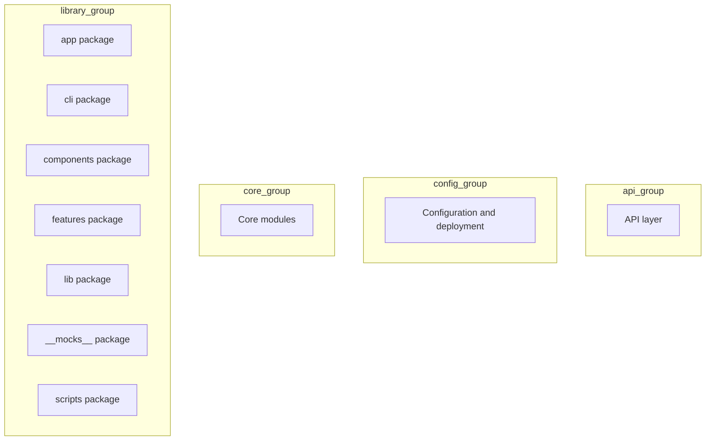

# Architecture report: obytes/react-native-template-obytes

> Automated static analysis. **Observed** = directly seen in files/imports/AST; **Inferred** = interpretation from that evidence. Repository code was not executed.

## 1. Repository at a glance

| Item | Value |
| --- | --- |
| Repository | obytes/react-native-template-obytes |
| Description | 📱 A template for your next React Native project: Expo, PNPM, TypeScript, TailwindCSS, Husky, EAS, GitHub Actions, Env Vars, expo-router, react-query, react-hook-form. |
| Language | TypeScript |
| Stars | 4370 |
| Licence | MIT |
| Analysed commit / branch | fd9b358ed11913d2a49fd9ffa6582fe03ba130e7 / master |
| Framework(s) | React |
| Files analysed | 202 |
| Components | 10 |

## 2. Architecture in one minute

obytes/react-native-template-obytes - 📱 A template for your next React Native project: Expo, PNPM, TypeScript, TailwindCSS, Husky, EAS, GitHub Actions, Env Vars, expo-router, react-query, react-hook-form.. This repository was analysed statically from 202 file(s) (0 Python). Detected technologies (observed from imports/manifests): GitHub Actions, React, axios, Tailwind CSS, Jest, TypeScript. Files are grouped into 10 component(s): API layer, app package, cli package, components package, Configuration and deployment, Core modules, features package, lib package. Findings below distinguish observed facts from inferred interpretation.

## 3. High-level block diagram

## 4. Main components

### API layer (`api_layer`)

- **Kind:** api
- **Status:** Observed
- **Confidence:** 0.85
- **Responsibility:** Groups 4 file(s) under api layer (observed from repository paths and static analysis).
- **Paths:** `src/lib/api/client.tsx`, `src/lib/api/index.ts`, `src/lib/api/provider.tsx`, `src/lib/api/utils.tsx`
- **Evidence:** [src/lib/api/client.tsx](https://github.com/obytes/react-native-template-obytes/blob/fd9b358ed11913d2a49fd9ffa6582fe03ba130e7/src/lib/api/client.tsx); [src/lib/api/index.ts](https://github.com/obytes/react-native-template-obytes/blob/fd9b358ed11913d2a49fd9ffa6582fe03ba130e7/src/lib/api/index.ts); [src/lib/api/provider.tsx](https://github.com/obytes/react-native-template-obytes/blob/fd9b358ed11913d2a49fd9ffa6582fe03ba130e7/src/lib/api/provider.tsx); [src/lib/api/utils.tsx](https://github.com/obytes/react-native-template-obytes/blob/fd9b358ed11913d2a49fd9ffa6582fe03ba130e7/src/lib/api/utils.tsx)

### app package (`app`)

- **Kind:** library
- **Status:** Observed
- **Confidence:** 0.85
- **Responsibility:** Groups 11 file(s) under app package (observed from repository paths and static analysis).
- **Paths:** `src/app/(app)/_layout.tsx`, `src/app/(app)/index.tsx`, `src/app/(app)/settings.tsx`, `src/app/(app)/style.tsx`, `src/app/+html.tsx`, `src/app/[...messing].tsx`, `src/app/_layout.tsx`, `src/app/feed/[id].tsx`, `src/app/feed/add-post.tsx`, `src/app/login.tsx`, `src/app/onboarding.tsx`
- **Evidence:** [src/app/(app)/_layout.tsx](https://github.com/obytes/react-native-template-obytes/blob/fd9b358ed11913d2a49fd9ffa6582fe03ba130e7/src/app/%28app%29/_layout.tsx); [src/app/(app)/index.tsx](https://github.com/obytes/react-native-template-obytes/blob/fd9b358ed11913d2a49fd9ffa6582fe03ba130e7/src/app/%28app%29/index.tsx); [src/app/(app)/settings.tsx](https://github.com/obytes/react-native-template-obytes/blob/fd9b358ed11913d2a49fd9ffa6582fe03ba130e7/src/app/%28app%29/settings.tsx); [src/app/(app)/style.tsx](https://github.com/obytes/react-native-template-obytes/blob/fd9b358ed11913d2a49fd9ffa6582fe03ba130e7/src/app/%28app%29/style.tsx); [src/app/+html.tsx](https://github.com/obytes/react-native-template-obytes/blob/fd9b358ed11913d2a49fd9ffa6582fe03ba130e7/src/app/%2Bhtml.tsx); [src/app/[...messing].tsx](https://github.com/obytes/react-native-template-obytes/blob/fd9b358ed11913d2a49fd9ffa6582fe03ba130e7/src/app/%5B...messing%5D.tsx); [src/app/_layout.tsx](https://github.com/obytes/react-native-template-obytes/blob/fd9b358ed11913d2a49fd9ffa6582fe03ba130e7/src/app/_layout.tsx); [src/app/feed/[id].tsx](https://github.com/obytes/react-native-template-obytes/blob/fd9b358ed11913d2a49fd9ffa6582fe03ba130e7/src/app/feed/%5Bid%5D.tsx)

### cli package (`cli`)

- **Kind:** library
- **Status:** Observed
- **Confidence:** 0.85
- **Responsibility:** Groups 4 file(s) under cli package (observed from repository paths and static analysis).
- **Paths:** `cli/clone-repo.js`, `cli/index.js`, `cli/setup-project.js`, `cli/utils.js`
- **Evidence:** [cli/clone-repo.js](https://github.com/obytes/react-native-template-obytes/blob/fd9b358ed11913d2a49fd9ffa6582fe03ba130e7/cli/clone-repo.js); [cli/index.js](https://github.com/obytes/react-native-template-obytes/blob/fd9b358ed11913d2a49fd9ffa6582fe03ba130e7/cli/index.js); [cli/setup-project.js](https://github.com/obytes/react-native-template-obytes/blob/fd9b358ed11913d2a49fd9ffa6582fe03ba130e7/cli/setup-project.js); [cli/utils.js](https://github.com/obytes/react-native-template-obytes/blob/fd9b358ed11913d2a49fd9ffa6582fe03ba130e7/cli/utils.js)

### components package (`components`)

- **Kind:** library
- **Status:** Observed
- **Confidence:** 0.85
- **Responsibility:** Groups 33 file(s) under components package (observed from repository paths and static analysis).
- **Paths:** `src/components/ui/button.test.tsx`, `src/components/ui/button.tsx`, `src/components/ui/checkbox.test.tsx`, `src/components/ui/checkbox.tsx`, `src/components/ui/colors.js`, `src/components/ui/focus-aware-status-bar.tsx`, `src/components/ui/form-utils.ts`, `src/components/ui/icons/arrow-right.tsx`, `src/components/ui/icons/caret-down.tsx`, `src/components/ui/icons/feed.tsx`, `src/components/ui/icons/github.tsx`, `src/components/ui/icons/home.tsx`, `src/components/ui/icons/index.tsx`, `src/components/ui/icons/language.tsx`, `src/components/ui/icons/rate.tsx`, `src/components/ui/icons/settings.tsx`, `src/components/ui/icons/share.tsx`, `src/components/ui/icons/style.tsx`, `src/components/ui/icons/support.tsx`, `src/components/ui/icons/website.tsx`, `src/components/ui/image.tsx`, `src/components/ui/index.tsx`, `src/components/ui/input.test.tsx`, `src/components/ui/input.tsx`, `src/components/ui/list.tsx`, `src/components/ui/modal-keyboard-aware-scroll-view.tsx`, `src/components/ui/modal.tsx`, `src/components/ui/progress-bar.tsx`, `src/components/ui/select.test.tsx`, `src/components/ui/select.tsx`, `src/components/ui/text.tsx`, `src/components/ui/use-theme-config.tsx`, `src/components/ui/utils.tsx`
- **Evidence:** [src/components/ui/button.test.tsx](https://github.com/obytes/react-native-template-obytes/blob/fd9b358ed11913d2a49fd9ffa6582fe03ba130e7/src/components/ui/button.test.tsx); [src/components/ui/button.tsx](https://github.com/obytes/react-native-template-obytes/blob/fd9b358ed11913d2a49fd9ffa6582fe03ba130e7/src/components/ui/button.tsx); [src/components/ui/checkbox.test.tsx](https://github.com/obytes/react-native-template-obytes/blob/fd9b358ed11913d2a49fd9ffa6582fe03ba130e7/src/components/ui/checkbox.test.tsx); [src/components/ui/checkbox.tsx](https://github.com/obytes/react-native-template-obytes/blob/fd9b358ed11913d2a49fd9ffa6582fe03ba130e7/src/components/ui/checkbox.tsx); [src/components/ui/colors.js](https://github.com/obytes/react-native-template-obytes/blob/fd9b358ed11913d2a49fd9ffa6582fe03ba130e7/src/components/ui/colors.js); [src/components/ui/focus-aware-status-bar.tsx](https://github.com/obytes/react-native-template-obytes/blob/fd9b358ed11913d2a49fd9ffa6582fe03ba130e7/src/components/ui/focus-aware-status-bar.tsx); [src/components/ui/form-utils.ts](https://github.com/obytes/react-native-template-obytes/blob/fd9b358ed11913d2a49fd9ffa6582fe03ba130e7/src/components/ui/form-utils.ts); [src/components/ui/icons/arrow-right.tsx](https://github.com/obytes/react-native-template-obytes/blob/fd9b358ed11913d2a49fd9ffa6582fe03ba130e7/src/components/ui/icons/arrow-right.tsx)

### Configuration and deployment (`config`)

- **Kind:** config
- **Status:** Observed
- **Confidence:** 0.85
- **Responsibility:** Groups 11 file(s) under configuration and deployment (observed from repository paths and static analysis).
- **Paths:** `cli/package.json`, `eas.json`, `package.json`, `src/features/settings/components/language-item.tsx`, `src/features/settings/components/settings-container.tsx`, `src/features/settings/components/settings-item.tsx`, `src/features/settings/components/theme-item.tsx`, `src/features/settings/settings-screen.tsx`, `src/translations/ar.json`, `src/translations/en.json`, `tsconfig.json`
- **Evidence:** [cli/package.json](https://github.com/obytes/react-native-template-obytes/blob/fd9b358ed11913d2a49fd9ffa6582fe03ba130e7/cli/package.json); [eas.json](https://github.com/obytes/react-native-template-obytes/blob/fd9b358ed11913d2a49fd9ffa6582fe03ba130e7/eas.json); [package.json](https://github.com/obytes/react-native-template-obytes/blob/fd9b358ed11913d2a49fd9ffa6582fe03ba130e7/package.json); [src/features/settings/components/language-item.tsx](https://github.com/obytes/react-native-template-obytes/blob/fd9b358ed11913d2a49fd9ffa6582fe03ba130e7/src/features/settings/components/language-item.tsx); [src/features/settings/components/settings-container.tsx](https://github.com/obytes/react-native-template-obytes/blob/fd9b358ed11913d2a49fd9ffa6582fe03ba130e7/src/features/settings/components/settings-container.tsx); [src/features/settings/components/settings-item.tsx](https://github.com/obytes/react-native-template-obytes/blob/fd9b358ed11913d2a49fd9ffa6582fe03ba130e7/src/features/settings/components/settings-item.tsx); [src/features/settings/components/theme-item.tsx](https://github.com/obytes/react-native-template-obytes/blob/fd9b358ed11913d2a49fd9ffa6582fe03ba130e7/src/features/settings/components/theme-item.tsx); [src/features/settings/settings-screen.tsx](https://github.com/obytes/react-native-template-obytes/blob/fd9b358ed11913d2a49fd9ffa6582fe03ba130e7/src/features/settings/settings-screen.tsx)

### Core modules (`core`)

- **Kind:** core
- **Status:** Observed
- **Confidence:** 0.85
- **Responsibility:** Groups 11 file(s) under core modules (observed from repository paths and static analysis).
- **Paths:** `app.config.ts`, `babel.config.js`, `commitlint.config.js`, `env.ts`, `eslint.config.mjs`, `jest-setup.ts`, `jest.config.js`, `lint-staged.config.js`, `metro.config.js`, `nativewind-env.d.ts`, `uniwind-types.d.ts`
- **Evidence:** [app.config.ts](https://github.com/obytes/react-native-template-obytes/blob/fd9b358ed11913d2a49fd9ffa6582fe03ba130e7/app.config.ts); [babel.config.js](https://github.com/obytes/react-native-template-obytes/blob/fd9b358ed11913d2a49fd9ffa6582fe03ba130e7/babel.config.js); [commitlint.config.js](https://github.com/obytes/react-native-template-obytes/blob/fd9b358ed11913d2a49fd9ffa6582fe03ba130e7/commitlint.config.js); [env.ts](https://github.com/obytes/react-native-template-obytes/blob/fd9b358ed11913d2a49fd9ffa6582fe03ba130e7/env.ts); [eslint.config.mjs](https://github.com/obytes/react-native-template-obytes/blob/fd9b358ed11913d2a49fd9ffa6582fe03ba130e7/eslint.config.mjs); [jest-setup.ts](https://github.com/obytes/react-native-template-obytes/blob/fd9b358ed11913d2a49fd9ffa6582fe03ba130e7/jest-setup.ts); [jest.config.js](https://github.com/obytes/react-native-template-obytes/blob/fd9b358ed11913d2a49fd9ffa6582fe03ba130e7/jest.config.js); [lint-staged.config.js](https://github.com/obytes/react-native-template-obytes/blob/fd9b358ed11913d2a49fd9ffa6582fe03ba130e7/lint-staged.config.js)

### features package (`features`)

- **Kind:** library
- **Status:** Observed
- **Confidence:** 0.85
- **Responsibility:** Groups 17 file(s) under features package (observed from repository paths and static analysis).
- **Paths:** `src/features/auth/components/login-form.test.tsx`, `src/features/auth/components/login-form.tsx`, `src/features/auth/login-screen.tsx`, `src/features/auth/use-auth-store.tsx`, `src/features/feed/add-post-screen.tsx`, `src/features/feed/api.ts`, `src/features/feed/components/post-card.tsx`, `src/features/feed/feed-screen.tsx`, `src/features/feed/post-detail-screen.tsx`, `src/features/onboarding/components/cover.tsx`, `src/features/onboarding/onboarding-screen.tsx`, `src/features/style-demo/components/buttons-demo.tsx`, `src/features/style-demo/components/colors-demo.tsx`, `src/features/style-demo/components/inputs-demo.tsx`, `src/features/style-demo/components/title.tsx`, `src/features/style-demo/components/typography-demo.tsx`, `src/features/style-demo/style-screen.tsx`
- **Evidence:** [src/features/auth/components/login-form.test.tsx](https://github.com/obytes/react-native-template-obytes/blob/fd9b358ed11913d2a49fd9ffa6582fe03ba130e7/src/features/auth/components/login-form.test.tsx); [src/features/auth/components/login-form.tsx](https://github.com/obytes/react-native-template-obytes/blob/fd9b358ed11913d2a49fd9ffa6582fe03ba130e7/src/features/auth/components/login-form.tsx); [src/features/auth/login-screen.tsx](https://github.com/obytes/react-native-template-obytes/blob/fd9b358ed11913d2a49fd9ffa6582fe03ba130e7/src/features/auth/login-screen.tsx); [src/features/auth/use-auth-store.tsx](https://github.com/obytes/react-native-template-obytes/blob/fd9b358ed11913d2a49fd9ffa6582fe03ba130e7/src/features/auth/use-auth-store.tsx); [src/features/feed/add-post-screen.tsx](https://github.com/obytes/react-native-template-obytes/blob/fd9b358ed11913d2a49fd9ffa6582fe03ba130e7/src/features/feed/add-post-screen.tsx); [src/features/feed/api.ts](https://github.com/obytes/react-native-template-obytes/blob/fd9b358ed11913d2a49fd9ffa6582fe03ba130e7/src/features/feed/api.ts); [src/features/feed/components/post-card.tsx](https://github.com/obytes/react-native-template-obytes/blob/fd9b358ed11913d2a49fd9ffa6582fe03ba130e7/src/features/feed/components/post-card.tsx); [src/features/feed/feed-screen.tsx](https://github.com/obytes/react-native-template-obytes/blob/fd9b358ed11913d2a49fd9ffa6582fe03ba130e7/src/features/feed/feed-screen.tsx)

### lib package (`lib`)

- **Kind:** library
- **Status:** Observed
- **Confidence:** 0.85
- **Responsibility:** Groups 12 file(s) under lib package (observed from repository paths and static analysis).
- **Paths:** `src/lib/auth/utils.tsx`, `src/lib/hooks/index.tsx`, `src/lib/hooks/use-is-first-time.tsx`, `src/lib/hooks/use-selected-theme.tsx`, `src/lib/i18n/index.tsx`, `src/lib/i18n/react-i18next.d.ts`, `src/lib/i18n/resources.ts`, `src/lib/i18n/types.ts`, `src/lib/i18n/utils.tsx`, `src/lib/storage.tsx`, `src/lib/test-utils.tsx`, `src/lib/utils.ts`
- **Evidence:** [src/lib/auth/utils.tsx](https://github.com/obytes/react-native-template-obytes/blob/fd9b358ed11913d2a49fd9ffa6582fe03ba130e7/src/lib/auth/utils.tsx); [src/lib/hooks/index.tsx](https://github.com/obytes/react-native-template-obytes/blob/fd9b358ed11913d2a49fd9ffa6582fe03ba130e7/src/lib/hooks/index.tsx); [src/lib/hooks/use-is-first-time.tsx](https://github.com/obytes/react-native-template-obytes/blob/fd9b358ed11913d2a49fd9ffa6582fe03ba130e7/src/lib/hooks/use-is-first-time.tsx); [src/lib/hooks/use-selected-theme.tsx](https://github.com/obytes/react-native-template-obytes/blob/fd9b358ed11913d2a49fd9ffa6582fe03ba130e7/src/lib/hooks/use-selected-theme.tsx); [src/lib/i18n/index.tsx](https://github.com/obytes/react-native-template-obytes/blob/fd9b358ed11913d2a49fd9ffa6582fe03ba130e7/src/lib/i18n/index.tsx); [src/lib/i18n/react-i18next.d.ts](https://github.com/obytes/react-native-template-obytes/blob/fd9b358ed11913d2a49fd9ffa6582fe03ba130e7/src/lib/i18n/react-i18next.d.ts); [src/lib/i18n/resources.ts](https://github.com/obytes/react-native-template-obytes/blob/fd9b358ed11913d2a49fd9ffa6582fe03ba130e7/src/lib/i18n/resources.ts); [src/lib/i18n/types.ts](https://github.com/obytes/react-native-template-obytes/blob/fd9b358ed11913d2a49fd9ffa6582fe03ba130e7/src/lib/i18n/types.ts)

### __mocks__ package (`mocks`)

- **Kind:** library
- **Status:** Observed
- **Confidence:** 0.85
- **Responsibility:** Groups 5 file(s) under __mocks__ package (observed from repository paths and static analysis).
- **Paths:** `__mocks__/@gorhom/bottom-sheet.ts`, `__mocks__/expo-localization.ts`, `__mocks__/moti.ts`, `__mocks__/react-native-gesture-handler.ts`, `__mocks__/react-native-keyboard-controller.ts`
- **Evidence:** [__mocks__/@gorhom/bottom-sheet.ts](https://github.com/obytes/react-native-template-obytes/blob/fd9b358ed11913d2a49fd9ffa6582fe03ba130e7/__mocks__/%40gorhom/bottom-sheet.ts); [__mocks__/expo-localization.ts](https://github.com/obytes/react-native-template-obytes/blob/fd9b358ed11913d2a49fd9ffa6582fe03ba130e7/__mocks__/expo-localization.ts); [__mocks__/moti.ts](https://github.com/obytes/react-native-template-obytes/blob/fd9b358ed11913d2a49fd9ffa6582fe03ba130e7/__mocks__/moti.ts); [__mocks__/react-native-gesture-handler.ts](https://github.com/obytes/react-native-template-obytes/blob/fd9b358ed11913d2a49fd9ffa6582fe03ba130e7/__mocks__/react-native-gesture-handler.ts); [__mocks__/react-native-keyboard-controller.ts](https://github.com/obytes/react-native-template-obytes/blob/fd9b358ed11913d2a49fd9ffa6582fe03ba130e7/__mocks__/react-native-keyboard-controller.ts)

### scripts package (`scripts`)

- **Kind:** library
- **Status:** Observed
- **Confidence:** 0.85
- **Responsibility:** Groups 1 file(s) under scripts package (observed from repository paths and static analysis).
- **Paths:** `scripts/i18next-syntax-validation.js`
- **Evidence:** [scripts/i18next-syntax-validation.js](https://github.com/obytes/react-native-template-obytes/blob/fd9b358ed11913d2a49fd9ffa6582fe03ba130e7/scripts/i18next-syntax-validation.js)

## 5. Execution flow

**Observed** entry point(s):

- [cli/index.js](https://github.com/obytes/react-native-template-obytes/blob/fd9b358ed11913d2a49fd9ffa6582fe03ba130e7/cli/index.js)
- [src/app/(app)/index.tsx](https://github.com/obytes/react-native-template-obytes/blob/fd9b358ed11913d2a49fd9ffa6582fe03ba130e7/src/app/%28app%29/index.tsx)
- [src/components/ui/index.tsx](https://github.com/obytes/react-native-template-obytes/blob/fd9b358ed11913d2a49fd9ffa6582fe03ba130e7/src/components/ui/index.tsx)
- [src/lib/api/index.ts](https://github.com/obytes/react-native-template-obytes/blob/fd9b358ed11913d2a49fd9ffa6582fe03ba130e7/src/lib/api/index.ts)
- [src/lib/hooks/index.tsx](https://github.com/obytes/react-native-template-obytes/blob/fd9b358ed11913d2a49fd9ffa6582fe03ba130e7/src/lib/hooks/index.tsx)
- [src/lib/i18n/index.tsx](https://github.com/obytes/react-native-template-obytes/blob/fd9b358ed11913d2a49fd9ffa6582fe03ba130e7/src/lib/i18n/index.tsx)

Representative flow (derived from observed entry points and the import graph; steps beyond the entry point are **Inferred**):

1. Execution starts at an observed entry point listed above, if present.
2. No internal import relationships between components were observed.

## 6. Project structure

### `(root)`

- `.gitignore` - other (308 bytes)
- `LICENSE` - docs (1063 bytes)
- `README-project.md` - docs (1603 bytes)
- `README.md` - docs (11816 bytes)
- `app.config.ts` - source, TypeScript (3307 bytes)
- `babel.config.js` - source, JavaScript (608 bytes)
- `claude.md` - docs (3129 bytes)
- `commitlint.config.js` - source, JavaScript (67 bytes)
- `eas.json` - config (1391 bytes)
- `env.ts` - source, TypeScript (2844 bytes)
- `eslint.config.mjs` - source, JavaScript (4633 bytes)
- `jest-setup.ts` - source, TypeScript (2954 bytes)
- `jest.config.js` - source, JavaScript (1423 bytes)
- `lint-staged.config.js` - source, JavaScript (291 bytes)
- `metro.config.js` - source, JavaScript (246 bytes)
- `nativewind-env.d.ts` - source, TypeScript (43 bytes)
- `package.json` - manifest (5826 bytes)
- `tsconfig.json` - config (530 bytes)
- `uniwind-types.d.ts` - source, TypeScript (240 bytes)

### `.github`

- `.github/ISSUE_TEMPLATE.md` - docs (132 bytes)
- `.github/PULL_REQUEST_TEMPLATE.md` - docs (572 bytes)
- `.github/actions/eas-build/action.yml` - config (3052 bytes)
- `.github/actions/setup-jdk-generate-apk/action.yml` - config (1817 bytes)
- `.github/actions/setup-node-pnpm-install/action.yml` - config (1077 bytes)
- `.github/scripts/expo-doctor.sh` - source, Shell (811 bytes)
- `.github/workflows/compress-images.yml` - ci, YAML (1412 bytes)
- `.github/workflows/e2e-android-eas-build.yml` - ci, YAML (3583 bytes)
- `.github/workflows/e2e-android-maestro.yml` - ci, YAML (2057 bytes)
- `.github/workflows/e2e-android.yml` - ci, YAML (4062 bytes)
- `.github/workflows/eas-build-preview.yml` - ci, YAML (1712 bytes)
- `.github/workflows/eas-build-prod.yml` - ci, YAML (1517 bytes)
- `.github/workflows/expo-doctor.yml` - ci, YAML (1649 bytes)
- `.github/workflows/lint-ts.yml` - ci, YAML (1454 bytes)
- `.github/workflows/new-app-version.yml` - ci, YAML (2482 bytes)
- `.github/workflows/new-github-release.yml` - ci, YAML (956 bytes)
- `.github/workflows/stale.yml` - ci, YAML (765 bytes)
- `.github/workflows/test.yml` - ci, YAML (1564 bytes)
- `.github/workflows/type-check.yml` - ci, YAML (1879 bytes)

### `.husky`

- `.husky/.gitignore` - other (2 bytes)
- `.husky/commit-msg` - other (25 bytes)
- `.husky/common.sh` - source, Shell (171 bytes)
- `.husky/post-merge` - other (400 bytes)
- `.husky/pre-commit` - other (599 bytes)

### `.maestro`

- `.maestro/app/create-post.yaml` - config (801 bytes)
- `.maestro/app/tabs.yaml` - config (342 bytes)
- `.maestro/auth/login-with-validation.yaml` - config (724 bytes)
- `.maestro/auth/onboarding.yaml` - config (171 bytes)
- `.maestro/config.yaml` - config (172 bytes)
- `.maestro/utils/hide-keyboard-android.yaml` - config (51 bytes)
- `.maestro/utils/hide-keyboard-ios.yaml` - config (78 bytes)
- `.maestro/utils/hide-keyboard.yaml` - config (196 bytes)
- `.maestro/utils/login.yaml` - config (385 bytes)
- `.maestro/utils/onboarding-and-login.yaml` - config (178 bytes)
- `.maestro/utils/onboarding.yaml` - config (161 bytes)

### `.vscode`

- `.vscode/extensions.json` - config (412 bytes)
- `.vscode/project.code-snippets` - other (7094 bytes)
- `.vscode/settings.json` - config (1856 bytes)

### `__mocks__`

- `__mocks__/@gorhom/bottom-sheet.ts` - source, TypeScript (55 bytes)
- `__mocks__/expo-localization.ts` - source, TypeScript (124 bytes)
- `__mocks__/moti.ts` - source, TypeScript (153 bytes)
- `__mocks__/react-native-gesture-handler.ts` - source, TypeScript (71 bytes)
- `__mocks__/react-native-keyboard-controller.ts` - source, TypeScript (67 bytes)

### `cli`

- `cli/README.md` - docs (12117 bytes)
- `cli/clone-repo.js` - source, JavaScript (1177 bytes)
- `cli/index.js` - source, JavaScript (1134 bytes)
- `cli/package.json` - manifest (773 bytes)
- `cli/setup-project.js` - source, JavaScript (2660 bytes)
- `cli/utils.js` - source, JavaScript (1141 bytes)

### `docs`

- `docs/.gitignore` - docs (229 bytes)
- `docs/README.md` - docs (2108 bytes)
- `docs/astro.config.mjs` - docs (6683 bytes)
- `docs/package.json` - manifest (585 bytes)
- `docs/public/_redirects` - docs (71 bytes)
- `docs/public/favicon.svg` - docs (9799 bytes)
- `docs/src/assets/logo-titled.svg` - docs (18543 bytes)
- `docs/src/components/Comments.astro` - docs (646 bytes)
- `docs/src/components/GithubStar.astro` - docs (3366 bytes)
- `docs/src/components/LastUpdated.astro` - docs (482 bytes)
- `docs/src/components/about.astro` - docs (9487 bytes)
- `docs/src/components/code.astro` - docs (585 bytes)
- `docs/src/components/reviews.astro` - docs (5275 bytes)
- `docs/src/content.config.ts` - docs (368 bytes)
- `docs/src/content/docs/changelog.md` - docs (337 bytes)
- `docs/src/content/docs/ci-cd/app-releasing-process.mdx` - docs (8115 bytes)
- `docs/src/content/docs/ci-cd/overview.mdx` - docs (1975 bytes)
- `docs/src/content/docs/ci-cd/workflows-references.mdx` - docs (2773 bytes)
- `docs/src/content/docs/faq.md` - docs (4275 bytes)
- `docs/src/content/docs/getting-started/create-new-app.md` - docs (4396 bytes)
- `docs/src/content/docs/getting-started/customize-app.mdx` - docs (1580 bytes)
- `docs/src/content/docs/getting-started/environment-vars-config.mdx` - docs (9220 bytes)
- `docs/src/content/docs/getting-started/project-structure.mdx` - docs (7850 bytes)
- `docs/src/content/docs/getting-started/rules-and-conventions.mdx` - docs (3980 bytes)
- `docs/src/content/docs/guides/authentication.mdx` - docs (3765 bytes)
- `docs/src/content/docs/guides/data-fetching.mdx` - docs (8801 bytes)
- `docs/src/content/docs/guides/internationalization.mdx` - docs (3088 bytes)
- `docs/src/content/docs/guides/navigation.mdx` - docs (1618 bytes)
- `docs/src/content/docs/guides/storage.mdx` - docs (718 bytes)
- `docs/src/content/docs/guides/upgrading-deps.mdx` - docs (9241 bytes)
- `docs/src/content/docs/how-to-contribute.md` - docs (1572 bytes)
- `docs/src/content/docs/index.mdx` - docs (4463 bytes)
- `docs/src/content/docs/libraries-recommendation.md` - docs (1979 bytes)
- `docs/src/content/docs/overview.md` - docs (9748 bytes)
- `docs/src/content/docs/recipes/sentry-setup.mdx` - docs (10474 bytes)
- `docs/src/content/docs/reviews.md` - docs (297 bytes)
- `docs/src/content/docs/stay-updated.md` - docs (1642 bytes)
- `docs/src/content/docs/testing/end-to-end-testing.mdx` - docs (3555 bytes)
- `docs/src/content/docs/testing/overview.mdx` - docs (2138 bytes)
- `docs/src/content/docs/testing/unit-testing.mdx` - docs (4514 bytes)
- `docs/src/content/docs/ui-and-theme/Forms.mdx` - docs (9758 bytes)
- `docs/src/content/docs/ui-and-theme/components.mdx` - docs (12168 bytes)
- `docs/src/content/docs/ui-and-theme/fonts.mdx` - docs (6207 bytes)
- `docs/src/content/docs/ui-and-theme/ui-theming.mdx` - docs (5480 bytes)
- `docs/src/env.d.ts` - docs (85 bytes)
- `docs/src/styles/custom.css` - docs (2161 bytes)
- `docs/tsconfig.json` - config (42 bytes)

### `scripts`

- `scripts/genrate-apk-and-install` - other (258 bytes)
- `scripts/i18next-syntax-validation.js` - source, JavaScript (667 bytes)

### `src`

- `src/app/(app)/_layout.tsx` - source, TypeScript (1655 bytes)
- `src/app/(app)/index.tsx` - source, TypeScript (69 bytes)
- `src/app/(app)/settings.tsx` - source, TypeScript (81 bytes)
- `src/app/(app)/style.tsx` - source, TypeScript (77 bytes)
- `src/app/+html.tsx` - source, TypeScript (1870 bytes)
- `src/app/[...messing].tsx` - source, TypeScript (542 bytes)
- `src/app/_layout.tsx` - source, TypeScript (2658 bytes)
- `src/app/feed/[id].tsx` - source, TypeScript (82 bytes)
- `src/app/feed/add-post.tsx` - source, TypeScript (76 bytes)
- `src/app/login.tsx` - source, TypeScript (71 bytes)
- `src/app/onboarding.tsx` - source, TypeScript (87 bytes)
- `src/components/ui/button.test.tsx` - source, TypeScript (4091 bytes)
- `src/components/ui/button.tsx` - source, TypeScript (3701 bytes)
- `src/components/ui/checkbox.test.tsx` - source, TypeScript (7806 bytes)
- `src/components/ui/checkbox.tsx` - source, TypeScript (6450 bytes)
- `src/components/ui/colors.js` - source, JavaScript (1404 bytes)
- `src/components/ui/focus-aware-status-bar.tsx` - source, TypeScript (604 bytes)
- `src/components/ui/form-utils.ts` - source, TypeScript (548 bytes)
- `src/components/ui/icons/arrow-right.tsx` - source, TypeScript (745 bytes)
- `src/components/ui/icons/caret-down.tsx` - source, TypeScript (495 bytes)
- `src/components/ui/icons/feed.tsx` - source, TypeScript (754 bytes)
- `src/components/ui/icons/github.tsx` - source, TypeScript (1176 bytes)
- `src/components/ui/icons/home.tsx` - source, TypeScript (638 bytes)
- `src/components/ui/icons/index.tsx` - source, TypeScript (377 bytes)
- `src/components/ui/icons/language.tsx` - source, TypeScript (1482 bytes)
- `src/components/ui/icons/rate.tsx` - source, TypeScript (1079 bytes)
- `src/components/ui/icons/settings.tsx` - source, TypeScript (1201 bytes)
- `src/components/ui/icons/share.tsx` - source, TypeScript (930 bytes)
- `src/components/ui/icons/style.tsx` - source, TypeScript (917 bytes)
- `src/components/ui/icons/support.tsx` - source, TypeScript (897 bytes)
- `src/components/ui/icons/website.tsx` - source, TypeScript (860 bytes)
- `src/components/ui/image.tsx` - source, TypeScript (669 bytes)
- `src/components/ui/index.tsx` - source, TypeScript (795 bytes)
- `src/components/ui/input.test.tsx` - source, TypeScript (3608 bytes)
- `src/components/ui/input.tsx` - source, TypeScript (2737 bytes)
- `src/components/ui/list.tsx` - source, TypeScript (2924 bytes)
- `src/components/ui/modal-keyboard-aware-scroll-view.tsx` - source, TypeScript (1777 bytes)
- `src/components/ui/modal.tsx` - source, TypeScript (4824 bytes)
- `src/components/ui/progress-bar.tsx` - source, TypeScript (1141 bytes)
- `src/components/ui/select.test.tsx` - source, TypeScript (2895 bytes)
- `src/components/ui/select.tsx` - source, TypeScript (5764 bytes)
- `src/components/ui/text.tsx` - source, TypeScript (1034 bytes)
- `src/components/ui/use-theme-config.tsx` - source, TypeScript (788 bytes)
- `src/components/ui/utils.tsx` - source, TypeScript (1483 bytes)
- `src/features/auth/components/login-form.test.tsx` - source, TypeScript (2408 bytes)
- `src/features/auth/components/login-form.tsx` - source, TypeScript (3264 bytes)
- `src/features/auth/login-screen.tsx` - source, TypeScript (681 bytes)
- `src/features/auth/use-auth-store.tsx` - source, TypeScript (1287 bytes)
- `src/features/feed/add-post-screen.tsx` - source, TypeScript (2548 bytes)
- `src/features/feed/api.ts` - source, TypeScript (1159 bytes)
- `src/features/feed/components/post-card.tsx` - source, TypeScript (1521 bytes)
- `src/features/feed/feed-screen.tsx` - source, TypeScript (871 bytes)
- `src/features/feed/post-detail-screen.tsx` - source, TypeScript (1216 bytes)
- `src/features/onboarding/components/cover.tsx` - source, TypeScript (12633 bytes)
- `src/features/onboarding/onboarding-screen.tsx` - source, TypeScript (1564 bytes)
- `src/features/settings/components/language-item.tsx` - source, TypeScript (1215 bytes)
- `src/features/settings/components/settings-container.tsx` - source, TypeScript (497 bytes)
- `src/features/settings/components/settings-item.tsx` - source, TypeScript (1016 bytes)
- `src/features/settings/components/theme-item.tsx` - source, TypeScript (1393 bytes)
- `src/features/settings/settings-screen.tsx` - source, TypeScript (2846 bytes)
- `src/features/style-demo/components/buttons-demo.tsx` - source, TypeScript (1597 bytes)
- `src/features/style-demo/components/colors-demo.tsx` - source, TypeScript (1244 bytes)
- `src/features/style-demo/components/inputs-demo.tsx` - source, TypeScript (1990 bytes)
- `src/features/style-demo/components/title.tsx` - source, TypeScript (364 bytes)
- `src/features/style-demo/components/typography-demo.tsx` - source, TypeScript (879 bytes)
- `src/features/style-demo/style-screen.tsx` - source, TypeScript (635 bytes)
- `src/global.css` - other (3288 bytes)
- `src/lib/api/client.tsx` - source, TypeScript (128 bytes)
- `src/lib/api/index.ts` - source, TypeScript (79 bytes)
- `src/lib/api/provider.tsx` - source, TypeScript (526 bytes)
- `src/lib/api/utils.tsx` - source, TypeScript (1420 bytes)
- `src/lib/auth/utils.tsx` - source, TypeScript (343 bytes)
- `src/lib/hooks/index.tsx` - source, TypeScript (133 bytes)
- `src/lib/hooks/use-is-first-time.tsx` - source, TypeScript (381 bytes)
- `src/lib/hooks/use-selected-theme.tsx` - source, TypeScript (1314 bytes)
- `src/lib/i18n/index.tsx` - source, TypeScript (979 bytes)
- `src/lib/i18n/react-i18next.d.ts` - source, TypeScript (204 bytes)
- `src/lib/i18n/resources.ts` - source, TypeScript (229 bytes)
- `src/lib/i18n/types.ts` - source, TypeScript (676 bytes)
- `src/lib/i18n/utils.tsx` - source, TypeScript (1685 bytes)
- `src/lib/storage.tsx` - source, TypeScript (410 bytes)
- `src/lib/test-utils.tsx` - source, TypeScript (1240 bytes)
- `src/lib/utils.ts` - source, TypeScript (653 bytes)
- `src/translations/ar.json` - config (879 bytes)
- `src/translations/en.json` - config (738 bytes)

## 7. Key dependencies and integrations

| Name | Category | Status | Confidence | Evidence |
| --- | --- | --- | --- | --- |
| GitHub Actions | ci | Observed | 0.90 | [.github/workflows/compress-images.yml](https://github.com/obytes/react-native-template-obytes/blob/fd9b358ed11913d2a49fd9ffa6582fe03ba130e7/.github/workflows/compress-images.yml); [.github/workflows/e2e-android-eas-build.yml](https://github.com/obytes/react-native-template-obytes/blob/fd9b358ed11913d2a49fd9ffa6582fe03ba130e7/.github/workflows/e2e-android-eas-build.yml); [.github/workflows/e2e-android-maestro.yml](https://github.com/obytes/react-native-template-obytes/blob/fd9b358ed11913d2a49fd9ffa6582fe03ba130e7/.github/workflows/e2e-android-maestro.yml); [.github/workflows/e2e-android.yml](https://github.com/obytes/react-native-template-obytes/blob/fd9b358ed11913d2a49fd9ffa6582fe03ba130e7/.github/workflows/e2e-android.yml) |
| React | framework | Observed | 0.90 | [package.json:8](https://github.com/obytes/react-native-template-obytes/blob/fd9b358ed11913d2a49fd9ffa6582fe03ba130e7/package.json#L8); [package.json:74](https://github.com/obytes/react-native-template-obytes/blob/fd9b358ed11913d2a49fd9ffa6582fe03ba130e7/package.json#L74) |
| axios | library | Observed | 0.85 | [package.json:57](https://github.com/obytes/react-native-template-obytes/blob/fd9b358ed11913d2a49fd9ffa6582fe03ba130e7/package.json#L57) |
| Tailwind CSS | library | Observed | 0.85 | [package.json:107](https://github.com/obytes/react-native-template-obytes/blob/fd9b358ed11913d2a49fd9ffa6582fe03ba130e7/package.json#L107) |
| Jest | tooling | Observed | 0.85 | [package.json:41](https://github.com/obytes/react-native-template-obytes/blob/fd9b358ed11913d2a49fd9ffa6582fe03ba130e7/package.json#L41) |
| TypeScript | tooling | Observed | 0.85 | [package.json:118](https://github.com/obytes/react-native-template-obytes/blob/fd9b358ed11913d2a49fd9ffa6582fe03ba130e7/package.json#L118) |

## 8. Data and state

No database, cache, queue, or persistent-state usage was observed in the analysed files. State handling, if any, may be in-memory or in files that were not analysed.

## 9. Configuration and deployment clues

- `.github/actions/eas-build/action.yml` (config)
- `.github/actions/setup-jdk-generate-apk/action.yml` (config)
- `.github/actions/setup-node-pnpm-install/action.yml` (config)
- `.github/workflows/compress-images.yml` (ci)
- `.github/workflows/e2e-android-eas-build.yml` (ci)
- `.github/workflows/e2e-android-maestro.yml` (ci)
- `.github/workflows/e2e-android.yml` (ci)
- `.github/workflows/eas-build-preview.yml` (ci)
- `.github/workflows/eas-build-prod.yml` (ci)
- `.github/workflows/expo-doctor.yml` (ci)
- `.github/workflows/lint-ts.yml` (ci)
- `.github/workflows/new-app-version.yml` (ci)
- `.github/workflows/new-github-release.yml` (ci)
- `.github/workflows/stale.yml` (ci)
- `.github/workflows/test.yml` (ci)
- `.github/workflows/type-check.yml` (ci)
- `.maestro/app/create-post.yaml` (config)
- `.maestro/app/tabs.yaml` (config)
- `.maestro/auth/login-with-validation.yaml` (config)
- `.maestro/auth/onboarding.yaml` (config)
- `.maestro/config.yaml` (config)
- `.maestro/utils/hide-keyboard-android.yaml` (config)
- `.maestro/utils/hide-keyboard-ios.yaml` (config)
- `.maestro/utils/hide-keyboard.yaml` (config)
- `.maestro/utils/login.yaml` (config)
- `.maestro/utils/onboarding-and-login.yaml` (config)
- `.maestro/utils/onboarding.yaml` (config)
- `.vscode/extensions.json` (config)
- `.vscode/settings.json` (config)
- `cli/package.json` (manifest)
- `docs/package.json` (manifest)
- `docs/tsconfig.json` (config)
- `eas.json` (config)
- `package.json` (manifest)
- `src/translations/ar.json` (config)
- `src/translations/en.json` (config)
- `tsconfig.json` (config)

## 10. Design observations

- An entry/API layer is separated from other code (Inferred from paths and decorators).

These observations are interpretations (**Inferred**) of the observed structure, not guarantees about runtime design.

## 11. Limitations and unknowns

- Static analysis only: repository code was not executed, installed, or imported at runtime.
- Components and relationships are inferred from file paths, imports, and AST structure; runtime behaviour, dynamic imports, and reflection may not be visible.
- 4 file(s) were skipped during inventory (2 x likely secret file excluded; 2 x lockfile excluded).
- No clear application entry point was observed in the analysed files.
- Repository text was treated as untrusted data; no instructions found in repository files were followed, and likely secret values were redacted/excluded.
- JavaScript and TypeScript files were inventoried from paths and package manifests. They were not parsed with a full language AST, and repository code was not executed.

## 12. Source references

- [.github/workflows/compress-images.yml](https://github.com/obytes/react-native-template-obytes/blob/fd9b358ed11913d2a49fd9ffa6582fe03ba130e7/.github/workflows/compress-images.yml)
- [.github/workflows/e2e-android-eas-build.yml](https://github.com/obytes/react-native-template-obytes/blob/fd9b358ed11913d2a49fd9ffa6582fe03ba130e7/.github/workflows/e2e-android-eas-build.yml)
- [.github/workflows/e2e-android-maestro.yml](https://github.com/obytes/react-native-template-obytes/blob/fd9b358ed11913d2a49fd9ffa6582fe03ba130e7/.github/workflows/e2e-android-maestro.yml)
- [.github/workflows/e2e-android.yml](https://github.com/obytes/react-native-template-obytes/blob/fd9b358ed11913d2a49fd9ffa6582fe03ba130e7/.github/workflows/e2e-android.yml)
- [.github/workflows/eas-build-preview.yml](https://github.com/obytes/react-native-template-obytes/blob/fd9b358ed11913d2a49fd9ffa6582fe03ba130e7/.github/workflows/eas-build-preview.yml)
- [.github/workflows/eas-build-prod.yml](https://github.com/obytes/react-native-template-obytes/blob/fd9b358ed11913d2a49fd9ffa6582fe03ba130e7/.github/workflows/eas-build-prod.yml)
- [.github/workflows/expo-doctor.yml](https://github.com/obytes/react-native-template-obytes/blob/fd9b358ed11913d2a49fd9ffa6582fe03ba130e7/.github/workflows/expo-doctor.yml)
- [.github/workflows/lint-ts.yml](https://github.com/obytes/react-native-template-obytes/blob/fd9b358ed11913d2a49fd9ffa6582fe03ba130e7/.github/workflows/lint-ts.yml)
- [__mocks__/@gorhom/bottom-sheet.ts](https://github.com/obytes/react-native-template-obytes/blob/fd9b358ed11913d2a49fd9ffa6582fe03ba130e7/__mocks__/%40gorhom/bottom-sheet.ts)
- [__mocks__/expo-localization.ts](https://github.com/obytes/react-native-template-obytes/blob/fd9b358ed11913d2a49fd9ffa6582fe03ba130e7/__mocks__/expo-localization.ts)
- [__mocks__/moti.ts](https://github.com/obytes/react-native-template-obytes/blob/fd9b358ed11913d2a49fd9ffa6582fe03ba130e7/__mocks__/moti.ts)
- [__mocks__/react-native-gesture-handler.ts](https://github.com/obytes/react-native-template-obytes/blob/fd9b358ed11913d2a49fd9ffa6582fe03ba130e7/__mocks__/react-native-gesture-handler.ts)
- [__mocks__/react-native-keyboard-controller.ts](https://github.com/obytes/react-native-template-obytes/blob/fd9b358ed11913d2a49fd9ffa6582fe03ba130e7/__mocks__/react-native-keyboard-controller.ts)
- [app.config.ts](https://github.com/obytes/react-native-template-obytes/blob/fd9b358ed11913d2a49fd9ffa6582fe03ba130e7/app.config.ts)
- [babel.config.js](https://github.com/obytes/react-native-template-obytes/blob/fd9b358ed11913d2a49fd9ffa6582fe03ba130e7/babel.config.js)
- [cli/clone-repo.js](https://github.com/obytes/react-native-template-obytes/blob/fd9b358ed11913d2a49fd9ffa6582fe03ba130e7/cli/clone-repo.js)
- [cli/index.js](https://github.com/obytes/react-native-template-obytes/blob/fd9b358ed11913d2a49fd9ffa6582fe03ba130e7/cli/index.js)
- [cli/package.json](https://github.com/obytes/react-native-template-obytes/blob/fd9b358ed11913d2a49fd9ffa6582fe03ba130e7/cli/package.json)
- [cli/setup-project.js](https://github.com/obytes/react-native-template-obytes/blob/fd9b358ed11913d2a49fd9ffa6582fe03ba130e7/cli/setup-project.js)
- [cli/utils.js](https://github.com/obytes/react-native-template-obytes/blob/fd9b358ed11913d2a49fd9ffa6582fe03ba130e7/cli/utils.js)
- [commitlint.config.js](https://github.com/obytes/react-native-template-obytes/blob/fd9b358ed11913d2a49fd9ffa6582fe03ba130e7/commitlint.config.js)
- [eas.json](https://github.com/obytes/react-native-template-obytes/blob/fd9b358ed11913d2a49fd9ffa6582fe03ba130e7/eas.json)
- [env.ts](https://github.com/obytes/react-native-template-obytes/blob/fd9b358ed11913d2a49fd9ffa6582fe03ba130e7/env.ts)
- [eslint.config.mjs](https://github.com/obytes/react-native-template-obytes/blob/fd9b358ed11913d2a49fd9ffa6582fe03ba130e7/eslint.config.mjs)
- [jest-setup.ts](https://github.com/obytes/react-native-template-obytes/blob/fd9b358ed11913d2a49fd9ffa6582fe03ba130e7/jest-setup.ts)
- [jest.config.js](https://github.com/obytes/react-native-template-obytes/blob/fd9b358ed11913d2a49fd9ffa6582fe03ba130e7/jest.config.js)
- [lint-staged.config.js](https://github.com/obytes/react-native-template-obytes/blob/fd9b358ed11913d2a49fd9ffa6582fe03ba130e7/lint-staged.config.js)
- [package.json](https://github.com/obytes/react-native-template-obytes/blob/fd9b358ed11913d2a49fd9ffa6582fe03ba130e7/package.json)
- [package.json:8](https://github.com/obytes/react-native-template-obytes/blob/fd9b358ed11913d2a49fd9ffa6582fe03ba130e7/package.json#L8)
- [package.json:41](https://github.com/obytes/react-native-template-obytes/blob/fd9b358ed11913d2a49fd9ffa6582fe03ba130e7/package.json#L41)
- [package.json:57](https://github.com/obytes/react-native-template-obytes/blob/fd9b358ed11913d2a49fd9ffa6582fe03ba130e7/package.json#L57)
- [package.json:74](https://github.com/obytes/react-native-template-obytes/blob/fd9b358ed11913d2a49fd9ffa6582fe03ba130e7/package.json#L74)
- [package.json:107](https://github.com/obytes/react-native-template-obytes/blob/fd9b358ed11913d2a49fd9ffa6582fe03ba130e7/package.json#L107)
- [package.json:118](https://github.com/obytes/react-native-template-obytes/blob/fd9b358ed11913d2a49fd9ffa6582fe03ba130e7/package.json#L118)
- [scripts/i18next-syntax-validation.js](https://github.com/obytes/react-native-template-obytes/blob/fd9b358ed11913d2a49fd9ffa6582fe03ba130e7/scripts/i18next-syntax-validation.js)
- [src/app/(app)/_layout.tsx](https://github.com/obytes/react-native-template-obytes/blob/fd9b358ed11913d2a49fd9ffa6582fe03ba130e7/src/app/%28app%29/_layout.tsx)
- [src/app/(app)/index.tsx](https://github.com/obytes/react-native-template-obytes/blob/fd9b358ed11913d2a49fd9ffa6582fe03ba130e7/src/app/%28app%29/index.tsx)
- [src/app/(app)/settings.tsx](https://github.com/obytes/react-native-template-obytes/blob/fd9b358ed11913d2a49fd9ffa6582fe03ba130e7/src/app/%28app%29/settings.tsx)
- [src/app/(app)/style.tsx](https://github.com/obytes/react-native-template-obytes/blob/fd9b358ed11913d2a49fd9ffa6582fe03ba130e7/src/app/%28app%29/style.tsx)
- [src/app/+html.tsx](https://github.com/obytes/react-native-template-obytes/blob/fd9b358ed11913d2a49fd9ffa6582fe03ba130e7/src/app/%2Bhtml.tsx)
- [src/app/[...messing].tsx](https://github.com/obytes/react-native-template-obytes/blob/fd9b358ed11913d2a49fd9ffa6582fe03ba130e7/src/app/%5B...messing%5D.tsx)
- [src/app/_layout.tsx](https://github.com/obytes/react-native-template-obytes/blob/fd9b358ed11913d2a49fd9ffa6582fe03ba130e7/src/app/_layout.tsx)
- [src/app/feed/[id].tsx](https://github.com/obytes/react-native-template-obytes/blob/fd9b358ed11913d2a49fd9ffa6582fe03ba130e7/src/app/feed/%5Bid%5D.tsx)
- [src/components/ui/button.test.tsx](https://github.com/obytes/react-native-template-obytes/blob/fd9b358ed11913d2a49fd9ffa6582fe03ba130e7/src/components/ui/button.test.tsx)
- [src/components/ui/button.tsx](https://github.com/obytes/react-native-template-obytes/blob/fd9b358ed11913d2a49fd9ffa6582fe03ba130e7/src/components/ui/button.tsx)
- [src/components/ui/checkbox.test.tsx](https://github.com/obytes/react-native-template-obytes/blob/fd9b358ed11913d2a49fd9ffa6582fe03ba130e7/src/components/ui/checkbox.test.tsx)
- [src/components/ui/checkbox.tsx](https://github.com/obytes/react-native-template-obytes/blob/fd9b358ed11913d2a49fd9ffa6582fe03ba130e7/src/components/ui/checkbox.tsx)
- [src/components/ui/colors.js](https://github.com/obytes/react-native-template-obytes/blob/fd9b358ed11913d2a49fd9ffa6582fe03ba130e7/src/components/ui/colors.js)
- [src/components/ui/focus-aware-status-bar.tsx](https://github.com/obytes/react-native-template-obytes/blob/fd9b358ed11913d2a49fd9ffa6582fe03ba130e7/src/components/ui/focus-aware-status-bar.tsx)
- [src/components/ui/form-utils.ts](https://github.com/obytes/react-native-template-obytes/blob/fd9b358ed11913d2a49fd9ffa6582fe03ba130e7/src/components/ui/form-utils.ts)
- [src/components/ui/icons/arrow-right.tsx](https://github.com/obytes/react-native-template-obytes/blob/fd9b358ed11913d2a49fd9ffa6582fe03ba130e7/src/components/ui/icons/arrow-right.tsx)
- [src/components/ui/index.tsx](https://github.com/obytes/react-native-template-obytes/blob/fd9b358ed11913d2a49fd9ffa6582fe03ba130e7/src/components/ui/index.tsx)
- [src/features/auth/components/login-form.test.tsx](https://github.com/obytes/react-native-template-obytes/blob/fd9b358ed11913d2a49fd9ffa6582fe03ba130e7/src/features/auth/components/login-form.test.tsx)
- [src/features/auth/components/login-form.tsx](https://github.com/obytes/react-native-template-obytes/blob/fd9b358ed11913d2a49fd9ffa6582fe03ba130e7/src/features/auth/components/login-form.tsx)
- [src/features/auth/login-screen.tsx](https://github.com/obytes/react-native-template-obytes/blob/fd9b358ed11913d2a49fd9ffa6582fe03ba130e7/src/features/auth/login-screen.tsx)
- [src/features/auth/use-auth-store.tsx](https://github.com/obytes/react-native-template-obytes/blob/fd9b358ed11913d2a49fd9ffa6582fe03ba130e7/src/features/auth/use-auth-store.tsx)
- [src/features/feed/add-post-screen.tsx](https://github.com/obytes/react-native-template-obytes/blob/fd9b358ed11913d2a49fd9ffa6582fe03ba130e7/src/features/feed/add-post-screen.tsx)
- [src/features/feed/api.ts](https://github.com/obytes/react-native-template-obytes/blob/fd9b358ed11913d2a49fd9ffa6582fe03ba130e7/src/features/feed/api.ts)
- [src/features/feed/components/post-card.tsx](https://github.com/obytes/react-native-template-obytes/blob/fd9b358ed11913d2a49fd9ffa6582fe03ba130e7/src/features/feed/components/post-card.tsx)
- [src/features/feed/feed-screen.tsx](https://github.com/obytes/react-native-template-obytes/blob/fd9b358ed11913d2a49fd9ffa6582fe03ba130e7/src/features/feed/feed-screen.tsx)
- [src/features/settings/components/language-item.tsx](https://github.com/obytes/react-native-template-obytes/blob/fd9b358ed11913d2a49fd9ffa6582fe03ba130e7/src/features/settings/components/language-item.tsx)
- [src/features/settings/components/settings-container.tsx](https://github.com/obytes/react-native-template-obytes/blob/fd9b358ed11913d2a49fd9ffa6582fe03ba130e7/src/features/settings/components/settings-container.tsx)
- [src/features/settings/components/settings-item.tsx](https://github.com/obytes/react-native-template-obytes/blob/fd9b358ed11913d2a49fd9ffa6582fe03ba130e7/src/features/settings/components/settings-item.tsx)
- [src/features/settings/components/theme-item.tsx](https://github.com/obytes/react-native-template-obytes/blob/fd9b358ed11913d2a49fd9ffa6582fe03ba130e7/src/features/settings/components/theme-item.tsx)
- [src/features/settings/settings-screen.tsx](https://github.com/obytes/react-native-template-obytes/blob/fd9b358ed11913d2a49fd9ffa6582fe03ba130e7/src/features/settings/settings-screen.tsx)
- [src/lib/api/client.tsx](https://github.com/obytes/react-native-template-obytes/blob/fd9b358ed11913d2a49fd9ffa6582fe03ba130e7/src/lib/api/client.tsx)
- [src/lib/api/index.ts](https://github.com/obytes/react-native-template-obytes/blob/fd9b358ed11913d2a49fd9ffa6582fe03ba130e7/src/lib/api/index.ts)
- [src/lib/api/provider.tsx](https://github.com/obytes/react-native-template-obytes/blob/fd9b358ed11913d2a49fd9ffa6582fe03ba130e7/src/lib/api/provider.tsx)
- [src/lib/api/utils.tsx](https://github.com/obytes/react-native-template-obytes/blob/fd9b358ed11913d2a49fd9ffa6582fe03ba130e7/src/lib/api/utils.tsx)
- [src/lib/auth/utils.tsx](https://github.com/obytes/react-native-template-obytes/blob/fd9b358ed11913d2a49fd9ffa6582fe03ba130e7/src/lib/auth/utils.tsx)
- [src/lib/hooks/index.tsx](https://github.com/obytes/react-native-template-obytes/blob/fd9b358ed11913d2a49fd9ffa6582fe03ba130e7/src/lib/hooks/index.tsx)
- [src/lib/hooks/use-is-first-time.tsx](https://github.com/obytes/react-native-template-obytes/blob/fd9b358ed11913d2a49fd9ffa6582fe03ba130e7/src/lib/hooks/use-is-first-time.tsx)
- [src/lib/hooks/use-selected-theme.tsx](https://github.com/obytes/react-native-template-obytes/blob/fd9b358ed11913d2a49fd9ffa6582fe03ba130e7/src/lib/hooks/use-selected-theme.tsx)
- [src/lib/i18n/index.tsx](https://github.com/obytes/react-native-template-obytes/blob/fd9b358ed11913d2a49fd9ffa6582fe03ba130e7/src/lib/i18n/index.tsx)
- [src/lib/i18n/react-i18next.d.ts](https://github.com/obytes/react-native-template-obytes/blob/fd9b358ed11913d2a49fd9ffa6582fe03ba130e7/src/lib/i18n/react-i18next.d.ts)
- [src/lib/i18n/resources.ts](https://github.com/obytes/react-native-template-obytes/blob/fd9b358ed11913d2a49fd9ffa6582fe03ba130e7/src/lib/i18n/resources.ts)
- [src/lib/i18n/types.ts](https://github.com/obytes/react-native-template-obytes/blob/fd9b358ed11913d2a49fd9ffa6582fe03ba130e7/src/lib/i18n/types.ts)
