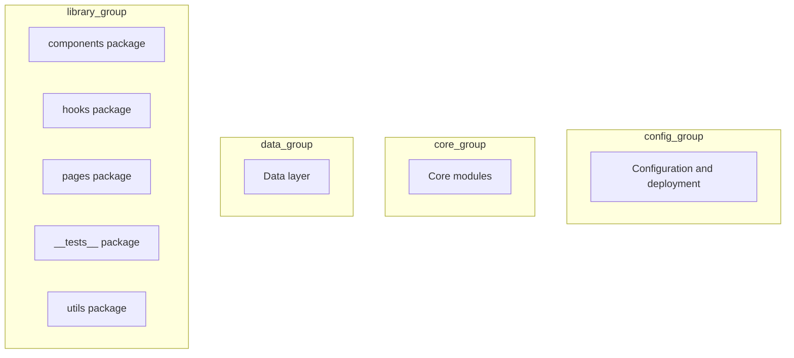

# Architecture report: octokatherine/readme.so

> Automated static analysis. **Observed** = directly seen in files/imports/AST; **Inferred** = interpretation from that evidence. Repository code was not executed.

## 1. Repository at a glance

| Item | Value |
| --- | --- |
| Repository | octokatherine/readme.so |
| Description | An online drag-and-drop editor to easily build READMEs |
| Language | JavaScript |
| Stars | 4634 |
| Licence | MIT |
| Analysed commit / branch | 90420ff0f33d1ef0e9cf4fd67515662ab626acee / main |
| Framework(s) | Next.js, React |
| Files analysed | 117 |
| Components | 8 |

## 2. Architecture in one minute

octokatherine/readme.so - An online drag-and-drop editor to easily build READMEs. This repository was analysed statically from 117 file(s) (0 Python). Detected technologies (observed from imports/manifests): GitHub Actions, Next.js, React, Tailwind CSS, Docker, Docker Compose. Files are grouped into 8 component(s): components package, Configuration and deployment, Core modules, Data layer, hooks package, pages package, __tests__ package, utils package. Findings below distinguish observed facts from inferred interpretation.

## 3. High-level block diagram

## 4. Main components

### components package (`components`)

- **Kind:** library
- **Status:** Observed
- **Confidence:** 0.85
- **Responsibility:** Groups 26 file(s) under components package (observed from repository paths and static analysis).
- **Paths:** `components/ColumnHeader.js`, `components/CustomSection.js`, `components/DownloadModal.js`, `components/EditPreviewContainer.js`, `components/EditorColumn.js`, `components/LanguageDropDown.js`, `components/Nav.js`, `components/PreviewColumn.js`, `components/RawPreview.js`, `components/SectionFilter.js`, `components/SectionsColumn.js`, `components/SortableItem.js`, `components/Tabs.js`, `components/__tests__/CustomSection.test.js`, `components/__tests__/DownloadModal.test.js`, `components/__tests__/EditorColumn.test.js`, `components/__tests__/EditorPreviewContainer.test.js`, `components/__tests__/Nav.test.js`, `components/__tests__/PreviewColumn.test.js`, `components/__tests__/RawPreview.test.js`, `components/__tests__/SectionFilter.test.js`, `components/__tests__/SectionsColumn.test.js`, `components/__tests__/SortableItem.test.js`, `components/__tests__/Tabs.test.js`, `components/icons/Close.js`, `components/icons/Menu.js`
- **Evidence:** [components/ColumnHeader.js](https://github.com/octokatherine/readme.so/blob/90420ff0f33d1ef0e9cf4fd67515662ab626acee/components/ColumnHeader.js); [components/CustomSection.js](https://github.com/octokatherine/readme.so/blob/90420ff0f33d1ef0e9cf4fd67515662ab626acee/components/CustomSection.js); [components/DownloadModal.js](https://github.com/octokatherine/readme.so/blob/90420ff0f33d1ef0e9cf4fd67515662ab626acee/components/DownloadModal.js); [components/EditPreviewContainer.js](https://github.com/octokatherine/readme.so/blob/90420ff0f33d1ef0e9cf4fd67515662ab626acee/components/EditPreviewContainer.js); [components/EditorColumn.js](https://github.com/octokatherine/readme.so/blob/90420ff0f33d1ef0e9cf4fd67515662ab626acee/components/EditorColumn.js); [components/LanguageDropDown.js](https://github.com/octokatherine/readme.so/blob/90420ff0f33d1ef0e9cf4fd67515662ab626acee/components/LanguageDropDown.js); [components/Nav.js](https://github.com/octokatherine/readme.so/blob/90420ff0f33d1ef0e9cf4fd67515662ab626acee/components/Nav.js); [components/PreviewColumn.js](https://github.com/octokatherine/readme.so/blob/90420ff0f33d1ef0e9cf4fd67515662ab626acee/components/PreviewColumn.js)

### Configuration and deployment (`config`)

- **Kind:** config
- **Status:** Observed
- **Confidence:** 0.85
- **Responsibility:** Groups 42 file(s) under configuration and deployment (observed from repository paths and static analysis).
- **Paths:** `Dockerfile`, `docker-compose.yml`, `package.json`, `public/locales/ar/common.json`, `public/locales/ar/editor.json`, `public/locales/bn/common.json`, `public/locales/bn/editor.json`, `public/locales/cn/common.json`, `public/locales/cn/editor.json`, `public/locales/de/common.json`, `public/locales/de/editor.json`, `public/locales/en/common.json`, `public/locales/en/editor.json`, `public/locales/es/common.json`, `public/locales/es/editor.json`, `public/locales/fil/common.json`, `public/locales/fil/editor.json`, `public/locales/fr/common.json`, `public/locales/fr/editor.json`, `public/locales/hi/common.json`, `public/locales/hi/editor.json`, `public/locales/id/common.json`, `public/locales/id/editor.json`, `public/locales/it/common.json`, `public/locales/it/editor.json`, `public/locales/ja/common.json`, `public/locales/ja/editor.json`, `public/locales/nl/common.json`, `public/locales/nl/editor.json`, `public/locales/pt/common.json`, `public/locales/pt/editor.json`, `public/locales/ru/common.json`, `public/locales/ru/editor.json`, `public/locales/sw/common.json`, `public/locales/sw/editor.json`, `public/locales/tl/common.json`, `public/locales/tl/editor.json`, `public/locales/tr/common.json`, `public/locales/tr/editor.json`, `public/locales/uz/common.json`, `public/locales/uz/editor.json`, `public/manifest.json`
- **Evidence:** [Dockerfile](https://github.com/octokatherine/readme.so/blob/90420ff0f33d1ef0e9cf4fd67515662ab626acee/Dockerfile); [docker-compose.yml](https://github.com/octokatherine/readme.so/blob/90420ff0f33d1ef0e9cf4fd67515662ab626acee/docker-compose.yml); [package.json](https://github.com/octokatherine/readme.so/blob/90420ff0f33d1ef0e9cf4fd67515662ab626acee/package.json); [public/locales/ar/common.json](https://github.com/octokatherine/readme.so/blob/90420ff0f33d1ef0e9cf4fd67515662ab626acee/public/locales/ar/common.json); [public/locales/ar/editor.json](https://github.com/octokatherine/readme.so/blob/90420ff0f33d1ef0e9cf4fd67515662ab626acee/public/locales/ar/editor.json); [public/locales/bn/common.json](https://github.com/octokatherine/readme.so/blob/90420ff0f33d1ef0e9cf4fd67515662ab626acee/public/locales/bn/common.json); [public/locales/bn/editor.json](https://github.com/octokatherine/readme.so/blob/90420ff0f33d1ef0e9cf4fd67515662ab626acee/public/locales/bn/editor.json); [public/locales/cn/common.json](https://github.com/octokatherine/readme.so/blob/90420ff0f33d1ef0e9cf4fd67515662ab626acee/public/locales/cn/common.json)

### Core modules (`core`)

- **Kind:** core
- **Status:** Observed
- **Confidence:** 0.85
- **Responsibility:** Groups 7 file(s) under core modules (observed from repository paths and static analysis).
- **Paths:** `jest.config.js`, `jest.setup.js`, `next-i18next.config.js`, `next-seo.config.js`, `next.config.js`, `postcss.config.js`, `tailwind.config.js`
- **Evidence:** [jest.config.js](https://github.com/octokatherine/readme.so/blob/90420ff0f33d1ef0e9cf4fd67515662ab626acee/jest.config.js); [jest.setup.js](https://github.com/octokatherine/readme.so/blob/90420ff0f33d1ef0e9cf4fd67515662ab626acee/jest.setup.js); [next-i18next.config.js](https://github.com/octokatherine/readme.so/blob/90420ff0f33d1ef0e9cf4fd67515662ab626acee/next-i18next.config.js); [next-seo.config.js](https://github.com/octokatherine/readme.so/blob/90420ff0f33d1ef0e9cf4fd67515662ab626acee/next-seo.config.js); [next.config.js](https://github.com/octokatherine/readme.so/blob/90420ff0f33d1ef0e9cf4fd67515662ab626acee/next.config.js); [postcss.config.js](https://github.com/octokatherine/readme.so/blob/90420ff0f33d1ef0e9cf4fd67515662ab626acee/postcss.config.js); [tailwind.config.js](https://github.com/octokatherine/readme.so/blob/90420ff0f33d1ef0e9cf4fd67515662ab626acee/tailwind.config.js)

### Data layer (`data_layer`)

- **Kind:** data
- **Status:** Observed
- **Confidence:** 0.85
- **Responsibility:** Groups 5 file(s) under data layer (observed from repository paths and static analysis).
- **Paths:** `data/index.js`, `data/section-templates-cn_CN.js`, `data/section-templates-en_EN.js`, `data/section-templates-pt_BR.js`, `data/section-templates-tr_TR.js`
- **Evidence:** [data/index.js](https://github.com/octokatherine/readme.so/blob/90420ff0f33d1ef0e9cf4fd67515662ab626acee/data/index.js); [data/section-templates-cn_CN.js](https://github.com/octokatherine/readme.so/blob/90420ff0f33d1ef0e9cf4fd67515662ab626acee/data/section-templates-cn_CN.js); [data/section-templates-en_EN.js](https://github.com/octokatherine/readme.so/blob/90420ff0f33d1ef0e9cf4fd67515662ab626acee/data/section-templates-en_EN.js); [data/section-templates-pt_BR.js](https://github.com/octokatherine/readme.so/blob/90420ff0f33d1ef0e9cf4fd67515662ab626acee/data/section-templates-pt_BR.js); [data/section-templates-tr_TR.js](https://github.com/octokatherine/readme.so/blob/90420ff0f33d1ef0e9cf4fd67515662ab626acee/data/section-templates-tr_TR.js)

### hooks package (`hooks`)

- **Kind:** library
- **Status:** Observed
- **Confidence:** 0.85
- **Responsibility:** Groups 2 file(s) under hooks package (observed from repository paths and static analysis).
- **Paths:** `hooks/useDeviceDetect.js`, `hooks/useLocalStorage.js`
- **Evidence:** [hooks/useDeviceDetect.js](https://github.com/octokatherine/readme.so/blob/90420ff0f33d1ef0e9cf4fd67515662ab626acee/hooks/useDeviceDetect.js); [hooks/useLocalStorage.js](https://github.com/octokatherine/readme.so/blob/90420ff0f33d1ef0e9cf4fd67515662ab626acee/hooks/useLocalStorage.js)

### pages package (`pages`)

- **Kind:** library
- **Status:** Observed
- **Confidence:** 0.85
- **Responsibility:** Groups 4 file(s) under pages package (observed from repository paths and static analysis).
- **Paths:** `pages/_app.js`, `pages/_document.js`, `pages/editor.js`, `pages/index.js`
- **Evidence:** [pages/_app.js](https://github.com/octokatherine/readme.so/blob/90420ff0f33d1ef0e9cf4fd67515662ab626acee/pages/_app.js); [pages/_document.js](https://github.com/octokatherine/readme.so/blob/90420ff0f33d1ef0e9cf4fd67515662ab626acee/pages/_document.js); [pages/editor.js](https://github.com/octokatherine/readme.so/blob/90420ff0f33d1ef0e9cf4fd67515662ab626acee/pages/editor.js); [pages/index.js](https://github.com/octokatherine/readme.so/blob/90420ff0f33d1ef0e9cf4fd67515662ab626acee/pages/index.js)

### __tests__ package (`tests`)

- **Kind:** library
- **Status:** Observed
- **Confidence:** 0.85
- **Responsibility:** Groups 1 file(s) under __tests__ package (observed from repository paths and static analysis).
- **Paths:** `__tests__/editor.test.js`
- **Evidence:** [__tests__/editor.test.js](https://github.com/octokatherine/readme.so/blob/90420ff0f33d1ef0e9cf4fd67515662ab626acee/__tests__/editor.test.js)

### utils package (`utils`)

- **Kind:** library
- **Status:** Observed
- **Confidence:** 0.85
- **Responsibility:** Groups 1 file(s) under utils package (observed from repository paths and static analysis).
- **Paths:** `utils/constants.js`
- **Evidence:** [utils/constants.js](https://github.com/octokatherine/readme.so/blob/90420ff0f33d1ef0e9cf4fd67515662ab626acee/utils/constants.js)

## 5. Execution flow

**Observed** entry point(s):

- [data/index.js](https://github.com/octokatherine/readme.so/blob/90420ff0f33d1ef0e9cf4fd67515662ab626acee/data/index.js)
- [pages/index.js](https://github.com/octokatherine/readme.so/blob/90420ff0f33d1ef0e9cf4fd67515662ab626acee/pages/index.js)

Representative flow (derived from observed entry points and the import graph; steps beyond the entry point are **Inferred**):

1. Execution starts at an observed entry point listed above, if present.
2. No internal import relationships between components were observed.

## 6. Project structure

### `(root)`

- `.babelrc` - other (32 bytes)
- `.dockerignore` - container (4 bytes)
- `.gitignore` - other (454 bytes)
- `.prettierignore` - other (27 bytes)
- `.prettierrc` - other (107 bytes)
- `CONTRIBUTING.md` - docs (542 bytes)
- `Dockerfile` - container (245 bytes)
- `LICENSE` - docs (1056 bytes)
- `README.md` - docs (941 bytes)
- `docker-compose.yml` - container (243 bytes)
- `jest.config.js` - source, JavaScript (538 bytes)
- `jest.setup.js` - source, JavaScript (35 bytes)
- `next-i18next.config.js` - source, JavaScript (312 bytes)
- `next-seo.config.js` - source, JavaScript (1150 bytes)
- `next.config.js` - source, JavaScript (81 bytes)
- `package.json` - manifest (1292 bytes)
- `postcss.config.js` - source, JavaScript (82 bytes)
- `tailwind.config.js` - source, JavaScript (289 bytes)
- `template.md` - docs (3384 bytes)

### `.github`

- `.github/ISSUE_TEMPLATE/bug_report.md` - docs (540 bytes)
- `.github/ISSUE_TEMPLATE/feature_request.md` - docs (611 bytes)
- `.github/copilot-instructions.md` - docs (2934 bytes)
- `.github/workflows/deploy.yml` - ci, YAML (743 bytes)

### `.husky`

- `.husky/.gitignore` - other (2 bytes)
- `.husky/pre-commit` - other (57 bytes)

### `__tests__`

- `__tests__/editor.test.js` - source, JavaScript (914 bytes)

### `components`

- `components/ColumnHeader.js` - source, JavaScript (722 bytes)
- `components/CustomSection.js` - source, JavaScript (5933 bytes)
- `components/DownloadModal.js` - source, JavaScript (3482 bytes)
- `components/EditPreviewContainer.js` - source, JavaScript (2458 bytes)
- `components/EditorColumn.js` - source, JavaScript (2586 bytes)
- `components/LanguageDropDown.js` - source, JavaScript (2664 bytes)
- `components/Nav.js` - source, JavaScript (2380 bytes)
- `components/PreviewColumn.js` - source, JavaScript (1273 bytes)
- `components/RawPreview.js` - source, JavaScript (2359 bytes)
- `components/SectionFilter.js` - source, JavaScript (490 bytes)
- `components/SectionsColumn.js` - source, JavaScript (9600 bytes)
- `components/SortableItem.js` - source, JavaScript (2551 bytes)
- `components/Tabs.js` - source, JavaScript (1085 bytes)
- `components/__tests__/CustomSection.test.js` - source, JavaScript (3800 bytes)
- `components/__tests__/DownloadModal.test.js` - source, JavaScript (970 bytes)
- `components/__tests__/EditorColumn.test.js` - source, JavaScript (1504 bytes)
- `components/__tests__/EditorPreviewContainer.test.js` - source, JavaScript (975 bytes)
- `components/__tests__/Nav.test.js` - source, JavaScript (1197 bytes)
- `components/__tests__/PreviewColumn.test.js` - source, JavaScript (479 bytes)
- `components/__tests__/RawPreview.test.js` - source, JavaScript (1067 bytes)
- `components/__tests__/SectionFilter.test.js` - source, JavaScript (1043 bytes)
- `components/__tests__/SectionsColumn.test.js` - source, JavaScript (1112 bytes)
- `components/__tests__/SortableItem.test.js` - source, JavaScript (1374 bytes)
- `components/__tests__/Tabs.test.js` - source, JavaScript (559 bytes)
- `components/icons/Close.js` - source, JavaScript (366 bytes)
- `components/icons/Menu.js` - source, JavaScript (328 bytes)

### `data`

- `data/index.js` - source, JavaScript (272 bytes)
- `data/section-templates-cn_CN.js` - source, JavaScript (7597 bytes)
- `data/section-templates-en_EN.js` - source, JavaScript (7768 bytes)
- `data/section-templates-pt_BR.js` - source, JavaScript (8207 bytes)
- `data/section-templates-tr_TR.js` - source, JavaScript (6549 bytes)

### `hooks`

- `hooks/useDeviceDetect.js` - source, JavaScript (382 bytes)
- `hooks/useLocalStorage.js` - source, JavaScript (888 bytes)

### `pages`

- `pages/_app.js` - source, JavaScript (425 bytes)
- `pages/_document.js` - source, JavaScript (223 bytes)
- `pages/editor.js` - source, JavaScript (3340 bytes)
- `pages/index.js` - source, JavaScript (4696 bytes)

### `public`

- `public/.nojekyll` - other (0 bytes)
- `public/CNAME` - other (10 bytes)
- `public/download.svg` - other (1542 bytes)
- `public/drag.svg` - other (2789 bytes)
- `public/github.svg` - other (792 bytes)
- `public/heart.svg` - other (769 bytes)
- `public/language.svg` - other (2543 bytes)
- `public/locales/ar/common.json` - config (423 bytes)
- `public/locales/ar/editor.json` - config (1153 bytes)
- `public/locales/bn/common.json` - config (605 bytes)
- `public/locales/bn/editor.json` - config (1886 bytes)
- `public/locales/cn/common.json` - config (317 bytes)
- `public/locales/cn/editor.json` - config (909 bytes)
- `public/locales/de/common.json` - config (383 bytes)
- `public/locales/de/editor.json` - config (1013 bytes)
- `public/locales/en/common.json` - config (353 bytes)
- `public/locales/en/editor.json` - config (926 bytes)
- `public/locales/es/common.json` - config (400 bytes)
- `public/locales/es/editor.json` - config (1012 bytes)
- `public/locales/fil/common.json` - config (407 bytes)
- `public/locales/fil/editor.json` - config (1102 bytes)
- `public/locales/fr/common.json` - config (414 bytes)
- `public/locales/fr/editor.json` - config (1001 bytes)
- `public/locales/hi/common.json` - config (631 bytes)
- `public/locales/hi/editor.json` - config (1550 bytes)
- `public/locales/id/common.json` - config (385 bytes)
- `public/locales/id/editor.json` - config (932 bytes)
- `public/locales/it/common.json` - config (399 bytes)
- `public/locales/it/editor.json` - config (998 bytes)
- `public/locales/ja/common.json` - config (428 bytes)
- `public/locales/ja/editor.json` - config (1209 bytes)
- `public/locales/nl/common.json` - config (369 bytes)
- `public/locales/nl/editor.json` - config (968 bytes)
- `public/locales/pt/common.json` - config (377 bytes)
- `public/locales/pt/editor.json` - config (1003 bytes)
- `public/locales/ru/common.json` - config (524 bytes)
- `public/locales/ru/editor.json` - config (1413 bytes)
- `public/locales/sw/common.json` - config (349 bytes)
- `public/locales/sw/editor.json` - config (938 bytes)
- `public/locales/tl/common.json` - config (786 bytes)
- `public/locales/tl/editor.json` - config (1878 bytes)
- `public/locales/tr/common.json` - config (437 bytes)
- `public/locales/tr/editor.json` - config (1040 bytes)
- `public/locales/uz/common.json` - config (338 bytes)
- `public/locales/uz/editor.json` - config (1033 bytes)
- `public/manifest.json` - config (1532 bytes)
- `public/readme.svg` - other (3813 bytes)
- `public/reset-light.svg` - other (298 bytes)
- `public/reset.svg` - other (306 bytes)
- `public/toggle_moon.svg` - other (201 bytes)
- `public/toggle_sun.svg` - other (655 bytes)
- `public/trash.svg` - other (480 bytes)

### `styles`

- `styles/globals.css` - other (4937 bytes)

### `utils`

- `utils/constants.js` - source, JavaScript (79 bytes)

## 7. Key dependencies and integrations

| Name | Category | Status | Confidence | Evidence |
| --- | --- | --- | --- | --- |
| GitHub Actions | ci | Observed | 0.85 | [.github/workflows/deploy.yml](https://github.com/octokatherine/readme.so/blob/90420ff0f33d1ef0e9cf4fd67515662ab626acee/.github/workflows/deploy.yml) |
| Next.js | framework | Observed | 0.85 | [package.json:6](https://github.com/octokatherine/readme.so/blob/90420ff0f33d1ef0e9cf4fd67515662ab626acee/package.json#L6) |
| React | framework | Observed | 0.90 | [package.json:19](https://github.com/octokatherine/readme.so/blob/90420ff0f33d1ef0e9cf4fd67515662ab626acee/package.json#L19); [package.json:26](https://github.com/octokatherine/readme.so/blob/90420ff0f33d1ef0e9cf4fd67515662ab626acee/package.json#L26) |
| Tailwind CSS | library | Observed | 0.85 | [package.json:46](https://github.com/octokatherine/readme.so/blob/90420ff0f33d1ef0e9cf4fd67515662ab626acee/package.json#L46) |
| Docker | tooling | Observed | 0.85 | [Dockerfile](https://github.com/octokatherine/readme.so/blob/90420ff0f33d1ef0e9cf4fd67515662ab626acee/Dockerfile) |
| Docker Compose | tooling | Observed | 0.85 | [docker-compose.yml](https://github.com/octokatherine/readme.so/blob/90420ff0f33d1ef0e9cf4fd67515662ab626acee/docker-compose.yml) |
| Jest | tooling | Observed | 0.85 | [package.json:9](https://github.com/octokatherine/readme.so/blob/90420ff0f33d1ef0e9cf4fd67515662ab626acee/package.json#L9) |

## 8. Data and state

- Data component `data_layer` (Observed): Groups 5 file(s) under data layer (observed from repository paths and static analysis).

## 9. Configuration and deployment clues

- `.dockerignore` (container)
- `.github/workflows/deploy.yml` (ci)
- `Dockerfile` (container)
- `docker-compose.yml` (container)
- `package.json` (manifest)
- `public/locales/ar/common.json` (config)
- `public/locales/ar/editor.json` (config)
- `public/locales/bn/common.json` (config)
- `public/locales/bn/editor.json` (config)
- `public/locales/cn/common.json` (config)
- `public/locales/cn/editor.json` (config)
- `public/locales/de/common.json` (config)
- `public/locales/de/editor.json` (config)
- `public/locales/en/common.json` (config)
- `public/locales/en/editor.json` (config)
- `public/locales/es/common.json` (config)
- `public/locales/es/editor.json` (config)
- `public/locales/fil/common.json` (config)
- `public/locales/fil/editor.json` (config)
- `public/locales/fr/common.json` (config)
- `public/locales/fr/editor.json` (config)
- `public/locales/hi/common.json` (config)
- `public/locales/hi/editor.json` (config)
- `public/locales/id/common.json` (config)
- `public/locales/id/editor.json` (config)
- `public/locales/it/common.json` (config)
- `public/locales/it/editor.json` (config)
- `public/locales/ja/common.json` (config)
- `public/locales/ja/editor.json` (config)
- `public/locales/nl/common.json` (config)
- `public/locales/nl/editor.json` (config)
- `public/locales/pt/common.json` (config)
- `public/locales/pt/editor.json` (config)
- `public/locales/ru/common.json` (config)
- `public/locales/ru/editor.json` (config)
- `public/locales/sw/common.json` (config)
- `public/locales/sw/editor.json` (config)
- `public/locales/tl/common.json` (config)
- `public/locales/tl/editor.json` (config)
- `public/locales/tr/common.json` (config)
- `public/locales/tr/editor.json` (config)
- `public/locales/uz/common.json` (config)
- `public/locales/uz/editor.json` (config)
- `public/manifest.json` (config)

## 10. Design observations

- Data-related code is grouped separately, suggesting a data-layer boundary (Inferred).

These observations are interpretations (**Inferred**) of the observed structure, not guarantees about runtime design.

## 11. Limitations and unknowns

- Static analysis only: repository code was not executed, installed, or imported at runtime.
- Components and relationships are inferred from file paths, imports, and AST structure; runtime behaviour, dynamic imports, and reflection may not be visible.
- No clear application entry point was observed in the analysed files.
- Repository text was treated as untrusted data; no instructions found in repository files were followed, and likely secret values were redacted/excluded.
- JavaScript and TypeScript files were inventoried from paths and package manifests. They were not parsed with a full language AST, and repository code was not executed.

## 12. Source references

- [.github/workflows/deploy.yml](https://github.com/octokatherine/readme.so/blob/90420ff0f33d1ef0e9cf4fd67515662ab626acee/.github/workflows/deploy.yml)
- [Dockerfile](https://github.com/octokatherine/readme.so/blob/90420ff0f33d1ef0e9cf4fd67515662ab626acee/Dockerfile)
- [__tests__/editor.test.js](https://github.com/octokatherine/readme.so/blob/90420ff0f33d1ef0e9cf4fd67515662ab626acee/__tests__/editor.test.js)
- [components/ColumnHeader.js](https://github.com/octokatherine/readme.so/blob/90420ff0f33d1ef0e9cf4fd67515662ab626acee/components/ColumnHeader.js)
- [components/CustomSection.js](https://github.com/octokatherine/readme.so/blob/90420ff0f33d1ef0e9cf4fd67515662ab626acee/components/CustomSection.js)
- [components/DownloadModal.js](https://github.com/octokatherine/readme.so/blob/90420ff0f33d1ef0e9cf4fd67515662ab626acee/components/DownloadModal.js)
- [components/EditPreviewContainer.js](https://github.com/octokatherine/readme.so/blob/90420ff0f33d1ef0e9cf4fd67515662ab626acee/components/EditPreviewContainer.js)
- [components/EditorColumn.js](https://github.com/octokatherine/readme.so/blob/90420ff0f33d1ef0e9cf4fd67515662ab626acee/components/EditorColumn.js)
- [components/LanguageDropDown.js](https://github.com/octokatherine/readme.so/blob/90420ff0f33d1ef0e9cf4fd67515662ab626acee/components/LanguageDropDown.js)
- [components/Nav.js](https://github.com/octokatherine/readme.so/blob/90420ff0f33d1ef0e9cf4fd67515662ab626acee/components/Nav.js)
- [components/PreviewColumn.js](https://github.com/octokatherine/readme.so/blob/90420ff0f33d1ef0e9cf4fd67515662ab626acee/components/PreviewColumn.js)
- [data/index.js](https://github.com/octokatherine/readme.so/blob/90420ff0f33d1ef0e9cf4fd67515662ab626acee/data/index.js)
- [data/section-templates-cn_CN.js](https://github.com/octokatherine/readme.so/blob/90420ff0f33d1ef0e9cf4fd67515662ab626acee/data/section-templates-cn_CN.js)
- [data/section-templates-en_EN.js](https://github.com/octokatherine/readme.so/blob/90420ff0f33d1ef0e9cf4fd67515662ab626acee/data/section-templates-en_EN.js)
- [data/section-templates-pt_BR.js](https://github.com/octokatherine/readme.so/blob/90420ff0f33d1ef0e9cf4fd67515662ab626acee/data/section-templates-pt_BR.js)
- [data/section-templates-tr_TR.js](https://github.com/octokatherine/readme.so/blob/90420ff0f33d1ef0e9cf4fd67515662ab626acee/data/section-templates-tr_TR.js)
- [docker-compose.yml](https://github.com/octokatherine/readme.so/blob/90420ff0f33d1ef0e9cf4fd67515662ab626acee/docker-compose.yml)
- [hooks/useDeviceDetect.js](https://github.com/octokatherine/readme.so/blob/90420ff0f33d1ef0e9cf4fd67515662ab626acee/hooks/useDeviceDetect.js)
- [hooks/useLocalStorage.js](https://github.com/octokatherine/readme.so/blob/90420ff0f33d1ef0e9cf4fd67515662ab626acee/hooks/useLocalStorage.js)
- [jest.config.js](https://github.com/octokatherine/readme.so/blob/90420ff0f33d1ef0e9cf4fd67515662ab626acee/jest.config.js)
- [jest.setup.js](https://github.com/octokatherine/readme.so/blob/90420ff0f33d1ef0e9cf4fd67515662ab626acee/jest.setup.js)
- [next-i18next.config.js](https://github.com/octokatherine/readme.so/blob/90420ff0f33d1ef0e9cf4fd67515662ab626acee/next-i18next.config.js)
- [next-seo.config.js](https://github.com/octokatherine/readme.so/blob/90420ff0f33d1ef0e9cf4fd67515662ab626acee/next-seo.config.js)
- [next.config.js](https://github.com/octokatherine/readme.so/blob/90420ff0f33d1ef0e9cf4fd67515662ab626acee/next.config.js)
- [package.json](https://github.com/octokatherine/readme.so/blob/90420ff0f33d1ef0e9cf4fd67515662ab626acee/package.json)
- [package.json:6](https://github.com/octokatherine/readme.so/blob/90420ff0f33d1ef0e9cf4fd67515662ab626acee/package.json#L6)
- [package.json:9](https://github.com/octokatherine/readme.so/blob/90420ff0f33d1ef0e9cf4fd67515662ab626acee/package.json#L9)
- [package.json:19](https://github.com/octokatherine/readme.so/blob/90420ff0f33d1ef0e9cf4fd67515662ab626acee/package.json#L19)
- [package.json:26](https://github.com/octokatherine/readme.so/blob/90420ff0f33d1ef0e9cf4fd67515662ab626acee/package.json#L26)
- [package.json:46](https://github.com/octokatherine/readme.so/blob/90420ff0f33d1ef0e9cf4fd67515662ab626acee/package.json#L46)
- [pages/_app.js](https://github.com/octokatherine/readme.so/blob/90420ff0f33d1ef0e9cf4fd67515662ab626acee/pages/_app.js)
- [pages/_document.js](https://github.com/octokatherine/readme.so/blob/90420ff0f33d1ef0e9cf4fd67515662ab626acee/pages/_document.js)
- [pages/editor.js](https://github.com/octokatherine/readme.so/blob/90420ff0f33d1ef0e9cf4fd67515662ab626acee/pages/editor.js)
- [pages/index.js](https://github.com/octokatherine/readme.so/blob/90420ff0f33d1ef0e9cf4fd67515662ab626acee/pages/index.js)
- [postcss.config.js](https://github.com/octokatherine/readme.so/blob/90420ff0f33d1ef0e9cf4fd67515662ab626acee/postcss.config.js)
- [public/locales/ar/common.json](https://github.com/octokatherine/readme.so/blob/90420ff0f33d1ef0e9cf4fd67515662ab626acee/public/locales/ar/common.json)
- [public/locales/ar/editor.json](https://github.com/octokatherine/readme.so/blob/90420ff0f33d1ef0e9cf4fd67515662ab626acee/public/locales/ar/editor.json)
- [public/locales/bn/common.json](https://github.com/octokatherine/readme.so/blob/90420ff0f33d1ef0e9cf4fd67515662ab626acee/public/locales/bn/common.json)
- [public/locales/bn/editor.json](https://github.com/octokatherine/readme.so/blob/90420ff0f33d1ef0e9cf4fd67515662ab626acee/public/locales/bn/editor.json)
- [public/locales/cn/common.json](https://github.com/octokatherine/readme.so/blob/90420ff0f33d1ef0e9cf4fd67515662ab626acee/public/locales/cn/common.json)
- [tailwind.config.js](https://github.com/octokatherine/readme.so/blob/90420ff0f33d1ef0e9cf4fd67515662ab626acee/tailwind.config.js)
- [utils/constants.js](https://github.com/octokatherine/readme.so/blob/90420ff0f33d1ef0e9cf4fd67515662ab626acee/utils/constants.js)
