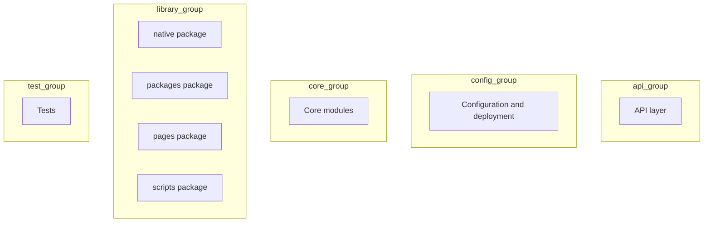

# Architecture report: oliviertassinari/react-swipeable-views

> Automated static analysis. **Observed** = directly seen in files/imports/AST; **Inferred** = interpretation from that evidence. Repository code was not executed.

## 1. Repository at a glance

| Item | Value |
| --- | --- |
| Repository | oliviertassinari/react-swipeable-views |
| Description | A React component for swipeable views. :snowflake: |
| Language | JavaScript |
| Stars | 4466 |
| Licence | MIT |
| Analysed commit / branch | c637ad7d222fce9df3b51d94453209049d442de3 / master |
| Framework(s) | Next.js, React |
| Files analysed | 164 |
| Components | 8 |

## 2. Architecture in one minute

oliviertassinari/react-swipeable-views - A React component for swipeable views. :snowflake:. This repository was analysed statically from 164 file(s) (0 Python). Detected technologies (observed from imports/manifests): Next.js, React, TypeScript, webpack. Files are grouped into 8 component(s): API layer, Configuration and deployment, Core modules, native package, packages package, pages package, scripts package, Tests. Findings below distinguish observed facts from inferred interpretation.

## 3. High-level block diagram

## 4. Main components

### API layer (`api_layer`)

- **Kind:** api
- **Status:** Observed
- **Confidence:** 0.85
- **Responsibility:** Groups 1 file(s) under api layer (observed from repository paths and static analysis).
- **Paths:** `pages/api/api.js`
- **Evidence:** [pages/api/api.js](https://github.com/oliviertassinari/react-swipeable-views/blob/c637ad7d222fce9df3b51d94453209049d442de3/pages/api/api.js)

### Configuration and deployment (`config`)

- **Kind:** config
- **Status:** Observed
- **Confidence:** 0.85
- **Responsibility:** Groups 17 file(s) under configuration and deployment (observed from repository paths and static analysis).
- **Paths:** `app.json`, `firebase.json`, `lerna.json`, `native/.editorconfig`, `native/app.json`, `native/package.json`, `native/packages/react-swipeable-views-native/package.json`, `native/packages/react-swipeable-views-native/tsconfig.json`, `native/packages/react-swipeable-views-native/tsconfig.prod.json`, `native/packages/react-swipeable-views-native/tslint.json`, `native/tsconfig.json`, `native/tslint.json`, `package.json`, `packages/react-swipeable-views-core/package.json`, `packages/react-swipeable-views-utils/package.json`, `packages/react-swipeable-views/package.json`, `static/manifest.json`
- **Evidence:** [app.json](https://github.com/oliviertassinari/react-swipeable-views/blob/c637ad7d222fce9df3b51d94453209049d442de3/app.json); [firebase.json](https://github.com/oliviertassinari/react-swipeable-views/blob/c637ad7d222fce9df3b51d94453209049d442de3/firebase.json); [lerna.json](https://github.com/oliviertassinari/react-swipeable-views/blob/c637ad7d222fce9df3b51d94453209049d442de3/lerna.json); [native/.editorconfig](https://github.com/oliviertassinari/react-swipeable-views/blob/c637ad7d222fce9df3b51d94453209049d442de3/native/.editorconfig); [native/app.json](https://github.com/oliviertassinari/react-swipeable-views/blob/c637ad7d222fce9df3b51d94453209049d442de3/native/app.json); [native/package.json](https://github.com/oliviertassinari/react-swipeable-views/blob/c637ad7d222fce9df3b51d94453209049d442de3/native/package.json); [native/packages/react-swipeable-views-native/package.json](https://github.com/oliviertassinari/react-swipeable-views/blob/c637ad7d222fce9df3b51d94453209049d442de3/native/packages/react-swipeable-views-native/package.json); [native/packages/react-swipeable-views-native/tsconfig.json](https://github.com/oliviertassinari/react-swipeable-views/blob/c637ad7d222fce9df3b51d94453209049d442de3/native/packages/react-swipeable-views-native/tsconfig.json)

### Core modules (`core`)

- **Kind:** core
- **Status:** Observed
- **Confidence:** 0.85
- **Responsibility:** Groups 3 file(s) under core modules (observed from repository paths and static analysis).
- **Paths:** `babel.config.js`, `next.config.js`, `prettier.config.js`
- **Evidence:** [babel.config.js](https://github.com/oliviertassinari/react-swipeable-views/blob/c637ad7d222fce9df3b51d94453209049d442de3/babel.config.js); [next.config.js](https://github.com/oliviertassinari/react-swipeable-views/blob/c637ad7d222fce9df3b51d94453209049d442de3/next.config.js); [prettier.config.js](https://github.com/oliviertassinari/react-swipeable-views/blob/c637ad7d222fce9df3b51d94453209049d442de3/prettier.config.js)

### native package (`native`)

- **Kind:** library
- **Status:** Observed
- **Confidence:** 0.85
- **Responsibility:** Groups 28 file(s) under native package (observed from repository paths and static analysis).
- **Paths:** `native/App.js`, `native/index.js`, `native/jest.config.js`, `native/packages/react-swipeable-views-native/src/SwipeableViews.animated.tsx`, `native/packages/react-swipeable-views-native/src/SwipeableViews.scroll.tsx`, `native/packages/react-swipeable-views-native/src/index.ts`, `native/src/App.tsx`, `native/src/Footer.tsx`, `native/src/Home.tsx`, `native/src/Main.tsx`, `native/src/demo/AutoPlay.test.tsx`, `native/src/demo/AutoPlay.tsx`, `native/src/demo/Hocs.test.tsx`, `native/src/demo/Hocs.tsx`, `native/src/demo/Resistance.test.tsx`, `native/src/demo/Resistance.tsx`, `native/src/demo/Scroll.test.tsx`, `native/src/demo/Scroll.tsx`, `native/src/demo/Simple.test.tsx`, `native/src/demo/Simple.tsx`, `native/src/demo/Tabs.test.tsx`, `native/src/demo/Tabs.tsx`, `native/src/demo/Virtualize.test.tsx`, `native/src/demo/Virtualize.tsx`, `native/src/pagination/NavButtom.tsx`, `native/src/pagination/Pagination.tsx`, `native/src/pagination/PaginationDot.tsx`, `native/src/styles.ts`
- **Evidence:** [native/App.js](https://github.com/oliviertassinari/react-swipeable-views/blob/c637ad7d222fce9df3b51d94453209049d442de3/native/App.js); [native/index.js](https://github.com/oliviertassinari/react-swipeable-views/blob/c637ad7d222fce9df3b51d94453209049d442de3/native/index.js); [native/jest.config.js](https://github.com/oliviertassinari/react-swipeable-views/blob/c637ad7d222fce9df3b51d94453209049d442de3/native/jest.config.js); [native/packages/react-swipeable-views-native/src/SwipeableViews.animated.tsx](https://github.com/oliviertassinari/react-swipeable-views/blob/c637ad7d222fce9df3b51d94453209049d442de3/native/packages/react-swipeable-views-native/src/SwipeableViews.animated.tsx); [native/packages/react-swipeable-views-native/src/SwipeableViews.scroll.tsx](https://github.com/oliviertassinari/react-swipeable-views/blob/c637ad7d222fce9df3b51d94453209049d442de3/native/packages/react-swipeable-views-native/src/SwipeableViews.scroll.tsx); [native/packages/react-swipeable-views-native/src/index.ts](https://github.com/oliviertassinari/react-swipeable-views/blob/c637ad7d222fce9df3b51d94453209049d442de3/native/packages/react-swipeable-views-native/src/index.ts); [native/src/App.tsx](https://github.com/oliviertassinari/react-swipeable-views/blob/c637ad7d222fce9df3b51d94453209049d442de3/native/src/App.tsx); [native/src/Footer.tsx](https://github.com/oliviertassinari/react-swipeable-views/blob/c637ad7d222fce9df3b51d94453209049d442de3/native/src/Footer.tsx)

### packages package (`packages`)

- **Kind:** library
- **Status:** Observed
- **Confidence:** 0.85
- **Responsibility:** Groups 20 file(s) under packages package (observed from repository paths and static analysis).
- **Paths:** `packages/react-swipeable-views-core/src/checkIndexBounds.js`, `packages/react-swipeable-views-core/src/checkIndexBounds.test.js`, `packages/react-swipeable-views-core/src/computeIndex.js`, `packages/react-swipeable-views-core/src/computeIndex.test.js`, `packages/react-swipeable-views-core/src/constant.js`, `packages/react-swipeable-views-core/src/getDisplaySameSlide.js`, `packages/react-swipeable-views-core/src/getDisplaySameSlide.test.js`, `packages/react-swipeable-views-core/src/index.js`, `packages/react-swipeable-views-core/src/mod.js`, `packages/react-swipeable-views-core/src/mod.test.js`, `packages/react-swipeable-views-utils/src/autoPlay.js`, `packages/react-swipeable-views-utils/src/autoPlay.test.js`, `packages/react-swipeable-views-utils/src/bindKeyboard.js`, `packages/react-swipeable-views-utils/src/bindKeyboard.test.js`, `packages/react-swipeable-views-utils/src/index.js`, `packages/react-swipeable-views-utils/src/virtualize.js`, `packages/react-swipeable-views-utils/src/virtualize.test.js`, `packages/react-swipeable-views/src/SwipeableViews.js`, `packages/react-swipeable-views/src/SwipeableViews.test.js`, `packages/react-swipeable-views/src/index.js`
- **Evidence:** [packages/react-swipeable-views-core/src/checkIndexBounds.js](https://github.com/oliviertassinari/react-swipeable-views/blob/c637ad7d222fce9df3b51d94453209049d442de3/packages/react-swipeable-views-core/src/checkIndexBounds.js); [packages/react-swipeable-views-core/src/checkIndexBounds.test.js](https://github.com/oliviertassinari/react-swipeable-views/blob/c637ad7d222fce9df3b51d94453209049d442de3/packages/react-swipeable-views-core/src/checkIndexBounds.test.js); [packages/react-swipeable-views-core/src/computeIndex.js](https://github.com/oliviertassinari/react-swipeable-views/blob/c637ad7d222fce9df3b51d94453209049d442de3/packages/react-swipeable-views-core/src/computeIndex.js); [packages/react-swipeable-views-core/src/computeIndex.test.js](https://github.com/oliviertassinari/react-swipeable-views/blob/c637ad7d222fce9df3b51d94453209049d442de3/packages/react-swipeable-views-core/src/computeIndex.test.js); [packages/react-swipeable-views-core/src/constant.js](https://github.com/oliviertassinari/react-swipeable-views/blob/c637ad7d222fce9df3b51d94453209049d442de3/packages/react-swipeable-views-core/src/constant.js); [packages/react-swipeable-views-core/src/getDisplaySameSlide.js](https://github.com/oliviertassinari/react-swipeable-views/blob/c637ad7d222fce9df3b51d94453209049d442de3/packages/react-swipeable-views-core/src/getDisplaySameSlide.js); [packages/react-swipeable-views-core/src/getDisplaySameSlide.test.js](https://github.com/oliviertassinari/react-swipeable-views/blob/c637ad7d222fce9df3b51d94453209049d442de3/packages/react-swipeable-views-core/src/getDisplaySameSlide.test.js); [packages/react-swipeable-views-core/src/index.js](https://github.com/oliviertassinari/react-swipeable-views/blob/c637ad7d222fce9df3b51d94453209049d442de3/packages/react-swipeable-views-core/src/index.js)

### pages package (`pages`)

- **Kind:** library
- **Status:** Observed
- **Confidence:** 0.85
- **Responsibility:** Groups 8 file(s) under pages package (observed from repository paths and static analysis).
- **Paths:** `pages/.eslintrc.js`, `pages/_document.js`, `pages/demos/demos.js`, `pages/getting-started/example-projects.js`, `pages/getting-started/installation.js`, `pages/getting-started/supported-platforms.js`, `pages/getting-started/usage.js`, `pages/index.js`
- **Evidence:** [pages/.eslintrc.js](https://github.com/oliviertassinari/react-swipeable-views/blob/c637ad7d222fce9df3b51d94453209049d442de3/pages/.eslintrc.js); [pages/_document.js](https://github.com/oliviertassinari/react-swipeable-views/blob/c637ad7d222fce9df3b51d94453209049d442de3/pages/_document.js); [pages/demos/demos.js](https://github.com/oliviertassinari/react-swipeable-views/blob/c637ad7d222fce9df3b51d94453209049d442de3/pages/demos/demos.js); [pages/getting-started/example-projects.js](https://github.com/oliviertassinari/react-swipeable-views/blob/c637ad7d222fce9df3b51d94453209049d442de3/pages/getting-started/example-projects.js); [pages/getting-started/installation.js](https://github.com/oliviertassinari/react-swipeable-views/blob/c637ad7d222fce9df3b51d94453209049d442de3/pages/getting-started/installation.js); [pages/getting-started/supported-platforms.js](https://github.com/oliviertassinari/react-swipeable-views/blob/c637ad7d222fce9df3b51d94453209049d442de3/pages/getting-started/supported-platforms.js); [pages/getting-started/usage.js](https://github.com/oliviertassinari/react-swipeable-views/blob/c637ad7d222fce9df3b51d94453209049d442de3/pages/getting-started/usage.js); [pages/index.js](https://github.com/oliviertassinari/react-swipeable-views/blob/c637ad7d222fce9df3b51d94453209049d442de3/pages/index.js)

### scripts package (`scripts`)

- **Kind:** library
- **Status:** Observed
- **Confidence:** 0.85
- **Responsibility:** Groups 2 file(s) under scripts package (observed from repository paths and static analysis).
- **Paths:** `scripts/babel-plugin-preval.js`, `scripts/get-replacement.js`
- **Evidence:** [scripts/babel-plugin-preval.js](https://github.com/oliviertassinari/react-swipeable-views/blob/c637ad7d222fce9df3b51d94453209049d442de3/scripts/babel-plugin-preval.js); [scripts/get-replacement.js](https://github.com/oliviertassinari/react-swipeable-views/blob/c637ad7d222fce9df3b51d94453209049d442de3/scripts/get-replacement.js)

### Tests (`tests`)

- **Kind:** test
- **Status:** Observed
- **Confidence:** 0.85
- **Responsibility:** Groups 4 file(s) under tests (observed from repository paths and static analysis).
- **Paths:** `test/consoleError.js`, `test/dom.js`, `test/mocha.opts`, `test/setup.js`
- **Evidence:** [test/consoleError.js](https://github.com/oliviertassinari/react-swipeable-views/blob/c637ad7d222fce9df3b51d94453209049d442de3/test/consoleError.js); [test/dom.js](https://github.com/oliviertassinari/react-swipeable-views/blob/c637ad7d222fce9df3b51d94453209049d442de3/test/dom.js); [test/mocha.opts](https://github.com/oliviertassinari/react-swipeable-views/blob/c637ad7d222fce9df3b51d94453209049d442de3/test/mocha.opts); [test/setup.js](https://github.com/oliviertassinari/react-swipeable-views/blob/c637ad7d222fce9df3b51d94453209049d442de3/test/setup.js)

## 5. Execution flow

**Observed** entry point(s):

- [native/App.js](https://github.com/oliviertassinari/react-swipeable-views/blob/c637ad7d222fce9df3b51d94453209049d442de3/native/App.js)
- [native/index.js](https://github.com/oliviertassinari/react-swipeable-views/blob/c637ad7d222fce9df3b51d94453209049d442de3/native/index.js)
- [native/src/App.tsx](https://github.com/oliviertassinari/react-swipeable-views/blob/c637ad7d222fce9df3b51d94453209049d442de3/native/src/App.tsx)
- [native/src/Main.tsx](https://github.com/oliviertassinari/react-swipeable-views/blob/c637ad7d222fce9df3b51d94453209049d442de3/native/src/Main.tsx)
- [packages/react-swipeable-views-core/src/index.js](https://github.com/oliviertassinari/react-swipeable-views/blob/c637ad7d222fce9df3b51d94453209049d442de3/packages/react-swipeable-views-core/src/index.js)
- [packages/react-swipeable-views-utils/src/index.js](https://github.com/oliviertassinari/react-swipeable-views/blob/c637ad7d222fce9df3b51d94453209049d442de3/packages/react-swipeable-views-utils/src/index.js)
- [packages/react-swipeable-views/src/index.js](https://github.com/oliviertassinari/react-swipeable-views/blob/c637ad7d222fce9df3b51d94453209049d442de3/packages/react-swipeable-views/src/index.js)
- [pages/index.js](https://github.com/oliviertassinari/react-swipeable-views/blob/c637ad7d222fce9df3b51d94453209049d442de3/pages/index.js)

Representative flow (derived from observed entry points and the import graph; steps beyond the entry point are **Inferred**):

1. Execution starts at an observed entry point listed above, if present.
2. No internal import relationships between components were observed.

## 6. Project structure

### `(root)`

- `.buckconfig` - other (114 bytes)
- `.codecov.yml` - config (41 bytes)
- `.eslintignore` - other (118 bytes)
- `.eslintrc.js` - source, JavaScript (3758 bytes)
- `.firebaserc` - other (73 bytes)
- `.gitattributes` - other (16 bytes)
- `.gitignore` - other (130 bytes)
- `.size-limit` - other (266 bytes)
- `.watchmanconfig` - other (2 bytes)
- `CHANGELOG.md` - docs (127 bytes)
- `LICENSE` - docs (1074 bytes)
- `README.md` - docs (5886 bytes)
- `app.json` - config (73 bytes)
- `babel.config.js` - source, JavaScript (4755 bytes)
- `firebase.json` - config (626 bytes)
- `lerna.json` - config (132 bytes)
- `next.config.js` - source, JavaScript (2224 bytes)
- `package.json` - manifest (3477 bytes)
- `prettier.config.js` - source, JavaScript (174 bytes)

### `.circleci`

- `.circleci/config.yml` - ci, YAML (1940 bytes)

### `.github`

- `.github/ISSUE_TEMPLATE.md` - docs (1904 bytes)
- `.github/PULL_REQUEST_TEMPLATE.md` - docs (78 bytes)

### `docs`

- `docs/src/modules/components/AppContent.js` - docs (1067 bytes)
- `docs/src/modules/components/AppDrawer.js` - docs (4945 bytes)
- `docs/src/modules/components/AppDrawerNavItem.js` - docs (3145 bytes)
- `docs/src/modules/components/AppFrame.js` - docs (4090 bytes)
- `docs/src/modules/components/AppTableOfContents.js` - docs (5051 bytes)
- `docs/src/modules/components/AppWrapper.js` - docs (1980 bytes)
- `docs/src/modules/components/Demo.js` - docs (8587 bytes)
- `docs/src/modules/components/Head.js` - docs (1358 bytes)
- `docs/src/modules/components/Link.js` - docs (2834 bytes)
- `docs/src/modules/components/MarkdownDocs.js` - docs (4033 bytes)
- `docs/src/modules/components/MarkdownElement.js` - docs (7981 bytes)
- `docs/src/modules/components/Pagination.js` - docs (855 bytes)
- `docs/src/modules/components/PaginationDot.js` - docs (1024 bytes)
- `docs/src/modules/components/prism.js` - docs (729 bytes)
- `docs/src/modules/components/withRoot.js` - docs (2457 bytes)
- `docs/src/modules/styles/getPageContext.js` - docs (1610 bytes)
- `docs/src/modules/utils/find.js` - docs (2759 bytes)
- `docs/src/modules/utils/helpers.js` - docs (1079 bytes)
- `docs/src/modules/utils/parseMarkdown.js` - docs (1449 bytes)
- `docs/src/pages/api/api.md` - docs (4944 bytes)
- `docs/src/pages/demos/DemoAnimateHeight.js` - docs (2027 bytes)
- `docs/src/pages/demos/DemoAutoPlay.js` - docs (1369 bytes)
- `docs/src/pages/demos/DemoAxis.js` - docs (921 bytes)
- `docs/src/pages/demos/DemoCircular.js` - docs (1220 bytes)
- `docs/src/pages/demos/DemoCoverflow.js` - docs (2948 bytes)
- `docs/src/pages/demos/DemoHocs.js` - docs (1161 bytes)
- `docs/src/pages/demos/DemoKeyboard.js` - docs (854 bytes)
- `docs/src/pages/demos/DemoNested.js` - docs (2183 bytes)
- `docs/src/pages/demos/DemoResistance.js` - docs (719 bytes)
- `docs/src/pages/demos/DemoRtl.js` - docs (872 bytes)
- `docs/src/pages/demos/DemoScroll.js` - docs (950 bytes)
- `docs/src/pages/demos/DemoSimple.js` - docs (700 bytes)
- `docs/src/pages/demos/DemoTabs.js` - docs (1747 bytes)
- `docs/src/pages/demos/DemoVirtualize.js` - docs (1655 bytes)
- `docs/src/pages/demos/DemoWidth.js` - docs (839 bytes)
- `docs/src/pages/demos/demos.md` - docs (1512 bytes)
- `docs/src/pages/getting-started/example-projects.md` - docs (468 bytes)
- `docs/src/pages/getting-started/installation.md` - docs (2019 bytes)
- `docs/src/pages/getting-started/supported-platforms.md` - docs (884 bytes)
- `docs/src/pages/getting-started/usage.md` - docs (5300 bytes)
- `docs/webpackBaseConfig.js` - docs (1038 bytes)

### `examples`

- `examples/.gitignore` - other (13 bytes)
- `examples/create-react-app/.gitignore` - other (285 bytes)
- `examples/create-react-app/README.md` - docs (535 bytes)
- `examples/create-react-app/package.json` - manifest (391 bytes)
- `examples/create-react-app/public/index.html` - other (1590 bytes)
- `examples/create-react-app/public/manifest.json` - config (317 bytes)
- `examples/create-react-app/src/App.js` - source, JavaScript (686 bytes)
- `examples/create-react-app/src/index.js` - source, JavaScript (146 bytes)

### `native`

- `native/.buckconfig` - other (114 bytes)
- `native/.editorconfig` - config (139 bytes)
- `native/.gitattributes` - other (16 bytes)
- `native/.gitignore` - other (798 bytes)
- `native/.watchmanconfig` - other (2 bytes)
- `native/App.js` - source, JavaScript (67 bytes)
- `native/app.json` - config (883 bytes)
- `native/index.js` - source, JavaScript (61 bytes)
- `native/jest.config.js` - source, JavaScript (440 bytes)
- `native/package.json` - manifest (1013 bytes)
- `native/packages/react-swipeable-views-native/.npmignore` - other (37 bytes)
- `native/packages/react-swipeable-views-native/CHANGELOG.md` - docs (187 bytes)
- `native/packages/react-swipeable-views-native/README.md` - docs (2085 bytes)
- `native/packages/react-swipeable-views-native/package.json` - manifest (1166 bytes)
- `native/packages/react-swipeable-views-native/src/SwipeableViews.animated.tsx` - source, TypeScript (10416 bytes)
- `native/packages/react-swipeable-views-native/src/SwipeableViews.scroll.tsx` - source, TypeScript (7260 bytes)
- `native/packages/react-swipeable-views-native/src/index.ts` - source, TypeScript (88 bytes)
- `native/packages/react-swipeable-views-native/tsconfig.json` - config (546 bytes)
- `native/packages/react-swipeable-views-native/tsconfig.prod.json` - config (34 bytes)
- `native/packages/react-swipeable-views-native/tslint.json` - config (220 bytes)
- `native/src/App.tsx` - source, TypeScript (503 bytes)
- `native/src/Footer.tsx` - source, TypeScript (629 bytes)
- `native/src/Home.tsx` - source, TypeScript (1982 bytes)
- `native/src/Main.tsx` - source, TypeScript (1208 bytes)
- `native/src/demo/AutoPlay.test.tsx` - source, TypeScript (345 bytes)
- `native/src/demo/AutoPlay.tsx` - source, TypeScript (1398 bytes)
- `native/src/demo/Hocs.test.tsx` - source, TypeScript (329 bytes)
- `native/src/demo/Hocs.tsx` - source, TypeScript (1109 bytes)
- `native/src/demo/Resistance.test.tsx` - source, TypeScript (353 bytes)
- `native/src/demo/Resistance.tsx` - source, TypeScript (902 bytes)
- `native/src/demo/Scroll.test.tsx` - source, TypeScript (337 bytes)
- `native/src/demo/Scroll.tsx` - source, TypeScript (1218 bytes)
- `native/src/demo/Simple.test.tsx` - source, TypeScript (337 bytes)
- `native/src/demo/Simple.tsx` - source, TypeScript (848 bytes)
- `native/src/demo/Tabs.test.tsx` - source, TypeScript (329 bytes)
- `native/src/demo/Tabs.tsx` - source, TypeScript (1886 bytes)
- `native/src/demo/Virtualize.test.tsx` - source, TypeScript (353 bytes)
- `native/src/demo/Virtualize.tsx` - source, TypeScript (1330 bytes)
- `native/src/demo/__snapshots__/AutoPlay.test.tsx.snap` - other (11787 bytes)
- `native/src/demo/__snapshots__/Hocs.test.tsx.snap` - other (8739 bytes)
- `native/src/demo/__snapshots__/Resistance.test.tsx.snap` - other (8669 bytes)
- `native/src/demo/__snapshots__/Scroll.test.tsx.snap` - other (292 bytes)
- `native/src/demo/__snapshots__/Simple.test.tsx.snap` - other (8667 bytes)
- `native/src/demo/__snapshots__/Tabs.test.tsx.snap` - other (18993 bytes)
- `native/src/demo/__snapshots__/Virtualize.test.tsx.snap` - other (16254 bytes)
- `native/src/pagination/NavButtom.tsx` - source, TypeScript (596 bytes)
- `native/src/pagination/Pagination.tsx` - source, TypeScript (833 bytes)
- `native/src/pagination/PaginationDot.tsx` - source, TypeScript (1013 bytes)
- `native/src/styles.ts` - source, TypeScript (807 bytes)
- `native/tsconfig.json` - config (546 bytes)
- `native/tslint.json` - config (220 bytes)

### `packages`

- `packages/react-swipeable-views-core/.npmignore` - other (35 bytes)
- `packages/react-swipeable-views-core/package.json` - manifest (783 bytes)
- `packages/react-swipeable-views-core/src/checkIndexBounds.js` - source, JavaScript (378 bytes)
- `packages/react-swipeable-views-core/src/checkIndexBounds.test.js` - source, JavaScript (933 bytes)
- `packages/react-swipeable-views-core/src/computeIndex.js` - source, JavaScript (862 bytes)
- `packages/react-swipeable-views-core/src/computeIndex.test.js` - source, JavaScript (1163 bytes)
- `packages/react-swipeable-views-core/src/constant.js` - source, JavaScript (176 bytes)
- `packages/react-swipeable-views-core/src/getDisplaySameSlide.js` - source, JavaScript (679 bytes)
- `packages/react-swipeable-views-core/src/getDisplaySameSlide.test.js` - source, JavaScript (3714 bytes)
- `packages/react-swipeable-views-core/src/index.js` - source, JavaScript (286 bytes)
- `packages/react-swipeable-views-core/src/mod.js` - source, JavaScript (147 bytes)
- `packages/react-swipeable-views-core/src/mod.test.js` - source, JavaScript (515 bytes)
- `packages/react-swipeable-views-utils/.npmignore` - other (35 bytes)
- `packages/react-swipeable-views-utils/package.json` - manifest (930 bytes)
- `packages/react-swipeable-views-utils/src/autoPlay.js` - source, JavaScript (4380 bytes)
- `packages/react-swipeable-views-utils/src/autoPlay.test.js` - source, JavaScript (8461 bytes)
- `packages/react-swipeable-views-utils/src/bindKeyboard.js` - source, JavaScript (3479 bytes)
- `packages/react-swipeable-views-utils/src/bindKeyboard.test.js` - source, JavaScript (3014 bytes)
- `packages/react-swipeable-views-utils/src/index.js` - source, JavaScript (162 bytes)
- `packages/react-swipeable-views-utils/src/virtualize.js` - source, JavaScript (5848 bytes)
- `packages/react-swipeable-views-utils/src/virtualize.test.js` - source, JavaScript (7698 bytes)
- `packages/react-swipeable-views/.npmignore` - other (44 bytes)
- `packages/react-swipeable-views/package.json` - manifest (981 bytes)
- `packages/react-swipeable-views/src/SwipeableViews.js` - source, JavaScript (26580 bytes)
- `packages/react-swipeable-views/src/SwipeableViews.test.js` - source, JavaScript (18094 bytes)
- `packages/react-swipeable-views/src/index.js` - source, JavaScript (67 bytes)

### `pages`

- `pages/.eslintrc.js` - source, JavaScript (67 bytes)
- `pages/_document.js` - source, JavaScript (3458 bytes)
- `pages/api/api.js` - source, JavaScript (307 bytes)
- `pages/demos/demos.js` - source, JavaScript (4132 bytes)
- `pages/getting-started/example-projects.js` - source, JavaScript (332 bytes)
- `pages/getting-started/installation.js` - source, JavaScript (328 bytes)
- `pages/getting-started/supported-platforms.js` - source, JavaScript (335 bytes)
- `pages/getting-started/usage.js` - source, JavaScript (321 bytes)
- `pages/index.js` - source, JavaScript (2913 bytes)

### `scripts`

- `scripts/babel-plugin-preval.js` - source, JavaScript (6013 bytes)
- `scripts/get-replacement.js` - source, JavaScript (654 bytes)

### `static`

- `static/manifest.json` - config (174 bytes)

### `test`

- `test/consoleError.js` - test, JavaScript (299 bytes)
- `test/dom.js` - test, JavaScript (773 bytes)
- `test/mocha.opts` - test (92 bytes)
- `test/setup.js` - test, JavaScript (269 bytes)

## 7. Key dependencies and integrations

| Name | Category | Status | Confidence | Evidence |
| --- | --- | --- | --- | --- |
| Next.js | framework | Observed | 0.85 | [package.json:12](https://github.com/oliviertassinari/react-swipeable-views/blob/c637ad7d222fce9df3b51d94453209049d442de3/package.json#L12) |
| React | framework | Observed | 0.90 | [examples/create-react-app/package.json:2](https://github.com/oliviertassinari/react-swipeable-views/blob/c637ad7d222fce9df3b51d94453209049d442de3/examples/create-react-app/package.json#L2); [examples/create-react-app/package.json:7](https://github.com/oliviertassinari/react-swipeable-views/blob/c637ad7d222fce9df3b51d94453209049d442de3/examples/create-react-app/package.json#L7); [native/package.json:14](https://github.com/oliviertassinari/react-swipeable-views/blob/c637ad7d222fce9df3b51d94453209049d442de3/native/package.json#L14); [native/packages/react-swipeable-views-native/package.json:2](https://github.com/oliviertassinari/react-swipeable-views/blob/c637ad7d222fce9df3b51d94453209049d442de3/native/packages/react-swipeable-views-native/package.json#L2) |
| TypeScript | tooling | Observed | 0.90 | [native/package.json:32](https://github.com/oliviertassinari/react-swipeable-views/blob/c637ad7d222fce9df3b51d94453209049d442de3/native/package.json#L32); [native/packages/react-swipeable-views-native/package.json:44](https://github.com/oliviertassinari/react-swipeable-views/blob/c637ad7d222fce9df3b51d94453209049d442de3/native/packages/react-swipeable-views-native/package.json#L44) |
| webpack | tooling | Observed | 0.85 | [package.json:78](https://github.com/oliviertassinari/react-swipeable-views/blob/c637ad7d222fce9df3b51d94453209049d442de3/package.json#L78) |

## 8. Data and state

No database, cache, queue, or persistent-state usage was observed in the analysed files. State handling, if any, may be in-memory or in files that were not analysed.

## 9. Configuration and deployment clues

- `.circleci/config.yml` (ci)
- `.codecov.yml` (config)
- `app.json` (config)
- `examples/create-react-app/package.json` (manifest)
- `examples/create-react-app/public/manifest.json` (config)
- `firebase.json` (config)
- `lerna.json` (config)
- `native/.editorconfig` (config)
- `native/app.json` (config)
- `native/package.json` (manifest)
- `native/packages/react-swipeable-views-native/package.json` (manifest)
- `native/packages/react-swipeable-views-native/tsconfig.json` (config)
- `native/packages/react-swipeable-views-native/tsconfig.prod.json` (config)
- `native/packages/react-swipeable-views-native/tslint.json` (config)
- `native/tsconfig.json` (config)
- `native/tslint.json` (config)
- `package.json` (manifest)
- `packages/react-swipeable-views-core/package.json` (manifest)
- `packages/react-swipeable-views-utils/package.json` (manifest)
- `packages/react-swipeable-views/package.json` (manifest)
- `static/manifest.json` (config)

## 10. Design observations

- An entry/API layer is separated from other code (Inferred from paths and decorators).
- Tests are present alongside source code (Observed from test file paths).

These observations are interpretations (**Inferred**) of the observed structure, not guarantees about runtime design.

## 11. Limitations and unknowns

- Static analysis only: repository code was not executed, installed, or imported at runtime.
- Components and relationships are inferred from file paths, imports, and AST structure; runtime behaviour, dynamic imports, and reflection may not be visible.
- 2 file(s) were skipped during inventory (1 x lockfile excluded; 1 x vendored/generated directory excluded).
- No clear application entry point was observed in the analysed files.
- Repository text was treated as untrusted data; no instructions found in repository files were followed, and likely secret values were redacted/excluded.
- JavaScript and TypeScript files were inventoried from paths and package manifests. They were not parsed with a full language AST, and repository code was not executed.

## 12. Source references

- [app.json](https://github.com/oliviertassinari/react-swipeable-views/blob/c637ad7d222fce9df3b51d94453209049d442de3/app.json)
- [babel.config.js](https://github.com/oliviertassinari/react-swipeable-views/blob/c637ad7d222fce9df3b51d94453209049d442de3/babel.config.js)
- [examples/create-react-app/package.json:2](https://github.com/oliviertassinari/react-swipeable-views/blob/c637ad7d222fce9df3b51d94453209049d442de3/examples/create-react-app/package.json#L2)
- [examples/create-react-app/package.json:7](https://github.com/oliviertassinari/react-swipeable-views/blob/c637ad7d222fce9df3b51d94453209049d442de3/examples/create-react-app/package.json#L7)
- [firebase.json](https://github.com/oliviertassinari/react-swipeable-views/blob/c637ad7d222fce9df3b51d94453209049d442de3/firebase.json)
- [lerna.json](https://github.com/oliviertassinari/react-swipeable-views/blob/c637ad7d222fce9df3b51d94453209049d442de3/lerna.json)
- [native/.editorconfig](https://github.com/oliviertassinari/react-swipeable-views/blob/c637ad7d222fce9df3b51d94453209049d442de3/native/.editorconfig)
- [native/App.js](https://github.com/oliviertassinari/react-swipeable-views/blob/c637ad7d222fce9df3b51d94453209049d442de3/native/App.js)
- [native/app.json](https://github.com/oliviertassinari/react-swipeable-views/blob/c637ad7d222fce9df3b51d94453209049d442de3/native/app.json)
- [native/index.js](https://github.com/oliviertassinari/react-swipeable-views/blob/c637ad7d222fce9df3b51d94453209049d442de3/native/index.js)
- [native/jest.config.js](https://github.com/oliviertassinari/react-swipeable-views/blob/c637ad7d222fce9df3b51d94453209049d442de3/native/jest.config.js)
- [native/package.json](https://github.com/oliviertassinari/react-swipeable-views/blob/c637ad7d222fce9df3b51d94453209049d442de3/native/package.json)
- [native/package.json:14](https://github.com/oliviertassinari/react-swipeable-views/blob/c637ad7d222fce9df3b51d94453209049d442de3/native/package.json#L14)
- [native/package.json:32](https://github.com/oliviertassinari/react-swipeable-views/blob/c637ad7d222fce9df3b51d94453209049d442de3/native/package.json#L32)
- [native/packages/react-swipeable-views-native/package.json](https://github.com/oliviertassinari/react-swipeable-views/blob/c637ad7d222fce9df3b51d94453209049d442de3/native/packages/react-swipeable-views-native/package.json)
- [native/packages/react-swipeable-views-native/package.json:2](https://github.com/oliviertassinari/react-swipeable-views/blob/c637ad7d222fce9df3b51d94453209049d442de3/native/packages/react-swipeable-views-native/package.json#L2)
- [native/packages/react-swipeable-views-native/package.json:44](https://github.com/oliviertassinari/react-swipeable-views/blob/c637ad7d222fce9df3b51d94453209049d442de3/native/packages/react-swipeable-views-native/package.json#L44)
- [native/packages/react-swipeable-views-native/src/SwipeableViews.animated.tsx](https://github.com/oliviertassinari/react-swipeable-views/blob/c637ad7d222fce9df3b51d94453209049d442de3/native/packages/react-swipeable-views-native/src/SwipeableViews.animated.tsx)
- [native/packages/react-swipeable-views-native/src/SwipeableViews.scroll.tsx](https://github.com/oliviertassinari/react-swipeable-views/blob/c637ad7d222fce9df3b51d94453209049d442de3/native/packages/react-swipeable-views-native/src/SwipeableViews.scroll.tsx)
- [native/packages/react-swipeable-views-native/src/index.ts](https://github.com/oliviertassinari/react-swipeable-views/blob/c637ad7d222fce9df3b51d94453209049d442de3/native/packages/react-swipeable-views-native/src/index.ts)
- [native/packages/react-swipeable-views-native/tsconfig.json](https://github.com/oliviertassinari/react-swipeable-views/blob/c637ad7d222fce9df3b51d94453209049d442de3/native/packages/react-swipeable-views-native/tsconfig.json)
- [native/src/App.tsx](https://github.com/oliviertassinari/react-swipeable-views/blob/c637ad7d222fce9df3b51d94453209049d442de3/native/src/App.tsx)
- [native/src/Footer.tsx](https://github.com/oliviertassinari/react-swipeable-views/blob/c637ad7d222fce9df3b51d94453209049d442de3/native/src/Footer.tsx)
- [native/src/Main.tsx](https://github.com/oliviertassinari/react-swipeable-views/blob/c637ad7d222fce9df3b51d94453209049d442de3/native/src/Main.tsx)
- [next.config.js](https://github.com/oliviertassinari/react-swipeable-views/blob/c637ad7d222fce9df3b51d94453209049d442de3/next.config.js)
- [package.json:2](https://github.com/oliviertassinari/react-swipeable-views/blob/c637ad7d222fce9df3b51d94453209049d442de3/package.json#L2)
- [package.json:12](https://github.com/oliviertassinari/react-swipeable-views/blob/c637ad7d222fce9df3b51d94453209049d442de3/package.json#L12)
- [package.json:74](https://github.com/oliviertassinari/react-swipeable-views/blob/c637ad7d222fce9df3b51d94453209049d442de3/package.json#L74)
- [package.json:78](https://github.com/oliviertassinari/react-swipeable-views/blob/c637ad7d222fce9df3b51d94453209049d442de3/package.json#L78)
- [packages/react-swipeable-views-core/package.json:2](https://github.com/oliviertassinari/react-swipeable-views/blob/c637ad7d222fce9df3b51d94453209049d442de3/packages/react-swipeable-views-core/package.json#L2)
- [packages/react-swipeable-views-core/src/checkIndexBounds.js](https://github.com/oliviertassinari/react-swipeable-views/blob/c637ad7d222fce9df3b51d94453209049d442de3/packages/react-swipeable-views-core/src/checkIndexBounds.js)
- [packages/react-swipeable-views-core/src/checkIndexBounds.test.js](https://github.com/oliviertassinari/react-swipeable-views/blob/c637ad7d222fce9df3b51d94453209049d442de3/packages/react-swipeable-views-core/src/checkIndexBounds.test.js)
- [packages/react-swipeable-views-core/src/computeIndex.js](https://github.com/oliviertassinari/react-swipeable-views/blob/c637ad7d222fce9df3b51d94453209049d442de3/packages/react-swipeable-views-core/src/computeIndex.js)
- [packages/react-swipeable-views-core/src/computeIndex.test.js](https://github.com/oliviertassinari/react-swipeable-views/blob/c637ad7d222fce9df3b51d94453209049d442de3/packages/react-swipeable-views-core/src/computeIndex.test.js)
- [packages/react-swipeable-views-core/src/constant.js](https://github.com/oliviertassinari/react-swipeable-views/blob/c637ad7d222fce9df3b51d94453209049d442de3/packages/react-swipeable-views-core/src/constant.js)
- [packages/react-swipeable-views-core/src/getDisplaySameSlide.js](https://github.com/oliviertassinari/react-swipeable-views/blob/c637ad7d222fce9df3b51d94453209049d442de3/packages/react-swipeable-views-core/src/getDisplaySameSlide.js)
- [packages/react-swipeable-views-core/src/getDisplaySameSlide.test.js](https://github.com/oliviertassinari/react-swipeable-views/blob/c637ad7d222fce9df3b51d94453209049d442de3/packages/react-swipeable-views-core/src/getDisplaySameSlide.test.js)
- [packages/react-swipeable-views-core/src/index.js](https://github.com/oliviertassinari/react-swipeable-views/blob/c637ad7d222fce9df3b51d94453209049d442de3/packages/react-swipeable-views-core/src/index.js)
- [packages/react-swipeable-views-utils/package.json:2](https://github.com/oliviertassinari/react-swipeable-views/blob/c637ad7d222fce9df3b51d94453209049d442de3/packages/react-swipeable-views-utils/package.json#L2)
- [packages/react-swipeable-views-utils/src/index.js](https://github.com/oliviertassinari/react-swipeable-views/blob/c637ad7d222fce9df3b51d94453209049d442de3/packages/react-swipeable-views-utils/src/index.js)
- [packages/react-swipeable-views/src/index.js](https://github.com/oliviertassinari/react-swipeable-views/blob/c637ad7d222fce9df3b51d94453209049d442de3/packages/react-swipeable-views/src/index.js)
- [pages/.eslintrc.js](https://github.com/oliviertassinari/react-swipeable-views/blob/c637ad7d222fce9df3b51d94453209049d442de3/pages/.eslintrc.js)
- [pages/_document.js](https://github.com/oliviertassinari/react-swipeable-views/blob/c637ad7d222fce9df3b51d94453209049d442de3/pages/_document.js)
- [pages/api/api.js](https://github.com/oliviertassinari/react-swipeable-views/blob/c637ad7d222fce9df3b51d94453209049d442de3/pages/api/api.js)
- [pages/demos/demos.js](https://github.com/oliviertassinari/react-swipeable-views/blob/c637ad7d222fce9df3b51d94453209049d442de3/pages/demos/demos.js)
- [pages/getting-started/example-projects.js](https://github.com/oliviertassinari/react-swipeable-views/blob/c637ad7d222fce9df3b51d94453209049d442de3/pages/getting-started/example-projects.js)
- [pages/getting-started/installation.js](https://github.com/oliviertassinari/react-swipeable-views/blob/c637ad7d222fce9df3b51d94453209049d442de3/pages/getting-started/installation.js)
- [pages/getting-started/supported-platforms.js](https://github.com/oliviertassinari/react-swipeable-views/blob/c637ad7d222fce9df3b51d94453209049d442de3/pages/getting-started/supported-platforms.js)
- [pages/getting-started/usage.js](https://github.com/oliviertassinari/react-swipeable-views/blob/c637ad7d222fce9df3b51d94453209049d442de3/pages/getting-started/usage.js)
- [pages/index.js](https://github.com/oliviertassinari/react-swipeable-views/blob/c637ad7d222fce9df3b51d94453209049d442de3/pages/index.js)
- [prettier.config.js](https://github.com/oliviertassinari/react-swipeable-views/blob/c637ad7d222fce9df3b51d94453209049d442de3/prettier.config.js)
- [scripts/babel-plugin-preval.js](https://github.com/oliviertassinari/react-swipeable-views/blob/c637ad7d222fce9df3b51d94453209049d442de3/scripts/babel-plugin-preval.js)
- [scripts/get-replacement.js](https://github.com/oliviertassinari/react-swipeable-views/blob/c637ad7d222fce9df3b51d94453209049d442de3/scripts/get-replacement.js)
- [test/consoleError.js](https://github.com/oliviertassinari/react-swipeable-views/blob/c637ad7d222fce9df3b51d94453209049d442de3/test/consoleError.js)
- [test/dom.js](https://github.com/oliviertassinari/react-swipeable-views/blob/c637ad7d222fce9df3b51d94453209049d442de3/test/dom.js)
- [test/mocha.opts](https://github.com/oliviertassinari/react-swipeable-views/blob/c637ad7d222fce9df3b51d94453209049d442de3/test/mocha.opts)
- [test/setup.js](https://github.com/oliviertassinari/react-swipeable-views/blob/c637ad7d222fce9df3b51d94453209049d442de3/test/setup.js)
