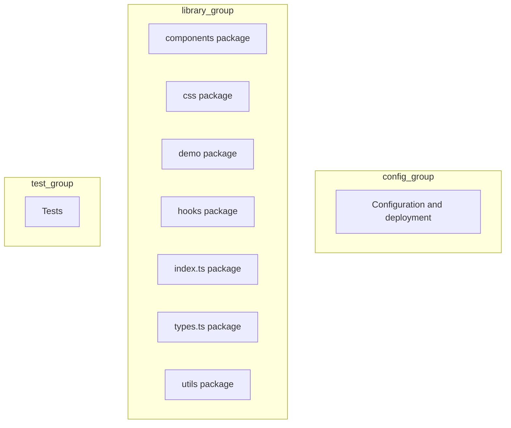

# Architecture report: omgovich/react-colorful

> Automated static analysis. **Observed** = directly seen in files/imports/AST; **Inferred** = interpretation from that evidence. Repository code was not executed.

## 1. Repository at a glance

| Item | Value |
| --- | --- |
| Repository | omgovich/react-colorful |
| Description | 🎨 A tiny (3,1 KB) color picker component for React and Preact apps |
| Language | TypeScript |
| Stars | 3565 |
| Licence | MIT |
| Analysed commit / branch | 5f665a8bbfd735af8a1a4a9ae482b5b54c47c825 / master |
| Framework(s) | React |
| Files analysed | 73 |
| Components | 9 |

## 2. Architecture in one minute

omgovich/react-colorful - 🎨 A tiny (3,1 KB) color picker component for React and Preact apps. This repository was analysed statically from 73 file(s) (0 Python). Detected technologies (observed from imports/manifests): GitHub Actions, React, Jest, TypeScript. Files are grouped into 9 component(s): components package, Configuration and deployment, css package, demo package, hooks package, index.ts package, Tests, types.ts package. Findings below distinguish observed facts from inferred interpretation.

## 3. High-level block diagram

## 4. Main components

### components package (`components`)

- **Kind:** library
- **Status:** Observed
- **Confidence:** 0.85
- **Responsibility:** Groups 23 file(s) under components package (observed from repository paths and static analysis).
- **Paths:** `src/components/HexAlphaColorPicker.tsx`, `src/components/HexColorInput.tsx`, `src/components/HexColorPicker.tsx`, `src/components/HslColorPicker.tsx`, `src/components/HslStringColorPicker.tsx`, `src/components/HslaColorPicker.tsx`, `src/components/HslaStringColorPicker.tsx`, `src/components/HsvColorPicker.tsx`, `src/components/HsvStringColorPicker.tsx`, `src/components/HsvaColorPicker.tsx`, `src/components/HsvaStringColorPicker.tsx`, `src/components/RgbColorPicker.tsx`, `src/components/RgbStringColorPicker.tsx`, `src/components/RgbaColorPicker.tsx`, `src/components/RgbaStringColorPicker.tsx`, `src/components/common/Alpha.tsx`, `src/components/common/AlphaColorPicker.tsx`, `src/components/common/ColorInput.tsx`, `src/components/common/ColorPicker.tsx`, `src/components/common/Hue.tsx`, `src/components/common/Interactive.tsx`, `src/components/common/Pointer.tsx`, `src/components/common/Saturation.tsx`
- **Evidence:** [src/components/HexAlphaColorPicker.tsx](https://github.com/omgovich/react-colorful/blob/5f665a8bbfd735af8a1a4a9ae482b5b54c47c825/src/components/HexAlphaColorPicker.tsx); [src/components/HexColorInput.tsx](https://github.com/omgovich/react-colorful/blob/5f665a8bbfd735af8a1a4a9ae482b5b54c47c825/src/components/HexColorInput.tsx); [src/components/HexColorPicker.tsx](https://github.com/omgovich/react-colorful/blob/5f665a8bbfd735af8a1a4a9ae482b5b54c47c825/src/components/HexColorPicker.tsx); [src/components/HslColorPicker.tsx](https://github.com/omgovich/react-colorful/blob/5f665a8bbfd735af8a1a4a9ae482b5b54c47c825/src/components/HslColorPicker.tsx); [src/components/HslStringColorPicker.tsx](https://github.com/omgovich/react-colorful/blob/5f665a8bbfd735af8a1a4a9ae482b5b54c47c825/src/components/HslStringColorPicker.tsx); [src/components/HslaColorPicker.tsx](https://github.com/omgovich/react-colorful/blob/5f665a8bbfd735af8a1a4a9ae482b5b54c47c825/src/components/HslaColorPicker.tsx); [src/components/HslaStringColorPicker.tsx](https://github.com/omgovich/react-colorful/blob/5f665a8bbfd735af8a1a4a9ae482b5b54c47c825/src/components/HslaStringColorPicker.tsx); [src/components/HsvColorPicker.tsx](https://github.com/omgovich/react-colorful/blob/5f665a8bbfd735af8a1a4a9ae482b5b54c47c825/src/components/HsvColorPicker.tsx)

### Configuration and deployment (`config`)

- **Kind:** config
- **Status:** Observed
- **Confidence:** 0.85
- **Responsibility:** Groups 3 file(s) under configuration and deployment (observed from repository paths and static analysis).
- **Paths:** `package.json`, `tsconfig.build.json`, `tsconfig.json`
- **Evidence:** [package.json](https://github.com/omgovich/react-colorful/blob/5f665a8bbfd735af8a1a4a9ae482b5b54c47c825/package.json); [tsconfig.build.json](https://github.com/omgovich/react-colorful/blob/5f665a8bbfd735af8a1a4a9ae482b5b54c47c825/tsconfig.build.json); [tsconfig.json](https://github.com/omgovich/react-colorful/blob/5f665a8bbfd735af8a1a4a9ae482b5b54c47c825/tsconfig.json)

### css package (`css`)

- **Kind:** library
- **Status:** Observed
- **Confidence:** 0.85
- **Responsibility:** Groups 1 file(s) under css package (observed from repository paths and static analysis).
- **Paths:** `src/css/styles.css.d.ts`
- **Evidence:** [src/css/styles.css.d.ts](https://github.com/omgovich/react-colorful/blob/5f665a8bbfd735af8a1a4a9ae482b5b54c47c825/src/css/styles.css.d.ts)

### demo package (`demo`)

- **Kind:** library
- **Status:** Observed
- **Confidence:** 0.85
- **Responsibility:** Groups 10 file(s) under demo package (observed from repository paths and static analysis).
- **Paths:** `demo/src/components/DevTools.tsx`, `demo/src/components/Icon.tsx`, `demo/src/components/PickerPreview.tsx`, `demo/src/components/ShadowDom.tsx`, `demo/src/hooks/declarations.d.ts`, `demo/src/hooks/useBodyBackground.ts`, `demo/src/hooks/useFaviconColor.ts`, `demo/src/hooks/useStargazerCount.ts`, `demo/src/index.tsx`, `demo/src/styles.ts`
- **Evidence:** [demo/src/components/DevTools.tsx](https://github.com/omgovich/react-colorful/blob/5f665a8bbfd735af8a1a4a9ae482b5b54c47c825/demo/src/components/DevTools.tsx); [demo/src/components/Icon.tsx](https://github.com/omgovich/react-colorful/blob/5f665a8bbfd735af8a1a4a9ae482b5b54c47c825/demo/src/components/Icon.tsx); [demo/src/components/PickerPreview.tsx](https://github.com/omgovich/react-colorful/blob/5f665a8bbfd735af8a1a4a9ae482b5b54c47c825/demo/src/components/PickerPreview.tsx); [demo/src/components/ShadowDom.tsx](https://github.com/omgovich/react-colorful/blob/5f665a8bbfd735af8a1a4a9ae482b5b54c47c825/demo/src/components/ShadowDom.tsx); [demo/src/hooks/declarations.d.ts](https://github.com/omgovich/react-colorful/blob/5f665a8bbfd735af8a1a4a9ae482b5b54c47c825/demo/src/hooks/declarations.d.ts); [demo/src/hooks/useBodyBackground.ts](https://github.com/omgovich/react-colorful/blob/5f665a8bbfd735af8a1a4a9ae482b5b54c47c825/demo/src/hooks/useBodyBackground.ts); [demo/src/hooks/useFaviconColor.ts](https://github.com/omgovich/react-colorful/blob/5f665a8bbfd735af8a1a4a9ae482b5b54c47c825/demo/src/hooks/useFaviconColor.ts); [demo/src/hooks/useStargazerCount.ts](https://github.com/omgovich/react-colorful/blob/5f665a8bbfd735af8a1a4a9ae482b5b54c47c825/demo/src/hooks/useStargazerCount.ts)

### hooks package (`hooks`)

- **Kind:** library
- **Status:** Observed
- **Confidence:** 0.85
- **Responsibility:** Groups 4 file(s) under hooks package (observed from repository paths and static analysis).
- **Paths:** `src/hooks/useColorManipulation.ts`, `src/hooks/useEventCallback.ts`, `src/hooks/useIsomorphicLayoutEffect.ts`, `src/hooks/useStyleSheet.ts`
- **Evidence:** [src/hooks/useColorManipulation.ts](https://github.com/omgovich/react-colorful/blob/5f665a8bbfd735af8a1a4a9ae482b5b54c47c825/src/hooks/useColorManipulation.ts); [src/hooks/useEventCallback.ts](https://github.com/omgovich/react-colorful/blob/5f665a8bbfd735af8a1a4a9ae482b5b54c47c825/src/hooks/useEventCallback.ts); [src/hooks/useIsomorphicLayoutEffect.ts](https://github.com/omgovich/react-colorful/blob/5f665a8bbfd735af8a1a4a9ae482b5b54c47c825/src/hooks/useIsomorphicLayoutEffect.ts); [src/hooks/useStyleSheet.ts](https://github.com/omgovich/react-colorful/blob/5f665a8bbfd735af8a1a4a9ae482b5b54c47c825/src/hooks/useStyleSheet.ts)

### index.ts package (`index_ts`)

- **Kind:** library
- **Status:** Observed
- **Confidence:** 0.85
- **Responsibility:** Groups 1 file(s) under index.ts package (observed from repository paths and static analysis).
- **Paths:** `src/index.ts`
- **Evidence:** [src/index.ts](https://github.com/omgovich/react-colorful/blob/5f665a8bbfd735af8a1a4a9ae482b5b54c47c825/src/index.ts)

### Tests (`tests`)

- **Kind:** test
- **Status:** Observed
- **Confidence:** 0.85
- **Responsibility:** Groups 6 file(s) under tests (observed from repository paths and static analysis).
- **Paths:** `tests/__mocks__/styles.css.mock.ts`, `tests/__snapshots__/components.test.js.snap`, `tests/components.test.js`, `tests/csp.test.js`, `tests/shadowDom.test.js`, `tests/utils.test.js`
- **Evidence:** [tests/__mocks__/styles.css.mock.ts](https://github.com/omgovich/react-colorful/blob/5f665a8bbfd735af8a1a4a9ae482b5b54c47c825/tests/__mocks__/styles.css.mock.ts); [tests/__snapshots__/components.test.js.snap](https://github.com/omgovich/react-colorful/blob/5f665a8bbfd735af8a1a4a9ae482b5b54c47c825/tests/__snapshots__/components.test.js.snap); [tests/components.test.js](https://github.com/omgovich/react-colorful/blob/5f665a8bbfd735af8a1a4a9ae482b5b54c47c825/tests/components.test.js); [tests/csp.test.js](https://github.com/omgovich/react-colorful/blob/5f665a8bbfd735af8a1a4a9ae482b5b54c47c825/tests/csp.test.js); [tests/shadowDom.test.js](https://github.com/omgovich/react-colorful/blob/5f665a8bbfd735af8a1a4a9ae482b5b54c47c825/tests/shadowDom.test.js); [tests/utils.test.js](https://github.com/omgovich/react-colorful/blob/5f665a8bbfd735af8a1a4a9ae482b5b54c47c825/tests/utils.test.js)

### types.ts package (`types_ts`)

- **Kind:** library
- **Status:** Observed
- **Confidence:** 0.85
- **Responsibility:** Groups 1 file(s) under types.ts package (observed from repository paths and static analysis).
- **Paths:** `src/types.ts`
- **Evidence:** [src/types.ts](https://github.com/omgovich/react-colorful/blob/5f665a8bbfd735af8a1a4a9ae482b5b54c47c825/src/types.ts)

### utils package (`utils`)

- **Kind:** library
- **Status:** Observed
- **Confidence:** 0.85
- **Responsibility:** Groups 7 file(s) under utils package (observed from repository paths and static analysis).
- **Paths:** `src/utils/clamp.ts`, `src/utils/compare.ts`, `src/utils/convert.ts`, `src/utils/format.ts`, `src/utils/nonce.ts`, `src/utils/round.ts`, `src/utils/validate.ts`
- **Evidence:** [src/utils/clamp.ts](https://github.com/omgovich/react-colorful/blob/5f665a8bbfd735af8a1a4a9ae482b5b54c47c825/src/utils/clamp.ts); [src/utils/compare.ts](https://github.com/omgovich/react-colorful/blob/5f665a8bbfd735af8a1a4a9ae482b5b54c47c825/src/utils/compare.ts); [src/utils/convert.ts](https://github.com/omgovich/react-colorful/blob/5f665a8bbfd735af8a1a4a9ae482b5b54c47c825/src/utils/convert.ts); [src/utils/format.ts](https://github.com/omgovich/react-colorful/blob/5f665a8bbfd735af8a1a4a9ae482b5b54c47c825/src/utils/format.ts); [src/utils/nonce.ts](https://github.com/omgovich/react-colorful/blob/5f665a8bbfd735af8a1a4a9ae482b5b54c47c825/src/utils/nonce.ts); [src/utils/round.ts](https://github.com/omgovich/react-colorful/blob/5f665a8bbfd735af8a1a4a9ae482b5b54c47c825/src/utils/round.ts); [src/utils/validate.ts](https://github.com/omgovich/react-colorful/blob/5f665a8bbfd735af8a1a4a9ae482b5b54c47c825/src/utils/validate.ts)

## 5. Execution flow

**Observed** entry point(s):

- [demo/src/index.tsx](https://github.com/omgovich/react-colorful/blob/5f665a8bbfd735af8a1a4a9ae482b5b54c47c825/demo/src/index.tsx)
- [src/index.ts](https://github.com/omgovich/react-colorful/blob/5f665a8bbfd735af8a1a4a9ae482b5b54c47c825/src/index.ts)

Representative flow (derived from observed entry points and the import graph; steps beyond the entry point are **Inferred**):

1. Execution starts at an observed entry point listed above, if present.
2. No internal import relationships between components were observed.

## 6. Project structure

### `(root)`

- `.eslintrc` - other (818 bytes)
- `.gitignore` - other (163 bytes)
- `.prettierrc` - other (24 bytes)
- `ACKNOWLEDGMENTS` - other (404 bytes)
- `CHANGELOG.md` - docs (6469 bytes)
- `CLAUDE.md` - docs (4548 bytes)
- `LICENSE` - docs (1093 bytes)
- `README.md` - docs (18475 bytes)
- `package.json` - manifest (6074 bytes)
- `tsconfig.build.json` - config (64 bytes)
- `tsconfig.json` - config (308 bytes)

### `.changeset`

- `.changeset/README.md` - docs (496 bytes)
- `.changeset/changelog.mjs` - source, JavaScript (465 bytes)
- `.changeset/config.json` - config (175 bytes)

### `.github`

- `.github/FUNDING.yml` - config (50 bytes)
- `.github/workflows/node.yml` - ci, YAML (575 bytes)
- `.github/workflows/release.yml` - ci, YAML (2729 bytes)
- `.github/workflows/size.yml` - ci, YAML (313 bytes)

### `demo`

- `demo/src/components/DevTools.tsx` - source, TypeScript (3089 bytes)
- `demo/src/components/Icon.tsx` - source, TypeScript (532 bytes)
- `demo/src/components/PickerPreview.tsx` - source, TypeScript (1425 bytes)
- `demo/src/components/ShadowDom.tsx` - source, TypeScript (619 bytes)
- `demo/src/hooks/declarations.d.ts` - source, TypeScript (198 bytes)
- `demo/src/hooks/useBodyBackground.ts` - source, TypeScript (183 bytes)
- `demo/src/hooks/useFaviconColor.ts` - source, TypeScript (2482 bytes)
- `demo/src/hooks/useStargazerCount.ts` - source, TypeScript (435 bytes)
- `demo/src/index.html` - other (1104 bytes)
- `demo/src/index.tsx` - source, TypeScript (2758 bytes)
- `demo/src/styles.ts` - source, TypeScript (2741 bytes)

### `src`

- `src/components/HexAlphaColorPicker.tsx` - source, TypeScript (552 bytes)
- `src/components/HexColorInput.tsx` - source, TypeScript (1113 bytes)
- `src/components/HexColorPicker.tsx` - source, TypeScript (567 bytes)
- `src/components/HslColorPicker.tsx` - source, TypeScript (656 bytes)
- `src/components/HslStringColorPicker.tsx` - source, TypeScript (588 bytes)
- `src/components/HslaColorPicker.tsx` - source, TypeScript (607 bytes)
- `src/components/HslaStringColorPicker.tsx` - source, TypeScript (612 bytes)
- `src/components/HsvColorPicker.tsx` - source, TypeScript (594 bytes)
- `src/components/HsvStringColorPicker.tsx` - source, TypeScript (588 bytes)
- `src/components/HsvaColorPicker.tsx` - source, TypeScript (597 bytes)
- `src/components/HsvaStringColorPicker.tsx` - source, TypeScript (612 bytes)
- `src/components/RgbColorPicker.tsx` - source, TypeScript (656 bytes)
- `src/components/RgbStringColorPicker.tsx` - source, TypeScript (586 bytes)
- `src/components/RgbaColorPicker.tsx` - source, TypeScript (607 bytes)
- `src/components/RgbaStringColorPicker.tsx` - source, TypeScript (610 bytes)
- `src/components/common/Alpha.tsx` - source, TypeScript (1908 bytes)
- `src/components/common/AlphaColorPicker.tsx` - source, TypeScript (1393 bytes)
- `src/components/common/ColorInput.tsx` - source, TypeScript (2071 bytes)
- `src/components/common/ColorPicker.tsx` - source, TypeScript (1278 bytes)
- `src/components/common/Hue.tsx` - source, TypeScript (1427 bytes)
- `src/components/common/Interactive.tsx` - source, TypeScript (6277 bytes)
- `src/components/common/Pointer.tsx` - source, TypeScript (599 bytes)
- `src/components/common/Saturation.tsx` - source, TypeScript (1592 bytes)
- `src/css/styles.css` - other (2532 bytes)
- `src/css/styles.css.d.ts` - source, TypeScript (59 bytes)
- `src/hooks/useColorManipulation.ts` - source, TypeScript (2481 bytes)
- `src/hooks/useEventCallback.ts` - source, TypeScript (388 bytes)
- `src/hooks/useIsomorphicLayoutEffect.ts` - source, TypeScript (348 bytes)
- `src/hooks/useStyleSheet.ts` - source, TypeScript (2157 bytes)
- `src/index.ts` - source, TypeScript (1240 bytes)
- `src/types.ts` - source, TypeScript (1312 bytes)
- `src/utils/clamp.ts` - source, TypeScript (298 bytes)
- `src/utils/compare.ts` - source, TypeScript (1376 bytes)
- `src/utils/convert.ts` - source, TypeScript (6067 bytes)
- `src/utils/format.ts` - source, TypeScript (94 bytes)
- `src/utils/nonce.ts` - source, TypeScript (752 bytes)
- `src/utils/round.ts` - source, TypeScript (138 bytes)
- `src/utils/validate.ts` - source, TypeScript (395 bytes)

### `tests`

- `tests/__mocks__/styles.css.mock.ts` - test, TypeScript (36 bytes)
- `tests/__snapshots__/components.test.js.snap` - test (5629 bytes)
- `tests/components.test.js` - test, JavaScript (22084 bytes)
- `tests/csp.test.js` - test, JavaScript (577 bytes)
- `tests/shadowDom.test.js` - test, JavaScript (754 bytes)
- `tests/utils.test.js` - test, JavaScript (10720 bytes)

## 7. Key dependencies and integrations

| Name | Category | Status | Confidence | Evidence |
| --- | --- | --- | --- | --- |
| GitHub Actions | ci | Observed | 0.90 | [.github/workflows/node.yml](https://github.com/omgovich/react-colorful/blob/5f665a8bbfd735af8a1a4a9ae482b5b54c47c825/.github/workflows/node.yml); [.github/workflows/release.yml](https://github.com/omgovich/react-colorful/blob/5f665a8bbfd735af8a1a4a9ae482b5b54c47c825/.github/workflows/release.yml); [.github/workflows/size.yml](https://github.com/omgovich/react-colorful/blob/5f665a8bbfd735af8a1a4a9ae482b5b54c47c825/.github/workflows/size.yml) |
| React | framework | Observed | 0.90 | [package.json:2](https://github.com/omgovich/react-colorful/blob/5f665a8bbfd735af8a1a4a9ae482b5b54c47c825/package.json#L2); [package.json:171](https://github.com/omgovich/react-colorful/blob/5f665a8bbfd735af8a1a4a9ae482b5b54c47c825/package.json#L171) |
| Jest | tooling | Observed | 0.85 | [package.json:24](https://github.com/omgovich/react-colorful/blob/5f665a8bbfd735af8a1a4a9ae482b5b54c47c825/package.json#L24) |
| TypeScript | tooling | Observed | 0.85 | [package.json:181](https://github.com/omgovich/react-colorful/blob/5f665a8bbfd735af8a1a4a9ae482b5b54c47c825/package.json#L181) |

## 8. Data and state

No database, cache, queue, or persistent-state usage was observed in the analysed files. State handling, if any, may be in-memory or in files that were not analysed.

## 9. Configuration and deployment clues

- `.changeset/config.json` (config)
- `.github/FUNDING.yml` (config)
- `.github/workflows/node.yml` (ci)
- `.github/workflows/release.yml` (ci)
- `.github/workflows/size.yml` (ci)
- `package.json` (manifest)
- `tsconfig.build.json` (config)
- `tsconfig.json` (config)

## 10. Design observations

- Tests are present alongside source code (Observed from test file paths).

These observations are interpretations (**Inferred**) of the observed structure, not guarantees about runtime design.

## 11. Limitations and unknowns

- Static analysis only: repository code was not executed, installed, or imported at runtime.
- Components and relationships are inferred from file paths, imports, and AST structure; runtime behaviour, dynamic imports, and reflection may not be visible.
- No clear application entry point was observed in the analysed files.
- Repository text was treated as untrusted data; no instructions found in repository files were followed, and likely secret values were redacted/excluded.
- JavaScript and TypeScript files were inventoried from paths and package manifests. They were not parsed with a full language AST, and repository code was not executed.

## 12. Source references

- [.github/workflows/node.yml](https://github.com/omgovich/react-colorful/blob/5f665a8bbfd735af8a1a4a9ae482b5b54c47c825/.github/workflows/node.yml)
- [.github/workflows/release.yml](https://github.com/omgovich/react-colorful/blob/5f665a8bbfd735af8a1a4a9ae482b5b54c47c825/.github/workflows/release.yml)
- [.github/workflows/size.yml](https://github.com/omgovich/react-colorful/blob/5f665a8bbfd735af8a1a4a9ae482b5b54c47c825/.github/workflows/size.yml)
- [demo/src/components/DevTools.tsx](https://github.com/omgovich/react-colorful/blob/5f665a8bbfd735af8a1a4a9ae482b5b54c47c825/demo/src/components/DevTools.tsx)
- [demo/src/components/Icon.tsx](https://github.com/omgovich/react-colorful/blob/5f665a8bbfd735af8a1a4a9ae482b5b54c47c825/demo/src/components/Icon.tsx)
- [demo/src/components/PickerPreview.tsx](https://github.com/omgovich/react-colorful/blob/5f665a8bbfd735af8a1a4a9ae482b5b54c47c825/demo/src/components/PickerPreview.tsx)
- [demo/src/components/ShadowDom.tsx](https://github.com/omgovich/react-colorful/blob/5f665a8bbfd735af8a1a4a9ae482b5b54c47c825/demo/src/components/ShadowDom.tsx)
- [demo/src/hooks/declarations.d.ts](https://github.com/omgovich/react-colorful/blob/5f665a8bbfd735af8a1a4a9ae482b5b54c47c825/demo/src/hooks/declarations.d.ts)
- [demo/src/hooks/useBodyBackground.ts](https://github.com/omgovich/react-colorful/blob/5f665a8bbfd735af8a1a4a9ae482b5b54c47c825/demo/src/hooks/useBodyBackground.ts)
- [demo/src/hooks/useFaviconColor.ts](https://github.com/omgovich/react-colorful/blob/5f665a8bbfd735af8a1a4a9ae482b5b54c47c825/demo/src/hooks/useFaviconColor.ts)
- [demo/src/hooks/useStargazerCount.ts](https://github.com/omgovich/react-colorful/blob/5f665a8bbfd735af8a1a4a9ae482b5b54c47c825/demo/src/hooks/useStargazerCount.ts)
- [demo/src/index.tsx](https://github.com/omgovich/react-colorful/blob/5f665a8bbfd735af8a1a4a9ae482b5b54c47c825/demo/src/index.tsx)
- [package.json](https://github.com/omgovich/react-colorful/blob/5f665a8bbfd735af8a1a4a9ae482b5b54c47c825/package.json)
- [package.json:2](https://github.com/omgovich/react-colorful/blob/5f665a8bbfd735af8a1a4a9ae482b5b54c47c825/package.json#L2)
- [package.json:24](https://github.com/omgovich/react-colorful/blob/5f665a8bbfd735af8a1a4a9ae482b5b54c47c825/package.json#L24)
- [package.json:171](https://github.com/omgovich/react-colorful/blob/5f665a8bbfd735af8a1a4a9ae482b5b54c47c825/package.json#L171)
- [package.json:181](https://github.com/omgovich/react-colorful/blob/5f665a8bbfd735af8a1a4a9ae482b5b54c47c825/package.json#L181)
- [src/components/HexAlphaColorPicker.tsx](https://github.com/omgovich/react-colorful/blob/5f665a8bbfd735af8a1a4a9ae482b5b54c47c825/src/components/HexAlphaColorPicker.tsx)
- [src/components/HexColorInput.tsx](https://github.com/omgovich/react-colorful/blob/5f665a8bbfd735af8a1a4a9ae482b5b54c47c825/src/components/HexColorInput.tsx)
- [src/components/HexColorPicker.tsx](https://github.com/omgovich/react-colorful/blob/5f665a8bbfd735af8a1a4a9ae482b5b54c47c825/src/components/HexColorPicker.tsx)
- [src/components/HslColorPicker.tsx](https://github.com/omgovich/react-colorful/blob/5f665a8bbfd735af8a1a4a9ae482b5b54c47c825/src/components/HslColorPicker.tsx)
- [src/components/HslStringColorPicker.tsx](https://github.com/omgovich/react-colorful/blob/5f665a8bbfd735af8a1a4a9ae482b5b54c47c825/src/components/HslStringColorPicker.tsx)
- [src/components/HslaColorPicker.tsx](https://github.com/omgovich/react-colorful/blob/5f665a8bbfd735af8a1a4a9ae482b5b54c47c825/src/components/HslaColorPicker.tsx)
- [src/components/HslaStringColorPicker.tsx](https://github.com/omgovich/react-colorful/blob/5f665a8bbfd735af8a1a4a9ae482b5b54c47c825/src/components/HslaStringColorPicker.tsx)
- [src/components/HsvColorPicker.tsx](https://github.com/omgovich/react-colorful/blob/5f665a8bbfd735af8a1a4a9ae482b5b54c47c825/src/components/HsvColorPicker.tsx)
- [src/css/styles.css.d.ts](https://github.com/omgovich/react-colorful/blob/5f665a8bbfd735af8a1a4a9ae482b5b54c47c825/src/css/styles.css.d.ts)
- [src/hooks/useColorManipulation.ts](https://github.com/omgovich/react-colorful/blob/5f665a8bbfd735af8a1a4a9ae482b5b54c47c825/src/hooks/useColorManipulation.ts)
- [src/hooks/useEventCallback.ts](https://github.com/omgovich/react-colorful/blob/5f665a8bbfd735af8a1a4a9ae482b5b54c47c825/src/hooks/useEventCallback.ts)
- [src/hooks/useIsomorphicLayoutEffect.ts](https://github.com/omgovich/react-colorful/blob/5f665a8bbfd735af8a1a4a9ae482b5b54c47c825/src/hooks/useIsomorphicLayoutEffect.ts)
- [src/hooks/useStyleSheet.ts](https://github.com/omgovich/react-colorful/blob/5f665a8bbfd735af8a1a4a9ae482b5b54c47c825/src/hooks/useStyleSheet.ts)
- [src/index.ts](https://github.com/omgovich/react-colorful/blob/5f665a8bbfd735af8a1a4a9ae482b5b54c47c825/src/index.ts)
- [src/types.ts](https://github.com/omgovich/react-colorful/blob/5f665a8bbfd735af8a1a4a9ae482b5b54c47c825/src/types.ts)
- [src/utils/clamp.ts](https://github.com/omgovich/react-colorful/blob/5f665a8bbfd735af8a1a4a9ae482b5b54c47c825/src/utils/clamp.ts)
- [src/utils/compare.ts](https://github.com/omgovich/react-colorful/blob/5f665a8bbfd735af8a1a4a9ae482b5b54c47c825/src/utils/compare.ts)
- [src/utils/convert.ts](https://github.com/omgovich/react-colorful/blob/5f665a8bbfd735af8a1a4a9ae482b5b54c47c825/src/utils/convert.ts)
- [src/utils/format.ts](https://github.com/omgovich/react-colorful/blob/5f665a8bbfd735af8a1a4a9ae482b5b54c47c825/src/utils/format.ts)
- [src/utils/nonce.ts](https://github.com/omgovich/react-colorful/blob/5f665a8bbfd735af8a1a4a9ae482b5b54c47c825/src/utils/nonce.ts)
- [src/utils/round.ts](https://github.com/omgovich/react-colorful/blob/5f665a8bbfd735af8a1a4a9ae482b5b54c47c825/src/utils/round.ts)
- [src/utils/validate.ts](https://github.com/omgovich/react-colorful/blob/5f665a8bbfd735af8a1a4a9ae482b5b54c47c825/src/utils/validate.ts)
- [tests/__mocks__/styles.css.mock.ts](https://github.com/omgovich/react-colorful/blob/5f665a8bbfd735af8a1a4a9ae482b5b54c47c825/tests/__mocks__/styles.css.mock.ts)
- [tests/__snapshots__/components.test.js.snap](https://github.com/omgovich/react-colorful/blob/5f665a8bbfd735af8a1a4a9ae482b5b54c47c825/tests/__snapshots__/components.test.js.snap)
- [tests/components.test.js](https://github.com/omgovich/react-colorful/blob/5f665a8bbfd735af8a1a4a9ae482b5b54c47c825/tests/components.test.js)
- [tests/csp.test.js](https://github.com/omgovich/react-colorful/blob/5f665a8bbfd735af8a1a4a9ae482b5b54c47c825/tests/csp.test.js)
- [tests/shadowDom.test.js](https://github.com/omgovich/react-colorful/blob/5f665a8bbfd735af8a1a4a9ae482b5b54c47c825/tests/shadowDom.test.js)
- [tests/utils.test.js](https://github.com/omgovich/react-colorful/blob/5f665a8bbfd735af8a1a4a9ae482b5b54c47c825/tests/utils.test.js)
- [tsconfig.build.json](https://github.com/omgovich/react-colorful/blob/5f665a8bbfd735af8a1a4a9ae482b5b54c47c825/tsconfig.build.json)
- [tsconfig.json](https://github.com/omgovich/react-colorful/blob/5f665a8bbfd735af8a1a4a9ae482b5b54c47c825/tsconfig.json)
