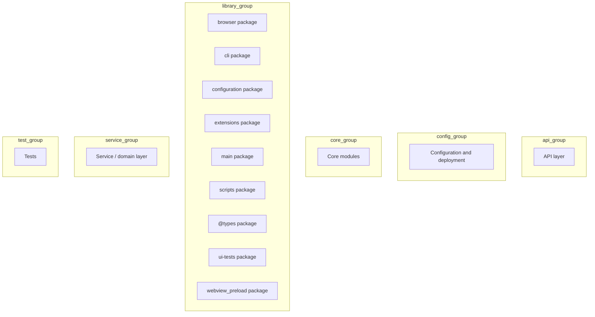

# Architecture report: onivim/oni

> Automated static analysis. **Observed** = directly seen in files/imports/AST; **Inferred** = interpretation from that evidence. Repository code was not executed.

## 1. Repository at a glance

| Item | Value |
| --- | --- |
| Repository | onivim/oni |
| Description | Oni: Modern Modal Editing - powered by Neovim |
| Language | TypeScript |
| Stars | 11232 |
| Licence | MIT |
| Analysed commit / branch | 17ceaa45311964a5509f5f4db8a330429d4ac0d7 / master |
| Framework(s) | Electron, React |
| Files analysed | 789 |
| Components | 14 |

## 2. Architecture in one minute

onivim/oni - Oni: Modern Modal Editing - powered by Neovim. This repository was analysed statically from 789 file(s) (0 Python). Detected technologies (observed from imports/manifests): Electron, React, Redux, Jest, TypeScript, webpack. Files are grouped into 14 component(s): API layer, browser package, cli package, Configuration and deployment, configuration package, Core modules, extensions package, main package. Findings below distinguish observed facts from inferred interpretation.

## 3. High-level block diagram

## 4. Main components

### API layer (`api_layer`)

- **Kind:** api
- **Status:** Observed
- **Confidence:** 0.85
- **Responsibility:** Groups 8 file(s) under api layer (observed from repository paths and static analysis).
- **Paths:** `browser/src/Plugins/Api/Capabilities.ts`, `browser/src/Plugins/Api/LanguageClient/LanguageClientHelpers.ts`, `browser/src/Plugins/Api/LanguageClient/LanguageClientLogger.ts`, `browser/src/Plugins/Api/Oni.ts`, `browser/src/Plugins/Api/Process.ts`, `browser/src/Plugins/Api/Services.ts`, `browser/src/Plugins/Api/Ui.ts`, `browser/src/Plugins/Api/shell-env.d.ts`
- **Evidence:** [browser/src/Plugins/Api/Capabilities.ts](https://github.com/onivim/oni/blob/17ceaa45311964a5509f5f4db8a330429d4ac0d7/browser/src/Plugins/Api/Capabilities.ts); [browser/src/Plugins/Api/LanguageClient/LanguageClientHelpers.ts](https://github.com/onivim/oni/blob/17ceaa45311964a5509f5f4db8a330429d4ac0d7/browser/src/Plugins/Api/LanguageClient/LanguageClientHelpers.ts); [browser/src/Plugins/Api/LanguageClient/LanguageClientLogger.ts](https://github.com/onivim/oni/blob/17ceaa45311964a5509f5f4db8a330429d4ac0d7/browser/src/Plugins/Api/LanguageClient/LanguageClientLogger.ts); [browser/src/Plugins/Api/Oni.ts](https://github.com/onivim/oni/blob/17ceaa45311964a5509f5f4db8a330429d4ac0d7/browser/src/Plugins/Api/Oni.ts); [browser/src/Plugins/Api/Process.ts](https://github.com/onivim/oni/blob/17ceaa45311964a5509f5f4db8a330429d4ac0d7/browser/src/Plugins/Api/Process.ts); [browser/src/Plugins/Api/Services.ts](https://github.com/onivim/oni/blob/17ceaa45311964a5509f5f4db8a330429d4ac0d7/browser/src/Plugins/Api/Services.ts); [browser/src/Plugins/Api/Ui.ts](https://github.com/onivim/oni/blob/17ceaa45311964a5509f5f4db8a330429d4ac0d7/browser/src/Plugins/Api/Ui.ts); [browser/src/Plugins/Api/shell-env.d.ts](https://github.com/onivim/oni/blob/17ceaa45311964a5509f5f4db8a330429d4ac0d7/browser/src/Plugins/Api/shell-env.d.ts)

### browser package (`browser`)

- **Kind:** library
- **Status:** Observed
- **Confidence:** 0.85
- **Responsibility:** Groups 173 file(s) under browser package (observed from repository paths and static analysis).
- **Paths:** `browser/src/App.ts`, `browser/src/CSS.ts`, `browser/src/Constants.ts`, `browser/src/Editor/BufferHighlights.ts`, `browser/src/Editor/BufferManager.ts`, `browser/src/Editor/Editor.ts`, `browser/src/Editor/NeovimEditor/BufferLayerManager.ts`, `browser/src/Editor/NeovimEditor/CompletionMenu.ts`, `browser/src/Editor/NeovimEditor/Definition.ts`, `browser/src/Editor/NeovimEditor/FileDropHandler.tsx`, `browser/src/Editor/NeovimEditor/HoverRenderer.tsx`, `browser/src/Editor/NeovimEditor/NeovimActiveWindow.tsx`, `browser/src/Editor/NeovimEditor/NeovimBufferLayersView.tsx`, `browser/src/Editor/NeovimEditor/NeovimEditor.tsx`, `browser/src/Editor/NeovimEditor/NeovimEditorActions.ts`, `browser/src/Editor/NeovimEditor/NeovimEditorCommands.ts`, `browser/src/Editor/NeovimEditor/NeovimEditorLoadingOverlay.tsx`, `browser/src/Editor/NeovimEditor/NeovimEditorReducer.ts`, `browser/src/Editor/NeovimEditor/NeovimEditorSelectors.ts`, `browser/src/Editor/NeovimEditor/NeovimEditorStore.ts`, `browser/src/Editor/NeovimEditor/NeovimInput.tsx`, `browser/src/Editor/NeovimEditor/NeovimPopupMenu.tsx`, `browser/src/Editor/NeovimEditor/NeovimRenderer.tsx`, `browser/src/Editor/NeovimEditor/NeovimSurface.tsx`, `browser/src/Editor/NeovimEditor/Rename.tsx`, `browser/src/Editor/NeovimEditor/Symbols.ts`, `browser/src/Editor/NeovimEditor/ToolTipsProvider.ts`, `browser/src/Editor/NeovimEditor/WelcomeBufferLayer.tsx`, `browser/src/Editor/NeovimEditor/index.ts`, `browser/src/Editor/NeovimEditor/markdown.ts`, `browser/src/Editor/OniEditor/ColorHighlightLayer.tsx`, `browser/src/Editor/OniEditor/ImageBufferLayer.tsx`, `browser/src/Editor/OniEditor/IndentGuideBufferLayer.tsx`, `browser/src/Editor/OniEditor/OniEditor.tsx`, `browser/src/Editor/OniEditor/containers/BufferScrollBarContainer.ts`, `browser/src/Editor/OniEditor/containers/DefinitionContainer.ts`, `browser/src/Editor/OniEditor/containers/ErrorsContainer.ts`, `browser/src/Editor/OniEditor/index.ts`, `browser/src/Font.ts`, `browser/src/Grid.ts`, `browser/src/Input/KeyBindings.ts`, `browser/src/Input/KeyParser.ts`, `browser/src/Input/Keyboard/KeyboardLayout.ts`, `browser/src/Input/Keyboard/KeyboardResolver.ts`, `browser/src/Input/Keyboard/Resolvers.ts`, `browser/src/Input/Keyboard/index.ts`, `browser/src/Input/KeyboardInput.tsx`, `browser/src/Input/Mouse.ts`, `browser/src/Performance.ts`, `browser/src/PeriodicJobs.ts`, `browser/src/PersistentStore.ts`, `browser/src/Platform.ts`, `browser/src/Plugins/AnonymousPlugin.ts`, `browser/src/Plugins/PackageMetadataParser.ts`, `browser/src/Plugins/Plugin.ts`, `browser/src/Plugins/PluginConfigurationSynchronizer.ts`, `browser/src/Plugins/PluginInstaller.ts`, `browser/src/Plugins/PluginManager.ts`, `browser/src/Plugins/PluginSidebarPane.tsx`, `browser/src/Redux/LoggingMiddleware.ts`, `browser/src/Redux/RequestAnimationFrameNotifyBatcher.ts`, `browser/src/Redux/createStore.ts`, `browser/src/Redux/index.ts`, `browser/src/Renderer/CanvasRenderer.ts`, `browser/src/Renderer/INeovimRenderer.ts`, `browser/src/Renderer/Span.ts`, `browser/src/Renderer/WebGLRenderer/SolidRenderer.ts`, `browser/src/Renderer/WebGLRenderer/TextRenderer/GlyphAtlas/GlyphAtlas.ts`, `browser/src/Renderer/WebGLRenderer/TextRenderer/GlyphAtlas/IRasterizedGlyph.ts`, `browser/src/Renderer/WebGLRenderer/TextRenderer/GlyphAtlas/index.ts`, `browser/src/Renderer/WebGLRenderer/TextRenderer/ICellGroup.ts`, `browser/src/Renderer/WebGLRenderer/TextRenderer/LigatureGrouper/ILigatureGrouper.ts`, `browser/src/Renderer/WebGLRenderer/TextRenderer/LigatureGrouper/NoopLigatureGrouper.ts`, `browser/src/Renderer/WebGLRenderer/TextRenderer/LigatureGrouper/OpenTypeLigatureGrouper.ts`, `browser/src/Renderer/WebGLRenderer/TextRenderer/LigatureGrouper/index.ts`, `browser/src/Renderer/WebGLRenderer/TextRenderer/TextRenderer.ts`, `browser/src/Renderer/WebGLRenderer/TextRenderer/groupCells.ts`, `browser/src/Renderer/WebGLRenderer/TextRenderer/index.ts`, `browser/src/Renderer/WebGLRenderer/WebGLRenderer.ts`, `browser/src/Renderer/WebGLRenderer/WebGLUtilities.ts`, `browser/src/Renderer/WebGLRenderer/index.ts`, `browser/src/Renderer/WebGLRenderer/normalizeColor.ts`, `browser/src/Renderer/index.ts`, `browser/src/UI/Icon.tsx`, `browser/src/UI/Shell/OverlayView.tsx`, `browser/src/UI/Shell/Shell.tsx`, `browser/src/UI/Shell/ShellActionCreators.ts`, `browser/src/UI/Shell/ShellActions.ts`, `browser/src/UI/Shell/ShellReducer.ts`, `browser/src/UI/Shell/ShellState.ts`, `browser/src/UI/Shell/ShellView.tsx`, `browser/src/UI/Shell/index.ts`, `browser/src/UI/components/Arrow.tsx`, `browser/src/UI/components/Background.tsx`, `browser/src/UI/components/BufferLayerHeader.tsx`, `browser/src/UI/components/BufferScrollBar.tsx`, `browser/src/UI/components/Caret.tsx`, `browser/src/UI/components/CodeActions.tsx`, `browser/src/UI/components/CommandLine.tsx`, `browser/src/UI/components/Cursor.tsx`, `browser/src/UI/components/CursorLine.tsx`, `browser/src/UI/components/CursorPositioner.tsx`, `browser/src/UI/components/Definition.tsx`, `browser/src/UI/components/Error.tsx`, `browser/src/UI/components/ErrorInfo.tsx`, `browser/src/UI/components/ExternalMenus.tsx`, `browser/src/UI/components/FlipCard.tsx`, `browser/src/UI/components/HighlightText.tsx`, `browser/src/UI/components/InstallHelp.tsx`, `browser/src/UI/components/KeyBindingInfo.tsx`, `browser/src/UI/components/LightweightText.tsx`, `browser/src/UI/components/Loading.tsx`, `browser/src/UI/components/LoadingSpinner.tsx`, `browser/src/UI/components/Octicon.tsx`, `browser/src/UI/components/PureComponentWithDisposeTracking.tsx`, `browser/src/UI/components/QuickInfo.tsx`, `browser/src/UI/components/QuickInfoContainer.tsx`, `browser/src/UI/components/RedErrorScreen.tsx`, `browser/src/UI/components/SectionTitle.tsx`, `browser/src/UI/components/SidebarButton.tsx`, `browser/src/UI/components/SidebarEmptyPaneView.tsx`, `browser/src/UI/components/SidebarItemView.tsx`, `browser/src/UI/components/Sneakable.tsx`, `browser/src/UI/components/StatusBar.tsx`, `browser/src/UI/components/StatusResize.tsx`, `browser/src/UI/components/Tabs.tsx`, `browser/src/UI/components/Text.tsx`, `browser/src/UI/components/ToolTip.tsx`, `browser/src/UI/components/VersionControl/Branch.tsx`, `browser/src/UI/components/VersionControl/CommitMessage.tsx`, `browser/src/UI/components/VersionControl/Commits.tsx`, `browser/src/UI/components/VersionControl/File.tsx`, `browser/src/UI/components/VersionControl/Help.tsx`, `browser/src/UI/components/VersionControl/Staged.tsx`, `browser/src/UI/components/VersionControl/Status.tsx`, `browser/src/UI/components/VimNavigator.tsx`, `browser/src/UI/components/Visible.tsx`, `browser/src/UI/components/WildMenu.tsx`, `browser/src/UI/components/WindowSplitHost.tsx`, `browser/src/UI/components/WindowSplits.tsx`, `browser/src/UI/components/WindowTitle.tsx`, `browser/src/UI/components/WithWidth.tsx`, `browser/src/UI/components/animations.ts`, `browser/src/UI/components/common.ts`, `browser/src/Utility.ts`, `browser/src/index.tsx`, `browser/src/neovim-client.d.ts`, `browser/src/neovim/CommandContext.ts`, `browser/src/neovim/EventContext.ts`, `browser/src/neovim/MsgPack.ts`, `browser/src/neovim/NeovimAutoCommands.ts`, `browser/src/neovim/NeovimBufferUpdateManager.ts`, `browser/src/neovim/NeovimInstance.ts`, `browser/src/neovim/NeovimMarks.ts`, `browser/src/neovim/NeovimProcessSpawner.ts`, `browser/src/neovim/NeovimTokenColorSynchronizer.ts`, `browser/src/neovim/NeovimWindowManager.ts`, `browser/src/neovim/QuickFix.ts`, `browser/src/neovim/Screen.ts`, `browser/src/neovim/ScreenWithPredictions.ts`, `browser/src/neovim/Session.ts`, `browser/src/neovim/SharedNeovimInstance.ts`, `browser/src/neovim/VimHighlights.ts`, `browser/src/neovim/actions.ts`, `browser/src/neovim/index.ts`, `browser/src/startEditors.ts`, `browser/src/sudo-prompt.d.ts`, `browser/src/units-css.d.ts`, `browser/testCoverageReporter.js`, `browser/testHelpers.js`, `browser/webpack.debug.config.js`, `browser/webpack.development.config.js`, `browser/webpack.production.config.js`
- **Evidence:** [browser/src/App.ts](https://github.com/onivim/oni/blob/17ceaa45311964a5509f5f4db8a330429d4ac0d7/browser/src/App.ts); [browser/src/CSS.ts](https://github.com/onivim/oni/blob/17ceaa45311964a5509f5f4db8a330429d4ac0d7/browser/src/CSS.ts); [browser/src/Constants.ts](https://github.com/onivim/oni/blob/17ceaa45311964a5509f5f4db8a330429d4ac0d7/browser/src/Constants.ts); [browser/src/Editor/BufferHighlights.ts](https://github.com/onivim/oni/blob/17ceaa45311964a5509f5f4db8a330429d4ac0d7/browser/src/Editor/BufferHighlights.ts); [browser/src/Editor/BufferManager.ts](https://github.com/onivim/oni/blob/17ceaa45311964a5509f5f4db8a330429d4ac0d7/browser/src/Editor/BufferManager.ts); [browser/src/Editor/Editor.ts](https://github.com/onivim/oni/blob/17ceaa45311964a5509f5f4db8a330429d4ac0d7/browser/src/Editor/Editor.ts); [browser/src/Editor/NeovimEditor/BufferLayerManager.ts](https://github.com/onivim/oni/blob/17ceaa45311964a5509f5f4db8a330429d4ac0d7/browser/src/Editor/NeovimEditor/BufferLayerManager.ts); [browser/src/Editor/NeovimEditor/CompletionMenu.ts](https://github.com/onivim/oni/blob/17ceaa45311964a5509f5f4db8a330429d4ac0d7/browser/src/Editor/NeovimEditor/CompletionMenu.ts)

### cli package (`cli`)

- **Kind:** library
- **Status:** Observed
- **Confidence:** 0.85
- **Responsibility:** Groups 4 file(s) under cli package (observed from repository paths and static analysis).
- **Paths:** `cli/linux/oni.sh`, `cli/mac/oni.sh`, `cli/src/cli.ts`, `cli/src/cli_args.ts`
- **Evidence:** [cli/linux/oni.sh](https://github.com/onivim/oni/blob/17ceaa45311964a5509f5f4db8a330429d4ac0d7/cli/linux/oni.sh); [cli/mac/oni.sh](https://github.com/onivim/oni/blob/17ceaa45311964a5509f5f4db8a330429d4ac0d7/cli/mac/oni.sh); [cli/src/cli.ts](https://github.com/onivim/oni/blob/17ceaa45311964a5509f5f4db8a330429d4ac0d7/cli/src/cli.ts); [cli/src/cli_args.ts](https://github.com/onivim/oni/blob/17ceaa45311964a5509f5f4db8a330429d4ac0d7/cli/src/cli_args.ts)

### Configuration and deployment (`config`)

- **Kind:** config
- **Status:** Observed
- **Confidence:** 0.85
- **Responsibility:** Groups 78 file(s) under configuration and deployment (observed from repository paths and static analysis).
- **Paths:** `appveyor.yml`, `browser/tsconfig.json`, `browser/tsconfig.test.json`, `cli/tsconfig.json`, `codecov.yml`, `extensions/clojure/syntaxes/clojure.tmLanguage.json`, `extensions/csharp/syntaxes/csharp.tmLanguage.json`, `extensions/css/syntaxes/css.tmLanguage.json`, `extensions/elixir/syntaxes/eex.tmLanguage.json`, `extensions/elixir/syntaxes/elixir.tmLanguage.json`, `extensions/elixir/syntaxes/html(eex).tmLanguage.json`, `extensions/go/syntaxes/go.json`, `extensions/html/package.json`, `extensions/html/snippets/html.json`, `extensions/images/package.json`, `extensions/java/syntaxes/Java.tmLanguage.json`, `extensions/javascript/package.json`, `extensions/javascript/snippets/javascript.json`, `extensions/javascript/syntaxes/JavaScript.tmLanguage.json`, `extensions/javascript/syntaxes/JavaScriptReact.tmLanguage.json`, `extensions/less/syntaxes/less.tmLanguage.json`, `extensions/lua/syntaxes/lua.tmLanguage.json`, `extensions/markdown/syntaxes/markdown.tmLanguage.json`, `extensions/objective-c/syntaxes/objective-c++.tmLanguage.json`, `extensions/objective-c/syntaxes/objective-c.tmLanguage.json`, `extensions/oni-plugin-markdown-preview/package.json`, `extensions/oni-plugin-markdown-preview/tsconfig.json`, `extensions/oni-plugin-prettier/.eslintrc.json`, `extensions/oni-plugin-prettier/package.json`, `extensions/oni-plugin-quickopen/package.json`, `extensions/oni-plugin-quickopen/tsconfig.json`, `extensions/php/syntaxes/html.tmLanguage.json`, `extensions/php/syntaxes/php.tmLanguage.json`, `extensions/python/syntaxes/python.tmLanguage.json`, `extensions/reason/package.json`, `extensions/reason/snippets/reason.json`, `extensions/reason/syntaxes/reason.json`, `extensions/ruby/syntaxes/ruby.tmLanguage.json`, `extensions/rust/syntaxes/rust.tmLanguage.json`, `extensions/scss/syntaxes/scss.json`, `extensions/shell/syntaxes/shell.tmLanguage.json`, `extensions/swift/syntaxes/swift.tmLanguage.json`, `extensions/theme-dracula/colors/dracula.json`, `extensions/theme-dracula/package.json`, `extensions/theme-gruvbox/colors/gruvbox_dark.json`, `extensions/theme-gruvbox/colors/gruvbox_light.json`, `extensions/theme-gruvbox/package.json`, `extensions/theme-hybrid/colors/hybrid_dark.json`, `extensions/theme-hybrid/colors/hybrid_light.json`, `extensions/theme-hybrid/package.json`, `extensions/theme-icons-seti/icons/seti-icon-theme.json`, `extensions/theme-icons-seti/package.json`, `extensions/theme-nord/colors/nord.json`, `extensions/theme-nord/package.json`, `extensions/theme-onedark/colors/onedark.json`, `extensions/theme-onedark/package.json`, `extensions/theme-solarized/colors/solarized8_dark.json`, `extensions/theme-solarized/colors/solarized8_light.json`, `extensions/theme-solarized/package.json`, `extensions/typescript/package.json`, `extensions/typescript/snippets/typescript.json`, `extensions/typescript/syntaxes/TypeScript.tmLanguage.json`, `extensions/typescript/syntaxes/TypeScriptReact.tmLanguage.json`, `extensions/vue/syntaxes/vue.json`, `main/tsconfig.json`, `main/tsconfig.test.json`, `package.json`, `tslint.json`, `ui-tests/tsconfig.react.json`, `vim/core/oni-core-statusbar/package.json`, `vim/core/oni-plugin-buffers/jsconfig.json`, `vim/core/oni-plugin-buffers/package.json`, `vim/core/oni-plugin-git/package.json`, `vim/core/oni-plugin-git/tsconfig.json`, `vim/core/oni-plugin-typescript/package.json`, `vim/core/oni-plugin-typescript/tsconfig.json`, `vim/core/oni-plugin-typescript/tsconfig.test.json`, `webview_preload/tsconfig.json`
- **Evidence:** [appveyor.yml](https://github.com/onivim/oni/blob/17ceaa45311964a5509f5f4db8a330429d4ac0d7/appveyor.yml); [browser/tsconfig.json](https://github.com/onivim/oni/blob/17ceaa45311964a5509f5f4db8a330429d4ac0d7/browser/tsconfig.json); [browser/tsconfig.test.json](https://github.com/onivim/oni/blob/17ceaa45311964a5509f5f4db8a330429d4ac0d7/browser/tsconfig.test.json); [cli/tsconfig.json](https://github.com/onivim/oni/blob/17ceaa45311964a5509f5f4db8a330429d4ac0d7/cli/tsconfig.json); [codecov.yml](https://github.com/onivim/oni/blob/17ceaa45311964a5509f5f4db8a330429d4ac0d7/codecov.yml); [extensions/clojure/syntaxes/clojure.tmLanguage.json](https://github.com/onivim/oni/blob/17ceaa45311964a5509f5f4db8a330429d4ac0d7/extensions/clojure/syntaxes/clojure.tmLanguage.json); [extensions/csharp/syntaxes/csharp.tmLanguage.json](https://github.com/onivim/oni/blob/17ceaa45311964a5509f5f4db8a330429d4ac0d7/extensions/csharp/syntaxes/csharp.tmLanguage.json); [extensions/css/syntaxes/css.tmLanguage.json](https://github.com/onivim/oni/blob/17ceaa45311964a5509f5f4db8a330429d4ac0d7/extensions/css/syntaxes/css.tmLanguage.json)

### configuration package (`configuration`)

- **Kind:** library
- **Status:** Observed
- **Confidence:** 0.85
- **Responsibility:** Groups 1 file(s) under configuration package (observed from repository paths and static analysis).
- **Paths:** `configuration/config.default.js`
- **Evidence:** [configuration/config.default.js](https://github.com/onivim/oni/blob/17ceaa45311964a5509f5f4db8a330429d4ac0d7/configuration/config.default.js)

### Core modules (`core`)

- **Kind:** core
- **Status:** Observed
- **Confidence:** 0.85
- **Responsibility:** Groups 2 file(s) under core modules (observed from repository paths and static analysis).
- **Paths:** `jest.config.js`, `preload.js`
- **Evidence:** [jest.config.js](https://github.com/onivim/oni/blob/17ceaa45311964a5509f5f4db8a330429d4ac0d7/jest.config.js); [preload.js](https://github.com/onivim/oni/blob/17ceaa45311964a5509f5f4db8a330429d4ac0d7/preload.js)

### extensions package (`extensions`)

- **Kind:** library
- **Status:** Observed
- **Confidence:** 0.85
- **Responsibility:** Groups 7 file(s) under extensions package (observed from repository paths and static analysis).
- **Paths:** `extensions/oni-plugin-markdown-preview/src/index.tsx`, `extensions/oni-plugin-prettier/index.js`, `extensions/oni-plugin-prettier/requirePackage.js`, `extensions/oni-plugin-quickopen/src/BookmarksSearch.ts`, `extensions/oni-plugin-quickopen/src/QuickOpen.ts`, `extensions/oni-plugin-quickopen/src/QuickOpenItem.ts`, `extensions/oni-plugin-quickopen/src/index.tsx`
- **Evidence:** [extensions/oni-plugin-markdown-preview/src/index.tsx](https://github.com/onivim/oni/blob/17ceaa45311964a5509f5f4db8a330429d4ac0d7/extensions/oni-plugin-markdown-preview/src/index.tsx); [extensions/oni-plugin-prettier/index.js](https://github.com/onivim/oni/blob/17ceaa45311964a5509f5f4db8a330429d4ac0d7/extensions/oni-plugin-prettier/index.js); [extensions/oni-plugin-prettier/requirePackage.js](https://github.com/onivim/oni/blob/17ceaa45311964a5509f5f4db8a330429d4ac0d7/extensions/oni-plugin-prettier/requirePackage.js); [extensions/oni-plugin-quickopen/src/BookmarksSearch.ts](https://github.com/onivim/oni/blob/17ceaa45311964a5509f5f4db8a330429d4ac0d7/extensions/oni-plugin-quickopen/src/BookmarksSearch.ts); [extensions/oni-plugin-quickopen/src/QuickOpen.ts](https://github.com/onivim/oni/blob/17ceaa45311964a5509f5f4db8a330429d4ac0d7/extensions/oni-plugin-quickopen/src/QuickOpen.ts); [extensions/oni-plugin-quickopen/src/QuickOpenItem.ts](https://github.com/onivim/oni/blob/17ceaa45311964a5509f5f4db8a330429d4ac0d7/extensions/oni-plugin-quickopen/src/QuickOpenItem.ts); [extensions/oni-plugin-quickopen/src/index.tsx](https://github.com/onivim/oni/blob/17ceaa45311964a5509f5f4db8a330429d4ac0d7/extensions/oni-plugin-quickopen/src/index.tsx)

### main package (`main`)

- **Kind:** library
- **Status:** Observed
- **Confidence:** 0.85
- **Responsibility:** Groups 6 file(s) under main package (observed from repository paths and static analysis).
- **Paths:** `main/src/Log.ts`, `main/src/ProcessLifecycle.ts`, `main/src/WindowManager.ts`, `main/src/installDevTools.ts`, `main/src/main.ts`, `main/src/menu.ts`
- **Evidence:** [main/src/Log.ts](https://github.com/onivim/oni/blob/17ceaa45311964a5509f5f4db8a330429d4ac0d7/main/src/Log.ts); [main/src/ProcessLifecycle.ts](https://github.com/onivim/oni/blob/17ceaa45311964a5509f5f4db8a330429d4ac0d7/main/src/ProcessLifecycle.ts); [main/src/WindowManager.ts](https://github.com/onivim/oni/blob/17ceaa45311964a5509f5f4db8a330429d4ac0d7/main/src/WindowManager.ts); [main/src/installDevTools.ts](https://github.com/onivim/oni/blob/17ceaa45311964a5509f5f4db8a330429d4ac0d7/main/src/installDevTools.ts); [main/src/main.ts](https://github.com/onivim/oni/blob/17ceaa45311964a5509f5f4db8a330429d4ac0d7/main/src/main.ts); [main/src/menu.ts](https://github.com/onivim/oni/blob/17ceaa45311964a5509f5f4db8a330429d4ac0d7/main/src/menu.ts)

### scripts package (`scripts`)

- **Kind:** library
- **Status:** Observed
- **Confidence:** 0.85
- **Responsibility:** Groups 2 file(s) under scripts package (observed from repository paths and static analysis).
- **Paths:** `scripts/dev_webpack_loader.js`, `scripts/webm2gif.sh`
- **Evidence:** [scripts/dev_webpack_loader.js](https://github.com/onivim/oni/blob/17ceaa45311964a5509f5f4db8a330429d4ac0d7/scripts/dev_webpack_loader.js); [scripts/webm2gif.sh](https://github.com/onivim/oni/blob/17ceaa45311964a5509f5f4db8a330429d4ac0d7/scripts/webm2gif.sh)

### Service / domain layer (`service_layer`)

- **Kind:** service
- **Status:** Observed
- **Confidence:** 0.85
- **Responsibility:** Groups 253 file(s) under service / domain layer (observed from repository paths and static analysis).
- **Paths:** `browser/src/Services/AutoClosingPairs.ts`, `browser/src/Services/AutoUpdate.ts`, `browser/src/Services/Automation.ts`, `browser/src/Services/Bookmarks/BookmarksPane.tsx`, `browser/src/Services/Bookmarks/index.ts`, `browser/src/Services/Browser/AddressBarView.tsx`, `browser/src/Services/Browser/BrowserButtonView.tsx`, `browser/src/Services/Browser/BrowserView.tsx`, `browser/src/Services/Browser/index.tsx`, `browser/src/Services/BrowserWindowConfigurationSynchronizer.ts`, `browser/src/Services/Colors.ts`, `browser/src/Services/CommandManager.ts`, `browser/src/Services/Commands/GlobalCommands.ts`, `browser/src/Services/Commands/index.ts`, `browser/src/Services/Completion/Completion.ts`, `browser/src/Services/Completion/CompletionProviders.ts`, `browser/src/Services/Completion/CompletionSelectors.ts`, `browser/src/Services/Completion/CompletionState.ts`, `browser/src/Services/Completion/CompletionStore.ts`, `browser/src/Services/Completion/CompletionUtility.ts`, `browser/src/Services/Completion/CompletionsRequestor.ts`, `browser/src/Services/Completion/index.ts`, `browser/src/Services/Configuration/Configuration.ts`, `browser/src/Services/Configuration/ConfigurationCommands.ts`, `browser/src/Services/Configuration/ConfigurationEditor.ts`, `browser/src/Services/Configuration/DefaultConfiguration.ts`, `browser/src/Services/Configuration/DeprecatedConfigurationValues.ts`, `browser/src/Services/Configuration/FileConfigurationProvider.ts`, `browser/src/Services/Configuration/IConfigurationValues.ts`, `browser/src/Services/Configuration/PersistentSettings.ts`, `browser/src/Services/Configuration/ReasonConfiguration.ts`, `browser/src/Services/Configuration/UserConfiguration.ts`, `browser/src/Services/Configuration/index.ts`, `browser/src/Services/ContextMenu/ContextMenu.tsx`, `browser/src/Services/ContextMenu/ContextMenuComponent.tsx`, `browser/src/Services/ContextMenu/index.ts`, `browser/src/Services/Debug.ts`, `browser/src/Services/Diagnostics/index.ts`, `browser/src/Services/Diagnostics/navigateErrors.ts`, `browser/src/Services/DragAndDrop.tsx`, `browser/src/Services/EditorManager.ts`, `browser/src/Services/Explorer/ExplorerFileSystem.ts`, `browser/src/Services/Explorer/ExplorerSelectors.ts`, `browser/src/Services/Explorer/ExplorerSplit.tsx`, `browser/src/Services/Explorer/ExplorerStore.ts`, `browser/src/Services/Explorer/ExplorerView.tsx`, `browser/src/Services/Explorer/index.tsx`, `browser/src/Services/FileIcon.tsx`, `browser/src/Services/FileMappings.ts`, `browser/src/Services/FileSystemWatcher/index.ts`, `browser/src/Services/FocusManager.ts`, `browser/src/Services/IconThemes/IconThemeLoader.ts`, `browser/src/Services/IconThemes/Icons.ts`, `browser/src/Services/IconThemes/StyleWriter.ts`, `browser/src/Services/IconThemes/index.ts`, `browser/src/Services/InputManager.ts`, `browser/src/Services/KeyDisplayer/KeyDisplayer.tsx`, `browser/src/Services/KeyDisplayer/KeyDisplayerStore.ts`, `browser/src/Services/KeyDisplayer/KeyDisplayerView.tsx`, `browser/src/Services/KeyDisplayer/index.tsx`, `browser/src/Services/Language/CodeAction.ts`, `browser/src/Services/Language/DefinitionRequestor.ts`, `browser/src/Services/Language/Edits.ts`, `browser/src/Services/Language/FindAllReferences.ts`, `browser/src/Services/Language/Formatting.ts`, `browser/src/Services/Language/HoverRequestor.ts`, `browser/src/Services/Language/LanguageClient.ts`, `browser/src/Services/Language/LanguageClientProcess.ts`, `browser/src/Services/Language/LanguageClientStatusBar.tsx`, `browser/src/Services/Language/LanguageClientTypes.ts`, `browser/src/Services/Language/LanguageConfiguration.ts`, `browser/src/Services/Language/LanguageEditorIntegration.ts`, `browser/src/Services/Language/LanguageManager.ts`, `browser/src/Services/Language/LanguageStore.ts`, `browser/src/Services/Language/PromiseQueue.ts`, `browser/src/Services/Language/RenameView.tsx`, `browser/src/Services/Language/ServerCapabilities.ts`, `browser/src/Services/Language/SignatureHelp.ts`, `browser/src/Services/Language/SignatureHelpView.tsx`, `browser/src/Services/Language/Workspace.ts`, `browser/src/Services/Language/addInsertModeLanguageFunctionality.ts`, `browser/src/Services/Language/index.ts`, `browser/src/Services/Learning/Achievements/AchievementNotificationRenderer.tsx`, `browser/src/Services/Learning/Achievements/AchievementsBufferLayer.tsx`, `browser/src/Services/Learning/Achievements/AchievementsManager.ts`, `browser/src/Services/Learning/Achievements/index.tsx`, `browser/src/Services/Learning/LearningPane.tsx`, `browser/src/Services/Learning/Tutorial/CompletionView.tsx`, `browser/src/Services/Learning/Tutorial/GameplayBufferLayer.tsx`, `browser/src/Services/Learning/Tutorial/GoalView.tsx`, `browser/src/Services/Learning/Tutorial/ITutorial.ts`, `browser/src/Services/Learning/Tutorial/Notes.tsx`, `browser/src/Services/Learning/Tutorial/Stages/CompositeStage.tsx`, `browser/src/Services/Learning/Tutorial/Stages/CorrectLineStage.tsx`, `browser/src/Services/Learning/Tutorial/Stages/DeleteCharactersStage.tsx`, `browser/src/Services/Learning/Tutorial/Stages/FadeInLineStage.tsx`, `browser/src/Services/Learning/Tutorial/Stages/InitializeBufferStage.tsx`, `browser/src/Services/Learning/Tutorial/Stages/MoveToGoalStage.tsx`, `browser/src/Services/Learning/Tutorial/Stages/SetBufferStage.tsx`, `browser/src/Services/Learning/Tutorial/Stages/SetCursorPositionStage.tsx`, `browser/src/Services/Learning/Tutorial/Stages/WaitForModeStage.tsx`, `browser/src/Services/Learning/Tutorial/Stages/WaitForRegisterStage.tsx`, `browser/src/Services/Learning/Tutorial/Stages/WaitForStateStage.tsx`, `browser/src/Services/Learning/Tutorial/Stages/index.tsx`, `browser/src/Services/Learning/Tutorial/TutorialBufferLayer.tsx`, `browser/src/Services/Learning/Tutorial/TutorialGameplayManager.ts`, `browser/src/Services/Learning/Tutorial/TutorialManager.ts`, `browser/src/Services/Learning/Tutorial/Tutorials/BasicMovementTutorial.tsx`, `browser/src/Services/Learning/Tutorial/Tutorials/BeginningsAndEndingsTutorial.tsx`, `browser/src/Services/Learning/Tutorial/Tutorials/ChangeOperatorTutorial.tsx`, `browser/src/Services/Learning/Tutorial/Tutorials/CopyPasteTutorial.tsx`, `browser/src/Services/Learning/Tutorial/Tutorials/DeleteCharacterTutorial.tsx`, `browser/src/Services/Learning/Tutorial/Tutorials/DeleteOperatorTutorial.tsx`, `browser/src/Services/Learning/Tutorial/Tutorials/DotCommandTutorial.tsx`, `browser/src/Services/Learning/Tutorial/Tutorials/InlineFindingTutorial.tsx`, `browser/src/Services/Learning/Tutorial/Tutorials/InsertAndUndoTutorial.tsx`, `browser/src/Services/Learning/Tutorial/Tutorials/SearchInBufferTutorial.tsx`, `browser/src/Services/Learning/Tutorial/Tutorials/SwitchModeTutorial.tsx`, `browser/src/Services/Learning/Tutorial/Tutorials/TargetsVimPluginTutorial.tsx`, `browser/src/Services/Learning/Tutorial/Tutorials/TextObjectsTutorial.tsx`, `browser/src/Services/Learning/Tutorial/Tutorials/VerticalMovementTutorial.tsx`, `browser/src/Services/Learning/Tutorial/Tutorials/VisualModeTutorial.tsx`, `browser/src/Services/Learning/Tutorial/Tutorials/WordMotionTutorial.tsx`, `browser/src/Services/Learning/Tutorial/Tutorials/index.tsx`, `browser/src/Services/Learning/Tutorial/index.ts`, `browser/src/Services/Learning/index.ts`, `browser/src/Services/Menu/Filter/FuseFilter.ts`, `browser/src/Services/Menu/Filter/NoFilter.ts`, `browser/src/Services/Menu/Filter/RegExFilter.ts`, `browser/src/Services/Menu/Filter/Utils.ts`, `browser/src/Services/Menu/Filter/VSCodeFilter.ts`, `browser/src/Services/Menu/Filter/index.ts`, `browser/src/Services/Menu/Menu.ts`, `browser/src/Services/Menu/MenuActionCreators.ts`, `browser/src/Services/Menu/MenuActions.ts`, `browser/src/Services/Menu/MenuComponent.tsx`, `browser/src/Services/Menu/MenuReducer.ts`, `browser/src/Services/Menu/MenuState.ts`, `browser/src/Services/Menu/PinnedIconView.tsx`, `browser/src/Services/Menu/index.ts`, `browser/src/Services/Metadata.ts`, `browser/src/Services/MultiProcess.ts`, `browser/src/Services/Notifications/Notification.ts`, `browser/src/Services/Notifications/NotificationStore.ts`, `browser/src/Services/Notifications/Notifications.ts`, `browser/src/Services/Notifications/NotificationsView.tsx`, `browser/src/Services/Notifications/index.ts`, `browser/src/Services/Overlay.ts`, `browser/src/Services/Particles/ParticleSystem.tsx`, `browser/src/Services/Particles/index.tsx`, `browser/src/Services/Preview/PreviewBufferLayer.tsx`, `browser/src/Services/Preview/index.tsx`, `browser/src/Services/Recorder.ts`, `browser/src/Services/Search/FinderProcess.ts`, `browser/src/Services/Search/RipGrep.ts`, `browser/src/Services/Search/Scorer/CharCode.ts`, `browser/src/Services/Search/Scorer/Comparers.ts`, `browser/src/Services/Search/Scorer/OniQuickOpenScorer.ts`, `browser/src/Services/Search/Scorer/QuickOpenScorer.ts`, `browser/src/Services/Search/Scorer/Utilities.ts`, `browser/src/Services/Search/Scorer/filters.ts`, `browser/src/Services/Search/Scorer/strings.ts`, `browser/src/Services/Search/SearchPaneView.tsx`, `browser/src/Services/Search/SearchProvider.ts`, `browser/src/Services/Search/SearchResultsSpinnerView.tsx`, `browser/src/Services/Search/SearchTextBox.tsx`, `browser/src/Services/Search/index.tsx`, `browser/src/Services/Sessions/SessionManager.ts`, `browser/src/Services/Sessions/Sessions.tsx`, `browser/src/Services/Sessions/SessionsPane.tsx`, `browser/src/Services/Sessions/SessionsStore.ts`, `browser/src/Services/Sessions/index.ts`, `browser/src/Services/Sidebar/SidebarContentSplit.tsx`, `browser/src/Services/Sidebar/SidebarSplit.tsx`, `browser/src/Services/Sidebar/SidebarStore.ts`, `browser/src/Services/Sidebar/SidebarView.tsx`, `browser/src/Services/Sidebar/index.ts`, `browser/src/Services/Sneak/Sneak.tsx`, `browser/src/Services/Sneak/SneakStore.ts`, `browser/src/Services/Sneak/SneakView.tsx`, `browser/src/Services/Sneak/index.tsx`, `browser/src/Services/Snippets/OniSnippet.ts`, `browser/src/Services/Snippets/SnippetBufferLayer.tsx`, `browser/src/Services/Snippets/SnippetCompletionProvider.ts`, `browser/src/Services/Snippets/SnippetManager.ts`, `browser/src/Services/Snippets/SnippetProvider.ts`, `browser/src/Services/Snippets/SnippetSession.ts`, `browser/src/Services/Snippets/SnippetVariableResolver.ts`, `browser/src/Services/Snippets/UserSnippetProvider.ts`, `browser/src/Services/Snippets/index.ts`, `browser/src/Services/StatusBar.ts`, `browser/src/Services/SyntaxHighlighting/Definitions.ts`, `browser/src/Services/SyntaxHighlighting/GrammarLoader.ts`, `browser/src/Services/SyntaxHighlighting/ISyntaxHighlighter.ts`, `browser/src/Services/SyntaxHighlighting/SyntaxHighlightReconciler.ts`, `browser/src/Services/SyntaxHighlighting/SyntaxHighlightSelectors.ts`, `browser/src/Services/SyntaxHighlighting/SyntaxHighlighting.ts`, `browser/src/Services/SyntaxHighlighting/SyntaxHighlightingPeriodicJob.ts`, `browser/src/Services/SyntaxHighlighting/SyntaxHighlightingReducer.ts`, `browser/src/Services/SyntaxHighlighting/SyntaxHighlightingStore.ts`, `browser/src/Services/SyntaxHighlighting/TokenGenerator.tsx`, `browser/src/Services/SyntaxHighlighting/TokenScorer.ts`, `browser/src/Services/SyntaxHighlighting/TokenThemeProvider.tsx`, `browser/src/Services/SyntaxHighlighting/index.ts`, `browser/src/Services/Tasks.ts`, `browser/src/Services/Terminal.ts`, `browser/src/Services/Themes/ThemeLoader.ts`, `browser/src/Services/Themes/ThemeManager.ts`, `browser/src/Services/Themes/ThemePicker.ts`, `browser/src/Services/Themes/index.ts`, `browser/src/Services/TokenColors.ts`, `browser/src/Services/TypingPredictionManager.ts`, `browser/src/Services/UnhandledErrorMonitor.ts`, `browser/src/Services/VersionControl/VersionControlBlameLayer.tsx`, `browser/src/Services/VersionControl/VersionControlManager.tsx`, `browser/src/Services/VersionControl/VersionControlPane.tsx`, `browser/src/Services/VersionControl/VersionControlProvider.ts`, `browser/src/Services/VersionControl/VersionControlStore.ts`, `browser/src/Services/VersionControl/VersionControlView.tsx`, `browser/src/Services/VersionControl/index.ts`, `browser/src/Services/VimConfigurationSynchronizer.ts`, `browser/src/Services/WindowManager/LinearSplitProvider.ts`, `browser/src/Services/WindowManager/RelationalSplitNavigator.ts`, `browser/src/Services/WindowManager/SingleSplitProvider.ts`, `browser/src/Services/WindowManager/WindowDock.ts`, `browser/src/Services/WindowManager/WindowManager.ts`, `browser/src/Services/WindowManager/WindowManagerStore.ts`, `browser/src/Services/WindowManager/index.ts`, `browser/src/Services/WindowManager/layoutFromSplitInfo.ts`, `browser/src/Services/Workspace/Workspace.ts`, `browser/src/Services/Workspace/WorkspaceCommands.ts`, `browser/src/Services/Workspace/WorkspaceConfiguration.ts`, `browser/src/Services/Workspace/find-up.d.ts`, `browser/src/Services/Workspace/index.ts`, `vim/core/oni-core-statusbar/index.js`, `vim/core/oni-plugin-buffers/index.js`, `vim/core/oni-plugin-git/src/index.tsx`, `vim/core/oni-plugin-git/src/vcs.ts`, `vim/core/oni-plugin-typescript/src/CodeActions.ts`, `vim/core/oni-plugin-typescript/src/Completion.ts`, `vim/core/oni-plugin-typescript/src/Definition.ts`, `vim/core/oni-plugin-typescript/src/FindAllReferences.ts`, `vim/core/oni-plugin-typescript/src/Formatting.ts`, `vim/core/oni-plugin-typescript/src/LightweightLanguageClient.ts`, `vim/core/oni-plugin-typescript/src/QuickInfo.ts`, `vim/core/oni-plugin-typescript/src/Rename.ts`, `vim/core/oni-plugin-typescript/src/SignatureHelp.ts`, `vim/core/oni-plugin-typescript/src/Symbols.ts`, `vim/core/oni-plugin-typescript/src/TypeScriptConfigurationEditor.ts`, `vim/core/oni-plugin-typescript/src/TypeScriptServerHost.ts`, `vim/core/oni-plugin-typescript/src/Types.ts`, `vim/core/oni-plugin-typescript/src/Utility.ts`, `vim/core/oni-plugin-typescript/src/index.ts`
- **Evidence:** [browser/src/Services/AutoClosingPairs.ts](https://github.com/onivim/oni/blob/17ceaa45311964a5509f5f4db8a330429d4ac0d7/browser/src/Services/AutoClosingPairs.ts); [browser/src/Services/AutoUpdate.ts](https://github.com/onivim/oni/blob/17ceaa45311964a5509f5f4db8a330429d4ac0d7/browser/src/Services/AutoUpdate.ts); [browser/src/Services/Automation.ts](https://github.com/onivim/oni/blob/17ceaa45311964a5509f5f4db8a330429d4ac0d7/browser/src/Services/Automation.ts); [browser/src/Services/Bookmarks/BookmarksPane.tsx](https://github.com/onivim/oni/blob/17ceaa45311964a5509f5f4db8a330429d4ac0d7/browser/src/Services/Bookmarks/BookmarksPane.tsx); [browser/src/Services/Bookmarks/index.ts](https://github.com/onivim/oni/blob/17ceaa45311964a5509f5f4db8a330429d4ac0d7/browser/src/Services/Bookmarks/index.ts); [browser/src/Services/Browser/AddressBarView.tsx](https://github.com/onivim/oni/blob/17ceaa45311964a5509f5f4db8a330429d4ac0d7/browser/src/Services/Browser/AddressBarView.tsx); [browser/src/Services/Browser/BrowserButtonView.tsx](https://github.com/onivim/oni/blob/17ceaa45311964a5509f5f4db8a330429d4ac0d7/browser/src/Services/Browser/BrowserButtonView.tsx); [browser/src/Services/Browser/BrowserView.tsx](https://github.com/onivim/oni/blob/17ceaa45311964a5509f5f4db8a330429d4ac0d7/browser/src/Services/Browser/BrowserView.tsx)

### Tests (`tests`)

- **Kind:** test
- **Status:** Observed
- **Confidence:** 0.85
- **Responsibility:** Groups 132 file(s) under tests (observed from repository paths and static analysis).
- **Paths:** `browser/test/AppTests.ts`, `browser/test/Editor/NeovimEditor/BufferStateTests.ts`, `browser/test/Editor/NeovimEditor/NeovimEditorReducerTests.ts`, `browser/test/Editor/NeovimEditor/SymbolsTests.ts`, `browser/test/GridTests.ts`, `browser/test/Input/InputManagerTests.ts`, `browser/test/Input/KeyParserTests.ts`, `browser/test/Input/Keyboard/ResolverTests.ts`, `browser/test/MarkdownTests.ts`, `browser/test/Mocks/MockBuffer.ts`, `browser/test/Mocks/MockPersistentStore.ts`, `browser/test/Mocks/MockPluginManager.ts`, `browser/test/Mocks/MockThemeLoader.ts`, `browser/test/Mocks/index.ts`, `browser/test/Mocks/neovim.ts`, `browser/test/Mocks/neovim/MockNeovimInstance.ts`, `browser/test/Plugins/Api/ProcessTests.ts`, `browser/test/Renderer/SpanTests.ts`, `browser/test/Services/AutoClosingPairsTests.ts`, `browser/test/Services/Completion/CompletionProvidersTests.ts`, `browser/test/Services/Completion/CompletionSelectorsTests.ts`, `browser/test/Services/Completion/CompletionStoreTests.ts`, `browser/test/Services/Completion/CompletionTests.ts`, `browser/test/Services/Completion/CompletionUtilityTests.ts`, `browser/test/Services/Completion/CompletionsRequestorTests.ts`, `browser/test/Services/Configuration/ConfigurationTests.ts`, `browser/test/Services/Configuration/FileConfigurationProviderTests.ts`, `browser/test/Services/Explorer/ExplorerFileSystemTests.ts`, `browser/test/Services/Explorer/ExplorerSelectorsTests.ts`, `browser/test/Services/Explorer/ExplorerStoreTests.ts`, `browser/test/Services/FileMappingsTests.ts`, `browser/test/Services/Language/EditTests.ts`, `browser/test/Services/Language/LanguageEditorIntegrationTests.ts`, `browser/test/Services/Language/LanguageManagerTests.ts`, `browser/test/Services/Learning/Achievements/AchievementsManagerTests.ts`, `browser/test/Services/Learning/Tutorial/TutorialGameplayManagerTests.ts`, `browser/test/Services/Learning/Tutorial/TutorialManagerTests.ts`, `browser/test/Services/Menu/MenuReducerTests.ts`, `browser/test/Services/Notifications/NotificationStoreTests.ts`, `browser/test/Services/QuickOpen/FinderProcessTests.ts`, `browser/test/Services/QuickOpen/RegExFilterTests.ts`, `browser/test/Services/QuickOpen/VSCodeFilterTests.ts`, `browser/test/Services/Sneak/SneakStoreTests.ts`, `browser/test/Services/Snippets/OniSnippetTests.ts`, `browser/test/Services/Snippets/SnippetCompletionProviderTests.ts`, `browser/test/Services/Snippets/SnippetProviderTests.ts`, `browser/test/Services/Snippets/SnippetSessionTests.ts`, `browser/test/Services/Snippets/SnippetVariableResolverTests.ts`, `browser/test/Services/SyntaxHighlighting/SyntaxHighlightingReconcilerTests.ts`, `browser/test/Services/SyntaxHighlighting/SyntaxHighlightingReducerTests.ts`, `browser/test/Services/TokenColorsTests.ts`, `browser/test/Services/TypingPredictionManagerTests.ts`, `browser/test/Services/WindowManager/LinearSplitProviderTests.ts`, `browser/test/Services/WindowManager/RelationalSplitNavigatorTests.ts.ts`, `browser/test/Services/WindowManager/WindowManagerTests.ts`, `browser/test/Services/WindowManager/layoutFromSplitInfoTests.ts`, `browser/test/Services/Workspace/WorkspaceConfigurationTests.ts`, `browser/test/Tabs/TabsTest.tsx`, `browser/test/TestHelpers.ts`, `browser/test/UtilityTests.ts`, `browser/test/neovim/NeovimBufferUpdateManagerTests.ts`, `browser/test/neovim/NeovimMarksTests.ts`, `browser/test/neovim/NeovimTokenColorSynchronizerTests.ts`, `browser/test/neovim/ScreenWithPredictionsTest.ts`, `main/test/WindowManagerTests.ts`, `test/CiTests.ts`, `test/Demo.ts`, `test/Manual.md`, `test/ci/Api.Buffer.AddLayer.tsx`, `test/ci/Api.Overlays.AddRemoveTest.tsx`, `test/ci/Assert.ts`, `test/ci/AutoClosingPairsTest.ts`, `test/ci/AutoCompletionTest-CSS.ts`, `test/ci/AutoCompletionTest-HTML.ts`, `test/ci/AutoCompletionTest-Reason.ts`, `test/ci/AutoCompletionTest-TypeScript.ts`, `test/ci/Browser.LocationTest.ts`, `test/ci/ColorHighlight.BufferLayerTest.ts`, `test/ci/Common.ts`, `test/ci/Configuration.JavaScriptEditorTest.ts`, `test/ci/Configuration.TypeScriptEditor.CompletionTest.ts`, `test/ci/Configuration.TypeScriptEditor.NewConfigurationTest.ts`, `test/ci/Editor.BufferModifiedState.ts`, `test/ci/Editor.BuffersCursorTest.ts`, `test/ci/Editor.CloseTabWithTabModesTabsTest.ts`, `test/ci/Editor.ExternalCommandLineTest.ts`, `test/ci/Editor.NextPreviousErrorTest.ts`, `test/ci/Editor.OpenFile.PathWithSpacesTest.ts`, `test/ci/Editor.ScrollEventTest.ts`, `test/ci/Editor.TabModifiedState.ts`, `test/ci/Explorer.LocateBufferTest.ts`, `test/ci/IndentGuide.BufferLayerTest.tsx`, `test/ci/LargeFileTest.ts`, `test/ci/LargePasteTest.ts`, `test/ci/MarkdownPreviewTest.tsx`, `test/ci/Neovim.CallOniCommands.ts`, `test/ci/Neovim.InvalidInitVimHandlingTest.ts`, `test/ci/NoInstalledNeovim.config.js`, `test/ci/NoInstalledNeovim.ts`, `test/ci/OSX.WindowTitleTest.ts`, `test/ci/PaintPerformanceTest.config.js`, `test/ci/PaintPerformanceTest.ts`, `test/ci/PrettierPluginTest.ts`, `test/ci/QuickOpenTest.ts`, `test/ci/Regression.1251.NoAdditionalProcessesOnStartup.ts`, `test/ci/Regression.1295.UnfocusedWindowTest.ts`, `test/ci/Regression.1296.SettingColorsTest.ts`, `test/ci/Regression.1799.MacroApplicationTest.ts`, `test/ci/Regression.1819.AutoReadCheckTimeTest.ts`, `test/ci/Regression.2047.VerifyCanvasIsIntegerSize.ts`, `test/ci/Sidebar.ToggleSplitTest.ts`, `test/ci/Snippets.BasicInsertTest.ts`, `test/ci/StatusBar-Mode.ts`, `test/ci/TabBarSneakTest.ts`, `test/ci/TextmateHighlighting.DebugScopesTest.ts`, `test/ci/TextmateHighlighting.ScopesOnEnterTest.ts`, `test/ci/TextmateHighlighting.TokenColorOverrideTest.ts`, `test/ci/Theming.LightAndDarkColorsTest.ts`, `test/ci/Welcome.BufferLayerTest.ts`, `test/ci/WindowManager.ErrorBoundary.tsx`, `test/ci/Workspace.ConfigurationTest.ts`, `test/ci/initVimPromptNotificationTest.ts`, `test/collateral/1799_test.csv`, `test/common/Oni.ts`, `test/common/ensureProcessNotRunning.ts`, `test/common/index.ts`, `test/common/runInProcTest.ts`, `test/demo/DemoCommon.ts`, `test/demo/HeroDemo.ts`, `test/demo/HeroScreenshot.ts`, `test/setup/WindowsInstallerTests.ts`, `test/tsconfig.json`
- **Evidence:** [browser/test/AppTests.ts](https://github.com/onivim/oni/blob/17ceaa45311964a5509f5f4db8a330429d4ac0d7/browser/test/AppTests.ts); [browser/test/Editor/NeovimEditor/BufferStateTests.ts](https://github.com/onivim/oni/blob/17ceaa45311964a5509f5f4db8a330429d4ac0d7/browser/test/Editor/NeovimEditor/BufferStateTests.ts); [browser/test/Editor/NeovimEditor/NeovimEditorReducerTests.ts](https://github.com/onivim/oni/blob/17ceaa45311964a5509f5f4db8a330429d4ac0d7/browser/test/Editor/NeovimEditor/NeovimEditorReducerTests.ts); [browser/test/Editor/NeovimEditor/SymbolsTests.ts](https://github.com/onivim/oni/blob/17ceaa45311964a5509f5f4db8a330429d4ac0d7/browser/test/Editor/NeovimEditor/SymbolsTests.ts); [browser/test/GridTests.ts](https://github.com/onivim/oni/blob/17ceaa45311964a5509f5f4db8a330429d4ac0d7/browser/test/GridTests.ts); [browser/test/Input/InputManagerTests.ts](https://github.com/onivim/oni/blob/17ceaa45311964a5509f5f4db8a330429d4ac0d7/browser/test/Input/InputManagerTests.ts); [browser/test/Input/KeyParserTests.ts](https://github.com/onivim/oni/blob/17ceaa45311964a5509f5f4db8a330429d4ac0d7/browser/test/Input/KeyParserTests.ts); [browser/test/Input/Keyboard/ResolverTests.ts](https://github.com/onivim/oni/blob/17ceaa45311964a5509f5f4db8a330429d4ac0d7/browser/test/Input/Keyboard/ResolverTests.ts)

### @types package (`types`)

- **Kind:** library
- **Status:** Observed
- **Confidence:** 0.85
- **Responsibility:** Groups 2 file(s) under @types package (observed from repository paths and static analysis).
- **Paths:** `@types/color-normalize/index.d.ts`, `@types/font-manager/index.d.ts`
- **Evidence:** [@types/color-normalize/index.d.ts](https://github.com/onivim/oni/blob/17ceaa45311964a5509f5f4db8a330429d4ac0d7/%40types/color-normalize/index.d.ts); [@types/font-manager/index.d.ts](https://github.com/onivim/oni/blob/17ceaa45311964a5509f5f4db8a330429d4ac0d7/%40types/font-manager/index.d.ts)

### ui-tests package (`ui_tests`)

- **Kind:** library
- **Status:** Observed
- **Confidence:** 0.85
- **Responsibility:** Groups 52 file(s) under ui-tests package (observed from repository paths and static analysis).
- **Paths:** `ui-tests/BrowserView.test.tsx`, `ui-tests/BufferManager.test.ts`, `ui-tests/BufferScrollBar.test.tsx`, `ui-tests/CommandLine.test.tsx`, `ui-tests/ContextMenuComponent.test.tsx`, `ui-tests/ErrorInfo.test.tsx`, `ui-tests/ExplorerSplit.test.tsx`, `ui-tests/ExplorerView.test.tsx`, `ui-tests/ExternalMenus.test.tsx`, `ui-tests/HighlightText.test.tsx`, `ui-tests/NeovimBufferLayersView.test.tsx`, `ui-tests/NodeView.test.tsx`, `ui-tests/NotificationView.test.tsx`, `ui-tests/QuickInfo.test.tsx`, `ui-tests/SessionManager.test.tsx`, `ui-tests/Sessions.test.tsx`, `ui-tests/SidebarStore.test.ts`, `ui-tests/Tabs.test.tsx`, `ui-tests/Text.test.tsx`, `ui-tests/TokenScorer.test.ts`, `ui-tests/TokenThemeProvider.test.tsx`, `ui-tests/VersionControl/Help.test.tsx`, `ui-tests/VersionControl/VersionControlCommits.test.tsx`, `ui-tests/VersionControl/VersionControlComponents.test.tsx`, `ui-tests/VersionControl/VersionControlManager.test.tsx`, `ui-tests/VersionControl/VersionControlPane.test.tsx`, `ui-tests/VersionControl/VersionControlSectionTitle.test.tsx`, `ui-tests/VersionControl/VersionControlStore.test.ts`, `ui-tests/VersionControl/VersionControlView.test.tsx`, `ui-tests/VersionControlBlameLayer.test.tsx`, `ui-tests/VimNavigator.test.tsx`, `ui-tests/WelcomeCommandsView.test.tsx`, `ui-tests/WelcomeView.test.tsx`, `ui-tests/WindowTitleView.test.tsx`, `ui-tests/enzyme-adapter-react-16.d.ts`, `ui-tests/jestsetup.ts`, `ui-tests/mocks/CommandManager.ts`, `ui-tests/mocks/Configuration.ts`, `ui-tests/mocks/EditorManager.ts`, `ui-tests/mocks/MenuManager.ts`, `ui-tests/mocks/Notifications.ts`, `ui-tests/mocks/Oni.ts`, `ui-tests/mocks/PersistentSettings.ts`, `ui-tests/mocks/SharedNeovimInstance.ts`, `ui-tests/mocks/Sidebar.ts`, `ui-tests/mocks/Statusbar.ts`, `ui-tests/mocks/UserConfiguration.ts`, `ui-tests/mocks/Utility.ts`, `ui-tests/mocks/Workspace.ts`, `ui-tests/mocks/electronMock.ts`, `ui-tests/mocks/keyboardLayout.ts`, `ui-tests/welcomeLayer.test.tsx`
- **Evidence:** [ui-tests/BrowserView.test.tsx](https://github.com/onivim/oni/blob/17ceaa45311964a5509f5f4db8a330429d4ac0d7/ui-tests/BrowserView.test.tsx); [ui-tests/BufferManager.test.ts](https://github.com/onivim/oni/blob/17ceaa45311964a5509f5f4db8a330429d4ac0d7/ui-tests/BufferManager.test.ts); [ui-tests/BufferScrollBar.test.tsx](https://github.com/onivim/oni/blob/17ceaa45311964a5509f5f4db8a330429d4ac0d7/ui-tests/BufferScrollBar.test.tsx); [ui-tests/CommandLine.test.tsx](https://github.com/onivim/oni/blob/17ceaa45311964a5509f5f4db8a330429d4ac0d7/ui-tests/CommandLine.test.tsx); [ui-tests/ContextMenuComponent.test.tsx](https://github.com/onivim/oni/blob/17ceaa45311964a5509f5f4db8a330429d4ac0d7/ui-tests/ContextMenuComponent.test.tsx); [ui-tests/ErrorInfo.test.tsx](https://github.com/onivim/oni/blob/17ceaa45311964a5509f5f4db8a330429d4ac0d7/ui-tests/ErrorInfo.test.tsx); [ui-tests/ExplorerSplit.test.tsx](https://github.com/onivim/oni/blob/17ceaa45311964a5509f5f4db8a330429d4ac0d7/ui-tests/ExplorerSplit.test.tsx); [ui-tests/ExplorerView.test.tsx](https://github.com/onivim/oni/blob/17ceaa45311964a5509f5f4db8a330429d4ac0d7/ui-tests/ExplorerView.test.tsx)

### webview_preload package (`webview_preload`)

- **Kind:** library
- **Status:** Observed
- **Confidence:** 0.85
- **Responsibility:** Groups 1 file(s) under webview_preload package (observed from repository paths and static analysis).
- **Paths:** `webview_preload/src/index.ts`
- **Evidence:** [webview_preload/src/index.ts](https://github.com/onivim/oni/blob/17ceaa45311964a5509f5f4db8a330429d4ac0d7/webview_preload/src/index.ts)

## 5. Execution flow

**Observed** entry point(s):

- [browser/src/App.ts](https://github.com/onivim/oni/blob/17ceaa45311964a5509f5f4db8a330429d4ac0d7/browser/src/App.ts)
- [browser/src/Redux/index.ts](https://github.com/onivim/oni/blob/17ceaa45311964a5509f5f4db8a330429d4ac0d7/browser/src/Redux/index.ts)
- [browser/src/Renderer/index.ts](https://github.com/onivim/oni/blob/17ceaa45311964a5509f5f4db8a330429d4ac0d7/browser/src/Renderer/index.ts)
- [browser/src/index.tsx](https://github.com/onivim/oni/blob/17ceaa45311964a5509f5f4db8a330429d4ac0d7/browser/src/index.tsx)
- [browser/src/neovim/index.ts](https://github.com/onivim/oni/blob/17ceaa45311964a5509f5f4db8a330429d4ac0d7/browser/src/neovim/index.ts)
- [extensions/oni-plugin-markdown-preview/src/index.tsx](https://github.com/onivim/oni/blob/17ceaa45311964a5509f5f4db8a330429d4ac0d7/extensions/oni-plugin-markdown-preview/src/index.tsx)
- [extensions/oni-plugin-prettier/index.js](https://github.com/onivim/oni/blob/17ceaa45311964a5509f5f4db8a330429d4ac0d7/extensions/oni-plugin-prettier/index.js)
- [extensions/oni-plugin-quickopen/src/index.tsx](https://github.com/onivim/oni/blob/17ceaa45311964a5509f5f4db8a330429d4ac0d7/extensions/oni-plugin-quickopen/src/index.tsx)
- [main/src/main.ts](https://github.com/onivim/oni/blob/17ceaa45311964a5509f5f4db8a330429d4ac0d7/main/src/main.ts)
- [vim/core/oni-core-statusbar/index.js](https://github.com/onivim/oni/blob/17ceaa45311964a5509f5f4db8a330429d4ac0d7/vim/core/oni-core-statusbar/index.js)
- [vim/core/oni-plugin-buffers/index.js](https://github.com/onivim/oni/blob/17ceaa45311964a5509f5f4db8a330429d4ac0d7/vim/core/oni-plugin-buffers/index.js)
- [webview_preload/src/index.ts](https://github.com/onivim/oni/blob/17ceaa45311964a5509f5f4db8a330429d4ac0d7/webview_preload/src/index.ts)

Representative flow (derived from observed entry points and the import graph; steps beyond the entry point are **Inferred**):

1. Execution starts at an observed entry point listed above, if present.
2. No internal import relationships between components were observed.

## 6. Project structure

### `(root)`

- `.editorconfig` - config (147 bytes)
- `.gitattributes` - other (275 bytes)
- `.gitignore` - other (2340 bytes)
- `.gitmodules` - other (661 bytes)
- `.npmignore` - other (67 bytes)
- `.nvmrc` - other (2 bytes)
- `.prettierignore` - other (68 bytes)
- `.prettierrc` - other (108 bytes)
- `.travis.yml` - ci, YAML (4093 bytes)
- `.yarnrc` - other (26 bytes)
- `ACCOUNTING.md` - docs (456 bytes)
- `BACKERS.md` - docs (5228 bytes)
- `CODE_OF_CONDUCT.md` - docs (3212 bytes)
- `CONTRIBUTING.md` - docs (8951 bytes)
- `LICENSE` - docs (1057 bytes)
- `README.md` - docs (9405 bytes)
- `appveyor.yml` - config (1013 bytes)
- `codecov.yml` - config (25 bytes)
- `index.dev.html` - other (866 bytes)
- `index.html` - other (1075 bytes)
- `jest.config.js` - source, JavaScript (1321 bytes)
- `package.json` - manifest (33335 bytes)
- `preload.js` - source, JavaScript (378 bytes)
- `tslint.json` - config (1224 bytes)

### `.github`

- `.github/ISSUE_TEMPLATE.md` - docs (295 bytes)
- `.github/config.yml` - config (759 bytes)

### `.oni`

- `.oni/config.js` - source, JavaScript (592 bytes)
- `.oni/templates/UnitTestTemplate.ts.template` - other (206 bytes)

### `.vscode`

- `.vscode/launch.json` - config (1419 bytes)

### `@types`

- `@types/color-normalize/index.d.ts` - source, TypeScript (1383 bytes)
- `@types/font-manager/index.d.ts` - source, TypeScript (1503 bytes)

### `browser`

- `browser/src/App.ts` - source, TypeScript (16270 bytes)
- `browser/src/CSS.ts` - source, TypeScript (325 bytes)
- `browser/src/Constants.ts` - source, TypeScript (278 bytes)
- `browser/src/Editor/BufferHighlights.ts` - source, TypeScript (2472 bytes)
- `browser/src/Editor/BufferManager.ts` - source, TypeScript (18789 bytes)
- `browser/src/Editor/Editor.ts` - source, TypeScript (3764 bytes)
- `browser/src/Editor/NeovimEditor/BufferLayerManager.ts` - source, TypeScript (2283 bytes)
- `browser/src/Editor/NeovimEditor/CompletionMenu.ts` - source, TypeScript (2638 bytes)
- `browser/src/Editor/NeovimEditor/Definition.ts` - source, TypeScript (1349 bytes)
- `browser/src/Editor/NeovimEditor/FileDropHandler.tsx` - source, TypeScript (1559 bytes)
- `browser/src/Editor/NeovimEditor/HoverRenderer.tsx` - source, TypeScript (5673 bytes)
- `browser/src/Editor/NeovimEditor/NeovimActiveWindow.tsx` - source, TypeScript (873 bytes)
- `browser/src/Editor/NeovimEditor/NeovimBufferLayersView.tsx` - source, TypeScript (4369 bytes)
- `browser/src/Editor/NeovimEditor/NeovimEditor.tsx` - source, TypeScript (48347 bytes)
- `browser/src/Editor/NeovimEditor/NeovimEditorActions.ts` - source, TypeScript (15093 bytes)
- `browser/src/Editor/NeovimEditor/NeovimEditorCommands.ts` - source, TypeScript (7966 bytes)
- `browser/src/Editor/NeovimEditor/NeovimEditorLoadingOverlay.tsx` - source, TypeScript (1172 bytes)
- `browser/src/Editor/NeovimEditor/NeovimEditorReducer.ts` - source, TypeScript (12621 bytes)
- `browser/src/Editor/NeovimEditor/NeovimEditorSelectors.ts` - source, TypeScript (3233 bytes)
- `browser/src/Editor/NeovimEditor/NeovimEditorStore.ts` - source, TypeScript (5022 bytes)
- `browser/src/Editor/NeovimEditor/NeovimInput.tsx` - source, TypeScript (1897 bytes)
- `browser/src/Editor/NeovimEditor/NeovimPopupMenu.tsx` - source, TypeScript (2450 bytes)
- `browser/src/Editor/NeovimEditor/NeovimRenderer.tsx` - source, TypeScript (1974 bytes)
- `browser/src/Editor/NeovimEditor/NeovimSurface.tsx` - source, TypeScript (4929 bytes)
- `browser/src/Editor/NeovimEditor/Rename.tsx` - source, TypeScript (2970 bytes)
- `browser/src/Editor/NeovimEditor/Symbols.ts` - source, TypeScript (6296 bytes)
- `browser/src/Editor/NeovimEditor/ToolTipsProvider.ts` - source, TypeScript (661 bytes)
- `browser/src/Editor/NeovimEditor/WelcomeBufferLayer.tsx` - source, TypeScript (20961 bytes)
- `browser/src/Editor/NeovimEditor/index.ts` - source, TypeScript (31 bytes)
- `browser/src/Editor/NeovimEditor/markdown.ts` - source, TypeScript (6493 bytes)
- `browser/src/Editor/OniEditor/ColorHighlightLayer.tsx` - source, TypeScript (9591 bytes)
- `browser/src/Editor/OniEditor/ImageBufferLayer.tsx` - source, TypeScript (2294 bytes)
- `browser/src/Editor/OniEditor/IndentGuideBufferLayer.tsx` - source, TypeScript (8597 bytes)
- `browser/src/Editor/OniEditor/OniEditor.tsx` - source, TypeScript (12720 bytes)
- `browser/src/Editor/OniEditor/containers/BufferScrollBarContainer.ts` - source, TypeScript (2549 bytes)
- `browser/src/Editor/OniEditor/containers/DefinitionContainer.ts` - source, TypeScript (1162 bytes)
- `browser/src/Editor/OniEditor/containers/ErrorsContainer.ts` - source, TypeScript (784 bytes)
- `browser/src/Editor/OniEditor/index.ts` - source, TypeScript (28 bytes)
- `browser/src/Font.ts` - source, TypeScript (1831 bytes)
- `browser/src/Grid.ts` - source, TypeScript (2850 bytes)
- `browser/src/Input/KeyBindings.ts` - source, TypeScript (7040 bytes)
- `browser/src/Input/KeyParser.ts` - source, TypeScript (2737 bytes)
- `browser/src/Input/Keyboard/KeyboardLayout.ts` - source, TypeScript (2184 bytes)
- `browser/src/Input/Keyboard/KeyboardResolver.ts` - source, TypeScript (1190 bytes)
- `browser/src/Input/Keyboard/Resolvers.ts` - source, TypeScript (5000 bytes)
- `browser/src/Input/Keyboard/index.ts` - source, TypeScript (61 bytes)
- `browser/src/Input/KeyboardInput.tsx` - source, TypeScript (8261 bytes)
- `browser/src/Input/Mouse.ts` - source, TypeScript (3390 bytes)
- `browser/src/Performance.ts` - source, TypeScript (702 bytes)
- `browser/src/PeriodicJobs.ts` - source, TypeScript (2189 bytes)
- `browser/src/PersistentStore.ts` - source, TypeScript (2191 bytes)
- `browser/src/Platform.ts` - source, TypeScript (1772 bytes)
- `browser/src/Plugins/AnonymousPlugin.ts` - source, TypeScript (506 bytes)
- `browser/src/Plugins/Api/Capabilities.ts` - source, TypeScript (1106 bytes)
- `browser/src/Plugins/Api/LanguageClient/LanguageClientHelpers.ts` - source, TypeScript (4247 bytes)
- `browser/src/Plugins/Api/LanguageClient/LanguageClientLogger.ts` - source, TypeScript (483 bytes)
- `browser/src/Plugins/Api/Oni.ts` - source, TypeScript (7570 bytes)
- `browser/src/Plugins/Api/Process.ts` - source, TypeScript (6033 bytes)
- `browser/src/Plugins/Api/Services.ts` - source, TypeScript (193 bytes)
- `browser/src/Plugins/Api/Ui.ts` - source, TypeScript (729 bytes)
- `browser/src/Plugins/Api/shell-env.d.ts` - source, TypeScript (195 bytes)
- `browser/src/Plugins/PackageMetadataParser.ts` - source, TypeScript (2226 bytes)
- `browser/src/Plugins/Plugin.ts` - source, TypeScript (2489 bytes)
- `browser/src/Plugins/PluginConfigurationSynchronizer.ts` - source, TypeScript (1536 bytes)
- `browser/src/Plugins/PluginInstaller.ts` - source, TypeScript (5219 bytes)
- `browser/src/Plugins/PluginManager.ts` - source, TypeScript (4988 bytes)
- `browser/src/Plugins/PluginSidebarPane.tsx` - source, TypeScript (8887 bytes)
- `browser/src/Redux/LoggingMiddleware.ts` - source, TypeScript (406 bytes)
- `browser/src/Redux/RequestAnimationFrameNotifyBatcher.ts` - source, TypeScript (616 bytes)
- `browser/src/Redux/createStore.ts` - source, TypeScript (1350 bytes)
- `browser/src/Redux/index.ts` - source, TypeScript (30 bytes)
- `browser/src/Renderer/CanvasRenderer.ts` - source, TypeScript (13309 bytes)
- `browser/src/Renderer/INeovimRenderer.ts` - source, TypeScript (286 bytes)
- `browser/src/Renderer/Span.ts` - source, TypeScript (2872 bytes)
- `browser/src/Renderer/WebGLRenderer/SolidRenderer.ts` - source, TypeScript (8121 bytes)
- `browser/src/Renderer/WebGLRenderer/TextRenderer/GlyphAtlas/GlyphAtlas.ts` - source, TypeScript (8269 bytes)
- `browser/src/Renderer/WebGLRenderer/TextRenderer/GlyphAtlas/IRasterizedGlyph.ts` - source, TypeScript (224 bytes)
- `browser/src/Renderer/WebGLRenderer/TextRenderer/GlyphAtlas/index.ts` - source, TypeScript (64 bytes)
- `browser/src/Renderer/WebGLRenderer/TextRenderer/ICellGroup.ts` - source, TypeScript (208 bytes)
- `browser/src/Renderer/WebGLRenderer/TextRenderer/LigatureGrouper/ILigatureGrouper.ts` - source, TypeScript (92 bytes)
- `browser/src/Renderer/WebGLRenderer/TextRenderer/LigatureGrouper/NoopLigatureGrouper.ts` - source, TypeScript (205 bytes)
- `browser/src/Renderer/WebGLRenderer/TextRenderer/LigatureGrouper/OpenTypeLigatureGrouper.ts` - source, TypeScript (4208 bytes)
- `browser/src/Renderer/WebGLRenderer/TextRenderer/LigatureGrouper/index.ts` - source, TypeScript (115 bytes)
- `browser/src/Renderer/WebGLRenderer/TextRenderer/TextRenderer.ts` - source, TypeScript (14935 bytes)
- `browser/src/Renderer/WebGLRenderer/TextRenderer/groupCells.ts` - source, TypeScript (1992 bytes)
- `browser/src/Renderer/WebGLRenderer/TextRenderer/index.ts` - source, TypeScript (31 bytes)
- `browser/src/Renderer/WebGLRenderer/WebGLRenderer.ts` - source, TypeScript (6273 bytes)
- `browser/src/Renderer/WebGLRenderer/WebGLUtilities.ts` - source, TypeScript (2032 bytes)
- `browser/src/Renderer/WebGLRenderer/index.ts` - source, TypeScript (32 bytes)
- `browser/src/Renderer/WebGLRenderer/normalizeColor.ts` - source, TypeScript (371 bytes)
- `browser/src/Renderer/index.ts` - source, TypeScript (99 bytes)
- `browser/src/Services/AutoClosingPairs.ts` - source, TypeScript (8903 bytes)
- `browser/src/Services/AutoUpdate.ts` - source, TypeScript (1684 bytes)
- `browser/src/Services/Automation.ts` - source, TypeScript (6917 bytes)
- `browser/src/Services/Bookmarks/BookmarksPane.tsx` - source, TypeScript (7338 bytes)
- `browser/src/Services/Bookmarks/index.ts` - source, TypeScript (2173 bytes)
- `browser/src/Services/Browser/AddressBarView.tsx` - source, TypeScript (2474 bytes)
- `browser/src/Services/Browser/BrowserButtonView.tsx` - source, TypeScript (1007 bytes)
- `browser/src/Services/Browser/BrowserView.tsx` - source, TypeScript (10898 bytes)
- `browser/src/Services/Browser/index.tsx` - source, TypeScript (10279 bytes)
- `browser/src/Services/BrowserWindowConfigurationSynchronizer.ts` - source, TypeScript (2641 bytes)
- `browser/src/Services/Colors.ts` - source, TypeScript (3352 bytes)
- `browser/src/Services/CommandManager.ts` - source, TypeScript (2964 bytes)
- `browser/src/Services/Commands/GlobalCommands.ts` - source, TypeScript (5716 bytes)
- `browser/src/Services/Commands/index.ts` - source, TypeScript (33 bytes)
- `browser/src/Services/Completion/Completion.ts` - source, TypeScript (6250 bytes)
- `browser/src/Services/Completion/CompletionProviders.ts` - source, TypeScript (3029 bytes)
- `browser/src/Services/Completion/CompletionSelectors.ts` - source, TypeScript (4539 bytes)
- `browser/src/Services/Completion/CompletionState.ts` - source, TypeScript (1942 bytes)
- `browser/src/Services/Completion/CompletionStore.ts` - source, TypeScript (14786 bytes)
- `browser/src/Services/Completion/CompletionUtility.ts` - source, TypeScript (5678 bytes)
- `browser/src/Services/Completion/CompletionsRequestor.ts` - source, TypeScript (3365 bytes)
- `browser/src/Services/Completion/index.ts` - source, TypeScript (142 bytes)
- `browser/src/Services/Configuration/Configuration.ts` - source, TypeScript (12470 bytes)
- `browser/src/Services/Configuration/ConfigurationCommands.ts` - source, TypeScript (1048 bytes)
- `browser/src/Services/Configuration/ConfigurationEditor.ts` - source, TypeScript (6214 bytes)
- `browser/src/Services/Configuration/DefaultConfiguration.ts` - source, TypeScript (15089 bytes)
- `browser/src/Services/Configuration/DeprecatedConfigurationValues.ts` - source, TypeScript (1357 bytes)
- `browser/src/Services/Configuration/FileConfigurationProvider.ts` - source, TypeScript (7097 bytes)
- `browser/src/Services/Configuration/IConfigurationValues.ts` - source, TypeScript (12937 bytes)
- `browser/src/Services/Configuration/PersistentSettings.ts` - source, TypeScript (1204 bytes)
- `browser/src/Services/Configuration/ReasonConfiguration.ts` - source, TypeScript (1181 bytes)
- `browser/src/Services/Configuration/UserConfiguration.ts` - source, TypeScript (1229 bytes)
- `browser/src/Services/Configuration/index.ts` - source, TypeScript (107 bytes)
- `browser/src/Services/ContextMenu/ContextMenu.tsx` - source, TypeScript (5732 bytes)
- `browser/src/Services/ContextMenu/ContextMenuComponent.tsx` - source, TypeScript (5660 bytes)
- `browser/src/Services/ContextMenu/index.ts` - source, TypeScript (69 bytes)
- `browser/src/Services/Debug.ts` - source, TypeScript (1895 bytes)
- `browser/src/Services/Diagnostics/index.ts` - source, TypeScript (3560 bytes)
- `browser/src/Services/Diagnostics/navigateErrors.ts` - source, TypeScript (2796 bytes)
- `browser/src/Services/DragAndDrop.tsx` - source, TypeScript (3909 bytes)
- `browser/src/Services/EditorManager.ts` - source, TypeScript (6981 bytes)
- `browser/src/Services/Explorer/ExplorerFileSystem.ts` - source, TypeScript (5831 bytes)
- `browser/src/Services/Explorer/ExplorerSelectors.ts` - source, TypeScript (3660 bytes)
- `browser/src/Services/Explorer/ExplorerSplit.tsx` - source, TypeScript (13101 bytes)
- `browser/src/Services/Explorer/ExplorerStore.ts` - source, TypeScript (33143 bytes)
- `browser/src/Services/Explorer/ExplorerView.tsx` - source, TypeScript (16065 bytes)
- `browser/src/Services/Explorer/index.tsx` - source, TypeScript (1757 bytes)
- `browser/src/Services/FileIcon.tsx` - source, TypeScript (1474 bytes)
- `browser/src/Services/FileMappings.ts` - source, TypeScript (3370 bytes)
- `browser/src/Services/FileSystemWatcher/index.ts` - source, TypeScript (2646 bytes)
- `browser/src/Services/FocusManager.ts` - source, TypeScript (1223 bytes)
- `browser/src/Services/IconThemes/IconThemeLoader.ts` - source, TypeScript (2003 bytes)
- `browser/src/Services/IconThemes/Icons.ts` - source, TypeScript (5027 bytes)
- `browser/src/Services/IconThemes/StyleWriter.ts` - source, TypeScript (1590 bytes)
- `browser/src/Services/IconThemes/index.ts` - source, TypeScript (658 bytes)
- `browser/src/Services/InputManager.ts` - source, TypeScript (5872 bytes)
- `browser/src/Services/KeyDisplayer/KeyDisplayer.tsx` - source, TypeScript (2547 bytes)
- `browser/src/Services/KeyDisplayer/KeyDisplayerStore.ts` - source, TypeScript (4036 bytes)
- `browser/src/Services/KeyDisplayer/KeyDisplayerView.tsx` - source, TypeScript (1314 bytes)
- `browser/src/Services/KeyDisplayer/index.tsx` - source, TypeScript (1321 bytes)
- `browser/src/Services/Language/CodeAction.ts` - source, TypeScript (2473 bytes)
- `browser/src/Services/Language/DefinitionRequestor.ts` - source, TypeScript (2057 bytes)
- `browser/src/Services/Language/Edits.ts` - source, TypeScript (892 bytes)
- `browser/src/Services/Language/FindAllReferences.ts` - source, TypeScript (2095 bytes)
- `browser/src/Services/Language/Formatting.ts` - source, TypeScript (2133 bytes)
- `browser/src/Services/Language/HoverRequestor.ts` - source, TypeScript (1638 bytes)
- `browser/src/Services/Language/LanguageClient.ts` - source, TypeScript (4704 bytes)
- `browser/src/Services/Language/LanguageClientProcess.ts` - source, TypeScript (8379 bytes)
- `browser/src/Services/Language/LanguageClientStatusBar.tsx` - source, TypeScript (2954 bytes)
- `browser/src/Services/Language/LanguageClientTypes.ts` - source, TypeScript (928 bytes)
- `browser/src/Services/Language/LanguageConfiguration.ts` - source, TypeScript (3538 bytes)
- `browser/src/Services/Language/LanguageEditorIntegration.ts` - source, TypeScript (5636 bytes)
- `browser/src/Services/Language/LanguageManager.ts` - source, TypeScript (15062 bytes)
- `browser/src/Services/Language/LanguageStore.ts` - source, TypeScript (10153 bytes)
- `browser/src/Services/Language/PromiseQueue.ts` - source, TypeScript (702 bytes)
- `browser/src/Services/Language/RenameView.tsx` - source, TypeScript (960 bytes)
- `browser/src/Services/Language/ServerCapabilities.ts` - source, TypeScript (4872 bytes)
- `browser/src/Services/Language/SignatureHelp.ts` - source, TypeScript (3368 bytes)
- `browser/src/Services/Language/SignatureHelpView.tsx` - source, TypeScript (2841 bytes)
- `browser/src/Services/Language/Workspace.ts` - source, TypeScript (605 bytes)
- `browser/src/Services/Language/addInsertModeLanguageFunctionality.ts` - source, TypeScript (1531 bytes)
- `browser/src/Services/Language/index.ts` - source, TypeScript (503 bytes)
- `browser/src/Services/Learning/Achievements/AchievementNotificationRenderer.tsx` - source, TypeScript (5440 bytes)
- `browser/src/Services/Learning/Achievements/AchievementsBufferLayer.tsx` - source, TypeScript (6736 bytes)
- `browser/src/Services/Learning/Achievements/AchievementsManager.ts` - source, TypeScript (5884 bytes)
- `browser/src/Services/Learning/Achievements/index.tsx` - source, TypeScript (3003 bytes)
- `browser/src/Services/Learning/LearningPane.tsx` - source, TypeScript (9002 bytes)
- `browser/src/Services/Learning/Tutorial/CompletionView.tsx` - source, TypeScript (3356 bytes)
- `browser/src/Services/Learning/Tutorial/GameplayBufferLayer.tsx` - source, TypeScript (2009 bytes)
- `browser/src/Services/Learning/Tutorial/GoalView.tsx` - source, TypeScript (1952 bytes)
- `browser/src/Services/Learning/Tutorial/ITutorial.ts` - source, TypeScript (633 bytes)
- `browser/src/Services/Learning/Tutorial/Notes.tsx` - source, TypeScript (14659 bytes)
- `browser/src/Services/Learning/Tutorial/Stages/CompositeStage.tsx` - source, TypeScript (1218 bytes)
- `browser/src/Services/Learning/Tutorial/Stages/CorrectLineStage.tsx` - source, TypeScript (3154 bytes)
- `browser/src/Services/Learning/Tutorial/Stages/DeleteCharactersStage.tsx` - source, TypeScript (1822 bytes)
- `browser/src/Services/Learning/Tutorial/Stages/FadeInLineStage.tsx` - source, TypeScript (2483 bytes)
- `browser/src/Services/Learning/Tutorial/Stages/InitializeBufferStage.tsx` - source, TypeScript (1127 bytes)
- `browser/src/Services/Learning/Tutorial/Stages/MoveToGoalStage.tsx` - source, TypeScript (3815 bytes)
- `browser/src/Services/Learning/Tutorial/Stages/SetBufferStage.tsx` - source, TypeScript (644 bytes)
- `browser/src/Services/Learning/Tutorial/Stages/SetCursorPositionStage.tsx` - source, TypeScript (549 bytes)
- `browser/src/Services/Learning/Tutorial/Stages/WaitForModeStage.tsx` - source, TypeScript (614 bytes)
- `browser/src/Services/Learning/Tutorial/Stages/WaitForRegisterStage.tsx` - source, TypeScript (703 bytes)
- `browser/src/Services/Learning/Tutorial/Stages/WaitForStateStage.tsx` - source, TypeScript (1119 bytes)
- `browser/src/Services/Learning/Tutorial/Stages/index.tsx` - source, TypeScript (512 bytes)
- `browser/src/Services/Learning/Tutorial/TutorialBufferLayer.tsx` - source, TypeScript (19152 bytes)
- `browser/src/Services/Learning/Tutorial/TutorialGameplayManager.ts` - source, TypeScript (3269 bytes)
- `browser/src/Services/Learning/Tutorial/TutorialManager.ts` - source, TypeScript (4928 bytes)
- `browser/src/Services/Learning/Tutorial/Tutorials/BasicMovementTutorial.tsx` - source, TypeScript (2320 bytes)
- `browser/src/Services/Learning/Tutorial/Tutorials/BeginningsAndEndingsTutorial.tsx` - source, TypeScript (2961 bytes)
- `browser/src/Services/Learning/Tutorial/Tutorials/ChangeOperatorTutorial.tsx` - source, TypeScript (3009 bytes)
- `browser/src/Services/Learning/Tutorial/Tutorials/CopyPasteTutorial.tsx` - source, TypeScript (5082 bytes)
- `browser/src/Services/Learning/Tutorial/Tutorials/DeleteCharacterTutorial.tsx` - source, TypeScript (6093 bytes)
- `browser/src/Services/Learning/Tutorial/Tutorials/DeleteOperatorTutorial.tsx` - source, TypeScript (6120 bytes)
- `browser/src/Services/Learning/Tutorial/Tutorials/DotCommandTutorial.tsx` - source, TypeScript (7465 bytes)
- `browser/src/Services/Learning/Tutorial/Tutorials/InlineFindingTutorial.tsx` - source, TypeScript (5632 bytes)
- `browser/src/Services/Learning/Tutorial/Tutorials/InsertAndUndoTutorial.tsx` - source, TypeScript (4565 bytes)
- `browser/src/Services/Learning/Tutorial/Tutorials/SearchInBufferTutorial.tsx` - source, TypeScript (4066 bytes)
- `browser/src/Services/Learning/Tutorial/Tutorials/SwitchModeTutorial.tsx` - source, TypeScript (2576 bytes)
- `browser/src/Services/Learning/Tutorial/Tutorials/TargetsVimPluginTutorial.tsx` - source, TypeScript (9134 bytes)
- `browser/src/Services/Learning/Tutorial/Tutorials/TextObjectsTutorial.tsx` - source, TypeScript (10158 bytes)
- `browser/src/Services/Learning/Tutorial/Tutorials/VerticalMovementTutorial.tsx` - source, TypeScript (1833 bytes)
- `browser/src/Services/Learning/Tutorial/Tutorials/VisualModeTutorial.tsx` - source, TypeScript (4809 bytes)
- `browser/src/Services/Learning/Tutorial/Tutorials/WordMotionTutorial.tsx` - source, TypeScript (4813 bytes)
- `browser/src/Services/Learning/Tutorial/Tutorials/index.tsx` - source, TypeScript (1750 bytes)
- `browser/src/Services/Learning/Tutorial/index.ts` - source, TypeScript (90 bytes)
- `browser/src/Services/Learning/index.ts` - source, TypeScript (2470 bytes)
- `browser/src/Services/Menu/Filter/FuseFilter.ts` - source, TypeScript (3081 bytes)
- `browser/src/Services/Menu/Filter/NoFilter.ts` - source, TypeScript (757 bytes)
- `browser/src/Services/Menu/Filter/RegExFilter.ts` - source, TypeScript (2673 bytes)
- `browser/src/Services/Menu/Filter/Utils.ts` - source, TypeScript (952 bytes)
- `browser/src/Services/Menu/Filter/VSCodeFilter.ts` - source, TypeScript (2868 bytes)
- `browser/src/Services/Menu/Filter/index.ts` - source, TypeScript (1020 bytes)
- `browser/src/Services/Menu/Menu.less` - other (2271 bytes)
- `browser/src/Services/Menu/Menu.ts` - source, TypeScript (5392 bytes)
- `browser/src/Services/Menu/MenuActionCreators.ts` - source, TypeScript (2455 bytes)
- `browser/src/Services/Menu/MenuActions.ts` - source, TypeScript (1578 bytes)
- `browser/src/Services/Menu/MenuComponent.tsx` - source, TypeScript (8639 bytes)
- `browser/src/Services/Menu/MenuReducer.ts` - source, TypeScript (4020 bytes)
- `browser/src/Services/Menu/MenuState.ts` - source, TypeScript (1214 bytes)
- `browser/src/Services/Menu/PinnedIconView.tsx` - source, TypeScript (403 bytes)
- `browser/src/Services/Menu/index.ts` - source, TypeScript (482 bytes)
- `browser/src/Services/Metadata.ts` - source, TypeScript (1070 bytes)
- `browser/src/Services/MultiProcess.ts` - source, TypeScript (974 bytes)
- `browser/src/Services/Notifications/Notification.ts` - source, TypeScript (2092 bytes)
- `browser/src/Services/Notifications/NotificationStore.ts` - source, TypeScript (3155 bytes)
- `browser/src/Services/Notifications/Notifications.ts` - source, TypeScript (976 bytes)
- `browser/src/Services/Notifications/NotificationsView.tsx` - source, TypeScript (8243 bytes)
- `browser/src/Services/Notifications/index.ts` - source, TypeScript (1034 bytes)
- `browser/src/Services/Overlay.ts` - source, TypeScript (1041 bytes)
- `browser/src/Services/Particles/ParticleSystem.tsx` - source, TypeScript (5192 bytes)
- `browser/src/Services/Particles/index.tsx` - source, TypeScript (1378 bytes)
- `browser/src/Services/Preview/PreviewBufferLayer.tsx` - source, TypeScript (2690 bytes)
- `browser/src/Services/Preview/index.tsx` - source, TypeScript (2743 bytes)
- `browser/src/Services/Recorder.ts` - source, TypeScript (5711 bytes)
- `browser/src/Services/Search/FinderProcess.ts` - source, TypeScript (2609 bytes)
- `browser/src/Services/Search/RipGrep.ts` - source, TypeScript (805 bytes)
- `browser/src/Services/Search/Scorer/CharCode.ts` - source, TypeScript (18221 bytes)
- `browser/src/Services/Search/Scorer/Comparers.ts` - source, TypeScript (6309 bytes)
- `browser/src/Services/Search/Scorer/OniQuickOpenScorer.ts` - source, TypeScript (1882 bytes)
- `browser/src/Services/Search/Scorer/QuickOpenScorer.ts` - source, TypeScript (21750 bytes)
- `browser/src/Services/Search/Scorer/Utilities.ts` - source, TypeScript (1130 bytes)
- `browser/src/Services/Search/Scorer/filters.ts` - source, TypeScript (5738 bytes)
- `browser/src/Services/Search/Scorer/strings.ts` - source, TypeScript (1773 bytes)
- `browser/src/Services/Search/SearchPaneView.tsx` - source, TypeScript (5601 bytes)
- `browser/src/Services/Search/SearchProvider.ts` - source, TypeScript (3742 bytes)
- `browser/src/Services/Search/SearchResultsSpinnerView.tsx` - source, TypeScript (2257 bytes)
- `browser/src/Services/Search/SearchTextBox.tsx` - source, TypeScript (2163 bytes)
- `browser/src/Services/Search/index.tsx` - source, TypeScript (4430 bytes)
- `browser/src/Services/Sessions/SessionManager.ts` - source, TypeScript (5983 bytes)
- `browser/src/Services/Sessions/Sessions.tsx` - source, TypeScript (7496 bytes)
- `browser/src/Services/Sessions/SessionsPane.tsx` - source, TypeScript (1572 bytes)
- `browser/src/Services/Sessions/SessionsStore.ts` - source, TypeScript (11148 bytes)
- `browser/src/Services/Sessions/index.ts` - source, TypeScript (222 bytes)
- `browser/src/Services/Sidebar/SidebarContentSplit.tsx` - source, TypeScript (5424 bytes)
- `browser/src/Services/Sidebar/SidebarSplit.tsx` - source, TypeScript (1015 bytes)
- `browser/src/Services/Sidebar/SidebarStore.ts` - source, TypeScript (9308 bytes)
- `browser/src/Services/Sidebar/SidebarView.tsx` - source, TypeScript (5793 bytes)
- `browser/src/Services/Sidebar/index.ts` - source, TypeScript (1712 bytes)
- `browser/src/Services/Sneak/Sneak.tsx` - source, TypeScript (3019 bytes)
- `browser/src/Services/Sneak/SneakStore.ts` - source, TypeScript (2483 bytes)
- `browser/src/Services/Sneak/SneakView.tsx` - source, TypeScript (3835 bytes)
- `browser/src/Services/Sneak/index.tsx` - source, TypeScript (2684 bytes)
- `browser/src/Services/Snippets/OniSnippet.ts` - source, TypeScript (3659 bytes)
- `browser/src/Services/Snippets/SnippetBufferLayer.tsx` - source, TypeScript (5997 bytes)
- `browser/src/Services/Snippets/SnippetCompletionProvider.ts` - source, TypeScript (1887 bytes)
- `browser/src/Services/Snippets/SnippetManager.ts` - source, TypeScript (4098 bytes)
- `browser/src/Services/Snippets/SnippetProvider.ts` - source, TypeScript (4130 bytes)
- `browser/src/Services/Snippets/SnippetSession.ts` - source, TypeScript (12964 bytes)
- `browser/src/Services/Snippets/SnippetVariableResolver.ts` - source, TypeScript (2221 bytes)
- `browser/src/Services/Snippets/UserSnippetProvider.ts` - source, TypeScript (4831 bytes)
- `browser/src/Services/Snippets/index.ts` - source, TypeScript (2234 bytes)
- `browser/src/Services/StatusBar.ts` - source, TypeScript (2559 bytes)
- `browser/src/Services/SyntaxHighlighting/Definitions.ts` - source, TypeScript (186 bytes)
- `browser/src/Services/SyntaxHighlighting/GrammarLoader.ts` - source, TypeScript (1623 bytes)
- `browser/src/Services/SyntaxHighlighting/ISyntaxHighlighter.ts` - source, TypeScript (609 bytes)
- `browser/src/Services/SyntaxHighlighting/SyntaxHighlightReconciler.ts` - source, TypeScript (5248 bytes)
- `browser/src/Services/SyntaxHighlighting/SyntaxHighlightSelectors.ts` - source, TypeScript (1210 bytes)
- `browser/src/Services/SyntaxHighlighting/SyntaxHighlighting.ts` - source, TypeScript (5200 bytes)
- `browser/src/Services/SyntaxHighlighting/SyntaxHighlightingPeriodicJob.ts` - source, TypeScript (3233 bytes)
- `browser/src/Services/SyntaxHighlighting/SyntaxHighlightingReducer.ts` - source, TypeScript (5531 bytes)
- `browser/src/Services/SyntaxHighlighting/SyntaxHighlightingStore.ts` - source, TypeScript (7085 bytes)
- `browser/src/Services/SyntaxHighlighting/TokenGenerator.tsx` - source, TypeScript (2269 bytes)
- `browser/src/Services/SyntaxHighlighting/TokenScorer.ts` - source, TypeScript (4660 bytes)
- `browser/src/Services/SyntaxHighlighting/TokenThemeProvider.tsx` - source, TypeScript (9539 bytes)
- `browser/src/Services/SyntaxHighlighting/index.ts` - source, TypeScript (234 bytes)
- `browser/src/Services/Tasks.ts` - source, TypeScript (3263 bytes)
- `browser/src/Services/Terminal.ts` - source, TypeScript (1317 bytes)
- `browser/src/Services/Themes/ThemeLoader.ts` - source, TypeScript (2213 bytes)
- `browser/src/Services/Themes/ThemeManager.ts` - source, TypeScript (13408 bytes)
- `browser/src/Services/Themes/ThemePicker.ts` - source, TypeScript (1682 bytes)
- `browser/src/Services/Themes/index.ts` - source, TypeScript (976 bytes)
- `browser/src/Services/TokenColors.ts` - source, TypeScript (5705 bytes)
- `browser/src/Services/TypingPredictionManager.ts` - source, TypeScript (4021 bytes)
- `browser/src/Services/UnhandledErrorMonitor.ts` - source, TypeScript (3286 bytes)
- `browser/src/Services/VersionControl/VersionControlBlameLayer.tsx` - source, TypeScript (13050 bytes)
- `browser/src/Services/VersionControl/VersionControlManager.tsx` - source, TypeScript (11190 bytes)
- `browser/src/Services/VersionControl/VersionControlPane.tsx` - source, TypeScript (9137 bytes)
- `browser/src/Services/VersionControl/VersionControlProvider.ts` - source, TypeScript (3245 bytes)
- `browser/src/Services/VersionControl/VersionControlStore.ts` - source, TypeScript (6357 bytes)
- `browser/src/Services/VersionControl/VersionControlView.tsx` - source, TypeScript (8739 bytes)
- `browser/src/Services/VersionControl/index.ts` - source, TypeScript (411 bytes)
- `browser/src/Services/VimConfigurationSynchronizer.ts` - source, TypeScript (1669 bytes)
- `browser/src/Services/WindowManager/LinearSplitProvider.ts` - source, TypeScript (6041 bytes)
- `browser/src/Services/WindowManager/RelationalSplitNavigator.ts` - source, TypeScript (3697 bytes)
- `browser/src/Services/WindowManager/SingleSplitProvider.ts` - source, TypeScript (986 bytes)
- `browser/src/Services/WindowManager/WindowDock.ts` - source, TypeScript (1237 bytes)
- `browser/src/Services/WindowManager/WindowManager.ts` - source, TypeScript (8966 bytes)
- `browser/src/Services/WindowManager/WindowManagerStore.ts` - source, TypeScript (3346 bytes)
- `browser/src/Services/WindowManager/index.ts` - source, TypeScript (1900 bytes)
- `browser/src/Services/WindowManager/layoutFromSplitInfo.ts` - source, TypeScript (1893 bytes)
- `browser/src/Services/Workspace/Workspace.ts` - source, TypeScript (6758 bytes)
- `browser/src/Services/Workspace/WorkspaceCommands.ts` - source, TypeScript (3913 bytes)
- `browser/src/Services/Workspace/WorkspaceConfiguration.ts` - source, TypeScript (2227 bytes)
- `browser/src/Services/Workspace/find-up.d.ts` - source, TypeScript (25 bytes)
- `browser/src/Services/Workspace/index.ts` - source, TypeScript (69 bytes)
- `browser/src/UI/Icon.tsx` - source, TypeScript (1555 bytes)
- `browser/src/UI/Shell/OverlayView.tsx` - source, TypeScript (927 bytes)
- `browser/src/UI/Shell/Shell.tsx` - source, TypeScript (2580 bytes)
- `browser/src/UI/Shell/ShellActionCreators.ts` - source, TypeScript (2625 bytes)
- `browser/src/UI/Shell/ShellActions.ts` - source, TypeScript (2207 bytes)
- `browser/src/UI/Shell/ShellReducer.ts` - source, TypeScript (2795 bytes)
- `browser/src/UI/Shell/ShellState.ts` - source, TypeScript (1840 bytes)
- `browser/src/UI/Shell/ShellView.tsx` - source, TypeScript (3977 bytes)
- `browser/src/UI/Shell/index.ts` - source, TypeScript (24 bytes)
- `browser/src/UI/components/Arrow.less` - other (1069 bytes)
- `browser/src/UI/components/Arrow.tsx` - source, TypeScript (2491 bytes)
- `browser/src/UI/components/Background.tsx` - source, TypeScript (1573 bytes)
- `browser/src/UI/components/BufferLayerHeader.tsx` - source, TypeScript (685 bytes)
- `browser/src/UI/components/BufferScrollBar.tsx` - source, TypeScript (4965 bytes)
- `browser/src/UI/components/Caret.tsx` - source, TypeScript (317 bytes)
- `browser/src/UI/components/CodeActions.tsx` - source, TypeScript (1420 bytes)
- `browser/src/UI/components/CommandLine.tsx` - source, TypeScript (4629 bytes)
- `browser/src/UI/components/Cursor.tsx` - source, TypeScript (5592 bytes)
- `browser/src/UI/components/CursorLine.tsx` - source, TypeScript (2675 bytes)
- `browser/src/UI/components/CursorPositioner.tsx` - source, TypeScript (8393 bytes)
- `browser/src/UI/components/Definition.tsx` - source, TypeScript (2261 bytes)
- `browser/src/UI/components/Error.tsx` - source, TypeScript (4398 bytes)
- `browser/src/UI/components/ErrorInfo.tsx` - source, TypeScript (1446 bytes)
- `browser/src/UI/components/ExternalMenus.tsx` - source, TypeScript (1355 bytes)
- `browser/src/UI/components/FlipCard.tsx` - source, TypeScript (1086 bytes)
- `browser/src/UI/components/HighlightText.tsx` - source, TypeScript (2455 bytes)
- `browser/src/UI/components/InstallHelp.less` - other (568 bytes)
- `browser/src/UI/components/InstallHelp.tsx` - source, TypeScript (2261 bytes)
- `browser/src/UI/components/KeyBindingInfo.tsx` - source, TypeScript (1370 bytes)
- `browser/src/UI/components/LightweightText.tsx` - source, TypeScript (4411 bytes)
- `browser/src/UI/components/Loading.tsx` - source, TypeScript (1048 bytes)
- `browser/src/UI/components/LoadingSpinner.tsx` - source, TypeScript (789 bytes)
- `browser/src/UI/components/Octicon.tsx` - source, TypeScript (338 bytes)
- `browser/src/UI/components/PureComponentWithDisposeTracking.tsx` - source, TypeScript (813 bytes)
- `browser/src/UI/components/QuickInfo.tsx` - source, TypeScript (4385 bytes)
- `browser/src/UI/components/QuickInfoContainer.tsx` - source, TypeScript (1973 bytes)
- `browser/src/UI/components/RedErrorScreen.tsx` - source, TypeScript (2654 bytes)
- `browser/src/UI/components/SectionTitle.tsx` - source, TypeScript (904 bytes)
- `browser/src/UI/components/SidebarButton.tsx` - source, TypeScript (1630 bytes)
- `browser/src/UI/components/SidebarEmptyPaneView.tsx` - source, TypeScript (1610 bytes)
- `browser/src/UI/components/SidebarItemView.tsx` - source, TypeScript (3873 bytes)
- `browser/src/UI/components/Sneakable.tsx` - source, TypeScript (1844 bytes)
- `browser/src/UI/components/StatusBar.tsx` - source, TypeScript (5642 bytes)
- `browser/src/UI/components/StatusResize.tsx` - source, TypeScript (4204 bytes)
- `browser/src/UI/components/Tabs.tsx` - source, TypeScript (15308 bytes)
- `browser/src/UI/components/Text.tsx` - source, TypeScript (357 bytes)
- `browser/src/UI/components/ToolTip.tsx` - source, TypeScript (3845 bytes)
- `browser/src/UI/components/VersionControl/Branch.tsx` - source, TypeScript (2575 bytes)
- `browser/src/UI/components/VersionControl/CommitMessage.tsx` - source, TypeScript (1157 bytes)
- `browser/src/UI/components/VersionControl/Commits.tsx` - source, TypeScript (2473 bytes)
- `browser/src/UI/components/VersionControl/File.tsx` - source, TypeScript (1047 bytes)
- `browser/src/UI/components/VersionControl/Help.tsx` - source, TypeScript (1810 bytes)
- `browser/src/UI/components/VersionControl/Staged.tsx` - source, TypeScript (4011 bytes)
- `browser/src/UI/components/VersionControl/Status.tsx` - source, TypeScript (1394 bytes)
- `browser/src/UI/components/VimNavigator.tsx` - source, TypeScript (4875 bytes)
- `browser/src/UI/components/Visible.tsx` - source, TypeScript (354 bytes)
- `browser/src/UI/components/WildMenu.tsx` - source, TypeScript (3262 bytes)
- `browser/src/UI/components/WindowSplitHost.tsx` - source, TypeScript (1971 bytes)
- `browser/src/UI/components/WindowSplits.tsx` - source, TypeScript (5248 bytes)
- `browser/src/UI/components/WindowTitle.tsx` - source, TypeScript (1460 bytes)
- `browser/src/UI/components/WithWidth.tsx` - source, TypeScript (1692 bytes)
- `browser/src/UI/components/animations.ts` - source, TypeScript (152 bytes)
- `browser/src/UI/components/common.less` - other (3104 bytes)
- `browser/src/UI/components/common.ts` - source, TypeScript (6504 bytes)
- `browser/src/Utility.ts` - source, TypeScript (8718 bytes)
- `browser/src/index.tsx` - source, TypeScript (479 bytes)
- `browser/src/neovim-client.d.ts` - source, TypeScript (7203 bytes)
- `browser/src/neovim/CommandContext.ts` - source, TypeScript (197 bytes)
- `browser/src/neovim/EventContext.ts` - source, TypeScript (1020 bytes)
- `browser/src/neovim/MsgPack.ts` - source, TypeScript (934 bytes)
- `browser/src/neovim/NeovimAutoCommands.ts` - source, TypeScript (4186 bytes)
- `browser/src/neovim/NeovimBufferUpdateManager.ts` - source, TypeScript (4189 bytes)
- `browser/src/neovim/NeovimInstance.ts` - source, TypeScript (35576 bytes)
- `browser/src/neovim/NeovimMarks.ts` - source, TypeScript (4154 bytes)
- `browser/src/neovim/NeovimProcessSpawner.ts` - source, TypeScript (4316 bytes)
- `browser/src/neovim/NeovimTokenColorSynchronizer.ts` - source, TypeScript (4581 bytes)
- `browser/src/neovim/NeovimWindowManager.ts` - source, TypeScript (12654 bytes)
- `browser/src/neovim/QuickFix.ts` - source, TypeScript (737 bytes)
- `browser/src/neovim/Screen.ts` - source, TypeScript (11931 bytes)
- `browser/src/neovim/ScreenWithPredictions.ts` - source, TypeScript (2784 bytes)
- `browser/src/neovim/Session.ts` - source, TypeScript (5030 bytes)
- `browser/src/neovim/SharedNeovimInstance.ts` - source, TypeScript (6183 bytes)
- `browser/src/neovim/VimHighlights.ts` - source, TypeScript (1315 bytes)
- `browser/src/neovim/actions.ts` - source, TypeScript (6137 bytes)
- `browser/src/neovim/index.ts` - source, TypeScript (341 bytes)
- `browser/src/overlay.less` - other (348 bytes)
- `browser/src/startEditors.ts` - source, TypeScript (1687 bytes)
- `browser/src/sudo-prompt.d.ts` - source, TypeScript (172 bytes)
- `browser/src/units-css.d.ts` - source, TypeScript (27 bytes)
- `browser/test/AppTests.ts` - test, TypeScript (1601 bytes)
- `browser/test/Editor/NeovimEditor/BufferStateTests.ts` - test, TypeScript (1788 bytes)
- `browser/test/Editor/NeovimEditor/NeovimEditorReducerTests.ts` - test, TypeScript (1968 bytes)
- `browser/test/Editor/NeovimEditor/SymbolsTests.ts` - test, TypeScript (7781 bytes)
- `browser/test/GridTests.ts` - test, TypeScript (4450 bytes)
- `browser/test/Input/InputManagerTests.ts` - test, TypeScript (4961 bytes)
- `browser/test/Input/KeyParserTests.ts` - test, TypeScript (1889 bytes)
- `browser/test/Input/Keyboard/ResolverTests.ts` - test, TypeScript (4166 bytes)
- `browser/test/MarkdownTests.ts` - test, TypeScript (4568 bytes)
- `browser/test/Mocks/MockBuffer.ts` - test, TypeScript (3842 bytes)
- `browser/test/Mocks/MockPersistentStore.ts` - test, TypeScript (616 bytes)
- `browser/test/Mocks/MockPluginManager.ts` - test, TypeScript (601 bytes)
- `browser/test/Mocks/MockThemeLoader.ts` - test, TypeScript (860 bytes)
- `browser/test/Mocks/index.ts` - test, TypeScript (9850 bytes)
- `browser/test/Mocks/neovim.ts` - test, TypeScript (1862 bytes)
- `browser/test/Mocks/neovim/MockNeovimInstance.ts` - test, TypeScript (1360 bytes)
- `browser/test/Plugins/Api/ProcessTests.ts` - test, TypeScript (851 bytes)
- `browser/test/Renderer/SpanTests.ts` - test, TypeScript (1328 bytes)
- `browser/test/Services/AutoClosingPairsTests.ts` - test, TypeScript (2881 bytes)
- `browser/test/Services/Completion/CompletionProvidersTests.ts` - test, TypeScript (2769 bytes)
- `browser/test/Services/Completion/CompletionSelectorsTests.ts` - test, TypeScript (1824 bytes)
- `browser/test/Services/Completion/CompletionStoreTests.ts` - test, TypeScript (2238 bytes)
- `browser/test/Services/Completion/CompletionTests.ts` - test, TypeScript (10860 bytes)
- `browser/test/Services/Completion/CompletionUtilityTests.ts` - test, TypeScript (4471 bytes)
- `browser/test/Services/Completion/CompletionsRequestorTests.ts` - test, TypeScript (2336 bytes)
- `browser/test/Services/Configuration/ConfigurationTests.ts` - test, TypeScript (12324 bytes)
- `browser/test/Services/Configuration/FileConfigurationProviderTests.ts` - test, TypeScript (865 bytes)
- `browser/test/Services/Explorer/ExplorerFileSystemTests.ts` - test, TypeScript (5620 bytes)
- `browser/test/Services/Explorer/ExplorerSelectorsTests.ts` - test, TypeScript (4311 bytes)
- `browser/test/Services/Explorer/ExplorerStoreTests.ts` - test, TypeScript (28959 bytes)
- `browser/test/Services/FileMappingsTests.ts` - test, TypeScript (4555 bytes)
- `browser/test/Services/Language/EditTests.ts` - test, TypeScript (1731 bytes)
- `browser/test/Services/Language/LanguageEditorIntegrationTests.ts` - test, TypeScript (9693 bytes)
- `browser/test/Services/Language/LanguageManagerTests.ts` - test, TypeScript (3102 bytes)
- `browser/test/Services/Learning/Achievements/AchievementsManagerTests.ts` - test, TypeScript (4996 bytes)
- `browser/test/Services/Learning/Tutorial/TutorialGameplayManagerTests.ts` - test, TypeScript (1945 bytes)
- `browser/test/Services/Learning/Tutorial/TutorialManagerTests.ts` - test, TypeScript (5814 bytes)
- `browser/test/Services/Menu/MenuReducerTests.ts` - test, TypeScript (1447 bytes)
- `browser/test/Services/Notifications/NotificationStoreTests.ts` - test, TypeScript (1751 bytes)
- `browser/test/Services/QuickOpen/FinderProcessTests.ts` - test, TypeScript (1714 bytes)
- `browser/test/Services/QuickOpen/RegExFilterTests.ts` - test, TypeScript (6016 bytes)
- `browser/test/Services/QuickOpen/VSCodeFilterTests.ts` - test, TypeScript (10911 bytes)
- `browser/test/Services/Sneak/SneakStoreTests.ts` - test, TypeScript (2221 bytes)
- `browser/test/Services/Snippets/OniSnippetTests.ts` - test, TypeScript (3520 bytes)
- `browser/test/Services/Snippets/SnippetCompletionProviderTests.ts` - test, TypeScript (1214 bytes)
- `browser/test/Services/Snippets/SnippetProviderTests.ts` - test, TypeScript (1801 bytes)
- `browser/test/Services/Snippets/SnippetSessionTests.ts` - test, TypeScript (10643 bytes)
- `browser/test/Services/Snippets/SnippetVariableResolverTests.ts` - test, TypeScript (826 bytes)
- `browser/test/Services/SyntaxHighlighting/SyntaxHighlightingReconcilerTests.ts` - test, TypeScript (7327 bytes)
- `browser/test/Services/SyntaxHighlighting/SyntaxHighlightingReducerTests.ts` - test, TypeScript (2990 bytes)
- `browser/test/Services/TokenColorsTests.ts` - test, TypeScript (2099 bytes)
- `browser/test/Services/TypingPredictionManagerTests.ts` - test, TypeScript (3581 bytes)
- `browser/test/Services/WindowManager/LinearSplitProviderTests.ts` - test, TypeScript (8440 bytes)
- `browser/test/Services/WindowManager/RelationalSplitNavigatorTests.ts.ts` - test, TypeScript (1709 bytes)
- `browser/test/Services/WindowManager/WindowManagerTests.ts` - test, TypeScript (4070 bytes)
- `browser/test/Services/WindowManager/layoutFromSplitInfoTests.ts` - test, TypeScript (4971 bytes)
- `browser/test/Services/Workspace/WorkspaceConfigurationTests.ts` - test, TypeScript (3836 bytes)
- `browser/test/Tabs/TabsTest.tsx` - test, TypeScript (1694 bytes)
- `browser/test/TestHelpers.ts` - test, TypeScript (1027 bytes)
- `browser/test/UtilityTests.ts` - test, TypeScript (3005 bytes)
- `browser/test/neovim/NeovimBufferUpdateManagerTests.ts` - test, TypeScript (3650 bytes)
- `browser/test/neovim/NeovimMarksTests.ts` - test, TypeScript (629 bytes)
- `browser/test/neovim/NeovimTokenColorSynchronizerTests.ts` - test, TypeScript (2361 bytes)
- `browser/test/neovim/ScreenWithPredictionsTest.ts` - test, TypeScript (2459 bytes)
- `browser/testCoverageReporter.js` - source, JavaScript (882 bytes)
- `browser/testHelpers.js` - source, JavaScript (1442 bytes)
- `browser/tsconfig.json` - config (982 bytes)
- `browser/tsconfig.test.json` - config (895 bytes)
- `browser/webpack.debug.config.js` - source, JavaScript (704 bytes)
- `browser/webpack.development.config.js` - source, JavaScript (2575 bytes)
- `browser/webpack.production.config.js` - source, JavaScript (412 bytes)

### `cli`

- `cli/linux/oni.sh` - source, Shell (437 bytes)
- `cli/mac/oni.sh` - source, Shell (443 bytes)
- `cli/src/cli.ts` - source, TypeScript (2351 bytes)
- `cli/src/cli_args.ts` - source, TypeScript (621 bytes)
- `cli/tsconfig.json` - config (867 bytes)
- `cli/win/oni.cmd` - other (121 bytes)

### `configuration`

- `configuration/config.default.js` - source, JavaScript (931 bytes)

### `extensions`

- `extensions/README.md` - docs (276 bytes)
- `extensions/clojure/syntaxes/clojure.tmLanguage.json` - config (14352 bytes)
- `extensions/csharp/syntaxes/csharp.tmLanguage.json` - config (152952 bytes)
- `extensions/css/syntaxes/css.tmLanguage.json` - config (99161 bytes)
- `extensions/elixir/syntaxes/eex.tmLanguage.json` - config (1105 bytes)
- `extensions/elixir/syntaxes/elixir.tmLanguage.json` - config (73874 bytes)
- `extensions/elixir/syntaxes/html(eex).tmLanguage.json` - config (651 bytes)
- `extensions/go/README.md` - docs (139 bytes)
- `extensions/go/syntaxes/go.json` - config (22808 bytes)
- `extensions/html/package.json` - manifest (435 bytes)
- `extensions/html/snippets/html.json` - config (742 bytes)
- `extensions/images/package.json` - manifest (467 bytes)
- `extensions/java/syntaxes/Java.tmLanguage.json` - config (50956 bytes)
- `extensions/javascript/package.json` - manifest (459 bytes)
- `extensions/javascript/snippets/javascript.json` - config (3959 bytes)
- `extensions/javascript/syntaxes/JavaScript.tmLanguage.json` - config (184352 bytes)
- `extensions/javascript/syntaxes/JavaScriptReact.tmLanguage.json` - config (186460 bytes)
- `extensions/less/syntaxes/less.tmLanguage.json` - config (18062 bytes)
- `extensions/lua/syntaxes/lua.tmLanguage.json` - config (10056 bytes)
- `extensions/markdown/syntaxes/markdown.tmLanguage.json` - config (100364 bytes)
- `extensions/objective-c/syntaxes/objective-c++.tmLanguage.json` - config (695 bytes)
- `extensions/objective-c/syntaxes/objective-c.tmLanguage.json` - config (73167 bytes)
- `extensions/oni-plugin-markdown-preview/package.json` - manifest (971 bytes)
- `extensions/oni-plugin-markdown-preview/src/index.tsx` - source, TypeScript (10650 bytes)
- `extensions/oni-plugin-markdown-preview/tsconfig.json` - config (416 bytes)
- `extensions/oni-plugin-prettier/.eslintrc.json` - config (1166 bytes)
- `extensions/oni-plugin-prettier/index.js` - source, JavaScript (7318 bytes)
- `extensions/oni-plugin-prettier/package.json` - manifest (379 bytes)
- `extensions/oni-plugin-prettier/requirePackage.js` - source, JavaScript (1692 bytes)
- `extensions/oni-plugin-quickopen/package.json` - manifest (479 bytes)
- `extensions/oni-plugin-quickopen/src/BookmarksSearch.ts` - source, TypeScript (2864 bytes)
- `extensions/oni-plugin-quickopen/src/QuickOpen.ts` - source, TypeScript (11657 bytes)
- `extensions/oni-plugin-quickopen/src/QuickOpenItem.ts` - source, TypeScript (2506 bytes)
- `extensions/oni-plugin-quickopen/src/index.tsx` - source, TypeScript (2572 bytes)
- `extensions/oni-plugin-quickopen/tsconfig.json` - config (416 bytes)
- `extensions/php/syntaxes/html.tmLanguage.json` - config (3012 bytes)
- `extensions/php/syntaxes/php.tmLanguage.json` - config (177724 bytes)
- `extensions/python/syntaxes/python.tmLanguage.json` - config (189483 bytes)
- `extensions/reason/README.md` - docs (250 bytes)
- `extensions/reason/package.json` - manifest (443 bytes)
- `extensions/reason/snippets/reason.json` - config (1629 bytes)
- `extensions/reason/syntaxes/reason.json` - config (105481 bytes)
- `extensions/ruby/syntaxes/ruby.tmLanguage.json` - config (113369 bytes)
- `extensions/rust/syntaxes/rust.tmLanguage.json` - config (20433 bytes)
- `extensions/scss/syntaxes/scss.json` - config (61505 bytes)
- `extensions/shell/syntaxes/shell.tmLanguage.json` - config (48744 bytes)
- `extensions/swift/syntaxes/swift.tmLanguage.json` - config (13034 bytes)
- `extensions/theme-dracula/colors/dracula.json` - config (1595 bytes)
- `extensions/theme-dracula/colors/dracula.vim` - other (9518 bytes)
- `extensions/theme-dracula/package.json` - manifest (406 bytes)
- `extensions/theme-gruvbox/colors/gruvbox.vim` - other (37099 bytes)
- `extensions/theme-gruvbox/colors/gruvbox_dark.json` - config (1362 bytes)
- `extensions/theme-gruvbox/colors/gruvbox_light.json` - config (1364 bytes)
- `extensions/theme-gruvbox/package.json` - manifest (503 bytes)
- `extensions/theme-hybrid/colors/hybrid.vim` - other (19764 bytes)
- `extensions/theme-hybrid/colors/hybrid_dark.json` - config (1360 bytes)
- `extensions/theme-hybrid/colors/hybrid_light.json` - config (1362 bytes)
- `extensions/theme-hybrid/package.json` - manifest (497 bytes)
- `extensions/theme-icons-seti/README.md` - docs (148 bytes)
- `extensions/theme-icons-seti/icons/seti-icon-theme.json` - config (41535 bytes)
- `extensions/theme-icons-seti/package.json` - manifest (456 bytes)
- `extensions/theme-icons-seti/thirdpartynotices.txt` - docs (1443 bytes)
- `extensions/theme-nord/README.md` - docs (121 bytes)
- `extensions/theme-nord/colors/nord.json` - config (1496 bytes)
- `extensions/theme-nord/colors/nord.vim` - other (19646 bytes)
- `extensions/theme-nord/package.json` - manifest (441 bytes)
- `extensions/theme-onedark/colors/onedark.json` - config (13734 bytes)
- `extensions/theme-onedark/colors/onedark.vim` - other (22488 bytes)
- `extensions/theme-onedark/package.json` - manifest (447 bytes)
- `extensions/theme-solarized/colors/solarized8.vim` - other (165516 bytes)
- `extensions/theme-solarized/colors/solarized8_dark.json` - config (1368 bytes)
- `extensions/theme-solarized/colors/solarized8_light.json` - config (1370 bytes)
- `extensions/theme-solarized/package.json` - manifest (594 bytes)
- `extensions/typescript/package.json` - manifest (459 bytes)
- `extensions/typescript/snippets/typescript.json` - config (5959 bytes)
- `extensions/typescript/syntaxes/TypeScript.tmLanguage.json` - config (175366 bytes)
- `extensions/typescript/syntaxes/TypeScriptReact.tmLanguage.json` - config (184847 bytes)
- `extensions/vue/syntaxes/vue.json` - config (32374 bytes)

### `font-awesome`

- `font-awesome/css/font-awesome.css` - other (37414 bytes)

### `images`

- `images/oni-icon-no-border.svg` - other (10883 bytes)

### `main`

- `main/src/Log.ts` - source, TypeScript (644 bytes)
- `main/src/ProcessLifecycle.ts` - source, TypeScript (400 bytes)
- `main/src/WindowManager.ts` - source, TypeScript (4651 bytes)
- `main/src/installDevTools.ts` - source, TypeScript (866 bytes)
- `main/src/main.ts` - source, TypeScript (11451 bytes)
- `main/src/menu.ts` - source, TypeScript (25963 bytes)
- `main/test/WindowManagerTests.ts` - test, TypeScript (4080 bytes)
- `main/tsconfig.json` - config (868 bytes)
- `main/tsconfig.test.json` - config (874 bytes)

### `scripts`

- `scripts/dev_webpack_loader.js` - source, JavaScript (2494 bytes)
- `scripts/webm2gif.sh` - source, Shell (341 bytes)

### `test`

- `test/CiTests.ts` - test, TypeScript (3579 bytes)
- `test/Demo.ts` - test, TypeScript (345 bytes)
- `test/Manual.md` - test (635 bytes)
- `test/ci/Api.Buffer.AddLayer.tsx` - test, TypeScript (2094 bytes)
- `test/ci/Api.Overlays.AddRemoveTest.tsx` - test, TypeScript (956 bytes)
- `test/ci/Assert.ts` - test, TypeScript (2230 bytes)
- `test/ci/AutoClosingPairsTest.ts` - test, TypeScript (2209 bytes)
- `test/ci/AutoCompletionTest-CSS.ts` - test, TypeScript (837 bytes)
- `test/ci/AutoCompletionTest-HTML.ts` - test, TypeScript (809 bytes)
- `test/ci/AutoCompletionTest-Reason.ts` - test, TypeScript (2183 bytes)
- `test/ci/AutoCompletionTest-TypeScript.ts` - test, TypeScript (819 bytes)
- `test/ci/Browser.LocationTest.ts` - test, TypeScript (1717 bytes)
- `test/ci/ColorHighlight.BufferLayerTest.ts` - test, TypeScript (1268 bytes)
- `test/ci/Common.ts` - test, TypeScript (3973 bytes)
- `test/ci/Configuration.JavaScriptEditorTest.ts` - test, TypeScript (1342 bytes)
- `test/ci/Configuration.TypeScriptEditor.CompletionTest.ts` - test, TypeScript (1586 bytes)
- `test/ci/Configuration.TypeScriptEditor.NewConfigurationTest.ts` - test, TypeScript (1684 bytes)
- `test/ci/Editor.BufferModifiedState.ts` - test, TypeScript (1958 bytes)
- `test/ci/Editor.BuffersCursorTest.ts` - test, TypeScript (1122 bytes)
- `test/ci/Editor.CloseTabWithTabModesTabsTest.ts` - test, TypeScript (1185 bytes)
- `test/ci/Editor.ExternalCommandLineTest.ts` - test, TypeScript (655 bytes)
- `test/ci/Editor.NextPreviousErrorTest.ts` - test, TypeScript (4212 bytes)
- `test/ci/Editor.OpenFile.PathWithSpacesTest.ts` - test, TypeScript (1129 bytes)
- `test/ci/Editor.ScrollEventTest.ts` - test, TypeScript (2373 bytes)
- `test/ci/Editor.TabModifiedState.ts` - test, TypeScript (2493 bytes)
- `test/ci/Explorer.LocateBufferTest.ts` - test, TypeScript (2077 bytes)
- `test/ci/IndentGuide.BufferLayerTest.tsx` - test, TypeScript (1273 bytes)
- `test/ci/LargeFileTest.ts` - test, TypeScript (1356 bytes)
- `test/ci/LargePasteTest.ts` - test, TypeScript (3707 bytes)
- `test/ci/MarkdownPreviewTest.tsx` - test, TypeScript (3810 bytes)
- `test/ci/Neovim.CallOniCommands.ts` - test, TypeScript (2663 bytes)
- `test/ci/Neovim.InvalidInitVimHandlingTest.ts` - test, TypeScript (1678 bytes)
- `test/ci/NoInstalledNeovim.config.js` - test, JavaScript (206 bytes)
- `test/ci/NoInstalledNeovim.ts` - test, TypeScript (813 bytes)
- `test/ci/OSX.WindowTitleTest.ts` - test, TypeScript (718 bytes)
- `test/ci/PaintPerformanceTest.config.js` - test, JavaScript (288 bytes)
- `test/ci/PaintPerformanceTest.ts` - test, TypeScript (3704 bytes)
- `test/ci/PrettierPluginTest.ts` - test, TypeScript (2976 bytes)
- `test/ci/QuickOpenTest.ts` - test, TypeScript (1588 bytes)
- `test/ci/Regression.1251.NoAdditionalProcessesOnStartup.ts` - test, TypeScript (376 bytes)
- `test/ci/Regression.1295.UnfocusedWindowTest.ts` - test, TypeScript (934 bytes)
- `test/ci/Regression.1296.SettingColorsTest.ts` - test, TypeScript (606 bytes)
- `test/ci/Regression.1799.MacroApplicationTest.ts` - test, TypeScript (1610 bytes)
- `test/ci/Regression.1819.AutoReadCheckTimeTest.ts` - test, TypeScript (1699 bytes)
- `test/ci/Regression.2047.VerifyCanvasIsIntegerSize.ts` - test, TypeScript (978 bytes)
- `test/ci/Sidebar.ToggleSplitTest.ts` - test, TypeScript (832 bytes)
- `test/ci/Snippets.BasicInsertTest.ts` - test, TypeScript (865 bytes)
- `test/ci/StatusBar-Mode.ts` - test, TypeScript (712 bytes)
- `test/ci/TabBarSneakTest.ts` - test, TypeScript (1412 bytes)
- `test/ci/TextmateHighlighting.DebugScopesTest.ts` - test, TypeScript (1658 bytes)
- `test/ci/TextmateHighlighting.ScopesOnEnterTest.ts` - test, TypeScript (1322 bytes)
- `test/ci/TextmateHighlighting.TokenColorOverrideTest.ts` - test, TypeScript (1668 bytes)
- `test/ci/Theming.LightAndDarkColorsTest.ts` - test, TypeScript (1666 bytes)
- `test/ci/Welcome.BufferLayerTest.ts` - test, TypeScript (1059 bytes)
- `test/ci/WindowManager.ErrorBoundary.tsx` - test, TypeScript (1204 bytes)
- `test/ci/Workspace.ConfigurationTest.ts` - test, TypeScript (988 bytes)
- `test/ci/initVimPromptNotificationTest.ts` - test, TypeScript (2171 bytes)
- `test/collateral/1799_test.csv` - test (16785 bytes)
- `test/common/Oni.ts` - test, TypeScript (5437 bytes)
- `test/common/ensureProcessNotRunning.ts` - test, TypeScript (2020 bytes)
- `test/common/index.ts` - test, TypeScript (54 bytes)
- `test/common/runInProcTest.ts` - test, TypeScript (7521 bytes)
- `test/demo/DemoCommon.ts` - test, TypeScript (365 bytes)
- `test/demo/HeroDemo.ts` - test, TypeScript (18264 bytes)
- `test/demo/HeroScreenshot.ts` - test, TypeScript (2140 bytes)
- `test/setup/WindowsInstallerTests.ts` - test, TypeScript (3440 bytes)
- `test/tsconfig.json` - test (418 bytes)

### `ui-tests`

- `ui-tests/BrowserView.test.tsx` - source, TypeScript (4939 bytes)
- `ui-tests/BufferManager.test.ts` - source, TypeScript (3921 bytes)
- `ui-tests/BufferScrollBar.test.tsx` - source, TypeScript (2385 bytes)
- `ui-tests/CommandLine.test.tsx` - source, TypeScript (2157 bytes)
- `ui-tests/ContextMenuComponent.test.tsx` - source, TypeScript (3404 bytes)
- `ui-tests/ErrorInfo.test.tsx` - source, TypeScript (2048 bytes)
- `ui-tests/ExplorerSplit.test.tsx` - source, TypeScript (2676 bytes)
- `ui-tests/ExplorerView.test.tsx` - source, TypeScript (2320 bytes)
- `ui-tests/ExternalMenus.test.tsx` - source, TypeScript (1241 bytes)
- `ui-tests/HighlightText.test.tsx` - source, TypeScript (2288 bytes)
- `ui-tests/NeovimBufferLayersView.test.tsx` - source, TypeScript (2966 bytes)
- `ui-tests/NodeView.test.tsx` - source, TypeScript (2297 bytes)
- `ui-tests/NotificationView.test.tsx` - source, TypeScript (2480 bytes)
- `ui-tests/QuickInfo.test.tsx` - source, TypeScript (951 bytes)
- `ui-tests/SessionManager.test.tsx` - source, TypeScript (2272 bytes)
- `ui-tests/Sessions.test.tsx` - source, TypeScript (5224 bytes)
- `ui-tests/SidebarStore.test.ts` - source, TypeScript (1693 bytes)
- `ui-tests/Tabs.test.tsx` - source, TypeScript (7960 bytes)
- `ui-tests/Text.test.tsx` - source, TypeScript (554 bytes)
- `ui-tests/TokenScorer.test.ts` - source, TypeScript (3434 bytes)
- `ui-tests/TokenThemeProvider.test.tsx` - source, TypeScript (2361 bytes)
- `ui-tests/VersionControl/Help.test.tsx` - source, TypeScript (797 bytes)
- `ui-tests/VersionControl/VersionControlCommits.test.tsx` - source, TypeScript (2437 bytes)
- `ui-tests/VersionControl/VersionControlComponents.test.tsx` - source, TypeScript (2724 bytes)
- `ui-tests/VersionControl/VersionControlManager.test.tsx` - source, TypeScript (2890 bytes)
- `ui-tests/VersionControl/VersionControlPane.test.tsx` - source, TypeScript (2231 bytes)
- `ui-tests/VersionControl/VersionControlSectionTitle.test.tsx` - source, TypeScript (1820 bytes)
- `ui-tests/VersionControl/VersionControlStore.test.ts` - source, TypeScript (2513 bytes)
- `ui-tests/VersionControl/VersionControlView.test.tsx` - source, TypeScript (6880 bytes)
- `ui-tests/VersionControl/__snapshots__/VersionControlComponents.test.tsx.snap` - other (369 bytes)
- `ui-tests/VersionControl/__snapshots__/VersionControlSectionTitle.test.tsx.snap` - other (294 bytes)
- `ui-tests/VersionControl/__snapshots__/VersionControlView.test.tsx.snap` - other (544 bytes)
- `ui-tests/VersionControlBlameLayer.test.tsx` - source, TypeScript (5378 bytes)
- `ui-tests/VimNavigator.test.tsx` - source, TypeScript (1257 bytes)
- `ui-tests/WelcomeCommandsView.test.tsx` - source, TypeScript (2425 bytes)
- `ui-tests/WelcomeView.test.tsx` - source, TypeScript (5719 bytes)
- `ui-tests/WindowTitleView.test.tsx` - source, TypeScript (584 bytes)
- `ui-tests/__snapshots__/BrowserView.test.tsx.snap` - other (854 bytes)
- `ui-tests/__snapshots__/BufferScrollBar.test.tsx.snap` - other (486 bytes)
- `ui-tests/__snapshots__/CommandLine.test.tsx.snap` - other (427 bytes)
- `ui-tests/__snapshots__/ErrorInfo.test.tsx.snap` - other (817 bytes)
- `ui-tests/__snapshots__/ExternalMenus.test.tsx.snap` - other (162 bytes)
- `ui-tests/__snapshots__/NodeView.test.tsx.snap` - other (619 bytes)
- `ui-tests/__snapshots__/NotificationView.test.tsx.snap` - other (1022 bytes)
- `ui-tests/__snapshots__/QuickInfo.test.tsx.snap` - other (123 bytes)
- `ui-tests/__snapshots__/Tabs.test.tsx.snap` - other (560 bytes)
- `ui-tests/__snapshots__/Text.test.tsx.snap` - other (307 bytes)
- `ui-tests/__snapshots__/WelcomeCommandsView.test.tsx.snap` - other (1845 bytes)
- `ui-tests/__snapshots__/WelcomeView.test.tsx.snap` - other (3014 bytes)
- `ui-tests/__snapshots__/WindowTitleView.test.tsx.snap` - other (231 bytes)
- `ui-tests/enzyme-adapter-react-16.d.ts` - source, TypeScript (41 bytes)
- `ui-tests/jestsetup.ts` - source, TypeScript (350 bytes)
- `ui-tests/mocks/CommandManager.ts` - source, TypeScript (275 bytes)
- `ui-tests/mocks/Configuration.ts` - source, TypeScript (380 bytes)
- `ui-tests/mocks/EditorManager.ts` - source, TypeScript (743 bytes)
- `ui-tests/mocks/MenuManager.ts` - source, TypeScript (442 bytes)
- `ui-tests/mocks/Notifications.ts` - source, TypeScript (191 bytes)
- `ui-tests/mocks/Oni.ts` - source, TypeScript (1529 bytes)
- `ui-tests/mocks/PersistentSettings.ts` - source, TypeScript (205 bytes)
- `ui-tests/mocks/SharedNeovimInstance.ts` - source, TypeScript (258 bytes)
- `ui-tests/mocks/Sidebar.ts` - source, TypeScript (267 bytes)
- `ui-tests/mocks/Statusbar.ts` - source, TypeScript (579 bytes)
- `ui-tests/mocks/UserConfiguration.ts` - source, TypeScript (82 bytes)
- `ui-tests/mocks/Utility.ts` - source, TypeScript (180 bytes)
- `ui-tests/mocks/Workspace.ts` - source, TypeScript (327 bytes)
- `ui-tests/mocks/electronMock.ts` - source, TypeScript (262 bytes)
- `ui-tests/mocks/keyboardLayout.ts` - source, TypeScript (358 bytes)
- `ui-tests/tsconfig.react.json` - config (961 bytes)
- `ui-tests/welcomeLayer.test.tsx` - source, TypeScript (3298 bytes)

### `vim`

- `vim/core/colors/Monokai.vim` - other (8350 bytes)
- `vim/core/oni-core-interop/plugin/init.vim` - other (8154 bytes)
- `vim/core/oni-core-interop/readme.md` - docs (52 bytes)
- `vim/core/oni-core-statusbar/index.js` - source, JavaScript (4767 bytes)
- `vim/core/oni-core-statusbar/package.json` - manifest (261 bytes)
- `vim/core/oni-plugin-buffers/index.js` - source, JavaScript (3607 bytes)
- `vim/core/oni-plugin-buffers/jsconfig.json` - config (24 bytes)
- `vim/core/oni-plugin-buffers/package.json` - manifest (259 bytes)
- `vim/core/oni-plugin-git/package.json` - manifest (567 bytes)
- `vim/core/oni-plugin-git/src/index.tsx` - source, TypeScript (9670 bytes)
- `vim/core/oni-plugin-git/src/vcs.ts` - source, TypeScript (3244 bytes)
- `vim/core/oni-plugin-git/tsconfig.json` - config (416 bytes)
- `vim/core/oni-plugin-reasonml/ftdetect/reason.vim` - other (95 bytes)
- `vim/core/oni-plugin-reasonml/indent/reason.vim` - other (6907 bytes)
- `vim/core/oni-plugin-reasonml/syntax/reason.vim` - other (13085 bytes)
- `vim/core/oni-plugin-typescript/.gitignore` - other (15 bytes)
- `vim/core/oni-plugin-typescript/package.json` - manifest (682 bytes)
- `vim/core/oni-plugin-typescript/src/CodeActions.ts` - source, TypeScript (3060 bytes)
- `vim/core/oni-plugin-typescript/src/Completion.ts` - source, TypeScript (3555 bytes)
- `vim/core/oni-plugin-typescript/src/Definition.ts` - source, TypeScript (1189 bytes)
- `vim/core/oni-plugin-typescript/src/FindAllReferences.ts` - source, TypeScript (1676 bytes)
- `vim/core/oni-plugin-typescript/src/Formatting.ts` - source, TypeScript (1302 bytes)
- `vim/core/oni-plugin-typescript/src/LightweightLanguageClient.ts` - source, TypeScript (5080 bytes)
- `vim/core/oni-plugin-typescript/src/QuickInfo.ts` - source, TypeScript (901 bytes)
- `vim/core/oni-plugin-typescript/src/Rename.ts` - source, TypeScript (1758 bytes)
- `vim/core/oni-plugin-typescript/src/SignatureHelp.ts` - source, TypeScript (2133 bytes)
- `vim/core/oni-plugin-typescript/src/Symbols.ts` - source, TypeScript (2761 bytes)
- `vim/core/oni-plugin-typescript/src/TypeScriptConfigurationEditor.ts` - source, TypeScript (3707 bytes)
- `vim/core/oni-plugin-typescript/src/TypeScriptServerHost.ts` - source, TypeScript (10518 bytes)
- `vim/core/oni-plugin-typescript/src/Types.ts` - source, TypeScript (891 bytes)
- `vim/core/oni-plugin-typescript/src/Utility.ts` - source, TypeScript (2648 bytes)
- `vim/core/oni-plugin-typescript/src/index.ts` - source, TypeScript (7446 bytes)
- `vim/core/oni-plugin-typescript/tsconfig.json` - config (383 bytes)
- `vim/core/oni-plugin-typescript/tsconfig.test.json` - config (337 bytes)
- `vim/default/bundle/oni-vim-defaults/plugin/init.vim` - other (468 bytes)
- `vim/noop.vim` - other (23 bytes)

### `webview_preload`

- `webview_preload/src/index.ts` - source, TypeScript (3226 bytes)
- `webview_preload/tsconfig.json` - config (5090 bytes)

## 7. Key dependencies and integrations

| Name | Category | Status | Confidence | Evidence |
| --- | --- | --- | --- | --- |
| Electron | framework | Observed | 0.85 | [package.json:704](https://github.com/onivim/oni/blob/17ceaa45311964a5509f5f4db8a330429d4ac0d7/package.json#L704) |
| React | framework | Observed | 0.90 | [package.json:812](https://github.com/onivim/oni/blob/17ceaa45311964a5509f5f4db8a330429d4ac0d7/package.json#L812); [package.json:883](https://github.com/onivim/oni/blob/17ceaa45311964a5509f5f4db8a330429d4ac0d7/package.json#L883) |
| Redux | library | Observed | 0.85 | [package.json:884](https://github.com/onivim/oni/blob/17ceaa45311964a5509f5f4db8a330429d4ac0d7/package.json#L884) |
| Jest | tooling | Observed | 0.85 | [package.json:812](https://github.com/onivim/oni/blob/17ceaa45311964a5509f5f4db8a330429d4ac0d7/package.json#L812) |
| TypeScript | tooling | Observed | 0.90 | [extensions/oni-plugin-quickopen/package.json:19](https://github.com/onivim/oni/blob/17ceaa45311964a5509f5f4db8a330429d4ac0d7/extensions/oni-plugin-quickopen/package.json#L19); [package.json:35](https://github.com/onivim/oni/blob/17ceaa45311964a5509f5f4db8a330429d4ac0d7/package.json#L35); [vim/core/oni-plugin-git/package.json:23](https://github.com/onivim/oni/blob/17ceaa45311964a5509f5f4db8a330429d4ac0d7/vim/core/oni-plugin-git/package.json#L23) |
| webpack | tooling | Observed | 0.85 | [package.json:786](https://github.com/onivim/oni/blob/17ceaa45311964a5509f5f4db8a330429d4ac0d7/package.json#L786) |

## 8. Data and state

No database, cache, queue, or persistent-state usage was observed in the analysed files. State handling, if any, may be in-memory or in files that were not analysed.

## 9. Configuration and deployment clues

- `.editorconfig` (config)
- `.github/config.yml` (config)
- `.travis.yml` (ci)
- `.vscode/launch.json` (config)
- `appveyor.yml` (config)
- `browser/tsconfig.json` (config)
- `browser/tsconfig.test.json` (config)
- `cli/tsconfig.json` (config)
- `codecov.yml` (config)
- `extensions/clojure/syntaxes/clojure.tmLanguage.json` (config)
- `extensions/csharp/syntaxes/csharp.tmLanguage.json` (config)
- `extensions/css/syntaxes/css.tmLanguage.json` (config)
- `extensions/elixir/syntaxes/eex.tmLanguage.json` (config)
- `extensions/elixir/syntaxes/elixir.tmLanguage.json` (config)
- `extensions/elixir/syntaxes/html(eex).tmLanguage.json` (config)
- `extensions/go/syntaxes/go.json` (config)
- `extensions/html/package.json` (manifest)
- `extensions/html/snippets/html.json` (config)
- `extensions/images/package.json` (manifest)
- `extensions/java/syntaxes/Java.tmLanguage.json` (config)
- `extensions/javascript/package.json` (manifest)
- `extensions/javascript/snippets/javascript.json` (config)
- `extensions/javascript/syntaxes/JavaScript.tmLanguage.json` (config)
- `extensions/javascript/syntaxes/JavaScriptReact.tmLanguage.json` (config)
- `extensions/less/syntaxes/less.tmLanguage.json` (config)
- `extensions/lua/syntaxes/lua.tmLanguage.json` (config)
- `extensions/markdown/syntaxes/markdown.tmLanguage.json` (config)
- `extensions/objective-c/syntaxes/objective-c++.tmLanguage.json` (config)
- `extensions/objective-c/syntaxes/objective-c.tmLanguage.json` (config)
- `extensions/oni-plugin-markdown-preview/package.json` (manifest)
- `extensions/oni-plugin-markdown-preview/tsconfig.json` (config)
- `extensions/oni-plugin-prettier/.eslintrc.json` (config)
- `extensions/oni-plugin-prettier/package.json` (manifest)
- `extensions/oni-plugin-quickopen/package.json` (manifest)
- `extensions/oni-plugin-quickopen/tsconfig.json` (config)
- `extensions/php/syntaxes/html.tmLanguage.json` (config)
- `extensions/php/syntaxes/php.tmLanguage.json` (config)
- `extensions/python/syntaxes/python.tmLanguage.json` (config)
- `extensions/reason/package.json` (manifest)
- `extensions/reason/snippets/reason.json` (config)
- `extensions/reason/syntaxes/reason.json` (config)
- `extensions/ruby/syntaxes/ruby.tmLanguage.json` (config)
- `extensions/rust/syntaxes/rust.tmLanguage.json` (config)
- `extensions/scss/syntaxes/scss.json` (config)
- `extensions/shell/syntaxes/shell.tmLanguage.json` (config)
- `extensions/swift/syntaxes/swift.tmLanguage.json` (config)
- `extensions/theme-dracula/colors/dracula.json` (config)
- `extensions/theme-dracula/package.json` (manifest)
- `extensions/theme-gruvbox/colors/gruvbox_dark.json` (config)
- `extensions/theme-gruvbox/colors/gruvbox_light.json` (config)
- `extensions/theme-gruvbox/package.json` (manifest)
- `extensions/theme-hybrid/colors/hybrid_dark.json` (config)
- `extensions/theme-hybrid/colors/hybrid_light.json` (config)
- `extensions/theme-hybrid/package.json` (manifest)
- `extensions/theme-icons-seti/icons/seti-icon-theme.json` (config)
- `extensions/theme-icons-seti/package.json` (manifest)
- `extensions/theme-nord/colors/nord.json` (config)
- `extensions/theme-nord/package.json` (manifest)
- `extensions/theme-onedark/colors/onedark.json` (config)
- `extensions/theme-onedark/package.json` (manifest)
- `extensions/theme-solarized/colors/solarized8_dark.json` (config)
- `extensions/theme-solarized/colors/solarized8_light.json` (config)
- `extensions/theme-solarized/package.json` (manifest)
- `extensions/typescript/package.json` (manifest)
- `extensions/typescript/snippets/typescript.json` (config)
- `extensions/typescript/syntaxes/TypeScript.tmLanguage.json` (config)
- `extensions/typescript/syntaxes/TypeScriptReact.tmLanguage.json` (config)
- `extensions/vue/syntaxes/vue.json` (config)
- `main/tsconfig.json` (config)
- `main/tsconfig.test.json` (config)
- `package.json` (manifest)
- `tslint.json` (config)
- `ui-tests/tsconfig.react.json` (config)
- `vim/core/oni-core-statusbar/package.json` (manifest)
- `vim/core/oni-plugin-buffers/jsconfig.json` (config)
- `vim/core/oni-plugin-buffers/package.json` (manifest)
- `vim/core/oni-plugin-git/package.json` (manifest)
- `vim/core/oni-plugin-git/tsconfig.json` (config)
- `vim/core/oni-plugin-typescript/package.json` (manifest)
- `vim/core/oni-plugin-typescript/tsconfig.json` (config)
- `vim/core/oni-plugin-typescript/tsconfig.test.json` (config)
- `webview_preload/tsconfig.json` (config)

## 10. Design observations

- An entry/API layer is separated from other code (Inferred from paths and decorators).
- Service/domain code is distinct from entry and data code, suggesting layered separation (Inferred).
- Tests are present alongside source code (Observed from test file paths).

These observations are interpretations (**Inferred**) of the observed structure, not guarantees about runtime design.

## 11. Limitations and unknowns

- Static analysis only: repository code was not executed, installed, or imported at runtime.
- Components and relationships are inferred from file paths, imports, and AST structure; runtime behaviour, dynamic imports, and reflection may not be visible.
- 11 file(s) were skipped during inventory (1 x generated/minified file excluded; 10 x vendored/generated directory excluded).
- No clear application entry point was observed in the analysed files.
- Repository text was treated as untrusted data; no instructions found in repository files were followed, and likely secret values were redacted/excluded.
- JavaScript and TypeScript files were inventoried from paths and package manifests. They were not parsed with a full language AST, and repository code was not executed.
- The GitHub repository was marked archived at selection time.

## 12. Source references

- [@types/color-normalize/index.d.ts](https://github.com/onivim/oni/blob/17ceaa45311964a5509f5f4db8a330429d4ac0d7/%40types/color-normalize/index.d.ts)
- [@types/font-manager/index.d.ts](https://github.com/onivim/oni/blob/17ceaa45311964a5509f5f4db8a330429d4ac0d7/%40types/font-manager/index.d.ts)
- [appveyor.yml](https://github.com/onivim/oni/blob/17ceaa45311964a5509f5f4db8a330429d4ac0d7/appveyor.yml)
- [browser/src/App.ts](https://github.com/onivim/oni/blob/17ceaa45311964a5509f5f4db8a330429d4ac0d7/browser/src/App.ts)
- [browser/src/CSS.ts](https://github.com/onivim/oni/blob/17ceaa45311964a5509f5f4db8a330429d4ac0d7/browser/src/CSS.ts)
- [browser/src/Constants.ts](https://github.com/onivim/oni/blob/17ceaa45311964a5509f5f4db8a330429d4ac0d7/browser/src/Constants.ts)
- [browser/src/Editor/BufferHighlights.ts](https://github.com/onivim/oni/blob/17ceaa45311964a5509f5f4db8a330429d4ac0d7/browser/src/Editor/BufferHighlights.ts)
- [browser/src/Editor/BufferManager.ts](https://github.com/onivim/oni/blob/17ceaa45311964a5509f5f4db8a330429d4ac0d7/browser/src/Editor/BufferManager.ts)
- [browser/src/Editor/Editor.ts](https://github.com/onivim/oni/blob/17ceaa45311964a5509f5f4db8a330429d4ac0d7/browser/src/Editor/Editor.ts)
- [browser/src/Editor/NeovimEditor/BufferLayerManager.ts](https://github.com/onivim/oni/blob/17ceaa45311964a5509f5f4db8a330429d4ac0d7/browser/src/Editor/NeovimEditor/BufferLayerManager.ts)
- [browser/src/Editor/NeovimEditor/CompletionMenu.ts](https://github.com/onivim/oni/blob/17ceaa45311964a5509f5f4db8a330429d4ac0d7/browser/src/Editor/NeovimEditor/CompletionMenu.ts)
- [browser/src/Plugins/Api/Capabilities.ts](https://github.com/onivim/oni/blob/17ceaa45311964a5509f5f4db8a330429d4ac0d7/browser/src/Plugins/Api/Capabilities.ts)
- [browser/src/Plugins/Api/LanguageClient/LanguageClientHelpers.ts](https://github.com/onivim/oni/blob/17ceaa45311964a5509f5f4db8a330429d4ac0d7/browser/src/Plugins/Api/LanguageClient/LanguageClientHelpers.ts)
- [browser/src/Plugins/Api/LanguageClient/LanguageClientLogger.ts](https://github.com/onivim/oni/blob/17ceaa45311964a5509f5f4db8a330429d4ac0d7/browser/src/Plugins/Api/LanguageClient/LanguageClientLogger.ts)
- [browser/src/Plugins/Api/Oni.ts](https://github.com/onivim/oni/blob/17ceaa45311964a5509f5f4db8a330429d4ac0d7/browser/src/Plugins/Api/Oni.ts)
- [browser/src/Plugins/Api/Process.ts](https://github.com/onivim/oni/blob/17ceaa45311964a5509f5f4db8a330429d4ac0d7/browser/src/Plugins/Api/Process.ts)
- [browser/src/Plugins/Api/Services.ts](https://github.com/onivim/oni/blob/17ceaa45311964a5509f5f4db8a330429d4ac0d7/browser/src/Plugins/Api/Services.ts)
- [browser/src/Plugins/Api/Ui.ts](https://github.com/onivim/oni/blob/17ceaa45311964a5509f5f4db8a330429d4ac0d7/browser/src/Plugins/Api/Ui.ts)
- [browser/src/Plugins/Api/shell-env.d.ts](https://github.com/onivim/oni/blob/17ceaa45311964a5509f5f4db8a330429d4ac0d7/browser/src/Plugins/Api/shell-env.d.ts)
- [browser/src/Redux/index.ts](https://github.com/onivim/oni/blob/17ceaa45311964a5509f5f4db8a330429d4ac0d7/browser/src/Redux/index.ts)
- [browser/src/Renderer/index.ts](https://github.com/onivim/oni/blob/17ceaa45311964a5509f5f4db8a330429d4ac0d7/browser/src/Renderer/index.ts)
- [browser/src/Services/AutoClosingPairs.ts](https://github.com/onivim/oni/blob/17ceaa45311964a5509f5f4db8a330429d4ac0d7/browser/src/Services/AutoClosingPairs.ts)
- [browser/src/Services/AutoUpdate.ts](https://github.com/onivim/oni/blob/17ceaa45311964a5509f5f4db8a330429d4ac0d7/browser/src/Services/AutoUpdate.ts)
- [browser/src/Services/Automation.ts](https://github.com/onivim/oni/blob/17ceaa45311964a5509f5f4db8a330429d4ac0d7/browser/src/Services/Automation.ts)
- [browser/src/Services/Bookmarks/BookmarksPane.tsx](https://github.com/onivim/oni/blob/17ceaa45311964a5509f5f4db8a330429d4ac0d7/browser/src/Services/Bookmarks/BookmarksPane.tsx)
- [browser/src/Services/Bookmarks/index.ts](https://github.com/onivim/oni/blob/17ceaa45311964a5509f5f4db8a330429d4ac0d7/browser/src/Services/Bookmarks/index.ts)
- [browser/src/Services/Browser/AddressBarView.tsx](https://github.com/onivim/oni/blob/17ceaa45311964a5509f5f4db8a330429d4ac0d7/browser/src/Services/Browser/AddressBarView.tsx)
- [browser/src/Services/Browser/BrowserButtonView.tsx](https://github.com/onivim/oni/blob/17ceaa45311964a5509f5f4db8a330429d4ac0d7/browser/src/Services/Browser/BrowserButtonView.tsx)
- [browser/src/Services/Browser/BrowserView.tsx](https://github.com/onivim/oni/blob/17ceaa45311964a5509f5f4db8a330429d4ac0d7/browser/src/Services/Browser/BrowserView.tsx)
- [browser/src/index.tsx](https://github.com/onivim/oni/blob/17ceaa45311964a5509f5f4db8a330429d4ac0d7/browser/src/index.tsx)
- [browser/src/neovim/index.ts](https://github.com/onivim/oni/blob/17ceaa45311964a5509f5f4db8a330429d4ac0d7/browser/src/neovim/index.ts)
- [browser/test/AppTests.ts](https://github.com/onivim/oni/blob/17ceaa45311964a5509f5f4db8a330429d4ac0d7/browser/test/AppTests.ts)
- [browser/test/Editor/NeovimEditor/BufferStateTests.ts](https://github.com/onivim/oni/blob/17ceaa45311964a5509f5f4db8a330429d4ac0d7/browser/test/Editor/NeovimEditor/BufferStateTests.ts)
- [browser/test/Editor/NeovimEditor/NeovimEditorReducerTests.ts](https://github.com/onivim/oni/blob/17ceaa45311964a5509f5f4db8a330429d4ac0d7/browser/test/Editor/NeovimEditor/NeovimEditorReducerTests.ts)
- [browser/test/Editor/NeovimEditor/SymbolsTests.ts](https://github.com/onivim/oni/blob/17ceaa45311964a5509f5f4db8a330429d4ac0d7/browser/test/Editor/NeovimEditor/SymbolsTests.ts)
- [browser/test/GridTests.ts](https://github.com/onivim/oni/blob/17ceaa45311964a5509f5f4db8a330429d4ac0d7/browser/test/GridTests.ts)
- [browser/test/Input/InputManagerTests.ts](https://github.com/onivim/oni/blob/17ceaa45311964a5509f5f4db8a330429d4ac0d7/browser/test/Input/InputManagerTests.ts)
- [browser/test/Input/KeyParserTests.ts](https://github.com/onivim/oni/blob/17ceaa45311964a5509f5f4db8a330429d4ac0d7/browser/test/Input/KeyParserTests.ts)
- [browser/test/Input/Keyboard/ResolverTests.ts](https://github.com/onivim/oni/blob/17ceaa45311964a5509f5f4db8a330429d4ac0d7/browser/test/Input/Keyboard/ResolverTests.ts)
- [browser/tsconfig.json](https://github.com/onivim/oni/blob/17ceaa45311964a5509f5f4db8a330429d4ac0d7/browser/tsconfig.json)
- [browser/tsconfig.test.json](https://github.com/onivim/oni/blob/17ceaa45311964a5509f5f4db8a330429d4ac0d7/browser/tsconfig.test.json)
- [cli/linux/oni.sh](https://github.com/onivim/oni/blob/17ceaa45311964a5509f5f4db8a330429d4ac0d7/cli/linux/oni.sh)
- [cli/mac/oni.sh](https://github.com/onivim/oni/blob/17ceaa45311964a5509f5f4db8a330429d4ac0d7/cli/mac/oni.sh)
- [cli/src/cli.ts](https://github.com/onivim/oni/blob/17ceaa45311964a5509f5f4db8a330429d4ac0d7/cli/src/cli.ts)
- [cli/src/cli_args.ts](https://github.com/onivim/oni/blob/17ceaa45311964a5509f5f4db8a330429d4ac0d7/cli/src/cli_args.ts)
- [cli/tsconfig.json](https://github.com/onivim/oni/blob/17ceaa45311964a5509f5f4db8a330429d4ac0d7/cli/tsconfig.json)
- [codecov.yml](https://github.com/onivim/oni/blob/17ceaa45311964a5509f5f4db8a330429d4ac0d7/codecov.yml)
- [configuration/config.default.js](https://github.com/onivim/oni/blob/17ceaa45311964a5509f5f4db8a330429d4ac0d7/configuration/config.default.js)
- [extensions/clojure/syntaxes/clojure.tmLanguage.json](https://github.com/onivim/oni/blob/17ceaa45311964a5509f5f4db8a330429d4ac0d7/extensions/clojure/syntaxes/clojure.tmLanguage.json)
- [extensions/csharp/syntaxes/csharp.tmLanguage.json](https://github.com/onivim/oni/blob/17ceaa45311964a5509f5f4db8a330429d4ac0d7/extensions/csharp/syntaxes/csharp.tmLanguage.json)
- [extensions/css/syntaxes/css.tmLanguage.json](https://github.com/onivim/oni/blob/17ceaa45311964a5509f5f4db8a330429d4ac0d7/extensions/css/syntaxes/css.tmLanguage.json)
- [extensions/oni-plugin-markdown-preview/src/index.tsx](https://github.com/onivim/oni/blob/17ceaa45311964a5509f5f4db8a330429d4ac0d7/extensions/oni-plugin-markdown-preview/src/index.tsx)
- [extensions/oni-plugin-prettier/index.js](https://github.com/onivim/oni/blob/17ceaa45311964a5509f5f4db8a330429d4ac0d7/extensions/oni-plugin-prettier/index.js)
- [extensions/oni-plugin-prettier/requirePackage.js](https://github.com/onivim/oni/blob/17ceaa45311964a5509f5f4db8a330429d4ac0d7/extensions/oni-plugin-prettier/requirePackage.js)
- [extensions/oni-plugin-quickopen/package.json:19](https://github.com/onivim/oni/blob/17ceaa45311964a5509f5f4db8a330429d4ac0d7/extensions/oni-plugin-quickopen/package.json#L19)
- [extensions/oni-plugin-quickopen/src/BookmarksSearch.ts](https://github.com/onivim/oni/blob/17ceaa45311964a5509f5f4db8a330429d4ac0d7/extensions/oni-plugin-quickopen/src/BookmarksSearch.ts)
- [extensions/oni-plugin-quickopen/src/QuickOpen.ts](https://github.com/onivim/oni/blob/17ceaa45311964a5509f5f4db8a330429d4ac0d7/extensions/oni-plugin-quickopen/src/QuickOpen.ts)
- [extensions/oni-plugin-quickopen/src/QuickOpenItem.ts](https://github.com/onivim/oni/blob/17ceaa45311964a5509f5f4db8a330429d4ac0d7/extensions/oni-plugin-quickopen/src/QuickOpenItem.ts)
- [extensions/oni-plugin-quickopen/src/index.tsx](https://github.com/onivim/oni/blob/17ceaa45311964a5509f5f4db8a330429d4ac0d7/extensions/oni-plugin-quickopen/src/index.tsx)
- [jest.config.js](https://github.com/onivim/oni/blob/17ceaa45311964a5509f5f4db8a330429d4ac0d7/jest.config.js)
- [main/src/Log.ts](https://github.com/onivim/oni/blob/17ceaa45311964a5509f5f4db8a330429d4ac0d7/main/src/Log.ts)
- [main/src/ProcessLifecycle.ts](https://github.com/onivim/oni/blob/17ceaa45311964a5509f5f4db8a330429d4ac0d7/main/src/ProcessLifecycle.ts)
- [main/src/WindowManager.ts](https://github.com/onivim/oni/blob/17ceaa45311964a5509f5f4db8a330429d4ac0d7/main/src/WindowManager.ts)
- [main/src/installDevTools.ts](https://github.com/onivim/oni/blob/17ceaa45311964a5509f5f4db8a330429d4ac0d7/main/src/installDevTools.ts)
- [main/src/main.ts](https://github.com/onivim/oni/blob/17ceaa45311964a5509f5f4db8a330429d4ac0d7/main/src/main.ts)
- [main/src/menu.ts](https://github.com/onivim/oni/blob/17ceaa45311964a5509f5f4db8a330429d4ac0d7/main/src/menu.ts)
- [package.json:35](https://github.com/onivim/oni/blob/17ceaa45311964a5509f5f4db8a330429d4ac0d7/package.json#L35)
- [package.json:704](https://github.com/onivim/oni/blob/17ceaa45311964a5509f5f4db8a330429d4ac0d7/package.json#L704)
- [package.json:786](https://github.com/onivim/oni/blob/17ceaa45311964a5509f5f4db8a330429d4ac0d7/package.json#L786)
- [package.json:812](https://github.com/onivim/oni/blob/17ceaa45311964a5509f5f4db8a330429d4ac0d7/package.json#L812)
- [package.json:883](https://github.com/onivim/oni/blob/17ceaa45311964a5509f5f4db8a330429d4ac0d7/package.json#L883)
- [package.json:884](https://github.com/onivim/oni/blob/17ceaa45311964a5509f5f4db8a330429d4ac0d7/package.json#L884)
- [preload.js](https://github.com/onivim/oni/blob/17ceaa45311964a5509f5f4db8a330429d4ac0d7/preload.js)
- [scripts/dev_webpack_loader.js](https://github.com/onivim/oni/blob/17ceaa45311964a5509f5f4db8a330429d4ac0d7/scripts/dev_webpack_loader.js)
- [scripts/webm2gif.sh](https://github.com/onivim/oni/blob/17ceaa45311964a5509f5f4db8a330429d4ac0d7/scripts/webm2gif.sh)
- [ui-tests/BrowserView.test.tsx](https://github.com/onivim/oni/blob/17ceaa45311964a5509f5f4db8a330429d4ac0d7/ui-tests/BrowserView.test.tsx)
- [ui-tests/BufferManager.test.ts](https://github.com/onivim/oni/blob/17ceaa45311964a5509f5f4db8a330429d4ac0d7/ui-tests/BufferManager.test.ts)
- [ui-tests/BufferScrollBar.test.tsx](https://github.com/onivim/oni/blob/17ceaa45311964a5509f5f4db8a330429d4ac0d7/ui-tests/BufferScrollBar.test.tsx)
- [ui-tests/CommandLine.test.tsx](https://github.com/onivim/oni/blob/17ceaa45311964a5509f5f4db8a330429d4ac0d7/ui-tests/CommandLine.test.tsx)
- [ui-tests/ContextMenuComponent.test.tsx](https://github.com/onivim/oni/blob/17ceaa45311964a5509f5f4db8a330429d4ac0d7/ui-tests/ContextMenuComponent.test.tsx)
- [ui-tests/ErrorInfo.test.tsx](https://github.com/onivim/oni/blob/17ceaa45311964a5509f5f4db8a330429d4ac0d7/ui-tests/ErrorInfo.test.tsx)
- [ui-tests/ExplorerSplit.test.tsx](https://github.com/onivim/oni/blob/17ceaa45311964a5509f5f4db8a330429d4ac0d7/ui-tests/ExplorerSplit.test.tsx)
- [ui-tests/ExplorerView.test.tsx](https://github.com/onivim/oni/blob/17ceaa45311964a5509f5f4db8a330429d4ac0d7/ui-tests/ExplorerView.test.tsx)
- [vim/core/oni-core-statusbar/index.js](https://github.com/onivim/oni/blob/17ceaa45311964a5509f5f4db8a330429d4ac0d7/vim/core/oni-core-statusbar/index.js)
- [vim/core/oni-plugin-buffers/index.js](https://github.com/onivim/oni/blob/17ceaa45311964a5509f5f4db8a330429d4ac0d7/vim/core/oni-plugin-buffers/index.js)
- [vim/core/oni-plugin-git/package.json:23](https://github.com/onivim/oni/blob/17ceaa45311964a5509f5f4db8a330429d4ac0d7/vim/core/oni-plugin-git/package.json#L23)
- [webview_preload/src/index.ts](https://github.com/onivim/oni/blob/17ceaa45311964a5509f5f4db8a330429d4ac0d7/webview_preload/src/index.ts)
