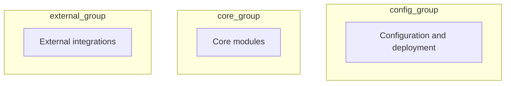

# Architecture report: openai/openai-realtime-console

> Automated static analysis. **Observed** = directly seen in files/imports/AST; **Inferred** = interpretation from that evidence. Repository code was not executed.

## 1. Repository at a glance

| Item | Value |
| --- | --- |
| Repository | openai/openai-realtime-console |
| Description | React app for inspecting, building and debugging with the Realtime API |
| Language | JavaScript |
| Stars | 3620 |
| Licence | MIT |
| Analysed commit / branch | ab8b8f5852b47ec1b9ef73bf566851d0eeafddbb / main |
| Framework(s) | Express, React |
| Files analysed | 22 |
| Components | 3 |

## 2. Architecture in one minute

openai/openai-realtime-console - React app for inspecting, building and debugging with the Realtime API. This repository was analysed statically from 22 file(s) (0 Python). Detected technologies (observed from imports/manifests): Express, React, React Router, Tailwind CSS, Vite. Files are grouped into 3 component(s): Configuration and deployment, Core modules, External integrations. Findings below distinguish observed facts from inferred interpretation.

## 3. High-level block diagram

## 4. Main components

### Configuration and deployment (`config`)

- **Kind:** config
- **Status:** Observed
- **Confidence:** 0.85
- **Responsibility:** Groups 1 file(s) under configuration and deployment (observed from repository paths and static analysis).
- **Paths:** `package.json`
- **Evidence:** [package.json](https://github.com/openai/openai-realtime-console/blob/ab8b8f5852b47ec1b9ef73bf566851d0eeafddbb/package.json)

### Core modules (`core`)

- **Kind:** core
- **Status:** Observed
- **Confidence:** 0.85
- **Responsibility:** Groups 4 file(s) under core modules (observed from repository paths and static analysis).
- **Paths:** `postcss.config.cjs`, `server.js`, `tailwind.config.js`, `vite.config.js`
- **Evidence:** [postcss.config.cjs](https://github.com/openai/openai-realtime-console/blob/ab8b8f5852b47ec1b9ef73bf566851d0eeafddbb/postcss.config.cjs); [server.js](https://github.com/openai/openai-realtime-console/blob/ab8b8f5852b47ec1b9ef73bf566851d0eeafddbb/server.js); [tailwind.config.js](https://github.com/openai/openai-realtime-console/blob/ab8b8f5852b47ec1b9ef73bf566851d0eeafddbb/tailwind.config.js); [vite.config.js](https://github.com/openai/openai-realtime-console/blob/ab8b8f5852b47ec1b9ef73bf566851d0eeafddbb/vite.config.js)

### External integrations (`external_integrations`)

- **Kind:** external
- **Status:** Observed
- **Confidence:** 0.85
- **Responsibility:** Groups 9 file(s) under external integrations (observed from repository paths and static analysis).
- **Paths:** `client/components/App.jsx`, `client/components/Button.jsx`, `client/components/EventLog.jsx`, `client/components/SessionControls.jsx`, `client/components/ToolPanel.jsx`, `client/entry-client.jsx`, `client/entry-server.jsx`, `client/index.js`, `client/pages/index.jsx`
- **Evidence:** [client/components/App.jsx](https://github.com/openai/openai-realtime-console/blob/ab8b8f5852b47ec1b9ef73bf566851d0eeafddbb/client/components/App.jsx); [client/components/Button.jsx](https://github.com/openai/openai-realtime-console/blob/ab8b8f5852b47ec1b9ef73bf566851d0eeafddbb/client/components/Button.jsx); [client/components/EventLog.jsx](https://github.com/openai/openai-realtime-console/blob/ab8b8f5852b47ec1b9ef73bf566851d0eeafddbb/client/components/EventLog.jsx); [client/components/SessionControls.jsx](https://github.com/openai/openai-realtime-console/blob/ab8b8f5852b47ec1b9ef73bf566851d0eeafddbb/client/components/SessionControls.jsx); [client/components/ToolPanel.jsx](https://github.com/openai/openai-realtime-console/blob/ab8b8f5852b47ec1b9ef73bf566851d0eeafddbb/client/components/ToolPanel.jsx); [client/entry-client.jsx](https://github.com/openai/openai-realtime-console/blob/ab8b8f5852b47ec1b9ef73bf566851d0eeafddbb/client/entry-client.jsx); [client/entry-server.jsx](https://github.com/openai/openai-realtime-console/blob/ab8b8f5852b47ec1b9ef73bf566851d0eeafddbb/client/entry-server.jsx); [client/index.js](https://github.com/openai/openai-realtime-console/blob/ab8b8f5852b47ec1b9ef73bf566851d0eeafddbb/client/index.js)

## 5. Execution flow

**Observed** entry point(s):

- [client/components/App.jsx](https://github.com/openai/openai-realtime-console/blob/ab8b8f5852b47ec1b9ef73bf566851d0eeafddbb/client/components/App.jsx)
- [client/index.js](https://github.com/openai/openai-realtime-console/blob/ab8b8f5852b47ec1b9ef73bf566851d0eeafddbb/client/index.js)
- [client/pages/index.jsx](https://github.com/openai/openai-realtime-console/blob/ab8b8f5852b47ec1b9ef73bf566851d0eeafddbb/client/pages/index.jsx)
- [server.js](https://github.com/openai/openai-realtime-console/blob/ab8b8f5852b47ec1b9ef73bf566851d0eeafddbb/server.js)

Representative flow (derived from observed entry points and the import graph; steps beyond the entry point are **Inferred**):

1. Execution starts at an observed entry point listed above, if present.
2. No internal import relationships between components were observed.

## 6. Project structure

### `(root)`

- `.env.example` - config (32 bytes)
- `.gitignore` - other (237 bytes)
- `.prettierrc` - other (211 bytes)
- `LICENSE` - docs (1063 bytes)
- `README.md` - docs (1779 bytes)
- `package.json` - manifest (909 bytes)
- `postcss.config.cjs` - source, JavaScript (251 bytes)
- `server.js` - source, JavaScript (2413 bytes)
- `tailwind.config.js` - source, JavaScript (174 bytes)
- `vite.config.js` - source, JavaScript (254 bytes)

### `client`

- `client/assets/openai-logomark.svg` - other (1735 bytes)
- `client/base.css` - other (427 bytes)
- `client/components/App.jsx` - source, JavaScript (5570 bytes)
- `client/components/Button.jsx` - source, JavaScript (291 bytes)
- `client/components/EventLog.jsx` - source, JavaScript (1735 bytes)
- `client/components/SessionControls.jsx` - source, JavaScript (2295 bytes)
- `client/components/ToolPanel.jsx` - source, JavaScript (3619 bytes)
- `client/entry-client.jsx` - source, JavaScript (239 bytes)
- `client/entry-server.jsx` - source, JavaScript (258 bytes)
- `client/index.html` - other (579 bytes)
- `client/index.js` - source, JavaScript (145 bytes)
- `client/pages/index.jsx` - source, JavaScript (92 bytes)

## 7. Key dependencies and integrations

| Name | Category | Status | Confidence | Evidence |
| --- | --- | --- | --- | --- |
| Express | framework | Observed | 0.85 | [package.json:14](https://github.com/openai/openai-realtime-console/blob/ab8b8f5852b47ec1b9ef73bf566851d0eeafddbb/package.json#L14) |
| React | framework | Observed | 0.90 | [package.json:17](https://github.com/openai/openai-realtime-console/blob/ab8b8f5852b47ec1b9ef73bf566851d0eeafddbb/package.json#L17); [package.json:18](https://github.com/openai/openai-realtime-console/blob/ab8b8f5852b47ec1b9ef73bf566851d0eeafddbb/package.json#L18) |
| React Router | library | Observed | 0.85 | [package.json:20](https://github.com/openai/openai-realtime-console/blob/ab8b8f5852b47ec1b9ef73bf566851d0eeafddbb/package.json#L20) |
| Tailwind CSS | library | Observed | 0.85 | [package.json:28](https://github.com/openai/openai-realtime-console/blob/ab8b8f5852b47ec1b9ef73bf566851d0eeafddbb/package.json#L28) |
| Vite | tooling | Observed | 0.85 | [package.json:7](https://github.com/openai/openai-realtime-console/blob/ab8b8f5852b47ec1b9ef73bf566851d0eeafddbb/package.json#L7) |

## 8. Data and state

No database, cache, queue, or persistent-state usage was observed in the analysed files. State handling, if any, may be in-memory or in files that were not analysed.

## 9. Configuration and deployment clues

- `.env.example` (config)
- `package.json` (manifest)

Environment variable *names* seen in example env files (values never recorded):

- `.env.example`: `OPENAI_API_KEY`

## 10. Design observations

- External integrations appear isolated behind a boundary component (Inferred from imports/paths).

These observations are interpretations (**Inferred**) of the observed structure, not guarantees about runtime design.

## 11. Limitations and unknowns

- Static analysis only: repository code was not executed, installed, or imported at runtime.
- Components and relationships are inferred from file paths, imports, and AST structure; runtime behaviour, dynamic imports, and reflection may not be visible.
- 1 file(s) were skipped during inventory (1 x lockfile excluded).
- No clear application entry point was observed in the analysed files.
- Repository text was treated as untrusted data; no instructions found in repository files were followed, and likely secret values were redacted/excluded.
- JavaScript and TypeScript files were inventoried from paths and package manifests. They were not parsed with a full language AST, and repository code was not executed.

## 12. Source references

- [client/components/App.jsx](https://github.com/openai/openai-realtime-console/blob/ab8b8f5852b47ec1b9ef73bf566851d0eeafddbb/client/components/App.jsx)
- [client/components/Button.jsx](https://github.com/openai/openai-realtime-console/blob/ab8b8f5852b47ec1b9ef73bf566851d0eeafddbb/client/components/Button.jsx)
- [client/components/EventLog.jsx](https://github.com/openai/openai-realtime-console/blob/ab8b8f5852b47ec1b9ef73bf566851d0eeafddbb/client/components/EventLog.jsx)
- [client/components/SessionControls.jsx](https://github.com/openai/openai-realtime-console/blob/ab8b8f5852b47ec1b9ef73bf566851d0eeafddbb/client/components/SessionControls.jsx)
- [client/components/ToolPanel.jsx](https://github.com/openai/openai-realtime-console/blob/ab8b8f5852b47ec1b9ef73bf566851d0eeafddbb/client/components/ToolPanel.jsx)
- [client/entry-client.jsx](https://github.com/openai/openai-realtime-console/blob/ab8b8f5852b47ec1b9ef73bf566851d0eeafddbb/client/entry-client.jsx)
- [client/entry-server.jsx](https://github.com/openai/openai-realtime-console/blob/ab8b8f5852b47ec1b9ef73bf566851d0eeafddbb/client/entry-server.jsx)
- [client/index.js](https://github.com/openai/openai-realtime-console/blob/ab8b8f5852b47ec1b9ef73bf566851d0eeafddbb/client/index.js)
- [client/pages/index.jsx](https://github.com/openai/openai-realtime-console/blob/ab8b8f5852b47ec1b9ef73bf566851d0eeafddbb/client/pages/index.jsx)
- [package.json](https://github.com/openai/openai-realtime-console/blob/ab8b8f5852b47ec1b9ef73bf566851d0eeafddbb/package.json)
- [package.json:7](https://github.com/openai/openai-realtime-console/blob/ab8b8f5852b47ec1b9ef73bf566851d0eeafddbb/package.json#L7)
- [package.json:14](https://github.com/openai/openai-realtime-console/blob/ab8b8f5852b47ec1b9ef73bf566851d0eeafddbb/package.json#L14)
- [package.json:17](https://github.com/openai/openai-realtime-console/blob/ab8b8f5852b47ec1b9ef73bf566851d0eeafddbb/package.json#L17)
- [package.json:18](https://github.com/openai/openai-realtime-console/blob/ab8b8f5852b47ec1b9ef73bf566851d0eeafddbb/package.json#L18)
- [package.json:20](https://github.com/openai/openai-realtime-console/blob/ab8b8f5852b47ec1b9ef73bf566851d0eeafddbb/package.json#L20)
- [package.json:28](https://github.com/openai/openai-realtime-console/blob/ab8b8f5852b47ec1b9ef73bf566851d0eeafddbb/package.json#L28)
- [postcss.config.cjs](https://github.com/openai/openai-realtime-console/blob/ab8b8f5852b47ec1b9ef73bf566851d0eeafddbb/postcss.config.cjs)
- [server.js](https://github.com/openai/openai-realtime-console/blob/ab8b8f5852b47ec1b9ef73bf566851d0eeafddbb/server.js)
- [tailwind.config.js](https://github.com/openai/openai-realtime-console/blob/ab8b8f5852b47ec1b9ef73bf566851d0eeafddbb/tailwind.config.js)
- [vite.config.js](https://github.com/openai/openai-realtime-console/blob/ab8b8f5852b47ec1b9ef73bf566851d0eeafddbb/vite.config.js)
