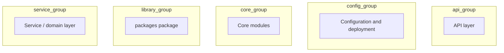

# Architecture report: orval-labs/orval

> Automated static analysis. **Observed** = directly seen in files/imports/AST; **Inferred** = interpretation from that evidence. Repository code was not executed.

## 1. Repository at a glance

| Item | Value |
| --- | --- |
| Repository | orval-labs/orval |
| Description | orval is able to generate client with appropriate type-signatures (TypeScript) from any valid OpenAPI v3 or Swagger v2 specification, either in yaml or json formats. 🍺 |
| Language | TypeScript |
| Stars | 6614 |
| Licence | MIT |
| Analysed commit / branch | 4d82f9584ff687adcafd10f3acc1b66ac4e45520 / master |
| Framework(s) | React |
| Files analysed | 800 |
| Components | 5 |

## 2. Architecture in one minute

orval-labs/orval - orval is able to generate client with appropriate type-signatures (TypeScript) from any valid OpenAPI v3 or Swagger v2 specification, either in yaml or json formats. 🍺. This repository was analysed statically from 800 file(s) (0 Python). Detected technologies (observed from imports/manifests): GitHub Actions, React, Tailwind CSS, Docker, TypeScript, Vite. Files are grouped into 5 component(s): API layer, Configuration and deployment, Core modules, packages package, Service / domain layer. Findings below distinguish observed facts from inferred interpretation.

## 3. High-level block diagram

## 4. Main components

### API layer (`api_layer`)

- **Kind:** api
- **Status:** Observed
- **Confidence:** 0.85
- **Responsibility:** Groups 116 file(s) under api layer (observed from repository paths and static analysis).
- **Paths:** `samples/angular-app/__snapshots__/api/artifact-groups/angular/index.ts`, `samples/angular-app/__snapshots__/api/artifact-groups/angular/pets/pets.service.ts`, `samples/angular-app/__snapshots__/api/artifact-groups/faker/index.faker.ts`, `samples/angular-app/__snapshots__/api/artifact-groups/faker/pets/pets.faker.ts`, `samples/angular-app/__snapshots__/api/artifact-groups/faker/schemas/index.faker.ts`, `samples/angular-app/__snapshots__/api/artifact-groups/msw/index.msw.ts`, `samples/angular-app/__snapshots__/api/artifact-groups/msw/pets/pets.msw.ts`, `samples/angular-app/__snapshots__/api/artifact-groups/schemas/createPetsBody.ts`, `samples/angular-app/__snapshots__/api/artifact-groups/schemas/createPetsBodyStatus.ts`, `samples/angular-app/__snapshots__/api/artifact-groups/schemas/error.ts`, `samples/angular-app/__snapshots__/api/artifact-groups/schemas/index.ts`, `samples/angular-app/__snapshots__/api/artifact-groups/schemas/listPetsParams.ts`, `samples/angular-app/__snapshots__/api/artifact-groups/schemas/pet.ts`, `samples/angular-app/__snapshots__/api/artifact-groups/schemas/petStatus.ts`, `samples/angular-app/__snapshots__/api/artifact-groups/schemas/pets.ts`, `samples/angular-app/__snapshots__/api/artifact-groups/schemas/searchPetsParams.ts`, `samples/angular-app/__snapshots__/api/artifact-groups/schemas/searchPetsStatus.ts`, `samples/angular-app/__snapshots__/api/base-url-token/index.ts`, `samples/angular-app/__snapshots__/api/base-url-token/model/createPetsBody.ts`, `samples/angular-app/__snapshots__/api/base-url-token/model/createPetsBodyStatus.ts`, `samples/angular-app/__snapshots__/api/base-url-token/model/error.ts`, `samples/angular-app/__snapshots__/api/base-url-token/model/index.ts`, `samples/angular-app/__snapshots__/api/base-url-token/model/listPetsParams.ts`, `samples/angular-app/__snapshots__/api/base-url-token/model/pet.ts`, `samples/angular-app/__snapshots__/api/base-url-token/model/petStatus.ts`, `samples/angular-app/__snapshots__/api/base-url-token/model/pets.ts`, `samples/angular-app/__snapshots__/api/base-url-token/model/searchPetsParams.ts`, `samples/angular-app/__snapshots__/api/base-url-token/model/searchPetsStatus.ts`, `samples/angular-app/__snapshots__/api/base-url-token/pets/pets.resource.ts`, `samples/angular-app/__snapshots__/api/base-url-token/pets/pets.service.ts`, `samples/angular-app/__snapshots__/api/base-url-token/petstore.base-url.ts`, `samples/angular-app/__snapshots__/api/endpoints-zod-both/index.msw.ts`, `samples/angular-app/__snapshots__/api/endpoints-zod-both/index.ts`, `samples/angular-app/__snapshots__/api/endpoints-zod-both/model/createPetsBody.zod.ts`, `samples/angular-app/__snapshots__/api/endpoints-zod-both/model/error.zod.ts`, `samples/angular-app/__snapshots__/api/endpoints-zod-both/model/index.ts`, `samples/angular-app/__snapshots__/api/endpoints-zod-both/model/listPetsParams.zod.ts`, `samples/angular-app/__snapshots__/api/endpoints-zod-both/model/patchPetByIdBody.zod.ts`, `samples/angular-app/__snapshots__/api/endpoints-zod-both/model/pet.zod.ts`, `samples/angular-app/__snapshots__/api/endpoints-zod-both/model/pets.zod.ts`, `samples/angular-app/__snapshots__/api/endpoints-zod-both/model/searchPetsParams.zod.ts`, `samples/angular-app/__snapshots__/api/endpoints-zod-both/model/updatePetByIdBody.zod.ts`, `samples/angular-app/__snapshots__/api/endpoints-zod-both/pets/pets.msw.ts`, `samples/angular-app/__snapshots__/api/endpoints-zod-both/pets/pets.service.ts`, `samples/angular-app/__snapshots__/api/endpoints-zod-request-bodies/index.ts`, `samples/angular-app/__snapshots__/api/endpoints-zod-request-bodies/model/createPetsBody.zod.ts`, `samples/angular-app/__snapshots__/api/endpoints-zod-request-bodies/model/error.zod.ts`, `samples/angular-app/__snapshots__/api/endpoints-zod-request-bodies/model/index.ts`, `samples/angular-app/__snapshots__/api/endpoints-zod-request-bodies/model/listPetsParams.zod.ts`, `samples/angular-app/__snapshots__/api/endpoints-zod-request-bodies/model/patchPetByIdBody.zod.ts`, `samples/angular-app/__snapshots__/api/endpoints-zod-request-bodies/model/pet.zod.ts`, `samples/angular-app/__snapshots__/api/endpoints-zod-request-bodies/model/pets.zod.ts`, `samples/angular-app/__snapshots__/api/endpoints-zod-request-bodies/model/searchPetsParams.zod.ts`, `samples/angular-app/__snapshots__/api/endpoints-zod-request-bodies/model/updatePetByIdBody.zod.ts`, `samples/angular-app/__snapshots__/api/endpoints-zod-request-bodies/pets/pets.resource.ts`, `samples/angular-app/__snapshots__/api/endpoints-zod-request-bodies/pets/pets.service.ts`, `samples/angular-app/__snapshots__/api/endpoints-zod/index.msw.ts`, `samples/angular-app/__snapshots__/api/endpoints-zod/index.ts`, `samples/angular-app/__snapshots__/api/endpoints-zod/model/createPetsBody.zod.ts`, `samples/angular-app/__snapshots__/api/endpoints-zod/model/error.zod.ts`, `samples/angular-app/__snapshots__/api/endpoints-zod/model/index.ts`, `samples/angular-app/__snapshots__/api/endpoints-zod/model/listPetsParams.zod.ts`, `samples/angular-app/__snapshots__/api/endpoints-zod/model/patchPetByIdBody.zod.ts`, `samples/angular-app/__snapshots__/api/endpoints-zod/model/pet.zod.ts`, `samples/angular-app/__snapshots__/api/endpoints-zod/model/pets.zod.ts`, `samples/angular-app/__snapshots__/api/endpoints-zod/model/searchPetsParams.zod.ts`, `samples/angular-app/__snapshots__/api/endpoints-zod/model/updatePetByIdBody.zod.ts`, `samples/angular-app/__snapshots__/api/endpoints-zod/pets/pets.msw.ts`, `samples/angular-app/__snapshots__/api/endpoints-zod/pets/pets.service.ts`, `samples/angular-app/__snapshots__/api/http-both/index.msw.ts`, `samples/angular-app/__snapshots__/api/http-both/index.ts`, `samples/angular-app/__snapshots__/api/http-both/model/createPetsBody.ts`, `samples/angular-app/__snapshots__/api/http-both/model/createPetsBodyStatus.ts`, `samples/angular-app/__snapshots__/api/http-both/model/error.ts`, `samples/angular-app/__snapshots__/api/http-both/model/index.ts`, `samples/angular-app/__snapshots__/api/http-both/model/listPetsParams.ts`, `samples/angular-app/__snapshots__/api/http-both/model/pet.ts`, `samples/angular-app/__snapshots__/api/http-both/model/petStatus.ts`, `samples/angular-app/__snapshots__/api/http-both/model/pets.ts`, `samples/angular-app/__snapshots__/api/http-both/model/searchPetsParams.ts`, `samples/angular-app/__snapshots__/api/http-both/model/searchPetsStatus.ts`, `samples/angular-app/__snapshots__/api/http-both/pets/pets.msw.ts`, `samples/angular-app/__snapshots__/api/http-both/pets/pets.resource.ts`, `samples/angular-app/__snapshots__/api/http-both/pets/pets.service.ts`, `samples/angular-app/__snapshots__/api/http-client-custom-params/index.msw.ts`, `samples/angular-app/__snapshots__/api/http-client-custom-params/index.ts`, `samples/angular-app/__snapshots__/api/http-client-custom-params/model/createPetsBody.ts`, `samples/angular-app/__snapshots__/api/http-client-custom-params/model/createPetsBodyStatus.ts`, `samples/angular-app/__snapshots__/api/http-client-custom-params/model/error.ts`, `samples/angular-app/__snapshots__/api/http-client-custom-params/model/index.ts`, `samples/angular-app/__snapshots__/api/http-client-custom-params/model/listPetsParams.ts`, `samples/angular-app/__snapshots__/api/http-client-custom-params/model/pet.ts`, `samples/angular-app/__snapshots__/api/http-client-custom-params/model/petStatus.ts`, `samples/angular-app/__snapshots__/api/http-client-custom-params/model/pets.ts`, `samples/angular-app/__snapshots__/api/http-client-custom-params/model/searchPetsParams.ts`, `samples/angular-app/__snapshots__/api/http-client-custom-params/model/searchPetsStatus.ts`, `samples/angular-app/__snapshots__/api/http-client-custom-params/pets/pets.msw.ts`, `samples/angular-app/__snapshots__/api/http-client-custom-params/pets/pets.service.ts`, `samples/angular-app/__snapshots__/api/http-client/index.msw.ts`, `samples/angular-app/__snapshots__/api/http-client/index.ts`, `samples/angular-app/__snapshots__/api/http-client/model/createPetsBody.ts`, `samples/angular-app/__snapshots__/api/http-client/model/createPetsBodyStatus.ts`, `samples/angular-app/__snapshots__/api/http-client/model/error.ts`, `samples/angular-app/__snapshots__/api/http-client/model/index.ts`, `samples/angular-app/__snapshots__/api/http-client/model/listPetsParams.ts`, `samples/angular-app/__snapshots__/api/http-client/model/pet.ts`, `samples/angular-app/__snapshots__/api/http-client/model/petStatus.ts`, `samples/angular-app/__snapshots__/api/http-client/model/pets.ts`, `samples/angular-app/__snapshots__/api/http-client/model/searchPetsParams.ts`, `samples/angular-app/__snapshots__/api/http-client/model/searchPetsStatus.ts`, `samples/angular-app/__snapshots__/api/http-client/pets/pets.msw.ts`, `samples/angular-app/__snapshots__/api/http-client/pets/pets.service.ts`, `samples/angular-app/__snapshots__/api/http-resource-zod/index.msw.ts`, `samples/angular-app/__snapshots__/api/http-resource-zod/index.ts`, `samples/angular-app/__snapshots__/api/http-resource-zod/model/createPetsBody.zod.ts`, `samples/angular-app/__snapshots__/api/http-resource-zod/model/error.zod.ts`
- **Evidence:** [samples/angular-app/__snapshots__/api/artifact-groups/angular/index.ts](https://github.com/orval-labs/orval/blob/4d82f9584ff687adcafd10f3acc1b66ac4e45520/samples/angular-app/__snapshots__/api/artifact-groups/angular/index.ts); [samples/angular-app/__snapshots__/api/artifact-groups/angular/pets/pets.service.ts](https://github.com/orval-labs/orval/blob/4d82f9584ff687adcafd10f3acc1b66ac4e45520/samples/angular-app/__snapshots__/api/artifact-groups/angular/pets/pets.service.ts); [samples/angular-app/__snapshots__/api/artifact-groups/faker/index.faker.ts](https://github.com/orval-labs/orval/blob/4d82f9584ff687adcafd10f3acc1b66ac4e45520/samples/angular-app/__snapshots__/api/artifact-groups/faker/index.faker.ts); [samples/angular-app/__snapshots__/api/artifact-groups/faker/pets/pets.faker.ts](https://github.com/orval-labs/orval/blob/4d82f9584ff687adcafd10f3acc1b66ac4e45520/samples/angular-app/__snapshots__/api/artifact-groups/faker/pets/pets.faker.ts); [samples/angular-app/__snapshots__/api/artifact-groups/faker/schemas/index.faker.ts](https://github.com/orval-labs/orval/blob/4d82f9584ff687adcafd10f3acc1b66ac4e45520/samples/angular-app/__snapshots__/api/artifact-groups/faker/schemas/index.faker.ts); [samples/angular-app/__snapshots__/api/artifact-groups/msw/index.msw.ts](https://github.com/orval-labs/orval/blob/4d82f9584ff687adcafd10f3acc1b66ac4e45520/samples/angular-app/__snapshots__/api/artifact-groups/msw/index.msw.ts); [samples/angular-app/__snapshots__/api/artifact-groups/msw/pets/pets.msw.ts](https://github.com/orval-labs/orval/blob/4d82f9584ff687adcafd10f3acc1b66ac4e45520/samples/angular-app/__snapshots__/api/artifact-groups/msw/pets/pets.msw.ts); [samples/angular-app/__snapshots__/api/artifact-groups/schemas/createPetsBody.ts](https://github.com/orval-labs/orval/blob/4d82f9584ff687adcafd10f3acc1b66ac4e45520/samples/angular-app/__snapshots__/api/artifact-groups/schemas/createPetsBody.ts)

### Configuration and deployment (`config`)

- **Kind:** config
- **Status:** Observed
- **Confidence:** 0.85
- **Responsibility:** Groups 48 file(s) under configuration and deployment (observed from repository paths and static analysis).
- **Paths:** `Dockerfile`, `bunfig.toml`, `package.json`, `packages/angular/package.json`, `packages/angular/tsconfig.build.json`, `packages/angular/tsconfig.json`, `packages/axios/package.json`, `packages/axios/tsconfig.build.json`, `packages/axios/tsconfig.json`, `packages/core/package.json`, `packages/core/tsconfig.build.json`, `packages/core/tsconfig.json`, `packages/effect/package.json`, `packages/effect/tsconfig.build.json`, `packages/effect/tsconfig.json`, `packages/fetch/package.json`, `packages/fetch/tsconfig.build.json`, `packages/fetch/tsconfig.json`, `packages/hono/package.json`, `packages/hono/tsconfig.build.json`, `packages/hono/tsconfig.json`, `packages/mcp/package.json`, `packages/mcp/tsconfig.build.json`, `packages/mcp/tsconfig.json`, `packages/mock/package.json`, `packages/mock/tsconfig.build.json`, `packages/mock/tsconfig.json`, `packages/orval/package.json`, `packages/orval/tsconfig.build.json`, `packages/orval/tsconfig.json`, `packages/pinia-colada/package.json`, `packages/pinia-colada/tsconfig.build.json`, `packages/pinia-colada/tsconfig.json`, `packages/query/package.json`, `packages/query/tsconfig.build.json`, `packages/query/tsconfig.json`, `packages/solid-start/package.json`, `packages/solid-start/tsconfig.build.json`, `packages/solid-start/tsconfig.json`, `packages/swr/package.json`, `packages/swr/tsconfig.build.json`, `packages/swr/tsconfig.json`, `packages/valibot/package.json`, `packages/valibot/tsconfig.build.json`, `packages/valibot/tsconfig.json`, `packages/zod/package.json`, `packages/zod/tsconfig.build.json`, `packages/zod/tsconfig.json`
- **Evidence:** [Dockerfile](https://github.com/orval-labs/orval/blob/4d82f9584ff687adcafd10f3acc1b66ac4e45520/Dockerfile); [bunfig.toml](https://github.com/orval-labs/orval/blob/4d82f9584ff687adcafd10f3acc1b66ac4e45520/bunfig.toml); [package.json](https://github.com/orval-labs/orval/blob/4d82f9584ff687adcafd10f3acc1b66ac4e45520/package.json); [packages/angular/package.json](https://github.com/orval-labs/orval/blob/4d82f9584ff687adcafd10f3acc1b66ac4e45520/packages/angular/package.json); [packages/angular/tsconfig.build.json](https://github.com/orval-labs/orval/blob/4d82f9584ff687adcafd10f3acc1b66ac4e45520/packages/angular/tsconfig.build.json); [packages/angular/tsconfig.json](https://github.com/orval-labs/orval/blob/4d82f9584ff687adcafd10f3acc1b66ac4e45520/packages/angular/tsconfig.json); [packages/axios/package.json](https://github.com/orval-labs/orval/blob/4d82f9584ff687adcafd10f3acc1b66ac4e45520/packages/axios/package.json); [packages/axios/tsconfig.build.json](https://github.com/orval-labs/orval/blob/4d82f9584ff687adcafd10f3acc1b66ac4e45520/packages/axios/tsconfig.build.json)

### Core modules (`core`)

- **Kind:** core
- **Status:** Observed
- **Confidence:** 0.85
- **Responsibility:** Groups 1 file(s) under core modules (observed from repository paths and static analysis).
- **Paths:** `commitlint.config.mjs`
- **Evidence:** [commitlint.config.mjs](https://github.com/orval-labs/orval/blob/4d82f9584ff687adcafd10f3acc1b66ac4e45520/commitlint.config.mjs)

### packages package (`packages`)

- **Kind:** library
- **Status:** Observed
- **Confidence:** 0.85
- **Responsibility:** Groups 207 file(s) under packages package (observed from repository paths and static analysis).
- **Paths:** `packages/angular/src/base-url.test.ts`, `packages/angular/src/base-url.ts`, `packages/angular/src/constants.ts`, `packages/angular/src/http-client.test.ts`, `packages/angular/src/http-client.ts`, `packages/angular/src/http-resource.test.ts`, `packages/angular/src/http-resource.ts`, `packages/angular/src/index.test.ts`, `packages/angular/src/index.ts`, `packages/angular/src/logger.ts`, `packages/angular/src/test-helpers.ts`, `packages/angular/src/types.test.ts`, `packages/angular/src/types.ts`, `packages/angular/src/utils.test.ts`, `packages/angular/src/utils.ts`, `packages/angular/vite.config.ts`, `packages/axios/src/index.test.ts`, `packages/axios/src/index.ts`, `packages/axios/vite.config.ts`, `packages/effect/src/compatible-v4.test.ts`, `packages/effect/src/compatible-v4.ts`, `packages/effect/src/effect.test.ts`, `packages/effect/src/index.ts`, `packages/effect/src/logger.ts`, `packages/effect/vite.config.ts`, `packages/fetch/src/http-client-injection-factory.test.ts`, `packages/fetch/src/http-client-injection-factory.ts`, `packages/fetch/src/index.test.ts`, `packages/fetch/src/index.ts`, `packages/fetch/src/response-helpers.ts`, `packages/fetch/src/runtime.ts`, `packages/fetch/src/shared-runtime-style.test.ts`, `packages/fetch/src/shared-runtime-style.ts`, `packages/fetch/src/test-utils.ts`, `packages/fetch/vite.config.ts`, `packages/hono/src/handler-merge.test.ts`, `packages/hono/src/handler-merge.ts`, `packages/hono/src/handler-merge.typescript7.test.ts`, `packages/hono/src/index.no-typescript.test.ts`, `packages/hono/src/index.test.ts`, `packages/hono/src/index.ts`, `packages/hono/src/route.test.ts`, `packages/hono/src/route.ts`, `packages/hono/src/zValidator.ts`, `packages/hono/vite.config.ts`, `packages/mcp/src/index.test.ts`, `packages/mcp/src/index.ts`, `packages/mcp/vite.config.ts`, `packages/mock/src/delay.ts`, `packages/mock/src/faker/compatible-v9.test.ts`, `packages/mock/src/faker/compatible-v9.ts`, `packages/mock/src/faker/constants.ts`, `packages/mock/src/faker/format-example-value.test.ts`, `packages/mock/src/faker/format-example-value.ts`, `packages/mock/src/faker/getters/all-of-required.ts`, `packages/mock/src/faker/getters/array-item-factory.test.ts`, `packages/mock/src/faker/getters/array-item-factory.ts`, `packages/mock/src/faker/getters/combine.test.ts`, `packages/mock/src/faker/getters/combine.ts`, `packages/mock/src/faker/getters/index.ts`, `packages/mock/src/faker/getters/object.test.ts`, `packages/mock/src/faker/getters/object.ts`, `packages/mock/src/faker/getters/route.test.ts`, `packages/mock/src/faker/getters/route.ts`, `packages/mock/src/faker/getters/scalar.test.ts`, `packages/mock/src/faker/getters/scalar.ts`, `packages/mock/src/faker/imports.test.ts`, `packages/mock/src/faker/imports.ts`, `packages/mock/src/faker/index.test.ts`, `packages/mock/src/faker/index.ts`, `packages/mock/src/faker/resolvers/index.ts`, `packages/mock/src/faker/resolvers/value.test.ts`, `packages/mock/src/faker/resolvers/value.ts`, `packages/mock/src/index.ts`, `packages/mock/src/mock-types.test.ts`, `packages/mock/src/mock-types.ts`, `packages/mock/src/msw/index.test.ts`, `packages/mock/src/msw/index.ts`, `packages/mock/src/msw/mocks.test.ts`, `packages/mock/src/msw/mocks.ts`, `packages/mock/src/types.ts`, `packages/mock/vite.config.ts`, `packages/orval/src/api.ts`, `packages/orval/src/bin/orval.ts`, `packages/orval/src/client.test.ts`, `packages/orval/src/client.ts`, `packages/orval/src/error-responses.test.ts`, `packages/orval/src/formatters/prettier.test.ts`, `packages/orval/src/formatters/prettier.ts`, `packages/orval/src/generate-spec.ts`, `packages/orval/src/generate.test.ts`, `packages/orval/src/generate.ts`, `packages/orval/src/import-open-api.ts`, `packages/orval/src/import-specs.test.ts`, `packages/orval/src/import-specs.ts`, `packages/orval/src/index.ts`, `packages/orval/src/logger.ts`, `packages/orval/src/mutation-invalidates-validation.test.ts`, `packages/orval/src/mutator-source-cache.test.ts`, `packages/orval/src/pinia-colada.test.ts`, `packages/orval/src/primitive-response-validation.test.ts`, `packages/orval/src/readonly-arrays.test.ts`, `packages/orval/src/reusable-schemas.test.ts`, `packages/orval/src/reusable-schemas.ts`, `packages/orval/src/utils/barrel.test.ts`, `packages/orval/src/utils/barrel.ts`, `packages/orval/src/utils/config.ts`, `packages/orval/src/utils/execute-hook.ts`, `packages/orval/src/utils/find-up.test.ts`, `packages/orval/src/utils/find-up.ts`, `packages/orval/src/utils/index.ts`, `packages/orval/src/utils/options.factory.test.ts`, `packages/orval/src/utils/options.test.ts`, `packages/orval/src/utils/options.ts`, `packages/orval/src/utils/package-json.test.ts`, `packages/orval/src/utils/package-json.ts`, `packages/orval/src/utils/tsconfig.ts`, `packages/orval/src/utils/watcher.ts`, `packages/orval/src/write-specs.test.ts`, `packages/orval/src/write-specs.ts`, `packages/orval/src/write-zod-specs.test.ts`, `packages/orval/src/write-zod-specs.ts`, `packages/orval/vite.config.ts`, `packages/pinia-colada/src/index.test.ts`, `packages/pinia-colada/src/index.ts`, `packages/pinia-colada/vite.config.ts`, `packages/query/src/client.test.ts`, `packages/query/src/client.ts`, `packages/query/src/dependencies.test.ts`, `packages/query/src/dependencies.ts`, `packages/query/src/framework-adapter.ts`, `packages/query/src/frameworks/angular.ts`, `packages/query/src/frameworks/index.ts`, `packages/query/src/frameworks/mutation-on-success.test.ts`, `packages/query/src/frameworks/react.test.ts`, `packages/query/src/frameworks/react.ts`, `packages/query/src/frameworks/solid.test.ts`, `packages/query/src/frameworks/solid.ts`, `packages/query/src/frameworks/svelte.ts`, `packages/query/src/frameworks/version-warning.test.ts`, `packages/query/src/frameworks/vue.test.ts`, `packages/query/src/frameworks/vue.ts`, `packages/query/src/index.test.ts`, `packages/query/src/index.ts`, `packages/query/src/logger.ts`, `packages/query/src/mutation-generator.test.ts`, `packages/query/src/mutation-generator.ts`, `packages/query/src/query-generator.test.ts`, `packages/query/src/query-generator.ts`, `packages/query/src/query-options.test.ts`, `packages/query/src/query-options.ts`, `packages/query/src/utils.test.ts`, `packages/query/src/utils.ts`, `packages/query/vite.config.ts`, `packages/solid-start/src/index.test.ts`, `packages/solid-start/src/index.ts`, `packages/solid-start/src/logger.ts`, `packages/solid-start/vite.config.ts`, `packages/swr/src/client.test.ts`, `packages/swr/src/client.ts`, `packages/swr/src/index.test.ts`, `packages/swr/src/index.ts`, `packages/swr/vite.config.ts`, `packages/valibot/src/composition.test.ts`, `packages/valibot/src/composition.ts`, `packages/valibot/src/constraints.test.ts`, `packages/valibot/src/constraints.ts`, `packages/valibot/src/dereference.test.ts`, `packages/valibot/src/dereference.ts`, `packages/valibot/src/form-data.ts`, `packages/valibot/src/index.ts`, `packages/valibot/src/logger.test.ts`, `packages/valibot/src/logger.ts`, `packages/valibot/src/nodes.ts`, `packages/valibot/src/operation.test.ts`, `packages/valibot/src/operation.ts`, `packages/valibot/src/read-only.test.ts`, `packages/valibot/src/ref-policy.test.ts`, `packages/valibot/src/ref-policy.ts`, `packages/valibot/src/refs.ts`, `packages/valibot/src/render-type.test.ts`, `packages/valibot/src/render-type.ts`, `packages/valibot/src/render.test.ts`, `packages/valibot/src/render.ts`, `packages/valibot/src/reusable-parity.test.ts`, `packages/valibot/src/reusable-schemas.test.ts`, `packages/valibot/src/reusable-schemas.ts`, `packages/valibot/src/schema.test.ts`, `packages/valibot/src/schema.ts`, `packages/valibot/src/schemas-inline.test.ts`, `packages/valibot/src/schemas-inline.ts`, `packages/valibot/src/schemas-module.test.ts`, `packages/valibot/src/schemas-module.ts`, `packages/valibot/src/script-helpers.ts`, `packages/valibot/src/test-helpers.ts`, `packages/valibot/vite.config.ts`, `packages/vite.config.base.ts`, `packages/zod/src/callable-serializer.test.ts`, `packages/zod/src/callable-serializer.ts`, `packages/zod/src/compatible-v4.test.ts`, `packages/zod/src/compatible-v4.ts`, `packages/zod/src/export-emitter.test.ts`, `packages/zod/src/export-emitter.ts`, `packages/zod/src/index.ts`, `packages/zod/src/logger.ts`, `packages/zod/src/reusable-defaults.test.ts`, `packages/zod/vite.config.ts`
- **Evidence:** [packages/angular/src/base-url.test.ts](https://github.com/orval-labs/orval/blob/4d82f9584ff687adcafd10f3acc1b66ac4e45520/packages/angular/src/base-url.test.ts); [packages/angular/src/base-url.ts](https://github.com/orval-labs/orval/blob/4d82f9584ff687adcafd10f3acc1b66ac4e45520/packages/angular/src/base-url.ts); [packages/angular/src/constants.ts](https://github.com/orval-labs/orval/blob/4d82f9584ff687adcafd10f3acc1b66ac4e45520/packages/angular/src/constants.ts); [packages/angular/src/http-client.test.ts](https://github.com/orval-labs/orval/blob/4d82f9584ff687adcafd10f3acc1b66ac4e45520/packages/angular/src/http-client.test.ts); [packages/angular/src/http-client.ts](https://github.com/orval-labs/orval/blob/4d82f9584ff687adcafd10f3acc1b66ac4e45520/packages/angular/src/http-client.ts); [packages/angular/src/http-resource.test.ts](https://github.com/orval-labs/orval/blob/4d82f9584ff687adcafd10f3acc1b66ac4e45520/packages/angular/src/http-resource.test.ts); [packages/angular/src/http-resource.ts](https://github.com/orval-labs/orval/blob/4d82f9584ff687adcafd10f3acc1b66ac4e45520/packages/angular/src/http-resource.ts); [packages/angular/src/index.test.ts](https://github.com/orval-labs/orval/blob/4d82f9584ff687adcafd10f3acc1b66ac4e45520/packages/angular/src/index.test.ts)

### Service / domain layer (`service_layer`)

- **Kind:** service
- **Status:** Observed
- **Confidence:** 0.85
- **Responsibility:** Groups 244 file(s) under service / domain layer (observed from repository paths and static analysis).
- **Paths:** `packages/core/src/constants.ts`, `packages/core/src/generators/__tests__/mutator-test-files/call-expression-tests/factory-default-export.ts`, `packages/core/src/generators/__tests__/mutator-test-files/call-expression-tests/factory-named-export.ts`, `packages/core/src/generators/__tests__/mutator-test-files/default-anonymous-function-0-args.ts`, `packages/core/src/generators/__tests__/mutator-test-files/default-anonymous-function-1-args.ts`, `packages/core/src/generators/__tests__/mutator-test-files/default-anonymous-function-2-args.ts`, `packages/core/src/generators/__tests__/mutator-test-files/default-anonymous-function-3-args.ts`, `packages/core/src/generators/__tests__/mutator-test-files/default-anonymous-lambda-0-args.ts`, `packages/core/src/generators/__tests__/mutator-test-files/default-anonymous-lambda-1-args.ts`, `packages/core/src/generators/__tests__/mutator-test-files/default-anonymous-lambda-2-args.ts`, `packages/core/src/generators/__tests__/mutator-test-files/default-anonymous-lambda-3-args.ts`, `packages/core/src/generators/__tests__/mutator-test-files/default-anonymous-nested-lambda-0-args.ts`, `packages/core/src/generators/__tests__/mutator-test-files/default-anonymous-nested-lambda-1-args.ts`, `packages/core/src/generators/__tests__/mutator-test-files/default-anonymous-nested-lambda-2-args.ts`, `packages/core/src/generators/__tests__/mutator-test-files/default-anonymous-nested-lambda-3-args.ts`, `packages/core/src/generators/__tests__/mutator-test-files/dynamic-import-tests/dynamic-import-named-export.ts`, `packages/core/src/generators/__tests__/mutator-test-files/external-module-tests/external-module.ts`, `packages/core/src/generators/__tests__/mutator-test-files/external-module-tests/mutation.ts`, `packages/core/src/generators/__tests__/mutator-test-files/import-meta-mutator.ts`, `packages/core/src/generators/__tests__/mutator-test-files/named-export-tests.ts`, `packages/core/src/generators/__tests__/mutator-test-files/re-export-tests/external-named-export.ts`, `packages/core/src/generators/component-definition.test.ts`, `packages/core/src/generators/component-definition.ts`, `packages/core/src/generators/date-transform.ts`, `packages/core/src/generators/dynamic-ref.test.ts`, `packages/core/src/generators/factory.test.ts`, `packages/core/src/generators/factory.ts`, `packages/core/src/generators/imports.test.ts`, `packages/core/src/generators/imports.ts`, `packages/core/src/generators/index.ts`, `packages/core/src/generators/input-filters.test.ts`, `packages/core/src/generators/input-filters.ts`, `packages/core/src/generators/interface.test.ts`, `packages/core/src/generators/interface.ts`, `packages/core/src/generators/models-inline.ts`, `packages/core/src/generators/mutator-info.cache.test.ts`, `packages/core/src/generators/mutator-info.test.ts`, `packages/core/src/generators/mutator-info.ts`, `packages/core/src/generators/mutator-source.test.ts`, `packages/core/src/generators/mutator-source.ts`, `packages/core/src/generators/mutator.test.ts`, `packages/core/src/generators/mutator.ts`, `packages/core/src/generators/options.test.ts`, `packages/core/src/generators/options.ts`, `packages/core/src/generators/parameter-definition.test.ts`, `packages/core/src/generators/parameter-definition.ts`, `packages/core/src/generators/runtime-validation.test.ts`, `packages/core/src/generators/runtime-validation.ts`, `packages/core/src/generators/schema-definition.test.ts`, `packages/core/src/generators/schema-definition.ts`, `packages/core/src/generators/standard-schema-helper.ts`, `packages/core/src/generators/verbs-options.ts`, `packages/core/src/getters/array.test.ts`, `packages/core/src/getters/array.ts`, `packages/core/src/getters/body.test.ts`, `packages/core/src/getters/body.ts`, `packages/core/src/getters/combine.test.ts`, `packages/core/src/getters/combine.ts`, `packages/core/src/getters/deepObject.test.ts`, `packages/core/src/getters/discriminators.test.ts`, `packages/core/src/getters/discriminators.ts`, `packages/core/src/getters/enum.test.ts`, `packages/core/src/getters/enum.ts`, `packages/core/src/getters/form-data-components.test.ts`, `packages/core/src/getters/form-data-components.ts`, `packages/core/src/getters/imports.test.ts`, `packages/core/src/getters/imports.ts`, `packages/core/src/getters/index.ts`, `packages/core/src/getters/keys.test.ts`, `packages/core/src/getters/keys.ts`, `packages/core/src/getters/object.test.ts`, `packages/core/src/getters/object.ts`, `packages/core/src/getters/operation.test.ts`, `packages/core/src/getters/operation.ts`, `packages/core/src/getters/parameters.test.ts`, `packages/core/src/getters/parameters.ts`, `packages/core/src/getters/params.test.ts`, `packages/core/src/getters/params.ts`, `packages/core/src/getters/property-renames.test.ts`, `packages/core/src/getters/property-renames.ts`, `packages/core/src/getters/props.test.ts`, `packages/core/src/getters/props.ts`, `packages/core/src/getters/query-param-serialization.test.ts`, `packages/core/src/getters/query-param-serialization.ts`, `packages/core/src/getters/query-params.test.ts`, `packages/core/src/getters/query-params.ts`, `packages/core/src/getters/ref.test.ts`, `packages/core/src/getters/ref.ts`, `packages/core/src/getters/res-req-types.test.ts`, `packages/core/src/getters/res-req-types.ts`, `packages/core/src/getters/response.test.ts`, `packages/core/src/getters/response.ts`, `packages/core/src/getters/route-extended.test.ts`, `packages/core/src/getters/route.test.ts`, `packages/core/src/getters/route.ts`, `packages/core/src/getters/scalar.test.ts`, `packages/core/src/getters/scalar.ts`, `packages/core/src/index.ts`, `packages/core/src/resolvers/dereference/cache.ts`, `packages/core/src/resolvers/dereference/dereference.test.ts`, `packages/core/src/resolvers/dereference/dereference.ts`, `packages/core/src/resolvers/dereference/dynamic-scope.ts`, `packages/core/src/resolvers/dereference/expand.ts`, `packages/core/src/resolvers/dereference/index.ts`, `packages/core/src/resolvers/dereference/resolve-target.ts`, `packages/core/src/resolvers/dereference/types.ts`, `packages/core/src/resolvers/dynamic-ref.test.ts`, `packages/core/src/resolvers/index.ts`, `packages/core/src/resolvers/object.test.ts`, `packages/core/src/resolvers/object.ts`, `packages/core/src/resolvers/ref.test.ts`, `packages/core/src/resolvers/ref.ts`, `packages/core/src/resolvers/value.test.ts`, `packages/core/src/resolvers/value.ts`, `packages/core/src/schema-graph/alias.ts`, `packages/core/src/schema-graph/component-memo.ts`, `packages/core/src/schema-graph/component-names.test.ts`, `packages/core/src/schema-graph/component-names.ts`, `packages/core/src/schema-graph/dereference.test.ts`, `packages/core/src/schema-graph/dereference.ts`, `packages/core/src/schema-graph/index.ts`, `packages/core/src/schema-graph/inline-budget.ts`, `packages/core/src/schema-graph/inline-module.test.ts`, `packages/core/src/schema-graph/inline-module.ts`, `packages/core/src/schema-graph/lazy.ts`, `packages/core/src/schema-graph/read-only.ts`, `packages/core/src/schema-graph/ref-policy.ts`, `packages/core/src/schema-graph/refs.ts`, `packages/core/src/schema-graph/reporter.test.ts`, `packages/core/src/schema-graph/reporter.ts`, `packages/core/src/schema-graph/schema-keys.ts`, `packages/core/src/schema-graph/schema-type.ts`, `packages/core/src/schema-graph/shared-ref-policy.ts`, `packages/core/src/schema-graph/unguarded-cycles.ts`, `packages/core/src/test-utils/context.ts`, `packages/core/src/test-utils/generators.ts`, `packages/core/src/test-utils/index.ts`, `packages/core/src/test-utils/split-modes.ts`, `packages/core/src/types.ts`, `packages/core/src/utils/assertion.test.ts`, `packages/core/src/utils/assertion.ts`, `packages/core/src/utils/async-reduce.ts`, `packages/core/src/utils/barrel-re-exports.test.ts`, `packages/core/src/utils/barrel-re-exports.ts`, `packages/core/src/utils/case.test.ts`, `packages/core/src/utils/case.ts`, `packages/core/src/utils/collection.test.ts`, `packages/core/src/utils/collection.ts`, `packages/core/src/utils/compare-version.test.ts`, `packages/core/src/utils/compare-version.ts`, `packages/core/src/utils/content-type.test.ts`, `packages/core/src/utils/content-type.ts`, `packages/core/src/utils/deep-non-nullable.ts`, `packages/core/src/utils/doc.test.ts`, `packages/core/src/utils/doc.ts`, `packages/core/src/utils/dynamic-import.ts`, `packages/core/src/utils/extension.ts`, `packages/core/src/utils/file-extensions.ts`, `packages/core/src/utils/file.test.ts`, `packages/core/src/utils/file.ts`, `packages/core/src/utils/get-property-safe.ts`, `packages/core/src/utils/http-status.test.ts`, `packages/core/src/utils/http-status.ts`, `packages/core/src/utils/index.ts`, `packages/core/src/utils/is-body-verb.ts`, `packages/core/src/utils/logger.test.ts`, `packages/core/src/utils/logger.ts`, `packages/core/src/utils/merge-deep.ts`, `packages/core/src/utils/mutation-invalidates.test.ts`, `packages/core/src/utils/mutation-invalidates.ts`, `packages/core/src/utils/name.test.ts`, `packages/core/src/utils/name.ts`, `packages/core/src/utils/object-schema.ts`, `packages/core/src/utils/path.test.ts`, `packages/core/src/utils/path.ts`, `packages/core/src/utils/required.ts`, `packages/core/src/utils/resolve-version.test.ts`, `packages/core/src/utils/resolve-version.ts`, `packages/core/src/utils/schema-import-path.test.ts`, `packages/core/src/utils/schema-import-path.ts`, `packages/core/src/utils/schemas-options.test.ts`, `packages/core/src/utils/schemas-options.ts`, `packages/core/src/utils/sort.test.ts`, `packages/core/src/utils/sort.ts`, `packages/core/src/utils/string.test.ts`, `packages/core/src/utils/string.ts`, `packages/core/src/utils/strongly-connected.test.ts`, `packages/core/src/utils/strongly-connected.ts`, `packages/core/src/utils/tags.test.ts`, `packages/core/src/utils/tags.ts`, `packages/core/src/utils/template-literal.test.ts`, `packages/core/src/utils/template-literal.ts`, `packages/core/src/utils/tsconfig.test.ts`, `packages/core/src/utils/tsconfig.ts`, `packages/core/src/writers/barrel-collisions.test.ts`, `packages/core/src/writers/barrel-collisions.ts`, `packages/core/src/writers/file.test.ts`, `packages/core/src/writers/file.ts`, `packages/core/src/writers/finalize-mock-implementation.ts`, `packages/core/src/writers/fixtures.test.ts`, `packages/core/src/writers/fixtures.ts`, `packages/core/src/writers/generate-imports-for-builder.test.ts`, `packages/core/src/writers/generate-imports-for-builder.ts`, `packages/core/src/writers/implementation-parts.test.ts`, `packages/core/src/writers/implementation-parts.ts`, `packages/core/src/writers/index.ts`, `packages/core/src/writers/mock-imports.test.ts`, `packages/core/src/writers/mock-imports.ts`, `packages/core/src/writers/mock-outputs.test.ts`, `packages/core/src/writers/mock-outputs.ts`, `packages/core/src/writers/mock-utils.test.ts`, `packages/core/src/writers/mock-utils.ts`, `packages/core/src/writers/operation-manifest.test.ts`, `packages/core/src/writers/operation-manifest.ts`, `packages/core/src/writers/schema-output-plan.test.ts`, `packages/core/src/writers/schema-output-plan.ts`, `packages/core/src/writers/schema-tag-mapper.test.ts`, `packages/core/src/writers/schema-tag-mapper.ts`, `packages/core/src/writers/schemas-tags-split.test.ts`, `packages/core/src/writers/schemas-tags-split.ts`, `packages/core/src/writers/schemas.test.ts`, `packages/core/src/writers/schemas.ts`, `packages/core/src/writers/single-mode.test.ts`, `packages/core/src/writers/single-mode.ts`, `packages/core/src/writers/split-mode.test.ts`, `packages/core/src/writers/split-mode.ts`, `packages/core/src/writers/split-tags-mode.test.ts`, `packages/core/src/writers/split-tags-mode.ts`, `packages/core/src/writers/tags-mode.test.ts`, `packages/core/src/writers/tags-mode.ts`, `packages/core/src/writers/tags-operations-mocks.test.ts`, `packages/core/src/writers/tags-operations-mocks.ts`, `packages/core/src/writers/tags-operations-mode.test.ts`, `packages/core/src/writers/tags-operations-mode.ts`, `packages/core/src/writers/tags-operations-split-mode.test.ts`, `packages/core/src/writers/tags-operations-split-mode.ts`, `packages/core/src/writers/target-tags-operations.ts`, `packages/core/src/writers/target-tags.test.ts`, `packages/core/src/writers/target-tags.ts`, `packages/core/src/writers/target.ts`, `packages/core/src/writers/types.ts`, `packages/core/src/writers/typescript-version.test.ts`, `packages/core/src/writers/typescript-version.ts`, `packages/core/vite.config.ts`
- **Evidence:** [packages/core/src/constants.ts](https://github.com/orval-labs/orval/blob/4d82f9584ff687adcafd10f3acc1b66ac4e45520/packages/core/src/constants.ts); [packages/core/src/generators/__tests__/mutator-test-files/call-expression-tests/factory-default-export.ts](https://github.com/orval-labs/orval/blob/4d82f9584ff687adcafd10f3acc1b66ac4e45520/packages/core/src/generators/__tests__/mutator-test-files/call-expression-tests/factory-default-export.ts); [packages/core/src/generators/__tests__/mutator-test-files/call-expression-tests/factory-named-export.ts](https://github.com/orval-labs/orval/blob/4d82f9584ff687adcafd10f3acc1b66ac4e45520/packages/core/src/generators/__tests__/mutator-test-files/call-expression-tests/factory-named-export.ts); [packages/core/src/generators/__tests__/mutator-test-files/default-anonymous-function-0-args.ts](https://github.com/orval-labs/orval/blob/4d82f9584ff687adcafd10f3acc1b66ac4e45520/packages/core/src/generators/__tests__/mutator-test-files/default-anonymous-function-0-args.ts); [packages/core/src/generators/__tests__/mutator-test-files/default-anonymous-function-1-args.ts](https://github.com/orval-labs/orval/blob/4d82f9584ff687adcafd10f3acc1b66ac4e45520/packages/core/src/generators/__tests__/mutator-test-files/default-anonymous-function-1-args.ts); [packages/core/src/generators/__tests__/mutator-test-files/default-anonymous-function-2-args.ts](https://github.com/orval-labs/orval/blob/4d82f9584ff687adcafd10f3acc1b66ac4e45520/packages/core/src/generators/__tests__/mutator-test-files/default-anonymous-function-2-args.ts); [packages/core/src/generators/__tests__/mutator-test-files/default-anonymous-function-3-args.ts](https://github.com/orval-labs/orval/blob/4d82f9584ff687adcafd10f3acc1b66ac4e45520/packages/core/src/generators/__tests__/mutator-test-files/default-anonymous-function-3-args.ts); [packages/core/src/generators/__tests__/mutator-test-files/default-anonymous-lambda-0-args.ts](https://github.com/orval-labs/orval/blob/4d82f9584ff687adcafd10f3acc1b66ac4e45520/packages/core/src/generators/__tests__/mutator-test-files/default-anonymous-lambda-0-args.ts)

## 5. Execution flow

**Observed** entry point(s):

- [packages/angular/src/index.ts](https://github.com/orval-labs/orval/blob/4d82f9584ff687adcafd10f3acc1b66ac4e45520/packages/angular/src/index.ts)
- [packages/axios/src/index.ts](https://github.com/orval-labs/orval/blob/4d82f9584ff687adcafd10f3acc1b66ac4e45520/packages/axios/src/index.ts)
- [packages/core/src/index.ts](https://github.com/orval-labs/orval/blob/4d82f9584ff687adcafd10f3acc1b66ac4e45520/packages/core/src/index.ts)
- [packages/effect/src/index.ts](https://github.com/orval-labs/orval/blob/4d82f9584ff687adcafd10f3acc1b66ac4e45520/packages/effect/src/index.ts)
- [packages/fetch/src/index.ts](https://github.com/orval-labs/orval/blob/4d82f9584ff687adcafd10f3acc1b66ac4e45520/packages/fetch/src/index.ts)
- [packages/hono/src/index.ts](https://github.com/orval-labs/orval/blob/4d82f9584ff687adcafd10f3acc1b66ac4e45520/packages/hono/src/index.ts)
- [packages/mcp/src/index.ts](https://github.com/orval-labs/orval/blob/4d82f9584ff687adcafd10f3acc1b66ac4e45520/packages/mcp/src/index.ts)
- [packages/mock/src/index.ts](https://github.com/orval-labs/orval/blob/4d82f9584ff687adcafd10f3acc1b66ac4e45520/packages/mock/src/index.ts)
- [packages/orval/src/index.ts](https://github.com/orval-labs/orval/blob/4d82f9584ff687adcafd10f3acc1b66ac4e45520/packages/orval/src/index.ts)
- [packages/pinia-colada/src/index.ts](https://github.com/orval-labs/orval/blob/4d82f9584ff687adcafd10f3acc1b66ac4e45520/packages/pinia-colada/src/index.ts)
- [packages/query/src/index.ts](https://github.com/orval-labs/orval/blob/4d82f9584ff687adcafd10f3acc1b66ac4e45520/packages/query/src/index.ts)
- [packages/solid-start/src/index.ts](https://github.com/orval-labs/orval/blob/4d82f9584ff687adcafd10f3acc1b66ac4e45520/packages/solid-start/src/index.ts)

Representative flow (derived from observed entry points and the import graph; steps beyond the entry point are **Inferred**):

1. Execution starts at an observed entry point listed above, if present.
2. No internal import relationships between components were observed.

## 6. Project structure

### `(root)`

- `.coderabbit.yaml` - config (258 bytes)
- `.dockerignore` - container (14 bytes)
- `.gitattributes` - other (188 bytes)
- `.gitignore` - other (1572 bytes)
- `.prettierrc.json` - config (179 bytes)
- `AGENTS.md` - docs (1731 bytes)
- `ARCHITECTURE.md` - docs (3891 bytes)
- `CODE_OF_CONDUCT.md` - docs (5211 bytes)
- `CONTRIBUTING.md` - docs (4645 bytes)
- `DEBUGGING.md` - docs (4610 bytes)
- `Dockerfile` - container (287 bytes)
- `LICENSE` - docs (1075 bytes)
- `README.md` - docs (9682 bytes)
- `SECURITY.md` - docs (2044 bytes)
- `bunfig.toml` - config (168 bytes)
- `commitlint.config.mjs` - source, JavaScript (68 bytes)
- `package.json` - manifest (4079 bytes)

### `.claude-plugin`

- `.claude-plugin/marketplace.json` - config (342 bytes)

### `.devcontainer`

- `.devcontainer/Dockerfile` - container (1698 bytes)
- `.devcontainer/devcontainer-lock.json` - config (337 bytes)
- `.devcontainer/devcontainer.json` - config (866 bytes)

### `.github`

- `.github/FUNDING.yml` - config (44 bytes)
- `.github/ISSUE_TEMPLATE/bug_report.yml` - config (2840 bytes)
- `.github/ISSUE_TEMPLATE/config.yml` - config (270 bytes)
- `.github/ISSUE_TEMPLATE/feature_request.yml` - config (1000 bytes)
- `.github/ISSUE_TEMPLATE/other.yml` - config (459 bytes)
- `.github/PULL_REQUEST_TEMPLATE.md` - docs (85 bytes)
- `.github/dependabot.yml` - config (1007 bytes)
- `.github/workflows/deploy-doc.yaml` - ci, YAML (845 bytes)
- `.github/workflows/docker-publish.yaml` - ci, YAML (2179 bytes)
- `.github/workflows/issue-labeler.yaml` - ci, YAML (1821 bytes)
- `.github/workflows/pr-checks.yaml` - ci, YAML (3212 bytes)
- `.github/workflows/release-prepare.yaml` - ci, YAML (2312 bytes)
- `.github/workflows/release-publish.yaml` - ci, YAML (2941 bytes)
- `.github/workflows/stale.yaml` - ci, YAML (873 bytes)

### `.vite-hooks`

- `.vite-hooks/commit-msg` - other (28 bytes)
- `.vite-hooks/pre-commit` - other (10 bytes)

### `.vscode`

- `.vscode/extensions.json` - config (239 bytes)
- `.vscode/settings.json` - config (1051 bytes)

### `docs`

- `docs/.gitignore` - docs (291 bytes)
- `docs/README.md` - docs (202 bytes)
- `docs/biome.json` - config (582 bytes)
- `docs/bun.lock` - docs (170983 bytes)
- `docs/content/docs/guides/angular-query.mdx` - docs (10664 bytes)
- `docs/content/docs/guides/angular.mdx` - docs (51177 bytes)
- `docs/content/docs/guides/basics.mdx` - docs (2459 bytes)
- `docs/content/docs/guides/client-with-effect.mdx` - docs (2237 bytes)
- `docs/content/docs/guides/client-with-zod.mdx` - docs (2188 bytes)
- `docs/content/docs/guides/custom-axios.mdx` - docs (2449 bytes)
- `docs/content/docs/guides/custom-client.mdx` - docs (2928 bytes)
- `docs/content/docs/guides/effect.mdx` - docs (2100 bytes)
- `docs/content/docs/guides/enums.mdx` - docs (5071 bytes)
- `docs/content/docs/guides/faker.mdx` - docs (12174 bytes)
- `docs/content/docs/guides/fetch-client.mdx` - docs (3255 bytes)
- `docs/content/docs/guides/fetch.mdx` - docs (5597 bytes)
- `docs/content/docs/guides/fixtures.mdx` - docs (11096 bytes)
- `docs/content/docs/guides/hono.mdx` - docs (4129 bytes)
- `docs/content/docs/guides/mcp.mdx` - docs (12703 bytes)
- `docs/content/docs/guides/meta.json` - config (629 bytes)
- `docs/content/docs/guides/msw.mdx` - docs (10033 bytes)
- `docs/content/docs/guides/pinia-colada.mdx` - docs (7663 bytes)
- `docs/content/docs/guides/react-query.mdx` - docs (7015 bytes)
- `docs/content/docs/guides/set-base-url.mdx` - docs (3063 bytes)
- `docs/content/docs/guides/solid-query.mdx` - docs (6952 bytes)
- `docs/content/docs/guides/solid-start.mdx` - docs (8613 bytes)
- `docs/content/docs/guides/stream-ndjson.mdx` - docs (2906 bytes)
- `docs/content/docs/guides/svelte-query.mdx` - docs (4417 bytes)
- `docs/content/docs/guides/swr.mdx` - docs (2498 bytes)
- `docs/content/docs/guides/valibot.mdx` - docs (10047 bytes)
- `docs/content/docs/guides/vue-query.mdx` - docs (5815 bytes)
- `docs/content/docs/guides/zod.mdx` - docs (9643 bytes)
- `docs/content/docs/index.mdx` - docs (1788 bytes)
- `docs/content/docs/installation.mdx` - docs (6162 bytes)
- `docs/content/docs/meta.json` - config (228 bytes)
- `docs/content/docs/quick-start.mdx` - docs (1748 bytes)
- `docs/content/docs/reference/cli.mdx` - docs (3182 bytes)
- `docs/content/docs/reference/configuration/full-example.mdx` - docs (1447 bytes)
- `docs/content/docs/reference/configuration/hooks.mdx` - docs (774 bytes)
- `docs/content/docs/reference/configuration/index.mdx` - docs (1070 bytes)
- `docs/content/docs/reference/configuration/input.mdx` - docs (12747 bytes)
- `docs/content/docs/reference/configuration/meta.json` - config (97 bytes)
- `docs/content/docs/reference/configuration/output.mdx` - docs (192093 bytes)
- `docs/content/docs/reference/integration.mdx` - docs (7043 bytes)
- `docs/content/docs/reference/meta.json` - config (82 bytes)
- `docs/content/docs/versions/meta.json` - config (45 bytes)
- `docs/content/docs/versions/v8.mdx` - docs (8591 bytes)
- `docs/content/docs/zh/guides/angular-query.mdx` - docs (10749 bytes)
- `docs/content/docs/zh/guides/angular.mdx` - docs (49444 bytes)
- `docs/content/docs/zh/guides/basics.mdx` - docs (2350 bytes)
- `docs/content/docs/zh/guides/client-with-effect.mdx` - docs (2260 bytes)
- `docs/content/docs/zh/guides/client-with-zod.mdx` - docs (2221 bytes)
- `docs/content/docs/zh/guides/custom-axios.mdx` - docs (2440 bytes)
- `docs/content/docs/zh/guides/custom-client.mdx` - docs (2929 bytes)
- `docs/content/docs/zh/guides/effect.mdx` - docs (1747 bytes)
- `docs/content/docs/zh/guides/enums.mdx` - docs (5046 bytes)
- `docs/content/docs/zh/guides/faker.mdx` - docs (12523 bytes)
- `docs/content/docs/zh/guides/fetch-client.mdx` - docs (3302 bytes)
- `docs/content/docs/zh/guides/fetch.mdx` - docs (3442 bytes)
- `docs/content/docs/zh/guides/fixtures.mdx` - docs (11333 bytes)
- `docs/content/docs/zh/guides/hono.mdx` - docs (4337 bytes)
- `docs/content/docs/zh/guides/mcp.mdx` - docs (13227 bytes)
- `docs/content/docs/zh/guides/meta.json` - config (618 bytes)
- `docs/content/docs/zh/guides/msw.mdx` - docs (10569 bytes)
- `docs/content/docs/zh/guides/pinia-colada.mdx` - docs (6776 bytes)
- `docs/content/docs/zh/guides/react-query.mdx` - docs (5713 bytes)
- `docs/content/docs/zh/guides/set-base-url.mdx` - docs (3192 bytes)
- `docs/content/docs/zh/guides/solid-query.mdx` - docs (7340 bytes)
- `docs/content/docs/zh/guides/solid-start.mdx` - docs (8849 bytes)
- `docs/content/docs/zh/guides/stream-ndjson.mdx` - docs (3007 bytes)
- `docs/content/docs/zh/guides/svelte-query.mdx` - docs (4779 bytes)
- `docs/content/docs/zh/guides/swr.mdx` - docs (2562 bytes)
- `docs/content/docs/zh/guides/valibot.mdx` - docs (7548 bytes)
- `docs/content/docs/zh/guides/vue-query.mdx` - docs (6249 bytes)
- `docs/content/docs/zh/guides/zod.mdx` - docs (9815 bytes)
- `docs/content/docs/zh/index.mdx` - docs (1826 bytes)
- `docs/content/docs/zh/installation.mdx` - docs (6085 bytes)
- `docs/content/docs/zh/meta.json` - config (215 bytes)
- `docs/content/docs/zh/quick-start.mdx` - docs (1744 bytes)
- `docs/content/docs/zh/reference/cli.mdx` - docs (3089 bytes)
- `docs/content/docs/zh/reference/configuration/full-example.mdx` - docs (1435 bytes)
- `docs/content/docs/zh/reference/configuration/hooks.mdx` - docs (774 bytes)
- `docs/content/docs/zh/reference/configuration/index.mdx` - docs (1029 bytes)
- `docs/content/docs/zh/reference/configuration/input.mdx` - docs (12588 bytes)
- `docs/content/docs/zh/reference/configuration/meta.json` - config (90 bytes)
- `docs/content/docs/zh/reference/configuration/output.mdx` - docs (153657 bytes)
- `docs/content/docs/zh/reference/integration.mdx` - docs (7029 bytes)
- `docs/content/docs/zh/reference/meta.json` - config (79 bytes)
- `docs/content/docs/zh/versions/meta.json` - config (43 bytes)
- `docs/content/docs/zh/versions/v8.mdx` - docs (8889 bytes)
- `docs/package.json` - manifest (1584 bytes)
- `docs/plugins/generate-md-pages.ts` - docs (9444 bytes)
- `docs/public/images/emblem.svg` - docs (12012 bytes)
- `docs/public/images/favicon.svg` - docs (12012 bytes)
- `docs/public/images/orval-logo-horizontal.svg` - docs (27508 bytes)
- `docs/scripts/check-i18n-coverage.ts` - docs (1074 bytes)
- `docs/site.config.json` - config (587 bytes)
- `docs/source.config.ts` - docs (157 bytes)
- `docs/src/components/docs/docs-page.tsx` - docs (3029 bytes)
- `docs/src/components/home/home-page.tsx` - docs (22715 bytes)
- `docs/src/components/not-found.tsx` - docs (924 bytes)
- `docs/src/components/particle-network.tsx` - docs (6461 bytes)
- `docs/src/components/playground/EditorPanel.tsx` - docs (1597 bytes)
- `docs/src/components/playground/ExampleSelector.tsx` - docs (2147 bytes)
- `docs/src/components/playground/OutputPanel.tsx` - docs (5004 bytes)
- `docs/src/components/playground/Playground.tsx` - docs (6161 bytes)
- `docs/src/components/playground/SchemaFormatToggle.tsx` - docs (1042 bytes)
- `docs/src/components/playground/playground-page.tsx` - docs (2259 bytes)
- `docs/src/lib/i18n.ts` - docs (1845 bytes)
- `docs/src/lib/layout.shared.tsx` - docs (1349 bytes)
- `docs/src/lib/playground/examples.ts` - docs (6372 bytes)
- `docs/src/lib/playground/generate.ts` - docs (1168 bytes)
- `docs/src/lib/playground/schema-format.ts` - docs (1344 bytes)
- `docs/src/lib/playground/types.ts` - docs (372 bytes)
- `docs/src/lib/source.ts` - docs (877 bytes)
- `docs/src/lib/sponsors.ts` - docs (1801 bytes)
- `docs/src/routeTree.gen.ts` - docs (5733 bytes)
- `docs/src/router.tsx` - docs (1007 bytes)
- `docs/src/routes/$locale/docs/$.tsx` - docs (460 bytes)
- `docs/src/routes/__root.tsx` - docs (2653 bytes)
- `docs/src/routes/api/search.ts` - docs (483 bytes)
- `docs/src/routes/docs/$.tsx` - docs (423 bytes)
- `docs/src/routes/index.tsx` - docs (448 bytes)
- `docs/src/routes/playground.tsx` - docs (388 bytes)
- `docs/src/routes/zh.tsx` - docs (450 bytes)
- `docs/src/routes/zh_.playground.tsx` - docs (386 bytes)
- `docs/src/styles/app.css` - docs (751 bytes)
- `docs/tsconfig.json` - config (607 bytes)
- `docs/vite.config.ts` - docs (775 bytes)
- `docs/wrangler.jsonc` - docs (484 bytes)

### `logo`

- `logo/orval-logo-horizontal.svg` - other (27520 bytes)

### `packages`

- `packages/angular/README.md` - docs (4448 bytes)
- `packages/angular/package.json` - manifest (733 bytes)
- `packages/angular/src/base-url.test.ts` - source, TypeScript (9510 bytes)
- `packages/angular/src/base-url.ts` - source, TypeScript (9408 bytes)
- `packages/angular/src/constants.ts` - source, TypeScript (1466 bytes)
- `packages/angular/src/http-client.test.ts` - source, TypeScript (118951 bytes)
- `packages/angular/src/http-client.ts` - source, TypeScript (48683 bytes)
- `packages/angular/src/http-resource.test.ts` - source, TypeScript (174065 bytes)
- `packages/angular/src/http-resource.ts` - source, TypeScript (77252 bytes)
- `packages/angular/src/index.test.ts` - source, TypeScript (2544 bytes)
- `packages/angular/src/index.ts` - source, TypeScript (1970 bytes)
- `packages/angular/src/logger.ts` - source, TypeScript (99 bytes)
- `packages/angular/src/test-helpers.ts` - source, TypeScript (5793 bytes)
- `packages/angular/src/types.test.ts` - source, TypeScript (7749 bytes)
- `packages/angular/src/types.ts` - source, TypeScript (2731 bytes)
- `packages/angular/src/utils.test.ts` - source, TypeScript (18801 bytes)
- `packages/angular/src/utils.ts` - source, TypeScript (10683 bytes)
- `packages/angular/tsconfig.build.json` - config (174 bytes)
- `packages/angular/tsconfig.json` - config (44 bytes)
- `packages/angular/vite.config.ts` - source, TypeScript (86 bytes)
- `packages/axios/README.md` - docs (1664 bytes)
- `packages/axios/package.json` - manifest (734 bytes)
- `packages/axios/src/index.test.ts` - source, TypeScript (24015 bytes)
- `packages/axios/src/index.ts` - source, TypeScript (15502 bytes)
- `packages/axios/tsconfig.build.json` - config (174 bytes)
- `packages/axios/tsconfig.json` - config (115 bytes)
- `packages/axios/vite.config.ts` - source, TypeScript (86 bytes)
- `packages/core/README.md` - docs (1651 bytes)
- `packages/core/package.json` - manifest (1307 bytes)
- `packages/core/src/constants.ts` - source, TypeScript (1425 bytes)
- `packages/core/src/generators/__tests__/mutator-test-files/call-expression-tests/factory-default-export.ts` - source, TypeScript (438 bytes)
- `packages/core/src/generators/__tests__/mutator-test-files/call-expression-tests/factory-named-export.ts` - source, TypeScript (390 bytes)
- `packages/core/src/generators/__tests__/mutator-test-files/default-anonymous-function-0-args.ts` - source, TypeScript (113 bytes)
- `packages/core/src/generators/__tests__/mutator-test-files/default-anonymous-function-1-args.ts` - source, TypeScript (151 bytes)
- `packages/core/src/generators/__tests__/mutator-test-files/default-anonymous-function-2-args.ts` - source, TypeScript (168 bytes)
- `packages/core/src/generators/__tests__/mutator-test-files/default-anonymous-function-3-args.ts` - source, TypeScript (185 bytes)
- `packages/core/src/generators/__tests__/mutator-test-files/default-anonymous-lambda-0-args.ts` - source, TypeScript (108 bytes)
- `packages/core/src/generators/__tests__/mutator-test-files/default-anonymous-lambda-1-args.ts` - source, TypeScript (146 bytes)
- `packages/core/src/generators/__tests__/mutator-test-files/default-anonymous-lambda-2-args.ts` - source, TypeScript (163 bytes)
- `packages/core/src/generators/__tests__/mutator-test-files/default-anonymous-lambda-3-args.ts` - source, TypeScript (180 bytes)
- `packages/core/src/generators/__tests__/mutator-test-files/default-anonymous-nested-lambda-0-args.ts` - source, TypeScript (114 bytes)
- `packages/core/src/generators/__tests__/mutator-test-files/default-anonymous-nested-lambda-1-args.ts` - source, TypeScript (152 bytes)
- `packages/core/src/generators/__tests__/mutator-test-files/default-anonymous-nested-lambda-2-args.ts` - source, TypeScript (169 bytes)
- `packages/core/src/generators/__tests__/mutator-test-files/default-anonymous-nested-lambda-3-args.ts` - source, TypeScript (186 bytes)
- `packages/core/src/generators/__tests__/mutator-test-files/dynamic-import-tests/dynamic-import-named-export.ts` - source, TypeScript (441 bytes)
- `packages/core/src/generators/__tests__/mutator-test-files/external-module-tests/external-module.ts` - source, TypeScript (125 bytes)
- `packages/core/src/generators/__tests__/mutator-test-files/external-module-tests/mutation.ts` - source, TypeScript (142 bytes)
- `packages/core/src/generators/__tests__/mutator-test-files/import-meta-mutator.ts` - source, TypeScript (528 bytes)
- `packages/core/src/generators/__tests__/mutator-test-files/named-export-tests.ts` - source, TypeScript (1063 bytes)
- `packages/core/src/generators/__tests__/mutator-test-files/re-export-tests/external-named-export.ts` - source, TypeScript (315 bytes)
- `packages/core/src/generators/component-definition.test.ts` - source, TypeScript (1293 bytes)
- `packages/core/src/generators/component-definition.ts` - source, TypeScript (2702 bytes)
- `packages/core/src/generators/date-transform.ts` - source, TypeScript (76930 bytes)
- `packages/core/src/generators/dynamic-ref.test.ts` - source, TypeScript (35217 bytes)
- `packages/core/src/generators/factory.test.ts` - source, TypeScript (32136 bytes)
- `packages/core/src/generators/factory.ts` - source, TypeScript (19879 bytes)
- `packages/core/src/generators/imports.test.ts` - source, TypeScript (12582 bytes)
- `packages/core/src/generators/imports.ts` - source, TypeScript (14421 bytes)
- `packages/core/src/generators/index.ts` - source, TypeScript (497 bytes)
- `packages/core/src/generators/input-filters.test.ts` - source, TypeScript (36009 bytes)
- `packages/core/src/generators/input-filters.ts` - source, TypeScript (9648 bytes)
- `packages/core/src/generators/interface.test.ts` - source, TypeScript (22156 bytes)
- `packages/core/src/generators/interface.ts` - source, TypeScript (2859 bytes)
- `packages/core/src/generators/models-inline.ts` - source, TypeScript (469 bytes)
- `packages/core/src/generators/mutator-info.cache.test.ts` - source, TypeScript (4672 bytes)
- `packages/core/src/generators/mutator-info.test.ts` - source, TypeScript (11972 bytes)
- `packages/core/src/generators/mutator-info.ts` - source, TypeScript (9768 bytes)
- `packages/core/src/generators/mutator-source.test.ts` - source, TypeScript (6270 bytes)
- `packages/core/src/generators/mutator-source.ts` - source, TypeScript (1725 bytes)
- `packages/core/src/generators/mutator.test.ts` - source, TypeScript (2798 bytes)
- `packages/core/src/generators/mutator.ts` - source, TypeScript (4168 bytes)
- `packages/core/src/generators/options.test.ts` - source, TypeScript (53352 bytes)
- `packages/core/src/generators/options.ts` - source, TypeScript (37310 bytes)
- `packages/core/src/generators/parameter-definition.test.ts` - source, TypeScript (2033 bytes)
- `packages/core/src/generators/parameter-definition.ts` - source, TypeScript (2343 bytes)
- `packages/core/src/generators/runtime-validation.test.ts` - source, TypeScript (24752 bytes)
- `packages/core/src/generators/runtime-validation.ts` - source, TypeScript (18718 bytes)
- `packages/core/src/generators/schema-definition.test.ts` - source, TypeScript (30163 bytes)
- `packages/core/src/generators/schema-definition.ts` - source, TypeScript (14311 bytes)
- `packages/core/src/generators/standard-schema-helper.ts` - source, TypeScript (4639 bytes)
- `packages/core/src/generators/verbs-options.ts` - source, TypeScript (17693 bytes)
- `packages/core/src/getters/array.test.ts` - source, TypeScript (6116 bytes)
- `packages/core/src/getters/array.ts` - source, TypeScript (4295 bytes)
- `packages/core/src/getters/body.test.ts` - source, TypeScript (32019 bytes)
- `packages/core/src/getters/body.ts` - source, TypeScript (8873 bytes)
- `packages/core/src/getters/combine.test.ts` - source, TypeScript (58820 bytes)
- `packages/core/src/getters/combine.ts` - source, TypeScript (41285 bytes)
- `packages/core/src/getters/deepObject.test.ts` - source, TypeScript (5649 bytes)
- `packages/core/src/getters/discriminators.test.ts` - source, TypeScript (22771 bytes)
- `packages/core/src/getters/discriminators.ts` - source, TypeScript (10646 bytes)
- `packages/core/src/getters/enum.test.ts` - source, TypeScript (25330 bytes)
- `packages/core/src/getters/enum.ts` - source, TypeScript (22011 bytes)
- `packages/core/src/getters/form-data-components.test.ts` - source, TypeScript (6924 bytes)
- `packages/core/src/getters/form-data-components.ts` - source, TypeScript (4738 bytes)
- `packages/core/src/getters/imports.test.ts` - source, TypeScript (8026 bytes)
- `packages/core/src/getters/imports.ts` - source, TypeScript (1708 bytes)
- `packages/core/src/getters/index.ts` - source, TypeScript (582 bytes)
- `packages/core/src/getters/keys.test.ts` - source, TypeScript (2524 bytes)
- `packages/core/src/getters/keys.ts` - source, TypeScript (2983 bytes)
- `packages/core/src/getters/object.test.ts` - source, TypeScript (10846 bytes)
- `packages/core/src/getters/object.ts` - source, TypeScript (27424 bytes)
- `packages/core/src/getters/operation.test.ts` - source, TypeScript (786 bytes)
- `packages/core/src/getters/operation.ts` - source, TypeScript (547 bytes)
- `packages/core/src/getters/parameters.test.ts` - source, TypeScript (6184 bytes)
- `packages/core/src/getters/parameters.ts` - source, TypeScript (2807 bytes)
- `packages/core/src/getters/params.test.ts` - source, TypeScript (7610 bytes)
- `packages/core/src/getters/params.ts` - source, TypeScript (7972 bytes)
- `packages/core/src/getters/property-renames.test.ts` - source, TypeScript (3009 bytes)
- `packages/core/src/getters/property-renames.ts` - source, TypeScript (2999 bytes)
- `packages/core/src/getters/props.test.ts` - source, TypeScript (2904 bytes)
- `packages/core/src/getters/props.ts` - source, TypeScript (4187 bytes)
- `packages/core/src/getters/query-param-serialization.test.ts` - source, TypeScript (5442 bytes)
- `packages/core/src/getters/query-param-serialization.ts` - source, TypeScript (12476 bytes)
- `packages/core/src/getters/query-params.test.ts` - source, TypeScript (31940 bytes)
- `packages/core/src/getters/query-params.ts` - source, TypeScript (13196 bytes)
- `packages/core/src/getters/ref.test.ts` - source, TypeScript (5516 bytes)
- `packages/core/src/getters/ref.ts` - source, TypeScript (4170 bytes)
- `packages/core/src/getters/res-req-types.test.ts` - source, TypeScript (97254 bytes)
- `packages/core/src/getters/res-req-types.ts` - source, TypeScript (54869 bytes)
- `packages/core/src/getters/response.test.ts` - source, TypeScript (17084 bytes)
- `packages/core/src/getters/response.ts` - source, TypeScript (2681 bytes)
- `packages/core/src/getters/route-extended.test.ts` - source, TypeScript (69135 bytes)
- `packages/core/src/getters/route.test.ts` - source, TypeScript (24245 bytes)
- `packages/core/src/getters/route.ts` - source, TypeScript (19718 bytes)
- `packages/core/src/getters/scalar.test.ts` - source, TypeScript (28506 bytes)
- `packages/core/src/getters/scalar.ts` - source, TypeScript (25291 bytes)
- `packages/core/src/index.ts` - source, TypeScript (224 bytes)
- `packages/core/src/resolvers/dereference/cache.ts` - source, TypeScript (5951 bytes)
- `packages/core/src/resolvers/dereference/dereference.test.ts` - source, TypeScript (41008 bytes)
- `packages/core/src/resolvers/dereference/dereference.ts` - source, TypeScript (992 bytes)
- `packages/core/src/resolvers/dereference/dynamic-scope.ts` - source, TypeScript (4403 bytes)
- `packages/core/src/resolvers/dereference/expand.ts` - source, TypeScript (13511 bytes)
- `packages/core/src/resolvers/dereference/index.ts` - source, TypeScript (153 bytes)
- `packages/core/src/resolvers/dereference/resolve-target.ts` - source, TypeScript (676 bytes)
- `packages/core/src/resolvers/dereference/types.ts` - source, TypeScript (2600 bytes)
- `packages/core/src/resolvers/dynamic-ref.test.ts` - source, TypeScript (30361 bytes)
- `packages/core/src/resolvers/index.ts` - source, TypeScript (105 bytes)
- `packages/core/src/resolvers/object.test.ts` - source, TypeScript (4361 bytes)
- `packages/core/src/resolvers/object.ts` - source, TypeScript (5655 bytes)
- `packages/core/src/resolvers/ref.test.ts` - source, TypeScript (20858 bytes)
- `packages/core/src/resolvers/ref.ts` - source, TypeScript (22103 bytes)
- `packages/core/src/resolvers/value.test.ts` - source, TypeScript (18707 bytes)
- `packages/core/src/resolvers/value.ts` - source, TypeScript (14494 bytes)
- `packages/core/src/schema-graph/alias.ts` - source, TypeScript (1230 bytes)
- `packages/core/src/schema-graph/component-memo.ts` - source, TypeScript (3693 bytes)
- `packages/core/src/schema-graph/component-names.test.ts` - source, TypeScript (2328 bytes)
- `packages/core/src/schema-graph/component-names.ts` - source, TypeScript (3747 bytes)
- `packages/core/src/schema-graph/dereference.test.ts` - source, TypeScript (1535 bytes)
- `packages/core/src/schema-graph/dereference.ts` - source, TypeScript (13740 bytes)
- `packages/core/src/schema-graph/index.ts` - source, TypeScript (1162 bytes)
- `packages/core/src/schema-graph/inline-budget.ts` - source, TypeScript (3073 bytes)
- `packages/core/src/schema-graph/inline-module.test.ts` - source, TypeScript (1824 bytes)
- `packages/core/src/schema-graph/inline-module.ts` - source, TypeScript (1671 bytes)
- `packages/core/src/schema-graph/lazy.ts` - source, TypeScript (236 bytes)
- `packages/core/src/schema-graph/read-only.ts` - source, TypeScript (5695 bytes)
- `packages/core/src/schema-graph/ref-policy.ts` - source, TypeScript (18295 bytes)
- `packages/core/src/schema-graph/refs.ts` - source, TypeScript (2290 bytes)
- `packages/core/src/schema-graph/reporter.test.ts` - source, TypeScript (1152 bytes)
- `packages/core/src/schema-graph/reporter.ts` - source, TypeScript (972 bytes)
- `packages/core/src/schema-graph/schema-keys.ts` - source, TypeScript (2043 bytes)
- `packages/core/src/schema-graph/schema-type.ts` - source, TypeScript (3152 bytes)
- `packages/core/src/schema-graph/shared-ref-policy.ts` - source, TypeScript (1882 bytes)
- `packages/core/src/schema-graph/unguarded-cycles.ts` - source, TypeScript (2012 bytes)
- `packages/core/src/test-utils/context.ts` - source, TypeScript (7275 bytes)
- `packages/core/src/test-utils/generators.ts` - source, TypeScript (4636 bytes)
- `packages/core/src/test-utils/index.ts` - source, TypeScript (524 bytes)
- `packages/core/src/test-utils/split-modes.ts` - source, TypeScript (2260 bytes)
- `packages/core/src/types.ts` - source, TypeScript (105385 bytes)
- `packages/core/src/utils/assertion.test.ts` - source, TypeScript (9727 bytes)
- `packages/core/src/utils/assertion.ts` - source, TypeScript (12289 bytes)
- `packages/core/src/utils/async-reduce.ts` - source, TypeScript (625 bytes)
- `packages/core/src/utils/barrel-re-exports.test.ts` - source, TypeScript (7547 bytes)
- `packages/core/src/utils/barrel-re-exports.ts` - source, TypeScript (4940 bytes)
- `packages/core/src/utils/case.test.ts` - source, TypeScript (4384 bytes)
- `packages/core/src/utils/case.ts` - source, TypeScript (2963 bytes)
- `packages/core/src/utils/collection.test.ts` - source, TypeScript (1954 bytes)
- `packages/core/src/utils/collection.ts` - source, TypeScript (2128 bytes)
- `packages/core/src/utils/compare-version.test.ts` - source, TypeScript (437 bytes)
- `packages/core/src/utils/compare-version.ts` - source, TypeScript (911 bytes)
- `packages/core/src/utils/content-type.test.ts` - source, TypeScript (5720 bytes)
- `packages/core/src/utils/content-type.ts` - source, TypeScript (5572 bytes)
- `packages/core/src/utils/deep-non-nullable.ts` - source, TypeScript (283 bytes)
- `packages/core/src/utils/doc.test.ts` - source, TypeScript (4065 bytes)
- `packages/core/src/utils/doc.ts` - source, TypeScript (5552 bytes)
- `packages/core/src/utils/dynamic-import.ts` - source, TypeScript (1621 bytes)
- `packages/core/src/utils/extension.ts` - source, TypeScript (163 bytes)
- `packages/core/src/utils/file-extensions.ts` - source, TypeScript (682 bytes)
- `packages/core/src/utils/file.test.ts` - source, TypeScript (2165 bytes)
- `packages/core/src/utils/file.ts` - source, TypeScript (3788 bytes)
- `packages/core/src/utils/get-property-safe.ts` - source, TypeScript (844 bytes)
- `packages/core/src/utils/http-status.test.ts` - source, TypeScript (3890 bytes)
- `packages/core/src/utils/http-status.ts` - source, TypeScript (5504 bytes)
- `packages/core/src/utils/index.ts` - source, TypeScript (999 bytes)
- `packages/core/src/utils/is-body-verb.ts` - source, TypeScript (176 bytes)
- `packages/core/src/utils/logger.test.ts` - source, TypeScript (14524 bytes)
- `packages/core/src/utils/logger.ts` - source, TypeScript (7080 bytes)
- `packages/core/src/utils/merge-deep.ts` - source, TypeScript (696 bytes)
- `packages/core/src/utils/mutation-invalidates.test.ts` - source, TypeScript (5616 bytes)
- `packages/core/src/utils/mutation-invalidates.ts` - source, TypeScript (4314 bytes)
- `packages/core/src/utils/name.test.ts` - source, TypeScript (2497 bytes)
- `packages/core/src/utils/name.ts` - source, TypeScript (4316 bytes)
- `packages/core/src/utils/object-schema.ts` - source, TypeScript (1334 bytes)
- `packages/core/src/utils/path.test.ts` - source, TypeScript (6146 bytes)
- `packages/core/src/utils/path.ts` - source, TypeScript (4616 bytes)
- `packages/core/src/utils/required.ts` - source, TypeScript (1394 bytes)
- `packages/core/src/utils/resolve-version.test.ts` - source, TypeScript (3124 bytes)
- `packages/core/src/utils/resolve-version.ts` - source, TypeScript (1916 bytes)
- `packages/core/src/utils/schema-import-path.test.ts` - source, TypeScript (17495 bytes)
- `packages/core/src/utils/schema-import-path.ts` - source, TypeScript (9565 bytes)
- `packages/core/src/utils/schemas-options.test.ts` - source, TypeScript (1057 bytes)
- `packages/core/src/utils/schemas-options.ts` - source, TypeScript (615 bytes)
- `packages/core/src/utils/sort.test.ts` - source, TypeScript (701 bytes)
- `packages/core/src/utils/sort.ts` - source, TypeScript (837 bytes)
- `packages/core/src/utils/string.test.ts` - source, TypeScript (17642 bytes)
- `packages/core/src/utils/string.ts` - source, TypeScript (14068 bytes)
- `packages/core/src/utils/strongly-connected.test.ts` - source, TypeScript (4879 bytes)
- `packages/core/src/utils/strongly-connected.ts` - source, TypeScript (3926 bytes)
- `packages/core/src/utils/tags.test.ts` - source, TypeScript (3860 bytes)
- `packages/core/src/utils/tags.ts` - source, TypeScript (3136 bytes)
- `packages/core/src/utils/template-literal.test.ts` - source, TypeScript (4643 bytes)
- `packages/core/src/utils/template-literal.ts` - source, TypeScript (4826 bytes)
- `packages/core/src/utils/tsconfig.test.ts` - source, TypeScript (2240 bytes)
- `packages/core/src/utils/tsconfig.ts` - source, TypeScript (1246 bytes)
- `packages/core/src/writers/barrel-collisions.test.ts` - source, TypeScript (3119 bytes)
- `packages/core/src/writers/barrel-collisions.ts` - source, TypeScript (3383 bytes)
- `packages/core/src/writers/file.test.ts` - source, TypeScript (5245 bytes)
- `packages/core/src/writers/file.ts` - source, TypeScript (4565 bytes)
- `packages/core/src/writers/finalize-mock-implementation.ts` - source, TypeScript (2008 bytes)
- `packages/core/src/writers/fixtures.test.ts` - source, TypeScript (5766 bytes)
- `packages/core/src/writers/fixtures.ts` - source, TypeScript (28945 bytes)
- `packages/core/src/writers/generate-imports-for-builder.test.ts` - source, TypeScript (28417 bytes)
- `packages/core/src/writers/generate-imports-for-builder.ts` - source, TypeScript (4976 bytes)
- `packages/core/src/writers/implementation-parts.test.ts` - source, TypeScript (6155 bytes)
- `packages/core/src/writers/implementation-parts.ts` - source, TypeScript (5076 bytes)
- `packages/core/src/writers/index.ts` - source, TypeScript (632 bytes)
- `packages/core/src/writers/mock-imports.test.ts` - source, TypeScript (2829 bytes)
- `packages/core/src/writers/mock-imports.ts` - source, TypeScript (3140 bytes)
- `packages/core/src/writers/mock-outputs.test.ts` - source, TypeScript (14382 bytes)
- `packages/core/src/writers/mock-outputs.ts` - source, TypeScript (6212 bytes)
- `packages/core/src/writers/mock-utils.test.ts` - source, TypeScript (3810 bytes)
- `packages/core/src/writers/mock-utils.ts` - source, TypeScript (3861 bytes)
- `packages/core/src/writers/operation-manifest.test.ts` - source, TypeScript (8317 bytes)
- `packages/core/src/writers/operation-manifest.ts` - source, TypeScript (14807 bytes)
- `packages/core/src/writers/schema-output-plan.test.ts` - source, TypeScript (13411 bytes)
- `packages/core/src/writers/schema-output-plan.ts` - source, TypeScript (13143 bytes)
- `packages/core/src/writers/schema-tag-mapper.test.ts` - source, TypeScript (4607 bytes)
- `packages/core/src/writers/schema-tag-mapper.ts` - source, TypeScript (2310 bytes)
- `packages/core/src/writers/schemas-tags-split.test.ts` - source, TypeScript (7226 bytes)
- `packages/core/src/writers/schemas-tags-split.ts` - source, TypeScript (4340 bytes)
- `packages/core/src/writers/schemas.test.ts` - source, TypeScript (33878 bytes)
- `packages/core/src/writers/schemas.ts` - source, TypeScript (22114 bytes)
- `packages/core/src/writers/single-mode.test.ts` - source, TypeScript (15040 bytes)
- `packages/core/src/writers/single-mode.ts` - source, TypeScript (11761 bytes)
- `packages/core/src/writers/split-mode.test.ts` - source, TypeScript (19794 bytes)
- `packages/core/src/writers/split-mode.ts` - source, TypeScript (10565 bytes)
- `packages/core/src/writers/split-tags-mode.test.ts` - source, TypeScript (32559 bytes)
- `packages/core/src/writers/split-tags-mode.ts` - source, TypeScript (19993 bytes)
- `packages/core/src/writers/tags-mode.test.ts` - source, TypeScript (24952 bytes)
- `packages/core/src/writers/tags-mode.ts` - source, TypeScript (13117 bytes)
- `packages/core/src/writers/tags-operations-mocks.test.ts` - source, TypeScript (5087 bytes)
- `packages/core/src/writers/tags-operations-mocks.ts` - source, TypeScript (9501 bytes)
- `packages/core/src/writers/tags-operations-mode.test.ts` - source, TypeScript (19894 bytes)
- `packages/core/src/writers/tags-operations-mode.ts` - source, TypeScript (10813 bytes)
- `packages/core/src/writers/tags-operations-split-mode.test.ts` - source, TypeScript (12618 bytes)
- `packages/core/src/writers/tags-operations-split-mode.ts` - source, TypeScript (12147 bytes)
- `packages/core/src/writers/target-tags-operations.ts` - source, TypeScript (11592 bytes)
- `packages/core/src/writers/target-tags.test.ts` - source, TypeScript (4678 bytes)
- `packages/core/src/writers/target-tags.ts` - source, TypeScript (13104 bytes)
- `packages/core/src/writers/target.ts` - source, TypeScript (6236 bytes)
- `packages/core/src/writers/types.ts` - source, TypeScript (1493 bytes)
- `packages/core/src/writers/typescript-version.test.ts` - source, TypeScript (855 bytes)
- `packages/core/src/writers/typescript-version.ts` - source, TypeScript (517 bytes)
- `packages/core/tsconfig.build.json` - config (174 bytes)
- `packages/core/tsconfig.json` - config (115 bytes)
- `packages/core/vite.config.ts` - source, TypeScript (86 bytes)
- `packages/effect/README.md` - docs (2501 bytes)
- `packages/effect/package.json` - manifest (857 bytes)
- `packages/effect/src/compatible-v4.test.ts` - source, TypeScript (2552 bytes)
- `packages/effect/src/compatible-v4.ts` - source, TypeScript (1490 bytes)
- `packages/effect/src/effect.test.ts` - source, TypeScript (51415 bytes)
- `packages/effect/src/index.ts` - source, TypeScript (61323 bytes)
- `packages/effect/src/logger.ts` - source, TypeScript (98 bytes)
- `packages/effect/tsconfig.build.json` - config (174 bytes)
- `packages/effect/tsconfig.json` - config (115 bytes)
- `packages/effect/vite.config.ts` - source, TypeScript (86 bytes)
- `packages/fetch/README.md` - docs (1759 bytes)
- `packages/fetch/package.json` - manifest (727 bytes)
- `packages/fetch/src/http-client-injection-factory.test.ts` - source, TypeScript (4097 bytes)
- `packages/fetch/src/http-client-injection-factory.ts` - source, TypeScript (4033 bytes)
- `packages/fetch/src/index.test.ts` - source, TypeScript (78783 bytes)
- `packages/fetch/src/index.ts` - source, TypeScript (48198 bytes)
- `packages/fetch/src/response-helpers.ts` - source, TypeScript (5810 bytes)
- `packages/fetch/src/runtime.ts` - source, TypeScript (16548 bytes)
- `packages/fetch/src/shared-runtime-style.test.ts` - source, TypeScript (71997 bytes)
- `packages/fetch/src/shared-runtime-style.ts` - source, TypeScript (25248 bytes)
- `packages/fetch/src/test-utils.ts` - source, TypeScript (1241 bytes)
- `packages/fetch/tsconfig.build.json` - config (174 bytes)
- `packages/fetch/tsconfig.json` - config (115 bytes)
- `packages/fetch/vite.config.ts` - source, TypeScript (86 bytes)
- `packages/hono/README.md` - docs (1664 bytes)
- `packages/hono/package.json` - manifest (885 bytes)
- `packages/hono/src/handler-merge.test.ts` - source, TypeScript (36859 bytes)
- `packages/hono/src/handler-merge.ts` - source, TypeScript (24088 bytes)
- `packages/hono/src/handler-merge.typescript7.test.ts` - source, TypeScript (960 bytes)
- `packages/hono/src/index.no-typescript.test.ts` - source, TypeScript (2234 bytes)
- `packages/hono/src/index.test.ts` - source, TypeScript (13977 bytes)
- `packages/hono/src/index.ts` - source, TypeScript (34853 bytes)
- `packages/hono/src/route.test.ts` - source, TypeScript (1321 bytes)
- `packages/hono/src/route.ts` - source, TypeScript (386 bytes)
- `packages/hono/src/zValidator.ts` - source, TypeScript (5070 bytes)
- `packages/hono/tsconfig.build.json` - config (174 bytes)
- `packages/hono/tsconfig.json` - config (115 bytes)
- `packages/hono/vite.config.ts` - source, TypeScript (142 bytes)
- `packages/mcp/README.md` - docs (2082 bytes)
- `packages/mcp/package.json` - manifest (960 bytes)
- `packages/mcp/src/index.test.ts` - source, TypeScript (16747 bytes)
- `packages/mcp/src/index.ts` - source, TypeScript (25714 bytes)
- `packages/mcp/tsconfig.build.json` - config (174 bytes)
- `packages/mcp/tsconfig.json` - config (115 bytes)
- `packages/mcp/vite.config.ts` - source, TypeScript (86 bytes)
- `packages/mock/README.md` - docs (1663 bytes)
- `packages/mock/package.json` - manifest (929 bytes)
- `packages/mock/src/delay.ts` - source, TypeScript (1034 bytes)
- `packages/mock/src/faker/compatible-v9.test.ts` - source, TypeScript (2091 bytes)
- `packages/mock/src/faker/compatible-v9.ts` - source, TypeScript (623 bytes)
- `packages/mock/src/faker/constants.ts` - source, TypeScript (1068 bytes)
- `packages/mock/src/faker/format-example-value.test.ts` - source, TypeScript (7216 bytes)
- `packages/mock/src/faker/format-example-value.ts` - source, TypeScript (7728 bytes)
- `packages/mock/src/faker/getters/all-of-required.ts` - source, TypeScript (3871 bytes)
- `packages/mock/src/faker/getters/array-item-factory.test.ts` - source, TypeScript (25699 bytes)
- `packages/mock/src/faker/getters/array-item-factory.ts` - source, TypeScript (11592 bytes)
- `packages/mock/src/faker/getters/combine.test.ts` - source, TypeScript (50543 bytes)
- `packages/mock/src/faker/getters/combine.ts` - source, TypeScript (18566 bytes)
- `packages/mock/src/faker/getters/index.ts` - source, TypeScript (104 bytes)
- `packages/mock/src/faker/getters/object.test.ts` - source, TypeScript (20260 bytes)
- `packages/mock/src/faker/getters/object.ts` - source, TypeScript (17449 bytes)
- `packages/mock/src/faker/getters/route.test.ts` - source, TypeScript (2463 bytes)
- `packages/mock/src/faker/getters/route.ts` - source, TypeScript (820 bytes)
- `packages/mock/src/faker/getters/scalar.test.ts` - source, TypeScript (60677 bytes)
- `packages/mock/src/faker/getters/scalar.ts` - source, TypeScript (30277 bytes)
- `packages/mock/src/faker/imports.test.ts` - source, TypeScript (3048 bytes)
- `packages/mock/src/faker/imports.ts` - source, TypeScript (2061 bytes)
- `packages/mock/src/faker/index.test.ts` - source, TypeScript (30848 bytes)
- `packages/mock/src/faker/index.ts` - source, TypeScript (9617 bytes)
- `packages/mock/src/faker/resolvers/index.ts` - source, TypeScript (25 bytes)
- `packages/mock/src/faker/resolvers/value.test.ts` - source, TypeScript (17573 bytes)
- `packages/mock/src/faker/resolvers/value.ts` - source, TypeScript (24828 bytes)
- `packages/mock/src/index.ts` - source, TypeScript (2765 bytes)
- `packages/mock/src/mock-types.test.ts` - source, TypeScript (18108 bytes)
- `packages/mock/src/mock-types.ts` - source, TypeScript (15057 bytes)
- `packages/mock/src/msw/index.test.ts` - source, TypeScript (83561 bytes)
- `packages/mock/src/msw/index.ts` - source, TypeScript (25905 bytes)
- `packages/mock/src/msw/mocks.test.ts` - source, TypeScript (12272 bytes)
- `packages/mock/src/msw/mocks.ts` - source, TypeScript (12039 bytes)
- `packages/mock/src/types.ts` - source, TypeScript (831 bytes)
- `packages/mock/tsconfig.build.json` - config (174 bytes)
- `packages/mock/tsconfig.json` - config (115 bytes)
- `packages/mock/vite.config.ts` - source, TypeScript (86 bytes)
- `packages/orval/README.md` - docs (1794 bytes)
- `packages/orval/package.json` - manifest (2584 bytes)
- `packages/orval/src/__snapshots__/primitive-response-validation.test.ts.snap` - other (4237 bytes)
- `packages/orval/src/api.ts` - source, TypeScript (9862 bytes)
- `packages/orval/src/bin/orval.ts` - source, TypeScript (8738 bytes)
- `packages/orval/src/client.test.ts` - source, TypeScript (2891 bytes)
- `packages/orval/src/client.ts` - source, TypeScript (18935 bytes)
- `packages/orval/src/error-responses.test.ts` - source, TypeScript (12598 bytes)
- `packages/orval/src/formatters/prettier.test.ts` - source, TypeScript (4110 bytes)
- `packages/orval/src/formatters/prettier.ts` - source, TypeScript (4159 bytes)
- `packages/orval/src/generate-spec.ts` - source, TypeScript (8414 bytes)
- `packages/orval/src/generate.test.ts` - source, TypeScript (12787 bytes)
- `packages/orval/src/generate.ts` - source, TypeScript (4885 bytes)
- `packages/orval/src/import-open-api.ts` - source, TypeScript (4269 bytes)
- `packages/orval/src/import-specs.test.ts` - source, TypeScript (182268 bytes)
- `packages/orval/src/import-specs.ts` - source, TypeScript (93689 bytes)
- `packages/orval/src/index.ts` - source, TypeScript (522 bytes)
- `packages/orval/src/logger.ts` - source, TypeScript (90 bytes)
- `packages/orval/src/mutation-invalidates-validation.test.ts` - source, TypeScript (3695 bytes)
- `packages/orval/src/mutator-source-cache.test.ts` - source, TypeScript (3126 bytes)
- `packages/orval/src/pinia-colada.test.ts` - source, TypeScript (6246 bytes)
- `packages/orval/src/primitive-response-validation.test.ts` - source, TypeScript (13046 bytes)
- `packages/orval/src/readonly-arrays.test.ts` - source, TypeScript (9340 bytes)
- `packages/orval/src/reusable-schemas.test.ts` - source, TypeScript (18053 bytes)
- `packages/orval/src/reusable-schemas.ts` - source, TypeScript (13191 bytes)
- `packages/orval/src/utils/barrel.test.ts` - source, TypeScript (1708 bytes)
- `packages/orval/src/utils/barrel.ts` - source, TypeScript (3894 bytes)
- `packages/orval/src/utils/config.ts` - source, TypeScript (2464 bytes)
- `packages/orval/src/utils/execute-hook.ts` - source, TypeScript (1351 bytes)
- `packages/orval/src/utils/find-up.test.ts` - source, TypeScript (1330 bytes)
- `packages/orval/src/utils/find-up.ts` - source, TypeScript (948 bytes)
- `packages/orval/src/utils/index.ts` - source, TypeScript (172 bytes)
- `packages/orval/src/utils/options.factory.test.ts` - source, TypeScript (1932 bytes)
- `packages/orval/src/utils/options.test.ts` - source, TypeScript (128945 bytes)
- `packages/orval/src/utils/options.ts` - source, TypeScript (79077 bytes)
- `packages/orval/src/utils/package-json.test.ts` - source, TypeScript (22588 bytes)
- `packages/orval/src/utils/package-json.ts` - source, TypeScript (6481 bytes)
- `packages/orval/src/utils/tsconfig.ts` - source, TypeScript (5193 bytes)
- `packages/orval/src/utils/watcher.ts` - source, TypeScript (1886 bytes)
- `packages/orval/src/write-specs.test.ts` - source, TypeScript (14313 bytes)
- `packages/orval/src/write-specs.ts` - source, TypeScript (50922 bytes)
- `packages/orval/src/write-zod-specs.test.ts` - source, TypeScript (71392 bytes)
- `packages/orval/src/write-zod-specs.ts` - source, TypeScript (61434 bytes)
- `packages/orval/tsconfig.build.json` - config (174 bytes)
- `packages/orval/tsconfig.json` - config (115 bytes)
- `packages/orval/vite.config.ts` - source, TypeScript (136 bytes)
- `packages/pinia-colada/package.json` - manifest (962 bytes)
- `packages/pinia-colada/src/index.test.ts` - source, TypeScript (212 bytes)
- `packages/pinia-colada/src/index.ts` - source, TypeScript (6704 bytes)
- `packages/pinia-colada/tsconfig.build.json` - config (174 bytes)
- `packages/pinia-colada/tsconfig.json` - config (115 bytes)
- `packages/pinia-colada/vite.config.ts` - source, TypeScript (86 bytes)
- `packages/query/DEVELOPMENT.md` - docs (8088 bytes)
- `packages/query/README.md` - docs (1664 bytes)
- `packages/query/package.json` - manifest (1341 bytes)
- `packages/query/src/client.test.ts` - source, TypeScript (45072 bytes)
- `packages/query/src/client.ts` - source, TypeScript (27422 bytes)
- `packages/query/src/dependencies.test.ts` - source, TypeScript (12007 bytes)
- `packages/query/src/dependencies.ts` - source, TypeScript (23998 bytes)
- `packages/query/src/framework-adapter.ts` - source, TypeScript (15906 bytes)
- `packages/query/src/frameworks/angular.ts` - source, TypeScript (11686 bytes)
- `packages/query/src/frameworks/index.ts` - source, TypeScript (18261 bytes)
- `packages/query/src/frameworks/mutation-on-success.test.ts` - source, TypeScript (2719 bytes)
- `packages/query/src/frameworks/react.test.ts` - source, TypeScript (3784 bytes)
- `packages/query/src/frameworks/react.ts` - source, TypeScript (3675 bytes)
- `packages/query/src/frameworks/solid.test.ts` - source, TypeScript (5280 bytes)
- `packages/query/src/frameworks/solid.ts` - source, TypeScript (12735 bytes)
- `packages/query/src/frameworks/svelte.ts` - source, TypeScript (7787 bytes)
- `packages/query/src/frameworks/version-warning.test.ts` - source, TypeScript (2785 bytes)
- `packages/query/src/frameworks/vue.test.ts` - source, TypeScript (3570 bytes)
- `packages/query/src/frameworks/vue.ts` - source, TypeScript (11485 bytes)
- `packages/query/src/index.test.ts` - source, TypeScript (26133 bytes)
- `packages/query/src/index.ts` - source, TypeScript (10237 bytes)
- `packages/query/src/logger.ts` - source, TypeScript (97 bytes)
- `packages/query/src/mutation-generator.test.ts` - source, TypeScript (11910 bytes)
- `packages/query/src/mutation-generator.ts` - source, TypeScript (29105 bytes)
- `packages/query/src/query-generator.test.ts` - source, TypeScript (37172 bytes)
- `packages/query/src/query-generator.ts` - source, TypeScript (59033 bytes)
- `packages/query/src/query-options.test.ts` - source, TypeScript (11159 bytes)
- `packages/query/src/query-options.ts` - source, TypeScript (9821 bytes)
- `packages/query/src/utils.test.ts` - source, TypeScript (5320 bytes)
- `packages/query/src/utils.ts` - source, TypeScript (7290 bytes)
- `packages/query/tsconfig.build.json` - config (174 bytes)
- `packages/query/tsconfig.json` - config (115 bytes)
- `packages/query/vite.config.ts` - source, TypeScript (86 bytes)
- `packages/solid-start/README.md` - docs (2984 bytes)
- `packages/solid-start/package.json` - manifest (745 bytes)
- `packages/solid-start/src/index.test.ts` - source, TypeScript (43670 bytes)
- `packages/solid-start/src/index.ts` - source, TypeScript (18384 bytes)
- `packages/solid-start/src/logger.ts` - source, TypeScript (103 bytes)
- `packages/solid-start/tsconfig.build.json` - config (174 bytes)
- `packages/solid-start/tsconfig.json` - config (115 bytes)
- `packages/solid-start/vite.config.ts` - source, TypeScript (86 bytes)
- `packages/swr/README.md` - docs (1664 bytes)
- `packages/swr/package.json` - manifest (877 bytes)
- `packages/swr/src/client.test.ts` - source, TypeScript (6096 bytes)
- `packages/swr/src/client.ts` - source, TypeScript (7073 bytes)
- `packages/swr/src/index.test.ts` - source, TypeScript (6891 bytes)
- `packages/swr/src/index.ts` - source, TypeScript (27788 bytes)
- `packages/swr/tsconfig.build.json` - config (174 bytes)
- `packages/swr/tsconfig.json` - config (115 bytes)
- `packages/swr/vite.config.ts` - source, TypeScript (86 bytes)
- `packages/valibot/README.md` - docs (1487 bytes)
- `packages/valibot/package.json` - manifest (896 bytes)
- `packages/valibot/src/composition.test.ts` - source, TypeScript (17696 bytes)
- `packages/valibot/src/composition.ts` - source, TypeScript (12210 bytes)
- `packages/valibot/src/constraints.test.ts` - source, TypeScript (6473 bytes)
- `packages/valibot/src/constraints.ts` - source, TypeScript (3738 bytes)
- `packages/valibot/src/dereference.test.ts` - source, TypeScript (6751 bytes)
- `packages/valibot/src/dereference.ts` - source, TypeScript (1109 bytes)
- `packages/valibot/src/form-data.ts` - source, TypeScript (2791 bytes)
- `packages/valibot/src/index.ts` - source, TypeScript (4647 bytes)
- `packages/valibot/src/logger.test.ts` - source, TypeScript (2378 bytes)
- `packages/valibot/src/logger.ts` - source, TypeScript (232 bytes)
- `packages/valibot/src/nodes.ts` - source, TypeScript (2813 bytes)
- `packages/valibot/src/operation.test.ts` - source, TypeScript (21488 bytes)
- `packages/valibot/src/operation.ts` - source, TypeScript (8789 bytes)
- `packages/valibot/src/read-only.test.ts` - source, TypeScript (4554 bytes)
- `packages/valibot/src/ref-policy.test.ts` - source, TypeScript (8744 bytes)
- `packages/valibot/src/ref-policy.ts` - source, TypeScript (3222 bytes)
- `packages/valibot/src/refs.ts` - source, TypeScript (2156 bytes)
- `packages/valibot/src/render-type.test.ts` - source, TypeScript (3902 bytes)
- `packages/valibot/src/render-type.ts` - source, TypeScript (7674 bytes)
- `packages/valibot/src/render.test.ts` - source, TypeScript (3247 bytes)
- `packages/valibot/src/render.ts` - source, TypeScript (5881 bytes)
- `packages/valibot/src/reusable-parity.test.ts` - source, TypeScript (24955 bytes)
- `packages/valibot/src/reusable-schemas.test.ts` - source, TypeScript (23119 bytes)
- `packages/valibot/src/reusable-schemas.ts` - source, TypeScript (6173 bytes)
- `packages/valibot/src/schema.test.ts` - source, TypeScript (15294 bytes)
- `packages/valibot/src/schema.ts` - source, TypeScript (16674 bytes)
- `packages/valibot/src/schemas-inline.test.ts` - source, TypeScript (2625 bytes)
- `packages/valibot/src/schemas-inline.ts` - source, TypeScript (1087 bytes)
- `packages/valibot/src/schemas-module.test.ts` - source, TypeScript (4312 bytes)
- `packages/valibot/src/schemas-module.ts` - source, TypeScript (13564 bytes)
- `packages/valibot/src/script-helpers.ts` - source, TypeScript (778 bytes)
- `packages/valibot/src/test-helpers.ts` - source, TypeScript (1282 bytes)
- `packages/valibot/tsconfig.build.json` - config (216 bytes)
- `packages/valibot/tsconfig.json` - config (115 bytes)
- `packages/valibot/vite.config.ts` - source, TypeScript (86 bytes)
- `packages/vite.config.base.ts` - source, TypeScript (2215 bytes)
- `packages/zod/README.md` - docs (1664 bytes)
- `packages/zod/package.json` - manifest (982 bytes)
- `packages/zod/src/callable-serializer.test.ts` - source, TypeScript (16979 bytes)
- `packages/zod/src/callable-serializer.ts` - source, TypeScript (11361 bytes)
- `packages/zod/src/compatible-v4.test.ts` - source, TypeScript (10810 bytes)
- `packages/zod/src/compatible-v4.ts` - source, TypeScript (5820 bytes)
- `packages/zod/src/export-emitter.test.ts` - source, TypeScript (16859 bytes)
- `packages/zod/src/export-emitter.ts` - source, TypeScript (9859 bytes)
- `packages/zod/src/index.ts` - source, TypeScript (170188 bytes)
- `packages/zod/src/logger.ts` - source, TypeScript (95 bytes)
- `packages/zod/src/reusable-defaults.test.ts` - source, TypeScript (3663 bytes)
- `packages/zod/tsconfig.build.json` - config (174 bytes)
- `packages/zod/tsconfig.json` - config (115 bytes)
- `packages/zod/vite.config.ts` - source, TypeScript (86 bytes)

### `samples`

- `samples/README.md` - docs (2302 bytes)
- `samples/angular-app/.gitignore` - other (587 bytes)
- `samples/angular-app/__snapshots__/api/artifact-groups/angular/index.ts` - source, TypeScript (37 bytes)
- `samples/angular-app/__snapshots__/api/artifact-groups/angular/pets/pets.service.ts` - source, TypeScript (18545 bytes)
- `samples/angular-app/__snapshots__/api/artifact-groups/faker/index.faker.ts` - source, TypeScript (114 bytes)
- `samples/angular-app/__snapshots__/api/artifact-groups/faker/pets/pets.faker.ts` - source, TypeScript (6167 bytes)
- `samples/angular-app/__snapshots__/api/artifact-groups/faker/schemas/index.faker.ts` - source, TypeScript (1673 bytes)
- `samples/angular-app/__snapshots__/api/artifact-groups/msw/index.msw.ts` - source, TypeScript (47 bytes)
- `samples/angular-app/__snapshots__/api/artifact-groups/msw/pets/pets.msw.ts` - source, TypeScript (7646 bytes)
- `samples/angular-app/__snapshots__/api/artifact-groups/schemas/createPetsBody.ts` - source, TypeScript (502 bytes)
- `samples/angular-app/__snapshots__/api/artifact-groups/schemas/createPetsBodyStatus.ts` - source, TypeScript (365 bytes)
- `samples/angular-app/__snapshots__/api/artifact-groups/schemas/error.ts` - source, TypeScript (312 bytes)
- `samples/angular-app/__snapshots__/api/artifact-groups/schemas/index.ts` - source, TypeScript (393 bytes)
- `samples/angular-app/__snapshots__/api/artifact-groups/schemas/listPetsParams.ts` - source, TypeScript (220 bytes)
- `samples/angular-app/__snapshots__/api/artifact-groups/schemas/pet.ts` - source, TypeScript (948 bytes)
- `samples/angular-app/__snapshots__/api/artifact-groups/schemas/petStatus.ts` - source, TypeScript (319 bytes)
- `samples/angular-app/__snapshots__/api/artifact-groups/schemas/pets.ts` - source, TypeScript (197 bytes)
- `samples/angular-app/__snapshots__/api/artifact-groups/schemas/searchPetsParams.ts` - source, TypeScript (564 bytes)
- `samples/angular-app/__snapshots__/api/artifact-groups/schemas/searchPetsStatus.ts` - source, TypeScript (314 bytes)
- `samples/angular-app/__snapshots__/api/base-url-token/index.ts` - source, TypeScript (75 bytes)
- `samples/angular-app/__snapshots__/api/base-url-token/model/createPetsBody.ts` - source, TypeScript (502 bytes)
- `samples/angular-app/__snapshots__/api/base-url-token/model/createPetsBodyStatus.ts` - source, TypeScript (365 bytes)
- `samples/angular-app/__snapshots__/api/base-url-token/model/error.ts` - source, TypeScript (312 bytes)
- `samples/angular-app/__snapshots__/api/base-url-token/model/index.ts` - source, TypeScript (393 bytes)
- `samples/angular-app/__snapshots__/api/base-url-token/model/listPetsParams.ts` - source, TypeScript (220 bytes)
- `samples/angular-app/__snapshots__/api/base-url-token/model/pet.ts` - source, TypeScript (948 bytes)
- `samples/angular-app/__snapshots__/api/base-url-token/model/petStatus.ts` - source, TypeScript (319 bytes)
- `samples/angular-app/__snapshots__/api/base-url-token/model/pets.ts` - source, TypeScript (197 bytes)
- `samples/angular-app/__snapshots__/api/base-url-token/model/searchPetsParams.ts` - source, TypeScript (564 bytes)
- `samples/angular-app/__snapshots__/api/base-url-token/model/searchPetsStatus.ts` - source, TypeScript (314 bytes)
- `samples/angular-app/__snapshots__/api/base-url-token/pets/pets.resource.ts` - source, TypeScript (15458 bytes)
- `samples/angular-app/__snapshots__/api/base-url-token/pets/pets.service.ts` - source, TypeScript (20677 bytes)
- `samples/angular-app/__snapshots__/api/base-url-token/petstore.base-url.ts` - source, TypeScript (2963 bytes)
- `samples/angular-app/__snapshots__/api/endpoints-zod-both/index.msw.ts` - source, TypeScript (47 bytes)
- `samples/angular-app/__snapshots__/api/endpoints-zod-both/index.ts` - source, TypeScript (37 bytes)
- `samples/angular-app/__snapshots__/api/endpoints-zod-both/model/createPetsBody.zod.ts` - source, TypeScript (877 bytes)
- `samples/angular-app/__snapshots__/api/endpoints-zod-both/model/error.zod.ts` - source, TypeScript (524 bytes)
- `samples/angular-app/__snapshots__/api/endpoints-zod-both/model/index.ts` - source, TypeScript (393 bytes)
- `samples/angular-app/__snapshots__/api/endpoints-zod-both/model/listPetsParams.zod.ts` - source, TypeScript (355 bytes)
- `samples/angular-app/__snapshots__/api/endpoints-zod-both/model/patchPetByIdBody.zod.ts` - source, TypeScript (1882 bytes)
- `samples/angular-app/__snapshots__/api/endpoints-zod-both/model/pet.zod.ts` - source, TypeScript (1563 bytes)
- `samples/angular-app/__snapshots__/api/endpoints-zod-both/model/pets.zod.ts` - source, TypeScript (1898 bytes)
- `samples/angular-app/__snapshots__/api/endpoints-zod-both/model/searchPetsParams.zod.ts` - source, TypeScript (668 bytes)
- `samples/angular-app/__snapshots__/api/endpoints-zod-both/model/updatePetByIdBody.zod.ts` - source, TypeScript (1905 bytes)
- `samples/angular-app/__snapshots__/api/endpoints-zod-both/pets/pets.msw.ts` - source, TypeScript (14850 bytes)
- `samples/angular-app/__snapshots__/api/endpoints-zod-both/pets/pets.service.ts` - source, TypeScript (24429 bytes)
- `samples/angular-app/__snapshots__/api/endpoints-zod-request-bodies/index.ts` - source, TypeScript (75 bytes)
- `samples/angular-app/__snapshots__/api/endpoints-zod-request-bodies/model/createPetsBody.zod.ts` - source, TypeScript (877 bytes)
- `samples/angular-app/__snapshots__/api/endpoints-zod-request-bodies/model/error.zod.ts` - source, TypeScript (524 bytes)
- `samples/angular-app/__snapshots__/api/endpoints-zod-request-bodies/model/index.ts` - source, TypeScript (393 bytes)
- `samples/angular-app/__snapshots__/api/endpoints-zod-request-bodies/model/listPetsParams.zod.ts` - source, TypeScript (355 bytes)
- `samples/angular-app/__snapshots__/api/endpoints-zod-request-bodies/model/patchPetByIdBody.zod.ts` - source, TypeScript (1882 bytes)
- `samples/angular-app/__snapshots__/api/endpoints-zod-request-bodies/model/pet.zod.ts` - source, TypeScript (1563 bytes)
- `samples/angular-app/__snapshots__/api/endpoints-zod-request-bodies/model/pets.zod.ts` - source, TypeScript (1898 bytes)
- `samples/angular-app/__snapshots__/api/endpoints-zod-request-bodies/model/searchPetsParams.zod.ts` - source, TypeScript (668 bytes)
- `samples/angular-app/__snapshots__/api/endpoints-zod-request-bodies/model/updatePetByIdBody.zod.ts` - source, TypeScript (1905 bytes)
- `samples/angular-app/__snapshots__/api/endpoints-zod-request-bodies/pets/pets.resource.ts` - source, TypeScript (15314 bytes)
- `samples/angular-app/__snapshots__/api/endpoints-zod-request-bodies/pets/pets.service.ts` - source, TypeScript (21401 bytes)
- `samples/angular-app/__snapshots__/api/endpoints-zod/index.msw.ts` - source, TypeScript (47 bytes)
- `samples/angular-app/__snapshots__/api/endpoints-zod/index.ts` - source, TypeScript (37 bytes)
- `samples/angular-app/__snapshots__/api/endpoints-zod/model/createPetsBody.zod.ts` - source, TypeScript (877 bytes)
- `samples/angular-app/__snapshots__/api/endpoints-zod/model/error.zod.ts` - source, TypeScript (524 bytes)
- `samples/angular-app/__snapshots__/api/endpoints-zod/model/index.ts` - source, TypeScript (393 bytes)
- `samples/angular-app/__snapshots__/api/endpoints-zod/model/listPetsParams.zod.ts` - source, TypeScript (355 bytes)
- `samples/angular-app/__snapshots__/api/endpoints-zod/model/patchPetByIdBody.zod.ts` - source, TypeScript (1882 bytes)
- `samples/angular-app/__snapshots__/api/endpoints-zod/model/pet.zod.ts` - source, TypeScript (1563 bytes)
- `samples/angular-app/__snapshots__/api/endpoints-zod/model/pets.zod.ts` - source, TypeScript (1898 bytes)
- `samples/angular-app/__snapshots__/api/endpoints-zod/model/searchPetsParams.zod.ts` - source, TypeScript (668 bytes)
- `samples/angular-app/__snapshots__/api/endpoints-zod/model/updatePetByIdBody.zod.ts` - source, TypeScript (1905 bytes)
- `samples/angular-app/__snapshots__/api/endpoints-zod/pets/pets.msw.ts` - source, TypeScript (14850 bytes)
- `samples/angular-app/__snapshots__/api/endpoints-zod/pets/pets.service.ts` - source, TypeScript (20828 bytes)
- `samples/angular-app/__snapshots__/api/http-both/index.msw.ts` - source, TypeScript (47 bytes)
- `samples/angular-app/__snapshots__/api/http-both/index.ts` - source, TypeScript (75 bytes)
- `samples/angular-app/__snapshots__/api/http-both/model/createPetsBody.ts` - source, TypeScript (502 bytes)
- `samples/angular-app/__snapshots__/api/http-both/model/createPetsBodyStatus.ts` - source, TypeScript (365 bytes)
- `samples/angular-app/__snapshots__/api/http-both/model/error.ts` - source, TypeScript (312 bytes)
- `samples/angular-app/__snapshots__/api/http-both/model/index.ts` - source, TypeScript (393 bytes)
- `samples/angular-app/__snapshots__/api/http-both/model/listPetsParams.ts` - source, TypeScript (220 bytes)
- `samples/angular-app/__snapshots__/api/http-both/model/pet.ts` - source, TypeScript (948 bytes)
- `samples/angular-app/__snapshots__/api/http-both/model/petStatus.ts` - source, TypeScript (319 bytes)
- `samples/angular-app/__snapshots__/api/http-both/model/pets.ts` - source, TypeScript (197 bytes)
- `samples/angular-app/__snapshots__/api/http-both/model/searchPetsParams.ts` - source, TypeScript (564 bytes)
- `samples/angular-app/__snapshots__/api/http-both/model/searchPetsStatus.ts` - source, TypeScript (314 bytes)
- `samples/angular-app/__snapshots__/api/http-both/pets/pets.msw.ts` - source, TypeScript (14850 bytes)
- `samples/angular-app/__snapshots__/api/http-both/pets/pets.resource.ts` - source, TypeScript (14734 bytes)
- `samples/angular-app/__snapshots__/api/http-both/pets/pets.service.ts` - source, TypeScript (19725 bytes)
- `samples/angular-app/__snapshots__/api/http-client-custom-params/index.msw.ts` - source, TypeScript (47 bytes)
- `samples/angular-app/__snapshots__/api/http-client-custom-params/index.ts` - source, TypeScript (37 bytes)
- `samples/angular-app/__snapshots__/api/http-client-custom-params/model/createPetsBody.ts` - source, TypeScript (502 bytes)
- `samples/angular-app/__snapshots__/api/http-client-custom-params/model/createPetsBodyStatus.ts` - source, TypeScript (365 bytes)
- `samples/angular-app/__snapshots__/api/http-client-custom-params/model/error.ts` - source, TypeScript (312 bytes)
- `samples/angular-app/__snapshots__/api/http-client-custom-params/model/index.ts` - source, TypeScript (393 bytes)
- `samples/angular-app/__snapshots__/api/http-client-custom-params/model/listPetsParams.ts` - source, TypeScript (220 bytes)
- `samples/angular-app/__snapshots__/api/http-client-custom-params/model/pet.ts` - source, TypeScript (948 bytes)
- `samples/angular-app/__snapshots__/api/http-client-custom-params/model/petStatus.ts` - source, TypeScript (319 bytes)
- `samples/angular-app/__snapshots__/api/http-client-custom-params/model/pets.ts` - source, TypeScript (197 bytes)
- `samples/angular-app/__snapshots__/api/http-client-custom-params/model/searchPetsParams.ts` - source, TypeScript (564 bytes)
- `samples/angular-app/__snapshots__/api/http-client-custom-params/model/searchPetsStatus.ts` - source, TypeScript (314 bytes)
- `samples/angular-app/__snapshots__/api/http-client-custom-params/pets/pets.msw.ts` - source, TypeScript (14850 bytes)
- `samples/angular-app/__snapshots__/api/http-client-custom-params/pets/pets.service.ts` - source, TypeScript (19960 bytes)
- `samples/angular-app/__snapshots__/api/http-client/index.msw.ts` - source, TypeScript (47 bytes)
- `samples/angular-app/__snapshots__/api/http-client/index.ts` - source, TypeScript (37 bytes)
- `samples/angular-app/__snapshots__/api/http-client/model/createPetsBody.ts` - source, TypeScript (502 bytes)
- `samples/angular-app/__snapshots__/api/http-client/model/createPetsBodyStatus.ts` - source, TypeScript (365 bytes)
- `samples/angular-app/__snapshots__/api/http-client/model/error.ts` - source, TypeScript (312 bytes)
- `samples/angular-app/__snapshots__/api/http-client/model/index.ts` - source, TypeScript (393 bytes)
- `samples/angular-app/__snapshots__/api/http-client/model/listPetsParams.ts` - source, TypeScript (220 bytes)
- `samples/angular-app/__snapshots__/api/http-client/model/pet.ts` - source, TypeScript (948 bytes)
- `samples/angular-app/__snapshots__/api/http-client/model/petStatus.ts` - source, TypeScript (319 bytes)
- `samples/angular-app/__snapshots__/api/http-client/model/pets.ts` - source, TypeScript (197 bytes)
- `samples/angular-app/__snapshots__/api/http-client/model/searchPetsParams.ts` - source, TypeScript (564 bytes)
- `samples/angular-app/__snapshots__/api/http-client/model/searchPetsStatus.ts` - source, TypeScript (314 bytes)
- `samples/angular-app/__snapshots__/api/http-client/pets/pets.msw.ts` - source, TypeScript (14850 bytes)
- `samples/angular-app/__snapshots__/api/http-client/pets/pets.service.ts` - source, TypeScript (18583 bytes)
- `samples/angular-app/__snapshots__/api/http-resource-zod/index.msw.ts` - source, TypeScript (47 bytes)
- `samples/angular-app/__snapshots__/api/http-resource-zod/index.ts` - source, TypeScript (37 bytes)
- `samples/angular-app/__snapshots__/api/http-resource-zod/model/createPetsBody.zod.ts` - source, TypeScript (877 bytes)
- `samples/angular-app/__snapshots__/api/http-resource-zod/model/error.zod.ts` - source, TypeScript (524 bytes)

## 7. Key dependencies and integrations

| Name | Category | Status | Confidence | Evidence |
| --- | --- | --- | --- | --- |
| GitHub Actions | ci | Observed | 0.90 | [.github/workflows/deploy-doc.yaml](https://github.com/orval-labs/orval/blob/4d82f9584ff687adcafd10f3acc1b66ac4e45520/.github/workflows/deploy-doc.yaml); [.github/workflows/docker-publish.yaml](https://github.com/orval-labs/orval/blob/4d82f9584ff687adcafd10f3acc1b66ac4e45520/.github/workflows/docker-publish.yaml); [.github/workflows/issue-labeler.yaml](https://github.com/orval-labs/orval/blob/4d82f9584ff687adcafd10f3acc1b66ac4e45520/.github/workflows/issue-labeler.yaml); [.github/workflows/pr-checks.yaml](https://github.com/orval-labs/orval/blob/4d82f9584ff687adcafd10f3acc1b66ac4e45520/.github/workflows/pr-checks.yaml) |
| React | framework | Observed | 0.90 | [docs/package.json:20](https://github.com/orval-labs/orval/blob/4d82f9584ff687adcafd10f3acc1b66ac4e45520/docs/package.json#L20); [docs/package.json:32](https://github.com/orval-labs/orval/blob/4d82f9584ff687adcafd10f3acc1b66ac4e45520/docs/package.json#L32) |
| Tailwind CSS | library | Observed | 0.85 | [docs/package.json:41](https://github.com/orval-labs/orval/blob/4d82f9584ff687adcafd10f3acc1b66ac4e45520/docs/package.json#L41) |
| Docker | tooling | Observed | 0.90 | [.devcontainer/Dockerfile](https://github.com/orval-labs/orval/blob/4d82f9584ff687adcafd10f3acc1b66ac4e45520/.devcontainer/Dockerfile); [.github/workflows/docker-publish.yaml:1](https://github.com/orval-labs/orval/blob/4d82f9584ff687adcafd10f3acc1b66ac4e45520/.github/workflows/docker-publish.yaml#L1); [Dockerfile](https://github.com/orval-labs/orval/blob/4d82f9584ff687adcafd10f3acc1b66ac4e45520/Dockerfile) |
| TypeScript | tooling | Observed | 0.90 | [docs/package.json:48](https://github.com/orval-labs/orval/blob/4d82f9584ff687adcafd10f3acc1b66ac4e45520/docs/package.json#L48); [package.json:43](https://github.com/orval-labs/orval/blob/4d82f9584ff687adcafd10f3acc1b66ac4e45520/package.json#L43); [packages/angular/package.json:30](https://github.com/orval-labs/orval/blob/4d82f9584ff687adcafd10f3acc1b66ac4e45520/packages/angular/package.json#L30); [packages/axios/package.json:30](https://github.com/orval-labs/orval/blob/4d82f9584ff687adcafd10f3acc1b66ac4e45520/packages/axios/package.json#L30) |
| Vite | tooling | Observed | 0.85 | [docs/package.json:7](https://github.com/orval-labs/orval/blob/4d82f9584ff687adcafd10f3acc1b66ac4e45520/docs/package.json#L7) |

## 8. Data and state

No database, cache, queue, or persistent-state usage was observed in the analysed files. State handling, if any, may be in-memory or in files that were not analysed.

## 9. Configuration and deployment clues

- `.claude-plugin/marketplace.json` (config)
- `.coderabbit.yaml` (config)
- `.devcontainer/Dockerfile` (container)
- `.devcontainer/devcontainer-lock.json` (config)
- `.devcontainer/devcontainer.json` (config)
- `.dockerignore` (container)
- `.github/FUNDING.yml` (config)
- `.github/ISSUE_TEMPLATE/bug_report.yml` (config)
- `.github/ISSUE_TEMPLATE/config.yml` (config)
- `.github/ISSUE_TEMPLATE/feature_request.yml` (config)
- `.github/ISSUE_TEMPLATE/other.yml` (config)
- `.github/dependabot.yml` (config)
- `.github/workflows/deploy-doc.yaml` (ci)
- `.github/workflows/docker-publish.yaml` (ci)
- `.github/workflows/issue-labeler.yaml` (ci)
- `.github/workflows/pr-checks.yaml` (ci)
- `.github/workflows/release-prepare.yaml` (ci)
- `.github/workflows/release-publish.yaml` (ci)
- `.github/workflows/stale.yaml` (ci)
- `.prettierrc.json` (config)
- `.vscode/extensions.json` (config)
- `.vscode/settings.json` (config)
- `Dockerfile` (container)
- `bunfig.toml` (config)
- `docs/biome.json` (config)
- `docs/content/docs/guides/meta.json` (config)
- `docs/content/docs/meta.json` (config)
- `docs/content/docs/reference/configuration/meta.json` (config)
- `docs/content/docs/reference/meta.json` (config)
- `docs/content/docs/versions/meta.json` (config)
- `docs/content/docs/zh/guides/meta.json` (config)
- `docs/content/docs/zh/meta.json` (config)
- `docs/content/docs/zh/reference/configuration/meta.json` (config)
- `docs/content/docs/zh/reference/meta.json` (config)
- `docs/content/docs/zh/versions/meta.json` (config)
- `docs/package.json` (manifest)
- `docs/site.config.json` (config)
- `docs/tsconfig.json` (config)
- `package.json` (manifest)
- `packages/angular/package.json` (manifest)
- `packages/angular/tsconfig.build.json` (config)
- `packages/angular/tsconfig.json` (config)
- `packages/axios/package.json` (manifest)
- `packages/axios/tsconfig.build.json` (config)
- `packages/axios/tsconfig.json` (config)
- `packages/core/package.json` (manifest)
- `packages/core/tsconfig.build.json` (config)
- `packages/core/tsconfig.json` (config)
- `packages/effect/package.json` (manifest)
- `packages/effect/tsconfig.build.json` (config)
- `packages/effect/tsconfig.json` (config)
- `packages/fetch/package.json` (manifest)
- `packages/fetch/tsconfig.build.json` (config)
- `packages/fetch/tsconfig.json` (config)
- `packages/hono/package.json` (manifest)
- `packages/hono/tsconfig.build.json` (config)
- `packages/hono/tsconfig.json` (config)
- `packages/mcp/package.json` (manifest)
- `packages/mcp/tsconfig.build.json` (config)
- `packages/mcp/tsconfig.json` (config)
- `packages/mock/package.json` (manifest)
- `packages/mock/tsconfig.build.json` (config)
- `packages/mock/tsconfig.json` (config)
- `packages/orval/package.json` (manifest)
- `packages/orval/tsconfig.build.json` (config)
- `packages/orval/tsconfig.json` (config)
- `packages/pinia-colada/package.json` (manifest)
- `packages/pinia-colada/tsconfig.build.json` (config)
- `packages/pinia-colada/tsconfig.json` (config)
- `packages/query/package.json` (manifest)
- `packages/query/tsconfig.build.json` (config)
- `packages/query/tsconfig.json` (config)
- `packages/solid-start/package.json` (manifest)
- `packages/solid-start/tsconfig.build.json` (config)
- `packages/solid-start/tsconfig.json` (config)
- `packages/swr/package.json` (manifest)
- `packages/swr/tsconfig.build.json` (config)
- `packages/swr/tsconfig.json` (config)
- `packages/valibot/package.json` (manifest)
- `packages/valibot/tsconfig.build.json` (config)
- `packages/valibot/tsconfig.json` (config)
- `packages/zod/package.json` (manifest)
- `packages/zod/tsconfig.build.json` (config)
- `packages/zod/tsconfig.json` (config)

## 10. Design observations

- An entry/API layer is separated from other code (Inferred from paths and decorators).
- Service/domain code is distinct from entry and data code, suggesting layered separation (Inferred).

These observations are interpretations (**Inferred**) of the observed structure, not guarantees about runtime design.

## 11. Limitations and unknowns

- Static analysis only: repository code was not executed, installed, or imported at runtime.
- Components and relationships are inferred from file paths, imports, and AST structure; runtime behaviour, dynamic imports, and reflection may not be visible.
- No clear application entry point was observed in the analysed files.
- Repository text was treated as untrusted data; no instructions found in repository files were followed, and likely secret values were redacted/excluded.
- JavaScript and TypeScript files were inventoried from paths and package manifests. They were not parsed with a full language AST, and repository code was not executed.

## 12. Source references

- [.devcontainer/Dockerfile](https://github.com/orval-labs/orval/blob/4d82f9584ff687adcafd10f3acc1b66ac4e45520/.devcontainer/Dockerfile)
- [.github/workflows/deploy-doc.yaml](https://github.com/orval-labs/orval/blob/4d82f9584ff687adcafd10f3acc1b66ac4e45520/.github/workflows/deploy-doc.yaml)
- [.github/workflows/docker-publish.yaml](https://github.com/orval-labs/orval/blob/4d82f9584ff687adcafd10f3acc1b66ac4e45520/.github/workflows/docker-publish.yaml)
- [.github/workflows/docker-publish.yaml:1](https://github.com/orval-labs/orval/blob/4d82f9584ff687adcafd10f3acc1b66ac4e45520/.github/workflows/docker-publish.yaml#L1)
- [.github/workflows/issue-labeler.yaml](https://github.com/orval-labs/orval/blob/4d82f9584ff687adcafd10f3acc1b66ac4e45520/.github/workflows/issue-labeler.yaml)
- [.github/workflows/pr-checks.yaml](https://github.com/orval-labs/orval/blob/4d82f9584ff687adcafd10f3acc1b66ac4e45520/.github/workflows/pr-checks.yaml)
- [.github/workflows/release-prepare.yaml](https://github.com/orval-labs/orval/blob/4d82f9584ff687adcafd10f3acc1b66ac4e45520/.github/workflows/release-prepare.yaml)
- [.github/workflows/release-publish.yaml](https://github.com/orval-labs/orval/blob/4d82f9584ff687adcafd10f3acc1b66ac4e45520/.github/workflows/release-publish.yaml)
- [.github/workflows/stale.yaml](https://github.com/orval-labs/orval/blob/4d82f9584ff687adcafd10f3acc1b66ac4e45520/.github/workflows/stale.yaml)
- [Dockerfile](https://github.com/orval-labs/orval/blob/4d82f9584ff687adcafd10f3acc1b66ac4e45520/Dockerfile)
- [bunfig.toml](https://github.com/orval-labs/orval/blob/4d82f9584ff687adcafd10f3acc1b66ac4e45520/bunfig.toml)
- [commitlint.config.mjs](https://github.com/orval-labs/orval/blob/4d82f9584ff687adcafd10f3acc1b66ac4e45520/commitlint.config.mjs)
- [docs/package.json:7](https://github.com/orval-labs/orval/blob/4d82f9584ff687adcafd10f3acc1b66ac4e45520/docs/package.json#L7)
- [docs/package.json:20](https://github.com/orval-labs/orval/blob/4d82f9584ff687adcafd10f3acc1b66ac4e45520/docs/package.json#L20)
- [docs/package.json:32](https://github.com/orval-labs/orval/blob/4d82f9584ff687adcafd10f3acc1b66ac4e45520/docs/package.json#L32)
- [docs/package.json:41](https://github.com/orval-labs/orval/blob/4d82f9584ff687adcafd10f3acc1b66ac4e45520/docs/package.json#L41)
- [docs/package.json:48](https://github.com/orval-labs/orval/blob/4d82f9584ff687adcafd10f3acc1b66ac4e45520/docs/package.json#L48)
- [package.json](https://github.com/orval-labs/orval/blob/4d82f9584ff687adcafd10f3acc1b66ac4e45520/package.json)
- [package.json:43](https://github.com/orval-labs/orval/blob/4d82f9584ff687adcafd10f3acc1b66ac4e45520/package.json#L43)
- [packages/angular/package.json](https://github.com/orval-labs/orval/blob/4d82f9584ff687adcafd10f3acc1b66ac4e45520/packages/angular/package.json)
- [packages/angular/package.json:30](https://github.com/orval-labs/orval/blob/4d82f9584ff687adcafd10f3acc1b66ac4e45520/packages/angular/package.json#L30)
- [packages/angular/src/base-url.test.ts](https://github.com/orval-labs/orval/blob/4d82f9584ff687adcafd10f3acc1b66ac4e45520/packages/angular/src/base-url.test.ts)
- [packages/angular/src/base-url.ts](https://github.com/orval-labs/orval/blob/4d82f9584ff687adcafd10f3acc1b66ac4e45520/packages/angular/src/base-url.ts)
- [packages/angular/src/constants.ts](https://github.com/orval-labs/orval/blob/4d82f9584ff687adcafd10f3acc1b66ac4e45520/packages/angular/src/constants.ts)
- [packages/angular/src/http-client.test.ts](https://github.com/orval-labs/orval/blob/4d82f9584ff687adcafd10f3acc1b66ac4e45520/packages/angular/src/http-client.test.ts)
- [packages/angular/src/http-client.ts](https://github.com/orval-labs/orval/blob/4d82f9584ff687adcafd10f3acc1b66ac4e45520/packages/angular/src/http-client.ts)
- [packages/angular/src/http-resource.test.ts](https://github.com/orval-labs/orval/blob/4d82f9584ff687adcafd10f3acc1b66ac4e45520/packages/angular/src/http-resource.test.ts)
- [packages/angular/src/http-resource.ts](https://github.com/orval-labs/orval/blob/4d82f9584ff687adcafd10f3acc1b66ac4e45520/packages/angular/src/http-resource.ts)
- [packages/angular/src/index.test.ts](https://github.com/orval-labs/orval/blob/4d82f9584ff687adcafd10f3acc1b66ac4e45520/packages/angular/src/index.test.ts)
- [packages/angular/src/index.ts](https://github.com/orval-labs/orval/blob/4d82f9584ff687adcafd10f3acc1b66ac4e45520/packages/angular/src/index.ts)
- [packages/angular/tsconfig.build.json](https://github.com/orval-labs/orval/blob/4d82f9584ff687adcafd10f3acc1b66ac4e45520/packages/angular/tsconfig.build.json)
- [packages/angular/tsconfig.json](https://github.com/orval-labs/orval/blob/4d82f9584ff687adcafd10f3acc1b66ac4e45520/packages/angular/tsconfig.json)
- [packages/axios/package.json](https://github.com/orval-labs/orval/blob/4d82f9584ff687adcafd10f3acc1b66ac4e45520/packages/axios/package.json)
- [packages/axios/package.json:30](https://github.com/orval-labs/orval/blob/4d82f9584ff687adcafd10f3acc1b66ac4e45520/packages/axios/package.json#L30)
- [packages/axios/src/index.ts](https://github.com/orval-labs/orval/blob/4d82f9584ff687adcafd10f3acc1b66ac4e45520/packages/axios/src/index.ts)
- [packages/axios/tsconfig.build.json](https://github.com/orval-labs/orval/blob/4d82f9584ff687adcafd10f3acc1b66ac4e45520/packages/axios/tsconfig.build.json)
- [packages/core/package.json:41](https://github.com/orval-labs/orval/blob/4d82f9584ff687adcafd10f3acc1b66ac4e45520/packages/core/package.json#L41)
- [packages/core/src/constants.ts](https://github.com/orval-labs/orval/blob/4d82f9584ff687adcafd10f3acc1b66ac4e45520/packages/core/src/constants.ts)
- [packages/core/src/generators/__tests__/mutator-test-files/call-expression-tests/factory-default-export.ts](https://github.com/orval-labs/orval/blob/4d82f9584ff687adcafd10f3acc1b66ac4e45520/packages/core/src/generators/__tests__/mutator-test-files/call-expression-tests/factory-default-export.ts)
- [packages/core/src/generators/__tests__/mutator-test-files/call-expression-tests/factory-named-export.ts](https://github.com/orval-labs/orval/blob/4d82f9584ff687adcafd10f3acc1b66ac4e45520/packages/core/src/generators/__tests__/mutator-test-files/call-expression-tests/factory-named-export.ts)
- [packages/core/src/generators/__tests__/mutator-test-files/default-anonymous-function-0-args.ts](https://github.com/orval-labs/orval/blob/4d82f9584ff687adcafd10f3acc1b66ac4e45520/packages/core/src/generators/__tests__/mutator-test-files/default-anonymous-function-0-args.ts)
- [packages/core/src/generators/__tests__/mutator-test-files/default-anonymous-function-1-args.ts](https://github.com/orval-labs/orval/blob/4d82f9584ff687adcafd10f3acc1b66ac4e45520/packages/core/src/generators/__tests__/mutator-test-files/default-anonymous-function-1-args.ts)
- [packages/core/src/generators/__tests__/mutator-test-files/default-anonymous-function-2-args.ts](https://github.com/orval-labs/orval/blob/4d82f9584ff687adcafd10f3acc1b66ac4e45520/packages/core/src/generators/__tests__/mutator-test-files/default-anonymous-function-2-args.ts)
- [packages/core/src/generators/__tests__/mutator-test-files/default-anonymous-function-3-args.ts](https://github.com/orval-labs/orval/blob/4d82f9584ff687adcafd10f3acc1b66ac4e45520/packages/core/src/generators/__tests__/mutator-test-files/default-anonymous-function-3-args.ts)
- [packages/core/src/generators/__tests__/mutator-test-files/default-anonymous-lambda-0-args.ts](https://github.com/orval-labs/orval/blob/4d82f9584ff687adcafd10f3acc1b66ac4e45520/packages/core/src/generators/__tests__/mutator-test-files/default-anonymous-lambda-0-args.ts)
- [packages/core/src/index.ts](https://github.com/orval-labs/orval/blob/4d82f9584ff687adcafd10f3acc1b66ac4e45520/packages/core/src/index.ts)
- [packages/effect/package.json:30](https://github.com/orval-labs/orval/blob/4d82f9584ff687adcafd10f3acc1b66ac4e45520/packages/effect/package.json#L30)
- [packages/effect/src/index.ts](https://github.com/orval-labs/orval/blob/4d82f9584ff687adcafd10f3acc1b66ac4e45520/packages/effect/src/index.ts)
- [packages/fetch/package.json:30](https://github.com/orval-labs/orval/blob/4d82f9584ff687adcafd10f3acc1b66ac4e45520/packages/fetch/package.json#L30)
- [packages/fetch/src/index.ts](https://github.com/orval-labs/orval/blob/4d82f9584ff687adcafd10f3acc1b66ac4e45520/packages/fetch/src/index.ts)
- [packages/hono/package.json:28](https://github.com/orval-labs/orval/blob/4d82f9584ff687adcafd10f3acc1b66ac4e45520/packages/hono/package.json#L28)
- [packages/hono/src/index.ts](https://github.com/orval-labs/orval/blob/4d82f9584ff687adcafd10f3acc1b66ac4e45520/packages/hono/src/index.ts)
- [packages/mcp/src/index.ts](https://github.com/orval-labs/orval/blob/4d82f9584ff687adcafd10f3acc1b66ac4e45520/packages/mcp/src/index.ts)
- [packages/mock/src/index.ts](https://github.com/orval-labs/orval/blob/4d82f9584ff687adcafd10f3acc1b66ac4e45520/packages/mock/src/index.ts)
- [packages/orval/src/index.ts](https://github.com/orval-labs/orval/blob/4d82f9584ff687adcafd10f3acc1b66ac4e45520/packages/orval/src/index.ts)
- [packages/pinia-colada/src/index.ts](https://github.com/orval-labs/orval/blob/4d82f9584ff687adcafd10f3acc1b66ac4e45520/packages/pinia-colada/src/index.ts)
- [packages/query/src/index.ts](https://github.com/orval-labs/orval/blob/4d82f9584ff687adcafd10f3acc1b66ac4e45520/packages/query/src/index.ts)
- [packages/solid-start/src/index.ts](https://github.com/orval-labs/orval/blob/4d82f9584ff687adcafd10f3acc1b66ac4e45520/packages/solid-start/src/index.ts)
- [samples/angular-app/__snapshots__/api/artifact-groups/angular/index.ts](https://github.com/orval-labs/orval/blob/4d82f9584ff687adcafd10f3acc1b66ac4e45520/samples/angular-app/__snapshots__/api/artifact-groups/angular/index.ts)
- [samples/angular-app/__snapshots__/api/artifact-groups/angular/pets/pets.service.ts](https://github.com/orval-labs/orval/blob/4d82f9584ff687adcafd10f3acc1b66ac4e45520/samples/angular-app/__snapshots__/api/artifact-groups/angular/pets/pets.service.ts)
- [samples/angular-app/__snapshots__/api/artifact-groups/faker/index.faker.ts](https://github.com/orval-labs/orval/blob/4d82f9584ff687adcafd10f3acc1b66ac4e45520/samples/angular-app/__snapshots__/api/artifact-groups/faker/index.faker.ts)
- [samples/angular-app/__snapshots__/api/artifact-groups/faker/pets/pets.faker.ts](https://github.com/orval-labs/orval/blob/4d82f9584ff687adcafd10f3acc1b66ac4e45520/samples/angular-app/__snapshots__/api/artifact-groups/faker/pets/pets.faker.ts)
- [samples/angular-app/__snapshots__/api/artifact-groups/faker/schemas/index.faker.ts](https://github.com/orval-labs/orval/blob/4d82f9584ff687adcafd10f3acc1b66ac4e45520/samples/angular-app/__snapshots__/api/artifact-groups/faker/schemas/index.faker.ts)
- [samples/angular-app/__snapshots__/api/artifact-groups/msw/index.msw.ts](https://github.com/orval-labs/orval/blob/4d82f9584ff687adcafd10f3acc1b66ac4e45520/samples/angular-app/__snapshots__/api/artifact-groups/msw/index.msw.ts)
- [samples/angular-app/__snapshots__/api/artifact-groups/msw/pets/pets.msw.ts](https://github.com/orval-labs/orval/blob/4d82f9584ff687adcafd10f3acc1b66ac4e45520/samples/angular-app/__snapshots__/api/artifact-groups/msw/pets/pets.msw.ts)
- [samples/angular-app/__snapshots__/api/artifact-groups/schemas/createPetsBody.ts](https://github.com/orval-labs/orval/blob/4d82f9584ff687adcafd10f3acc1b66ac4e45520/samples/angular-app/__snapshots__/api/artifact-groups/schemas/createPetsBody.ts)
